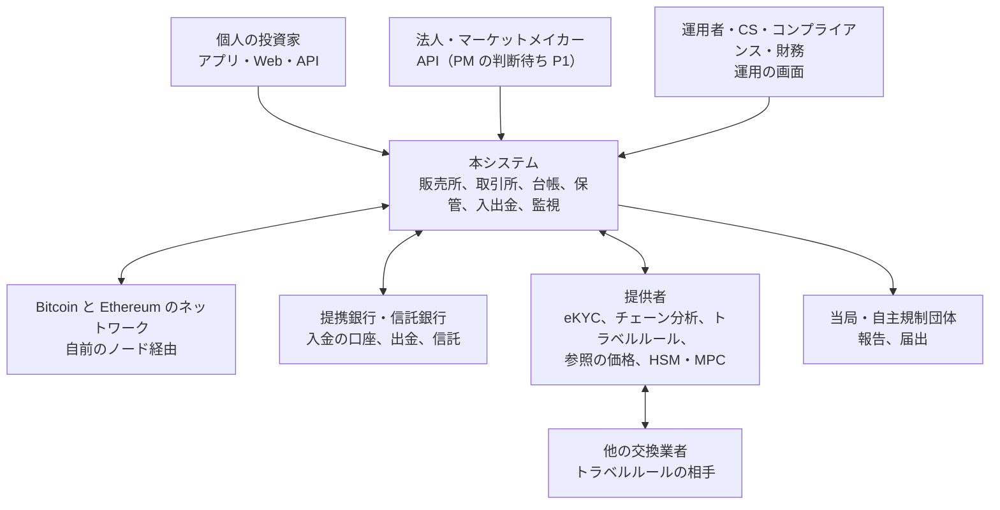
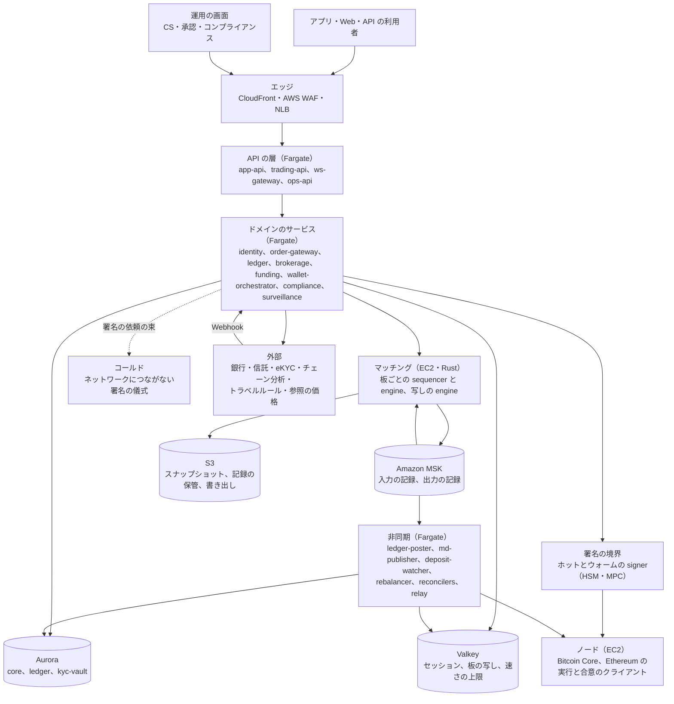
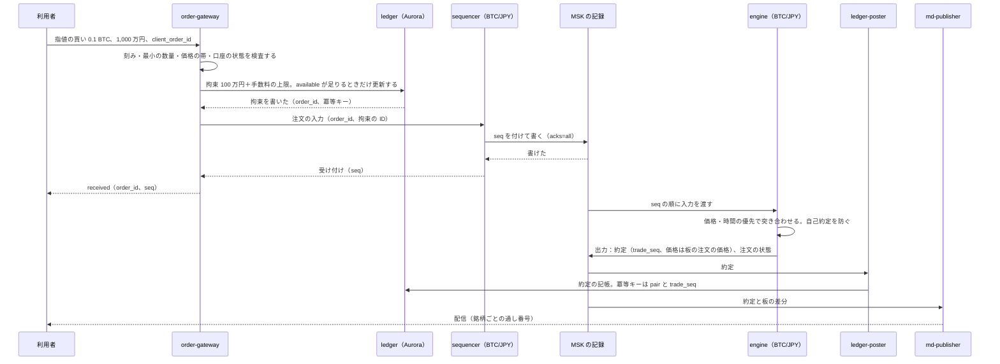
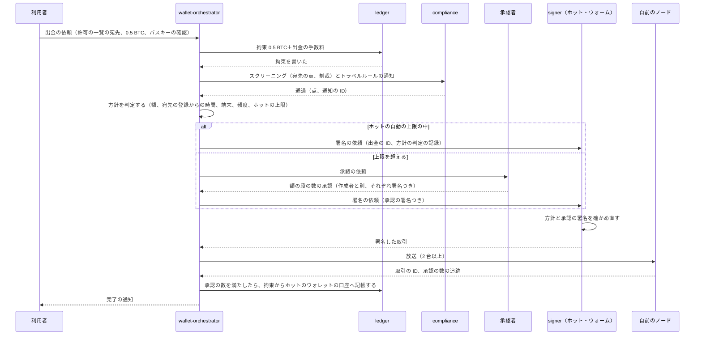
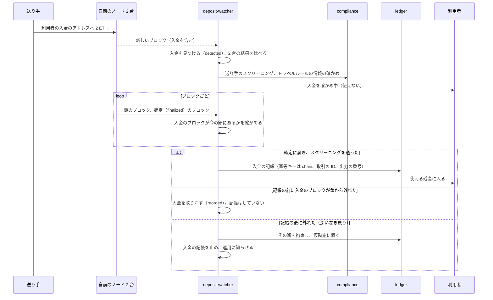

# Architecture: Coinbase

全体像と横断的な方針。領域ごとの設計は、同じディレクトリに領域ごとのファイルとして置く（一覧は 7 節。工程 2 で書く）。データモデルの正本は `data-model.md`（工程 4 で作る）、品質の戦略は [quality.md](../quality.md)、Epic と Story は [roadmap.md](../roadmap.md)、SLO と運用は [runbooks/](../runbooks/README.md) にある。用語は前提知識の資料の用語集に置く（工程 5 で作る）。

## 1. 全体構成

### 1.1 コンテキスト

本システムと、使う人・外部のシステムの関係。中身の部品は 1.2 節に描く。



### 1.2 コンテナ

主要なコンテナと、その間の呼び出し。大阪の DR の構成は infrastructure の領域で描く。



| コンテナ | 責務 |
| --- | --- |
| エッジ（CloudFront、AWS WAF、NLB） | TLS の終端、ボットと速さの上限、Web の静的な資産。板の配信の WebSocket と取引の API は NLB で受ける（遅れを減らす） |
| `app-api` | アプリと Web の入口。セッションの検証、`actor_id` の決定、画面ごとの集約。ドメインのサービスの公開の関数だけを呼ぶ |
| `trading-api` | 取引の REST の API（注文、取り消し、照会）。API キーの署名（`<Brand>-Signature`）の検証、キーごとの速さの上限 |
| `ws-gateway` | 板・約定・ローソク足の配信と、本人の注文と約定の通知の WebSocket。銘柄ごとの通し番号を付けて配る |
| `ops-api` | 運用の画面の入口。期限つきの権限、理由の入力、全操作の監査ログ（[Auth0 の ADR-0056](../../../auth0/docs/decisions/0056-operator-access.md) を引き継ぐ） |
| `identity` | 口座の開設、eKYC の提供者との連携と確認の状態、ログイン（パスキー、TOTP）、セッション、端末、API キー、退会（kyc-and-accounts の領域） |
| `order-gateway` | 注文の検査（刻み、最小の数量、価格の帯、口座の状態）、拘束の記帳、冪等、sequencer への送り（[ADR-0004](../decisions/0004-order-entry-holds-and-idempotency.md)） |
| `ledger` | 複式簿記の仕訳、口座と残高、拘束、冪等な記帳の API。ledger の Aurora に書くのはこのサービスだけ（[ADR-0005](../decisions/0005-ledger-balances-and-trade-settlement.md)） |
| `brokerage` | 販売所の価格の提示と受け入れ、在庫の上限、スプレッドの調整（[ADR-0010](../decisions/0010-brokerage-quotes-and-inventory.md)） |
| `funding` | 日本円の入出金（提携銀行のアダプター、利用者ごとの振込先の口座番号、出金の依頼）、信託の依頼（fiat-and-banking の領域） |
| `wallet-orchestrator` | 入金のアドレスの払い出し、出金の状態の管理、署名の依頼の組み立て、方針の判定、承認の集め、放送、ウォレットの間の移し替え（[ADR-0007](../decisions/0007-signing-service-and-key-custody.md)、[ADR-0008](../decisions/0008-withdrawal-pipeline-and-approvals.md)） |
| `compliance` | スクリーニング（制裁、チェーン分析）、トラベルルールの通知、取引の監視の規則、疑わしい取引の届出の案件（aml-and-travel-rule の領域） |
| `surveillance` | 板の入力と約定の記録から、見せ玉・仮装売買・相場操縦の兆しを見つけ、案件にする（market-surveillance の領域） |
| `sequencer`（板ごと） | 板の入力に通し番号と時刻を付け、MSK の入力の記録に書き、書けたら受け付けを返す（[ADR-0002](../decisions/0002-sequencer-and-event-journal.md)） |
| `engine`（板ごと） | 入力の記録を番号の順に読み、板を変え、約定と注文の状態を出力の記録に書く。決定的（[ADR-0003](../decisions/0003-matching-rules-and-self-trade-prevention.md)） |
| 写しの `engine` | 別の AZ で同じ入力を読み、出力の要約を本番と比べる。本番が止まったら引き継ぐ（[ADR-0002](../decisions/0002-sequencer-and-event-journal.md)） |
| MSK | 板ごとの入力の記録（1 つの区画）と出力の記録。3 AZ に写す。正本の記録は S3 にも移して長く持つ |
| `ledger-poster` | 出力の記録の約定と取り消しを、冪等キーで台帳に記帳する |
| `md-publisher` | 出力の記録から板の差分・約定・ローソク足を作り、Valkey の写しと `ws-gateway` に流す（market-data の領域） |
| `deposit-watcher` | 自前のノードから新しいブロックを読み、入金を見つけ、承認の数・確定を追い、巻き戻りを見つける（[ADR-0009](../decisions/0009-deposits-confirmations-and-own-nodes.md)） |
| `rebalancer` | ウォレットの段ごとの残高と目標を比べ、移し替えの依頼を作る（[ADR-0006](../decisions/0006-wallet-tiers-and-cold-ratio.md)） |
| `reconcilers` | 拘束と未約定の注文、台帳とウォレット（チェーン）、台帳と銀行・信託の照合 |
| `relay` | outbox を読み、SNS へ流す |
| 署名の境界 | ホット（自動、上限つき）とウォーム（人の承認）の signer。方針と承認を確かめ直してから署名する。別の AWS アカウントに置く（[ADR-0007](../decisions/0007-signing-service-and-key-custody.md)） |
| コールド | ネットワークにつながない機器と、複数の人と場所での署名の儀式。オンラインとは、署名の依頼と署名した取引の束（QR や記録媒体）だけでやり取りする |
| ノード | BTC と ETH のそれぞれ 2 台以上の自前のノード（別の AZ）。入金の確かめ、手数料の見積もり、放送 |
| Aurora core | 口座、本人確認の状態、注文の記録、出金と入金の状態、宛先の許可の一覧、販売所の提示、コンプライアンスの案件。FORCE RLS |
| Aurora ledger | 口座、仕訳、残高、拘束、照合の結果。`ledger` のサービスだけが書く |
| Aurora kyc-vault | 本人確認の書類の参照、氏名・住所・生年月日、口座の番号。封筒の暗号化。読む関数は監査の行を同じトランザクションで書く（[Workday の保管庫](../../../workday/docs/architecture/my-number-vault.md)の形） |
| Valkey | セッションの写し、板の写し（配信と販売所の参照）、速さの上限。失ってよい（正本にしない） |
| S3 | エンジンのスナップショット、入力・出力の記録の長期の保管、書き出し。大阪へ写す |

原則は 6 つ。

- **板の正本は、順序をつけた入力の記録である。** 板の状態は記録から作り直せる写しで、sequencer が番号を付けて記録に書けた入力だけが板を変える。スナップショットは早く戻るための手段で、正本ではない（[ADR-0002](../decisions/0002-sequencer-and-event-journal.md)）。
- **お金の正本は台帳で、板は台帳を書かない。** エンジンは約定を出力するだけで、残高に触れない。注文の前に台帳が拘束を書き、約定の後に台帳が約定を記帳する。2 つは冪等キーと照合でつなぐ（[ADR-0004](../decisions/0004-order-entry-holds-and-idempotency.md)、[ADR-0005](../decisions/0005-ledger-balances-and-trade-settlement.md)）。
- **鍵は方針の後ろに閉じる。** 署名の鍵は署名の境界の中にだけあり、境界は方針と承認を自分で確かめる。外から届く依頼を信じない（[ADR-0007](../decisions/0007-signing-service-and-key-custody.md)）。
- **ネットワークにつながる額を小さく保つ。** ホットは日々の出金に要る分だけにし、残りはコールドに置く。割合の上限は `legal.*` の値で持つ（[ADR-0006](../decisions/0006-wallet-tiers-and-cold-ratio.md)）。
- **チェーンは遅れ、巻き戻る。** 入金は閾値まで待ち、自前のノードで確かめる。出金は放送の後も確定まで追い、作り直しは前の取引が確定しえないと分かってからにする（[ADR-0008](../decisions/0008-withdrawal-pipeline-and-approvals.md)、[ADR-0009](../decisions/0009-deposits-confirmations-and-own-nodes.md)）。
- **法的に未決の値を、設定とデータの型で分けて持つ。** コールドの割合、信託の額、トラベルルールの対象、確認の方式は `legal.*` の値と、口座・状態の種類で持ち、法務の結論でコードを書き直さずに切り替える。

### 1.3 主要な流れ

**A. 取引所の注文から約定と記帳まで**

指値の買いの注文が、板にある売りの注文と約定し、台帳に記帳されるまで。拘束は sequencer の前、記帳はエンジンの後に置く。



1. `order-gateway` は、`(account_id, client_order_id)` の一意の制約で重複を止める。同じ値の再送には最初の結果を返す（[ADR-0004](../decisions/0004-order-entry-holds-and-idempotency.md)）。
2. 買いの指値は「数量 × 指値 ＋ テイカーの手数料の上限」を、売りは数量を拘束する。成行の買いは、金額の指定か、数量 × 価格の帯の上限で拘束する。拘束は ledger の Aurora の 1 つのトランザクションで、仕訳（`available` から `hold` へ）と注文の行を書く。
3. sequencer は板ごとに 1 つだけ動き（epoch で囲う）、入力に `seq` と時刻を付けて MSK の区画に書く。書けてから受け付けを返す。拘束を書いた後に sequencer へ届かなかった注文は、`reconcilers` が同じ `order_id` で送り直すか、取り消して拘束を戻す（[ADR-0002](../decisions/0002-sequencer-and-event-journal.md)）。
4. エンジンは、入力の番号の順に、価格の良い順・同じ価格なら `seq` の順に突き合わせる。約定の価格は板にあった注文の価格で、テイカーの指値との差は買い手の拘束に戻る。同じ利用者の注文がぶつかったら、自己約定の防止の指定で取り消す（[ADR-0003](../decisions/0003-matching-rules-and-self-trade-prevention.md)）。
5. `ledger-poster` は約定ごとに 1 つの仕訳を書く。買い手の `hold:JPY` から売り手の `available:JPY`（手数料を引く）、売り手の `hold:BTC` から買い手の `available:BTC`（手数料を引く）、手数料の収益。冪等キーは `(pair, trade_seq)` で、再実行しても 2 度書かない（[ADR-0005](../decisions/0005-ledger-balances-and-trade-settlement.md)）。
6. 約定から台帳の記帳まで p99 1 秒（NFR-005）。記帳の前の数量は、画面には「約定済み、反映中」と出し、出金にも次の注文にも使わせない。
7. 写しのエンジンは、同じ入力から出力の要約（ハッシュの連鎖）を作り、本番と入力の番号ごとに比べる。食い違ったら板を止める（NFR-003。[runbooks/market-halt.md](../runbooks/market-halt.md)）。

**B. 暗号資産の出金（承認と署名）**

許可の一覧の宛先への BTC の出金が、スクリーニング、方針、承認、署名、放送、確定を通るまで。



1. 宛先は、登録から 24 時間（既定。PM の判断待ち P4）を過ぎた許可の一覧の中にだけ置ける。登録と変更は、パスキーの確認とメールの知らせを要する（[ADR-0008](../decisions/0008-withdrawal-pipeline-and-approvals.md)）。
2. スクリーニングを通らない出金（制裁の一致、チェーン分析の点が閾値を超える、トラベルルールの通知を送れない相手）は、`compliance_review` に止め、コンプライアンスの担当が判断する。止めた間も拘束は戻さない（法務の L5・L6）。
3. 方針は `wallet-orchestrator` と署名の境界の両方で判定する。境界の中の判定は、承認者の署名、方針のバージョン、出金の ID の一回性（同じ出金の ID に 2 度署名しない）を確かめる（[ADR-0007](../decisions/0007-signing-service-and-key-custody.md)）。
4. 結果が分からない放送は作り直さない。BTC は同じ入力の取引だけ（手数料の引き上げ）、ETH は同じ nonce の取引だけを、新しく作ってよい（[ADR-0008](../decisions/0008-withdrawal-pipeline-and-approvals.md)）。
5. 出金の依頼から放送まで、ホットで払えるものは p95 30 分（承認の待ちを除く。NFR-008）。ホットの残高が足りない大きな出金は、ウォームからの補充か、コールドの儀式の後になる（最長 24 時間を目安にする）。

**C. 暗号資産の入金（承認の数と巻き戻り）**

利用者ごとの入金のアドレスに届いた ETH が、確定を待って残高に入るまで。巻き戻りの経路も含む。



1. BTC は 3 承認で記帳し、6 承認で出金に使えるようにする。ETH は合意のクライアントの「確定（finalized）」のブロックに入ったら記帳する（本システムの値。本家の値は**未検証**。[ADR-0009](../decisions/0009-deposits-confirmations-and-own-nodes.md)）。
2. 記帳は、自前のノード 2 台が同じブロックの ID と入金を返したときだけ行う。食い違えば記帳を止める。外部の提供者の結果は、ノードの遅れと分かれの見張りにだけ使う。
3. 記帳の後の巻き戻りは、閾値の選び方からまれである。起きたら、その額を拘束して仮勘定に置き、その資産の入金の記帳を止め、[runbooks/chain-reorg.md](../runbooks/chain-reorg.md) に従う。
4. ETH の入金のアドレスから利用者用のホットのウォレットへの集め直し（sweep）は、記帳とは別の内部の移し替えとして、`rebalancer` の依頼で行う（方式は `eth-deposit-sweep-poc`）。

**D. 販売所の購入**

1. 利用者が「0.01 BTC を買う」を押すと、`brokerage` は板の写しと参照の価格からスプレッドを足した価格を、期限（既定 10 秒）つきの提示（`quote_id`）として返す（[ADR-0010](../decisions/0010-brokerage-quotes-and-inventory.md)）。
2. 利用者が期限の中で受け入れると、`brokerage` は ledger の 1 つのトランザクションで、利用者の日本円と本システムの在庫の口座（`house_inventory:BTC`）の間の仕訳を書く。提示を 2 度使えないよう、`quote_id` を冪等キーにする。
3. 販売所の取引は板を通らない。本システムの在庫が上限に近づくと、提示のスプレッドを広げ、上限で提示を止める。在庫のヘッジは MVP で持たない（PM の判断待ち P3、法務の L7）。

**E. 日本円の入金と出金**

1. 利用者ごとに、提携銀行の振込先の口座番号（仮想の口座の番号）を払い出す。銀行の着金の通知（API）を受け、口座番号から利用者を決め、名義の照合（振込の依頼人の名義と、本人確認の氏名のカナ）を通ったら記帳する。名義の違う振込は記帳せず、組戻しの手続きに回す（fiat-and-banking の領域）。
2. 出金は本人の名義の口座にだけ送る。拘束 → 提携銀行の API への依頼（冪等の依頼の番号）→ 結果の照会 → 記帳。結果が分からないときは依頼し直さず、照会で確かめる（[Stripe の ADR-0018](../../../stripe/docs/decisions/0018-payout-execution-via-banking-partner.md) の形）。
3. 利用者の日本円の残高の合計を、毎営業日、信託の額と比べ、足りない分の信託を依頼する（計算は法務の L3）。

### 1.4 本家の形（確かめたこと）

| 項目 | 本家 | 出典 |
| --- | --- | --- |
| 板と約定の優先 | Coinbase Exchange の板は連続の先着順で、受け付けた順に価格・時間の優先で約定する | [Exchange Matching Engine](https://docs.cdp.coinbase.com/exchange/concepts/matching-engine) |
| 約定の価格 | 板にあった注文の価格で約定する（テイカーの価格ではない） | 同上 |
| 自己約定の防止 | 同じ利用者の注文は約定しない。テイカーの指定が優先し、`dc`（既定）・`co`・`cn`・`cb` を選べる | 同上 |
| 注文の状態 | `received`（エンジンに届いた）→ `open`（残りが板にある）→ `done`（約定し終えたか、取り消された） | 同上 |
| 配信の通し番号 | 銘柄ごとに増える整数。抜けは取りこぼし、小さい番号は順序の入れ替わり。板の同期には `level2` の経路を勧める | [Exchange WebSocket Feed](https://docs.cdp.coinbase.com/exchange/websocket-feed/overview) |
| 日本の事業 | 2023 年 1 月に止めると発表した（報道でだけ確かめた） | [Bloomberg](https://www.bloomberg.com/news/articles/2023-01-18/coinbase-stops-japan-operations-after-slump-in-digital-assets)、[CNBC](https://www.cnbc.com/2023/01/18/crypto-exchange-coinbase-says-it-will-halt-japan-operations-.html) |
| サポートの委託先からの漏えい | 2025 年 5 月、米国の外のサポートの委託先の担当者が買収され、利用者のデータを持ち出した。鍵とウォレットには触れられなかった | [Help Net Security](https://www.helpnetsecurity.com/2025/05/15/coinbase-suffers-data-breach-gets-extorted/)（届出の本文は**未検証**） |
| マッチングエンジンの実装、言語、配置、遅れの値 | 公式の資料で確かめられなかった | **未検証** |
| コールドの割合、鍵の保管の方式、出金の承認の段、入金の承認の数 | 公式の資料で確かめられなかった | **未検証** |
| 預かり資産の額、取引高 | 二次の資料でだけ見つけた | **未検証** |

いずれも 2026-11-15 に確認。この設計は振る舞いを参考にするが、本家のコード・データ・ライブラリは使わない（[リポジトリ共通の ADR-0007](../../../../docs/decisions/0007-no-reuse-of-original-implementation.md)）。

**本家との意図した違い**：

| 項目 | 本家 | 本システム | 理由・根拠 |
| --- | --- | --- | --- |
| 自己約定の防止の既定 | `dc`（小さいほうを取り消し、大きいほうを減らす） | 既定は新しいほうの取り消し（`cancel_newest`）。`cancel_oldest`・`cancel_both`・`decrement` も選べる | 利用者に最も予想しやすい。板にある注文の時間の優先を壊さない（[ADR-0003](../decisions/0003-matching-rules-and-self-trade-prevention.md)） |
| 販売所 | 本家の簡単な売買の画面の価格の作り方は**未検証** | 板の写しと参照の価格にスプレッドを足した期限つきの提示。板を通らない | 日本の販売所の形にする（[ADR-0010](../decisions/0010-brokerage-quotes-and-inventory.md)。法務の L8） |
| 扱う資産 | 多数の暗号資産とトークン | BTC と ETH 本体だけ | MVP の範囲（intent） |
| ヘッダーと API キーの名前 | 本家の名前を含む | `<Brand>-Signature`、`<brand>_live_` | リポジトリ共通の ADR-0006 |
| サポートの担当の参照 | 委託先の担当者が利用者のデータを広く引けた（報道） | CS の画面は問い合わせに要る項目だけを出し、本人確認の書類と口座の番号は金庫の画面で、期限つきの権限と理由でだけ見る | 本家の 2025 年の事故（security の領域） |
| データの所在 | 国ごとに**未検証** | すべて日本（東京、DR は大阪） | 日本の交換業者にする |

## 2. 規模の段階

| 段階 | 稼働の口座 | 預かりの暗号資産（円換算） | 預かりの日本円 | 板 | 板の入力（注文と取り消し）の最大 | 約定の最大 | 配信の接続 | 暗号資産の入出金 | 構成 |
| --- | --- | --- | --- | --- | --- | --- | --- | --- | --- |
| S1（MVP） | 30 万 | 1,500 億円 | 150 億円 | 2（BTC/JPY、ETH/JPY） | 3,000 件/秒（全体）、平均 100 件/秒 | 300 件/秒、30 万件/日 | 2 万 | 入金 5,000 件/日、出金 4,000 件/日 | 東京の 3 AZ。板ごとに sequencer と engine を 1 組、写しの engine を別の AZ に 1 つ。MSK 3 ブローカー。Aurora は core・ledger・kyc-vault。ノードは BTC・ETH とも 2 台。大阪に Aurora Global Database、S3 の写し、待機のノード |
| S2 | 150 万 | 7,500 億円 | 750 億円 | 10（銘柄の追加の後） | 3 万件/秒 | 3,000 件/秒 | 10 万 | 入金 3 万件/日、出金 2 万件/日 | 板を EC2 の組に分けて置く（1 台に数板）。ledger の熱い口座をスロットに分ける（[Stripe の ADR-0016](../../../stripe/docs/decisions/0016-hot-accounts-and-ledger-sharding.md)）。配信を銘柄ごとの組に分ける |
| S3 | 500 万 | 2.5 兆円 | 2,500 億円 | 50 | 10 万件/秒 | 1 万件/秒 | 50 万 | 入金 10 万件/日、出金 7 万件/日 | 熱い板は専用の EC2。ledger を口座の持ち主のハッシュで分ける。入力の記録の方式を見直す（[ADR-0002](../decisions/0002-sequencer-and-event-journal.md) の `decide_after`） |

- 数値は本システムの想定である。国内の会員の合計は、2025 年 2 月に稼働の口座 約 740 万、預かりの暗号資産 約 3.49 兆円、金銭等 約 2,931 億円、現物の取引高 約 1.92 兆円/月だった（[intent.md](../intent.md) の出典）。1 口座あたりの預かりの暗号資産は約 47 万円になる。S1 は稼働の口座の約 4% と見込み、1 口座 50 万円として 1,500 億円にした。S3 は市場の大きな部分（稼働の口座の約 7 割）を取ったときの上の限りで、達する見込みではない。
- 預かりの日本円は、会員の合計の比（金銭等 ÷ 暗号資産 ≒ 8%）から、暗号資産の 1 割と置いた。
- 約定の数：S1 の取引高を市場の 4%（約 770 億円/月、約 25 億円/日）と置き、1 約定の平均を 1 万円（マーケットメイカーの小さな約定が多い）と見て、約 25 万件/日。余裕を見て 30 万件/日にした。最大は、相場の急変の 1 分の平均を、普段の平均（約 3.5 件/秒）の 85 倍ほどと置いた 300 件/秒。
- 板の入力：注文と取り消しは、約定の 30 倍と見込む（マーケットメイカーは注文を出しては取り消す）。平均は 30 万 × 30 ÷ 86,400 ≒ 104 件/秒。最大は急変の時の 30 倍で 3,000 件/秒。1 つの板の sequencer と engine は、最大の全部を 1 つの板が受けても足りるように作る（`engine-latency-poc` で確かめる）。
- 入出金は、稼働の口座の 2〜3% が 1 日に 1 回入金か出金すると見込んだ。日本円の入出金は暗号資産と同じほどの数と見込む（fiat-and-banking の領域で確かめる）。
- ホットとウォームの合計は、利用者の暗号資産の `legal.hot_ratio_max`（翻訳の資料の 5%。法務の L2）を超えない。S1 で最大 75 億円になる。本システムは、ホットの自動の署名で使える額を、それより小さい目標（既定は利用者の暗号資産の 1%、S1 で 15 億円）に置く。侵害の時の損失の上限を決めるのはこの値である（[ADR-0006](../decisions/0006-wallet-tiers-and-cold-ratio.md)）。

### 2.1 費用のモデル

約定 1 件、出金 1 件、稼働の口座 1 つの月あたりの原価を、次の和で見る。単価は capacity の領域で、AWS の東京の公開の価格と提供者の見積もりから入れる。

```
約定あたりの原価 = 板の入力（sequencer、MSK の書き込みと写し、engine と写しの engine の EC2）× 約定あたりの入力の数（約 30）
               ＋ 記帳（Aurora ledger の仕訳 1 件、拘束の解放）
               ＋ 配信（md-publisher、ws-gateway の転送）
出金あたりの原価 = 署名（HSM・MPC の提供者の料金、署名の境界の部品）
               ＋ スクリーニング（チェーン分析の照会の料金）＋ トラベルルールの通知の料金
               ＋ チェーンの手数料（利用者から受ける出金の手数料との差は本システムが持つ）
               ＋ 承認の人の時間（上限を超える出金だけ）
口座あたりの月の原価 = 本人確認（eKYC の 1 回の料金を口座の寿命で割る）＋ 監視（取引の監視、制裁の照合）
                     ＋ 台帳と明細の保管 ＋ 通知 ＋ CS の人の時間
固定の原価 = ノード（BTC・ETH の各 2 台と大阪の待機。大きなディスク）＋ HSM・MPC の固定の料金
           ＋ コールドの儀式の場所と人 ＋ 外部の監査とペンテスト
```

- 最も大きいのは、固定の原価（ノード、HSM・MPC、コールドの儀式、監査）と、出金あたりの提供者の料金、CS とコンプライアンスの人の時間と見込む。約定あたりの原価は、入力の数（マーケットメイカーの注文と取り消し）に比例し、速さの上限の段とメイカーの手数料が主な制御の手段になる。
- S1 の本番の AWS の費用は、月 約 8 万 USD（±50%。本システムの見積もりで、単価は**未検証**）と置く。提供者の料金（HSM・MPC、eKYC、チェーン分析、トラベルルール）は選定の後に capacity の領域で入れる。目標は、約定あたりの基盤の原価（提供者を除く）を、テイカーの手数料の既定（約定の額の 0.1%。本システムの値）の 1 割以下に置くことである。

## 3. 非機能要件

| ID | 項目 | S1 の目標 | 備考 |
| --- | --- | --- | --- |
| NFR-001 | 注文の受け付けの速さ | `trading-api` が注文を受けてから、入力の記録に書けた受け付けを返すまで p99 20ms・p50 5ms（東京の中、拘束の記帳を含む）。取り消しも同じ | [ADR-0002](../decisions/0002-sequencer-and-event-journal.md)、[ADR-0004](../decisions/0004-order-entry-holds-and-idempotency.md)。`engine-latency-poc` で確かめる |
| NFR-002 | 板の配信の速さ | 入力の記録への書き込みから、配信の接続への送り出しまで p99 50ms。エンジンの 1 入力の処理 p99 100µs | market-data の領域 |
| NFR-003 | エンジンの決定性 | 同じスナップショットと入力の列から、出力の要約が一致しない件数 0。本番と写しのエンジンの要約の食い違い 0。日次の全部の再生で食い違い 0 | [ADR-0002](../decisions/0002-sequencer-and-event-journal.md)、[ADR-0003](../decisions/0003-matching-rules-and-self-trade-prevention.md) |
| NFR-004 | 残高の二重の使用なし | 使える残高が負になった件数 0。拘束の和と、未約定の注文・手続き中の出金・受け入れた提示の必要額の和の違い 0（5 分ごとの照合）。DB のフェイルオーバー、MSK の障害のときも 0 | [ADR-0004](../decisions/0004-order-entry-holds-and-idempotency.md) |
| NFR-005 | 台帳の正しさと約定の反映 | 釣り合わない仕訳 0。約定から台帳の記帳まで p99 1 秒。約定の記帳の重複 0、欠け（出力の記録にあって台帳にない約定）が 1 分を超える件数 0 | [ADR-0005](../decisions/0005-ledger-balances-and-trade-settlement.md) |
| NFR-006 | 照合 | 台帳と利用者用のウォレット（チェーン）の照合を、ホットとウォームは 1 時間ごと、コールドは毎日。台帳と銀行・信託の照合を毎営業日。説明のつかない差を翌営業日に 0 にする（仮勘定に置き、期限で人が確かめる） | segregation-and-reconciliation の領域 |
| NFR-007 | ネットワークにつながる額 | ホットとウォームの利用者の暗号資産の割合が `legal.hot_ratio_max` を超える時間 0（10 分ごとに計る）。ホットの自動の署名で使える額は、既定で利用者の暗号資産の 1% まで | [ADR-0006](../decisions/0006-wallet-tiers-and-cold-ratio.md)。法務の L2 |
| NFR-008 | 出金 | 二重の出金 0。許可の一覧の外の宛先への出金 0。ホットで払える出金の依頼から放送まで p95 30 分（承認の待ちを除く）。上限を超える出金は 24 時間以内（営業日） | [ADR-0008](../decisions/0008-withdrawal-pipeline-and-approvals.md) |
| NFR-009 | 入金 | 閾値（BTC 3 承認、ETH の確定）に届いてから記帳まで p95 5 分。巻き戻りで消えた入金が使われた件数 0 | [ADR-0009](../decisions/0009-deposits-confirmations-and-own-nodes.md) |
| NFR-010 | 可用性 | 取引所（注文と取り消し）と販売所 月間 99.95%、板の配信 月間 99.95%、入出金の受け付け 月間 99.9%、運用の画面 月間 99.5%。予定した板の停止（銘柄の設定の変更）は数えない | 本家の SLA は確かめなかった（**未検証**） |
| NFR-011 | 耐久性と復旧 | 受け付けを返した注文・取り消しの消失 0（AZ の障害を含む）。AZ の障害で、板の再開まで RTO 5 分（写しのエンジンへの切り替え）。リージョンの障害で、板は止めてから大阪で再開する RTO 4 時間、台帳の RPO 1 分（Aurora Global Database）、入力の記録の RPO は写しの遅れ（目標 1 秒）で、失った入力は利用者に取り消しとして知らせる | infrastructure の領域、[ADR-0002](../decisions/0002-sequencer-and-event-journal.md) |
| NFR-012 | 自己約定 | 同じ利用者（同じ口座、同じ法人の口座の組）の売りと買いの約定 0 | [ADR-0003](../decisions/0003-matching-rules-and-self-trade-prevention.md) |
| NFR-013 | 公正さ | sequencer の番号の順と違う順でエンジンが処理した入力 0。特定の利用者だけの速い経路 0（どの入口も同じ sequencer を通る） | [ADR-0002](../decisions/0002-sequencer-and-event-journal.md) |
| NFR-014 | 鍵と署名 | 1 人で署名できる経路 0。方針の外の署名 0。署名の境界の外での鍵の材料の平文 0 | [ADR-0007](../decisions/0007-signing-service-and-key-custody.md) |
| NFR-015 | スクリーニング | スクリーニングとトラベルルールの判定のない出金の署名 0。スクリーニングのない入金の記帳 0（提供者の障害の間は記帳を止める） | aml-and-travel-rule の領域。法務の L5・L6 |
| NFR-016 | 個人のデータ | 本人確認の書類・口座の番号が金庫の外（ログ、CS の画面、分析の基盤）に出た事象 0。運用者の参照は全件が監査の行を持つ | kyc-and-accounts、security の各領域 |

## 4. 技術スタック

| 層 | 選んだもの | 理由 | エージェントにとっての理由 |
| --- | --- | --- | --- |
| 言語（サービス） | TypeScript（Hono＋Zod）。ドメインごとのパッケージを持つ 1 つのコードベースを、入口・Worker ごとのサービスとして出す | 他の題材と同じ（[ADR-0001](../decisions/0001-platform-and-stack.md)） | 題材をまたいで、エージェントと人が同じ道具で検証できる。マイクロサービスは、小さなチームとエージェントには重い |
| 言語（マッチング） | Rust。`engine-core`（I/O のない純粋な crate）、`sequencer`、`engine-host` | GC の停止がなく、遅れの裾を抑えられる。所有権でデータの競合を型で止め、検査つきの整数の演算で桁あふれを止める（[ADR-0001](../decisions/0001-platform-and-stack.md)） | コンパイルが遅く、修正の往復が増える（Uber の題材が Go を選んだ理由）。代わりに、核を小さな純粋な crate に閉じ、性質ベーステスト（proptest）と再生の比べで誤りを機械で落とす。Rust のタスクを eval に入れる |
| 実行基盤（マッチング） | ECS on EC2（計算の最適化の型の専用のインスタンス、板ごとに CPU を固定）。写しは別の AZ | Fargate では CPU の固定と遅れの裾を制御できない（[ADR-0001](../decisions/0001-platform-and-stack.md)） | ECS のタスクの定義と Terraform は他の題材と同じ道具で書ける |
| 入力と出力の記録 | Amazon MSK（板ごとの区画、`acks=all`、`min.insync.replicas=2`、冪等の producer）。S3 に長く移す | 順序と耐久性を汎用の管理のサービスで持つ。順序をつけるのは自前の sequencer（[ADR-0002](../decisions/0002-sequencer-and-event-journal.md)） | 手元と CI で Testcontainers の Kafka を使える。自前の複製の記録（Raft）は、エージェントが書くには誤りが見つけにくい |
| DB | Aurora PostgreSQL 18。core・ledger・kyc-vault の 3 クラスタ。FORCE RLS と `SET LOCAL`、ID は UUIDv7、transactional outbox、金額は `numeric(38,0)` | [ADR-0001](../decisions/0001-platform-and-stack.md)、[ADR-0005](../decisions/0005-ledger-balances-and-trade-settlement.md) | 拘束と仕訳の釣り合いを DB の制約で持てる。エージェントの書き忘れを DB が落とす |
| キャッシュ | ElastiCache Valkey | 他の題材と同じ。失ってよい部品 | 題材をまたいで同じ道具で検証できる |
| 非同期 | outbox → SNS・SQS（ドメインの事象）。板の出力は MSK を直接読む | 他の題材と同じ | 同上 |
| 署名 | 署名の境界を別の AWS アカウントに置き、ホットとウォームは HSM か MPC の提供者、コールドはネットワークにつながない機器。方式は `custody-signing-poc` で選ぶ | [ADR-0007](../decisions/0007-signing-service-and-key-custody.md) | 方針の判定を純粋な関数と決定表にし、表駆動のテストで全行を確かめる。署名の鍵にはエージェントも開発の環境も触れない |
| ノード | Bitcoin Core、Ethereum の実行のクライアントと合意のクライアント（種類は `node-ops-poc` で選ぶ）。EC2 と大きな NVMe | 合意の規則を自前で書かない（[ADR-0009](../decisions/0009-deposits-confirmations-and-own-nodes.md)） | regtest と開発用のチェーンを手元と CI で動かせ、チェーンの巻き戻りを試験で作れる |
| エッジ | CloudFront、AWS WAF（Bot Control）、NLB（取引の API と WebSocket） | 他の題材と同じ。取引の経路は遅れを減らす | 題材をまたいで同じ道具で検証できる |
| 外部 | 提携銀行・信託銀行、eKYC、チェーン分析、トラベルルールの通知、参照の価格の提供者。どれもアダプターの後ろ | [ADR-0011](../decisions/0011-external-providers-boundary.md) | アダプターの契約を模型（シミュレーター）にし、エージェントが提供者なしで端から端まで試せる |
| アプリ | iOS・Android は React Native（TypeScript）、Web は React | 他の題材（メルカリ、X、Uber）と同じ形 | ネイティブの 2 つのコードベースは、小さなチームとエージェントに重い |
| IaC | Terraform | infrastructure の領域 | 題材をまたいで同じ道具で検証できる |
| 可観測性 | OpenTelemetry（ADOT）→ CloudWatch・AMP・Managed Grafana | observability の領域 | 同上 |
| フラグ | AWS AppConfig（`release.*`、`ops.*`、`legal.*`） | 他の題材と同じ | 同上 |
| テスト | Vitest・fast-check、Rust の proptest と再生の道具（`engine-replay`）、自前の参照の実装（`engine-ref`：素直な板、`ledger-ref`）、Testcontainers（PostgreSQL 18、Valkey、Kafka）、bitcoind の regtest、Ethereum の開発用のチェーン、`chain-sim`・`bank-sim`・`screening-sim`、k6 と自前の注文の負荷の生成器、Playwright・Maestro | [quality.md](../quality.md) | 正しさを、実装と別の参照・再生・シミュレーターで判定するので、エージェントが自分のテストに合わせて誤りを隠せない |

## 5. 主な決定

どれも `proposed`（2026-11-15。人の承認を待つ）。0001〜0011 は最初の設計の起票で、下の表に置く。領域ごとの ADR は、7 節の番号の範囲で起票する。

| ADR | 決定 |
| --- | --- |
| [0001](../decisions/0001-platform-and-stack.md) | 共通の基盤を引き継ぎ、サービスは TypeScript の 1 つのコードベースで出す。マッチングの部品だけを Rust で書き、ECS on EC2 に置く。Aurora は core・ledger・kyc-vault の 3 クラスタ |
| [0002](../decisions/0002-sequencer-and-event-journal.md) | 板ごとに 1 つの sequencer が入力に通し番号と時刻を付け、MSK に書けてから受け付ける。エンジンは記録から作り直せる写しで、スナップショットと再生で戻り、写しのエンジンの要約で決定性を常に確かめる |
| [0003](../decisions/0003-matching-rules-and-self-trade-prevention.md) | 価格・時間の優先、板の注文の価格での約定、MVP の注文の種類、価格の帯、刻みと最小の数量、自己約定の防止（既定は新しいほうの取り消し）、板の状態（取引中・取り消しだけ・停止） |
| [0004](../decisions/0004-order-entry-holds-and-idempotency.md) | 注文は sequencer の前に台帳で拘束を書き、`client_order_id` で冪等にする。拘束と注文の残りを照合で常に合わせ、届かなかった注文は送り直すか取り消す |
| [0005](../decisions/0005-ledger-balances-and-trade-settlement.md) | Stripe とメルカリの台帳を引き継ぎ、資産ごとの釣り合い、`available`・`hold` の口座、約定ごとに 1 回の記帳、利用者の財産と本システムの財産の口座の分け、日本円の信託との照合を足す |
| [0006](../decisions/0006-wallet-tiers-and-cold-ratio.md) | ウォレットをホット・ウォーム・コールドの 3 段にし、ネットワークにつながる額の上限を `legal.*` の値で持ち、`rebalancer` が 10 分ごとに目標へ寄せる。履行保証暗号資産は別のコールドのウォレットに置く |
| [0007](../decisions/0007-signing-service-and-key-custody.md) | 署名の方針と依頼の流れを自前で作り、鍵は別のアカウントの署名の境界に閉じる。境界の中で方針と承認を確かめ直す。HSM・MPC・チェーンの上の複数署名の選定は PoC の後に決める |
| [0008](../decisions/0008-withdrawal-pipeline-and-approvals.md) | 出金をステートマシンにし、拘束 → スクリーニング → 方針 → 額による承認 → 署名 → 放送 → 確定の順に進める。宛先は許可の一覧だけ。結果が分からない取引は作り直さない |
| [0009](../decisions/0009-deposits-confirmations-and-own-nodes.md) | 入金は利用者ごとのアドレスで受け、自前のノード 2 台で確かめ、BTC は 3 承認、ETH は確定で記帳する。記帳の後の巻き戻りは拘束と仮勘定で扱う。ノードは汎用のクライアントを使う |
| [0010](../decisions/0010-brokerage-quotes-and-inventory.md) | 販売所は板を通らない期限つきの提示にし、受け入れを台帳の 1 つのトランザクションで記帳する。在庫は上限とスプレッドの広げで持ち、MVP ではヘッジしない |
| [0011](../decisions/0011-external-providers-boundary.md) | eKYC、銀行・信託、チェーン分析、トラベルルール、参照の価格の提供者はアダプターの後ろに置き、判定と状態は自前で持つ。提供者の障害の間は、入出金を止める側に倒す |

リポジトリ共通の決定（開発プロセス、ブランチモデル、本家の名前・接頭辞を使わない規則の [ADR-0006](../../../../docs/decisions/0006-brand-neutral-identifiers.md)、本家の実装を核に使わない規則の [ADR-0007](../../../../docs/decisions/0007-no-reuse-of-original-implementation.md)）は、ルートの [docs/decisions/](../../../../docs/decisions/README.md) にある。

関係する他の題材の設計（参照するだけで、設計し直さない）：

| 題材 | 参照するもの |
| --- | --- |
| Stripe | 複式簿記の台帳（[ADR-0003](../../../stripe/docs/decisions/0003-double-entry-ledger.md)）、冪等（[ADR-0004](../../../stripe/docs/decisions/0004-idempotency.md)）、熱い口座の分け方（[ADR-0016](../../../stripe/docs/decisions/0016-hot-accounts-and-ledger-sharding.md)）、3 者の照合と仮勘定（[ADR-0017](../../../stripe/docs/decisions/0017-three-way-reconciliation-with-suspense.md)）、提携銀行での振込（[ADR-0018](../../../stripe/docs/decisions/0018-payout-execution-via-banking-partner.md)）、封筒の暗号化と鍵の階層（[ADR-0019](../../../stripe/docs/decisions/0019-vault-encryption-and-key-hierarchy.md)） |
| メルカリ | 預かりの台帳と一回の振り替え（[ADR-0003](../../../mercari/docs/decisions/0003-escrow-and-double-entry-ledger.md)）、法的に未決の型を `legal.*` で持つ形 |
| Auth0 | 運用者の期限つきの権限と、エージェントが本番に経路を持たないこと（[ADR-0056](../../../auth0/docs/decisions/0056-operator-access.md)） |
| Workday | 本人確認の書類の保管庫の形（[my-number-vault.md](../../../workday/docs/architecture/my-number-vault.md)） |
| Uber | 熱い経路を別の言語で書く判断と、その言語の数の上限（[ADR-0001](../../../uber/docs/decisions/0001-platform-and-stack.md)） |
| Figma | 1 つの書き手が通し番号を付け、記録に書いてから確定する形（[architecture/README.md](../../../figma/docs/architecture/README.md) の 2 節） |

## 6. リスクと未解決事項

品質の面のリスクの順位と対策は [quality.md](../quality.md) の 1 節にある。ここは設計の面のリスクを書く。

- **ホットのウォレットの侵害**：署名の鍵、署名の境界、方針の判定の誤り、承認者の乗っ取りで、ネットワークにつながる資産が流れ出る。2024 年 5 月の国内の流出の例がある。ホットの額の上限、境界の中での方針の確かめ直し、承認者の端末の鍵、出金の速さの上限、異常の時の全出金の停止で、損失をホットの上限の中に閉じる（[ADR-0006](../decisions/0006-wallet-tiers-and-cold-ratio.md)、[ADR-0007](../decisions/0007-signing-service-and-key-custody.md)、[runbooks/hot-wallet-compromise.md](../runbooks/hot-wallet-compromise.md)）。
- **内部の者による持ち出し**：運用者・委託先の担当者が、利用者のデータや承認の権限を悪用する。本家の 2025 年の事故がこの形である。常設の権限を持たせず、参照の範囲を絞り、2 人の承認と監査で抑える（security の領域）。
- **エンジンの非決定性**：ハッシュの順序、浮動小数点、時計、スレッド、ライブラリの更新で、再生の結果が本番と違う。`engine-core` を純粋な crate に閉じ、写しのエンジンの要約の比べと日次の再生で見つける（[ADR-0002](../decisions/0002-sequencer-and-event-journal.md)）。
- **拘束と板の食い違い**：拘束を書いた後に sequencer に届かない注文、エンジンが取り消したのに拘束が戻らない注文。照合（5 分ごと）と、`order_id` での送り直しで抑える（[ADR-0004](../decisions/0004-order-entry-holds-and-idempotency.md)）。
- **sequencer の二重化**：切り替えの時に 2 つの sequencer が同じ板に書く。epoch の囲い（MSK のトランザクションの producer の fencing）と、エンジンでの番号の連続の検査で、古い書き手の入力を捨てる。
- **チェーンの巻き戻りと分かれ**：深い巻き戻り、ノードの分かれ、ノードの遅れ。閾値、2 台の比べ、外部の見張り、記帳の停止で抑える（[ADR-0009](../decisions/0009-deposits-confirmations-and-own-nodes.md)）。
- **出金の取り違え**：宛先の書き換え（利用者の端末のマルウェア）、詰まった取引の作り直しによる二重の出金。許可の一覧と待ち時間、取引の作り直しの規則で抑える（[ADR-0008](../decisions/0008-withdrawal-pipeline-and-approvals.md)）。
- **不公正取引**：見せ玉、仮装売買、相場操縦、内部の者の取引。監視の規則と、役職員の取引の制限で抑える（法務の L7）。
- **法令の移行**：開業の前後に、資金決済法から金融商品取引法への移行が施行される。業の名前、報告、資本の規律が変わる（法務の L1）。法令の言葉と値を `legal.*` と規則の表に集め、コードの書き直しを減らす。
- **提供者への依存**：HSM・MPC、eKYC、チェーン分析、トラベルルールの提供者の障害・終了。アダプターの契約と、障害の間に止める側に倒す既定で抑える。外部への委託の管理は法務の L13。

### 残る未解決事項（2026-11-15）

| 項目 | いつ・どう決めるか |
| --- | --- |
| 法務の確認待ち（L1〜L14） | [intent.md](../intent.md) の「法務の確認待ち」。結論まで、そこに挙げた Story の spec を承認しない |
| PM の判断待ち（P1〜P4：法人の口座、API キーの出金の権限、販売所のヘッジ、宛先の待ち時間） | [intent.md](../intent.md) の「PM の判断待ち」。E2・E7・E11 の spec の前 |
| MSK の `acks=all` の p99 と、エンジンの処理の速さ、写しのエンジンの遅れ | E9 の前の `engine-latency-poc`。NFR-001 を満たさなければ、入力の記録の方式を見直す ADR を書く |
| 鍵の保管と署名の方式（HSM・MPC・チェーンの上の複数署名）と提供者 | E6 の前の `custody-signing-poc`（[ADR-0007](../decisions/0007-signing-service-and-key-custody.md)） |
| ETH の入金のアドレスの方式と集め直しの費用 | E5 の前の `eth-deposit-sweep-poc` |
| ノードのクライアントの種類と運用 | E5 の前の `node-ops-poc` |
| ホットの自動の署名の上限（既定 1%）、承認の段の額 | custody-and-keys・withdrawals の領域。財務・Ops・コンプライアンスと合意 |
| 費用の実績（単価は**未検証**） | E16 の `cost-baseline` |
| 本家の振る舞いで未確認のもの（エンジンの実装、コールドの割合、承認の数、出金の承認の段） | 公式の資料で確かめられなかった。本システムの値を使う |

決めた経緯（工程ごとの「決定」の記録）は、工程 3 から `design-log.md` に書く。

## 7. 領域の文書

工程 2 で、下の表の 1 行ごとに 1 つの文書を書く。領域の担当は、下の表の番号の範囲の中で ADR を採番する（範囲の外に出るときは、この表を先に更新する）。持ち主は、どれも Dev が書き、「レビュー」の列のロールが確認する。

| ファイル | 範囲 | ADR | レビュー | 関わる Epic |
| --- | --- | --- | --- | --- |
| `matching-engine.md` | `engine-core` の板の型、注文の種類と期限、約定の規則、自己約定の防止、価格の帯、板の状態（取引中・取り消しだけ・停止）、銘柄の設定、スナップショットの形、再生の道具、写しのエンジンと切り替え | 0012–0016 | QA | E9 |
| `order-entry-and-risk.md` | 注文の検査、拘束の額の計算（指値・成行・手数料の上限）、冪等、sequencer への送りと送り直し、速さの上限の段（個人・API・マーケットメイカー）、口座の状態による止め、注文の照会 | 0017–0020 | QA | E8 |
| `market-data.md` | 板の差分と全体、約定、ローソク足、配信の通し番号と取りこぼしの回復、`ws-gateway` の接続と上限、日々の売買高の公表（法務の L1） | 0021–0023 | QA、Ops | E10 |
| `brokerage-quotes.md` | 販売所の価格の作り方（板の写し、参照の価格、スプレッド）、提示の期限、受け入れの記帳、在庫の上限、在庫の調整（法務の L7・L8）、表示 | 0024–0026 | QA、法務 | E11 |
| `ledger-and-balances.md` | 勘定科目（資産ごと、利用者・本システム・ウォレット・仮勘定）、仕訳の型、拘束、約定の記帳、手数料の表と端数、明細と年間の報告書（法務の L10）、相続・差押え（法務の L14） | 0027–0030 | QA、財務、法務 | E4 |
| `segregation-and-reconciliation.md` | 台帳とチェーン（ウォレットの段ごと）、台帳と銀行・信託、拘束と注文の照合、仮勘定、日本円の信託の額の計算（法務の L3）、分別管理の日次の報告（法務の L2） | 0031–0033 | QA、財務、法務 | E13 |
| `custody-and-keys.md` | ウォレットの段と上限、鍵の作成と儀式、鍵の材料の分け方と場所、署名の境界、方針の言語と決定表、承認者の鍵、移し替え（`rebalancer`）、履行保証暗号資産（法務の L2）、提供者の選定（法務の L13） | 0034–0038 | セキュリティ、財務、法務 | E6 |
| `deposits.md` | 入金のアドレスの払い出し（BTC の導出、ETH の方式）、入金の状態、閾値、巻き戻りの扱い、集め直し、入金のスクリーニングとトラベルルールの情報（法務の L5） | 0039–0041 | QA、セキュリティ | E5 |
| `withdrawals.md` | 出金のステートマシン、宛先の許可の一覧と待ち時間、出金の手数料の表と手数料の見積もり、方針と承認の段、取引の作り直しの規則、詰まった取引、利用者への説明（法務の L12） | 0042–0045 | QA、セキュリティ、法務 | E7 |
| `chain-nodes-and-confirmations.md` | ノードの構成と台数、クライアントの選定、同期と更新、2 台の比べ、外部の見張り、頭と確定の追跡、手数料の見積もり、放送 | 0046–0048 | Ops、セキュリティ | E5 |
| `fiat-and-banking.md` | 提携銀行のアダプター、利用者ごとの振込先の口座番号、名義の照合、組戻し、出金の依頼と結果、信託銀行との連携（法務の L3）、銀行の営業日 | 0049–0051 | QA、財務、法務 | E3 |
| `kyc-and-accounts.md` | 口座の開設、eKYC の方式と状態（法務の L4）、再確認、法人の口座（PM の判断待ち P1）、ログインと端末、API キー、`kyc-vault`、退会と保持（法務の L11）、未成年（法務の L12） | 0052–0054 | セキュリティ、法務 | E2 |
| `aml-and-travel-rule.md` | 制裁の照合、チェーン分析のスクリーニングと閾値、取引の監視の規則、疑わしい取引の届出の案件（法務の L4・L6）、トラベルルールの通知と受け取り（法務の L5）、提供者の障害の時の既定 | 0055–0058 | QA、コンプライアンス、法務 | E12 |
| `market-surveillance.md` | 板の入力と約定の記録からの兆しの検出（見せ玉、仮装売買、相場操縦、価格の急変）、案件と調べ、役職員の取引の制限、インサイダー取引の規制への備え（法務の L7） | 0059–0061 | コンプライアンス、法務 | E14 |
| `regulatory-compliance-japan.md` | 法令の枠組みと移行（法務の L1）、当局と自主規制団体への報告、`legal.*` の値の一覧と変更の手順、税の書類（法務の L10）、システムのリスクと外部への委託（法務の L13）、自主規制の規則（法務の L9） | 0062–0064 | 法務、コンプライアンス | E15 |
| `security.md` | 脅威モデル（ウォレット、承認者、内部の者、利用者の乗っ取り、宛先の書き換え）、アカウントの分け方、運用者の期限つきの権限と監査、CS の画面の参照の範囲、個人のデータの扱い、漏えいの対応 | 0065–0067 | セキュリティ | E1、E16 |
| `observability.md` | ログ・メトリクス・トレース、SLI の計測（受け付け、配信、記帳、照合、ウォレットの割合）、正しさの見張り（要約の比べ、照合）、外からの見張り、秘密を含まない計測の型 | 0068–0069 | Ops | E1、E16 |
| `capacity.md` | 負荷のモデル（相場の急変、マーケットメイカーの入力、入出金の山）、部品ごとの必要量、費用のモデルと単価、負荷試験 | 0070 | Ops | E16 |
| `infrastructure.md` | AWS のアカウントとネットワーク、マッチングの EC2 の配置、MSK、3 つの Aurora、ノード、署名の境界のアカウント、egress（銀行・提供者・ノードの P2P）、DR（大阪）と板の再開、段階を上げる基準 | 0071–0073 | Ops、セキュリティ | E1、E16 |
| `delivery.md` | CI/CD、段階のデプロイ（エンジンは板の停止の時間に入れ替える）、スキーマの変更、フラグ（`release.*`・`ops.*`・`legal.*`）、署名の方針と規則の表の出し方、アプリのリリース | 0074–0075 | QA、Ops | E1、E16 |
| `data-model.md`・`data-model/` | データモデルの正本（工程 4） | なし（各領域の ADR を参照する） | QA | 全 Epic |
| `design-log.md` | 設計の工程ごとの「決定」の記録（工程 3 から） | なし | なし | なし |

- 範囲の空きは、領域の工程の後で 5 節に書く。次に採番する ADR は、各領域の範囲の最初の番号である。
- 範囲を決めたときに、既存の `decisions/` に 0012 以降の番号がないことを確かめた（2026-11-15）。

## 8. Epic

Epic と Story の計画は [roadmap.md](../roadmap.md) にある（PM が持つ）。E1〜E16 が MVP（S1）。各 Epic の品質の重点と合否基準は [quality.md](../quality.md) の 5 節にある。

| Epic | 目的 |
| --- | --- |
| E1 | 基盤：AWS・Terraform・CI（TypeScript と Rust）、3 つの Aurora と RLS、outbox、フラグ、監査ログ、運用の画面の骨格、署名の境界のアカウント、大阪の骨格 |
| E2 | アカウントと本人確認：口座の開設、eKYC、ログイン、端末、API キー、`kyc-vault`、退会 |
| E3 | 日本円の入出金と信託：提携銀行、振込先の口座番号、名義の照合、出金、信託の依頼 |
| E4 | 台帳と残高：勘定科目、仕訳、拘束、約定の記帳、手数料、明細と報告書 |
| E5 | チェーンのノードと入金：ノード、入金のアドレス、承認の数と確定、巻き戻り、集め直し |
| E6 | 保管と署名：ウォレットの段、署名の境界、方針、承認者の鍵、鍵の儀式、`rebalancer`、履行保証暗号資産 |
| E7 | 暗号資産の出金：宛先の許可の一覧、出金のステートマシン、承認の段、放送と追跡、手数料 |
| E8 | 注文の受付とリスクの確認：注文の検査、拘束、冪等、送り直し、速さの上限 |
| E9 | マッチングエンジンと sequencer：`engine-core`、sequencer、MSK の記録、スナップショットと再生、写しのエンジン、板の停止と再開 |
| E10 | 板の配信と API：REST と WebSocket、板の差分、約定、ローソク足、通し番号 |
| E11 | 販売所：価格の提示、受け入れ、在庫の上限、表示 |
| E12 | AML とトラベルルール：スクリーニング、制裁、取引の監視、届出の案件、トラベルルールの通知 |
| E13 | 分別管理と照合：台帳とチェーン・銀行・信託の照合、仮勘定、日次の報告 |
| E14 | 不公正取引の監視：兆しの検出、案件、役職員の取引の制限 |
| E15 | 法令の対応と報告：法令の移行、当局・自主規制団体への報告、税の書類、`legal.*` の手順 |
| E16 | 本番の準備と GA の判定：負荷試験（相場の急変）、DR の訓練（板の再開）、鍵の儀式の監査、外部のペンテスト |
| E17 以降（MVP の後） | 銘柄の追加とトークン、積立、法人の大口の取引と外部でのヘッジ、板寄せでの再開、貸借 |
