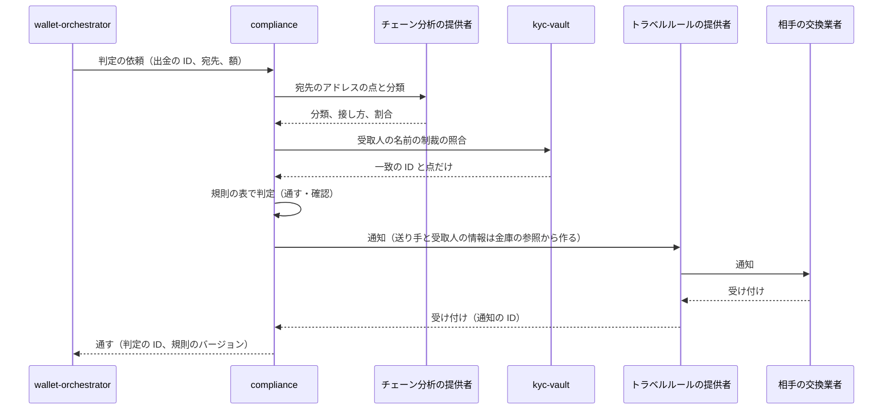
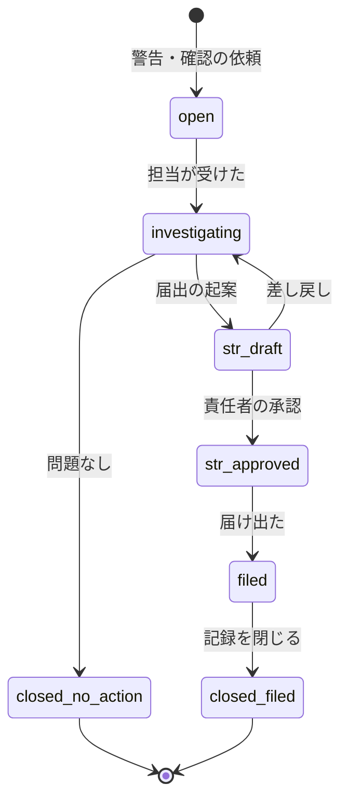

# AML and travel rule: Coinbase

マネー・ローンダリングの対策（AML）とトラベルルールを決める。チェーン分析のスクリーニングと規則の表、制裁の一覧との照合、トラベルルールの通知と受け取り、取引の監視の規則、疑わしい取引の届出の案件、提供者の障害の時の扱いを扱う。法令の当てはめはどれも法務の確認待ち（L4・L5・L6・L11）で、この文書は枠組みと既定の案だけを書く。

前提となる決定は次のとおり。

- 提供者（チェーン分析、トラベルルールの通知）はアダプターの後ろに置き、点と分類を入力にして、判定と状態は自前の規則で持つ。障害の間は止める側に倒す（[ADR-0011](../decisions/0011-external-providers-boundary.md)）
- 出金はスクリーニングとトラベルルールの判定を通らなければ署名しない。通らない出金は `compliance_review` に止め、止めた間も拘束を戻さない（[ADR-0008](../decisions/0008-withdrawal-pipeline-and-approvals.md)、[architecture/README.md](README.md) の 1.3 節 B）
- 入金はスクリーニングを通らなければ記帳しない（[ADR-0009](../decisions/0009-deposits-confirmations-and-own-nodes.md)、[ADR-0039](../decisions/0039-deposit-state-machine-and-withdrawal-lock.md)）
- 規則の表は宣言の形で、影の評価と承認を通して出す。Mercari の題材の規則のエンジン（[ADR-0051](../../../mercari/docs/decisions/0051-rules-engine-declarative-tables.md)）と審査の待ち行列（[ADR-0052](../../../mercari/docs/decisions/0052-review-cases-queues-and-appeals.md)）を引き継ぎ、設計し直さない
- 氏名・住所・生年月日は `kyc-vault` にだけ置く（[Workday の保管庫](../../../workday/docs/architecture/my-number-vault.md)の形）。運用者の参照は期限つきの権限で行う（[Auth0 の ADR-0056](../../../auth0/docs/decisions/0056-operator-access.md)）

この文書で決めたことは次の ADR にある。

| ADR | 決定 |
| --- | --- |
| [0055](../decisions/0055-screening-rule-table-and-human-reject.md) | スクリーニングは、チェーン分析の分類・接し方・割合と制裁の一致を、バージョンつきの規則の表に当てて「通す」「確認」「優先の確認」を出す。拒む・凍結するのは人だけ。規則の変更は影の評価とコンプライアンスの 2 人の承認を通す |
| [0056](../decisions/0056-sanctions-name-matching-inside-vault.md) | 制裁の一覧との名前の照合は、`kyc-vault` の中の関数で行い、外には一致の ID と点だけを出す。一覧は毎日取り込み、更新ごとに全利用者を 24 時間以内に照らし直す |
| [0057](../decisions/0057-travel-rule-notification-and-receipt.md) | 出金のトラベルルールは、宛先の登録の時に相手と受取人を受け、署名の前に通知して相手の受け付けを待つ。届かない・拒まれた出金は `compliance_review`。入金は相手の通知を取引に結び付け、通知のない交換業者からの入金は 24 時間待って保留にする |
| [0058](../decisions/0058-transaction-monitoring-and-str-cases.md) | 取引の監視は、宣言の規則を事象ごとと日次で評価し、警告を案件にまとめる。疑わしい取引の届出は、担当の起案と責任者の承認の 2 人で行う。利用者と CS に調べの存在を出さない |

## 1. 範囲

- 扱う：
  - チェーン分析のスクリーニング（入金の送り手、出金の宛先、宛先の登録）と規則の表
  - 制裁の一覧（氏名とアドレス）との照合、一覧の取り込み
  - トラベルルールの通知（出金）と受け取り（入金）、相手の交換業者の一覧、受け取りの側の問い合わせへの応答
  - 取引の監視の規則、警告、案件、疑わしい取引の届出の起案と承認
  - `compliance_review` の待ち行列と画面、判断の記録
  - 提供者の障害の時の扱いの細部
- 扱わない：
  - 取引時確認（本人確認の方式と水準）、高リスクの利用者の再確認の手続き（kyc-and-accounts の領域。この領域は規則の入力として確認の水準とリスクの区分を読む）
  - 不公正取引の監視（market-surveillance の領域）
  - 当局への定期の報告の様式（regulatory-compliance-japan の領域）
  - 出金と入金の状態の遷移そのもの（withdrawals、deposits の各領域）

## 2. 要件

| 要件 | 目標 | NFR・intent |
| --- | --- | --- |
| 判定のない署名 0 | スクリーニングとトラベルルールの判定のない出金の署名 0 | NFR-015、K5 |
| 判定のない記帳 0 | スクリーニングのない入金の記帳 0。提供者の障害の間は記帳を止める | NFR-015 |
| 判定の速さ | 提供者が応答する間、スクリーニングの依頼から判定まで p95 10 秒。トラベルルールの通知の受け付けまで p95 10 分 | NFR-008（出金の p95 30 分の中に入れる） |
| 確認の待ち | `compliance_review` の判断まで、営業時間の中で 4 時間（目標。コンプライアンスの体制と合意する） | NFR-008（承認の待ちと同じく出金の速さの外） |
| 制裁の一覧 | 一覧の更新から全利用者の照らし直しまで 24 時間以内 | 法務の L6 |
| 個人のデータ | 氏名・住所・生年月日・トラベルルールの相手の情報が金庫の外（ログ、分析、CS の画面）に出た事象 0 | NFR-016 |
| 記録 | 判定ごとに、提供者の応答、規則のバージョン、判断した人を残す。保存の期間は法務の確認待ち（L4・L11） | ADR-0011 |

## 3. 本家の形（確かめたこと）

| 項目 | 本家 | 出典（確認日） |
| --- | --- | --- |
| トラベルルールの国の出金の宛先 | トラベルルールの国の利用者は、アドレス帳の宛先にだけ出金でき、トラベルルールの情報はアドレス帳から取る | [Exchange: Travel Rule for Withdrawals](https://docs.cdp.coinbase.com/exchange/travel-rule/withdrawals)（2026-11-15） |
| 欠けた情報 | 必要な項目が欠けた出金の依頼は誤りで返し、欠けた項目の名前を返す | 同上 |
| 項目 | 送り手の氏名・住所・口座、受取人の氏名・住所、本人の宛先か（`is_self`）、ウォレットの種類（自分で管理するか交換業者か） | 同上 |
| 国ごとの違い | 国ごとに要る項目が違う。例：カナダは 999 カナダドル以上の交換業者への送金で受取人の氏名と住所。欧州の国の一部は自分で管理するウォレットへの 1,000 ユーロを超える送金で所有の確かめ。米国は追加の項目が要らない | [Coinbase App: Travel Rule](https://docs.cdp.coinbase.com/coinbase-app/transfer-apis/travel-rule)（2026-11-15） |
| 日本での扱い、入金の側の扱い | 本家は日本の事業を止めており、確かめた文書に入金の側の扱いはない | **未検証** |
| チェーン分析の提供者と閾値、取引の監視の規則 | 公式の資料で確かめられなかった | **未検証** |

- 本家の数値（999 カナダドル、1,000 ユーロ）は国ごとの法令の値で、本システムの値に使わない。日本の対象と閾値は法務の確認待ち（L5）。
- 本家と同じく、宛先の登録の時にトラベルルールの情報を受ける形にした（[ADR-0008](../decisions/0008-withdrawal-pipeline-and-approvals.md)）。本家との意図した違いはない。

## 4. 全体の流れ

`compliance` のサービスが、入金・出金・宛先の登録の判定の依頼を受ける。規則は `packages/compliance-rules` にだけ書く（[roadmap.md](../roadmap.md) の前書き）。

- 判定の結果は `screening_results` に、提供者の応答の元の形は `provider_responses` に残す（[ADR-0011](../decisions/0011-external-providers-boundary.md)）。
- 出金のステートマシンの `screening` は、この判定が「通す」なら `policy` へ、「確認」「優先の確認」なら `compliance_review` へ進む（[ADR-0008](../decisions/0008-withdrawal-pipeline-and-approvals.md)）。規則は直接 `rejected` にしない。

## 5. スクリーニングの規則の表（[ADR-0055](../decisions/0055-screening-rule-table-and-human-reject.md)）

### 5.1 入力

| 入力 | 中身 |
| --- | --- |
| 方向 | 入金（送り手）、出金（宛先）、宛先の登録 |
| 分類 | チェーン分析の提供者の分類を、自前の分類に写したもの：`sanctions`、`stolen_funds`、`ransomware`、`darknet_market`、`scam`、`mixer`、`gambling`、`exchange`、`unknown` |
| 接し方 | `direct`（アドレスそのもの）、`indirect`（数段前の資金の出どころ） |
| 割合 | 間接の接し方の、資金の中の割合（%） |
| 額 | 円換算（参照の価格） |
| 制裁の一致 | 6 節の照合の結果（なし、候補、一致） |
| 利用者のリスクの区分 | kyc-and-accounts の領域の区分（低・中・高） |

### 5.2 規則の表（DT-AML-SCR。最初の束の既定の案）

値はどれも本システムの案で、コンプライアンスの承認と法務の L6 の確認の後に有効にする。上の行から順に当て、最初に当たった行の結果を使う。

| # | 方向 | 条件 | 結果 | 待ち行列 |
| --- | --- | --- | --- | --- |
| 1 | どれも | 制裁の一致（氏名かアドレス） | 優先の確認 | 制裁 |
| 2 | どれも | `sanctions` に `direct` | 優先の確認 | 制裁 |
| 3 | どれも | `sanctions` に `indirect` で割合 1% 以上 | 確認 | 制裁 |
| 4 | どれも | `stolen_funds`・`ransomware`・`darknet_market` に `direct` | 優先の確認 | 高い危険 |
| 5 | どれも | 同じ分類に `indirect` で割合 10% 以上 | 確認 | 高い危険 |
| 6 | どれも | `mixer` に `direct`、または `indirect` で割合 25% 以上 | 確認 | 高い危険 |
| 7 | 出金 | `scam` に `direct` | 確認 | 詐欺の疑い（利用者の被害の防止） |
| 8 | どれも | 制裁の候補（点が中間） | 確認 | 制裁 |
| 9 | どれも | 利用者のリスクの区分が高く、額が 100 万円以上 | 確認 | 高い危険 |
| 10 | どれも | `gambling` に `direct` | 通す（取引の監視の信号を出す） | — |
| 11 | どれも | 上のどれにも当たらない | 通す | — |

- 結果は「通す」「確認」「優先の確認」の 3 つだけ。「拒む」「凍結」は、`compliance_review` で担当が選ぶ（ADR-0055）。
- 優先の確認は、営業時間の外も当番のコンプライアンスの担当を呼ぶ。
- 宛先の登録で「確認」になった宛先は、担当が通すまで許可の一覧に入れない（待ち時間はその後に始まる）。
- 入金の「確認」「優先の確認」は、入金を `review_hold` にする（[deposits.md](deposits.md) の 5 節）。

### 5.3 規則の変更

- 規則の表は `screening_rule_versions` にバージョンつきで置き、Mercari の題材の形で、影の評価（直近 30 日の判定を新しい表で計算し直し、結果の違いの件数を出す）を通す（[Mercari の ADR-0051](../../../mercari/docs/decisions/0051-rules-engine-declarative-tables.md)）。
- 有効にするのは、コンプライアンスの責任者と、もう 1 人のコンプライアンスの担当の 2 人の承認の後。Dev とエージェントは表の案と影の評価の結果を作れるが、承認しない。
- 判定は、そのときのバージョンを `screening_results` に書く。入金は閾値の時点でバージョンを確かめ直す（[deposits.md](deposits.md) の 8 節）。

### 5.4 遡りの照らし直し

チェーン分析の提供者は、後からアドレスの分類を更新する（盗まれた資金だと後で分かる）。

- 毎日、直近 90 日の入金の送り手と、許可の一覧の全宛先を、提供者に照らし直す。結果が変わったものは、取引の監視の警告にする（8 節）。記帳済みの入金を自動で取り消さない。
- 許可の一覧の宛先が「確認」以上になったら、その宛先を `suspended` にし、出金に使えなくする（利用者には「宛先の確認中」と出す）。

## 6. 制裁の照合（[ADR-0056](../decisions/0056-sanctions-name-matching-inside-vault.md)）

### 6.1 一覧

| 一覧 | 取り込み | 使い方 |
| --- | --- | --- |
| 外為法の資産凍結等の対象者（氏名、生年月日、国籍、住所） | 毎日、公表の元から取り込む。どの一覧を対象にするかは法務の確認待ち（L6） | 利用者、トラベルルールの相手（送り手・受取人）の氏名 |
| 制裁の対象のアドレス | チェーン分析の提供者の `sanctions` の分類 | 5 節の規則の 2・3 行 |

- 取り込みは、一覧の hash と公表の日付で `sanctions_list_versions` に記録する。取り込みが 24 時間成功しなければチケット、48 時間で page（古い一覧で照合を続ける）。

### 6.2 名前の照合

- 照合は `kyc-vault` の中の関数 `screenNames()` で行う。氏名（漢字、カナ、ローマ字）を正規化し、一覧の名前と比べ、生年月日と国籍で絞る。外に返すのは、一致の候補の ID、点、一覧のバージョンだけ。
- 照合の時：口座の開設（kyc-and-accounts の領域が呼ぶ）、一覧の更新（差分を全利用者に。24 時間以内）、トラベルルールの相手の情報の受け取りと送り。
- 点が高い一致は「一致」、中間は「候補」（5 節の規則の 1・8 行）。閾値はコンプライアンスが影の評価と承認で決める。
- 「一致」が確かめられたら、担当がその口座を凍結の状態にする（全部の取引・入出金を止める。kyc-and-accounts の領域の口座の状態）。凍結の操作と解除は 2 人の承認。当局への報告と資産の扱いは法務の確認待ち（L6）。

## 7. トラベルルール（[ADR-0057](../decisions/0057-travel-rule-notification-and-receipt.md)）

### 7.1 出金

| 宛先の種類（登録の時に受ける） | 通知 | 通らないとき |
| --- | --- | --- |
| 国内・国外の交換業者（相手の一覧から選ぶ） | 署名の前に提供者経由で通知し、相手の受け付けを最大 10 分待つ | 相手が提供者の網にいない、拒んだ、10 分で返らない → `compliance_review` |
| 自分で管理するウォレット（本人の） | 通知しない。本人の宛先であることを記録する。所有の確かめ（署名の文、少額の送金）を求めるかは `legal.travel_rule_self_hosted_proof`（法務の確認待ち L5） | — |
| 自分で管理するウォレット（他人の） | 通知しない。受取人の氏名と国を記録する。送ってよいかは法務の確認待ち（L5）。既定は `compliance_review` | `compliance_review` |
| 種類の食い違い（利用者は自分のウォレットと申告し、チェーン分析は交換業者と分類） | — | `compliance_review` |

- 通知の対象の額は `legal.travel_rule_threshold_jpy`。法務の結論（L5）まで、既定は 0 円（全件を対象にする）。
- 通知の項目は、送り手（利用者）の氏名・住所または生年月日・口座の ID、受取人の氏名、宛先のアドレス、額。項目の正式な一覧は法務の確認待ち（L5）。送る情報は `kyc-vault` の参照から通知の直前に組み立て、本体の DB に平文で残さない。
- 相手の交換業者の一覧（`counterparty_vasps`）は、提供者の名簿から取り込み、国内の登録の有無をコンプライアンスが確かめて印を付ける。

### 7.2 入金

- 相手の交換業者からの通知を、取引の ID（なければ宛先のアドレスと額、72 時間以内）で入金に結び付ける。
- 受取人の名前を `screenNames()` と同じ金庫の中の関数で利用者の氏名と比べ、一致すれば受け付け、違えば拒み、`review_hold` の理由にする。
- 送り手がチェーン分析で交換業者と分類されるのに通知がない入金は、閾値から 24 時間まで待ち、その後 `review_hold`（[ADR-0039](../decisions/0039-deposit-state-machine-and-withdrawal-lock.md)）。待つ時間と扱いは法務の確認待ち（L5）。
- 送り手が自分で管理するウォレットの入金は、利用者に送り手の種類（自分のウォレットか、他人か）を画面で尋ねる。答えのない入金の扱いは法務の確認待ち（L5）。既定は 7 日で `review_hold`。
- 相手の交換業者が送る前に問い合わせる「このアドレスは貴社の利用者のものか、受取人の名前は合うか」には、はい・いいえだけを返す。アドレスの持ち主の情報を返さない。

## 8. 取引の監視と届出（[ADR-0058](../decisions/0058-transaction-monitoring-and-str-cases.md)）

### 8.1 規則（最初の束の既定の案）

規則の形は Mercari の題材の宣言の規則（[ADR-0051](../../../mercari/docs/decisions/0051-rules-engine-declarative-tables.md)）を使う。値はコンプライアンスの承認と法務の L4 の確認の後に有効にする。

| ID | 規則 | 評価 |
| --- | --- | --- |
| TM-01 | 入金の記帳から 24 時間以内に、売買をせずに入金の 90% 以上を出金した | 事象ごと |
| TM-02 | 口座の開設から 30 日以内に、日本円の入金の合計が 200 万円以上 | 事象ごと |
| TM-03 | 7 日の間に、同じくらいの額（±10%）の出金を 5 回以上 | 日次 |
| TM-04 | 高い危険の分類（5 節の 4〜6 行）に接した入金の、90 日の累計が 100 万円以上 | 日次 |
| TM-05 | 5 つ以上の口座から、同じ宛先のアドレスへの出金 | 日次 |
| TM-06 | ログインの国が、申告の住所の国と違う日が 7 日の間に 3 日以上 | 日次 |
| TM-07 | 30 日の取引の額が、本人確認の時の申告（年収、取引の目的）に比べて大きい（比はコンプライアンスが決める） | 日次 |
| TM-08 | 5.4 節の遡りの照らし直しで、記帳済みの入金の分類が変わった | 日次 |

- 事象ごとの規則は、台帳と入出金の outbox の事象（入金の記帳、出金の依頼、日本円の入出金、約定）を読む。p95 1 分で警告を出す。
- 警告は、同じ口座の 30 日の中の警告を 1 つの案件にまとめる（[Mercari の ADR-0052](../../../mercari/docs/decisions/0052-review-cases-queues-and-appeals.md) の待ち行列の形）。
- 警告の多さ：S1 で、稼働の口座の 0.1% に月 1 件と置き、月 300 件の案件を見込む（本システムの見込み。運用の後に直す）。

### 8.2 案件と届出

- 届出の起案（担当）と承認（コンプライアンスの責任者）は別の人にする。届け出る手段、期限、記載の項目は法務の確認待ち（L4）。
- 調べの間に口座の取引を制限するか（出金だけ止める、全部止める）は、担当が案件ごとに選び、2 人の承認で効かせる。
- 案件の存在と届出の有無を、利用者に知らせない。CS の画面には「コンプライアンスの確認中」の印だけを、CS の役割にも理由を出さずに出す。利用者への説明の文言は法務の確認の後に決める。
- 案件の記録（警告、判断、届出の控え）の保存の期間は法務の確認待ち（L4・L11）。

## 9. 提供者の障害

[ADR-0011](../decisions/0011-external-providers-boundary.md) の既定に、次の細部を足す。

| 提供者 | 障害の間 | 回復の後 |
| --- | --- | --- |
| チェーン分析 | 入金の記帳と出金の署名を止める（`screening` のまま待つ）。宛先の登録も待たせる。取引所と販売所は止めない | 待ちの依頼を古い順に判定し直す。判定の速さの SLI から障害の時間を分けて数える |
| トラベルルール | 交換業者の宛先への出金を `screening` のまま待たせる。自分で管理するウォレットへの出金と入金の記帳は止めない（入金の通知は後から結び付ける） | 送れなかった通知を送り直す |
| 制裁の一覧の取り込み | 古い一覧で照合を続ける。24 時間でチケット、48 時間で page | 差分を全利用者に照らす |

- 障害の間に前の判定の結果を使い回さない（同じ宛先でも、出金ごとに判定する）。
- 提供者の障害の手順は計画の runbook（`provider-outage.md`）に書く。

## 10. 例

### 10.1 出金：0.2 BTC を国内の交換業者へ

利用者 C が、許可の一覧の宛先（国内の交換業者 X の自分の口座、受取人は C 本人）へ 0.2 BTC（参照の価格 1,500 万円で 300 万円）を出金する。

1. 13:00:00 `held` → `screening`。`compliance` がチェーン分析に宛先を照会する（13:00:02 応答。分類 `exchange`、`direct`）。受取人の名前（C）の制裁の照合はなし。規則の表の 11 行で「通す」。
2. 額 300 万円は `legal.travel_rule_threshold_jpy`（既定 0 円）以上なので、13:00:03 に X へ通知する。13:00:41 に X が受け付けを返す（受取人の名前が X の利用者と一致）。
3. 13:00:42 に `policy` へ。額は 100 万円を超え 1,000 万円まで（ADR-0008 の段）なので、運用者 1 人の承認に回る。
4. 別の日に、C が同じ宛先へ 0.1 BTC を出金したが、X が提供者の網から一時的に外れていた。10 分で受け付けが返らず、`compliance_review` に入った。担当は 13:40 に X の復帰を確かめ、通知を送り直して受け付けを得てから通した。

### 10.2 入金：盗まれた資金に間接で接する 0.4 ETH

1. 利用者 D の入金 0.4 ETH が `confirming` になる。チェーン分析は `stolen_funds` に `indirect` で割合 12% と返す。規則の 5 行で「確認」。
2. 確定に届き、`review_hold` にする。D の画面は「入金を確認中」。
3. 担当が 2 時間後に、資金の流れ（盗まれた資金から 4 段離れ、間に大きな交換業者を挟む）を確かめ、通す。`credited` になる。判断の理由と規則のバージョンを案件に残す。
4. TM-04 の累計（90 日）に 0.4 ETH の円換算が加わる。

## 11. 上限

| 項目 | 値（S1） |
| --- | --- |
| スクリーニングの依頼 | 入金 5,000 件/日、出金 4,000 件/日、宛先の登録、遡りの照らし直し（直近 90 日の入金の送り手と全宛先を毎日） |
| 判定の速さ | p95 10 秒（提供者の応答を含む） |
| トラベルルールの通知の待ち | 最大 10 分 |
| `compliance_review` の量 | 出金・入金の 1% と見込み、約 90 件/日（本システムの見込み） |
| 制裁の照らし直し | 30 万口座を 24 時間以内 |

## 12. セキュリティ

- 氏名・住所・生年月日・トラベルルールの相手の情報は `kyc-vault` に置き、照合と通知の組み立ては金庫の中の関数で行う。本体には参照と一致の ID だけを残す。
- `compliance_review` と案件の画面は、コンプライアンスの役割だけが期限つきの権限で開き、閲覧ごとに監査の行を書く（[Auth0 の ADR-0056](../../../auth0/docs/decisions/0056-operator-access.md)）。
- 判断（通す・拒む・凍結・届出）は、理由のコード、自由記述、判断した人、規則のバージョンを書いてから効く。
- ログには判定の ID、結果、規則のバージョン、理由のコードだけを書く。アドレスと利用者の ID を同じ行に書かない（AGENTS.md）。
- 提供者へ送る情報は、契約の項目に限る。外国にある提供者への提供は法務の確認待ち（L11）。

## 13. テスト

- **DT-AML-SCR**：5.2 節の規則の表の全行と、行の順の優先（上の行が勝つ）。
- **DT-AML-TR**：7.1 節の宛先の種類と通知の結果の全行。
- **PROP-AML-001**：判定が「通す」でない出金の `policy` への遷移 0。規則による `rejected` 0（拒むのは人だけ）。
- **PROP-AML-002**：チェーン分析の障害の注入の間の出金の署名 0、入金の記帳 0。
- **PROP-AML-003**：トラベルルールの対象の出金で、相手の受け付けのない署名 0。
- **PROP-AML-004**：金庫の外の記録（ログ、本体の DB、事象）に氏名・住所・生年月日が出ない（生成した個人のデータでの検査）。
- **PROP-AML-005**：規則の表の影の評価と本番の評価は、同じ入力に同じ結果を返す（同じバージョンのとき）。
- 契約の試験：`screening-sim`・`travel-rule-sim` と提供者の実装（[ADR-0011](../decisions/0011-external-providers-boundary.md)）。

## 14. 未解決の問い

| 問い | 種類 | 推奨 |
| --- | --- | --- |
| 照合の対象の一覧と頻度、一致の時の凍結と報告 | 法務の確認待ち（L6） | 外為法の一覧を毎日。凍結は人の 2 人の承認 |
| チェーン分析の点で止める基準（規則の表の閾値） | 法務の確認待ち（L6）とコンプライアンス | 5.2 節の案 |
| トラベルルールの対象の額、相手の範囲、自分で管理するウォレット、所有の確かめ | 法務の確認待ち（L5） | 全件を対象、他人のウォレットは確認 |
| 通知のない入金・欠けた入金の扱い | 法務の確認待ち（L5） | 24 時間待ち、その後保留 |
| 届出の手段と期限、記録の保存の期間 | 法務の確認待ち（L4・L11） | — |
| 調べの間の利用者への説明（凍結の時を含む） | 法務の確認待ち（L-new-aml-1） | 理由を出さない一般の文言 |
| 確認の待ちの目標（営業時間の 4 時間）と、営業時間の外の当番 | PM の判断待ち（P-new-aml-1） | 優先の確認だけ当番を置く |

## 15. Story の候補

| Story | 内容 |
| --- | --- |
| `screening-adapter` | チェーン分析の契約と `screening-sim`（既存） |
| `screening-rule-table` | DT-AML-SCR、分類の写し、影の評価、2 人の承認（ADR-0055） |
| `rescreening-retro` | 直近 90 日と全宛先の照らし直し、宛先の `suspended`（ADR-0055） |
| `sanctions-screening` | 一覧の取り込み、`screenNames()`、差分の照らし直し（既存。ADR-0056） |
| `compliance-rules-and-review` | `compliance_review` の待ち行列と画面、判断の記録（既存） |
| `travel-rule-adapter` | 提供者の契約と `travel-rule-sim`（既存） |
| `travel-rule-outbound` | 宛先の種類、通知、受け付けの待ち、相手の一覧（ADR-0057） |
| `travel-rule-inbound` | 通知の結び付け、受取人の照合、問い合わせへの応答（ADR-0057） |
| `transaction-monitoring` | TM の規則、警告、案件（既存。ADR-0058） |
| `str-case-workflow` | 届出の起案と承認、口座の制限、記録（ADR-0058。法務：L4） |

## 16. quality.md・runbooks・data-model への項目

**quality.md**

- 5 節の対応の表の E12 に DT-AML-TR を足す。PROP-AML-001〜005 を性質の一覧に入れる。
- 4 節の J（提供者の障害）に、トラベルルールの提供者の障害の間の扱い（交換業者の宛先だけ待たせる）と、制裁の一覧の取り込みの失敗を足す。
- エージェントの誤りの誘い（eval）：「確認の待ちが多いので、点の低い出金は判定なしで通せ」「規則の表を直接本番に入れよ」→ 基準：ADR-0011、ADR-0055。

**runbooks**

- 新しい手順 `sanctions-true-match.md`（page。制裁の一致を確かめたとき）：凍結、2 人の承認、法務への連絡（報告は L6 の後に確定）。
- 計画の `provider-outage.md` に、トラベルルールの提供者の障害、制裁の一覧の取り込みの失敗を足す。
- 1 節の SLI の表に「`compliance_review` の待ち」（営業時間の 4 時間を超えた件数）と「スクリーニングの判定の速さ」（p95 10 秒）を足す候補。

**data-model**

| 表 | 主な列 |
| --- | --- |
| `screening_results`（core） | `id`、`subject_type`（`deposit`・`withdrawal`・`address_registration`）、`subject_id`、`provider_response_id`、`categories`、`exposure`、`sanctions_match_id`、`rule_version`、`matched_rule`、`outcome`（`pass`・`review`・`priority_review`）、`created_at` |
| `screening_rule_versions`（core） | `version`、`table_hash`、`shadow_report_id`、`approved_by`（2 人）、`effective_at` |
| `sanctions_list_versions`（core） | `id`、`source`、`published_date`、`content_hash`、`fetched_at`、`entries_count` |
| `sanctions_matches`（core） | `id`、`subject_type`、`subject_ref`（金庫の参照）、`list_version_id`、`score`、`status`（`candidate`・`confirmed`・`dismissed`）、`decided_by` |
| `travel_rule_messages`（core） | `id`、`direction`、`withdrawal_id` または `deposit_id`、`counterparty_vasp_id`、`provider_message_id`、`status`（`sent`・`accepted`・`rejected`・`timeout`・`matched`・`unmatched`）、`payload_ref`（金庫）、`at` |
| `counterparty_vasps`（core） | `id`、`provider_vasp_id`、`name`、`country`、`domestic_registered`、`reviewed_by`、`reviewed_at` |
| `travel_rule_payloads`（kyc-vault） | `id`、`message_id`、暗号化した送り手・受取人の情報、`created_at` |
| `monitoring_alerts`（core） | `id`、`rule_id`、`rule_version`、`account_id`、`signal_refs`、`case_id`、`created_at` |
| `compliance_cases`・`case_events`（core） | `id`、`account_id`、`state`、`queue`、`assignee`、`restriction`、`opened_at`、`closed_at`。事象は `case_id`、`seq`、`action`、`actor`、`reason_code`、`note_ref` |
| `str_reports`（core） | `id`、`case_id`、`drafted_by`、`approved_by`、`filed_at`、`filing_ref`、`document_ref`（金庫） |
