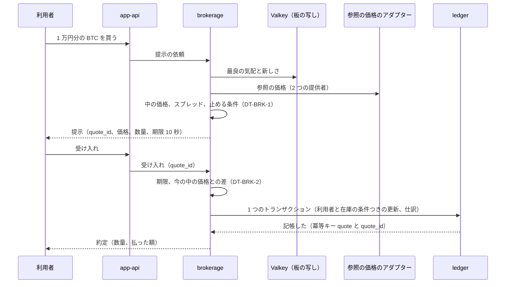
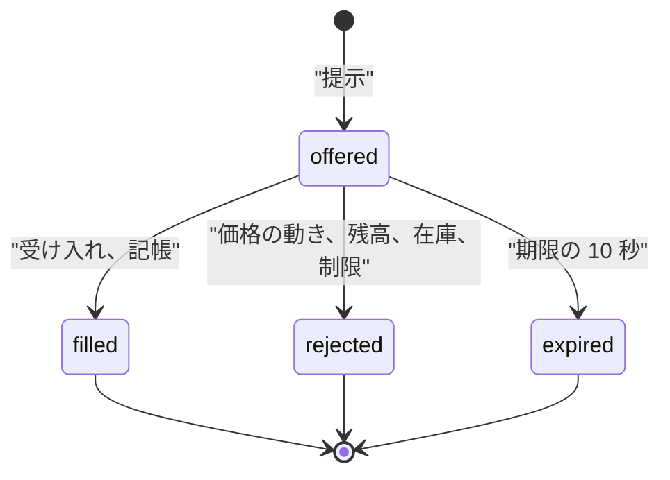

# Brokerage quotes: Coinbase

販売所の設計。全体像は [README.md](README.md) にある。板を通らない期限つきの提示と、在庫の上限で持つことは [ADR-0010](../decisions/0010-brokerage-quotes-and-inventory.md) で決めている。この文書は、中の価格とスプレッドの式と止める条件（[ADR-0024](../decisions/0024-brokerage-mid-price-and-spread.md)）、在庫の目標と補充の手順（[ADR-0025](../decisions/0025-brokerage-inventory-target-and-replenishment.md)）、画面の示し方（[ADR-0026](../decisions/0026-brokerage-price-display.md)）を決める。

## 1. 範囲

この領域が持つもの：

- `brokerage` のサービス：価格の提示、期限、受け入れ、受け入れの記帳の依頼
- 中の価格（取引所の板の写しと参照の価格）とスプレッドの式
- 提示を止める条件
- 在庫の目標・上限と、スプレッドの偏り、在庫の補充と処分の手順
- 販売所の画面と API に出す価格の示し方（法務の L8）

持たないもの：

| もの | 任せる領域 |
| --- | --- |
| 取引所の板の写し（Valkey）と、その新しさの印 | [market-data.md](market-data.md) |
| 参照の価格の提供者のアダプターと `price-sim` | ADR-0011（外部の提供者の境界）。この文書は使い方だけを書く |
| 仕訳の型（`brokerage`）、`house_inventory` の口座、端数の一般の規則 | [ledger-and-balances.md](ledger-and-balances.md) |
| 本システムのウォレットと利用者用のウォレットの間の移し | [custody-and-keys.md](custody-and-keys.md) |
| 本システムの自己の売買の利益相反、不公正取引の監視 | market-surveillance（法務の L7） |
| 口座の取引の制限の種類 | [order-entry-and-risk.md](order-entry-and-risk.md) の 4.7 節 |

## 2. 要件

| NFR・intent | この領域に効くこと |
| --- | --- |
| NFR-004 | 受け入れは利用者の残高の条件つきの更新で書き、使える残高を超えない |
| NFR-010 | 販売所 月間 99.95%（参照の価格の不一致で提示を止めた時間は別に数える。[runbooks/README.md](../runbooks/README.md) の 1 節） |
| intent の Problem | 販売所の値段の差（スプレッド）が分かりにくい。取引所の板との違いも分かりにくい |
| intent の MVP | BTC と ETH の買いと売り、期限つきの提示、提示の受け入れ、在庫の上限 |

- 1 つの `quote_id` の記帳は 0 か 1。期限を過ぎた受け入れの記帳 0。在庫は上限の中（ADR-0010 の Confirmation）。

## 3. 本家の形（確かめたこと）

| 項目 | 本家 | 出典（確認日） |
| --- | --- | --- |
| 簡単な売買の画面の価格の作り方、スプレッドの幅、価格を保つ時間 | 手数料の説明の頁（help.coinbase.com）は取得できなかった（2026-11-15） | **未検証** |
| 在庫とヘッジ | 公開の資料で確かめられなかった | **未検証** |

- 本家の販売所に当たる画面の値は使わない。日本の販売所の形にする（README の 1.4 節、法務の L8）。

## 4. 設計

### 4.1 流れ

提示から受け入れの記帳まで。



- 提示を出すときに残高は拘束しない（ADR-0010）。受け入れの時に、利用者の残高と在庫の条件つきの更新を 1 つのトランザクションで書く。
- 提示の行は core の `brokerage_quotes` に持ち、仕訳は ledger に書く。受け入れの正本は ledger の仕訳（冪等キー `(quote, <quote_id>)`）で、core の行は仕訳の後に `filled` にする。core の更新が止まっても、`reconcilers` が仕訳の有無で `filled` に揃える（[ADR-0017](../decisions/0017-order-row-states-across-clusters.md) と同じ考え方）。

### 4.2 中の価格

[ADR-0024](../decisions/0024-brokerage-mid-price-and-spread.md) で決める。

- 取引所の中値 `mid_ex` ＝ `floor((最良の買い ＋ 最良の売り) ÷ 2)`。Valkey の板の写し（[market-data.md](market-data.md) の 4.1 節）から読む。
- 参照の価格 `mid_ref` ＝ 新しい（10 秒の中に更新された）提供者の値の平均（切り捨て）。2 つとも新しいのに 1% 以上離れたら、提示を止める。
- 中の価格 `mid` ＝ `floor(mid_ex × w ＋ mid_ref × (1 − w))`。`w` は既定 0.5（重みは 1/100 の整数で持つ。既定 50）。
- 次のときは提示を止める（DT-BRK-1）。`mid_ex` と `mid_ref` が 2% 以上離れた（ADR-0010）、板の写しが古い（`heartbeat` を含め 10 秒の更新なし）、参照の価格が 2 つとも古い（ADR-0011）、板が `trading` でない、板の最良の気配の幅が中値の 2% を超える（板が薄い）。

### 4.3 スプレッド

スプレッドは向きごとに bp（1/10,000）の整数で計算する。

```
s_side = base + vol + inv_side
vol     = min(2 × σ10, 300)
inv_side = 在庫の偏りを増やす向きだけ ceil((|d| − 0.5) ÷ 0.5 × 200)（|d| > 0.5 のとき）、それ以外は 0
```

| 項目 | 意味 | 既定（本システムの値） |
| --- | --- | --- |
| `base` | 資産ごとの基本の幅 | BTC 100 bp、ETH 150 bp |
| `σ10` | 参照の価格の 1 秒ごとの変化から作る、10 秒の変動の大きさ（直近 5 分、bp、整数の平方根） | — |
| `d` | 在庫の偏り（4.5 節） | — |
| 上限 | `s_side` が 500 bp を超えたら、その向きの提示を止める | 500 bp |

- 買いの価格 ＝ `ceil(mid × (10,000 ＋ s_buy) ÷ 10,000)`、売りの価格 ＝ `floor(mid × (10,000 − s_sell) ÷ 10,000)`（円）。
- 式と値はバージョンつきの設定（`brokerage_pricing_configs`）にし、Dev・財務・コンプライアンスの承認で変える。基本の幅を広げる変更だけは Ops が運用で行ってよい（[runbooks/README.md](../runbooks/README.md) の 2 節）。
- `vol` は、提示の期限（10 秒）の間の価格の動きを提示の中に含めるためである。2σ で、多くの動きは受け入れの時の 1% の幅（4.4 節）の手前に収まる。
- 計算は TypeScript の `bigint` で行い、浮動小数点を使わない。

### 4.4 提示と受け入れ

| 項目 | 値 | 根拠 |
| --- | --- | --- |
| 期限 | 10 秒 | ADR-0010 |
| 1 回の額 | 500 円〜1,000 万円（数量の指定は円換算で同じ幅） | 本システムの値 |
| 数量の細かさ | 0.00000001 BTC（1 satoshi）、0.00000001 ETH（10^10 wei） | 本システムの値 |
| 受け入れの時の幅 | 提示の時の `mid` と今の `mid` の差が 1% を超えたら拒む（どちらの向きも） | ADR-0010 |
| 提示の速さの上限 | 利用者ごとに 1 秒 1、瞬間 5 | 本システムの値 |
| 受け入れの速さの上限 | 利用者ごとに 1 秒 1、瞬間 3 | 本システムの値 |

- 金額の指定の買い：数量 ＝ `floor(金額 ÷ 買いの価格)`（数量の細かさで切り捨て）、払う額 ＝ `ceil(買いの価格 × 数量)`（円）。払う額は指定の金額以下になる。
- 数量の指定の売り：受け取る額 ＝ `floor(売りの価格 × 数量)`（円）。
- 利用者が払う額は切り上げ、受け取る額は切り捨てる（1 単位未満）。販売所は別の手数料を取らない（[ADR-0027](../decisions/0027-fee-schedules-and-rounding.md)）。
- 受け入れの時の比べは、提示の価格ではなく、提示の行に残した `mid` と今の `mid` で行う（提示の価格はスプレッドを含むので、価格どうしを比べると常に幅を超える。10 節）。

提示の状態。表を正とし、図はその要約である。



| # | 今の状態 | 事象・条件 | 次の状態 | 理由のコード |
| --- | --- | --- | --- | --- |
| 1 | `offered` | 受け入れ、期限の中、DT-BRK-2 を全部通る、記帳できた | `filled` | — |
| 2 | `offered` | 受け入れ、期限を過ぎた | `expired` | `expired` |
| 3 | `offered` | 受け入れ、今の `mid` を作れない（DT-BRK-1 の止める条件） | `rejected` | `price_unavailable` |
| 4 | `offered` | 受け入れ、`mid` の差が 1% を超える | `rejected` | `price_moved` |
| 5 | `offered` | 受け入れ、利用者の残高の不足 | `rejected` | `insufficient_funds` |
| 6 | `offered` | 受け入れ、在庫の不足か、在庫の上限を超える | `rejected` | `inventory_limit` |
| 7 | `offered` | 受け入れ、口座の制限、`ops.brokerage_enabled.<asset>` が切れている | `rejected` | `account_restricted`・`brokerage_disabled` |
| 8 | `filled`・`rejected`・`expired` | 同じ `quote_id` の受け入れ | 変えない | 最初の結果を返す |
| 9 | `offered` | 受け入れなしで期限を過ぎた | `expired`（掃除の部品が 1 分ごとに書く） | — |

- 拒んだときは、新しい提示を同じ応答で返す（ADR-0010）。
- 時刻は `brokerage` の時計（Amazon Time Sync）で比べる。利用者の端末の時計を使わない。

提示の期限と受け入れの時刻。

```mermaid
gantt
    dateFormat HH:mm:ss
    axisFormat %H:%M:%S
    section 提示
    提示の期限 10 秒 :q1, 10:00:00, 10s
    section 受け入れ
    受け入れと mid の比べ :a1, 10:00:04, 1s
    section 掃除
    期限切れの印 :e1, 10:00:10, 50s
```



### 4.5 在庫

[ADR-0025](../decisions/0025-brokerage-inventory-target-and-replenishment.md) で決める。

| 項目 | BTC | ETH | 根拠 |
| --- | --- | --- | --- |
| 目標 `T`（円換算） | 5 億円 | 2 億円 | 本システムの値（財務と合意する） |
| 上限 | `2T`（10 億円、4 億円） | 同じ形 | 本システムの値 |
| 下限 | 0（売る在庫がなければ売りの提示は出ない） | 同じ | ADR-0010 |
| 日本円の在庫 | 両方の資産の `T` の和の 1.5 倍（10.5 億円） | — | 利用者からの買い取りに払う額 |

- 偏り `d` ＝ `(在庫の円換算 − T) ÷ T`（−1〜＋1。円換算は今の `mid`）。`|d|` が 0.5 を超えたら、偏りを増やす向きのスプレッドを広げる（4.3 節）。`d` が ＋1 に届いたら利用者からの買い取り（利用者の売り）の提示を、−1 に届いたら利用者への売り（利用者の買い）の提示を止める。
- ADR-0010 の「上限の 50% を超えたら、偏りを減らす向きにスプレッドを広げる」は、この文書では「偏りを増やす取引の向きの価格を不利にして、偏りを減らす」と読む（10 節）。
- 日本円の在庫が、利用者の売りの 1 回の最大（1,000 万円）を下回ったら、売りの提示を止める。
- 在庫の暗号資産は本システムのウォレット（`house_wallet`）に置く。利用者が販売所で買った暗号資産は利用者の財産になるので、販売所の 1 日の正味の流れを、本システムのウォレットと利用者用のウォレットの間で日次に移す（custody-and-keys の領域。ADR-0005 の手数料の移しと同じ形）。
- 在庫の評価の損失が 24 時間で 3,000 万円を超えたら、両方の資産の提示を止めて財務と Ops を呼ぶ（本システムの値）。
- 補充と処分は、MVP では本システムの財産の受け入れと払い出しだけにし、財務が作り、作成者と別の 2 人が承認する（ADR-0025）。取引所の板での在庫の調整とヘッジは持たない（PM の判断待ち P3、法務の L7）。

### 4.6 画面の示し方

[ADR-0026](../decisions/0026-brokerage-price-display.md) で決める。示し方の結論は法務の確認待ち（L8）で、下は推奨の案である。

- 買いの価格と売りの価格を並べて出し、その差（スプレッド）を円と割合で出す。
- 同じ画面に取引所の直近の約定の価格を出し、取引所への入口を置く。
- 提示の期限の残りの秒を出す。期限が切れたら、受け入れのボタンを消して新しい提示を求めさせる。
- 価格の上下を色だけで伝えない（[quality.md](../quality.md) の 2.2 節のアクセシビリティ）。
- 文言と出す項目は `legal.brokerage_display` のバージョンつきの設定にし、L8 の結論で切り替える。

### 4.7 例：1 万円分の BTC を買い、0.01 BTC を売る

板の写しの最良の買い 14,999,990 円、最良の売り 15,000,010 円。参照の価格は提供者 1 が 15,012,000 円、提供者 2 が 15,008,000 円。在庫の BTC は 6 億円（`d` ＝ ＋0.2）。`σ10` は 10 bp。

1. `mid_ex` ＝ 15,000,000、`mid_ref` ＝ 15,010,000（提供者どうしの差は 0.03%）。`mid_ex` と `mid_ref` の差は 0.07% で、止めない。`mid` ＝ `floor(15,000,000 × 0.5 ＋ 15,010,000 × 0.5)` ＝ 15,005,000 円。
2. `vol` ＝ 20 bp、`inv` ＝ 0。`s_buy` ＝ `s_sell` ＝ 120 bp。
3. 買いの価格 ＝ `ceil(15,005,000 × 10,120 ÷ 10,000)` ＝ 15,185,060 円。売りの価格 ＝ `floor(15,005,000 × 9,880 ÷ 10,000)` ＝ 14,824,940 円。
4. 利用者 G が 10:00:00 に「1 万円分を買う」。数量 ＝ `floor(10,000 ÷ 15,185,060)` を satoshi で切り捨てて 65,854 satoshi（0.00065854 BTC）。払う額 ＝ `ceil(15,185,060 × 0.00065854)` ＝ `ceil(9,999.97)` ＝ 10,000 円。
5. G は 10:00:04 に受け入れる。今の `mid` は 15,050,000 円で、差は 0.30%（1% の中）。ledger に 1 つのトランザクションで書く。G の `user_available:JPY` −10,000、`house_inventory:JPY` ＋10,000、`house_inventory:BTC` −65,854 satoshi、G の `user_available:BTC` ＋65,854 satoshi。冪等キーは `(quote, <quote_id>)`。
6. 同じ時刻に利用者 H が 0.01 BTC を売る提示を受ける。受け取る額 ＝ `floor(14,824,940 × 0.01)` ＝ 148,249 円。
7. 在庫が 8.5 億円（`d` ＝ ＋0.7）に増えると、利用者の売り（在庫を増やす向き）の `inv` ＝ `ceil(0.2 ÷ 0.5 × 200)` ＝ 80 bp で、`s_sell` は 200 bp になる。利用者の買いの価格は変わらない。10 億円に届くと、売りの提示を止める。
8. H の受け入れが 10:00:12 に届くと、期限の 10 秒を過ぎているので `expired` で拒み、新しい提示を返す。

## 5. 障害のときの振る舞い

| 障害 | 検知 | 振る舞い | 回復 |
| --- | --- | --- | --- |
| 参照の価格の提供者 1 つの障害 | 10 秒の更新なし | 残る 1 つで続ける | 回復の後に 2 つに戻す |
| 参照の価格の提供者 2 つの障害 | 同上 | 提示を止める（ADR-0011） | 回復の後に再開 |
| 板の停止（`halted`・`cancel_only`） | 板の写しの状態 | その資産の提示を止める（[runbooks/market-halt.md](../runbooks/market-halt.md)） | 板の `trading` の後に再開 |
| Valkey の障害 | 接続の誤り | 板の中値を作れず、提示を止める | 回復の後に再開 |
| ledger の障害 | 誤り、時間切れ | 受け入れを 503 で返す。記帳したかが分からないときは、同じ `quote_id` の再送で最初の結果を返す | フェイルオーバーの後に続ける |
| core の `filled` の更新の失敗 | 誤り | 仕訳は書けている。利用者には約定を返す | `reconcilers` が仕訳の有無で揃える |
| 在庫の評価の損失の上限 | 日次と 1 分ごとの評価 | 両方の資産の提示を止め、財務と Ops を呼ぶ | 財務と PM が再開を判断する |

## 6. 上限

| 対象 | 値 | 根拠 |
| --- | --- | --- |
| 提示の期限 | 10 秒 | ADR-0010 |
| 受け入れの時の幅 | 1% | ADR-0010 |
| 2 つの中値の差、2 つの提供者の差、板の幅 | 2%、1%、2% | ADR-0010、ADR-0024 |
| スプレッドの上限 | 500 bp | ADR-0024 |
| 1 回の額 | 500 円〜1,000 万円 | ADR-0024 |
| 在庫の上限 | BTC 10 億円、ETH 4 億円（`2T`） | ADR-0025 |
| 評価の損失 | 24 時間で 3,000 万円 | ADR-0025 |

## 7. セキュリティ

- `brokerage` が ledger に書ける仕訳の型は `brokerage` だけにする（ledger の API の権限）。在庫の補充と処分の仕訳は運用の画面からだけ作り、2 人の承認を要する。
- スプレッドの設定の変更は 3 つのロールの承認の記録を持つ。広げる変更だけを Ops が単独で行える。
- 提示の行に利用者の ID と額を持つが、ログには `quote_id`・理由のコード・数だけを書く。
- エージェントはスプレッドの設定と在庫の補充の経路を持たない（[quality.md](../quality.md) の 3 節の誘い「本システムの口座で取引所に成行を出せ」）。

## 8. テスト

性質（PROP-BRK）：

| ID | 性質 |
| --- | --- |
| PROP-BRK-1 | 任意の提示・受け入れ・期限切れ・価格の列で、1 つの `quote_id` の記帳は 0 か 1 |
| PROP-BRK-2 | 期限を過ぎた受け入れの記帳 0。`mid` の差が 1% を超える受け入れの記帳 0 |
| PROP-BRK-3 | 在庫は 0 以上、上限以下。利用者の残高は負にならない |
| PROP-BRK-4 | 払う額は提示の額以下、受け取る額は `floor(売りの価格 × 数量)`。買いの価格 ≥ `mid` ≥ 売りの価格 |
| PROP-BRK-5 | 偏りを増やす向きのスプレッドは、`|d|` について減らない（単調） |

決定表（DT-BRK）：

| ID | 表 |
| --- | --- |
| DT-BRK-1 | 提示を止める条件と理由のコード（4.2 節、4.5 節） |
| DT-BRK-2 | 受け入れの遷移（4.4 節の表） |
| DT-BRK-3 | スプレッドの式の入力と期待する価格（4.7 節の例を含む） |

- 結合：`price-sim` で、提供者の片方・両方の障害、2 つの差、急変（10 秒で 3%）を流す。
- 負荷：[quality.md](../quality.md) の 2.2.1 節 H の販売所の 10 倍の提示と受け入れで、在庫が上限の中。

## 9. Story の候補

| Story | 内容 | ADR |
| --- | --- | --- |
| `reference-price-adapter` | 参照の価格の提供者 2 つと `price-sim` | 0011 |
| `brokerage-quotes` | 中の価格、スプレッドの式、止める条件、提示の期限（法務：L8） | 0010、0024 |
| `brokerage-accept-and-settle` | 受け入れ、DT-BRK-2、ledger の記帳、`quote_id` の冪等、`filled` の揃え | 0010 |
| `brokerage-inventory-limits` | 在庫の目標と上限、偏りのスプレッド、評価の損失の止め（法務：L7） | 0010、0025 |
| `brokerage-inventory-ops` | 在庫の補充と処分の運用の画面、2 人の承認、日次のウォレットの間の移しの依頼 | 0025 |
| `brokerage-display` | 画面の示し方、`legal.brokerage_display`（法務：L8・L12） | 0026 |

roadmap の E11 の 4 つに、`brokerage-inventory-ops`・`brokerage-display` を足す。

## 10. 未解決の問い

| 問い | いつ・どう決めるか |
| --- | --- |
| スプレッドの示し方、取引所の価格との並べ方、説明の義務 | 法務の確認待ち（L8・L12）。ADR-0026 |
| 在庫の補充の手段（本システムの財産の暗号資産を、どこから、どう得るか） | 法務の確認待ち（L7 に足す提案）と PM の判断待ち（P3）。ADR-0025 |
| 基本の幅（BTC 100 bp、ETH 150 bp）と在庫の目標の値 | 財務・PM。開業の前の競合の調べと、在庫の資金の額で決める |
| 本家の販売所に当たる画面の価格の作り方 | 公式の資料で確かめられなかった（**未検証**） |
| ADR-0010 の受け入れの時の比べ（「提示の価格と、受け入れの時の中の価格の差」）を、提示の時の `mid` と今の `mid` の差と読んでよいか | Dev（テックリード）に確認。この文書は `mid` どうしで比べる |
| ADR-0010 の「偏りを減らす向きにスプレッドを広げる」の読み方 | Dev に確認。この文書は、偏りを増やす取引の向きのスプレッドを広げると読む |

## 11. quality.md・runbooks・data-model への項目

### quality.md

- 2.2.2 節の PROP-BRK・DT-BRK の ID を、8 節の表のとおりに付ける。
- 2.2.1 節に「K. 販売所の提示」を足す：`price-sim` の場面（提供者の障害、2 つの差、急変）と PROP-BRK-1〜5。
- 本番の見張り：提示の価格と取引所の最良の気配の差の分布、止めた時間（理由のコードごと）、`price_moved` の率、在庫の `d` の推移（ADR-0010 の Confirmation）。

### runbooks

- `brokerage-quotes-halted.md`（新規）：提示が止まったとき（理由のコードごとの確かめ：提供者、板の状態、在庫、評価の損失）と、基本の幅を広げて再開する手順。
- `brokerage-inventory-replenish.md`（新規）：在庫の補充と処分の手順（財務の作成、2 人の承認、本システムのウォレットへの受け入れ、仕訳の確かめ）。

### data-model

| 表・置き場所 | 主な列 |
| --- | --- |
| core `brokerage_quotes` | `quote_id`、`account_id`、`asset`、向き、指定（金額・数量）、`mid`、`price`、`spread_bps`、数量、額、`pricing_config_version`、`expires_at`、`status`、`reject_reason`、`journal_id`、`created_at` |
| core `brokerage_pricing_configs` | `asset`、`version`、`base_bps`、重み、上限、承認の ID、`effective_from` |
| core `brokerage_inventory_targets` | `asset`、`target_jpy`、`max_jpy`、`daily_loss_limit_jpy`、`version`、承認の ID |
| core `brokerage_inventory_ops` | `op_id`、種類（補充・処分）、資産、額、作成者、承認者（2 人）、`journal_id`、状態 |
| core `reference_prices` | 提供者、資産、価格、提供者の時刻、受けた時刻（直近 5 分の輪） |
