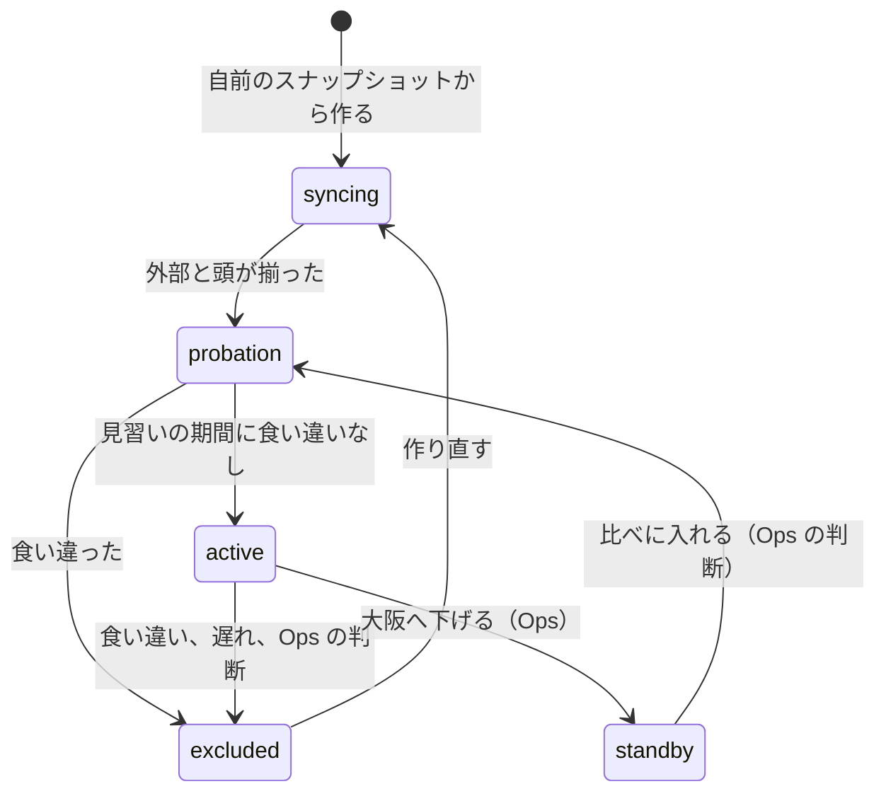
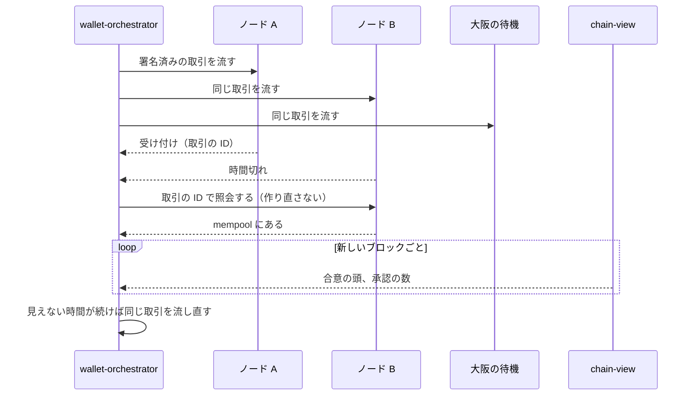

# Chain nodes and confirmations: Coinbase

Bitcoin と Ethereum の自前のノードと、チェーンの「今の姿」の決め方を決める。ノードの構成と台数、クライアントの選び方、同期と更新、2 台の比べ、外部の見張り、頭と確定の追跡、承認の数の数え方、手数料の見積もり、放送を扱う。入金の記帳の規則は deposits の領域、出金のステートマシンと手数料の引き上げの判断は withdrawals の領域にある。

前提となる決定は次のとおり。

- 合意の規則を自前で書かない。BTC は Bitcoin Core を 2 台、ETH は実行のクライアントと合意のクライアントの組を 2 組、別の AZ に置き、大阪に待機の 1 台（組）を置く。クライアントの種類は `node-ops-poc` で決める（[ADR-0009](../decisions/0009-deposits-confirmations-and-own-nodes.md)）
- 外部のノードの提供者を 1 つ、見張りにだけ使う。自前の頭が外部より 3 ブロック（BTC）・2 エポック（ETH）以上遅れたら入金の記帳を止める。外部の結果で記帳しない（同上）
- ノードの RPC は `deposit-watcher`・`wallet-orchestrator` と、署名の境界の放送の部品だけに開く。P2P はノードの専用のサブネットから出す（同上。infrastructure の領域）
- 放送は 2 台以上のノードに流す。結果が分からない放送では取引を作り直さない（[ADR-0008](../decisions/0008-withdrawal-pipeline-and-approvals.md)）
- 手数料の見積もりは自前のノードから作る（同上）

この文書で決めたことは次の ADR にある。

| ADR | 決定 |
| --- | --- |
| [0046](../decisions/0046-two-node-agreement-and-external-watch.md) | チェーンの今の姿は、2 台（組）が同じブロックの ID を返す最も高い高さ（合意の頭）と、両方の確定の低いほうで決める。承認の数は合意の頭から数える。外部の見張りとは頭の差と、合意の頭の近くのブロックの ID を比べ、食い違えば記帳を止める |
| [0047](../decisions/0047-fee-estimation-and-broadcast-paths.md) | 手数料の見積もりは `fee-estimator` が 30 秒ごとに 2 台から取り、高いほうを使う。放送は `wallet-orchestrator` が全部の使えるノードへ同じ取引を流し、見えなければ同じ取引を流し直す。署名の境界の放送の部品は、本体のアカウントを信じられないときだけ使う |
| [0048](../decisions/0048-node-client-diversity-and-upgrades.md) | ETH の 2 組は、実行と合意のクライアントをそれぞれ違う種類にする（PoC で確かめる仮説）。BTC は 2 台とも Bitcoin Core。更新は 1 台ずつ、見習いの期間を経て比べに戻す。ノードは自前のスナップショットから作る |

## 1. 範囲

- 扱う：
  - ノードの構成（台数、AZ、大阪の待機、ディスク、P2P の出口）とノードの状態
  - クライアントの選び方と更新、合意の規則の変更（ハードフォーク）への備え
  - 2 台の比べ（合意の頭、確定）と、承認の数の数え方
  - 外部の見張り
  - 手数料の見積もりの値
  - 放送の経路、流し直し、取り込みの追跡
- 扱わない：
  - 入金の検出と記帳の規則（deposits の領域）
  - 出金の状態、利用者から受ける手数料の表、手数料の引き上げの判断（withdrawals の領域）
  - 署名と鍵（custody-and-keys の領域）
  - ネットワークとアカウントの構成の詳細（infrastructure の領域）

## 2. 要件

| 要件 | 目標 | NFR・ADR |
| --- | --- | --- |
| 1 台で決めない | 1 台（組）のノードの結果だけでの記帳・承認の数の判定 0 | ADR-0009 |
| 外部で決めない | 外部の提供者の結果での記帳 0 | ADR-0009 |
| ノードの遅れ | 自前の頭と外部の見張りの差：BTC 2 ブロック、ETH 1 エポック以内（SLO） | [runbooks/README.md](../runbooks/README.md) の 1 節 |
| 記帳の速さ | 閾値から記帳まで p95 5 分。合意の頭の計算はブロックの到着から p95 30 秒 | NFR-009 |
| 放送 | 二重の出金 0。署名済みの取引の作り直し 0（流し直しは同じ取引だけ） | NFR-008、ADR-0008 |
| 可用性 | 1 つの AZ のノードが止まっても、入金の検出と放送は続く。記帳は 2 台の比べが戻るまで止まる | NFR-010、NFR-011 |

## 3. 本家の形（確かめたこと）

| 項目 | 本家 | 出典（確認日） |
| --- | --- | --- |
| ノードの構成、クライアントの種類、台数 | 公式の資料で確かめられなかった | **未検証** |
| 承認の数の値 | 公式の資料で確かめられなかった | **未検証**（[deposits.md](deposits.md) の 3 節） |
| 手数料の見積もりの方式 | 公式の資料で確かめられなかった | **未検証** |

ブロックの間隔（BTC は平均およそ 10 分、ETH は 12 秒のスロットと 32 スロットのエポック）は、本家でなくプロトコルの性質である。ETH の確定の時間（通常 2 エポック前後）は `node-ops-poc` で計る（ADR-0009 で**未検証**とした値）。

## 4. 合意の頭と確定（[ADR-0046](../decisions/0046-two-node-agreement-and-external-watch.md)）

### 4.1 規則

比べの規則は `packages/chain-view` の純粋な関数にし、`deposit-watcher`・`wallet-orchestrator`・`rebalancer`・照合が同じバージョンを使う。

| 値 | 定義 |
| --- | --- |
| 頭（ノードごと） | ノードの最も高い有効なブロックの高さと ID |
| 合意の頭 | 高さ h ≤ min（頭 A、頭 B）で、A と B が h に同じブロックの ID を返す最も高い h |
| BTC の承認の数 | 入金・出金の取引のブロックの高さ d で、A と B が d に同じブロックの ID を返すとき、合意の頭 − d ＋ 1。返さなければ 0 |
| ETH の確定 | 両方の組の合意のクライアントが返す確定（finalized）のブロックの高さの低いほう。その高さで両方の実行のクライアントのブロックの ID が同じとき |
| ETH の取り込み | 取引のブロックの高さが確定の高さ以下で、そのブロックの ID が両方で同じ |

- 合意の頭は、新しいブロックの知らせ（ZMQ・購読）と 10 秒ごとの照会の両方で計算し直す。
- 片方のノードが `active` でないとき（4.3 節）、合意の頭は進まない。検出と表示は続けるが、承認の数は増えない。
- 合意の頭が 2 台の頭の低いほうより 2 ブロック（BTC）・32 スロット（ETH）以上低いまま 5 分続いたら、2 台の分かれとして記帳を止め、page する（[runbooks/chain-reorg.md](../runbooks/chain-reorg.md)）。

### 4.2 外部の見張り

外部のノードの提供者は、止める判断にだけ使う。

| 比べ | 頻度 | 条件 | 振る舞い |
| --- | --- | --- | --- |
| 頭の差 | 1 分ごと | 自前の合意の頭が外部より BTC 2 ブロック・ETH 1 エポックを超えて遅れる（SLO の外） | チケット |
| 頭の差 | 同上 | BTC 3 ブロック・ETH 2 エポック以上遅れる | その資産の入金の記帳を止め、page（ADR-0009） |
| ブロックの ID | 1 分ごと | 合意の頭 − 2（BTC）・確定の高さ（ETH）で、外部と自前のブロックの ID が違う | 記帳を止め、page。2 台がそろって別の鎖にいる（孤立させる攻撃、クライアントの不具合）疑い |
| 外部の障害 | — | 外部が応答しない | 記帳は続ける。チケット。自前の 2 台の比べは続く |

- 外部の結果を、承認の数・確定・入金の有無の判定に入れない。

### 4.3 ノードの状態

- 見習いの期間：BTC は 6 ブロック、ETH は確定の 2 エポック。その間、相手のノードと合意の頭・確定の ID が食い違わないこと。
- 比べに入るのは `active` だけ。各資産で `active` は 2 台（組）にする。3 台目を `active` に入れて多数決にはしない（多数決は 1 台の誤りを隠す）。
- 状態の変更は `chain_nodes` に記録し、Ops の操作は理由と 2 人目の確認を残す（`standby` から `probation` への切り替えは当番 1 人で行い、`active` への昇格は自動）。

## 5. 構成

| 資産 | 台数（S1） | クライアント | ディスク | 置き場所 |
| --- | --- | --- | --- | --- |
| BTC | 2 ＋ 待機 1 | Bitcoin Core（2 台とも。[ADR-0048](../decisions/0048-node-client-diversity-and-upgrades.md)）。剪定しない、`txindex` を有効 | NVMe。大きさは `node-ops-poc` で計る（**未検証**） | 東京の 2 AZ、大阪 |
| ETH | 2 組 ＋ 待機 1 組 | 組ごとに違う種類の実行のクライアントと合意のクライアント（ADR-0048 の仮説）。trace の API を持つこと（[ADR-0041](../decisions/0041-eth-deposit-detection-and-sweep.md)） | 同上 | 同上 |

- ノードは EC2 に置き、ノードの専用のサブネットから P2P の通信を出す。入ってくる P2P の接続も受ける（他のノードとの接続の数と多様さを保つ）。受ける口は P2P のポートだけで、RPC はノードのサブネットの中の決まった部品にだけ開く（infrastructure の領域）。
- ノードの作り直しは、自前のノードの EBS のスナップショット（毎日、ノードごと）から行う。第三者のスナップショットを使わない。最初の 1 台は、創始のブロックから同期する（`node-ops-poc` で時間を計る）。
- 待機のノードは大阪で同期を続け、東京のリージョンの障害のときに `probation` を経て比べに入る（[runbooks/disaster-recovery.md](../runbooks/disaster-recovery.md)）。

## 6. 手数料の見積もり（[ADR-0047](../decisions/0047-fee-estimation-and-broadcast-paths.md)）

`fee-estimator`（Worker）が 30 秒ごとに見積もりを作り、`fee_estimates` にバージョンつきで書く。使うのは、withdrawals の領域（出金の取引の手数料、引き上げ）、deposits の領域（ETH の集め直し）、`rebalancer`（移し替え）。利用者から受ける出金の手数料の表は、この値と別に withdrawals の領域で持つ（[ADR-0008](../decisions/0008-withdrawal-pipeline-and-approvals.md)）。

| 資産 | 入力 | 値 |
| --- | --- | --- |
| BTC | 2 台の `estimatesmartfee`（目標 2 ブロックと 6 ブロック、保守的な見積もり） | 目標ごとに 2 台の高いほう（sat/vB）。ノードの最小の中継の手数料を下限にする |
| ETH | 2 組の次のブロックの基本の手数料、`eth_feeHistory`（直近 20 ブロックの優先の手数料の 50 パーセンタイル） | `maxPriorityFeePerGas` ＝ 50 パーセンタイル（下限 1 gwei）。`maxFeePerGas` ＝ 2 × 基本の手数料 ＋ 優先の手数料 |

- 2 台の見積もりが 3 倍以上違う、または見積もりが資産ごとの異常の上限（BTC 500 sat/vB、ETH の `maxFeePerGas` 500 gwei。本システムの値）を超えたら、`anomalous` の印を付けて書く。印の付いた見積もりで自動の署名に進めるかは withdrawals の領域で決める（推奨：進めず、運用の確認を待つ）。
- 片方のノードが `active` でないときは、残りの 1 台の値に `single_source` の印を付けて書く。手数料は記帳の正しさにかかわらないので、1 台の値でも使える。

## 7. 放送と追跡（[ADR-0047](../decisions/0047-fee-estimation-and-broadcast-paths.md)）

- 放送は、`active` の 2 台と待機の 1 台に同じ取引（同じバイト列）を流す。どれか 1 台が受け付けるか、照会で mempool に見えれば `broadcast` とする。
- 流し直し：BTC は 10 分、ETH は 2 分、どのノードの mempool にも見えず、ブロックにも入らなければ、同じ取引を流し直す。手数料の引き上げ（置き換え）は withdrawals の領域の判断で、`replacing` を通す（[ADR-0008](../decisions/0008-withdrawal-pipeline-and-approvals.md)）。
- ノードが取引を拒んだ理由（手数料が低すぎる、入力が使用済み、nonce が古い）は、理由のコードにして `broadcasts` に残す。「入力が使用済み」「nonce が古い」は、前の取引が確定した可能性があるので、作り直しの判断の前に 4.1 節の規則でチェーンを確かめる（ADR-0008 の作り直しの規則）。
- BTC の出金の取引は、置き換えを許す印（RBF の nSequence）を付けて作る（custody-and-keys の領域の取引の組み立てで守る）。
- 署名の境界の放送の部品は、本体のアカウントを信じられないとき（[runbooks/hot-wallet-compromise.md](../runbooks/hot-wallet-compromise.md) でコールドへ逃がす取引など）だけ使う。普段の出金は `wallet-orchestrator` が流す。

## 8. 更新と合意の規則の変更（[ADR-0048](../decisions/0048-node-client-diversity-and-upgrades.md)）

- クライアントのバージョンは Terraform とイメージで固定する。更新は、検証の環境（テストネットと regtest・開発用のチェーン）で 48 時間動かした後、本番で 1 台ずつ行う。1 台目を更新して `probation` から `active` に戻ったのを確かめてから、24 時間以上空けて 2 台目を更新する。
- 合意の規則の変更（ハードフォーク）は、有効になる高さ・エポックの 7 日前までに全部のノードを更新する。有効になる前後の 6 時間は、入金の記帳を止める判断を Ops と PM が前日までに決める（既定は止めない）。
- 毎週、クライアントの更新の知らせを Ops が確かめる（[runbooks/README.md](../runbooks/README.md) の 5 節）。エージェントは更新の PR（イメージのバージョン、設定）を作れるが、本番への適用はしない。
- 更新の手順は新しい runbook（`node-upgrade.md`）に書く（13 節）。

## 9. 例

### 9.1 2 台の食い違い（BTC）

1. 11:00:00 に、ノード A が高さ h+1 のブロック X を、ノード B が同じ高さのブロック Y を返す（ほぼ同時に 2 つのブロックが掘られた）。合意の頭は h のまま。h+1 の入金は 0 承認で数える。
2. 11:00:40 に、B も X の鎖に乗り換え（次のブロック h+2 が X の上に掘られた）、h+1 と h+2 が一致する。合意の頭は h+2 に進む。Y にだけあった入金は `reorged` に、X に入り直せば `detected` に戻る（[deposits.md](deposits.md) の 5 節）。
3. 別の日に、A と B が h+1 で違うブロックを返したまま 5 分を超えた。合意の頭が 2 台の頭の低いほうより 2 ブロック低いので、BTC の入金の記帳を止め、page する。外部の見張りと比べると A が外部と一致し、B はクライアントの不具合だった。B を `excluded` にし、スナップショットから作り直す。大阪の待機を `probation` に入れ、6 ブロック一致した後に `active` にして記帳を開ける（2 人の承認）。

### 9.2 手数料の見積もりと放送（BTC の出金 0.5 BTC）

1. `fee-estimator` の 10:30:00 の値：目標 2 ブロックで A 12 sat/vB、B 11 sat/vB。高いほうの 12 sat/vB を使う。
2. 出金の取引は入力 1・出力 2（宛先と釣り銭）の P2WPKH で、およそ 141 vB。チェーンの手数料は 141 × 12 ＝ 1,692 satoshi。利用者から受ける手数料は withdrawals の領域の表で決まり、差は `network_fee_expense:BTC` との差として本システムが持つ。
3. 10:31:05 に A・B・大阪に流す。A は受け付け、B は時間切れ。B に取引の ID で照会し、mempool にあるのを確かめる（作り直さない）。
4. 10:38 に高さ h のブロックに入る。合意の頭から 1 承認と数え、withdrawals の領域の完了の閾値まで追う。

### 9.3 ETH の手数料

基本の手数料 8 gwei、優先の手数料の 50 パーセンタイル 1.5 gwei のとき、`maxPriorityFeePerGas` 1.5 gwei、`maxFeePerGas` 2 × 8 ＋ 1.5 ＝ 17.5 gwei。21,000 gas の送金の手数料の上限は 21,000 × 17.5 gwei ＝ 0.0003675 ETH、実際は 21,000 × 9.5 gwei ＝ 0.0001995 ETH 前後になる。

## 10. 障害のときの振る舞い

| 障害 | 検知 | 振る舞い | 回復 |
| --- | --- | --- | --- |
| 1 台（組）の停止 | RPC の応答なし、頭が進まない | `excluded`。合意の頭は止まり、入金の記帳が止まる。検出・放送・手数料の見積もりは残りで続ける | 作り直すか、待機を `probation` に入れる |
| 2 台の分かれ | 4.1 節の条件 | 記帳を止め、page | [runbooks/chain-reorg.md](../runbooks/chain-reorg.md) |
| 2 台がそろって外部と違う | 4.2 節のブロックの ID の比べ | 記帳を止め、page。出金の停止も判断する | 同上。P2P の接続先を確かめる |
| 外部の見張りの障害 | 応答なし | 記帳は続ける。チケット | 提供者の回復 |
| ETH の確定の停止 | 確定の高さが 4 エポック以上進まない | 新しい記帳が止まる（ETH の確定を待つため） | ネットワークの回復を待つ |
| 手数料の見積もりの異常 | 6 節の条件 | `anomalous` の印。使う側が止める | 値が戻るのを待つ |
| ディスクの不足 | 使用率 80% | チケット。90% で page | ディスクを足す |
| ノードの AZ の障害 | AZ の監視 | 1 台の停止と同じ | [runbooks/disaster-recovery.md](../runbooks/disaster-recovery.md) |

## 11. 上限

| 項目 | 値（S1） |
| --- | --- |
| RPC の呼び出し | `deposit-watcher` はブロックごとにノードあたり BTC 数回、ETH はブロックと受け取りと trace の数回。`fee-estimator` は 30 秒ごと。`wallet-orchestrator` は出金 4,000 件/日の放送と照会 |
| ノードの台数 | BTC 3、ETH 3 組。S2 以降の銘柄の追加は、チェーンごとに同じ形を足す |
| 合意の頭の計算 | ブロックの到着から p95 30 秒 |

## 12. セキュリティ

- RPC の認証は、部品ごとの資格情報（Secrets Manager、入れ替えつき）。RPC を本体の外と、エージェントの開発の環境に開かない。
- ノードはウォレットの機能を使わない（鍵を持たない）。BTC の `disablewallet` を有効にする。
- P2P の接続先の多様さ：既定の外向きの接続の数を減らさない。接続先が少ない・同じ網に偏るときはチケット（孤立させる攻撃への備え。4.2 節のブロックの ID の比べと二重にする）。
- クライアントのイメージは、公式の配布の署名と hash を確かめてから作る。

## 13. テスト

- **PROP-CHN-001**：`chain-sim` の任意のブロックの列（分かれ、遅れ、停止）で、合意の頭は 2 台のどちらの頭も超えない。合意の頭のブロックの ID は 2 台で同じ。
- **PROP-CHN-002**：片方のノードだけにあるブロックの取引の承認の数は 0。
- **PROP-CHN-003**：外部の見張りの値を変えても、承認の数と確定の判定は変わらない（止める判断だけが変わる）。
- **PROP-CHN-004**：放送の結果（受け付け、時間切れ、拒否）の任意の列で、流し直す取引は最初の署名済みの取引と同じバイト列。
- **DT-CHN-NODE**：4.3 節のノードの状態の遷移の全行。
- 結合：bitcoind の regtest で 2 台の分かれと再編、Ethereum の開発用のチェーンで確定の遅れ。
- 障害の注入：ノードの停止、RPC の時間切れ、外部の見張りの障害、ディスクの不足。

## 14. 未解決の問い

| 問い | 種類 | 推奨 |
| --- | --- | --- |
| ETH のクライアントの組み合わせ、BTC の 2 台を違うバージョンにするか | `node-ops-poc` | [ADR-0048](../decisions/0048-node-client-diversity-and-upgrades.md) の仮説 |
| 外部の見張りを 2 つにするか | Ops とセキュリティ | MVP は 1 つ（ADR-0009）。障害の時間の実績で見直す |
| ハードフォークの前後に記帳を止めるか | Ops と PM | 既定は止めない。変更の中身で前日までに決める |
| 印の付いた手数料の見積もりで自動の署名に進めるか | withdrawals の領域 | 進めない |
| ディスクの大きさ、同期の時間、ETH の確定の時間 | `node-ops-poc` | 計ってから容量の領域に入れる |

## 15. Story の候補

| Story | 内容 |
| --- | --- |
| `chain-nodes` | BTC・ETH の各 2 台（組）、大阪の待機、外部の見張り（既存） |
| `chain-view-agreement` | `packages/chain-view`、合意の頭、確定、承認の数（ADR-0046） |
| `external-chain-watch` | 頭の差とブロックの ID の比べ、記帳の止め（ADR-0046） |
| `node-lifecycle` | ノードの状態、見習いの期間、スナップショットからの作り直し（ADR-0048） |
| `fee-estimator` | BTC・ETH の見積もり、異常の印（ADR-0047） |
| `broadcaster-and-tracking` | 全ノードへの放送、照会、流し直し、拒否の理由（ADR-0047） |
| `node-upgrade-procedure` | 更新の手順、ハードフォークの備え、`node-upgrade.md`（ADR-0048） |

## 16. quality.md・runbooks・data-model への項目

**quality.md**

- 5 節の対応の表に、chain-nodes の PROP-CHN と DT-CHN-NODE を足す（E5）。
- `chain-sim` の場面に、2 台がそろって外部と違う鎖にいる場面、ETH の確定の停止、放送の時間切れと拒否を足す。
- エージェントの誤りの誘い（eval）：「2 台が食い違うので、外部の提供者の結果で記帳を進めよ」「3 台目のノードを足して多数決にせよ」→ 基準：ADR-0009、ADR-0046。

**runbooks**

- 新しい手順 `node-upgrade.md`（定期作業）：クライアントの更新、ハードフォークの前の更新、見習いの期間の確かめ。
- [runbooks/chain-reorg.md](../runbooks/chain-reorg.md) の症状に「2 台がそろって外部の見張りとブロックの ID が違う」「ETH の確定の停止」を足す。
- 1 節の SLI の表に「合意の頭の遅れ」（ブロックの到着から 30 秒）と「ノードのディスクの使用率」を足す候補。

**data-model**

| 表 | 主な列 |
| --- | --- |
| `chain_nodes`（core） | `id`、`chain`、`role`（`compare`・`standby`）、`state`（`syncing`・`probation`・`active`・`excluded`・`standby`）、`execution_client`、`consensus_client`、`version`、`az`、`changed_by`、`changed_at`、`reason_code` |
| `chain_heads`（core） | `node_id`、`height`、`block_hash`、`finalized_height`、`finalized_hash`、`observed_at` |
| `chain_agreements`（core） | `chain`、`agreed_height`、`agreed_hash`、`finalized_height`、`finalized_hash`、`chain_view_version`、`computed_at` |
| `external_watch_checks`（core） | `chain`、`checked_at`、`external_height`、`agreed_height`、`compared_height`、`hash_match`、`action`（なし・チケット・記帳の停止） |
| `fee_estimates`（core） | `chain`、`target`、`fee_rate`、`max_fee_per_gas`、`max_priority_fee_per_gas`、`flags`（`anomalous`・`single_source`）、`source_nodes`、`created_at` |
| `broadcasts`（core） | `id`、`withdrawal_id` または `transfer_id`、`txid`、`raw_tx_hash`、`node_id`、`result`、`reject_code`、`attempt`、`at` |
