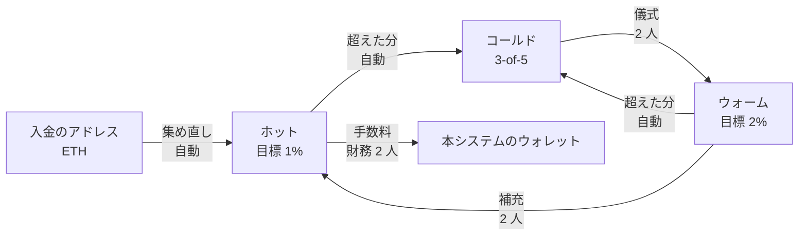
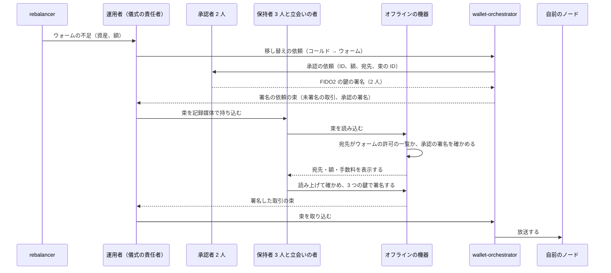
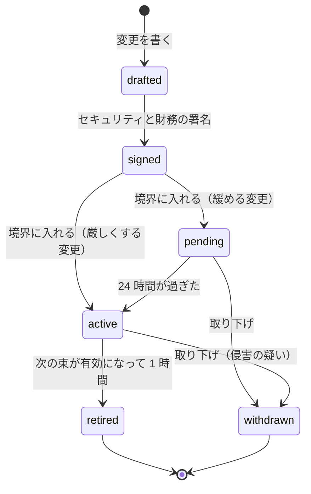

# custody-and-keys: 保管と鍵

この領域の設計。全体像は [README.md](README.md) にある。ウォレットの段とネットワークにつながる額の上限は [ADR-0006](../decisions/0006-wallet-tiers-and-cold-ratio.md)、署名の境界と方針の形は [ADR-0007](../decisions/0007-signing-service-and-key-custody.md) で決めた。この文書は、その中身（コールドの鍵の分け方、方針の決定表、承認者の鍵、移し替えの経路）を決める。

この文書で決めたことは次の ADR にある。

| ADR | 決定 |
| --- | --- |
| [0034](../decisions/0034-cold-key-quorum-and-locations.md) | コールドの鍵を 3-of-5 にし、東京 2・大阪 2・その他 1 に置く。1 か所の侵害で署名できず、1 か所を失っても署名できる |
| [0035](../decisions/0035-signing-policy-bundle-and-decision-table.md) | 署名の方針を表と値の 1 つの束にし、上から最初に当たる行で決め、最後の行で拒む。束はセキュリティと財務の 2 人が署名し、緩める変更は 24 時間後に有効にする |
| [0036](../decisions/0036-approver-keys-and-approval-payload.md) | 承認者は会社が配る FIDO2 の鍵で、承認の内容（ID、資産、額、宛先、束の ID、期限 30 分）に署名する。境界が取引の中身と照らす |
| [0037](../decisions/0037-transfer-routes-and-warm-target.md) | 移し替えの経路を 6 本に固定し、宛先は本システムのウォレットの許可の一覧だけ。ウォームの目標は 2%、最小の移し替えは目標の 10% |

0038 は空けておく（履行保証暗号資産の額の計算の方式を、法務の L2 の結論の後に起票する）。

## 1. 範囲

| 持つもの | 持たないもの（任せる領域） |
| --- | --- |
| ウォレットの段（ホット・ウォーム・コールド・履行保証）ごとのアドレスと鍵の管理 | 出金のステートマシン、宛先の許可の一覧（[withdrawals.md](withdrawals.md)） |
| 鍵の作成と儀式、鍵の材料の分け方と場所、保持者 | 入金のアドレスの払い出しの流れ（deposits の領域）。この領域は導出の根の鍵を持つ |
| 署名の境界の部品（`policy-verifier`、`approval-verifier`、`nonce-and-utxo-guard`、signer のアダプター） | ノード、手数料の見積もり、放送（chain-nodes-and-confirmations の領域） |
| 方針の決定表（DT-POL）と束の出し方 | 台帳の口座と仕訳（ledger-and-balances の領域） |
| 承認者の鍵と一覧 | 台帳とチェーンの照合（segregation-and-reconciliation の領域） |
| 移し替え（`rebalancer`）の経路と目標 | `custody` のアカウントのネットワーク（infrastructure の領域） |
| 履行保証暗号資産のウォレット（額の計算は法務の L2） | 運用者の権限の一般、脅威モデルの全体（[security.md](security.md)） |
| 鍵の保管の方式と提供者の選定の基準（`custody-signing-poc`。法務の L13） | |

## 2. 要件

| 出どころ | 要件 |
| --- | --- |
| NFR-007 | ホットとウォームの利用者の暗号資産の割合が `legal.hot_ratio_max` を超える時間 0。ホットの自動の署名で使える額は既定で 1% まで |
| NFR-014 | 1 人で署名できる経路 0。方針の外の署名 0。境界の外での鍵の材料の平文 0 |
| NFR-006 | 台帳とウォレットの照合（ホット・ウォームは 1 時間ごと、コールドは毎日） |
| K1 | 本システムの誤りと侵害による資産の損失 0。ホットの自動の署名の上限を超えた流出の経路 0 |
| intent の守るべき振る舞い | 一人の人も、一つのサービスも、方針の上限を超えて資産を動かせない。割合を超えたら自動でコールドへ移す依頼を出す |
| AGENTS.md | 暗号の処理を自作しない。コールドの鍵をネットワークにつながない。エージェントと Dev は承認者にも保持者にもならない |

## 3. 本家の形（確かめたこと）

| 項目 | 本家 | 出典（確認日） |
| --- | --- | --- |
| 機関向けの出金の承認 | Coinbase Prime の出金は、既定で Prime の画面での合意の承認（consensus approval）を要する。宛先の帳簿（address book）の新しい行も合意の承認を要する | [Prime Withdrawals](https://docs.cdp.coinbase.com/prime/concepts/transactions/withdrawals)（2026-11-15） |
| コールドの割合 | 利用者の資産の 99% 超をオフラインに置くと本家が述べたと、二次の資料が伝える。本家の公式の頁（coinbase.com/security）は取得できなかった | 二次の資料だけ。**未検証** |
| 鍵の分け方、場所、方式（HSM・MPC・複数署名） | 地理的に分けた保管と鍵の分割を述べる二次の資料がある。公式の資料で確かめられなかった | **未検証** |
| ホットの上限、移し替えの頻度、儀式の人数 | 見つからなかった | **未検証** |

本家の値は使わない。本システムの値は、内閣府令の第 27 条の翻訳の資料（5%。法務の L2）と、侵害の時の損失の上限から決めた（[ADR-0006](../decisions/0006-wallet-tiers-and-cold-ratio.md)）。

## 4. 段と額

S1 の利用者の暗号資産を 1,500 億円として（[README.md](README.md) の 2 節）、段ごとの目標は次のとおり。

| 段 | 目標（S1） | 鍵の置き場所 | 署名 |
| --- | --- | --- | --- |
| ホット | 1%（15 億円） | `custody` のアカウントの HSM か MPC | 方針の中なら自動。24 時間の自動の累計はホットの目標の 50%（7.5 億円） |
| ウォーム | 2%（30 億円）（[ADR-0037](../decisions/0037-transfer-routes-and-warm-target.md)） | `custody` のアカウント。ホットと別の鍵と方針 | 承認の後にオンラインで |
| コールド | 残り（約 1,455 億円） | ネットワークにつながない機器。3-of-5（[ADR-0034](../decisions/0034-cold-key-quorum-and-locations.md)） | 儀式 |
| 履行保証 | 法務の L2 の結論の額 | コールド（利用者用と別のウォレットと鍵） | 儀式 |
| 入金のアドレス（ETH） | 集め直しまでの残高 | 署名の境界で導出 | 集め直しだけ自動 |

- ホットとウォームの合計の目標は 3% で、翻訳の資料の 5% との間に余裕を置く。ウォームと入金のアドレス（ETH の集め直しの前）の残高は、法務の L2 の結論まで「ネットワークにつながる」側に数え、割合（NFR-007）の分子に入れる（ADR-0006 の 2026-11-15 の注記）。
- 段ごと、資産ごとに別の鍵（別のアドレス）にする。1 つの段の鍵の侵害で、ほかの段の資産に届かない。
- 本システムの財産（手数料の収益、販売所の在庫）は `house_wallet:<asset>` の別のアドレス（[ADR-0005](../decisions/0005-ledger-balances-and-trade-settlement.md)）。在庫の額の多くはコールドの側の本システムのウォレットに置く（値は brokerage-quotes の領域と合意する）。

### 4.1 移し替え

`rebalancer` は 10 分ごとに、段ごとのチェーンの上の残高（自前のノード）と目標を比べ、[ADR-0037](../decisions/0037-transfer-routes-and-warm-target.md) の 6 本の経路のどれかで依頼を作る。次の図は経路を示す。どの経路も宛先は本システムのウォレットの許可の一覧のアドレスだけである。

- ホットが目標の 50% を下回ったら、ウォームから目標の 100% まで補充する（2 人の承認）。ウォームがその分を持たないときは、コールドの儀式を予定に入れる。儀式は営業日に 1 回（既定）と臨時（ADR-0006）。
- 目標を超えた分が、その段の目標の 10% より小さいときは、次の周期にまとめる。チェーンの手数料と、移し替えの数を減らすため。
- ネットワークにつながる額が `legal.hot_ratio_max` を超えたら、ホットとウォームからの署名はコールドへの移し替え以外止める（ADR-0006。runbooks の `hot-ratio-breach.md`）。80% で警告を出す。
- 移し替えのたびに、台帳の `wallet:<tier>:<asset>` の間の仕訳を、放送の時ではなく確定の時に書く（ledger-and-balances の領域と合意する）。途中の額は照合で「移し替え中」として扱う（segregation-and-reconciliation の領域）。

## 5. 鍵と儀式

### 5.1 コールドの鍵

[ADR-0034](../decisions/0034-cold-key-quorum-and-locations.md) で、5 つの鍵のうち 3 つで署名する形にした。

| 場所 | 鍵の数 | 1 か所を失ったとき | 1 か所が破られたとき |
| --- | --- | --- | --- |
| 東京の保管の場所 | 2 | 残り 3 で署名できる | 2 で閾値に届かない |
| 大阪の保管の場所 | 2 | 残り 3 で署名できる | 2 で閾値に届かない |
| その他の 1 か所 | 1 | 残り 4 で署名できる | 1 で閾値に届かない |

- 保持者は鍵ごとに主と副の 2 人。1 人が 2 つ以上の鍵を持たない。保持者は運用・セキュリティ・財務から選ぶ。
- 方式（BTC の複数の鍵の出力、MPC、HSM）は `custody-signing-poc` で決める（[ADR-0007](../decisions/0007-signing-service-and-key-custody.md) の `decide_after`）。数と場所の規則は方式に依らない。

### 5.2 儀式

コールドからウォームへの補充の儀式の流れ。オンラインとの間は、依頼の束と署名した取引の束（QR か記録媒体）だけでやり取りする。

- オフラインの機器は、承認者の公開鍵の一覧と、ウォームの許可の一覧を、儀式のたびに持ち込む署名つきの束で受け、束の署名を確かめる。機器の中の一覧が古いときは署名しない。
- 儀式の記録（日時、場所、保持者、立会いの者、機器の番号、依頼の ID、取引の ID）は、運用の画面に記録し、録画とともに保存する。記録は外部の監査で年 1 回確かめる（ADR-0006）。
- 儀式の手順の文書は `cold-ceremony.md`（runbooks の計画）。

### 5.3 鍵の作成と作り直し

| 場面 | 手順 |
| --- | --- |
| コールドの鍵の作成 | 儀式として、5 人の保持者と立会いの者で、オフラインの機器の上で作る。公開鍵（BTC は拡張の公開鍵、ETH はアドレス）だけを持ち出し、許可の一覧に入れる。復旧の材料は鍵と別の場所に封をして置く（ADR-0034） |
| ホット・ウォームの鍵の作成 | 境界の中の HSM か MPC の中で作る。鍵の材料は境界の外に出ない（NFR-014） |
| 入金のアドレスの根の鍵 | ホットと別の鍵。監視だけの公開鍵（xpub）を `deposit-watcher` に渡す（[ADR-0009](../decisions/0009-deposits-confirmations-and-own-nodes.md)） |
| 作り直し | 保持者の離職、侵害の疑い、方式の変更のとき。新しい鍵を作り、許可の一覧に入れ、古いアドレスの残りを移してから、古いアドレスを一覧から外す。古いアドレスへの入金を見張る（[runbooks/hot-wallet-compromise.md](../runbooks/hot-wallet-compromise.md)） |

## 6. 署名の境界と方針

### 6.1 境界の部品

[ADR-0007](../decisions/0007-signing-service-and-key-custody.md) の部品を、依頼の順に並べる。どこか 1 つで拒めば署名しない。

| 順 | 部品 | 確かめること |
| --- | --- | --- |
| 1 | 取引の解読 | 未署名の取引を自分で解読し、宛先・額・手数料・入力（BTC）・nonce（ETH）を取り出す。依頼の要約と食い違えば拒む |
| 2 | `policy-verifier` | 束の ID が有効か。DT-POL の最初に当たる行の結果。額を境界の中の参照の価格で計算し直す（差 2% で拒む）。累計を境界の記録から数える（[ADR-0035](../decisions/0035-signing-policy-bundle-and-decision-table.md)） |
| 3 | `approval-verifier` | 行が求める役割と数の承認。承認の内容と取引の中身の一致、期限、作成者でないこと、同じ人の 2 度目でないこと（[ADR-0036](../decisions/0036-approver-keys-and-approval-payload.md)） |
| 4 | `nonce-and-utxo-guard` | 同じ依頼の ID、同じ入力、同じ nonce に、別の取引で署名していないか。置き換えなら宛先と額が前と同じか（[ADR-0008](../decisions/0008-withdrawal-pipeline-and-approvals.md)） |
| 5 | signer のアダプター | HSM・MPC の提供者に署名を依頼する |
| 6 | 署名の記録 | 依頼の ID、束の ID、行の番号、承認者、取引の ID を、境界の記録（別のアカウントに写す）に書く |

### 6.2 方針の決定表（DT-POL の候補）

上から最初に当たる行で決める。最後の行で拒む。額は依頼 1 件の円換算の額。値は S1 の既定で、財務・Ops・コンプライアンスと確定する（[README.md](README.md) の 6 節の残る未解決事項）。

| # | 依頼の種類 | 送り元 | 宛先の種類 | 額・累計 | 状態の条件 | 結果 |
| --- | --- | --- | --- | --- | --- | --- |
| P01 | すべて | ホット・ウォーム | `house_cold` 以外 | — | 割合が `legal.hot_ratio_max` を超えている | `deny` |
| P02 | `user_withdrawal` | すべて | `user_allowlisted` 以外 | — | — | `deny` |
| P03 | `user_withdrawal` | ホット | `user_allowlisted` | 100 万円まで、口座の 24 時間の累計 300 万円まで、ホットの自動の累計がホットの目標の 50% まで | — | `auto` |
| P04 | `user_withdrawal` | ホット・ウォーム | `user_allowlisted` | 1,000 万円まで | — | `approve(運用 1)` |
| P05 | `user_withdrawal` | ウォーム | `user_allowlisted` | 1,000 万円を超える | — | `approve(運用 1、コンプライアンスか財務 1)` |
| P06 | `replacement` | 前の取引と同じ | 前の取引と同じ宛先と額 | 手数料が出金の手数料の表の値の 10 倍まで | — | `auto` |
| P07 | `replacement` | 前の取引と同じ | 前の取引と同じ宛先と額 | 10 倍を超える | — | `approve(運用 1)` |
| P08 | `internal_transfer` | ホット・ウォーム | `house_cold` | — | — | `auto` |
| P09 | `internal_transfer` | ウォーム | `house_hot` | ホットの目標の 100% まで | — | `approve(運用 1、財務 1)` |
| P10 | `internal_transfer` | コールド | `house_warm` | — | — | `ceremony`（3-of-5）と `approve(運用 1、財務 1)` |
| P11 | `deposit_sweep` | 入金のアドレス | その資産の `house_hot`（利用者用のホット） | — | — | `auto` |
| P12 | `house_transfer` | ホット | `house_wallet` | — | — | `approve(財務 2)` |
| P13 | すべて | すべて | すべて | — | — | `deny` |

- P03 の口座の 24 時間の累計 300 万円は本システムの値（新しい値。ADR-0008 は「口座の 24 時間の累計」の上限を置くと決め、値を領域に任せた）。超えた依頼は P04 に落ちる。
- P04 で、ホットの残高が足りないときは、ウォームから署名する（ADR-0008 の表の「足りなければウォーム」）。P05 で、ウォームが足りないときは、出金は `waiting_funds` で儀式を待つ（[withdrawals.md](withdrawals.md)）。
- 宛先の種類 `user_allowlisted` は、宛先の登録を境界が記録した時刻から待ち時間を過ぎたものである（[ADR-0045](../decisions/0045-allowlist-registration-recorded-in-boundary.md)）。
- 行の番号（`P01` など）は、署名の記録に残す。

### 6.3 方針の束の出し方

[ADR-0035](../decisions/0035-signing-policy-bundle-and-decision-table.md) の束は、次の順で境界に入る。

- 「緩める」は、額の段の上限を上げる、累計を広げる、`deny` の行を外す、`auto` の行を増やすこと。CI が前の束との差から判定し、`pending` の時間を付ける。判定に迷う差は緩める側に数える。
- 承認者の一覧と、本システムのウォレットの許可の一覧も、同じステートマシンで出す（[ADR-0036](../decisions/0036-approver-keys-and-approval-payload.md)、[ADR-0037](../decisions/0037-transfer-routes-and-warm-target.md)）。外す変更はすぐに有効にする。

## 7. 例：ホットの補充からコールドの儀式まで

BTC を 1,000 万円、利用者の暗号資産のうち BTC を 1,050 億円（10,500 BTC）とする（例の仮定）。BTC のホットの目標は 1%（105 BTC）、ウォームの目標は 2%（210 BTC）、自動の 24 時間の累計の上限はホットの目標の 50%（52.5 BTC、5.25 億円）。

| 時刻（営業日） | 出来事 | 残高（ホット / ウォーム） |
| --- | --- | --- |
| 9:00 | 始まり | 105 BTC / 210 BTC |
| 9:00〜13:00 | 100 万円までの出金 480 件、計 40 BTC を自動で署名（P03）。自動の累計は 40 BTC | 65 BTC / 210 BTC |
| 13:20 | 0.5 BTC（500 万円）の出金を運用者 1 人が承認（P04） | 64.5 BTC / 210 BTC |
| 14:00 | 自動の出金がさらに 12.5 BTC 出て、自動の累計が 52.5 BTC に届く。以後の 100 万円までの出金は P03 に当たらず、P04 に落ちて承認を待つ | 52 BTC / 210 BTC |
| 14:10 | `rebalancer` が、ホットが目標の 50%（52.5 BTC）を下回ったと判定し、目標の 100% までの 53 BTC をウォームから補充する依頼を作る（P09） | 52 BTC / 210 BTC |
| 14:25 | 運用 1 人と財務 1 人が承認。署名、放送 | — |
| 15:30 | 補充の取引が確定。台帳に `wallet:warm:BTC` から `wallet:hot:BTC` の仕訳（チェーンの手数料は小さいので表では省く） | 105 BTC / 157 BTC |
| 15:40 | `rebalancer` が、ウォームの不足 53 BTC（目標の 10% の 21 BTC を超える）を、翌営業日の儀式に予定する | — |
| 翌営業日 10:00 | 東京で、保持者 3 人と立会いの者が儀式（P10）。コールドからウォームへ 53 BTC | — |
| 翌営業日 11:10 | 確定。ネットワークにつながる額は 210 + 105 = 315 BTC（3%） | 105 BTC / 210 BTC |

- 自動の累計（52.5 BTC）は境界の記録から数える。`wallet-orchestrator` が数を誤っても、境界は 14:00 以降の P03 の署名を拒む。
- 14:00 から補充の確定までの 100 万円までの出金は承認を待つ。承認の待ちは NFR-008 の p95 30 分の外である（承認とコンプライアンスの待ちを除く）。運用の人の時間が増えるので、累計の上限の値を、出金の実績で見直す（[README.md](README.md) の 6 節）。

## 8. 障害のときの振る舞い

| 障害 | 検知 | 振る舞い | 回復 |
| --- | --- | --- | --- |
| 2 か所の方針の判定の食い違い | 境界の拒否のうちオンラインが通した依頼（SLI） | 全資産の自動の署名と出金を止める（[security.md](security.md) の自動の停止） | [runbooks/hot-wallet-compromise.md](../runbooks/hot-wallet-compromise.md) |
| HSM・MPC の提供者の障害 | signer のアダプターの誤り・時間切れ | 署名しない。出金は `signing` に留まる（作り直さない） | 提供者の回復の後に同じ依頼を流し直す。同じ依頼の ID の 2 度目の署名は guard が同じ取引に限る |
| 境界の中の参照の価格が古い、2 つが食い違う | 価格の時刻と差 | 額の計算が要る行（P03〜P05、P09）で拒み、承認の行へも進めない | 価格の提供者の回復（[ADR-0011](../decisions/0011-external-providers-boundary.md)） |
| ウォームが足りない | `rebalancer` の比べ | 大きな出金は `waiting_funds`。臨時の儀式を予定する | 儀式 |
| 割合の超え | 10 分ごとの計測（NFR-007） | P01 で、コールドへの移し替え以外を拒む | `hot-ratio-breach.md`（計画） |
| 保持者が揃わない | 儀式の予定 | 儀式を延ばす。急ぎは別の場所の保持者を呼ぶ | 副の保持者 |
| 1 か所の保管の場所の喪失 | 物理の警報、点検 | その場所の鍵を使わない。残りで署名できる（ADR-0034） | 新しい鍵の作成と、全残りの移し替え |
| 承認者の鍵の紛失・盗難 | 本人の届け、異常な承認 | その鍵を一覧から外す（すぐに有効） | 予備の鍵、新しい鍵の登録（24 時間の後） |

## 9. 上限

| 対象 | 値（S1 の既定） | 正本 |
| --- | --- | --- |
| ホットの目標 | 利用者の暗号資産の 1%（15 億円） | ADR-0006 |
| ウォームの目標 | 2%（30 億円） | ADR-0037 |
| ネットワークにつながる額の上限 | `legal.hot_ratio_max`（本番は法務の L2 の後） | ADR-0006 |
| 自動の署名の 24 時間の累計 | ホットの目標の 50%（資産ごと） | ADR-0007 |
| 口座の自動の署名の 24 時間の累計 | 300 万円 | この文書の DT-POL |
| 置き換えの自動の手数料の上限 | 出金の手数料の表の値の 10 倍 | この文書の DT-POL |
| 境界の価格の差 | 2% | ADR-0035 |
| 承認の期限 | 30 分 | ADR-0036 |
| 緩める変更の待ち | 24 時間 | ADR-0035 |
| 移し替えの最小の額 | 段の目標の 10% | ADR-0037 |
| コールドの閾値 | 3-of-5 | ADR-0034 |

## 10. セキュリティ

- 境界は `custody` のアカウントにあり、本体のアカウントからは署名の依頼の 1 つの API だけを通す（ADR-0007）。人の操作（停止、束の読み込み）は break-glass の 2 人の手順だけで、普段の経路を持たない（[security.md](security.md)）。
- 境界の中の部品の入れ替えは、ホットの自動の署名を止めてから行う（[runbooks/README.md](../runbooks/README.md) の 3 節）。部品の依存（BTC・ETH の符号化のライブラリ、提供者の SDK）は許可の一覧で固定し、更新はセキュリティのレビューを要する。
- 鍵の材料、署名の承認の中身、保持者の名前をログに出さない。署名の記録は ID、束の ID、行の番号、役割、取引の ID だけ。
- 侵害の形と守りの全体は [security.md](security.md) の 3 節。

## 11. テスト

| 種類 | 中身 |
| --- | --- |
| 決定表 | DT-POL の全行を、`wallet-orchestrator` と `policy-verifier` に流して一致を見る（[ADR-0035](../decisions/0035-signing-policy-bundle-and-decision-table.md)） |
| 性質（PROP-CUS） | 任意の依頼の列で方針の外の署名 0。最後の行に当たる依頼の署名 0。承認の内容と中身が違う依頼の署名 0。境界の記録の累計が上限を超える自動の署名 0。表にない経路の移し替えの署名 0。移し替えの後に割合が上限以下に戻る |
| 性質（鍵の配置） | 任意の 1 か所の鍵で閾値に届かない。任意の 1 か所を除いて閾値に届く |
| 束の検査 | 最後の行が `deny`。緩める変更に `pending` の時間が付く |
| 障害の注入 | 提供者の時間切れ、価格の欠け、ウォームの不足、2 つの束の切り替えの途中 |
| 訓練 | 鍵の復旧（年 1 回、試験の鍵）、儀式の手順（E16 の `ceremony-audit`） |

## 12. Story の候補

既存の E6 の Story（[roadmap.md](../roadmap.md)）に、この文書の中身を当てる。

| Story | 内容 |
| --- | --- |
| `custody-signing-poc` | 方式と提供者の比べ。ADR-0034 の 3-of-5 と場所の規則を満たせるかを観点に足す |
| `signing-boundary` | 6.1 節の部品の順、境界の中の参照の価格の写し |
| `signing-policy-table` | DT-POL、束のステートマシン、緩める変更の 24 時間、CI の検査（ADR-0035） |
| `approver-keys` | FIDO2 の鍵、承認の内容、期限、一覧の変更（ADR-0036） |
| `wallet-tiers-and-rebalancer` | 経路の表、目標と幅、補充と儀式の予定（ADR-0037） |
| `cold-ceremony` | 3-of-5 の保持者と場所、儀式の記録、オフラインの機器の束（ADR-0034） |
| `performance-guarantee-assets` | 履行保証のウォレット。額の計算は法務の L2 の後 |
| 新：`house-wallet-allowlist` | 本システムのウォレットの許可の一覧と、コールドのアドレスの儀式の記録との照らし |
| 新：`key-recovery-drill` | 鍵の復旧の訓練の手順と、試験の鍵での年 1 回の訓練 |

## 13. 未解決の問い

| 問い | 誰が | いつ |
| --- | --- | --- |
| 鍵の保管の方式と提供者（ADR-0034 の規則を満たすか） | Dev、セキュリティ | `custody-signing-poc`（ADR-0007 の `decide_after`） |
| 自動の累計（ホットの目標の 50%、口座の 300 万円）の値 | 財務、Ops、コンプライアンス | E6 の spec の前 |
| MPC の鍵の断片の数え方（3-of-5 の断片が「常時インターネットに接続していない」に当たるか） | 法務の確認待ち（L2） | E6 のウォレットの段の Story の前 |
| 履行保証暗号資産の額の計算と、置くウォレットの段 | 法務の確認待ち（L2） | `performance-guarantee-assets` の前 |
| 3 か所目の保管の場所の選び方と、保管の委託（金庫の業者）の扱い | 法務の確認待ち（L13）、財務 | `cold-ceremony` の前 |
| 2024 年の流出の後の自主規制団体の規則の改正（儀式・鍵の管理の要件） | 法務の確認待ち（L9） | E6 の Story の前 |
| ウォーム → コールドの自動の移し替えと、AGENTS.md の 2 人の承認の規則（2026-11-15 の統合で「コールドへ入るのは自動、ウォームとコールドから出るのは 2 人」と書き分けた。ADR-0037 の注記） | Dev（テックリード）の承認 | E6 の spec の前 |

## 14. quality.md・runbooks・data-model への項目

**quality.md**

- 2.2.1 節 E に足す：最初に当たる行が 1 つに決まる性質、最後の行の拒否、承認の内容と中身の食い違い、境界の記録の累計。
- 2.2.1 節 G に足す：表にない経路の移し替えの署名 0、最小の移し替えの額での間引き。
- 鍵の配置の性質（任意の 1 か所で閾値に届かない、任意の 1 か所を除いて届く）を、E6 の合否基準に足す。
- 正解のファイルの持ち主：DT-POL の期待する値はセキュリティと財務（6 節の RACI の「署名の方針の決定表の期待する値」）。

**runbooks**

| 手順 | 契機 |
| --- | --- |
| `cold-ceremony.md`（計画にある） | 定期の儀式、臨時の儀式、保持者の交代 |
| `hot-ratio-breach.md`（計画にある） | 割合の 80% の警告と超え |
| 新：[`signing-policy-rollout.md`](../runbooks/signing-policy-rollout.md)（2026-11-15 の統合で delivery の領域の同じ手順と 1 本にした） | 方針の束・承認者の一覧・本システムのウォレットの許可の一覧の変更、取り下げ |
| 新：`approver-key-lost.md` | 承認者の鍵の紛失・盗難の届け |
| 新：`key-site-loss.md` | 保管の場所の喪失・侵害の疑い |

- 2 節の上限の表に足す：ウォームの目標 2%、口座の自動の累計 300 万円、承認の期限 30 分、緩める変更の 24 時間。

**data-model**

| 表（クラスタ） | 主な列 |
| --- | --- |
| `wallets`（core） | `wallet_id`、`owner`（user・house）、`tier`、`asset`、`address`、`key_ref`、`status`、`created_ceremony_id` |
| `wallet_targets`（core） | `asset`、`tier`、`target_ratio`、`refill_ratio`、`min_transfer_ratio`、`version` |
| `internal_transfers`（core） | `transfer_id`、`route`、`asset`、`amount`、`from_wallet_id`、`to_wallet_id`、`state`、`txid`、`requested_by` |
| `signing_policy_bundles`（custody の記録） | `bundle_id`（内容のハッシュ）、`version`、`kind`（policy・approvers・house_allowlist）、`state`、`signatures`、`effective_at`、`retired_at` |
| `approvers`（custody の記録） | `approver_id`、`role`、`credential_public_keys`、`valid_from`、`valid_to`、`bundle_id` |
| `signing_records`（custody の記録） | `request_id`、`bundle_id`、`rule_no`、`approver_ids`、`txid`、`asset`、`amount_jpy`、`signed_at` |
| `ceremonies`（core） | `ceremony_id`、`kind`、`site`、`holder_ids`、`witness_id`、`device_id`、`request_ids`、`recording_ref`、`started_at` |
| `key_holders`（core） | `holder_id`、`key_slot`（1〜5）、`site`、`primary_or_backup`、`valid_from`、`valid_to` |
