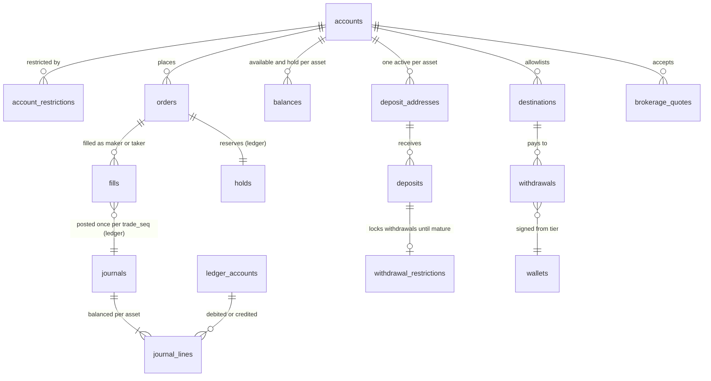
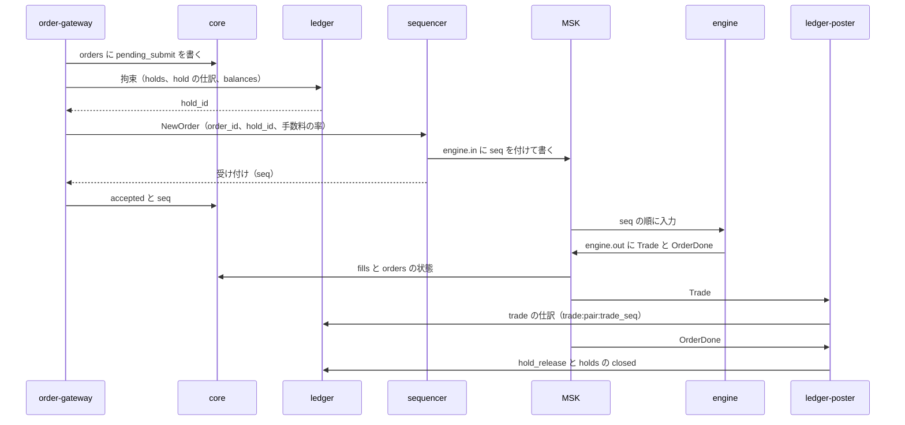
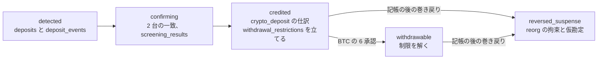
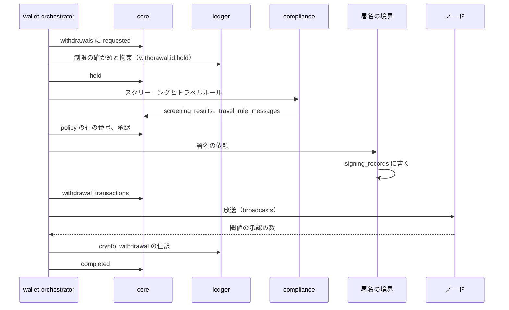

# Data model: Coinbase

データモデルの正本。規約、置き場所、表の目録、全体の ER 図、注文・入金・出金・照合の道筋、横断の不変条件、この工程で決めたことを、ここに置く。領域ごとの表（列・キー・索引・CHECK・RLS・分割・保持・量）と ER 図は [data-model/](data-model/) に置く。

- **列・制約・索引・置き場所の形の正本は、このファイルと `data-model/` の各ファイル**である。領域の文書は振る舞いの正本で、各文書の「quality.md・runbooks・data-model への項目」の節の data-model の表は提案の記録として残す。両者が食い違ったら、このデータモデルに合わせて領域の文書を直す（直すのは各文書の持ち主。食い違いは 10 節に挙げた）。
- 実装の変更（開発リポジトリの `changes/`）でマイグレーションや形を変えるときは、同じ PR でここを更新する。スキーマの変更の段と守る物は [delivery.md](delivery.md) の 4.7 節。
- 方針の元は [ADR-0001](../decisions/0001-platform-and-stack.md)（3 つの Aurora と FORCE RLS）、[ADR-0002](../decisions/0002-sequencer-and-event-journal.md)（板ごとの順序と記録）、[ADR-0004](../decisions/0004-order-entry-holds-and-idempotency.md)（拘束と冪等）、[ADR-0005](../decisions/0005-ledger-balances-and-trade-settlement.md)（台帳と約定の記帳）、[ADR-0017](../decisions/0017-order-row-states-across-clusters.md)（注文の行の正本）、[ADR-0029](../decisions/0029-hold-kinds-and-withdrawal-restrictions.md)（拘束の種類と出金の制限）、[ADR-0052](../decisions/0052-account-lifecycle-levels-and-restrictions.md)（口座の 3 つの軸）、[ADR-0054](../decisions/0054-kyc-vault-purpose-api-and-retention.md)（`kyc-vault`）。
- 「S1 の量」は S1（稼働の口座 30 万、板 2、約定 30 万件/日、新しい注文 約 450 万件/日、暗号資産の入金 5,000 件/日・出金 4,000 件/日、日本円も同じほど）の**初期見積もり**である（[README.md](README.md) の 2 節、[capacity.md](capacity.md) の 4・6 節）。E16 の負荷試験で置き換える。
- 保持の期間の多くは**法務の確認待ち（L4・L7・L9・L10・L11）**である。結論まで、`legal.*` の保持の日数は「未設定なら消さない」（[regulatory-compliance-japan.md](regulatory-compliance-japan.md) の 4.2 節）。表の「保持」は、その鍵の名前か、本システムの値を書く。

## 1. ファイルの構成

| ファイル | 領域 | 表の数 |
| --- | --- | --- |
| [data-model/trading-engine.md](data-model/trading-engine.md) | sequencer と書き手のエンジンの持ち主の記録、銘柄の設定、スナップショット、エンジンのビルドと入れ替え。MSK の入力と出力の記録の形 | 6 |
| [data-model/orders-and-limits.md](data-model/orders-and-limits.md) | 注文、約定、速さの上限の段 | 3 |
| [data-model/market-data-and-brokerage.md](data-model/market-data-and-brokerage.md) | ローソク足、日々の売買高の公表、配信の持ち主の記録、販売所の提示・価格の設定・在庫の目標と操作、参照の価格 | 8 |
| [data-model/ledger-and-balances.md](data-model/ledger-and-balances.md) | 台帳の口座、仕訳と行、冪等キー、型の規則、残高、拘束、出金の制限、手数料の表、締めのスナップショット、明細、年間の報告書 | 13（うち core の `fee_schedules` 1） |
| [data-model/reconciliation-and-trust.md](data-model/reconciliation-and-trust.md) | 照合の実行と項目、本システムの持ち分の精算、信託の額の計算、分別管理の日次の報告、仮勘定の案件 | 6 |
| [data-model/custody-and-wallets.md](data-model/custody-and-wallets.md) | ウォレット、段の目標、移し替え、儀式、鍵の保持者。署名の境界の記録（方針の束、承認者、署名、宛先とパスキー） | 5（境界の記録 5） |
| [data-model/deposits.md](data-model/deposits.md) | 入金のアドレス、入金と事象、閾値、ETH の集め直し、例外の受け取り | 7 |
| [data-model/withdrawals.md](data-model/withdrawals.md) | 出金と事象、取引の試み、承認、宛先の許可の一覧、ETH のレーン | 6 |
| [data-model/chain-nodes.md](data-model/chain-nodes.md) | ノード、頭、2 台の合意、外部の見張り、手数料の見積もり、放送、入金の読み進みの位置 | 7 |
| [data-model/fiat-banking.md](data-model/fiat-banking.md) | 振込先の口座番号、日本円の入金・出金と事象、出金の束、信託の依頼、銀行の営業日 | 8 |
| [data-model/accounts-and-kyc.md](data-model/accounts-and-kyc.md) | 口座、制限と理由の表、法人、パスキー・端末・セッション、出金の待ち、API キー、保持の延長。`kyc-vault` の人・申告・確認・実質的支配者・銀行の口座・読み出しの監査 | 10（`kyc-vault` 6） |
| [data-model/compliance-and-surveillance.md](data-model/compliance-and-surveillance.md) | スクリーニング、制裁の照合、トラベルルール、取引の監視と案件と届出。不公正取引の監視の規則・兆し・案件・措置、口座のつながり、役職員の取引、重要な情報 | 21（`kyc-vault` 1） |
| [data-model/regulatory-and-config.md](data-model/regulatory-and-config.md) | `legal.*` の変更の記録、法令の言葉、報告の定義と実行、外部への委託の台帳、署名つきの設定の束 | 7 |
| [data-model/ops-and-observability.md](data-model/ops-and-observability.md) | outbox、運用者の権限と操作、金庫の表示、CS の参照の数、自動の停止、見張りの口座、DR の記録、キャパシティのレビュー。`watch` の DynamoDB と、Aurora の外の置き場所（MSK、Valkey、S3、AppConfig） | 9（`kyc-vault` 1、DynamoDB 2） |

合計：Aurora の 125 表（core 98、ledger 19、kyc-vault 8。`outbox` は core と ledger に 1 つずつ）。署名の境界の記録 6（`tripwire_events` の写しを含む）、`watch` の DynamoDB 2。ER 図は 15 個（領域ごとに 14 個、4 節の全体図 1 個）。5 節の道筋の図は `sequenceDiagram` 2 個と `flowchart` 1 個。

## 2. 置き場所

| 置き場所 | 中身 | 見える範囲の分け方 | 詳細 |
| --- | --- | --- | --- |
| Aurora core（PostgreSQL 18。東京に writer 1・reader 1、大阪に Global Database の二次） | 口座と制限、注文と約定、入出金の状態、宛先の許可の一覧、ウォレットと移し替え、ノードの状態、販売所の提示、コンプライアンスと監視の案件、設定のバージョン、運用の記録、`sequencer_leases` | 本人の FORCE RLS、公開（設定と市場のデータ）、サービスの役割の許可リスト（3.3 節） | 3.1 節、各 `data-model/` |
| Aurora ledger（同） | 台帳の口座、仕訳、残高、拘束、出金の制限、締め、明細、照合の結果、仮勘定 | 利用者に直接は見せない。`ledger` のサービスの役割だけが書く。仕訳の表は追記だけ | [ledger-and-balances.md](data-model/ledger-and-balances.md)、[reconciliation-and-trust.md](data-model/reconciliation-and-trust.md) |
| Aurora kyc-vault（同） | 氏名・カナ・生年月日・住所・国籍、申告、確認の記録、銀行の口座の番号、トラベルルールの送り手と受取人の情報、読み出しの監査 | 表を直接読ませない。目的で縛る関数だけ。関数は監査の行を同じトランザクションで書く。呼べる役割は `identity`・`funding`・`compliance`・書き出しと運用の画面の関数だけ | [accounts-and-kyc.md](data-model/accounts-and-kyc.md) の 3 節 |
| Amazon MSK | 板ごとの入力の記録 `engine.in.<pair>` と出力の記録 `engine.out.<pair>`（区画 1、保持 7 日、毎時 S3 へ）、配信の `md.pub.<pair>`・`md.priv.<pair>`（保持 1 日、作り直せる） | トピックごとの IAM。`md.priv` は本人の配信だけ | [trading-engine.md](data-model/trading-engine.md) の 4 節、[ops-and-observability.md](data-model/ops-and-observability.md) の 4 節 |
| Valkey | 板の写し `book:<pair>`、速さの上限 `rl:{acct}:<limit>`、セッションの写し、口座の使える機能の写し（5 秒） | 失ってよい。正本にしない | [ops-and-observability.md](data-model/ops-and-observability.md) の 4 節 |
| S3（大阪へ写す） | エンジンのスナップショット `snapshots/<pair>/<seq>.snap`、入力と出力の記録の長期の保管（Object Lock）、13 か月より古い仕訳の区切り（Parquet）、報告と書き出し、`log-archive` | バケットと接頭辞ごとの KMS の鍵と役割 | 同上 |
| SNS・SQS | outbox の事象 | 事象は ID・状態・数・金額・理由のコードだけ | 同上 |
| AppConfig | `release.*`・`ops.*`・`legal.*`（`legal.*` は束の署名を検証の関数で確かめる） | `legal.*` は法務と財務の署名 | [regulatory-and-config.md](data-model/regulatory-and-config.md) |
| 署名の境界の記録（`custody-prod` のアカウント。別のアカウントに写す） | 方針の束、承認者、署名の記録、宛先の登録とパスキーの公開鍵、自動の停止の事象 | `prod` のアカウントから書き換えられない。器（DB の種類）は `custody-signing-poc` の後に custody-and-keys の領域で決める | [custody-and-wallets.md](data-model/custody-and-wallets.md) の 3 節 |
| DynamoDB（`watch` のアカウント。主は大阪） | 心拍、ホットとウォームの残高の独立の見張り | 本体のアカウントから読めない | [ops-and-observability.md](data-model/ops-and-observability.md) の 3 節 |
| 提供者（外部） | 本人確認の書類と顔の画像、チェーン分析の結果の本体、トラベルルールの通知の本体 | 本システムは参照の ID だけを持つ | [ADR-0011](../decisions/0011-external-providers-boundary.md) |

## 3. 規約

### 3.1 クラスタと表

DB の中のスキーマは `public` の 1 つ。表は持ち主のパッケージだけが書く（lint。[ADR-0001](../decisions/0001-platform-and-stack.md)）。ledger のクラスタに書くのは `packages/ledger` だけで、`ledger-poster`・`reconcilers` もこのパッケージの関数で書く（ADR-0001 の DB の分け方の表）。

| クラスタ | 領域 | 表 | 見える範囲 |
| --- | --- | --- | --- |
| core | エンジン | `sequencer_leases`、`engine_leases`、`engine_snapshots`、`engine_builds`、`engine_swaps` | サービス |
| core | 同 | `instrument_configs` | 公開（設定） |
| core | 注文 | `orders`、`fills` | 本人 |
| core | 同 | `rate_limit_tiers` | サービス |
| core | 配信 | `candles`、`daily_volume_publications` | 公開 |
| core | 同 | `md_publisher_leases` | サービス |
| core | 販売所 | `brokerage_quotes` | 本人 |
| core | 同 | `brokerage_pricing_configs`、`brokerage_inventory_targets`、`brokerage_inventory_ops`、`reference_prices` | サービス |
| core | 台帳の設定 | `fee_schedules` | 公開（設定） |
| core | 保管 | `wallets`、`wallet_targets`、`internal_transfers`、`ceremonies`、`key_holders` | サービス |
| core | 入金 | `deposit_addresses`、`deposits`、`deposit_events` | 本人 |
| core | 同 | `deposit_thresholds`、`eth_sweeps`、`unsupported_receipts`、`unattributed_receipts` | サービス |
| core | 出金 | `withdrawals`、`withdrawal_events`、`destinations` | 本人 |
| core | 同 | `withdrawal_transactions`、`withdrawal_approvals`、`eth_lanes` | サービス |
| core | ノード | `chain_nodes`、`chain_heads`、`chain_agreements`、`external_watch_checks`、`fee_estimates`、`broadcasts`、`chain_cursors` | サービス |
| core | 日本円 | `virtual_accounts`、`fiat_deposits`、`payout_bank_accounts`、`fiat_withdrawals`、`fiat_withdrawal_events` | 本人 |
| core | 同 | `fiat_payout_batches`、`trust_instructions` | サービス |
| core | 同 | `business_calendars` | 公開（設定） |
| core | 口座 | `accounts`、`passkeys`、`devices`、`sessions`、`cooldowns`、`api_keys` | 本人 |
| core | 同 | `account_restrictions` | 本人（理由のコードと種類だけ。立てた者と案件は運用の画面） |
| core | 同 | `restriction_reasons` | サービス（設定） |
| core | 同 | `organizations`、`retention_holds` | サービス |
| core | AML | `screening_results`、`screening_rule_versions`、`sanctions_list_versions`、`sanctions_matches`、`travel_rule_messages`、`counterparty_vasps`、`monitoring_alerts`、`compliance_cases`、`compliance_case_events`、`str_reports` | サービス（コンプライアンス） |
| core | 監視 | `surveillance_rules`、`surveillance_alerts`、`surveillance_cases`、`surveillance_case_events`、`surveillance_actions`、`surveillance_report_items`、`account_links`、`staff_registry`、`staff_preclearances`、`material_info_events`、`insider_lists` | サービス（監視） |
| core | 法令と設定 | `legal_config_changes`、`report_definitions`、`report_runs`、`vendor_register`、`config_bundles`、`config_bundle_signatures` | サービス |
| core | 同 | `regulatory_terms` | 公開（設定） |
| core | 運用 | `operator_grants`、`operator_actions`、`cs_view_counters`、`tripwire_events`、`canary_accounts`、`dr_failovers`、`dr_lost_ranges`、`capacity_reviews`、`outbox` | サービス |
| ledger | 台帳 | `ledger_accounts`、`journals`、`idempotency_keys`、`journal_lines`、`journal_type_rules`、`balances`、`ledger_balances`、`holds`、`withdrawal_restrictions`、`balance_snapshots`、`statement_lines`、`annual_reports`、`outbox` | サービス（`ledger`）。利用者は API で自分の分だけ |
| ledger | 照合 | `reconciliation_runs`、`reconciliation_items`、`settlement_batches`、`trust_calculations`、`segregation_reports`、`suspense_cases` | サービス（`ledger`。読み出しは財務） |
| kyc-vault | 本人確認 | `persons`、`person_declarations`、`kyc_checks`、`beneficial_owners`、`bank_accounts`、`vault_access_log` | 関数だけ |
| kyc-vault | AML・運用 | `travel_rule_payloads`、`vault_reveals` | 関数だけ |

- `schema_migrations` は各クラスタにあり、数に入れない。
- S2：ledger の熱い口座の残高の行をスロットに分ける（[Stripe の ADR-0016](../../../stripe/docs/decisions/0016-hot-accounts-and-ledger-sharding.md)）。S3：ledger を口座の持ち主のハッシュで分ける（[README.md](README.md) の 2 節）。

### 3.2 ID と名前

| 種類 | 型 | 作り方 | 対象 |
| --- | --- | --- | --- |
| UUIDv7 | `uuid` | PostgreSQL 18 の `uuidv7()` | ほぼすべての行の ID（`order_id`、`journal_id`、`withdrawal_id` など）。時刻の順に並ぶ |
| 板の連番 | `bigint` | sequencer・エンジンが付ける | `seq`（入力）、`trade_seq`（約定）、`book_seq`（板の差分）。板ごとに 1 から |
| 利用者の冪等キー | `text` | 利用者が作る | `client_order_id`（`account_id` と一意） |
| 内部の冪等キー | `text` | `<source>:<id>:<event>` の形 | `idempotency_keys`・`journals.idempotency_key`（3.5 節） |
| 外部の参照 | `text` | 相手が付ける | 銀行の取引の番号、提供者の応答の ID、チェーンの取引の ID（`txid`） |
| 内容のハッシュ | `bytea`（32） | SHA-256 | 方針の束、設定の束、スナップショットの状態、報告の出力 |
| `person_key` | `bytea`（32） | 確かめたカナ・生年月日・住所の正規化した値の HMAC（`identity` の鍵） | 同じ人の口座の判定（[kyc-and-accounts.md](kyc-and-accounts.md) の 6.1 節） |

- **`account_id` は利用者の口座（`accounts.account_id`）だけを指す。** 台帳の口座は `ledger_account_id`（`ledger_accounts` の主キー）で指す。領域の文書の `user_id`（fiat-and-banking、ledger-and-balances の `annual_reports`）と、`ledger_accounts` の `account_id`・`owner_id` は、この名前に揃えた（7 節の N3）。
- **板の名前（`pair`）は `btc_jpy`・`eth_jpy`**（小文字、`_` で区切る）。MSK のトピック、`ops.*` の鍵、冪等キーで同じ値を使う。画面と API の表示は `BTC/JPY`（7 節の N4）。
- **資産（`asset`）は `BTC`・`ETH`・`JPY`**。チェーン（`chain`）は `bitcoin`・`ethereum`。
- 外に見せる ID も UUIDv7（推測しにくい）。API キーの ID は `<brand>_live_<26 文字>`（[kyc-and-accounts.md](kyc-and-accounts.md) の 5.3 節）。

### 3.3 見える範囲と RLS

単一のテナントで、`tenant_id` を持たない。トランザクションごとに `SET LOCAL app.actor_id`（`app-api`・`trading-api` がセッションか API キーの署名からだけ決める）か `SET LOCAL app.service` を置く（[ADR-0001](../decisions/0001-platform-and-stack.md)、roadmap の `aurora-clusters-and-rls`）。

**本人の表**（core。持ち主の列は `account_id`）：

```sql
ALTER TABLE <t> ENABLE ROW LEVEL SECURITY;
ALTER TABLE <t> FORCE ROW LEVEL SECURITY;
CREATE POLICY owner_read ON <t> FOR SELECT
  USING (account_id = current_setting('app.actor_id')::uuid);
CREATE POLICY svc_rw ON <t> TO <svc_role_1>, <svc_role_2>   -- allowlist per table
  USING (true) WITH CHECK (true);
```

- 利用者の要求でも、書き込みは持ち主のサービスの遷移の関数を通り、サービスの役割で書く。利用者の役割に `INSERT`・`UPDATE` を与えない。
- `current_setting` の `missing_ok` を使わない（`app.actor_id` も `app.service` もなければ失敗する）。
- アプリの DB の役割は表の持ち主でなく、`BYPASSRLS` を持たない。`BYPASSRLS` はマイグレーションの役割だけ。ledger の仕訳の表は別の持ち主の役割が持ち、マイグレーションの役割も行を書き換えられない（[ADR-0005](../decisions/0005-ledger-balances-and-trade-settlement.md)）。
- 運用者は RLS を外さない。`ops-api` が案件に結んだ期限つきの権限（`operator_grants`）を確かめ、持ち主のサービスの API を呼ぶ（[ADR-0065](../decisions/0065-operator-access-and-cs-view-scope.md)）。
- **ledger**：利用者の役割は ledger のクラスタに経路を持たない。残高・明細の照会は `ledger` の API が `account_id` で絞って返す。
- **kyc-vault**：表への `SELECT` を誰にも与えない。`SECURITY DEFINER` の関数（`nameKanaMatches` など）だけを役割ごとに `EXECUTE` で許し、関数が `vault_access_log` に行を書く（[ADR-0054](../decisions/0054-kyc-vault-purpose-api-and-retention.md)）。
- **公開の表**（RLS なし）：`instrument_configs`、`candles`、`daily_volume_publications`（`published_at` のある行）、`fee_schedules`、`business_calendars`、`regulatory_terms`。
- CI のスキーマの検査は、全表が 3.1 節の一覧にあること、本人の表に FORCE RLS と方針があること、全表に区分（3.6 節）と保持（3.8 節）があることを確かめる（roadmap の E1）。

### 3.4 クラスタをまたぐ参照

- 別のクラスタの行を指す列には外部キーを張らない（論理の参照）。一致は冪等キーと照合で守る。

| 指す列 | 指される行 | 守り方 |
| --- | --- | --- |
| core の `orders.hold_id` | ledger の `holds` | 冪等キー `order:<order_id>:hold`。`reconcilers` が 10 秒を超えた `pending_submit` を引く（[ADR-0017](../decisions/0017-order-row-states-across-clusters.md)）。REC-HOLD（5 分） |
| ledger の `journals.source_id`（`trade`） | core の `fills`・MSK の `Trade` | REC-TRADE（1 分ごとの `trade_seq` の連番） |
| core の `deposits.credit_journal_id`、`withdrawals`・`fiat_withdrawals`・`brokerage_quotes` の `journal_id` | ledger の `journals` | 書いた後に ID を戻す。照合で欠けを見つける |
| ledger の `holds.source_id`（`withdrawal`・`fiat_withdrawal`・`reorg`・`legal`） | core の `withdrawals`・`fiat_withdrawals`・`deposits`・`compliance_cases` | NFR-004 の `source_type` ごとの比べ |
| ledger の `withdrawal_restrictions.deposit_id` | core の `deposits` | 6 承認で `deposit-watcher` が解く |
| core の `persons` への参照（`virtual_accounts.vault_ref`、`payout_bank_accounts.vault_ref`、`sanctions_matches.subject_ref`、`travel_rule_messages.payload_ref`、`str_reports.document_ref`） | kyc-vault の行 | 参照だけを持ち、値は関数で読む |
| core の `withdrawals.policy_bundle_id`、`destinations.registered_at_boundary` | 署名の境界の記録 | 毎週の束と境界の記録の照らし合わせ（[runbooks/README.md](../runbooks/README.md) の 5 節） |

### 3.5 金額・数量・冪等キー

- **金額と数量は、資産ごとの最小の単位の整数**（BTC は satoshi、ETH は wei、日本円は 1 円）。型は `numeric(38,0)`。浮動小数点を使わない（[AGENTS.md](../../AGENTS.md)、[ADR-0005](../decisions/0005-ledger-balances-and-trade-settlement.md)）。ETH の wei は `bigint` に収まらないので、日本円も同じ型にそろえる。TypeScript は `bigint`、Rust は `i128`・`u128`、境界の符号化は文字列の整数（[ADR-0001](../decisions/0001-platform-and-stack.md)）。
- 列の名前：`amount`・`*_amount`・`fee`・`quantity`（基準の資産の数量）・`price`（基準の資産 1 単位あたりの円。刻みの整数）・`notional`（代金の円）・`*_jpy`（円換算の評価）・`*_minor`（`watch` の DynamoDB）。
- 代金 ＝ `floor(price × quantity ÷ 基準の資産の 1 単位)`（[ADR-0003](../decisions/0003-matching-rules-and-self-trade-prevention.md)）。手数料 ＝ `floor(受け取る額 × 率 ÷ 1,000,000)`（[ADR-0027](../decisions/0027-fee-schedules-and-rounding.md)）。
- 率：手数料は 100 万分率の整数（`*_ppm`）、販売所のスプレッドは基点の整数（`*_bps`）。ウォレットの段の目標のような割合は `numeric(7,6)`（正確な十進。浮動小数点でない）。
- **拘束に手数料の上限を足さない**（[ADR-0004](../decisions/0004-order-entry-holds-and-idempotency.md) の 2026-11-15 の注記）。拘束の額の列 `holds.amount` は [order-entry-and-risk.md](order-entry-and-risk.md) の 4.3 節の式の値だけ。
- **冪等キー**：`idempotency_keys` の主キー（分割しない表。`journals` は月の分割なので、全期間の一意をここで守る）。`journals.idempotency_key` にも同じ値を持つ。形は `<source>:<id>:<event>`。

| 仕訳 | 冪等キー |
| --- | --- |
| 注文の拘束・戻し | `order:<order_id>:hold`、`order:<order_id>:release` |
| 約定 | `trade:<pair>:<trade_seq>` |
| 販売所 | `quote:<quote_id>` |
| 暗号資産の入金 | `deposit:<chain>:<txid>:<output_ref>`（BTC は出力の番号、ETH は trace の位置か log の番号） |
| 暗号資産の出金 | `withdrawal:<withdrawal_id>:hold`、`withdrawal:<withdrawal_id>:complete`、`withdrawal:<withdrawal_id>:release` |
| 日本円 | `fiat_deposit:<bank_txn_id>`、`fiat_withdrawal:<id>:hold`・`:request`・`:settle`・`:return`・`:release` |
| 巻き戻り | `reorg:<deposit_id>:hold` |
| 移し替え・仮勘定・打ち消し | `transfer:<id>`、`suspense:<case_id>:<n>`、`reversal:<journal_id>` |

### 3.6 データの区分と暗号化

区分は [security.md](security.md) の 8 節（[メルカリの ADR-0071](../../../mercari/docs/decisions/0071-data-classes-and-lifecycle.md) の考え方）。各表の「区分」の列に書く。

| 区分 | 記号 | 例 | ログ・トレース |
| --- | --- | --- | --- |
| 秘密 | S | 鍵の材料、API キーの秘密（本システムは持たない）、承認の署名の中身 | 出さない |
| 金庫 | V | 氏名・住所・生年月日、口座の番号、トラベルルールの送り手と受取人 | 出さない |
| 本人 | O | メール、電話、端末、パスキーの公開鍵 | 出さない |
| お金 | F | 残高、仕訳、拘束、出金の額 | ID と額だけ |
| チェーン | C | アドレス、取引の ID、ブロックの ID | 出してよいが、`account_id` と同じ行（ログ）に書かない（`chain` のロググループ） |
| 監査 | A | 運用者の操作、署名の記録、案件の事象 | 監査のアカウントへ |
| 運用 | M | 設定、持ち主の記録、ノードの状態 | 出してよい |
| 公開 | U | 板、約定の集計、ローソク足、法令の言葉 | 出してよい |

- **DB の表は C の列と `account_id` を同じ行に持ってよい**（入金のアドレス、出金の宛先）。ログの規則（[ADR-0069](../decisions/0069-telemetry-schema-without-secrets.md)）は、ログとトレースの行の決まりである。
- `kyc-vault` の V の列は、人ごとの鍵による封筒の暗号化（`persons.key_id`。形は [Workday の保管庫](../../../workday/docs/architecture/my-number-vault.md)）。退会の保持の期限の後、鍵を破棄して消す（[ADR-0054](../decisions/0054-kyc-vault-purpose-api-and-retention.md)）。
- core の O の列（メール、電話番号）は列の暗号にし、引きは HMAC の列で完全一致だけ（[security.md](security.md) の 8 節の「core（暗号化の列）」）。
- **持たないもの**：本人確認の書類と顔の画像（提供者だけ）、個人番号（法務の L10）、API キーの秘密の値（公開鍵だけ）、パスワード（使わない）、署名の鍵の材料（境界の中だけ）。

### 3.7 時刻

- 時刻は `timestamptz`（UTC で保存）。日の列（`business_date`、`trade_date`、`as_of_date`、`bucket_start` の 1 日と 6 時間の足）は日本時間の暦。締めは JST 0:00（[ledger-and-balances.md](ledger-and-balances.md) の 9 節）。
- 板とローソク足の時刻は sequencer の `ts` だけを使う（[ADR-0022](../decisions/0022-candles-from-sequencer-time.md)）。DB の `now()` は記録の時刻で、約定の時刻にしない。
- 期限は DB の時刻か、決める部品の時計（Amazon Time Sync）で決める。利用者の端末の時計を使わない。72 時間・24 時間の待ちは**境界の記録の時刻**で数える（[ADR-0045](../decisions/0045-allowlist-registration-recorded-in-boundary.md)）。
- 列の名前：時刻 `_at`、期限 `expires_at`・`_until`・`due_at`、範囲 `valid_from`・`valid_to`・`effective_from`。

### 3.8 分割・保持・削除

| 表 | 分割 | 保持 |
| --- | --- | --- |
| `journals`・`journal_lines` | 月ごと（`created_at`） | 消さない（追記だけ）。13 か月より古い区切りを S3 の Parquet へ移し、Aurora から外す（[capacity.md](capacity.md) の 6 節） |
| `holds` | 分割しない（`active` の行を月の区切りに縛らない） | 消さない。`closed` の行は 13 か月で S3 へ |
| `idempotency_keys` | 分割しない（全期間で一意） | 13 か月（仕訳の区切りを S3 へ移すときに同じ範囲を消す） |
| `orders` | S1 は分割しない（`(account_id, client_order_id)` の一意を全体で守るため） | `legal.transaction_record_retention_days`（開発の既定 2,555 日、本番は L4・L11。未設定なら消さない） |
| `fills` | 月ごと（sequencer の `ts`） | 同上 |
| `statement_lines` | 月ごと | 作り直せる。表示は 13 か月、古い区切りは S3 |
| 入出金の表と事象 | 分割しない（S1 で 1 日 数万行） | `legal.transaction_record_retention_days` |
| 本人確認（kyc-vault） | 分割しない | 退会から `legal.kyc_record_retention_days`。法令の照会・差押えの間は `retention_holds` で延ばす |
| 監視の記録 | 分割しない | `legal.surveillance_record_retention_days`（開発の既定 1,826 日） |
| 報告の出力 | — | 提出から 1,826 日（本システムの仮の値。L9） |
| 持ち主の記録、設定、ノードの状態 | — | 置き換え。履歴は設定の束と監査の写し |
| MSK の記録 | — | 7 日（配信は 1 日）。入力と出力は毎時 S3 へ、保管は L4・L7 |
| ログ | — | CloudWatch 120 日、`log-archive` 13 か月（[observability.md](observability.md) の 4.6 節）。法令の記録の保存の代わりにしない |

- 削除は退会の保持の期限の後に、`kyc-vault` の人ごとの鍵の破棄で行う。台帳と core には `account_id` と `person_key` だけが残る（[kyc-and-accounts.md](kyc-and-accounts.md) の 7 節）。
- 追記だけの表（仕訳、仕訳の行、事象の表、`vault_access_log`、`operator_actions`、案件の事象）は `UPDATE`・`DELETE` を権限で拒む。

### 3.9 outbox と事象

- core と ledger に `outbox` を 1 つずつ持つ。状態の変化と同じトランザクションで行を書き、`relay` が SNS へ流す（[ADR-0001](../decisions/0001-platform-and-stack.md)）。列は [ops-and-observability.md](data-model/ops-and-observability.md) の 2.1 節。
- 板の出力は outbox を通らない。`ledger-poster`・`md-publisher`・`surveillance`・状態の更新の部品は MSK の `engine.out.<pair>` を直接読む。
- 事象の名前は `<領域>.<過去形>`（`account.capabilities_changed`、`account.activated`、`deposit.credited`）。本文は ID・状態・数・金額・理由のコードだけで、V・O の値を入れない。

### 3.10 命名と型

- 表は複数形の snake_case、列は snake_case。主キーは `<単数形>_id`（領域の文書が `id` と書いたものも、他の表から指すときは `<単数形>_id`）。
- 状態の列は `state`（ステートマシンを持つもの：注文以外の入出金、案件）か `status`（ADR が `status` と書いたもの：`orders`、`brokerage_quotes`、`fiat_*`）。値は `text` と `CHECK`（列挙型を使わない。値の追加をマイグレーションの CHECK の差し替えで行う）。
- 理由のコードは `reason_code`（`text`）。口座の制限の理由は `restriction_reasons` の行に限る（外部キー）。

## 4. 全体の ER 図

主な表の関係だけを示す（列は各 `data-model/` の図）。クラスタをまたぐ線（`orders` → `holds`、`fills` → `journals`、`deposits` → `journals`）は論理の参照で、外部キーを張らない（3.4 節）。



- `orders ||--|| holds`：注文を受け付けた行は必ず拘束を 1 つ持つ。拘束の不足で `rejected` になった行は拘束を持たない（`hold_id` は NULL）。
- `fills`：1 つの約定（`trade_seq`）は、メイカーとテイカーの 2 行。台帳の `trade` の仕訳は約定ごとに 1 つ。
- `deposits ||--o| withdrawal_restrictions`：BTC の入金だけが `deposit_maturity` の行を 1 つ持つ（ETH は記帳と同時に出金に使える）。
- `brokerage_quotes` は拘束を持たない。受け入れは 1 つのトランザクションで `brokerage` の仕訳を書く（[ADR-0010](../decisions/0010-brokerage-quotes-and-inventory.md)）。

## 5. 主な道筋

どの表のどの行が、どのトランザクションで書かれるかを示す。図の前の表が正で、図は要約である。

### 5.1 注文から約定と記帳まで

| 順 | クラスタ・記録 | 書くもの | 書く者 |
| --- | --- | --- | --- |
| 1 | core | `orders`（`pending_submit`、`client_order_id` の一意）と、同じトランザクションで `account_restrictions` の読み | `order-gateway` |
| 2 | ledger | `balances` の条件つきの更新（`available >= $a`）、`holds`（`active`）、`journals`（`hold`）と行 2 | `ledger`（冪等キー `order:<order_id>:hold`） |
| 3 | MSK | `engine.in.<pair>` に `NewOrder`（`seq`、`ts`、`epoch`） | sequencer |
| 4 | core | `orders` を `accepted` と `seq` に（応答の後） | `order-gateway` |
| 5 | MSK | `engine.out.<pair>` に `Trade`、`OrderOpened`・`OrderDone`、`InputDigest` | engine |
| 6 | core | `fills` の 2 行、`orders.filled_quantity`・`status` | 状態の更新の部品（出力の記録を読む） |
| 7 | ledger | `journals`（`trade`）と行 6、`balances` の 4 行、`holds` の 2 行の残り。outbox | `ledger-poster`（`trade:<pair>:<trade_seq>`） |
| 8 | ledger | `done` で `hold_release`、`holds` を `closed` | `ledger-poster`（`order:<order_id>:release`） |



### 5.2 入金から記帳と出金の制限の解除まで

| 順 | 状態 | 書くもの | 書く者 |
| --- | --- | --- | --- |
| 1 | `detected` | `deposits`（`(chain, txid, output_ref)` の一意）、`deposit_events` | `deposit-watcher` |
| 2 | `confirming` | 2 台が同じブロックを返した。`screening_results` | `deposit-watcher`、`compliance` |
| 3 | `credited` | ledger の 1 つのトランザクションで `crypto_deposit` の仕訳、`balances`、`ledger_balances`（`wallet:<tier>:<asset>`）、BTC は `withdrawal_restrictions`（`scope = account`、`deposit_maturity`）。core の `deposits.credit_journal_id` | `deposit-watcher` が `ledger` を呼ぶ |
| 4 | `withdrawable` | `withdrawal_restrictions.released_at` | `deposit-watcher`（BTC の 6 承認） |
| 5 | `reversed_suspense` | `holds`（`reorg`）と `hold` の仕訳。足りない分は `suspense:reorg` | `deposit-watcher`（記帳の後の巻き戻り） |



### 5.3 出金から確定まで

| 順 | 状態 | 書くもの | 書く者 |
| --- | --- | --- | --- |
| 1 | `requested` | `withdrawals`（手数料と `fee_schedule_version` を決める）、`withdrawal_events` | `wallet-orchestrator` |
| 2 | `held` | `withdrawal_restrictions` の `scope = account` の行がないことを確かめ、ledger に拘束（額 ＋ 手数料。冪等キー `withdrawal:<id>:hold`） | `wallet-orchestrator` が `ledger` を呼ぶ |
| 3 | `screening`・`compliance_review` | `screening_results`、`travel_rule_messages` | `compliance` |
| 4 | `policy`・`approving` | `withdrawals.policy_rule_no`・`policy_bundle_id`、`withdrawal_approvals` | `wallet-orchestrator` |
| 5 | `signing` | 境界の `signing_records` | 署名の境界 |
| 6 | `broadcast`・`replacing` | `withdrawal_transactions`、`broadcasts` | `wallet-orchestrator` |
| 7 | `completed` | ledger の `crypto_withdrawal`（拘束から `wallet:<tier>` と `fee_revenue`、`network_fee_expense`） | `wallet-orchestrator` が `ledger` を呼ぶ |



### 5.4 照合

照合は書き換えない結果の行を残す。台帳とチェーンは、2 台が同じブロックを返す高さ h を選び、ledger の reader の 1 つの読み取り（REPEATABLE READ）で `ledger_balances`（`wallet:*`）と途中の項目を読む（[ADR-0031](../decisions/0031-point-in-time-reconciliation-with-in-flight.md)）。

| 照合 | 読むもの | 書くもの | 頻度 |
| --- | --- | --- | --- |
| REC-HOLD | `holds`（`order`、`active`）とエンジンの未約定の写し | `reconciliation_runs` | 5 分 |
| REC-TRADE | `journals`（`trade`）と出力の記録の `trade_seq` | 同上 | 1 分 |
| REC-CHAIN-HOT・COLD・HOUSE | `ledger_balances`（`wallet:*`・`house_wallet:*`）、ノードの残高、途中の項目（`deposits`、`withdrawal_transactions`、`internal_transfers`、`eth_sweeps`） | `reconciliation_runs`、`reconciliation_items`、説明のつかない差は `suspense_cases` | 1 時間・毎日 |
| REC-BANK・TRUST | `ledger_balances`（`bank:*`・`trust:*`・`fiat_in_transit`）、銀行と信託の明細 | 同上、`trust_calculations` | 毎営業日 |
| REC-SEG | 利用者の口座の和、置き場所の口座の和、`journal_lines.settlement_batch_id` の空の和 | `reconciliation_runs`、`segregation_reports` | 毎日（JST 0:00 の締め） |

## 6. 横断の不変条件

| # | 不変条件 | 守る場所 | 確かめ方 |
| --- | --- | --- | --- |
| I1 | 1 つの仕訳の行の和は、資産ごとに 0 | ledger の遅延の制約のトリガー、`packages/ledger` | PROP-LED-001、締めの検査（[ledger-and-balances.md](ledger-and-balances.md) の 9 節） |
| I2 | 資産ごとに、全口座の残高の和は 0 | 締めの `balance_snapshots` | 締めの検査（破れたら書き込みを止める） |
| I3 | `balances.available >= 0`、`balances.hold >= 0` | `CHECK` と条件つきの更新（`available >= $a`） | PROP-ORD-1、NFR-004 |
| I4 | `balances.hold` ＝ その口座・資産の `active` の `holds.remaining` の和 | 同じトランザクションで両方を書く | 締めの検査 |
| I5 | 拘束の和は `source_type` ごとに必要額と一致する（`order` は未約定の注文、`withdrawal`・`fiat_withdrawal` は手続き中の出金、`reorg`・`legal` は案件の記録） | REC-HOLD、`reconcilers` | NFR-004、[ADR-0029](../decisions/0029-hold-kinds-and-withdrawal-restrictions.md) |
| I6 | 約定ごとに `trade` の仕訳は 1 つ（`trade:<pair>:<trade_seq>` の一意）。欠けが 1 分を超えない | 一意の制約、REC-TRADE | PROP-LED-002、NFR-005 |
| I7 | 入金ごとに `crypto_deposit` は 0 か 1（`deposit:<chain>:<txid>:<output_ref>` の一意） | 一意の制約 | PROP-DEP-002 |
| I8 | `withdrawal_restrictions` の解けていない `scope = account` の行がある口座の出金（暗号資産・日本円）の `held` 0 | 出金の拘束の前の確かめ | PROP-DEP-004、PROP-LED-004 |
| I9 | 台帳の `wallet:<tier>:<asset>` ＋ 途中の項目 ＝ チェーンの上の残高（高さ h） | REC-CHAIN-* | NFR-006、[ADR-0031](../decisions/0031-point-in-time-reconciliation-with-in-flight.md) |
| I10 | 利用者の口座の和 ＝ 置き場所の口座の和 − 本システムの持ち分 ＋ 本システムの置き場所にある利用者の財産（資産ごと） | REC-SEG | [segregation-and-reconciliation.md](segregation-and-reconciliation.md) の 6 節 |
| I11 | 板ごとに `seq` は 1 からの連番で、抜けも重なりもない。`epoch` は減らない | sequencer の fencing、エンジンの検査（抜け・小さい `epoch` で板を止める） | NFR-003・NFR-013、[ADR-0002](../decisions/0002-sequencer-and-event-journal.md) |
| I12 | `trade_seq`・`book_seq` は板ごとの連番。出力の `output_hash[seq]` は前の値からの連鎖 | `engine-core` | 写しのエンジンの比べ、日次の再生（NFR-003） |
| I13 | 板ごとに有効な `sequencer_leases` の持ち主は 1 つ。古い持ち主の書き込みは MSK のトランザクションの fencing で拒まれる | `sequencer_leases`、`transactional.id` | [ADR-0072](../decisions/0072-matching-placement-across-azs.md) の 2026-11-15 の注記 |
| I14 | 1 つの出金に有効な取引は 1 つ（置き換えは同じ入力・同じ nonce・同じ宛先と額だけ） | `withdrawal_transactions` の一意、境界の `nonce-and-utxo-guard` | NFR-008、[ADR-0044](../decisions/0044-stuck-transaction-replacement.md) |
| I15 | 1 つの `quote_id` の受け入れの仕訳は 0 か 1 | `quote:<quote_id>` の一意 | PROP-BRK |
| I16 | 解けていない口座の制限は行ごとに外す。重いほう（`frozen` ＞ `restricted`）が効く | `account_restrictions` の行、`identity.capabilities()`（DT-KYC-001） | PROP-KYC-002 |
| I17 | 利用者の財産と本システムの財産を同じウォレット・口座に混ぜない | `wallets.property_class`、`ledger_accounts.property_class` | REC-HOUSE、REC-SEG |

## 7. この工程で決めたこと（2026-11-15）

どれも Dev（テックリード）の承認を待つ草案である。領域の文書と ADR の本文の名前は、持ち主が直す（10 節）。

- **N1 口座の制限の理由のコードを 1 つの一覧にした**（[design-log.md](design-log.md) の統合の残り）。正の一覧は [accounts-and-kyc.md](data-model/accounts-and-kyc.md) の 2.3 節の `restriction_reasons` の行である。
  - `takeover_suspected`（[ADR-0019](../decisions/0019-account-trading-restrictions.md)）は `takeover_lock`（[ADR-0052](../decisions/0052-account-lifecycle-levels-and-restrictions.md)・[ADR-0053](../decisions/0053-sign-in-step-up-cooldown-and-api-keys.md)・runbooks）に揃えた。`kind = frozen`。立てるのは本人（「これは私ではない」）、CS、セキュリティ。
  - ADR-0019 の理由 `frozen` は理由のコードでなく `kind = frozen` で、理由は `sanctions_match`・`legal_order`・`deceased` に分けた。
  - ADR-0019 の `kyc_incomplete` と `closing` は制限の行にしない。寿命の状態（`applying`・`verifying`・`review`、`closing`）が DT-KYC-001 で同じ止めを表すので、同じ事実を 2 か所に持たない。退会は未約定の注文 0 が条件なので、`closing` で取り消す注文もない（[kyc-and-accounts.md](kyc-and-accounts.md) の 7 節）。
  - ADR-0019 の `trading_suspended` は残す（`kind = restricted`、立てるのはコンプライアンス。監視は自分の `surveillance_hold`・`surveillance_suspension` を使う）。DT-KYC-001 の `restricted` の行と違い、売りの新しい注文も止め、板の注文を全部取り消す。この違いは `restriction_reasons` の列で持つ。
- **N2 署名の方針の宛先の種類**：`house_hot`・`house_warm`・`house_cold`（[ADR-0035](../decisions/0035-signing-policy-bundle-and-decision-table.md)）はデータモデルでは `tier_hot`・`tier_warm`・`tier_cold` として持つ（ADR-0035 の注記の例のとおり）。`house_wallet` はそのまま。`wallets.owner`（custody-and-keys の `user`・`house`）は、台帳と同じ語の `property_class`（`user`・`house`）にした。
- **N3 `account_id` と `ledger_account_id`**：利用者の口座は `account_id`、台帳の口座は `ledger_account_id`。fiat-and-banking の `user_id`、`annual_reports.user_id`、`ledger_accounts.owner_id` を `account_id`（`owner_account_id`）に揃えた。
- **N4 板の名前**：`pair` の値は `btc_jpy`。ledger-and-balances の例の `trade:BTC-JPY:<trade_seq>` は `trade:btc_jpy:<trade_seq>` と読む。
- **N5 手数料の表を 1 つにした**：withdrawals の `withdrawal_fee_tables` を、[ADR-0027](../decisions/0027-fee-schedules-and-rounding.md) の `fee_schedules`（core、`kind = crypto_withdrawal`）にまとめ、[ADR-0043](../decisions/0043-one-transaction-per-withdrawal-and-fee-table.md) の最小の出金の額を `min_amount` の列にした。`withdrawals.fee_table_version` は `fee_schedule_version`。`fee_schedules` は core に置き、`order-gateway`・`wallet-orchestrator`・`funding` が受け付けの時に読む。中身は `config/withdrawal-fees/` などの署名つきの束（[ADR-0075](../decisions/0075-signed-config-bundles-for-policies-and-rules.md)）から入れる。
- **N6 仕訳の型の名前**：deposits の `deposit_reversal_hold` は、ledger の `hold`（`source_type = reorg`、冪等キー `reorg:<deposit_id>:hold`）と読む。`fiat_withdrawal_return`（ledger-and-balances の 5 節の本文と fiat-and-banking の 6.2 節）を型の一覧に入れた。
- **N7 残高の行を 2 つに分けた**：利用者の `balances`（`account_id`、`asset`、`available`、`hold`。ADR-0005 の形）と、利用者でない口座の `ledger_balances`（`ledger_account_id`、`balance`）。照合（5.4 節）と販売所の在庫の確かめが、ウォレット・銀行・在庫の口座の残高を読むため。`fee_revenue:*` は約定ごとに更新しない（締めのスナップショットと仕訳の和で出す）。capacity の 5.2 節の「約定の記帳の残高の行 4」を変えないためである。
- **N8 自己約定の組**：DB の列は `accounts.self_trade_group_id` と `orders.self_trade_group_id`。エンジンの入力の `stp_group_id` は同じ値の符号化の名前である。
- **N9 案件の事象の表**：aml-and-travel-rule の `case_events` を `compliance_case_events` にした（`surveillance_case_events` と並べる）。
- **N10 出金の制限は 1 つの表**：`withdrawal_restrictions`（ledger）に `scope`（`account`・`asset`）を持ち、`deposit_maturity` は `scope = account` の 1 行（D1）。口座の制限（`account_restrictions`）、出金の待ち（`cooldowns`）とは別の表で、意味を混ぜない。

## 8. 段階ごとの変化

- S2：ledger の熱い口座（マーケットメイカーの `balances`、`fee_revenue` の集計）をスロットに分ける。板の数が 10 になり、`candles`・`fills` の量が増える。注文の拘束を仕訳にしない案（[capacity.md](capacity.md) の 6 節）を S2 の前に見直す。
- S3：ledger を口座の持ち主のハッシュで分ける。入力の記録の方式を見直す（[ADR-0002](../decisions/0002-sequencer-and-event-journal.md)）。

## 9. 持ち越し

| 項目 | 次に決める者・時 |
| --- | --- |
| 署名の境界の記録の器（DB の種類）と、写しの先のアカウント | `custody-signing-poc` の後、custody-and-keys の領域 |
| `kyc-vault` の人ごとの鍵の表の形（`persons.key_id` の指す先） | E2 の `kyc-vault`。Workday の保管庫の形を写す |
| 日本円の出金の `returned`（完了の後の組戻しの着金）の仕訳の型の名前 | ledger-and-balances の領域（[fiat-and-banking.md](fiat-and-banking.md) の 6.2 節は「返却の着金」とだけ書く） |
| `orders` の分け方（1 年 約 16 億行。口座のハッシュで分けるか、古い行を移すか） | Dev。S2 の前に保持の結論（L4・L11）と合わせて |
| 販売所の提示の量（S1） | brokerage-quotes の領域（[capacity.md](capacity.md) の 4 節で**未検証**） |
| 入金のアドレスの残高（ETH の集め直しの前）を `wallet:hot:ETH` に含めるか、別の口座にするか | ledger-and-balances の領域（[deposits.md](deposits.md) の 14 節）。[ledger-and-balances.md](ledger-and-balances.md) の 5 節の `crypto_deposit` は `wallet:<tier>:<asset>` に借記するので、今の形では `wallet:hot:ETH` に含まれる |
| 領域の文書と ADR の名前の直し（7 節の N1〜N9） | 各文書・ADR の持ち主 |

## 10. 領域の文書・ADR との食い違い

データモデルで上のとおり揃えたが、元の文書は直していない。直すのは各文書の持ち主である。

| # | 場所 | 食い違い | データモデルでの扱い |
| --- | --- | --- | --- |
| G1 | [ADR-0032](../decisions/0032-house-share-settlement.md) の 30 行、[segregation-and-reconciliation.md](segregation-and-reconciliation.md) の 138 行 と [ADR-0037](../decisions/0037-transfer-routes-and-warm-target.md) の 42 行、[custody-and-keys.md](custody-and-keys.md) の 180 行（DT-POL の P12） | 精算の `to_user` の向き（本システムのウォレット → 利用者用のホット）は 1 時間ごとの移し替えだが、ADR-0037 はこの経路を方針で拒み、DT-POL にも行がない | `internal_transfers.route` に持たない。経路を足すか、精算の向きを変えるかは custody-and-keys と segregation-and-reconciliation の持ち主（セキュリティ・財務）が決める |
| G2 | [order-entry-and-risk.md](order-entry-and-risk.md) の 188 行、[kyc-and-accounts.md](kyc-and-accounts.md) の 136 行（DT-KYC-001） | `trading_suspended` は売りも止め板の注文を取り消すが、DT-KYC-001 の `restricted` の行は売りを通す | `restriction_reasons` の列で違いを持つ。DT-KYC-001 に理由ごとの違いを足すのは kyc-and-accounts の持ち主 |
| G3 | [order-entry-and-risk.md](order-entry-and-risk.md) の 187・189・191 行、[ADR-0019](../decisions/0019-account-trading-restrictions.md) の 26 行 | `kyc_incomplete`・`takeover_suspected`・`closing` の名前（N1） | `takeover_lock` に揃え、`kyc_incomplete`・`closing` は寿命の状態で表す |
| G4 | [withdrawals.md](withdrawals.md) の 317・322 行 | `withdrawal_fee_tables` と `fee_table_version` は ADR-0027 の `fee_schedules` と重なる（N5） | `fee_schedules` にまとめた |
| G5 | [fiat-and-banking.md](fiat-and-banking.md) の 224・226・227 行、[ledger-and-balances.md](ledger-and-balances.md) の 320 行 | `user_id` と `account_id` の 2 つの名前（N3） | `account_id` |
| G6 | [deposits.md](deposits.md) の 127 行 | 仕訳の型 `deposit_reversal_hold` は ledger-and-balances の型の一覧にない（N6） | `hold`（`source_type = reorg`） |
| G7 | [ledger-and-balances.md](ledger-and-balances.md) の 99 行（本文だけ）、[fiat-and-banking.md](fiat-and-banking.md) の 113 行 | `fiat_withdrawal_return` が 5 節の型の表にない。`returned` の仕訳の型に名前がない | `fiat_withdrawal_return` を型の一覧に入れた。`returned` は 9 節の持ち越し |
| G8 | [ledger-and-balances.md](ledger-and-balances.md) の 226 行 | 冪等キーの例 `trade:BTC-JPY:<trade_seq>` は、ほかの文書の `btc_jpy`（トピック、フラグ）と違う（N4） | `btc_jpy` |
| G9 | [ledger-and-balances.md](ledger-and-balances.md) の 311 行、[capacity.md](capacity.md) の 200 行 | `journals.idempotency_key` の一意と、`journals` の月の分割は両立しない（PostgreSQL の分割の表は分割の鍵を含まない一意を持てない） | 分割しない `idempotency_keys` で一意を守る（[ADR-0001](../decisions/0001-platform-and-stack.md) の ledger の「冪等キー」） |
| G10 | [deposits.md](deposits.md) の 190 行 と [ledger-and-balances.md](ledger-and-balances.md) の 88 行 | 集め直しの記帳を「入金のアドレスからホットへ」と書くが、`crypto_deposit` は `wallet:<tier>:<asset>` に借記し、入金のアドレスの口座はない | 9 節の持ち越し（design-log の統合の残り） |
| G11 | [ADR-0035](../decisions/0035-signing-policy-bundle-and-decision-table.md) の 34 行、[custody-and-keys.md](custody-and-keys.md) の 329 行 | 宛先の種類 `house_hot` など、`wallets.owner` の名前（N2） | `tier_hot` など、`property_class` |
| G12 | [matching-engine.md](matching-engine.md) の 80・134 行、[kyc-and-accounts.md](kyc-and-accounts.md) の 168 行 | `stp_group_id` と `self_trade_group_id`（N8） | DB は `self_trade_group_id` |
| G13 | [observability.md](observability.md) の 191 行 | 「本システムの口座の種類 `canary`」と、observability の data-model の `canary_accounts` の表 | `canary_accounts` の行で表し、`accounts.account_type` に値を足さない |
| G14 | [README.md](README.md) の 3・459 行、[../README.md](../README.md) の「これから作る文書」 | データモデルを「工程 4 で作る」と書いている | `docs/README.md` の行だけを、この工程で直した（README.md は持ち主が直す） |

