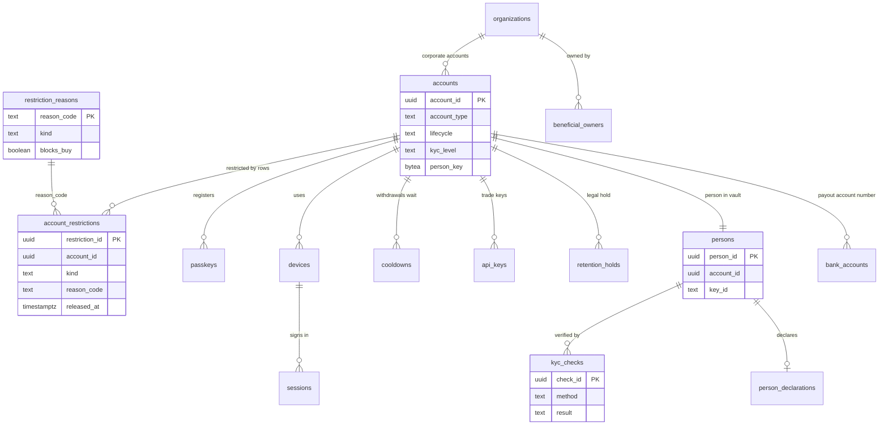

# Data model: 口座と本人確認

口座（寿命・確認の水準・段）、口座の制限と理由の表、法人、パスキー・端末・セッション、出金の待ち、取引の API キー、保持の延長。`kyc-vault` の人・申告・確認の記録・実質的支配者・銀行の口座・読み出しの監査。振る舞いは [kyc-and-accounts.md](../kyc-and-accounts.md)、方針は [ADR-0052](../../decisions/0052-account-lifecycle-levels-and-restrictions.md)・[ADR-0053](../../decisions/0053-sign-in-step-up-cooldown-and-api-keys.md)・[ADR-0054](../../decisions/0054-kyc-vault-purpose-api-and-retention.md)・[ADR-0019](../../decisions/0019-account-trading-restrictions.md)。

- core の表は `identity` が書く。`account_restrictions` には `compliance`・`surveillance`・運用の画面（期限つきの権限）も行を立てる。どの表も個人の項目（氏名、住所、生年月日、口座の番号）を持たない。
- `kyc-vault` の表は、目的で縛る関数だけで読む（`nameKanaMatches`・`travelRuleOriginator`・`screeningSubject`・`reportSubject`・`revealForCase`）。関数は `vault_access_log` に同じトランザクションで行を書く。
- 口座の使える機能は `identity.capabilities(account_id)` が DT-KYC-001（[kyc-and-accounts.md](../kyc-and-accounts.md) の 4.4 節）と理由の表（2.3 節）だけで答える。各サービスは事象 `account.capabilities_changed` で写しを持ち、写しは 5 秒で切れる。出金は正本で確かめ直す。

## 1. ER 図

- `persons`・`kyc_checks`・`person_declarations`・`beneficial_owners`・`bank_accounts` は `kyc-vault` にあり、core の表との線は論理の参照である。

## 2. 表（core）

### 2.1 `accounts`

口座。3 つの軸（寿命の状態、確認の水準、制限）のうち、前の 2 つと段を持つ。定義元：[kyc-and-accounts.md](../kyc-and-accounts.md) の 4・15 節。

| 列 | 型 | NULL | 説明 |
| --- | --- | --- | --- |
| `account_id` | `uuid` | NOT NULL | |
| `account_type` | `text` | NOT NULL | `individual`・`corporate`（`release.corporate-accounts` の裏。P1） |
| `lifecycle` | `text` | NOT NULL | `applying`・`verifying`・`review`・`active`・`rejected`・`closing`・`closed` |
| `kyc_level` | `text` | NOT NULL | `none`・`contact`・`verified` |
| `kyc_method` | `text` | NULL | `verified` にした方式（`jpki`・`ic_chip_face`・`document_face`・`document_postal`） |
| `suitability_tier` | `text` | NULL | 申告から決めた段（上限は本番で無効。法務の L12） |
| `person_key` | `bytea` | NULL | `verified` で入る |
| `organization_id` | `uuid` | NULL | 法人の口座 |
| `self_trade_group_id` | `uuid` | NOT NULL | 自己約定の組。個人は口座ごと、法人は同じ法人の口座で 1 つ |
| `email_ct`・`phone_ct` | `bytea` | NULL | 列の暗号（O） |
| `email_hmac`・`phone_hmac` | `bytea` | NULL | 完全一致の引き |
| `created_at` | `timestamptz` | NOT NULL | |
| `closed_at` | `timestamptz` | NULL | |

- キー：PK `(account_id)`。部分 UK `(person_key) WHERE account_type = 'individual' AND lifecycle NOT IN ('rejected','closed')` — 1 人に個人の口座は 1 つ（2 つ目は `review`）。UK `(email_hmac)`。
- CHECK：`(kyc_level = 'verified') = (kyc_method IS NOT NULL AND person_key IS NOT NULL)`。`lifecycle = 'active' <= (kyc_level = 'verified')`。`(account_type = 'corporate') = (organization_id IS NOT NULL)`。
- 遷移は [kyc-and-accounts.md](../kyc-and-accounts.md) の 4.3 節の表だけ（条件つきの更新）。`verified` への遷移は `legal.kyc_allowed_methods` の方式と期間の中だけ（本番は L4 の結論まで空）。
- RLS：本人。区分：O（暗号の列）・M。保持：退会から `legal.kyc_record_retention_days`。期限の後も `account_id` と `person_key` は残る。S1 の量：稼働 30 万行（登録はそれより多い）。

### 2.2 `account_restrictions`

口座の制限の行。複数が同時に立ち、行ごとに外す。重いほう（`frozen` ＞ `restricted`）が効く。1 つの表に全部の領域が行を立てる（D14）。定義元：同 4.1・15 節、[ADR-0052](../../decisions/0052-account-lifecycle-levels-and-restrictions.md)、[ADR-0019](../../decisions/0019-account-trading-restrictions.md) の 2026-11-15 の注記。

| 列 | 型 | NULL | 説明 |
| --- | --- | --- | --- |
| `restriction_id` | `uuid` | NOT NULL | |
| `account_id` | `uuid` | NOT NULL | |
| `kind` | `text` | NOT NULL | `restricted`・`frozen`。理由の表の `kind` の写し |
| `reason_code` | `text` | NOT NULL | `restriction_reasons` の外部キー |
| `set_by_kind` | `text` | NOT NULL | `identity`・`user`（本人の「これは私ではない」）・`compliance`・`surveillance`・`cs`・`security` |
| `set_by` | `text` | NOT NULL | 部品か人の ID |
| `case_id` | `uuid` | NULL | 元の案件（コンプライアンス・監視・CS） |
| `approval_id` | `uuid` | NULL | 立てる時の 2 人目（`frozen` の多く） |
| `set_at` | `timestamptz` | NOT NULL | |
| `released_at` | `timestamptz` | NULL | |
| `released_by` | `uuid[]` | NULL | 外す依頼の作成者と 2 人目 |

- キー：PK `(restriction_id)`。外部キー `(reason_code) → restriction_reasons`。CHECK：`(released_at IS NULL) = (released_by IS NULL)`。`kind` は理由の表の `kind` と同じ（トリガー）。
- 書くと同じトランザクションで outbox に `account.capabilities_changed` を書く。`frozen` は写しを消す依頼を直接にも送り、`order-gateway` は板ごとに `AccountBlock` を送る。全部の行が解けたら `AccountUnblock`。
- 索引：`(account_id) WHERE released_at IS NULL`。
- RLS：本人は自分の行の `kind`・`reason_code`・`set_at` だけ（列の GRANT）。画面に理由を出すかは法務の確認の後の文言の型。区分：A。保持：取引の記録と同じ（外した行も残す）。S1 の量：解けていない行は数百〜数千。

### 2.3 `restriction_reasons`

理由のコードごとの扱い。各領域が自分の理由の行を足す。`order-gateway` はこの表で「新しい注文を止めるか」を引く。定義元：D14（[design-log.md](../design-log.md)）、[kyc-and-accounts.md](../kyc-and-accounts.md) の 4.4 節、[order-entry-and-risk.md](../order-entry-and-risk.md) の 4.7 節、[runbooks/account-restriction-release.md](../../runbooks/account-restriction-release.md)。

| 列 | 型 | NULL | 説明 |
| --- | --- | --- | --- |
| `reason_code` | `text` | NOT NULL | |
| `kind` | `text` | NOT NULL | `restricted`・`frozen` |
| `owner_area` | `text` | NOT NULL | 行を足した領域 |
| `blocks_buy`・`blocks_sell` | `boolean` | NOT NULL | 新しい注文（取引所と販売所） |
| `cancels_resting` | `boolean` | NOT NULL | 立てた時に板の注文を全部取り消す（`AccountBlock`） |
| `blocks_crypto_withdrawal`・`blocks_fiat_withdrawal` | `boolean` | NOT NULL | 日本円は `false` でも本人の名義の口座だけ |
| `blocks_crypto_credit` | `boolean` | NOT NULL | 暗号資産の入金の記帳を止める（検出と追跡は続ける） |
| `holds_fiat_deposit` | `boolean` | NOT NULL | 日本円の着金を記帳してから拘束に移す |
| `release_rule` | `text` | NOT NULL | 外す者と条件 |
| `version` | `integer` | NOT NULL | |

- キー：PK `(reason_code)`。取り消しはどの理由でも通す（利用者の取り消し。`frozen` は立てる時に本システムが取り消す）。
- RLS：なし（設定）。区分：M。保持：消さない。変更は QA の承認を要する（DT-KYC-001 の表駆動のテストの正解）。
- **MVP の一覧**（データモデルの工程で 1 つにした。[data-model.md](../data-model.md) の 7 節の N1）：

| `reason_code` | `kind` | 立てる者 | 買い | 売り | 板の注文 | 暗号資産の出金 | 日本円の出金 | 暗号資産の入金の記帳 | 外す者 | 元の名前 |
| --- | --- | --- | --- | --- | --- | --- | --- | --- | --- | --- |
| `reverify_due` | `restricted` | identity | 止める | 通す | 残す | 止める | 本人の名義だけ | 通す | 自動（再確認の完了） | — |
| `suitability_limit` | `restricted` | identity | 止める | 通す | 残す | 止める | 本人の名義だけ | 通す | identity（本番は書かない。L12） | — |
| `compliance_hold` | `restricted` | compliance | 止める | 通す | 残す | 止める | 本人の名義だけ | 通す | コンプライアンスの担当と 2 人目 | — |
| `trading_suspended` | `restricted` | compliance | 止める | **止める** | **取り消す** | 止める | 本人の名義だけ | 通す | 作成者と別の人の承認 | ADR-0019 |
| `surveillance_hold` | `restricted` | surveillance | 止める | 通す | 残す | 止める | 本人の名義だけ | 通す | 監視の責任者（提案者と別） | — |
| `staff_blackout` | `restricted` | surveillance（重要な情報の台帳） | 止める | 通す（どこまで止めるかは法務の L7） | 残す | 止める | 本人の名義だけ | 通す | 自動（公表の 1 営業日後） | — |
| `takeover_lock` | `frozen` | user、cs、security、identity | 止める | 止める | 取り消す | 止める | 止める | 止める | CS の社員と 2 人目 | `takeover_suspected`（ADR-0019） |
| `sanctions_match` | `frozen` | compliance | 止める | 止める | 取り消す | 止める | 止める | 止める | コンプライアンスの責任者と 2 人目 | ADR-0019 の `frozen` |
| `legal_order` | `frozen` | compliance | 止める | 止める | 取り消す | 止める | 止める | 止める | コンプライアンスの責任者と法務 | ADR-0019 の `frozen` |
| `deceased` | `frozen` | compliance | 止める | 止める | 取り消す | 止める | 止める | 止める | 同上 | — |
| `surveillance_suspension` | `frozen` | surveillance | 止める | 止める | 取り消す | 止める | 止める | 止める | 監視の責任者（提案者と別） | — |

- `restricted` の行は DT-KYC-001 の `restricted` の行と同じ扱い、`frozen` の行は `frozen` の行と同じ扱い（`frozen` は日本円の着金を記帳して拘束する）。**`trading_suspended` だけが DT-KYC-001 の `restricted` の行と違う**（売りも止め、板の注文を取り消す）。DT-KYC-001 にこの違いを足すのは kyc-and-accounts の持ち主（[data-model.md](../data-model.md) の 10 節の G2）。
- ADR-0019 の `kyc_incomplete` と `closing` は行にしない。寿命の状態（`applying`・`verifying`・`review` と `closing`）が DT-KYC-001 で同じ止めを表す。

### 2.4 `organizations`

法人（PM の判断待ち P1）。実質的支配者の個人の項目は `kyc-vault` の `beneficial_owners`。定義元：同 4.8・15 節。

| 列 | 型 | NULL | 説明 |
| --- | --- | --- | --- |
| `organization_id` | `uuid` | NOT NULL | |
| `corporate_number` | `text` | NOT NULL | 法人番号（公開の値） |
| `name` | `text` | NOT NULL | 名称（公開の値） |
| `kyc_level` | `text` | NOT NULL | 法人の書類と担当者・実質的支配者の確認がすべて済んだら `verified` |
| `self_trade_group_id` | `uuid` | NOT NULL | |
| `created_at` | `timestamptz` | NOT NULL | |

- キー：PK `(organization_id)`。UK `(corporate_number)`。RLS：なし（`identity`）。区分：M。保持：口座と同じ。S1 の量：0（P1 の後）。

### 2.5 `passkeys`・`devices`・`sessions`

ログインの資格情報と端末とセッション。形は Mercari の題材の [ADR-0066](../../../../mercari/docs/decisions/0066-sign-in-sessions-and-devices.md) を引き継ぐ。定義元：同 5.1・15 節。

| 表 | 列 | 説明 |
| --- | --- | --- |
| `passkeys` | `credential_id`（PK）、`account_id`、`device_id`、`public_key`、`sign_count`、`created_at`、`revoked_at` | WebAuthn。UV を必須。公開鍵は境界の記録にも送る（`boundary_credentials`） |
| `devices` | `device_id`（PK）、`account_id`、`name`、`device_public_key`、`registered_at`、`last_seen_at`、`revoked_at` | 取り消すと端末のセッションとパスキーを無効にする |
| `sessions` | `session_id`（PK）、`account_id`、`device_id`、`refresh_token_hash`、`expires_at`、`revoked_at` | アプリは 30 日の更新のトークン（使うたびに回す）、Web は 30 分・最長 12 時間 |

- キー：`passkeys` UK `(credential_id)`、`sessions` UK `(refresh_token_hash)`。秘密の値はハッシュだけを持つ。
- 「これは私ではない」で全セッションを消す（`revoked_at`）。
- RLS：本人。区分：O。保持：`passkeys`・`devices` は口座と同じ、`sessions` は期限の後 30 日。S1 の量：`passkeys` 約 60 万、`sessions` 約 100 万。

### 2.6 `api_keys`

取引の API キー。利用者が端末で Ed25519 の鍵の組を作り、公開鍵だけを登録する。権限は `read`・`trade` だけ（P2）。定義元：同 5.3・15 節。

| 列 | 型 | NULL | 説明 |
| --- | --- | --- | --- |
| `key_id` | `text` | NOT NULL | `<brand>_live_<26 文字>` |
| `account_id` | `uuid` | NOT NULL | |
| `public_key` | `bytea` | NOT NULL | |
| `scopes` | `text[]` | NOT NULL | `read`・`trade` |
| `ip_allowlist` | `inet[]` | NULL | 最大 10 件 |
| `tier` | `text` | NOT NULL | `api_standard`・`api_mm` |
| `expires_at` | `timestamptz` | NOT NULL | 既定 365 日 |
| `revoked_at` | `timestamptz` | NULL | 監視の措置の API キーの停止もここ |
| `created_at` | `timestamptz` | NOT NULL | |

- キー：PK `(key_id)`。CHECK：`scopes <@ ARRAY['read','trade']`。`cardinality(ip_allowlist) <= 10`。口座ごとに有効なキーは 10 本まで（作成の関数で数える）。
- RLS：本人。区分：O。保持：口座と同じ。S1 の量：数万行。

### 2.7 `cooldowns`

出金の待ち。待ちの間は暗号資産と日本円の出金の依頼を受けない。売買と入金は止めない。定義元：同 5.2・15 節、[ADR-0053](../../decisions/0053-sign-in-step-up-cooldown-and-api-keys.md)。

| 列 | 型 | NULL | 説明 |
| --- | --- | --- | --- |
| `cooldown_id` | `uuid` | NOT NULL | |
| `account_id` | `uuid` | NOT NULL | |
| `reason` | `text` | NOT NULL | `passkey_added`・`totp_reset`・`email_changed`・`phone_changed`・`account_recovered`・`payout_account_changed`・`takeover_lock_released` |
| `started_at` | `timestamptz` | NOT NULL | |
| `ends_at` | `timestamptz` | NOT NULL | 既定 72 時間後 |

- キー：PK `(cooldown_id)`。索引：`(account_id, ends_at)`。`identity.withdrawalAllowedAt(account_id)` は `max(ends_at)` を返す。暗号資産の出金は、境界の記録の時刻でも 72 時間を数える（[ADR-0045](../../decisions/0045-allowlist-registration-recorded-in-boundary.md)）。
- RLS：本人。区分：O。保持：口座と同じ。S1 の量：1 日 数千行。

### 2.8 `retention_holds`

保持の延長（legal hold）。法令の照会や差押えの間、退会の後の鍵の破棄を止める。定義元：同 7・15 節。

| 列 | 型 | NULL | 説明 |
| --- | --- | --- | --- |
| `hold_id` | `uuid` | NOT NULL | |
| `account_id` | `uuid` | NOT NULL | |
| `reason` | `text` | NOT NULL | `legal_inquiry`・`seizure`・`str_case` など |
| `case_id` | `uuid` | NULL | |
| `set_at` | `timestamptz` | NOT NULL | |
| `released_at` | `timestamptz` | NULL | |

- キー：PK `(hold_id)`。台帳の `holds`（拘束）とは別のもの。RLS：なし（コンプライアンス、法務）。区分：A。保持：外した後も口座と同じ。S1 の量：数十行。

## 3. 表（`kyc-vault`）

どの表も封筒の暗号化（人ごとの鍵 `key_id`）。関数だけで読み、表への `SELECT` を誰にも与えない。保持は退会から `legal.kyc_record_retention_days` で、期限の後に人ごとの鍵を破棄する。

### 3.1 `persons`

| 列 | 型 | NULL | 説明 |
| --- | --- | --- | --- |
| `person_id` | `uuid` | NOT NULL | |
| `account_id` | `uuid` | NOT NULL | |
| `key_id` | `text` | NOT NULL | 人ごとの鍵（形は Workday の保管庫。[data-model.md](../data-model.md) の 9 節） |
| `name_ct`・`name_kana_ct`・`birth_date_ct`・`address_ct`・`nationality_ct` | `bytea` | NOT NULL | 確かめた値の暗号文 |
| `name_kana_norm_hmac` | `bytea` | NOT NULL | 名義の照合の正規化（全銀の使用文字、半角カナ、小書きを大きく、空白を除く）の HMAC |
| `valid_from`・`valid_to` | `timestamptz` | — | 氏名・住所の変更は新しい行。古い行は保持の期限まで履歴 |

- キー：PK `(person_id)`。部分 UK `(account_id) WHERE valid_to IS NULL`。区分：V。S1 の量：30 万行と変更の履歴。

### 3.2 `person_declarations`

申告（職業、取引の目的、投資の経験、金融資産の区分、年収の区分）。core には段（`suitability_tier`）だけを置く。列：`account_id`、`occupation_ct`、`purpose_ct`、`experience`、`asset_band`、`income_band`、`declared_at`。キー：PK `(account_id, declared_at)`。区分：V。

### 3.3 `kyc_checks`

確認の記録。書類の番号を残すかは `legal.kyc_record_fields`（未設定なら書類の種類だけ）。

| 列 | 型 | NULL | 説明 |
| --- | --- | --- | --- |
| `check_id` | `uuid` | NOT NULL | |
| `account_id` | `uuid` | NOT NULL | |
| `method` | `text` | NOT NULL | `jpki`・`ic_chip_face`・`document_face`・`document_postal`・`email_phone` |
| `provider`・`provider_ref` | `text` | NOT NULL | 冪等キー `kyc:<account_id>:<n>` |
| `result` | `text` | NOT NULL | `submitted`・`approve`・`review`・`decline` |
| `document_kind` | `text` | NULL | |
| `checked_at` | `timestamptz` | NULL | |
| `legal_config_version` | `integer` | NOT NULL | 使った `legal.kyc_allowed_methods` |

- キー：PK `(check_id)`。UK `(provider, provider_ref)`。書類と顔の画像は持たない（提供者だけ）。区分：V。S1 の量：口座ごとに 1〜数行。

### 3.4 `beneficial_owners`

法人の実質的支配者の個人の項目。列：`organization_id`、`person_seq`、`name_ct`、`birth_date_ct`、`address_ct`、`ownership_ratio`、`verified_check_id`。キー：PK `(organization_id, person_seq)`。区分：V。S1 の量：0（P1 の後）。

### 3.5 `bank_accounts`

銀行の口座の番号と名義（振込先の口座番号と出金の口座）。書くのは `funding`。列：`vault_ref`（PK。core の `virtual_accounts`・`payout_bank_accounts` が指す）、`account_id`、`kind`（`virtual`・`payout`）、`bank_code`、`branch_code`、`account_number_ct`、`holder_name_kana_ct`、`created_at`。区分：V。S1 の量：最大 60 万行。

### 3.6 `vault_access_log`

読み出しの監査。関数が同じトランザクションで書き、ハッシュの鎖でつなぐ（[Workday の ADR-0048](../../../../workday/docs/decisions/0048-audit-log-hash-chain-and-anchoring.md)）。

| 列 | 型 | NULL | 説明 |
| --- | --- | --- | --- |
| `seq` | `bigint` | NOT NULL | 連番 |
| `caller` | `text` | NOT NULL | 役割と部品 |
| `purpose` | `text` | NOT NULL | 関数の名前 |
| `account_id` | `uuid` | NOT NULL | |
| `field_kinds` | `text[]` | NOT NULL | 読んだ項目の種類（値は持たない） |
| `case_id` | `uuid` | NULL | `revealForCase` |
| `at` | `timestamptz` | NOT NULL | |
| `prev_hash`・`hash` | `bytea` | NOT NULL | |

- キー：PK `(seq)`。追記だけ。監査のアカウントへ写す。区分：A。保持：本人確認の記録より長く（`legal.kyc_record_retention_days` の後も、鍵の破棄の記録として残す。値を持たないため）。S1 の量：1 日 数万行（名義の照合とスクリーニング）。

## 4. 段階ごとの変化

- P1 で法人を入れると、`organizations`・`beneficial_owners` に行が入り、`self_trade_group_id` を法人で 1 つにする。
- 方式の終わりの日（`document_face`）を過ぎても、その前に `verified` になった口座の水準は下げない。再確認は `legal.kyc_reverify_on_method_sunset`。
