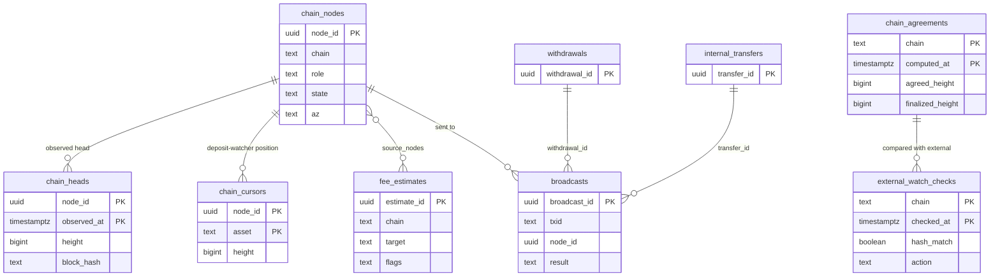

# Data model: ノードと承認の数

自前のノードの状態、ノードごとの頭、2 台の合意の頭と確定、外部の見張りの比べ、手数料の見積もり、放送の記録、入金の読み進みの位置。振る舞いは [chain-nodes-and-confirmations.md](../chain-nodes-and-confirmations.md)、方針は [ADR-0009](../../decisions/0009-deposits-confirmations-and-own-nodes.md)・[ADR-0046](../../decisions/0046-two-node-agreement-and-external-watch.md)・[ADR-0047](../../decisions/0047-fee-estimation-and-broadcast-paths.md)・[ADR-0048](../../decisions/0048-node-client-diversity-and-upgrades.md)。

- どの表も core のクラスタにある。合意の頭と承認の数の計算は `packages/chain-view` の純粋な関数で、`deposit-watcher`・`wallet-orchestrator`・`rebalancer`・照合が同じバージョンを使う。表はその結果の記録で、計算の入力にしない（ブロックの ID はノードから読み直す）。
- 外部の見張りの結果は、止める判断にだけ使う。承認の数・確定・入金の有無に入れない。

## 1. ER 図

## 2. 表

### 2.1 `chain_nodes`

自前のノード（BTC は 1 台、ETH は実行と合意のクライアントの組を 1 行）。状態は [chain-nodes-and-confirmations.md](../chain-nodes-and-confirmations.md) の 4.3 節。定義元：同 4.3・16 節。

| 列 | 型 | NULL | 説明 |
| --- | --- | --- | --- |
| `node_id` | `uuid` | NOT NULL | |
| `chain` | `text` | NOT NULL | `bitcoin`・`ethereum` |
| `role` | `text` | NOT NULL | `compare`（東京の比べの 2 台）・`standby`（大阪） |
| `state` | `text` | NOT NULL | `syncing`・`probation`・`active`・`excluded`・`standby` |
| `execution_client`・`consensus_client` | `text` | — | ETH は組ごとに違う種類（ADR-0048 の仮説）。BTC は `execution_client` に Bitcoin Core |
| `version` | `text` | NOT NULL | |
| `az` | `text` | NOT NULL | |
| `changed_by` | `text` | NOT NULL | 自動（`active` への昇格）か Ops の ID |
| `second_confirmer` | `uuid` | NULL | Ops の操作の 2 人目 |
| `changed_at` | `timestamptz` | NOT NULL | |
| `reason_code` | `text` | NULL | |

- キー：PK `(node_id)`。CHECK：`state IN (...)`。`role = 'standby' <= (state IN ('standby','syncing','probation'))`。
- 各資産で `active` は 2 台（組）。3 台目を `active` に入れて多数決にしない（部分の索引で `active` の数を数え、3 つ目の昇格を関数で拒む）。
- 状態の履歴は `operator_actions` と監査の写し。RLS：なし（`chain-view`、Ops）。区分：M。保持：置き換え。S1 の量：6 行。

### 2.2 `chain_heads`

ノードごとの頭と確定の観測。定義元：同 16 節。

| 列 | 型 | NULL | 説明 |
| --- | --- | --- | --- |
| `node_id` | `uuid` | NOT NULL | |
| `observed_at` | `timestamptz` | NOT NULL | |
| `height` | `bigint` | NOT NULL | |
| `block_hash` | `text` | NOT NULL | |
| `finalized_height`・`finalized_hash` | `bigint`・`text` | NULL | ETH |

- キー：PK `(node_id, observed_at)`。分割：日ごと。区分：M。保持：30 日（本システムの値。調べに要る間）。S1 の量：1 日 約 4.5 万行（ETH は 12 秒ごと × 3 組、BTC は 10 分ごと × 3 台と 10 秒ごとの照会の変化だけ）。

### 2.3 `chain_agreements`

2 台の合意の頭と確定。承認の数の元。定義元：同 4.1・16 節。

| 列 | 型 | NULL | 説明 |
| --- | --- | --- | --- |
| `chain` | `text` | NOT NULL | |
| `computed_at` | `timestamptz` | NOT NULL | |
| `agreed_height`・`agreed_hash` | `bigint`・`text` | NOT NULL | A と B が同じブロックの ID を返す最も高い高さ |
| `finalized_height`・`finalized_hash` | `bigint`・`text` | NULL | ETH。両方の組の確定の低いほうで、ID が同じ |
| `chain_view_version` | `text` | NOT NULL | 計算した `chain-view` のバージョン |
| `diverged_since` | `timestamptz` | NULL | 合意の頭が 2 台の頭の低いほうより 2 ブロック・32 スロット以上低い状態の始まり（5 分で記帳を止める） |

- キー：PK `(chain, computed_at)`。索引：`(chain, computed_at DESC)` — 最新の合意の頭。分割：日ごと。区分：M。保持：30 日。S1 の量：1 日 約 2 万行。

### 2.4 `external_watch_checks`

外部の見張りとの 1 分ごとの比べ。定義元：同 4.2・16 節。

| 列 | 型 | NULL | 説明 |
| --- | --- | --- | --- |
| `chain` | `text` | NOT NULL | |
| `checked_at` | `timestamptz` | NOT NULL | |
| `external_height` | `bigint` | NULL | 外部が応答しないときは NULL |
| `agreed_height` | `bigint` | NOT NULL | |
| `compared_height` | `bigint` | NOT NULL | 合意の頭 − 2（BTC）・確定の高さ（ETH） |
| `hash_match` | `boolean` | NULL | |
| `action` | `text` | NOT NULL | `none`・`ticket`・`halt_crediting` |

- キー：PK `(chain, checked_at)`。分割：日ごと。区分：M。保持：90 日（本システムの値）。S1 の量：1 日 約 2,900 行。

### 2.5 `fee_estimates`

`fee-estimator` が 30 秒ごとに書く手数料の見積もり。使う側は見積もりの ID を記録に残す。定義元：同 6・16 節。

| 列 | 型 | NULL | 説明 |
| --- | --- | --- | --- |
| `estimate_id` | `uuid` | NOT NULL | |
| `chain` | `text` | NOT NULL | |
| `target` | `text` | NOT NULL | BTC は `2_blocks`・`6_blocks`、ETH は `next_block` |
| `fee_rate` | `numeric(38,0)` | NULL | BTC の sat/vB |
| `max_fee_per_gas`・`max_priority_fee_per_gas` | `numeric(38,0)` | NULL | ETH の wei |
| `flags` | `text[]` | NOT NULL | `anomalous`・`single_source` |
| `source_nodes` | `uuid[]` | NOT NULL | |
| `created_at` | `timestamptz` | NOT NULL | |

- キー：PK `(estimate_id)`。索引：`(chain, target, created_at DESC)`。
- `anomalous` の見積もりでは自動の署名をしない。7 日の中央値が利用者の手数料の表を 1 日続けて超えたら財務へチケット（[ADR-0043](../../decisions/0043-one-transaction-per-withdrawal-and-fee-table.md)）。
- 分割：日ごと。区分：M。保持：90 日。S1 の量：1 日 約 8,600 行。

### 2.6 `broadcasts`

放送の 1 回ごとの記録。`active` の 2 台と待機の 1 台に同じバイト列を流す。定義元：同 7・16 節。

| 列 | 型 | NULL | 説明 |
| --- | --- | --- | --- |
| `broadcast_id` | `uuid` | NOT NULL | |
| `withdrawal_id` | `uuid` | NULL | |
| `transfer_id` | `uuid` | NULL | 移し替えか集め直し（`eth_sweeps.sweep_id`） |
| `txid` | `text` | NOT NULL | |
| `raw_tx_hash` | `bytea` | NOT NULL | 流したバイト列のハッシュ（同じ取引を流し直したことの確かめ） |
| `node_id` | `uuid` | NOT NULL | |
| `result` | `text` | NOT NULL | `accepted`・`timeout`・`rejected`・`seen_in_mempool` |
| `reject_code` | `text` | NULL | `fee_too_low`・`input_spent`・`nonce_too_low` など。後の 2 つは作り直しの判断の前に確定を調べる |
| `attempt` | `smallint` | NOT NULL | 流し直しの回数 |
| `at` | `timestamptz` | NOT NULL | |

- キー：PK `(broadcast_id)`。CHECK：`num_nonnulls(withdrawal_id, transfer_id) = 1`。索引：`(txid)`。
- 区分：C。保持：取引の記録と同じ。S1 の量：1 日 約 1.5 万行（出金 4,000 × 3 台 ＋ 移し替えと集め直し）。

### 2.7 `chain_cursors`

`deposit-watcher` のブロックの読み込みの位置。ノードごと・資産ごと。定義元：[deposits.md](../deposits.md) の 6.1・16 節。

| 列 | 型 | NULL | 説明 |
| --- | --- | --- | --- |
| `node_id` | `uuid` | NOT NULL | |
| `asset` | `text` | NOT NULL | |
| `height` | `bigint` | NOT NULL | 読み終えた高さ |
| `block_hash` | `text` | NOT NULL | 読み終えたブロックの ID（巻き戻りの検出） |
| `updated_at` | `timestamptz` | NOT NULL | |

- キー：PK `(node_id, asset)`。`chain_heads` はノードの頭の観測で、`chain_cursors` は入金の検出の進み。両者を混ぜない。
- RLS：なし（`deposit-watcher`）。区分：M。保持：置き換え。S1 の量：6 行。

## 3. 段階ごとの変化

- S2：チェーンが増えると行が比例して増える。`chain_heads`・`chain_agreements` の日の分割と 30 日の保持はそのまま。
