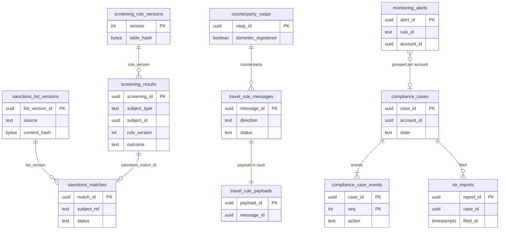
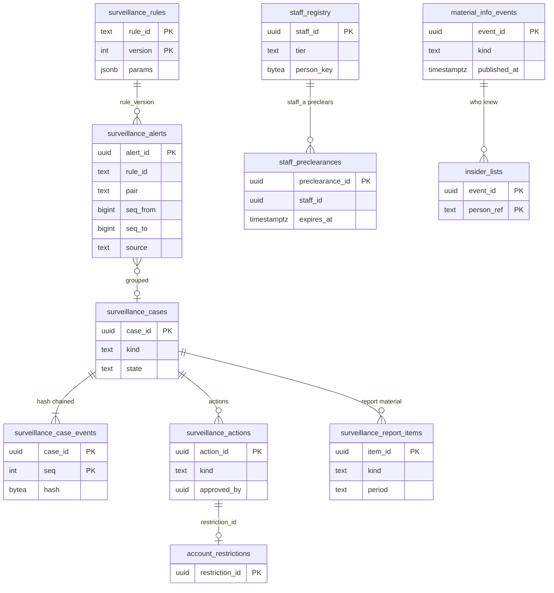

# Data model: AML と不公正取引の監視

スクリーニング、制裁の照合、トラベルルール、取引の監視と案件と届出（AML）。不公正取引の監視の規則・兆し・案件・措置、口座のつながり、役職員の取引、重要な情報の台帳（監視）。振る舞いは [aml-and-travel-rule.md](../aml-and-travel-rule.md)・[market-surveillance.md](../market-surveillance.md)、方針は [ADR-0055](../../decisions/0055-screening-rule-table-and-human-reject.md)〜[ADR-0058](../../decisions/0058-transaction-monitoring-and-str-cases.md)・[ADR-0059](../../decisions/0059-surveillance-detectors-over-journals.md)〜[ADR-0061](../../decisions/0061-staff-trading-and-material-information.md)。

- core の表は `compliance`（1 節）と `surveillance`（2 節）が書く。トラベルルールの送り手と受取人の情報は `kyc-vault` の `travel_rule_payloads` にだけ置く。
- 規則の表（スクリーニング、取引の監視、不公正取引の監視）は署名つきの設定の束で出し（[ADR-0075](../../decisions/0075-signed-config-bundles-for-policies-and-rules.md)）、判定の記録に規則のバージョンを残す。
- 案件の存在と届出の有無は利用者に知らせない。CS の画面には「コンプライアンスの確認中」の印だけを出す。案件の事象は追記だけで、ハッシュの鎖でつなぐ（監視）。
- 保持：AML の記録は `legal.transaction_record_retention_days`（L4・L11）、監視の記録は `legal.surveillance_record_retention_days`（開発の既定 1,826 日。L7・L9）。どちらも未設定なら消さない。
- 領域の文書の `case_events` は `compliance_case_events` にした（[data-model.md](../data-model.md) の 7 節の N9）。

## 1. AML とトラベルルール

### 1.1 ER 図

### 1.2 表

| 表 | 主な列 | キー・制約 | 量（S1） |
| --- | --- | --- | --- |
| `screening_results` | `screening_id`、`subject_type`（`deposit`・`withdrawal`・`address_registration`）、`subject_id`、`provider_response_id`、`categories`（`text[]`）、`exposure`（チェーン分析の点）、`sanctions_match_id`、`rule_version`、`matched_rule`、`outcome`（`pass`・`review`・`priority_review`）、`created_at` | PK `(screening_id)`。索引 `(subject_type, subject_id)`。入金は閾値の時点で規則のバージョンが変わっていれば判定し直し、新しい行にする。機械は拒まない（拒むのは人。ADR-0055） | 1 日 約 1 万行（入出金と宛先の登録） |
| `screening_rule_versions` | `version`、`table_hash`、`shadow_report_id`（影の評価の報告）、`approved_by`（2 人）、`effective_at` | PK `(version)`。CHECK `cardinality(approved_by) >= 2` | 年に数十行 |
| `sanctions_list_versions` | `list_version_id`、`source`、`published_date`、`content_hash`、`fetched_at`、`entries_count` | PK。UK `(source, content_hash)`。取り込みの失敗は `provider-outage.md` | 1 日 数行 |
| `sanctions_matches` | `match_id`、`subject_type`、`subject_ref`（`kyc-vault` の参照）、`list_version_id`、`score`、`status`（`candidate`・`confirmed`・`dismissed`）、`decided_by` | PK。名前の照合は `kyc-vault` の中で行い（ADR-0056）、core には参照と点だけ。`confirmed` で `sanctions_match` の制限を立てる | 1 日 数件 |
| `travel_rule_messages` | `message_id`、`direction`（`outbound`・`inbound`）、`withdrawal_id` か `deposit_id`、`counterparty_vasp_id`、`provider_message_id`、`status`（`sent`・`accepted`・`rejected`・`timeout`・`matched`・`unmatched`）、`payload_ref`（`kyc-vault`）、`at` | PK。CHECK `num_nonnulls(withdrawal_id, deposit_id) = 1`。UK `(provider_message_id)`。`legal.travel_rule_threshold_jpy` の未設定は 0 円（全件） | 1 日 数千行 |
| `counterparty_vasps` | `vasp_id`、`provider_vasp_id`、`name`、`country`、`domestic_registered`、`reviewed_by`、`reviewed_at` | PK。UK `(provider_vasp_id)` | 数百行 |
| `monitoring_alerts` | `alert_id`、`rule_id`、`rule_version`、`account_id`、`signal_refs`（入金の記帳、出金の依頼、日本円の入出金、約定の事象の ID）、`case_id`、`created_at` | PK。事象ごとの規則は p95 1 分で警告（ADR-0058） | 1 日 数百行 |
| `compliance_cases` | `case_id`、`account_id`、`state`（`open`・`investigating`・`closed_no_action`・`str_draft`・`str_approved`・`filed`・`closed_filed`）、`queue`、`assignee`、`restriction_id`（調べの間の制限。2 人の承認）、`opened_at`、`closed_at` | PK。部分 UK `(account_id) WHERE state NOT IN ('closed_no_action','closed_filed')` — 警告を口座ごとの案件にまとめる | 1 日 数十行 |
| `compliance_case_events` | `case_id`、`seq`、`action`、`actor`、`reason_code`、`note_ref`（所見の本文は S3 の暗号化した記録） | PK `(case_id, seq)`。追記だけ | 1 日 数百行 |
| `str_reports` | `report_id`、`case_id`、`drafted_by`、`approved_by`、`filed_at`、`filing_ref`、`document_ref`（`kyc-vault`） | PK。CHECK `drafted_by <> approved_by`。届け出る手段と項目は法務の L4 | 月に数件 |
| `travel_rule_payloads`（`kyc-vault`） | `payload_id`、`message_id`、送り手と受取人の情報の暗号文（`legal.*` が決める項目だけ）、`created_at` | PK。UK `(message_id)`。関数 `travelRuleOriginator` で読む | 1 日 数千行 |

- 区分：`screening_results`・`monitoring_alerts`・案件は A、`sanctions_matches` の参照と `travel_rule_payloads` は V。どれも RLS なし（`compliance` の役割と運用の画面の期限つきの権限）。

## 2. 不公正取引の監視

### 2.1 ER 図

- `account_links`（口座のつながり）は図から省く。`account_a`・`account_b` の 2 つの口座の組である。

### 2.2 表

| 表 | 主な列 | キー・制約 | 量（S1） |
| --- | --- | --- | --- |
| `surveillance_rules` | `rule_id`（`SUR-*`）、`version`、`params`（`jsonb`）、`effective_from`、`approval_ref`、`approved_by` | PK `(rule_id, version)` | 年に数十行 |
| `surveillance_alerts` | `alert_id`、`rule_id`、`rule_version`、`pair`、`window_key`、`account_ids`（`uuid[]`）、`score`、`seq_from`、`seq_to`（入力の記録の範囲）、`detected_at`、`source`（`live`・`replay`） | PK。UK `(rule_id, rule_version, pair, window_key, source)` — 日次の再生で同じ兆しを 2 度作らない（PROP-SUR-001。見落としは `live` にない `replay` の行で分かる） | 1 日 数百行 |
| `surveillance_cases` | `case_id`、`kind`（`account`・`market`）、`state`（`open`・`investigating`・`closed_no_action`・`action_proposed`・`actioned`・`monitoring`・`closed_actioned`）、`assignee`、`opened_at`、`closed_at`、`close_reason` | PK。遷移は [market-surveillance.md](../market-surveillance.md) の 5.1 節の表 | 1 日 数十行 |
| `surveillance_case_events` | `case_id`、`seq`、`event`、`actor`、`note_ref`、`at`、`prev_hash`、`hash` | PK `(case_id, seq)`。追記だけ。ハッシュの鎖 | 1 日 数百行 |
| `surveillance_actions` | `action_id`、`case_id`、`kind`（`warning`・`restrict`・`suspend`・`api_key_suspend`）、`restriction_id`、`proposed_by`、`approved_by`、`applied_at` | PK。CHECK `proposed_by <> approved_by`（提案者と別の責任者）。エージェントは提案も承認もしない | 月に数十件 |
| `surveillance_report_items` | `item_id`、`case_id`、`kind`（`incident`・`monthly`）、`period`、`exported_at` | PK。協会への報告の材料（L9） | 月に数十件 |
| `account_links` | `account_a`、`account_b`、`signal`（`person`・`device`・`ip`・`address`・`bank`）、`first_seen`、`last_seen` | PK `(account_a, account_b, signal)`。CHECK `account_a < account_b` | 数十万行 |
| `staff_registry` | `staff_id`、`tier`（`staff_a`・`staff_b`）、`person_key`、`valid_from`、`valid_to` | PK `(staff_id, valid_from)`。役職員の口座は `accounts.person_key` との照らしで決める（口座の表に列を足さない）。保有の期間の拒否（`staff_holding_period`）は `order-gateway` が受け付けで引く | 役職員の数 |
| `staff_preclearances` | `preclearance_id`、`staff_id`、`account_id`、`pair`、`side`、`max_qty`、`expires_at`（1 営業日）、`approved_by` | PK | 1 日 数件 |
| `material_info_events` | `event_id`、`kind`、`opened_at`、`published_at`、`closed_at`、`owner` | PK。公表の 1 営業日後に `staff_blackout` を自動で外す | 年に数十件 |
| `insider_lists` | `event_id`、`person_ref`（`staff_id` か外部の関係者の ID）、`added_at`、`reason` | PK `(event_id, person_ref)`。事象を見た操作で自動に足す | 事象ごとに数十行 |

- どれも RLS なし（`surveillance` の役割、監視の担当と責任者の期限つきの権限）。監視の役割は、板の停止・再開の運用の役割と注文の受付の Dev の役割から分ける（協会の規則の第 4 条第 4 項の独立）。区分：A（`staff_registry` の `person_key` は M）。

## 3. 段階ごとの変化

- S2：板と銘柄が増えると、`surveillance_alerts` は板の数で増える。日次の再生の時間（入力の記録の量）は [capacity.md](../capacity.md) で見積もり直す。
