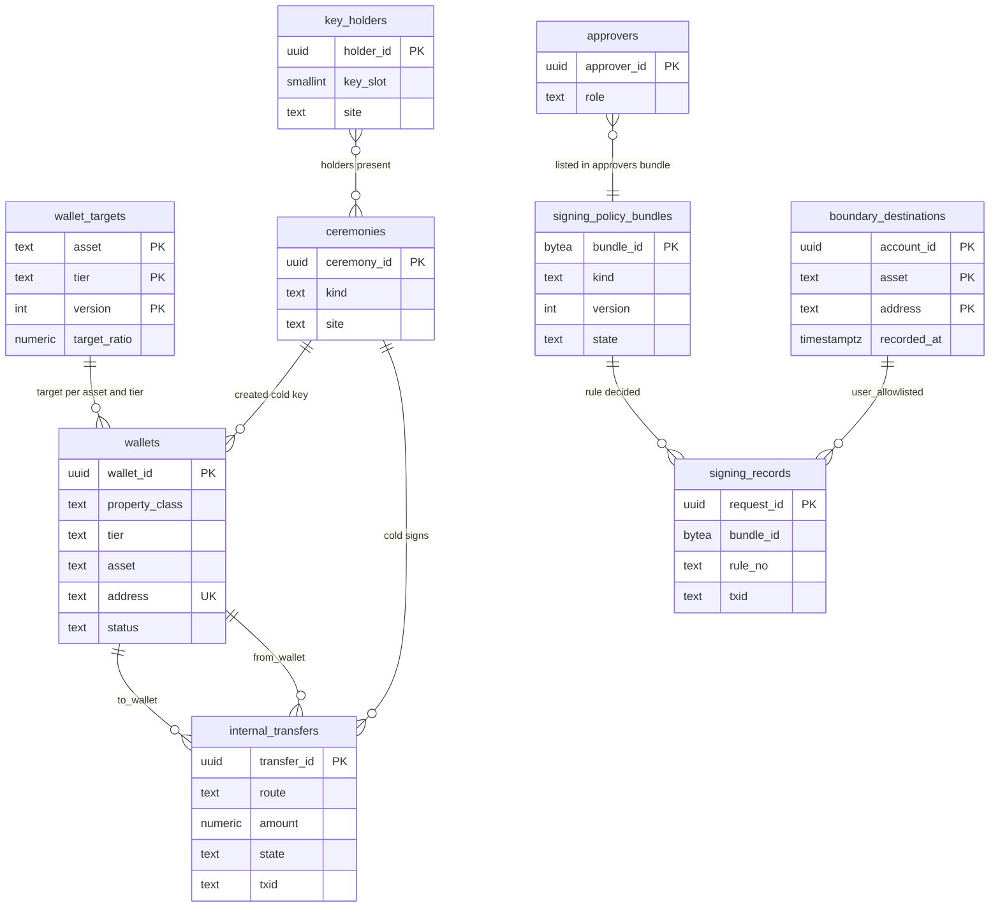

# Data model: 保管とウォレット

ウォレット（アドレスと段）、段の目標、ウォレットの間の移し替え、コールドの儀式、鍵の保持者。署名の境界の記録（方針の束、承認者、署名の記録、宛先の登録、利用者のパスキーの公開鍵）も、形だけをここに置く。振る舞いは [custody-and-keys.md](../custody-and-keys.md)、方針は [ADR-0006](../../decisions/0006-wallet-tiers-and-cold-ratio.md)・[ADR-0007](../../decisions/0007-signing-service-and-key-custody.md)・[ADR-0034](../../decisions/0034-cold-key-quorum-and-locations.md)・[ADR-0035](../../decisions/0035-signing-policy-bundle-and-decision-table.md)・[ADR-0036](../../decisions/0036-approver-keys-and-approval-payload.md)・[ADR-0037](../../decisions/0037-transfer-routes-and-warm-target.md)・[ADR-0045](../../decisions/0045-allowlist-registration-recorded-in-boundary.md)。

- core の表は `wallet-orchestrator`・`rebalancer`・運用の画面（儀式の記録）が書く。鍵の材料はどの表にもない（境界の中の HSM・MPC か、オフラインの機器だけ）。
- 署名の境界の記録は `custody-prod` のアカウントにあり、`prod` のアカウントから書き換えられない。core の表と食い違ったら、境界の記録を正とする。器（DB の種類）は `custody-signing-poc` の後に決める（[data-model.md](../data-model.md) の 9 節）。
- **名前**：署名の方針の宛先の種類は、データモデルでは `tier_hot`・`tier_warm`・`tier_cold`（利用者用のウォレットの段）・`house_wallet`（本システムの財産）・`user_allowlisted`・`other`（[data-model.md](../data-model.md) の 7 節の N2。ADR-0035 の本文の `house_hot`・`house_warm`・`house_cold` に当たる）。

## 1. ER 図

## 2. 表（core）

### 2.1 `wallets`

本システムが管理するアドレスと、その段と財産の区分。入金のアドレス（利用者ごと）は [deposits.md](deposits.md) の `deposit_addresses` に置き、ここに入れない。定義元：[custody-and-keys.md](../custody-and-keys.md) の 4・14 節、[ADR-0005](../../decisions/0005-ledger-balances-and-trade-settlement.md)。

| 列 | 型 | NULL | 説明 |
| --- | --- | --- | --- |
| `wallet_id` | `uuid` | NOT NULL | |
| `property_class` | `text` | NOT NULL | `user`（利用者の財産。台帳の `wallet:<tier>:<asset>`）・`house`（本システムの財産。`house_wallet:<asset>`） |
| `purpose` | `text` | NOT NULL | `custody`・`house`・`performance_bond`（履行保証暗号資産。法務の L2）・`change`（BTC のお釣り）・`eth_lane`（[withdrawals.md](withdrawals.md) の `eth_lanes`） |
| `tier` | `text` | NOT NULL | `hot`・`warm`・`cold` |
| `asset` | `text` | NOT NULL | |
| `address` | `text` | NOT NULL | |
| `key_ref` | `text` | NOT NULL | 境界の中の鍵の参照（HSM・MPC の鍵の ID か、コールドの鍵の組の ID）。鍵の材料でない |
| `status` | `text` | NOT NULL | `active`・`draining`（作り直しで残りを移している）・`retired` |
| `created_ceremony_id` | `uuid` | NULL | コールドの鍵を作った儀式 |
| `created_at` | `timestamptz` | NOT NULL | |

- キー：PK `(wallet_id)`。UK `(asset, address)`。
- CHECK：`purpose = 'performance_bond' <= (property_class = 'house' AND tier = 'cold')`。`(tier = 'cold') <= (created_ceremony_id IS NOT NULL)`。
- 段ごと・資産ごとに別の鍵（別のアドレス）にする。利用者の財産と本システムの財産を同じアドレスに置かない（I17）。
- 本システムのウォレットの許可の一覧（宛先として使ってよいアドレス）は、この表の `active` の行から作る署名つきの束で境界に入れる（`kind = house_allowlist`。追加は 24 時間の後に有効）。
- RLS：なし（`wallet-orchestrator`・`rebalancer`、読むのは `reconcilers`）。区分：C。保持：消さない（古いアドレスへの入金を見張る）。S1 の量：数十行。

### 2.2 `wallet_targets`

段ごとの目標と補充の閾値。値はウォレットの方針の設定（署名つきの束）から入れる。定義元：[ADR-0037](../../decisions/0037-transfer-routes-and-warm-target.md) の「目標と幅」、同 14 節。

| 列 | 型 | NULL | 説明 |
| --- | --- | --- | --- |
| `asset` | `text` | NOT NULL | |
| `tier` | `text` | NOT NULL | `hot`・`warm` |
| `version` | `integer` | NOT NULL | |
| `target_ratio` | `numeric(7,6)` | NOT NULL | 利用者の暗号資産に対する目標（ホット 0.01、ウォーム 0.02） |
| `refill_ratio` | `numeric(7,6)` | NULL | ホットの補充の閾値（目標の 0.5） |
| `min_transfer_ratio` | `numeric(7,6)` | NOT NULL | 移し替えの最小の額（その段の目標の 0.1） |
| `effective_at` | `timestamptz` | NOT NULL | |

- キー：PK `(asset, tier, version)`。CHECK：`target_ratio > 0 AND target_ratio < 1`。
- `legal.hot_ratio_max`（AppConfig）はここに持たない。ネットワークにつながる額の分子は、ホット ＋ ウォーム ＋ 集め直しの前の入金のアドレスの残高（[ADR-0006](../../decisions/0006-wallet-tiers-and-cold-ratio.md) の 2026-11-15 の注記）。
- RLS：なし（設定）。区分：M。保持：消さない。S1 の量：数行。

### 2.3 `internal_transfers`

ウォレットの間の移し替え。経路は [ADR-0037](../../decisions/0037-transfer-routes-and-warm-target.md) の表だけ。台帳の `internal_transfer` の仕訳は、放送の時でなく確定の時に書く。定義元：[custody-and-keys.md](../custody-and-keys.md) の 4.1・14 節。

| 列 | 型 | NULL | 説明 |
| --- | --- | --- | --- |
| `transfer_id` | `uuid` | NOT NULL | 冪等キー `transfer:<transfer_id>` |
| `route` | `text` | NOT NULL | `hot_to_cold`・`warm_to_cold`・`warm_to_hot`・`cold_to_warm`・`hot_to_house`（手数料の日次の移しと精算の `to_house`） |
| `asset` | `text` | NOT NULL | |
| `amount` | `numeric(38,0)` | NOT NULL | |
| `from_wallet_id`・`to_wallet_id` | `uuid` | NOT NULL | |
| `state` | `text` | NOT NULL | 既定案：`requested`・`approving`・`ceremony`・`signing`・`broadcast`・`completed`・`rejected`（値の一覧は custody-and-keys の領域が確かめる） |
| `policy_rule_no` | `text` | NULL | DT-POL の行（P08〜P12） |
| `settlement_batch_id` | `uuid` | NULL | 本システムの持ち分の精算（[reconciliation-and-trust.md](reconciliation-and-trust.md) の 2.3 節） |
| `ceremony_id` | `uuid` | NULL | `cold_to_warm` |
| `txid` | `text` | NULL | |
| `fee_paid` | `numeric(38,0)` | NULL | チェーンの手数料（`network_fee_expense`） |
| `journal_id` | `uuid` | NULL | 確定で書いた `internal_transfer` の仕訳 |
| `requested_by` | `text` | NOT NULL | `rebalancer` か運用者の ID |
| `created_at`・`completed_at` | `timestamptz` | — | |

- キー：PK `(transfer_id)`。CHECK：`amount > 0`。`(route = 'cold_to_warm') = (ceremony_id IS NOT NULL)`。`from_wallet_id <> to_wallet_id`。
- 索引：`(state) WHERE state NOT IN ('completed','rejected')` — 照合の途中の項目（移し元は減り、移し先は確定の記帳の前）。
- 精算の `to_user`（本システムのウォレット → 利用者用のホット）の経路は持たない。ADR-0032 と ADR-0037 の食い違いで、[data-model.md](../data-model.md) の 10 節の G1 に挙げた。
- RLS：なし。区分：F・C。保持：取引の記録と同じ。S1 の量：1 日 数十行（10 分ごとの判定のうち、最小の額を超えたものだけ）。

### 2.4 `ceremonies`

コールドの儀式の記録。録画とともに保存し、外部の監査で年 1 回確かめる。定義元：同 5.2・14 節。

| 列 | 型 | NULL | 説明 |
| --- | --- | --- | --- |
| `ceremony_id` | `uuid` | NOT NULL | |
| `kind` | `text` | NOT NULL | `scheduled`（営業日に 1 回）・`adhoc`・`key_generation`・`holder_rotation` |
| `site` | `text` | NOT NULL | 保管の場所 |
| `holder_ids` | `uuid[]` | NOT NULL | 3 人以上 |
| `witness_id` | `uuid` | NOT NULL | 立会いの者 |
| `device_id` | `text` | NOT NULL | オフラインの機器の番号 |
| `request_ids` | `uuid[]` | NOT NULL | 束に入れた依頼（移し替え、出金） |
| `txids` | `text[]` | NULL | 署名した取引 |
| `recording_ref` | `text` | NOT NULL | 録画の置き場所 |
| `started_at`・`ended_at` | `timestamptz` | — | |

- キー：PK `(ceremony_id)`。CHECK：`cardinality(holder_ids) >= 3`。`NOT (witness_id = ANY (holder_ids))`。
- RLS：なし（運用の画面）。区分：A。保持：消さない。S1 の量：年に 約 250 行。

### 2.5 `key_holders`

コールドの鍵の保持者。5 つの鍵（3-of-5）、場所は東京 2・大阪 2・その他 1、鍵ごとに主と副。定義元：[ADR-0034](../../decisions/0034-cold-key-quorum-and-locations.md)、同 5.1・14 節。

| 列 | 型 | NULL | 説明 |
| --- | --- | --- | --- |
| `holder_id` | `uuid` | NOT NULL | 社員の ID |
| `key_slot` | `smallint` | NOT NULL | 1〜5 |
| `site` | `text` | NOT NULL | |
| `primary_or_backup` | `text` | NOT NULL | `primary`・`backup` |
| `valid_from`・`valid_to` | `timestamptz` | — | |

- キー：PK `(holder_id, key_slot, valid_from)`。CHECK：`key_slot BETWEEN 1 AND 5`。
- 排他の制約：同じ時点に、1 人が 2 つ以上の `key_slot` を持たない（`EXCLUDE USING gist (holder_id WITH =, tstzrange(valid_from, valid_to) WITH &&)`）。`(key_slot, primary_or_backup)` も期間で重ならない。
- RLS：なし。区分：A。保持：消さない。S1 の量：10 行と交代の履歴。

## 3. 署名の境界の記録（`custody-prod`）

器は未定で、ここは項目の形だけを決める。どれも境界の中の部品だけが書き、別のアカウントに写す。

| 記録 | 主な項目 | 書く者 | 定義元 |
| --- | --- | --- | --- |
| `signing_policy_bundles` | `bundle_id`（内容のハッシュ）、`kind`（`policy`・`approvers`・`house_allowlist`）、`version`、`prev_hash`、`state`（`drafted`・`signed`・`pending`・`active`・`retired`・`withdrawn`）、`signatures`、`effective_at`、`retired_at` | `policy-verifier` | [custody-and-keys.md](../custody-and-keys.md) の 6.3・14 節、[ADR-0075](../../decisions/0075-signed-config-bundles-for-policies-and-rules.md) |
| `approvers` | `approver_id`、`role`（運用・財務・コンプライアンス・セキュリティ）、`credential_public_keys`、`valid_from`、`valid_to`、`bundle_id` | `approval-verifier` | [ADR-0036](../../decisions/0036-approver-keys-and-approval-payload.md) |
| `signing_records` | `request_id`、`request_kind`（`user_withdrawal`・`replacement`・`internal_transfer`・`deposit_sweep`・`house_transfer`）、`bundle_id`、`rule_no`、`approver_ids`、`txid`、`asset`、`amount`、`amount_jpy`（境界の中の参照の価格で計算し直した額）、`inputs_or_nonce`、`signed_at` | 署名の記録の部品 | 同 6.1・14 節 |
| `boundary_destinations` | `account_id`、`asset`、`address`、`destination_kind`、登録の時の利用者のパスキーの署名、`recorded_at`（境界が受けた時刻）、`revoked_at` | `policy-verifier` | [ADR-0045](../../decisions/0045-allowlist-registration-recorded-in-boundary.md)、[withdrawals.md](../withdrawals.md) の 15 節 |
| `boundary_credentials` | `account_id`、`credential_id`、`public_key`、`recorded_at`、認証の情報の変更の事象（TOTP の再設定、メール・電話番号の変更、回復）とその時刻 | 同上 | 同上 |
| `tripwire_events`（写し） | [ops-and-observability.md](ops-and-observability.md) の 2.6 節と同じ項目。境界の中の見張りが自分で止めたもの | 境界の中の見張り | [ADR-0066](../../decisions/0066-automatic-withdrawal-tripwires.md) |

- 境界は有効な束を常に 1 つだけ持つ（[ADR-0035](../../decisions/0035-signing-policy-bundle-and-decision-table.md) の 2026-11-15 の注記）。`state = active` の行は `kind` ごとに 1 つ。
- `signing_records` の `request_id` は一意で、同じ依頼の ID に 2 度署名しない。同じ入力（BTC）・同じ nonce（ETH）に別の取引で署名しない（`nonce-and-utxo-guard`）。
- 自動の署名の累計（口座の 24 時間 300 万円、ホットの自動の累計がホットの目標の 50%）は `signing_records` から数える。
- 72 時間と 24 時間の待ちは `recorded_at` で数える。境界の記録は個人のデータを含まない（ID、公開鍵、アドレス）。S1 で 30 万口座分。

## 4. 段階ごとの変化

- S2：資産が増え、`wallets` と `wallet_targets` が資産の数で増える。ETH のトークンを扱うとき、集め直しの手数料を送る経路（[ADR-0041](../../decisions/0041-eth-deposit-detection-and-sweep.md)）の `route` を足す。
