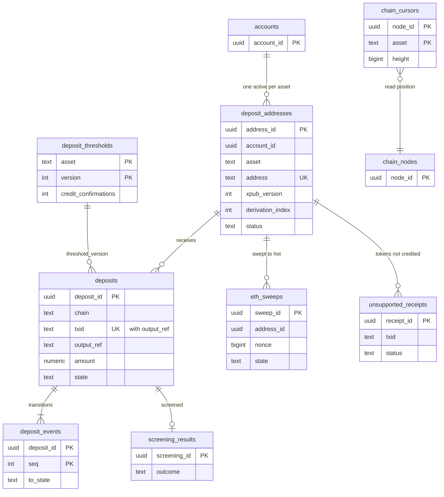

# Data model: 暗号資産の入金

入金のアドレス、入金と遷移の事象、閾値、ETH の集め直し、例外の受け取り。振る舞いは [deposits.md](../deposits.md)、方針は [ADR-0009](../../decisions/0009-deposits-confirmations-and-own-nodes.md)・[ADR-0039](../../decisions/0039-deposit-state-machine-and-withdrawal-lock.md)・[ADR-0040](../../decisions/0040-deposit-address-issuance-and-verification.md)・[ADR-0041](../../decisions/0041-eth-deposit-detection-and-sweep.md)。

- どの表も core のクラスタにあり、`deposit-watcher`（`packages/deposits`）と `rebalancer` が書く。入金の遷移は `transitionDeposit()` だけが書き、遷移ごとに `deposit_events` に行を足す。
- 記帳は ledger の `crypto_deposit`（冪等キー `deposit:<chain>:<txid>:<output_ref>`）。BTC は同じトランザクションで `withdrawal_restrictions`（`scope = account`、`deposit_maturity`）を立てる（[ledger-and-balances.md](ledger-and-balances.md) の 2.8 節）。
- 入金のアドレスとチェーンの取引の ID は C の区分で、ログでは `account_id` と同じ行に書かない（`chain` のロググループ）。DB の行は両方を持つ。

## 1. ER 図

## 2. 表

### 2.1 `deposit_addresses`

利用者ごと・資産ごとの入金のアドレス。BTC は BIP84、ETH は BIP44 の形で、枝の xpub から `index` だけを導く。定義元：[deposits.md](../deposits.md) の 4・16 節、[ADR-0040](../../decisions/0040-deposit-address-issuance-and-verification.md)。

| 列 | 型 | NULL | 説明 |
| --- | --- | --- | --- |
| `address_id` | `uuid` | NOT NULL | |
| `account_id` | `uuid` | NOT NULL | RLS |
| `asset` | `text` | NOT NULL | `BTC`・`ETH` |
| `address` | `text` | NOT NULL | |
| `xpub_version` | `integer` | NOT NULL | 導いた枝の xpub のバージョン |
| `derivation_index` | `integer` | NOT NULL | 連番 |
| `status` | `text` | NOT NULL | `pending_verification`（境界の確かめの前。画面は「準備中」）・`active`・`retired` |
| `issued_at` | `timestamptz` | NOT NULL | |
| `verified_at` | `timestamptz` | NULL | `address-verifier` が導き直して一致を確かめた時刻 |
| `retired_at` | `timestamptz` | NULL | |

- キー：PK `(address_id)`。UK `(asset, xpub_version, derivation_index)`、UK `(asset, address)` — 2 人に同じアドレスを出さない（PROP-DEP-007）。部分 UK `(account_id, asset) WHERE status = 'active'`。
- CHECK：`(status = 'active') <= (verified_at IS NOT NULL)`。
- 入れ替えは利用者の求め（月に 1 回まで）と侵害の疑い（2 人の承認）のときだけ。`retired` のアドレスも見張り、届いた入金を記帳する。
- `address-verifier`（`custody` のアカウント）が毎日、全行を導き直して確かめる。食い違いは page。
- RLS：本人。区分：C。保持：消さない（`retired` も見張る）。S1 の量：最大 60 万行（入れ替えを含めて 70 万を上限に作る）。

### 2.2 `deposits`

入金。1 つの出力（BTC）・1 つの送金（ETH の最上位の取引か trace の呼び出し）が 1 行。状態は [deposits.md](../deposits.md) の 5 節の DT-DEP が正。定義元：同 5・16 節。

| 列 | 型 | NULL | 説明 |
| --- | --- | --- | --- |
| `deposit_id` | `uuid` | NOT NULL | |
| `account_id` | `uuid` | NOT NULL | RLS |
| `asset` | `text` | NOT NULL | |
| `chain` | `text` | NOT NULL | `bitcoin`・`ethereum` |
| `txid` | `text` | NOT NULL | |
| `output_ref` | `text` | NOT NULL | BTC は出力の番号、ETH は trace の位置か log の番号 |
| `address_id` | `uuid` | NOT NULL | |
| `amount` | `numeric(38,0)` | NOT NULL | |
| `block_hash`・`block_height` | `text`・`bigint` | NULL | 今の合意の鎖での位置（`reorged` で NULL に戻す） |
| `state` | `text` | NOT NULL | `detected`・`confirming`・`review_hold`・`below_minimum`・`credited`・`withdrawable`・`reorged`・`frozen`・`reversed_suspense` |
| `threshold_version` | `integer` | NULL | 記帳に使った `deposit_thresholds` |
| `screening_result_id` | `uuid` | NULL | `screening_results` |
| `travel_rule_status` | `text` | NULL | `not_required`・`matched`・`missing`・`incomplete`（[compliance-and-surveillance.md](compliance-and-surveillance.md) の 2.5 節） |
| `credit_journal_id` | `uuid` | NULL | ledger の `crypto_deposit` |
| `credited_at` | `timestamptz` | NULL | |
| `withdrawable_at` | `timestamptz` | NULL | BTC の 6 承認。ETH は `credited_at` と同じ |
| `created_at`・`updated_at` | `timestamptz` | NOT NULL | |

- キー：PK `(deposit_id)`。UK `(chain, txid, output_ref)` — `reorged` から `detected` に戻るときも同じ行を使い直す。記帳は 2 度起きない（I7）。
- CHECK：`amount > 0`。`state IN (...)`。`(state IN ('credited','withdrawable','reversed_suspense')) = (credit_journal_id IS NOT NULL)`。
- 状態の更新：`UPDATE … WHERE deposit_id = $1 AND state = $from`（条件つき）。`frozen`（法務の L6）とその後の返却は、本システムの出金として [withdrawals.md](withdrawals.md) の流れを通す。
- 索引：`(state, block_height) WHERE state IN ('detected','confirming')` — 閾値の判定と照合の途中の項目。`(account_id, created_at DESC)` — 照会。`(account_id) WHERE state = 'credited'` — 出金の制限の待ちの表示。
- `review_hold`・`below_minimum`・`frozen` は台帳に書かない。照合では「記帳していない既知の入金」として説明に使う。
- RLS：本人（`frozen`・`review_hold` の理由は出さない。画面は「確認中」）。区分：F・C。保持：`legal.transaction_record_retention_days`。S1 の量：1 日 5,000 行。

### 2.3 `deposit_events`

入金の遷移の記録。追記だけ。定義元：同 5・16 節。

| 列 | 型 | NULL | 説明 |
| --- | --- | --- | --- |
| `deposit_id` | `uuid` | NOT NULL | |
| `seq` | `integer` | NOT NULL | 入金ごとに 1 から |
| `from_state`・`to_state` | `text` | — | |
| `reason_code` | `text` | NULL | `node_disagreement`・`screening_hold`・`reorg` など |
| `block_height` | `bigint` | NULL | |
| `actor` | `text` | NULL | 人の判定（`review_hold` からの遷移）の担当 |
| `at` | `timestamptz` | NOT NULL | |

- キー：PK `(deposit_id, seq)`。RLS：本人（`reason_code` と `actor` を除く列の GRANT）。区分：F。保持：入金と同じ。S1 の量：1 日 約 2.5 万行（入金 1 件に約 5 つ）。

### 2.4 `deposit_thresholds`

記帳と出金に使える閾値。変更は Dev とセキュリティの承認。上げた値は、それ以降に `credited` になる入金にだけ効く。定義元：同 5.1・16 節。

| 列 | 型 | NULL | 説明 |
| --- | --- | --- | --- |
| `asset` | `text` | NOT NULL | |
| `version` | `integer` | NOT NULL | |
| `credit_confirmations` | `smallint` | NULL | BTC 3 |
| `withdrawable_confirmations` | `smallint` | NULL | BTC 6 |
| `finality_rule` | `text` | NOT NULL | `confirmations`（BTC）・`finalized`（ETH。合意のクライアントの確定） |
| `min_deposit_amount` | `numeric(38,0)` | NOT NULL | BTC 1 万 satoshi、ETH 0.001 ETH |
| `approved_by` | `uuid[]` | NOT NULL | |
| `effective_at` | `timestamptz` | NOT NULL | |

- キー：PK `(asset, version)`。CHECK：`(finality_rule = 'confirmations') = (credit_confirmations IS NOT NULL AND withdrawable_confirmations >= credit_confirmations)`。
- 承認の数は 2 台の合意の頭から数える（[chain-nodes.md](chain-nodes.md) の `chain_agreements`）。
- RLS：なし（設定）。区分：M。保持：消さない。S1 の量：数行。

### 2.5 `eth_sweeps`

ETH の入金のアドレスから利用者用のホットへの集め直し。ETH 本体はアドレス自身の残高から手数料を払う。定義元：同 7.1・16 節、[ADR-0041](../../decisions/0041-eth-deposit-detection-and-sweep.md)。

| 列 | 型 | NULL | 説明 |
| --- | --- | --- | --- |
| `sweep_id` | `uuid` | NOT NULL | |
| `address_id` | `uuid` | NOT NULL | |
| `to_wallet_id` | `uuid` | NOT NULL | その資産の利用者用のホット |
| `amount` | `numeric(38,0)` | NOT NULL | 残高 − 21,000 gas × `max_fee_per_gas` |
| `nonce` | `bigint` | NOT NULL | アドレスごとにノードから読む |
| `tx_hash` | `text` | NULL | |
| `max_fee_per_gas` | `numeric(38,0)` | NOT NULL | wei |
| `fee_paid` | `numeric(38,0)` | NULL | `network_fee_expense:ETH` |
| `state` | `text` | NOT NULL | 既定案：`requested`・`signing`・`broadcast`・`completed`・`failed` |
| `journal_id` | `uuid` | NULL | 確定の時の振り替えの仕訳 |
| `created_at`・`completed_at` | `timestamptz` | — | |

- キー：PK `(sweep_id)`。部分 UK `(address_id) WHERE state NOT IN ('completed','failed')` — 1 つのアドレスに同時に 2 つ作らない。
- 起動の条件：記帳済みの残高 0.05 ETH 以上、または最後の記帳から 24 時間で 0.005 ETH 以上（本システムの値）。1 日にアドレスあたり 1 回まで。
- RLS：なし（`rebalancer`・`wallet-orchestrator`）。区分：F・C。保持：取引の記録と同じ。S1 の量：1 日 数千行以下（ETH の入金の数を上限とする）。

### 2.6 `unsupported_receipts`・`unattributed_receipts`

記帳しない受け取り。ERC-20 のトークン（`unsupported_receipts`）と、trace に出ない ETH・本システムのウォレットへの直の受け取り（`unattributed_receipts`）。同じ形の 2 つの表。定義元：同 7.3・16 節。

| 列 | 型 | NULL | 説明 |
| --- | --- | --- | --- |
| `receipt_id` | `uuid` | NOT NULL | |
| `chain` | `text` | NOT NULL | |
| `txid` | `text` | NOT NULL | |
| `output_ref` | `text` | NOT NULL | |
| `address` | `text` | NOT NULL | 受けたアドレス |
| `asset_or_token` | `text` | NOT NULL | `ETH`・トークンの契約のアドレス |
| `amount` | `numeric(38,0)` | NOT NULL | |
| `status` | `text` | NOT NULL | `open`・`attributed`（持ち主を確かめて記帳した）・`closed` |
| `resolved_by` | `uuid[]` | NULL | 財務の 2 人（`unattributed_receipts` の記帳） |
| `journal_id` | `uuid` | NULL | 記帳したとき |
| `created_at` | `timestamptz` | NOT NULL | |

- キー：PK `(receipt_id)`。UK `(chain, txid, output_ref)`。CHECK：`(status = 'attributed') = (journal_id IS NOT NULL)`。
- 7 日を超えた `open` の行が 1 件あればチケット（`unattributed-receipts.md`）。照合で「記帳していない既知の受け取り」として説明に使う。
- RLS：なし（財務、CS）。区分：C。保持：取引の記録と同じ。S1 の量：月に数十行。

## 3. 段階ごとの変化

- S2：銘柄の追加でトークンの入金を扱うと、`unsupported_receipts` の一部を記帳の対象に移し、`deposit_thresholds` と集め直しの手数料の経路（トークンのときだけ本システムが ETH を送る。ADR-0009 の注記）を足す。
- `chain_cursors` は [chain-nodes.md](chain-nodes.md) の 2.7 節。
