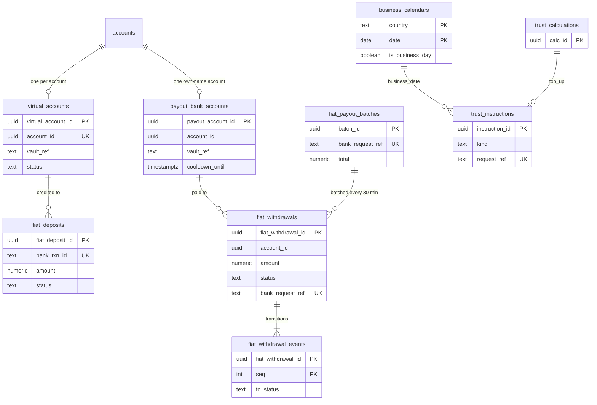

# Data model: 日本円の入出金と銀行

利用者ごとの振込先の口座番号、日本円の入金、出金の口座、日本円の出金と事象、出金の束、信託の依頼、銀行の営業日。振る舞いは [fiat-and-banking.md](../fiat-and-banking.md)、方針は [ADR-0049](../../decisions/0049-virtual-accounts-and-name-matching.md)・[ADR-0050](../../decisions/0050-fiat-withdrawals-idempotency-and-inquiry.md)・[ADR-0033](../../decisions/0033-trust-amount-method-and-daily-top-up.md)。結果の分からない依頼の扱いは Stripe の [ADR-0018](../../../../stripe/docs/decisions/0018-payout-execution-via-banking-partner.md) の形。

- どの表も core のクラスタにあり、`funding` が書く。口座番号と名義は `kyc-vault` の `bank_accounts`（[accounts-and-kyc.md](accounts-and-kyc.md) の 3.5 節）にだけ置き、ここは参照（`vault_ref`）だけを持つ。名義の照合は `nameKanaMatches()` の真偽だけを受ける。
- 領域の文書の `user_id` は `account_id` に揃えた（[data-model.md](../data-model.md) の 7 節の N3）。
- 台帳の口座は `bank:user_deposit`・`bank:user_payout`・`bank:house`・`trust:<account>`・`fiat_in_transit`（[fiat-and-banking.md](../fiat-and-banking.md) の 4 節）。

## 1. ER 図

- `trust_calculations` は ledger（[reconciliation-and-trust.md](reconciliation-and-trust.md)）で、論理の参照である。

## 2. 表

### 2.1 `virtual_accounts`

利用者ごとの振込先の口座番号（提携銀行の仮想の口座の番号）。本人確認の後に 1 つ払い出し、退会の後も再利用しない。定義元：[fiat-and-banking.md](../fiat-and-banking.md) の 5・16 節。

| 列 | 型 | NULL | 説明 |
| --- | --- | --- | --- |
| `virtual_account_id` | `uuid` | NOT NULL | |
| `account_id` | `uuid` | NOT NULL | RLS |
| `vault_ref` | `text` | NOT NULL | `kyc-vault` の口座番号の参照 |
| `bank_lookup_hmac` | `bytea` | NOT NULL | 着金の通知の口座番号から利用者を引く HMAC（完全一致だけ） |
| `status` | `text` | NOT NULL | `active`・`retired` |
| `issued_at` | `timestamptz` | NOT NULL | `account.activated` の後 |
| `retired_at` | `timestamptz` | NULL | |

- キー：PK `(virtual_account_id)`。UK `(bank_lookup_hmac)` — 再利用しない。部分 UK `(account_id) WHERE status = 'active'`。
- RLS：本人（画面の表示は `kyc-vault` から番号を取る関数を通す）。区分：V の参照。保持：消さない（再利用を防ぐ）。S1 の量：30 万行。

### 2.2 `fiat_deposits`

日本円の着金。通知と明細の照会を、銀行の取引の番号で 1 回にする。状態は ADR-0049 の遷移の表が正（[fiat-and-banking.md](../fiat-and-banking.md) の 5 節の図）。定義元：同 5・16 節。

| 列 | 型 | NULL | 説明 |
| --- | --- | --- | --- |
| `fiat_deposit_id` | `uuid` | NOT NULL | |
| `bank_txn_id` | `text` | NOT NULL | 冪等キー `fiat_deposit:<bank_txn_id>` |
| `virtual_account_id` | `uuid` | NULL | 口座番号が使えないときは NULL |
| `account_id` | `uuid` | NULL | 同上 |
| `amount` | `numeric(38,0)` | NOT NULL | 円 |
| `payer_name_ref` | `text` | NOT NULL | 振込の依頼人の名義（`kyc-vault` の参照。正規化の前の値を core に持たない） |
| `status` | `text` | NOT NULL | `notified`・`credited`・`review`・`returning`・`returned` |
| `name_check_result` | `text` | NULL | `match`・`mismatch`・`variant_confirmed`（本人の別の表記を 2 人で確かめた） |
| `journal_id` | `uuid` | NULL | `fiat_deposit`（`credited`）。`review`・`returning` は `suspense:bank` の仕訳 |
| `source` | `text` | NOT NULL | `notification`・`statement_inquiry` |
| `received_at` | `timestamptz` | NOT NULL | |

- キー：PK `(fiat_deposit_id)`。UK `(bank_txn_id)`。CHECK：`amount > 0`。`(status = 'credited') <= (journal_id IS NOT NULL AND account_id IS NOT NULL)`。
- `frozen` の口座への着金は記帳してから拘束（`legal`）に移す（DT-KYC-001）。
- 索引：`(status, received_at) WHERE status = 'review'` — 翌営業日までの待ち（`fiat-deposit-review-backlog.md`）。
- RLS：本人（`account_id` の決まった行）。区分：F。保持：`legal.transaction_record_retention_days`。S1 の量：1 日 5,000 行。

### 2.3 `payout_bank_accounts`

出金の口座。本人の名義の口座 1 つだけ。登録と変更の後 72 時間は出金を受けない。定義元：同 6.1・16 節。

| 列 | 型 | NULL | 説明 |
| --- | --- | --- | --- |
| `payout_account_id` | `uuid` | NOT NULL | |
| `account_id` | `uuid` | NOT NULL | RLS |
| `vault_ref` | `text` | NOT NULL | `kyc-vault` の `bank_accounts` |
| `name_verified_by` | `text` | NOT NULL | `kana_match`（本人確認のカナとの一致）・`bank_inquiry`（銀行の名義の照会。使えるかは**未検証**）・`first_payout` |
| `registered_at` | `timestamptz` | NOT NULL | |
| `cooldown_until` | `timestamptz` | NOT NULL | 登録・変更から 72 時間 |
| `revoked_at` | `timestamptz` | NULL | 変更で古い口座を外した時刻 |

- キー：PK `(payout_account_id)`。部分 UK `(account_id) WHERE revoked_at IS NULL`。
- 72 時間は `cooldowns` の行（[accounts-and-kyc.md](accounts-and-kyc.md) の 2.7 節）と同じ考え方で、ここは出金の口座ごとの写し。出金の判定は `identity.withdrawalAllowedAt()` を正とする。
- RLS：本人。区分：V の参照。保持：取引の記録と同じ。S1 の量：30 万行以下。

### 2.4 `fiat_withdrawals`

日本円の出金。状態は [fiat-and-banking.md](../fiat-and-banking.md) の 6.2 節の表が正。定義元：同 6.2・16 節、[ADR-0050](../../decisions/0050-fiat-withdrawals-idempotency-and-inquiry.md)。

| 列 | 型 | NULL | 説明 |
| --- | --- | --- | --- |
| `fiat_withdrawal_id` | `uuid` | NOT NULL | |
| `account_id` | `uuid` | NOT NULL | RLS |
| `payout_account_id` | `uuid` | NOT NULL | |
| `amount` | `numeric(38,0)` | NOT NULL | 振り込む額 |
| `fee` | `numeric(38,0)` | NOT NULL | 表の固定の額 |
| `fee_schedule_version` | `integer` | NOT NULL | `fee_schedules`（`kind = fiat_withdrawal`） |
| `status` | `text` | NOT NULL | `requested`・`held`・`submitted`・`unknown`・`accepted`・`completed`・`failed`・`returned`・`rejected` |
| `reason_code` | `text` | NULL | `insufficient_funds`・`account_restricted`・`deposit_maturity`（待ち）・銀行の拒否の理由 |
| `hold_id` | `uuid` | NULL | ledger の `holds`（`fiat_withdrawal`） |
| `batch_id` | `uuid` | NULL | `fiat_payout_batches` |
| `bank_request_ref` | `text` | NULL | 依頼の番号。採番して保存してから送る |
| `journal_ids` | `uuid[]` | NOT NULL | 書いた仕訳（`fiat_withdrawal_request`・`_settle`・`_return`） |
| `created_at`・`updated_at` | `timestamptz` | NOT NULL | |

- キー：PK `(fiat_withdrawal_id)`。部分 UK `(bank_request_ref) WHERE bank_request_ref IS NOT NULL`。
- CHECK：`amount > 0`。`status IN (...)`。`submitted` 以降は `rejected` に進めない（遷移の関数とトリガー）。`unknown` では依頼し直さず、照会で決める。
- `scope = account` の解けていない出金の制限があれば `held` の前で待たせる（I8）。
- 索引：`(status) WHERE status IN ('held','submitted','unknown','accepted')` — 30 分ごとの束ねと照会。
- RLS：本人。区分：F。保持：`legal.transaction_record_retention_days`。S1 の量：1 日 4,000 行。

### 2.5 `fiat_withdrawal_events`

日本円の出金の遷移の記録。追記だけ。定義元：同 6.2・16 節。

| 列 | 型 | NULL | 説明 |
| --- | --- | --- | --- |
| `fiat_withdrawal_id` | `uuid` | NOT NULL | |
| `seq` | `integer` | NOT NULL | |
| `from_status`・`to_status` | `text` | — | |
| `reason` | `text` | NULL | 理由のコード |
| `at` | `timestamptz` | NOT NULL | |

- キー：PK `(fiat_withdrawal_id, seq)`。RLS：本人。区分：F。保持：出金と同じ。S1 の量：1 日 約 2 万行。

### 2.6 `fiat_payout_batches`

30 分ごとの出金の束。束の依頼の番号を採番してから送る。定義元：同 6.3・16 節。

| 列 | 型 | NULL | 説明 |
| --- | --- | --- | --- |
| `batch_id` | `uuid` | NOT NULL | |
| `bank_request_ref` | `text` | NOT NULL | |
| `count` | `integer` | NOT NULL | 銀行の 1 回の件数の上限（**未検証**）以下 |
| `total` | `numeric(38,0)` | NOT NULL | |
| `status` | `text` | NOT NULL | 既定案：`created`・`submitted`・`unknown`・`accepted`・`completed`・`failed`・`held_for_funding`（出金の口座の残高が足りない） |
| `submitted_at` | `timestamptz` | NULL | |

- キー：PK `(batch_id)`。UK `(bank_request_ref)`。区分：F。保持：取引の記録と同じ。S1 の量：1 日 48 行。

### 2.7 `trust_instructions`

信託銀行への依頼。依頼の番号で冪等にし、結果が分からないときは照会する。定義元：同 7・16 節。

| 列 | 型 | NULL | 説明 |
| --- | --- | --- | --- |
| `instruction_id` | `uuid` | NOT NULL | |
| `kind` | `text` | NOT NULL | `top_up`（自動）・`withdraw`（解約。財務の 2 人） |
| `amount` | `numeric(38,0)` | NOT NULL | |
| `business_date` | `date` | NOT NULL | |
| `request_ref` | `text` | NOT NULL | |
| `status` | `text` | NOT NULL | `requested`・`accepted`・`completed`・`failed` |
| `approved_by` | `uuid[]` | NULL | `withdraw` だけ |
| `journal_id` | `uuid` | NULL | 完了の `internal_transfer`（`bank:user_deposit` と `trust:<account>` の間） |

- キー：PK `(instruction_id)`。UK `(request_ref)`。CHECK：`(kind = 'withdraw') <= (cardinality(approved_by) >= 2)`。
- 接続が人の手続きなら、依頼は運用の画面の作業の待ち行列にし、財務が完了を記録する（**未検証**。法務の L3）。区分：F。保持：取引の記録と同じ。S1 の量：年に 約 250 行。

### 2.8 `business_calendars`

銀行の営業日。定義元：同 8・16 節。

| 列 | 型 | NULL | 説明 |
| --- | --- | --- | --- |
| `country` | `text` | NOT NULL | `JP` |
| `date` | `date` | NOT NULL | |
| `is_business_day` | `boolean` | NOT NULL | |

- キー：PK `(country, date)`。RLS：なし（公開の設定）。区分：U。保持：消さない。S1 の量：年に 365 行。

## 3. 段階ごとの変化

- S2：提携銀行を足すと、`virtual_accounts` と `fiat_payout_batches` に銀行の列を足す。
