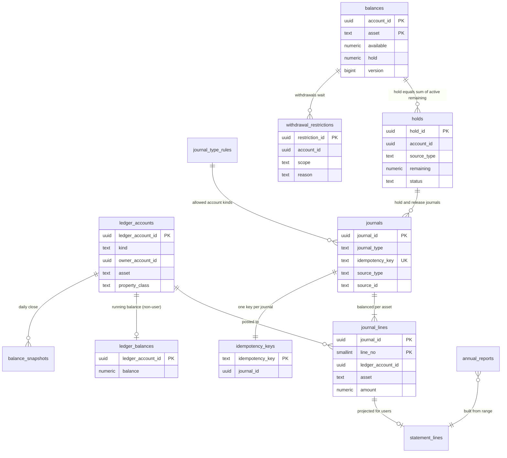

# Data model: 台帳と残高

台帳の口座、仕訳と行、冪等キー、型の規則、残高、拘束、出金の制限、締めのスナップショット、明細、年間の報告書。手数料の表（core）もここに置く。振る舞いは [ledger-and-balances.md](../ledger-and-balances.md)、方針は [ADR-0005](../../decisions/0005-ledger-balances-and-trade-settlement.md)・[ADR-0004](../../decisions/0004-order-entry-holds-and-idempotency.md)・[ADR-0027](../../decisions/0027-fee-schedules-and-rounding.md)・[ADR-0028](../../decisions/0028-statements-and-annual-report-source.md)・[ADR-0029](../../decisions/0029-hold-kinds-and-withdrawal-restrictions.md)。台帳の一般の形は Stripe の [ledger.md](../../../../stripe/docs/architecture/ledger.md) とメルカリの [ledger-and-proceeds.md](../../../../mercari/docs/architecture/data-model/ledger-and-proceeds.md) にあり、ここは差分（複数の資産、拘束、約定の記帳、利用者の財産と本システムの財産の分け）を書く。

- `fee_schedules` 以外は ledger のクラスタにあり、`packages/ledger` だけが書く。利用者は `ledger` の API で自分の分だけを読む（[data-model.md](../data-model.md) の 3.3 節）。
- 仕訳・仕訳の行・冪等キーは追記だけ。`UPDATE`・`DELETE` は権限とトリガーで拒む。誤りは `reversal` で直す。
- 金額はすべて `numeric(38,0)` の資産の最小の単位（[data-model.md](../data-model.md) の 3.5 節）。

## 1. ER 図

- `balances` は利用者の口座ごと・資産ごとの 1 行で、台帳の 2 つの口座（`user_available:<asset>`・`user_hold:<asset>`）の残高を持つ。利用者でない口座の残高は `ledger_balances`（`fee_revenue:*` を除く。2.6 節）。

## 2. 表

### 2.1 `ledger_accounts`

台帳の口座。種類は [ledger-and-balances.md](../ledger-and-balances.md) の 4 節の表。定義元：同 4・19 節。

| 列 | 型 | NULL | 説明 |
| --- | --- | --- | --- |
| `ledger_account_id` | `uuid` | NOT NULL | |
| `kind` | `text` | NOT NULL | `user_available`・`user_hold`・`wallet`・`bank`・`trust`・`fiat_in_transit`・`house_wallet`・`house_inventory`・`fee_revenue`・`network_fee_expense`・`bank_fee_expense`・`suspense` |
| `qualifier` | `text` | NULL | `wallet` の段（`hot`・`warm`・`cold`）、`bank`・`trust` の口座（`user_deposit`・`user_payout`・`house`・信託の口座）、`suspense` の元（`chain`・`bank`・`trust`・`reorg`・`wallet_loss`） |
| `owner_account_id` | `uuid` | NULL | `user_*` だけ。利用者の `account_id` |
| `asset` | `text` | NOT NULL | `BTC`・`ETH`・`JPY` |
| `property_class` | `text` | NOT NULL | `user`・`house`・`location`・`suspense` |
| `created_at` | `timestamptz` | NOT NULL | |

- キー：PK `(ledger_account_id)`。UK `(kind, qualifier, owner_account_id, asset) NULLS NOT DISTINCT`。
- CHECK：`(kind LIKE 'user_%') = (owner_account_id IS NOT NULL)`。`property_class` は `kind` で決まる（`user_*` は `user`、`wallet`・`bank`・`trust`・`fiat_in_transit` は `location`、`house_*`・`fee_revenue`・`*_expense` は `house`、`suspense` は `suspense`）。`kind IN ('bank_fee_expense') <= (asset = 'JPY')`。
- 利用者の口座は、口座の開設（`account.activated`）で資産ごとに 2 つずつ作る。
- 区分：F。保持：消さない。S1 の量：約 180 万行（30 万口座 × 3 資産 × 2）。

### 2.2 `journals`

仕訳の見出し。1 つの事象に 1 つ。定義元：同 5・19 節。

| 列 | 型 | NULL | 説明 |
| --- | --- | --- | --- |
| `journal_id` | `uuid` | NOT NULL | UUIDv7 |
| `journal_type` | `text` | NOT NULL | 2.4 節の型 |
| `idempotency_key` | `text` | NOT NULL | [data-model.md](../data-model.md) の 3.5 節の形 |
| `source_type` | `text` | NOT NULL | `order`・`trade`・`quote`・`deposit`・`withdrawal`・`fiat_deposit`・`fiat_withdrawal`・`transfer`・`suspense`・`reorg`・`legal`・`reversal` |
| `source_id` | `text` | NOT NULL | 元の行の ID（`trade` は `<pair>:<trade_seq>`） |
| `fee_schedule_version` | `integer` | NULL | 手数料を含む型（`trade`・`crypto_withdrawal`・`fiat_withdrawal_request`） |
| `reverses_journal_id` | `uuid` | NULL | `reversal` だけ |
| `actor_id` | `uuid` | NULL | 人が作った仕訳（`reversal`・`suspense_*`・`legal` の拘束）の作成者。承認者は `approval_id` |
| `approval_id` | `uuid` | NULL | 財務・コンプライアンスの 2 人の承認 |
| `created_at` | `timestamptz` | NOT NULL | 分割の鍵 |

- キー：PK `(journal_id, created_at)`。冪等は `idempotency_keys`（2.3 節）で全体に一意にする（分割の表は分割の鍵を含まない一意を持てないため）。
- CHECK：`(journal_type = 'reversal') = (reverses_journal_id IS NOT NULL)`。`journal_type IN ('reversal','suspense_in','suspense_out') <= (approval_id IS NOT NULL)`。
- 索引：`(source_type, source_id)` — 照合と明細。`(journal_type, created_at)` — 締めの検査。
- 分割：月ごと（`created_at`）。13 か月より古い区切りを S3 の Parquet へ移す（[capacity.md](../capacity.md) の 6 節）。区分：F。保持：消さない。S1 の量：1 日 約 930 万行（注文の拘束と戻し 約 900 万、約定 30 万、その他）。

### 2.3 `idempotency_keys`

仕訳の冪等キー。分割しない表で、全期間で一意にする。ADR-0001 の ledger の表の「冪等キー」に当たる。定義元：[ADR-0001](../../decisions/0001-platform-and-stack.md)、[ADR-0005](../../decisions/0005-ledger-balances-and-trade-settlement.md)。

| 列 | 型 | NULL | 説明 |
| --- | --- | --- | --- |
| `idempotency_key` | `text` | NOT NULL | |
| `journal_id` | `uuid` | NOT NULL | |
| `created_at` | `timestamptz` | NOT NULL | |

- キー：PK `(idempotency_key)`。仕訳を書くトランザクションの最初に `INSERT … ON CONFLICT DO NOTHING RETURNING` で取り、0 行なら既にある仕訳の ID を返して何も書かない（同じ `trade_seq` の再実行は成功として扱う。[ledger-and-balances.md](../ledger-and-balances.md) の 7 節）。
- 保持：13 か月（仕訳の区切りを S3 へ移すときに同じ範囲を消す）。それより古いキーの再実行は起きない（MSK の保持 7 日、`pending_submit` の送り直し 60 秒）。区分：F。S1 の量：1 日 約 930 万行。

### 2.4 `journal_lines`

仕訳の行。借方を正、貸方を負で持つ。定義元：同 5・19 節、[segregation-and-reconciliation.md](../segregation-and-reconciliation.md) の 18 節。

| 列 | 型 | NULL | 説明 |
| --- | --- | --- | --- |
| `journal_id` | `uuid` | NOT NULL | |
| `line_no` | `smallint` | NOT NULL | 1〜20 |
| `ledger_account_id` | `uuid` | NOT NULL | |
| `asset` | `text` | NOT NULL | 口座の資産と同じ |
| `amount` | `numeric(38,0)` | NOT NULL | 借方を正 |
| `settlement_batch_id` | `uuid` | NULL | 本システムの持ち分の精算の束（[reconciliation-and-trust.md](reconciliation-and-trust.md) の 2.3 節）。空の行の和が精算の待ち |
| `created_at` | `timestamptz` | NOT NULL | 見出しと同じ値。分割の鍵 |

- キー：PK `(journal_id, line_no, created_at)`。CHECK：`amount <> 0`。`line_no BETWEEN 1 AND 20`。
- 釣り合い：遅延の制約のトリガー（`DEFERRABLE INITIALLY DEFERRED`）が、commit の時に `journal_id` ごと・`asset` ごとに `sum(amount) = 0` を確かめる（I1）。トリガーは型の規則（2.5 節）も確かめる。
- `settlement_batch_id` だけは、精算の仕訳を書くときに空から値へ一度だけ書ける（トリガーで、ほかの列と、値から別の値への変更を拒む）。
- 索引：`(ledger_account_id, created_at)` — 明細と再計算。`(ledger_account_id) WHERE settlement_batch_id IS NULL AND <精算の対象の口座>` — 精算の待ちの和。
- 分割：月ごと。区分：F。保持：消さない（13 か月より古い区切りは S3）。S1 の量：1 日 約 2,900 万行（拘束と戻しの 2,700 万、約定の 210 万。[capacity.md](../capacity.md) の 6 節）。

### 2.5 `journal_type_rules`

型ごとに使ってよい口座の組。型の追加と変更は QA の承認を要する正解のファイルの変更（[roadmap.md](../../roadmap.md) の「エージェントに任せないこと」）。定義元：同 5・19 節。

| 列 | 型 | NULL | 説明 |
| --- | --- | --- | --- |
| `journal_type` | `text` | NOT NULL | |
| `version` | `integer` | NOT NULL | |
| `side` | `text` | NOT NULL | `debit`・`credit` |
| `account_kind` | `text` | NOT NULL | `ledger_accounts.kind` |
| `max_lines` | `smallint` | NOT NULL | |

- キー：PK `(journal_type, version, side, account_kind)`。区分：M。保持：消さない。
- 型の一覧（MVP）：

| 型 | 借方 | 貸方 |
| --- | --- | --- |
| `hold` | `user_available` | `user_hold` |
| `hold_release` | `user_hold` | `user_available` |
| `trade` | `user_hold`（買い手の JPY、売り手の基準の資産） | `user_available`（売り手の JPY、買い手の基準の資産）、`fee_revenue` |
| `brokerage` | `user_available`（払う資産）、`house_inventory`（渡す資産） | `house_inventory`（受ける資産）、`user_available`（受ける資産） |
| `crypto_deposit` | `wallet` | `user_available` |
| `crypto_withdrawal` | `user_hold`、`network_fee_expense` | `wallet`、`fee_revenue` |
| `fiat_deposit` | `bank` | `user_available` |
| `fiat_withdrawal_request` | `user_hold` | `fiat_in_transit`、`fee_revenue` |
| `fiat_withdrawal_settle` | `fiat_in_transit`、`bank_fee_expense` | `bank` |
| `fiat_withdrawal_return` | `fiat_in_transit`、`fee_revenue` | `user_available` |
| `internal_transfer` | 移し先の `wallet`・`bank`・`trust`・`house_wallet` | 移し元 |
| `suspense_in`・`suspense_out` | `suspense` か相手の口座 | 相手の口座か `suspense` |
| `reversal` | 元の仕訳の逆 | 元の仕訳の逆 |

- `deposit_reversal_hold`（[deposits.md](../deposits.md) の 5 節）は型でなく、`hold`（`source_type = reorg`、冪等キー `reorg:<deposit_id>:hold`）である。足りない分は `suspense_in`（`suspense:reorg`）。
- `fiat_withdrawal_return` は [ledger-and-balances.md](../ledger-and-balances.md) の 5 節の本文と [fiat-and-banking.md](../fiat-and-banking.md) の 6.2 節にあり、手数料を返す。完了の後の組戻し（`returned`）の型の名前は未定（[data-model.md](../data-model.md) の 9 節）。

### 2.6 `balances`・`ledger_balances`

残高の行。仕訳と同じトランザクションで更新する。定義元：[ADR-0005](../../decisions/0005-ledger-balances-and-trade-settlement.md)、同 9 節。

**`balances`**（利用者）

| 列 | 型 | NULL | 説明 |
| --- | --- | --- | --- |
| `account_id` | `uuid` | NOT NULL | |
| `asset` | `text` | NOT NULL | |
| `available` | `numeric(38,0)` | NOT NULL | `user_available:<asset>` の残高 |
| `hold` | `numeric(38,0)` | NOT NULL | `user_hold:<asset>` の残高 |
| `version` | `bigint` | NOT NULL | 更新ごとに 1 上がる |
| `updated_at` | `timestamptz` | NOT NULL | |

- キー：PK `(account_id, asset)`。CHECK：`available >= 0`、`hold >= 0`（I3）。
- 拘束：`UPDATE balances SET available = available - $a, hold = hold + $a, version = version + 1 WHERE account_id = $1 AND asset = $2 AND available >= $a`。出金と日本円の出金は、`scope = asset` の解けていない制限の和を引いた `available - restricted >= $a` にする（2.8 節）。`reorg` の拘束だけは足りない分を `suspense:reorg` に置く。
- 1 行の更新は直列になる。1 行あたり 500〜1,000 件/秒が上限で（**未検証**）、マーケットメイカー 1 社の入力の上限はこの半分以下にする（[capacity.md](../capacity.md) の 5.2 節）。S2 でスロットに分ける。
- 区分：F。保持：置き換え（正本は仕訳）。S1 の量：90 万行（30 万口座 × 3 資産）。

**`ledger_balances`**（利用者でない口座）

| 列 | 型 | NULL | 説明 |
| --- | --- | --- | --- |
| `ledger_account_id` | `uuid` | NOT NULL | |
| `balance` | `numeric(38,0)` | NOT NULL | 借方を正 |
| `version` | `bigint` | NOT NULL | |
| `updated_at` | `timestamptz` | NOT NULL | |

- キー：PK `(ledger_account_id)`。`fee_revenue:*` の行は持たない（約定ごとに更新すると熱い行になる。締めのスナップショットと仕訳の和で出す。[data-model.md](../data-model.md) の 7 節の N7）。
- 照合は高さ h を決めた後、reader の 1 つの読み取りのトランザクションで `wallet:*` の行を読む（[ADR-0031](../../decisions/0031-point-in-time-reconciliation-with-in-flight.md)）。販売所は受け入れのトランザクションで `house_inventory:<asset>` の行を条件つきで更新する（在庫の不足は `inventory_limit`）。
- 区分：F。保持：置き換え。S1 の量：数十行。

### 2.7 `holds`

拘束の行。「この先で使う額」を 1 行で持つ。寿命と種類は [ledger-and-balances.md](../ledger-and-balances.md) の 6・6.1 節。定義元：同 19 節、[ADR-0029](../../decisions/0029-hold-kinds-and-withdrawal-restrictions.md)。

| 列 | 型 | NULL | 説明 |
| --- | --- | --- | --- |
| `hold_id` | `uuid` | NOT NULL | |
| `account_id` | `uuid` | NOT NULL | |
| `asset` | `text` | NOT NULL | |
| `source_type` | `text` | NOT NULL | `order`・`withdrawal`・`fiat_withdrawal`・`reorg`・`legal` |
| `source_id` | `uuid` | NOT NULL | 注文、出金、日本円の出金、入金、案件 |
| `amount` | `numeric(38,0)` | NOT NULL | 拘束した額。手数料の上限を含めない（出金は額 ＋ 表の固定の手数料） |
| `remaining` | `numeric(38,0)` | NOT NULL | 使った分と戻した分を引いた残り |
| `status` | `text` | NOT NULL | `active`・`closed` |
| `created_at` | `timestamptz` | NOT NULL | |
| `closed_at` | `timestamptz` | NULL | |

- キー：PK `(hold_id)`。UK `(source_type, source_id)` — 1 つの元に 1 つの拘束。
- CHECK：`amount > 0`。`0 <= remaining AND remaining <= amount`。`(status = 'closed') = (remaining = 0)`。`(status = 'closed') = (closed_at IS NOT NULL)`。
- 更新：`remaining` は `trade`・`crypto_withdrawal`・`fiat_withdrawal_request`・`hold_release` の仕訳と同じトランザクションで減らす。`balances.hold` ＝ `active` の `remaining` の和（I4）。
- 索引：`(account_id, asset) WHERE status = 'active'` — 締めの検査と REC-HOLD。`(source_type, created_at) WHERE status = 'active'` — NFR-004 の `source_type` ごとの比べ。
- 分割しない（`active` の行を月の区切りに縛らないため）。`closed` の行は 13 か月で S3 へ移す。区分：F。保持：仕訳と同じ。S1 の量：1 日 約 450 万行（注文）、`active` は未約定の注文の数ほど。
- 販売所の受け入れは拘束を作らない（[ADR-0010](../../decisions/0010-brokerage-quotes-and-inventory.md)。NFR-004 の比べに入れない）。

### 2.8 `withdrawal_restrictions`

出金の制限。拘束ではなく、出金だけを止める。台帳の口座にせず、照合の等式にも入らない。定義元：[ADR-0029](../../decisions/0029-hold-kinds-and-withdrawal-restrictions.md) の 2026-11-15 の注記、[ledger-and-balances.md](../ledger-and-balances.md) の 6.2 節。

| 列 | 型 | NULL | 説明 |
| --- | --- | --- | --- |
| `restriction_id` | `uuid` | NOT NULL | |
| `account_id` | `uuid` | NOT NULL | |
| `scope` | `text` | NOT NULL | `account`（口座の全部の出金）・`asset`（その資産の額） |
| `asset` | `text` | NULL | `scope = asset` だけ |
| `amount` | `numeric(38,0)` | NULL | `scope = asset` だけ |
| `reason` | `text` | NOT NULL | `deposit_maturity`（MVP の唯一の値） |
| `deposit_id` | `uuid` | NULL | `deposit_maturity` の元の入金 |
| `created_at` | `timestamptz` | NOT NULL | `crypto_deposit` と同じトランザクション |
| `released_at` | `timestamptz` | NULL | BTC の 6 承認で `deposit-watcher` が書く |

- キー：PK `(restriction_id)`。部分 UK `(deposit_id) WHERE deposit_id IS NOT NULL`。
- CHECK：`(scope = 'account') = (asset IS NULL AND amount IS NULL)`。`reason <> 'deposit_maturity' OR (scope = 'account' AND deposit_id IS NOT NULL)`。
- 読み方：`scope = account` の解けていない行がある口座は、暗号資産と日本円の出金を `held` の前で待たせる（額の式を使わない。I8）。`scope = asset` は出金に使える額 ＝ `available` − 解けていない和（0 未満なら 0）。
- 索引：`(account_id) WHERE released_at IS NULL`。
- 区分：F。保持：取引の記録と同じ。S1 の量：1 日 約 2,500 行（BTC の入金。入金 5,000 件の半分と置いた）、解けていない行は数百。

### 2.9 `fee_schedules`（core）

手数料の表。バージョンつき。中身は署名つきの設定の束（[ADR-0075](../../decisions/0075-signed-config-bundles-for-policies-and-rules.md)）から入れ、財務と PM の承認を要する。定義元：[ADR-0027](../../decisions/0027-fee-schedules-and-rounding.md)、[ADR-0043](../../decisions/0043-one-transaction-per-withdrawal-and-fee-table.md)、同 8・19 節。

| 列 | 型 | NULL | 説明 |
| --- | --- | --- | --- |
| `schedule_id` | `uuid` | NOT NULL | |
| `kind` | `text` | NOT NULL | `trade`・`crypto_withdrawal`・`fiat_withdrawal` |
| `pair_or_asset` | `text` | NOT NULL | `trade` は板、ほかは資産 |
| `version` | `integer` | NOT NULL | |
| `tier` | `text` | NOT NULL | MVP は `default` だけ |
| `maker_ppm`・`taker_ppm` | `integer` | NULL | `trade` だけ。既定 500・1,000 |
| `fixed_amount` | `numeric(38,0)` | NULL | 出金の固定の額（BTC 0.0002 BTC、ETH 0.002 ETH。日本円は fiat-and-banking の値） |
| `min_amount` | `numeric(38,0)` | NULL | `crypto_withdrawal` の最小の出金の額（BTC 0.0005、ETH 0.01） |
| `effective_from` | `timestamptz` | NOT NULL | この時刻の後に受け付けた注文・出金から効く |
| `approved_by` | `uuid[]` | NOT NULL | 財務と PM |

- キー：PK `(schedule_id)`。UK `(kind, pair_or_asset, tier, version)`。
- CHECK：`(kind = 'trade') = (maker_ppm IS NOT NULL AND taker_ppm IS NOT NULL AND fixed_amount IS NULL)`。`maker_ppm >= 0`（負の率を持たない）。`min_amount IS NULL OR kind = 'crypto_withdrawal'`。
- 注文・出金は受け付けの時のバージョンと率を行に写す。`ledger-poster` は表を引き直さない。表のバージョンが見つからなければ板の記帳を止める（[ledger-and-balances.md](../ledger-and-balances.md) の 13 節）。
- RLS：なし（公開の設定）。区分：M。保持：消さない。S1 の量：数十行。

### 2.10 `balance_snapshots`

締め（JST 0:00）の後の口座ごとの残高。前日のスナップショットとその日の仕訳から作る。定義元：同 9・19 節。

| 列 | 型 | NULL | 説明 |
| --- | --- | --- | --- |
| `ledger_account_id` | `uuid` | NOT NULL | |
| `as_of_date` | `date` | NOT NULL | 締めの日（日本時間） |
| `balance` | `numeric(38,0)` | NOT NULL | |

- キー：PK `(ledger_account_id, as_of_date)`。全体の釣り合い（資産ごとに全口座の和 0。I2）と、`balances` ＝ スナップショット ＋ 締めの後の仕訳の和を確かめる。
- 分割：月ごと（`as_of_date`）。残高 0 で動きのない口座は行を書かない（前の行を引き継ぐ）。区分：F。保持：消さない。S1 の量：1 日 最大 約 180 万行（動きのあった口座だけなら数万）。

### 2.11 `statement_lines`

明細。利用者の口座に触れた仕訳の行の射影で、outbox から作る。作り直せる。定義元：[ADR-0028](../../decisions/0028-statements-and-annual-report-source.md)、同 10・19 節。

| 列 | 型 | NULL | 説明 |
| --- | --- | --- | --- |
| `account_id` | `uuid` | NOT NULL | |
| `journal_id` | `uuid` | NOT NULL | |
| `journal_type` | `text` | NOT NULL | |
| `asset` | `text` | NOT NULL | |
| `delta` | `numeric(38,0)` | NOT NULL | 利用者の残高（`available ＋ hold`）の増減 |
| `fee` | `numeric(38,0)` | NOT NULL | |
| `price` | `numeric(38,0)` | NULL | 約定・販売所の価格 |
| `counterparty_kind` | `text` | NOT NULL | `exchange`・`brokerage`・`deposit`・`withdrawal`・`fiat` |
| `created_at` | `timestamptz` | NOT NULL | 仕訳の時刻 |

- キー：PK `(account_id, journal_id, asset, created_at)`。拘束と戻し（`hold`・`hold_release`）は `available ＋ hold` を変えないので、明細の行にしない。
- 索引：PK の順で利用者ごとの一覧。分割：月ごと。区分：F。氏名・住所を入れない。保持：作り直せる（表示は 13 か月）。S1 の量：1 日 約 60 万行（約定の両側）。

### 2.12 `annual_reports`

年間の取引の報告書の元。暦の年（JST）の明細から作る。取得の価額の計算は `legal.cost_basis_method`（未設定なら `none`。数量と円の受け払いだけ）。定義元：同 10・19 節、法務の L10。

| 列 | 型 | NULL | 説明 |
| --- | --- | --- | --- |
| `report_id` | `uuid` | NOT NULL | |
| `account_id` | `uuid` | NOT NULL | |
| `year` | `smallint` | NOT NULL | |
| `format_version` | `integer` | NOT NULL | 様式のバージョン |
| `cost_basis_method` | `text` | NOT NULL | `none`・法務の結論の方法 |
| `last_journal_id` | `uuid` | NOT NULL | 作った時の明細の範囲 |
| `digest` | `bytea` | NOT NULL | 内容の要約。作り直しで違えば差分を財務へ |
| `document_ref` | `text` | NOT NULL | S3 の書き出しの場所 |
| `issued_at` | `timestamptz` | NOT NULL | |

- キー：PK `(report_id)`。UK `(account_id, year, format_version)`。区分：F。氏名・住所は交付の時に `kyc-vault` から差し込み、行に持たない。保持：`legal.transaction_record_retention_days`。S1 の量：年に 約 30 万行。

## 3. 段階ごとの変化

- S2：マーケットメイカーの `balances` の行をスロットに分ける（Stripe の [ADR-0016](../../../../stripe/docs/decisions/0016-hot-accounts-and-ledger-sharding.md)）。注文の拘束を仕訳にせず、残高の行と拘束の行だけで持つ案（[capacity.md](../capacity.md) の 6 節）を見直す。採れば `journals`・`journal_lines` の量は 1 日 約 30 万件の約定と入出金の分まで減る。
- S3：ledger を口座の持ち主のハッシュで分ける。利用者でない口座（`ledger_balances`）は分けずに 1 か所に置き、口座をまたぐ仕訳（`trade`）の扱いを ADR で決める。
