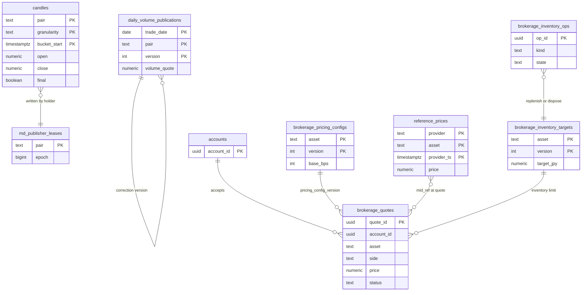

# Data model: 板の配信と販売所

ローソク足、日々の売買高の公表、配信の持ち主の記録（取引所の配信）。販売所の提示、価格の設定、在庫の目標、在庫の補充と処分、参照の価格（販売所）。振る舞いは [market-data.md](../market-data.md)・[brokerage-quotes.md](../brokerage-quotes.md)、方針は [ADR-0021](../../decisions/0021-market-data-feed-and-book-seq.md)〜[ADR-0023](../../decisions/0023-daily-volume-publication.md)・[ADR-0010](../../decisions/0010-brokerage-quotes-and-inventory.md)・[ADR-0024](../../decisions/0024-brokerage-mid-price-and-spread.md)〜[ADR-0026](../../decisions/0026-brokerage-price-display.md)。

- 配信の表は core のクラスタにあり、`md-publisher` が書く。足の時刻は sequencer の `ts` だけで決める。夜間に S3 の出力の記録から前日の足を作り直し、書いた値と一致することを確かめる。
- 販売所の表は core のクラスタにあり、`brokerage` が書く。受け入れは ledger の 1 つのトランザクションで `brokerage` の仕訳（冪等キー `quote:<quote_id>`）を書き、拘束を作らない。手数料は取らない（収益はスプレッド）。
- 価格はどれも円の整数、率は bp の整数（`*_bps`）、重みは 1/100 の整数（[data-model.md](../data-model.md) の 3.5 節）。

## 1. ER 図

## 2. 配信の表

### 2.1 `candles`

確定したローソク足。粒度は 1 分、5 分、15 分、1 時間、6 時間、1 日。1 日と 6 時間の足は日本時間で切る。約定のない足は作らない。販売所の取引を入れない。定義元：[market-data.md](../market-data.md) の 4.5・11 節、[ADR-0022](../../decisions/0022-candles-from-sequencer-time.md)。

| 列 | 型 | NULL | 説明 |
| --- | --- | --- | --- |
| `pair` | `text` | NOT NULL | |
| `granularity` | `text` | NOT NULL | `1m`・`5m`・`15m`・`1h`・`6h`・`1d` |
| `bucket_start` | `timestamptz` | NOT NULL | sequencer の `ts` の足の始まり |
| `open`・`high`・`low`・`close` | `numeric(38,0)` | NOT NULL | 円 |
| `volume_base` | `numeric(38,0)` | NOT NULL | 基準の資産の最小の単位 |
| `volume_quote` | `numeric(38,0)` | NOT NULL | 代金の円の和 |
| `trade_count` | `integer` | NOT NULL | |
| `final` | `boolean` | NOT NULL | `ts` が足の終わり以上の入力を見て確定した |
| `first_trade_seq`・`last_trade_seq` | `bigint` | NOT NULL | 作り直しの照らし |

- キー：PK `(pair, granularity, bucket_start)`。CHECK：`low <= open AND low <= close AND high >= open AND high >= close`。`trade_count > 0`。
- 書き込みは `INSERT … ON CONFLICT DO UPDATE WHERE NOT candles.final`（確定した足は変えない）。
- RLS：なし（公開）。区分：U。保持：消さない。S1 の量：1 日 最大 約 3,700 行（板 2 × 1 分足 1,440 ＋ ほかの粒度）。

### 2.2 `daily_volume_publications`

日々の売買高の計算と公表。翌日の 0 時 30 分に計算し、出力の記録から作った値と ledger の `trade` の仕訳から作った値が一致したら公表する。公表した値は書き換えず、訂正は新しいバージョン。`legal.daily_volume_definition` の本番の値は法務の L1 の結論まで有効にしない（計算と照合だけを回す）。定義元：同 4.6・11 節、[ADR-0023](../../decisions/0023-daily-volume-publication.md)。

| 列 | 型 | NULL | 説明 |
| --- | --- | --- | --- |
| `trade_date` | `date` | NOT NULL | 日本時間 |
| `pair` | `text` | NOT NULL | |
| `version` | `integer` | NOT NULL | 1 から。訂正で増える |
| `definition_version` | `integer` | NOT NULL | 使った `legal.daily_volume_definition`（販売所を含めるか） |
| `trade_count` | `integer` | NOT NULL | |
| `volume_base`・`volume_quote` | `numeric(38,0)` | NOT NULL | |
| `reconciled_at` | `timestamptz` | NULL | 2 つの値が一致した時刻 |
| `published_at` | `timestamptz` | NULL | |
| `correction_reason` | `text` | NULL | `version > 1` のとき |

- キー：PK `(trade_date, pair, version)`。CHECK：`published_at IS NULL OR reconciled_at IS NOT NULL`。`(version > 1) = (correction_reason IS NOT NULL)`。
- RLS：なし（`published_at` のある行だけを `GET /stats/daily-volume` で出す）。区分：U。保持：消さない。S1 の量：1 日 2 行。

### 2.3 `md_publisher_leases`

板ごとの `md-publisher` の持ち主の記録。形は `engine_leases` と同じ（[trading-engine.md](trading-engine.md) の 2.2 節）。定義元：同 11 節。列：`pair`（PK）、`holder_id`、`epoch`、`expires_at`。区分：M。S1 の量：2 行。

## 3. 販売所の表

### 3.1 `brokerage_quotes`

販売所の提示と受け入れ。期限 10 秒。状態は [brokerage-quotes.md](../brokerage-quotes.md) の 4.4 節の表が正。定義元：同 4.4・11 節。

| 列 | 型 | NULL | 説明 |
| --- | --- | --- | --- |
| `quote_id` | `uuid` | NOT NULL | 冪等キー `quote:<quote_id>` |
| `account_id` | `uuid` | NOT NULL | RLS |
| `asset` | `text` | NOT NULL | `BTC`・`ETH` |
| `side` | `text` | NOT NULL | 利用者から見た `buy`・`sell` |
| `spec_kind` | `text` | NOT NULL | `amount`（金額の指定）・`quantity`（数量の指定） |
| `mid` | `numeric(38,0)` | NOT NULL | 提示の時の中の価格（受け入れの時の 1% の比べに使う） |
| `price` | `numeric(38,0)` | NOT NULL | スプレッドを含む価格 |
| `spread_bps` | `integer` | NOT NULL | その向きの `s_side` |
| `quantity` | `numeric(38,0)` | NOT NULL | 1 satoshi・10^10 wei の細かさ |
| `jpy_amount` | `numeric(38,0)` | NOT NULL | 払う額は切り上げ、受け取る額は切り捨て。500 円〜1,000 万円 |
| `pricing_config_version` | `integer` | NOT NULL | |
| `expires_at` | `timestamptz` | NOT NULL | `brokerage` の時計で 10 秒 |
| `status` | `text` | NOT NULL | `offered`・`filled`・`rejected`・`expired` |
| `reject_reason` | `text` | NULL | `expired`・`price_unavailable`・`price_moved`・`insufficient_funds`・`inventory_limit`・`account_restricted`・`brokerage_disabled` |
| `journal_id` | `uuid` | NULL | `filled` の `brokerage` の仕訳 |
| `created_at` | `timestamptz` | NOT NULL | |
| `decided_at` | `timestamptz` | NULL | |

- キー：PK `(quote_id)`。CHECK：`(status = 'filled') = (journal_id IS NOT NULL)`。`rejected` は `reject_reason` を持つ。`reject_reason = 'expired'` は `status = 'expired'` だけ（受け入れなしで期限を過ぎた `expired` は理由を持たない）。`jpy_amount BETWEEN 500 AND 10000000`。
- 受け入れ：1 つの ledger のトランザクションで、`balances` の条件つきの更新、`ledger_balances`（`house_inventory:<asset>`）の条件つきの更新、`brokerage` の仕訳を書き、その後 core の行を `filled` にする。同じ `quote_id` の 2 度目は最初の結果を返す（I15）。
- 掃除の部品が 1 分ごとに期限を過ぎた `offered` を `expired` にする。索引：`(status, expires_at) WHERE status = 'offered'`。`(account_id, created_at DESC)`。
- 分割：月ごと（`created_at`）。RLS：本人。区分：F。保持：`filled` は `legal.transaction_record_retention_days`、ほかは 13 か月（本システムの値）。S1 の量：**未見積もり**（[capacity.md](../capacity.md) の 4 節。brokerage-quotes の領域が見積もる）。

### 3.2 `brokerage_pricing_configs`

価格の式の値。Dev・財務・コンプライアンスの承認で変える。基本の幅を広げる変更だけは Ops が運用で行ってよい。定義元：同 4.2・4.3・11 節。

| 列 | 型 | NULL | 説明 |
| --- | --- | --- | --- |
| `asset` | `text` | NOT NULL | |
| `version` | `integer` | NOT NULL | |
| `base_bps` | `integer` | NOT NULL | BTC 100、ETH 150 |
| `ex_weight` | `smallint` | NOT NULL | `mid_ex` の重み（1/100。既定 50） |
| `vol_cap_bps` | `integer` | NOT NULL | 300 |
| `side_cap_bps` | `integer` | NOT NULL | 500 |
| `approval_id` | `uuid` | NOT NULL | |
| `effective_from` | `timestamptz` | NOT NULL | |

- キー：PK `(asset, version)`。CHECK：`ex_weight BETWEEN 0 AND 100`。区分：M。保持：消さない。

### 3.3 `brokerage_inventory_targets`

在庫の目標と上限と損失の上限（円換算）。定義元：同 4.5・11 節、[ADR-0025](../../decisions/0025-brokerage-inventory-target-and-replenishment.md)。

| 列 | 型 | NULL | 説明 |
| --- | --- | --- | --- |
| `asset` | `text` | NOT NULL | `BTC`・`ETH`・`JPY` |
| `version` | `integer` | NOT NULL | |
| `target_jpy` | `numeric(38,0)` | NOT NULL | BTC 5 億円、ETH 2 億円、JPY 10.5 億円 |
| `max_jpy` | `numeric(38,0)` | NULL | `2T` |
| `daily_loss_limit_jpy` | `numeric(38,0)` | NULL | 24 時間の評価の損失 3,000 万円 |
| `approval_id` | `uuid` | NOT NULL | |

- キー：PK `(asset, version)`。区分：M。保持：消さない。

### 3.4 `brokerage_inventory_ops`

在庫の補充と処分。財務が作り、作成者と別の 2 人が承認する。取引所の板での調整とヘッジは持たない（P3、L7）。定義元：同 4.5・11 節。

| 列 | 型 | NULL | 説明 |
| --- | --- | --- | --- |
| `op_id` | `uuid` | NOT NULL | |
| `kind` | `text` | NOT NULL | `replenish`・`dispose` |
| `asset` | `text` | NOT NULL | |
| `amount` | `numeric(38,0)` | NOT NULL | |
| `created_by` | `uuid` | NOT NULL | |
| `approved_by` | `uuid[]` | NULL | 2 人 |
| `journal_id` | `uuid` | NULL | |
| `state` | `text` | NOT NULL | 既定案：`drafted`・`approved`・`completed`・`cancelled` |

- キー：PK `(op_id)`。CHECK：`state <> 'approved' OR (cardinality(approved_by) >= 2 AND NOT (created_by = ANY (approved_by)))`。区分：F。保持：取引の記録と同じ。

### 3.5 `reference_prices`

参照の価格の提供者の値。直近 5 分の輪で、古いものは消す。10 秒の中に更新された値だけを `mid_ref` に使う。定義元：同 4.2・11 節。列：`provider`、`asset`、`price`、`provider_ts`、`received_at`。キー：PK `(provider, asset, provider_ts)`。分割しない（5 分より古い行を 1 分ごとに消す）。区分：M。S1 の量：常に数千行。

## 4. 段階ごとの変化

- S2：板が 10 になると `candles` と `daily_volume_publications` が板の数で増える。銘柄を販売所に足すと、`brokerage_pricing_configs` と `brokerage_inventory_targets` に資産の行を足す。
