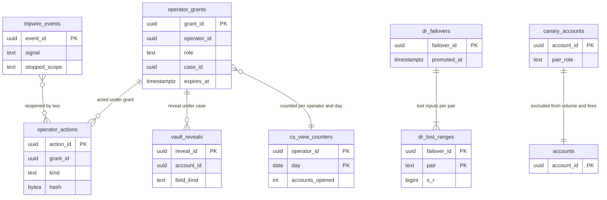

# Data model: 運用と可観測性

outbox、運用者の期限つきの権限と操作の監査、金庫の表示、CS の参照の数、自動の停止の事象、見張りの口座、DR の記録、キャパシティのレビュー。`watch` のアカウントの DynamoDB と、Aurora の外の置き場所（MSK、Valkey、S3、AppConfig）の形もここに置く。振る舞いは [security.md](../security.md)・[observability.md](../observability.md)・[infrastructure.md](../infrastructure.md)・[capacity.md](../capacity.md)、方針は [ADR-0065](../../decisions/0065-operator-access-and-cs-view-scope.md)・[ADR-0066](../../decisions/0066-automatic-withdrawal-tripwires.md)・[ADR-0068](../../decisions/0068-correctness-monitors-and-independent-watch.md)・[ADR-0069](../../decisions/0069-telemetry-schema-without-secrets.md)・[ADR-0073](../../decisions/0073-osaka-dr-and-market-restart.md)。

- core の表は `ops-api`・`identity`・運用の部品が書く。運用者の操作は、操作と同じトランザクションで `operator_actions` に書き、ハッシュの鎖で監査のアカウントへ写す（[security.md](../security.md) の 7 節）。
- AI エージェントは、どの表にも、ログ・トレース・メトリクスにも、本番の経路を持たない（[observability.md](../observability.md) の 4.6 節）。

## 1. ER 図

## 2. 表（Aurora）

### 2.1 `outbox`（core と ledger）

状態の変化と同じトランザクションで書く事象。`relay` が読んで SNS へ流す。定義元：[ADR-0001](../../decisions/0001-platform-and-stack.md)、[observability.md](../observability.md) の 4.2 節。

| 列 | 型 | NULL | 説明 |
| --- | --- | --- | --- |
| `event_id` | `uuid` | NOT NULL | UUIDv7。消費者の重複の除去に使う |
| `topic` | `text` | NOT NULL | `<領域>.<過去形>`（`account.capabilities_changed`、`deposit.credited` など） |
| `aggregate_id` | `uuid` | NOT NULL | 元の行の ID |
| `payload` | `jsonb` | NOT NULL | ID・状態・数・金額・理由のコードだけ（V・O の値を入れない） |
| `trace_context` | `text` | NULL | トレースの伝播 |
| `created_at` | `timestamptz` | NOT NULL | |
| `published_at` | `timestamptz` | NULL | |

- キー：PK `(event_id)`。索引：`(created_at) WHERE published_at IS NULL` — `relay`。
- 分割：日ごと。区分：M。保持：送った後 7 日。S1 の量：core 1 日 数百万行（注文の状態の事象を含む）、ledger 1 日 約 100 万行（約定と入出金の記帳）。

### 2.2 `operator_grants`

案件に結び付く期限つきの権限（JIT）。定義元：[security.md](../security.md) の 7・16 節、[ADR-0065](../../decisions/0065-operator-access-and-cs-view-scope.md)。

| 列 | 型 | NULL | 説明 |
| --- | --- | --- | --- |
| `grant_id` | `uuid` | NOT NULL | |
| `operator_id` | `uuid` | NOT NULL | |
| `role` | `text` | NOT NULL | `cs_vendor`・`cs_staff`・`compliance`・`finance`・`ops_oncall`・`security`・`surveillance` |
| `case_id` | `uuid` | NULL | |
| `reason_ct` | `bytea` | NULL | 理由の入力（暗号の列） |
| `approved_by` | `uuid` | NULL | 2 人目 |
| `expires_at` | `timestamptz` | NOT NULL | コンプライアンスは 2 時間など |
| `created_at` | `timestamptz` | NOT NULL | |

- キー：PK `(grant_id)`。CHECK：`approved_by IS NULL OR approved_by <> operator_id`。
- 委託先の役割は一括で止められる（`vendor-access-suspend.md`）。RLS：なし（`ops-api`）。区分：A。保持：消さない。S1 の量：1 日 数百行。

### 2.3 `operator_actions`

運用者の操作の監査。追記だけ。監査のアカウントへ写す。定義元：同 16 節。

| 列 | 型 | NULL | 説明 |
| --- | --- | --- | --- |
| `action_id` | `uuid` | NOT NULL | |
| `operator_id` | `uuid` | NOT NULL | |
| `grant_id` | `uuid` | NULL | |
| `kind` | `text` | NOT NULL | 操作の種類 |
| `target_account_id` | `uuid` | NULL | |
| `case_id` | `uuid` | NULL | |
| `at` | `timestamptz` | NOT NULL | |
| `prev_hash`・`hash` | `bytea` | NOT NULL | 流れごとのハッシュの鎖 |

- キー：PK `(action_id)`。区分：A。保持：消さない（`log-archive` の写しは 13 か月以上）。S1 の量：1 日 数千行。

### 2.4 `vault_reveals`（`kyc-vault`）

金庫の値を運用の画面に見せた記録。`revealForCase` の 2 人の承認。定義元：同 16 節。列：`reveal_id`、`operator_id`、`second_approver_id`、`account_id`、`field_kind`、`case_id`、`at`。キー：PK `(reveal_id)`。CHECK：`operator_id <> second_approver_id`。区分：A。保持：本人確認の記録と同じ。

### 2.5 `cs_view_counters`

CS の担当ごとの参照の数。上限に当たった件数を SLI にし、毎月見直す。定義元：同 16 節。列：`operator_id`、`day`、`accounts_opened`、`last_hour_count`。キー：PK `(operator_id, day)`。区分：A。保持：13 か月。

### 2.6 `tripwire_events`（core と境界の記録）

自動の停止の事象。境界の中の見張りと本体の側の見張りが、それぞれ自分で止める。止めるまでの目標は 30 秒。定義元：同 9・16 節、[ADR-0066](../../decisions/0066-automatic-withdrawal-tripwires.md)。

| 列 | 型 | NULL | 説明 |
| --- | --- | --- | --- |
| `event_id` | `uuid` | NOT NULL | |
| `signal` | `text` | NOT NULL | 兆しの種類（境界の記録にない署名の取引、方針の外の判定の食い違い など） |
| `certainty` | `text` | NOT NULL | `certain`・`possible` |
| `asset` | `text` | NULL | |
| `stopped_scope` | `text` | NOT NULL | 全資産の出金、ホットの自動の署名、境界の受け付け など |
| `detected_at`・`stopped_at` | `timestamptz` | NOT NULL | |
| `reopened_by` | `uuid[]` | NULL | 2 人（`tripwire-reopen.md`） |
| `reopened_at` | `timestamptz` | NULL | |

- キー：PK `(event_id)`。CHECK：`reopened_at IS NULL OR cardinality(reopened_by) >= 2`。区分：A。保持：消さない。S1 の量：年に数件。

### 2.7 `canary_accounts`

見張りの口座。取引高、手数料の収益、監視の兆し、SLO から除く。[observability.md](../observability.md) の 4.5 節の「口座の種類 `canary`」は、この表の行で表す（`accounts.account_type` に値を足さない）。定義元：同 4.5・11 節。列：`account_id`、`pair_role`（`a`・`b`）、`created_at`、`disabled_at`。キー：PK `(account_id)`。区分：M。S1 の量：数行。

### 2.8 `dr_failovers`・`dr_lost_ranges`

大阪への切り替えと、失った入力の記録。台帳の打ち消しは ledger の `reversal` の仕訳で、ここは参照だけ。定義元：[infrastructure.md](../infrastructure.md) の 4.7・11 節、[ADR-0073](../../decisions/0073-osaka-dr-and-market-restart.md)。

| 表 | 列 | 説明 |
| --- | --- | --- |
| `dr_failovers` | `failover_id`（PK）、`started_at`、`decided_by`、`promoted_at`、`reopened_at` | 切り替えの記録 |
| `dr_lost_ranges` | `failover_id`、`pair`（PK の組）、`s_r`（大阪で確かめた最後の `seq`）、`tokyo_last_seq`、`lost_order_ids`、`reversed_trade_seqs` | 失った入力と、打ち消した約定の一覧。財務の 2 人の承認 |

- 区分：A。保持：消さない。S1 の量：訓練と障害の回数ほど。

### 2.9 `capacity_reviews`

常設の部品の最大の使用率の毎週の確認。台帳と別の core に置く。定義元：[capacity.md](../capacity.md) の 14 節。列：`week`、`component`、`peak_utilization`、`action`、`reviewed_by`。キー：PK `(week, component)`。区分：M。保持：消さない。

## 3. `watch` のアカウントの DynamoDB

本体のアカウントから読めない独立の見張り。主は大阪。定義元：[observability.md](../observability.md) の 11 節、[ADR-0068](../../decisions/0068-correctness-monitors-and-independent-watch.md)。

| 表 | キー | 項目 | 用途 |
| --- | --- | --- | --- |
| `watch_heartbeats` | PK `sli`、SK `window_end` | `sender`、`count`、`last_checked_ref`、`build_version`、`received_at` | 心拍とデッドマンスイッチ（途絶 5 分で呼び出し） |
| `watch_wallet_balances` | PK `asset#tier`、SK `observed_at` | `address_ref`、`balance_minor`、`reported_outflow_minor`、`unexplained_minor` | ホットとウォームの残高の独立の見張り。数は最小の単位の整数の文字列 |

- TTL：`watch_heartbeats` は 30 日、`watch_wallet_balances` は 13 か月（本システムの値）。区分：M・C。

## 4. Aurora の外の置き場所

| 置き場所 | 鍵・名前 | 中身 | 寿命 | 正本 |
| --- | --- | --- | --- | --- |
| MSK | `engine.in.<pair>`・`engine.out.<pair>` | 板の入力と出力（[trading-engine.md](trading-engine.md) の 4 節） | 7 日。毎時 S3 へ | 入力の記録が板の正本 |
| MSK | `md.pub.<pair>`・`md.priv.<pair>` | 公開の配信（板の差分、約定、ローソク足）と本人の配信（注文と約定の通知） | 1 日 | 作り直せる |
| Valkey | `book:<pair>` | 段の合計、`book_seq`、最良の気配、更新の時刻 | 失ってよい | 出力の記録 |
| Valkey | `rl:{acct}:<limit>` | GCRA の値。障害の間は各タスクのメモリーで数える | 失ってよい | — |
| Valkey | セッションと使える機能の写し | 5 秒で切れる写し | 失ってよい | core |
| S3 | `snapshots/<pair>/<seq>.snap` | エンジンのスナップショット（[ADR-0014](../../decisions/0014-output-hash-chain-and-snapshots.md)） | 入力の記録と同じ | 記録から作り直せる |
| S3 | 入力と出力の記録の保管 | MSK から毎時。Object Lock | L4・L7 | 板の正本 |
| S3 | 仕訳の古い区切り | 13 か月より古い `journals`・`journal_lines`・`holds` の Parquet | 消さない | 台帳 |
| S3 | 書き出し | 報告、年間の報告書、分別管理の報告の本文、案件の所見 | 各表の保持 | — |
| S3 | `log-archive` | `app`・`chain`・`audit` のログ。Object Lock のコンプライアンスモード | 13 か月以上 | — |
| SNS・SQS | outbox の `topic` | ドメインの事象 | 消費まで | outbox |
| AppConfig | `release.*`・`ops.*`・`legal.*` | `release.*` は kebab-case、`ops.*` は snake_case（止めるだけ）、`legal.*` は署名つきの束から | — | `legal.*` は AppConfig、変更の記録は `legal_config_changes` |
| CloudWatch・AMP・X-Ray | ログ 120 日、メトリクス 150 日、トレース 30 日 | 許可の一覧の項目だけ（ADR-0069） | — | — |
