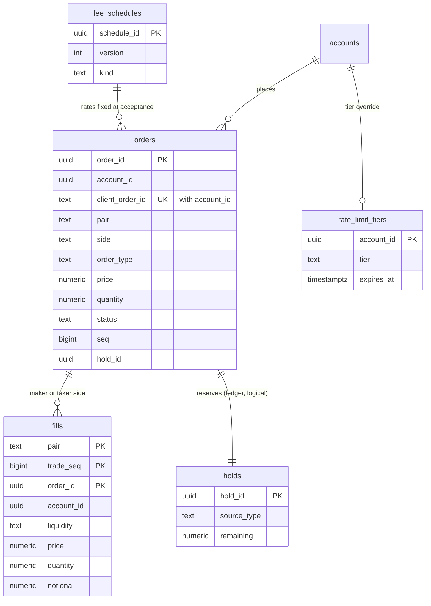

# Data model: 注文と速さの上限

注文の行、約定の行、速さの上限の段の上書き。振る舞いは [order-entry-and-risk.md](../order-entry-and-risk.md)・[matching-engine.md](../matching-engine.md) の 4.2 節、方針は [ADR-0004](../../decisions/0004-order-entry-holds-and-idempotency.md)・[ADR-0017](../../decisions/0017-order-row-states-across-clusters.md)・[ADR-0018](../../decisions/0018-cancel-idempotency-and-early-cancel.md)・[ADR-0020](../../decisions/0020-rate-limit-tiers-and-cancel-budget.md)・[ADR-0027](../../decisions/0027-fee-schedules-and-rounding.md)。

- 注文の行の正本は core の `orders` である。拘束は ledger の `holds`（[ledger-and-balances.md](ledger-and-balances.md)）で、`order:<order_id>:hold` の冪等キーでつなぐ（[ADR-0017](../../decisions/0017-order-row-states-across-clusters.md)）。
- 約定の正本は MSK の出力の記録の `Trade` で、`fills` はその写し（利用者の照会と明細の元）。お金の正本は ledger の `trade` の仕訳である。
- 口座の制限は [accounts-and-kyc.md](accounts-and-kyc.md) の `account_restrictions` を読むだけで、この領域は書かない。

## 1. ER 図

## 2. 表

### 2.1 `orders`

注文の行。`order-gateway` が先に `pending_submit` で書き、拘束、sequencer の受け付け、出力の記録の順に進める。状態は [order-entry-and-risk.md](../order-entry-and-risk.md) の 4.5 節の表が正。定義元：同 4.3〜4.6・11 節。

| 列 | 型 | NULL | 説明 |
| --- | --- | --- | --- |
| `order_id` | `uuid` | NOT NULL | UUIDv7。`order-gateway` が決める |
| `account_id` | `uuid` | NOT NULL | RLS |
| `client_order_id` | `text` | NOT NULL | API で必須。画面は端末が UUID を作る |
| `api_key_id` | `text` | NULL | API から来た注文 |
| `pair` | `text` | NOT NULL | `btc_jpy`・`eth_jpy` |
| `side` | `text` | NOT NULL | `buy`・`sell` |
| `order_type` | `text` | NOT NULL | `limit`・`market` |
| `time_in_force` | `text` | NOT NULL | 期限（[ADR-0003](../../decisions/0003-matching-rules-and-self-trade-prevention.md) の MVP の種類） |
| `price` | `numeric(38,0)` | NULL | 指値（円）。成行は NULL |
| `quantity` | `numeric(38,0)` | NULL | 数量の指定（基準の資産の最小の単位） |
| `funds` | `numeric(38,0)` | NULL | 成行の買いの金額の指定（円）。エンジンの代金の上限になる |
| `stp` | `text` | NOT NULL | 自己約定の防止の指定。既定 `cancel_newest` |
| `self_trade_group_id` | `uuid` | NULL | `accounts.self_trade_group_id` の写し（法人の口座の組） |
| `hold_id` | `uuid` | NULL | ledger の `holds`。拘束の前と拘束の不足では NULL |
| `hold_amount` | `numeric(38,0)` | NULL | 拘束した額（4.3 節の式。手数料の上限を含めない） |
| `fee_schedule_version` | `integer` | NOT NULL | 受け付けの時の `fee_schedules` のバージョン |
| `taker_fee_ppm`・`maker_fee_ppm` | `integer` | NOT NULL | 受け付けの時の率。エンジンの出力に載り、`ledger-poster` はこれで計算する |
| `status` | `text` | NOT NULL | `pending_submit`・`accepted`・`open`・`done`・`rejected` |
| `done_reason` | `text` | NULL | `filled`・`canceled`・`ioc_remainder`・`market_remainder`・`stp`・`blocked` |
| `reject_reason` | `text` | NULL | `insufficient_funds`・`account_restricted`・`internal`・エンジンの理由のコード |
| `seq` | `bigint` | NULL | sequencer の入力の番号 |
| `filled_quantity` | `numeric(38,0)` | NOT NULL | 既定 0 |
| `filled_notional` | `numeric(38,0)` | NOT NULL | 既定 0 |
| `resubmit_count` | `smallint` | NOT NULL | 送り直しの回数（10 秒ごと） |
| `cancel_requested_at` | `timestamptz` | NULL | |
| `created_at` | `timestamptz` | NOT NULL | |
| `updated_at` | `timestamptz` | NOT NULL | |

- キー：PK `(order_id)`。UK `(account_id, client_order_id)` — 再送には最初の行の結果を返す（[ADR-0004](../../decisions/0004-order-entry-holds-and-idempotency.md)）。
- 索引：`(status, created_at) WHERE status = 'pending_submit'` — `reconcilers` の 5 秒ごとの送り直し（10 秒を超えた行）。`(account_id, created_at DESC)` — 照会。`(pair, status) WHERE status IN ('accepted','open')` — 未約定の注文の写し（REC-HOLD）。
- CHECK：`side IN ('buy','sell')`。`order_type IN ('limit','market')`。`(order_type = 'limit') = (price IS NOT NULL)`。`num_nonnulls(quantity, funds) = 1`。`funds IS NULL OR (order_type = 'market' AND side = 'buy')`。`status IN (...)`。`(status = 'done') = (done_reason IS NOT NULL)`。`filled_quantity >= 0`。
- 状態の更新：`UPDATE … WHERE order_id = $1 AND status = $from`（条件つき）。`done`・`rejected` から動かさない。`Trade` は状態を変えず `filled_*` を足す。
- 分割：S1 では分割しない。PostgreSQL の分割の表は分割の鍵を含まない一意の制約を持てず、`(account_id, client_order_id)` の一意を全体で守れないためである。量が大きいので、分け方（口座のハッシュで分けるか、古い行を別の表へ移すか）は保持の結論（L4・L11）と合わせて S2 の前に決める（[data-model.md](../data-model.md) の 9 節）。RLS：本人（`account_id = app.actor_id`）。サービスの役割：`order-gateway`、状態の更新の部品、`reconcilers`、`surveillance`（読むだけ）。
- 区分：F。保持：`legal.transaction_record_retention_days`（未設定なら消さない）。S1 の量：1 日 約 450 万行（新しい注文。[capacity.md](../capacity.md) の 4 節）、1 年 約 16 億行。

### 2.2 `fills`

約定の行。1 つの約定（`trade_seq`）にメイカーとテイカーの 2 行。出力の記録の `Trade` から書く。定義元：[order-entry-and-risk.md](../order-entry-and-risk.md) の 11 節、[matching-engine.md](../matching-engine.md) の 4.2 節。

| 列 | 型 | NULL | 説明 |
| --- | --- | --- | --- |
| `pair` | `text` | NOT NULL | |
| `trade_seq` | `bigint` | NOT NULL | 板ごとの約定の連番 |
| `order_id` | `uuid` | NOT NULL | |
| `account_id` | `uuid` | NOT NULL | RLS |
| `liquidity` | `text` | NOT NULL | `maker`・`taker` |
| `side` | `text` | NOT NULL | この行の注文の向き |
| `price` | `numeric(38,0)` | NOT NULL | 約定の価格（板にあった注文の価格） |
| `quantity` | `numeric(38,0)` | NOT NULL | |
| `notional` | `numeric(38,0)` | NOT NULL | `floor(price × quantity ÷ 1 単位)` |
| `fee_ppm` | `integer` | NOT NULL | この行の注文の率 |
| `fee` | `numeric(38,0)` | NOT NULL | 受け取る資産から引く手数料（買いは基準の資産、売りは円） |
| `seq` | `bigint` | NOT NULL | 約定を出した入力の番号 |
| `ts` | `timestamptz` | NOT NULL | その入力の sequencer の時刻。分割の鍵（記録から決まるので、読み直しても同じ区切りに入る） |
| `journal_id` | `uuid` | NULL | ledger の `trade` の仕訳（記帳の後に入る） |
| `created_at` | `timestamptz` | NOT NULL | |

- キー：PK `(pair, trade_seq, order_id, ts)`。CHECK：`liquidity IN ('maker','taker')`。`quantity > 0`。`fee >= 0`。
- 索引：`(account_id, ts DESC)` — 照会。`(order_id)`。`(pair, trade_seq) WHERE journal_id IS NULL` — 「約定済み、反映中」の表示。
- 冪等：`INSERT … ON CONFLICT DO NOTHING`（出力の記録の読み直し）。
- 分割：月ごと（`ts`）。RLS：本人。区分：F。保持：`legal.transaction_record_retention_days`。S1 の量：1 日 60 万行（約定 30 万 × 2）。

### 2.3 `rate_limit_tiers`

速さの上限の段の割り当てと、期限つきの上書き。段の値（`app`・`api_standard`・`api_mm`）は [order-entry-and-risk.md](../order-entry-and-risk.md) の 4.8 節の表で、ここは口座ごとの割り当てだけを持つ。計数は Valkey の `rl:{acct}:<limit>`（GCRA）。定義元：同 11 節、[ADR-0020](../../decisions/0020-rate-limit-tiers-and-cancel-budget.md)。

| 列 | 型 | NULL | 説明 |
| --- | --- | --- | --- |
| `account_id` | `uuid` | NOT NULL | |
| `tier` | `text` | NOT NULL | `api_standard`・`api_mm` |
| `override` | `jsonb` | NULL | 一時の引き上げの値（注文・取り消し・照会の 1 秒と瞬間） |
| `expires_at` | `timestamptz` | NULL | 上書きの期限 |
| `approval_id` | `uuid` | NULL | Ops と PM の 2 人の承認（`rate-limit-override.md`） |
| `updated_at` | `timestamptz` | NOT NULL | |

- キー：PK `(account_id)`。CHECK：`tier IN ('api_standard','api_mm')`。`(override IS NULL) = (expires_at IS NULL)`。`override IS NULL OR approval_id IS NOT NULL`。
- 行のない口座は `api_standard`（API）か `app`（画面）。`api_mm` は PM の判断待ち P1 の後。
- RLS：なし（`order-gateway`・`ops-api`）。区分：M。保持：置き換え。S1 の量：数百行（API を使う口座とマーケットメイカー）。

## 3. 段階ごとの変化

- S2：板が 10 になり、`orders`・`fills` は板の数とマーケットメイカーの数で増える。S2 の前に `orders` の分け方を決め、古い区切りを S3 へ移すかを `legal.transaction_record_retention_days` の結論と合わせて決める。
