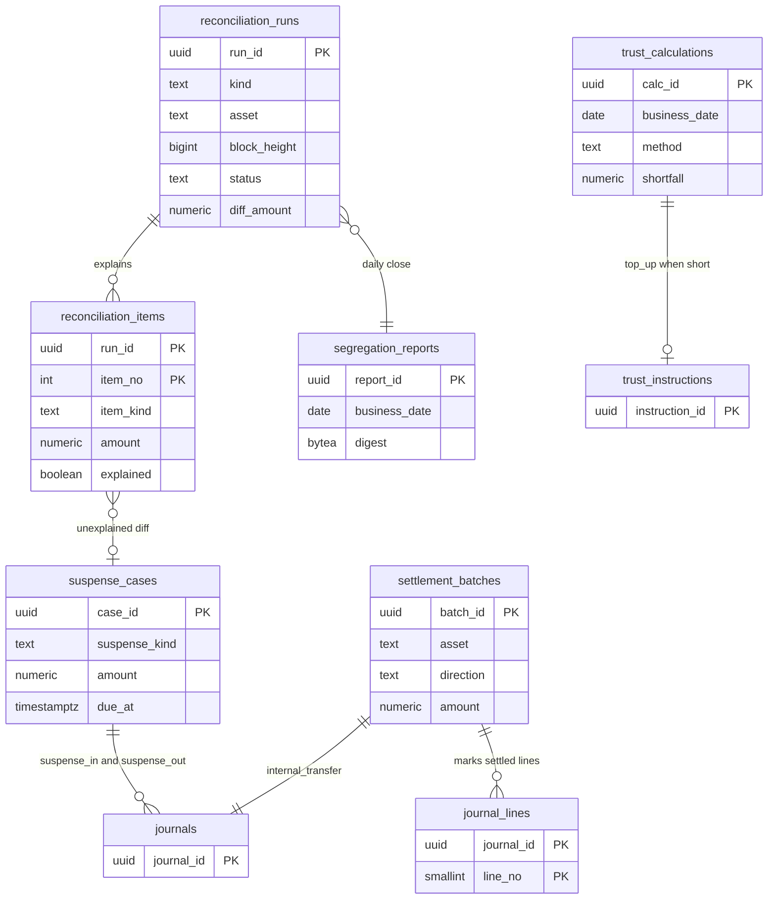

# Data model: 照合と信託

照合の実行と項目、本システムの持ち分の精算の束、日本円の信託の額の計算、分別管理の日次の報告、仮勘定の案件。振る舞いは [segregation-and-reconciliation.md](../segregation-and-reconciliation.md)、方針は [ADR-0031](../../decisions/0031-point-in-time-reconciliation-with-in-flight.md)・[ADR-0032](../../decisions/0032-house-share-settlement.md)・[ADR-0033](../../decisions/0033-trust-amount-method-and-daily-top-up.md)。照合の一般の形は Stripe の [ADR-0017](../../../../stripe/docs/decisions/0017-three-way-reconciliation-with-suspense.md)。

- どの表も ledger のクラスタにあり、`packages/ledger` の照合の関数（`reconcilers`）が書く（[ADR-0001](../../decisions/0001-platform-and-stack.md) の ledger の「照合の結果」）。
- 結果の行は書き換えない。取り直しは新しい実行の行にする。
- 仮勘定への出し入れは、ここの案件の行と、`suspense_in`・`suspense_out` の仕訳（財務の 2 人の承認）の組で行う。

## 1. ER 図

- `trust_instructions` は core（[fiat-banking.md](fiat-banking.md)）で、論理の参照である。

## 2. 表

### 2.1 `reconciliation_runs`

照合の 1 回の実行。種類は [segregation-and-reconciliation.md](../segregation-and-reconciliation.md) の 4 節の REC-*。定義元：同 4・18 節。

| 列 | 型 | NULL | 説明 |
| --- | --- | --- | --- |
| `run_id` | `uuid` | NOT NULL | |
| `kind` | `text` | NOT NULL | `REC-HOLD`・`REC-TRADE`・`REC-CHAIN-HOT`・`REC-CHAIN-COLD`・`REC-HOUSE`・`REC-BANK`・`REC-TRUST`・`REC-SEG` |
| `asset` | `text` | NULL | |
| `tier` | `text` | NULL | チェーンの照合の段 |
| `block_height`・`block_hash` | `bigint`・`text` | NULL | 2 台が同じブロックを返した高さ h |
| `as_of` | `timestamptz` | NOT NULL | 台帳を読んだ時点 |
| `status` | `text` | NOT NULL | `matched`・`diff_retrying`（h をずらして取り直す）・`diff`・`failed` |
| `expected_amount`・`external_amount` | `numeric(38,0)` | NULL | 期待する残高（台帳 ＋ 途中の項目）と外部の値 |
| `diff_amount` | `numeric(38,0)` | NULL | 外部 − 期待（負は減り） |
| `retry_of_run_id` | `uuid` | NULL | 取り直しの元の実行 |
| `created_at` | `timestamptz` | NOT NULL | |

- キー：PK `(run_id)`。索引：`(kind, asset, created_at DESC)` — 最後の成功の時刻の SLI（間隔の 2 倍で呼び出し）。
- CHECK：`(status = 'matched') = (diff_amount = 0)`。
- 区分：F。保持：取引の記録と同じ。S1 の量：1 日 約 1,800 行（REC-HOLD 5 分 × 2 資産、REC-TRADE 1 分 × 2 板、チェーン 1 時間 × 資産 × 段、ほかは日次）。

### 2.2 `reconciliation_items`

実行ごとの説明のついた項目と、説明のつかない差。途中の項目の種類は [segregation-and-reconciliation.md](../segregation-and-reconciliation.md) の 5.1 節。定義元：同 18 節。

| 列 | 型 | NULL | 説明 |
| --- | --- | --- | --- |
| `run_id` | `uuid` | NOT NULL | |
| `item_no` | `integer` | NOT NULL | |
| `item_kind` | `text` | NOT NULL | `pending_deposit`・`held_deposit`（記帳を止めた入金。理由を `note_code` に）・`unconfirmed_withdrawal`・`transfer_in_flight`・`sweep_in_flight`・`reversed_deposit`・`unexplained` |
| `note_code` | `text` | NULL | 止めた理由（スクリーニングの待ち、ERC-20、2 台の食い違い）など |
| `source_type`・`source_id` | `text`・`uuid` | NULL | 入金、出金、移し替え、集め直し |
| `included_height` | `bigint` | NULL | 項目が含まれたブロック。h より後は数えない |
| `amount` | `numeric(38,0)` | NOT NULL | 期待する残高への足し方の符号つき |
| `explained` | `boolean` | NOT NULL | |
| `suspense_case_id` | `uuid` | NULL | 説明がつかず、仮勘定に置いた |

- キー：PK `(run_id, item_no)`。CHECK：`(item_kind = 'unexplained') = (NOT explained)`。
- 区分：F。保持：同上。S1 の量：1 日 数千行（記帳を待つ入金と放送の後の出金の数ほど）。

### 2.3 `settlement_batches`

本システムの持ち分の精算の束。両方向を差し引いて、資産ごとに 1 回の移し替えにする。定義元：[ADR-0032](../../decisions/0032-house-share-settlement.md)、同 7・18 節。

| 列 | 型 | NULL | 説明 |
| --- | --- | --- | --- |
| `batch_id` | `uuid` | NOT NULL | |
| `asset` | `text` | NOT NULL | |
| `direction` | `text` | NOT NULL | `to_user`（利用者の財産の不足を埋める。1 時間ごとか閾値 1,000 万円）・`to_house`（本システムの持ち分の余り。毎日） |
| `amount` | `numeric(38,0)` | NOT NULL | 差し引いた額 |
| `transfer_id` | `uuid` | NULL | 暗号資産は core の `internal_transfers`、日本円は銀行の振替 |
| `journal_id` | `uuid` | NULL | `internal_transfer` の仕訳。書いたら対象の行の `journal_lines.settlement_batch_id` を埋める |
| `created_at` | `timestamptz` | NOT NULL | |
| `completed_at` | `timestamptz` | NULL | |

- キー：PK `(batch_id)`。CHECK：`amount > 0`。`direction IN ('to_user','to_house')`。
- 不足の額と時間は分別管理の日次の報告に出す（閾値と頻度は法務の L2・L3 で見直す）。区分：F。保持：取引の記録と同じ。S1 の量：1 日 約 70 行（3 資産 × 24 回）。

### 2.4 `trust_calculations`

日本円の信託すべき額の計算。毎営業日、前日の締めのスナップショットで行う。方式は `legal.trust_amount_method`（`user_balance`・`with_in_transit`・`with_unapplied`）。定義元：[ADR-0033](../../decisions/0033-trust-amount-method-and-daily-top-up.md)、同 8・18 節。

| 列 | 型 | NULL | 説明 |
| --- | --- | --- | --- |
| `calc_id` | `uuid` | NOT NULL | |
| `business_date` | `date` | NOT NULL | |
| `method` | `text` | NOT NULL | 使った方式 |
| `legal_config_version` | `integer` | NOT NULL | 使った `legal.*` のバージョン |
| `user_balance` | `numeric(38,0)` | NOT NULL | 利用者の日本円の残高の和 |
| `in_transit` | `numeric(38,0)` | NOT NULL | `fiat_in_transit` |
| `unapplied` | `numeric(38,0)` | NOT NULL | 着金したが記帳していない額（`review`・`returning`） |
| `required` | `numeric(38,0)` | NOT NULL | 方式で足した額 |
| `trust_balance` | `numeric(38,0)` | NOT NULL | 信託の口座の残高（通知） |
| `shortfall` | `numeric(38,0)` | NOT NULL | `max(required − trust_balance, 0)` |
| `instruction_id` | `uuid` | NULL | 不足のときの `top_up` の依頼 |

- キー：PK `(calc_id)`。UK `(business_date)`。CHECK：`shortfall >= 0`。
- 不足があれば、その営業日の中に `top_up` を依頼して `instruction_id` を書く。本番で `legal.trust_amount_method` が未設定の間は計算だけを残し、依頼を作らない（[regulatory-compliance-japan.md](../regulatory-compliance-japan.md) の 4.2 節の `when_unset`）。
- 区分：F。保持：取引の記録と同じ。S1 の量：年に 約 245 行。

### 2.5 `segregation_reports`

分別管理の日次の報告。締めの時点の照合の結果から作り、書き換えない。定義元：同 9・18 節。

| 列 | 型 | NULL | 説明 |
| --- | --- | --- | --- |
| `report_id` | `uuid` | NOT NULL | |
| `business_date` | `date` | NOT NULL | |
| `content_ref` | `text` | NOT NULL | S3 の本文（資産ごとの利用者の財産、置き場所ごとの額、精算の待ち、ネットワークにつながる額の割合、仮勘定の残高と年齢） |
| `digest` | `bytea` | NOT NULL | 内容のハッシュ |
| `approved_by` | `uuid` | NULL | 財務 |
| `approved_at` | `timestamptz` | NULL | |

- キー：PK `(report_id)`。UK `(business_date)`。様式と提出は法務の L2・L3・L9。区分：F。保持：報告の出力と同じ（1,826 日の仮の値）。S1 の量：1 日 1 行。

### 2.6 `suspense_cases`

仮勘定の案件。種類と期限は [segregation-and-reconciliation.md](../segregation-and-reconciliation.md) の 10 節。定義元：同 18 節。

| 列 | 型 | NULL | 説明 |
| --- | --- | --- | --- |
| `case_id` | `uuid` | NOT NULL | 冪等キー `suspense:<case_id>:<n>` の元 |
| `suspense_kind` | `text` | NOT NULL | `chain`・`bank`・`trust`・`reorg`・`wallet_loss` |
| `asset` | `text` | NOT NULL | |
| `amount` | `numeric(38,0)` | NOT NULL | |
| `source_run_id` | `uuid` | NULL | 見つけた照合 |
| `opened_at` | `timestamptz` | NOT NULL | |
| `due_at` | `timestamptz` | NOT NULL | 翌営業日（`chain` は 30 日で財務の責任者へ） |
| `resolution` | `text` | NULL | `returned`・`house_revenue`・`credited_to_user`・`bank_corrected`・`recovered`・`house_loss`・`compensated` |
| `approved_by` | `uuid[]` | NULL | 財務の 2 人 |
| `closed_at` | `timestamptz` | NULL | |

- キー：PK `(case_id)`。CHECK：`(closed_at IS NULL) = (resolution IS NULL)`。`closed_at IS NULL OR cardinality(approved_by) >= 2`。
- 索引：`(suspense_kind, opened_at) WHERE closed_at IS NULL` — 毎営業日の年齢の確認。
- 区分：F。保持：取引の記録と同じ。S1 の量：月に数件（説明のつく差は仮勘定に入れない）。

## 3. 段階ごとの変化

- S2：資産と板が増え、`reconciliation_runs` は資産 × 段の数で増える。形は変わらない。
