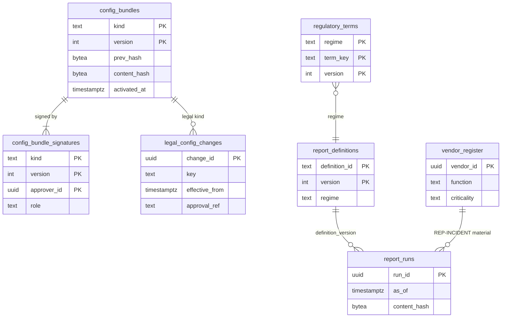

# Data model: 法令と設定

`legal.*` の値の変更の記録、法令の型ごとの言葉、報告の定義と実行、外部への委託の台帳、署名つきの設定の束と署名。振る舞いは [regulatory-compliance-japan.md](../regulatory-compliance-japan.md)・[delivery.md](../delivery.md) の 4.9 節、方針は [ADR-0062](../../decisions/0062-legal-config-catalog-and-approval.md)・[ADR-0063](../../decisions/0063-regulatory-regime-switch.md)・[ADR-0064](../../decisions/0064-regulatory-report-exports.md)・[ADR-0075](../../decisions/0075-signed-config-bundles-for-policies-and-rules.md)。

- `legal.*` の今の値の正本は AppConfig（別のアプリケーション）で、AppConfig の検証の関数が束の署名を確かめてから受ける。core の `legal_config_changes` は変更の記録で、値の正本ではない。カタログ（鍵、`l_ref`、`owner_area`、`dev_default`、`when_unset`、`ga_required`）の正本は [regulatory-compliance-japan.md](../regulatory-compliance-japan.md) の 4.2 節の表と `config/legal/`。
- 本番の値は法務の結論（intent の L 番号）と承認の記録の後にだけ入れる。保持の日数は未設定なら消さない。
- 報告の提出は人が行う。本システムは外へ自動で送らない。

## 1. ER 図

## 2. 表

### 2.1 `legal_config_changes`

`legal.*` の値の変更の記録。手順は [regulatory-compliance-japan.md](../regulatory-compliance-japan.md) の 4.4 節。定義元：同 14 節。

| 列 | 型 | NULL | 説明 |
| --- | --- | --- | --- |
| `change_id` | `uuid` | NOT NULL | |
| `key` | `text` | NOT NULL | `legal.<名前>` |
| `old_value`・`new_value` | `jsonb` | — | |
| `effective_from`・`effective_to` | `timestamptz` | — | 施行の日、方式の終わりの日 |
| `approval_ref` | `text` | NOT NULL | 法務・財務の承認の記録（結論の文書） |
| `approved_by` | `uuid[]` | NOT NULL | |
| `applied_by` | `uuid` | NOT NULL | Ops（平日の昼に適用） |
| `applied_at` | `timestamptz` | NOT NULL | |
| `catalog_version` | `integer` | NOT NULL | カタログのバージョン |
| `bundle_version` | `integer` | NOT NULL | `config_bundles`（`kind = legal`） |

- キー：PK `(change_id)`。索引：`(key, applied_at DESC)`。追記だけ。
- `legal.*` で動く判定と仕訳は、使った値のバージョン（`legal_config_version`）を自分の行に残す（`trust_calculations`、`kyc_checks` など）。
- RLS：なし。区分：A。保持：消さない。S1 の量：年に数十行。

### 2.2 `regulatory_terms`

法令の型（`legal.regime`：`psa_exchange` など）ごとの言葉（業の名前、画面と書面の用語）。施行の時刻の切り替えで使う（[ADR-0063](../../decisions/0063-regulatory-regime-switch.md)）。列：`regime`、`term_key`、`text`、`version`、`effective_from`。キー：PK `(regime, term_key, version)`。RLS：なし（公開の設定）。区分：U。保持：消さない。S1 の量：数百行。

### 2.3 `report_definitions`

報告の定義。候補の一覧は [regulatory-compliance-japan.md](../regulatory-compliance-japan.md) の 6.1 節（`REP-SEG`・`REP-JVCEA-MONTHLY`・`REP-SURV`・`REP-SURV-DATA`・`REP-BUSINESS`・`REP-CAPITAL`・`REP-INCIDENT`・`REP-TAX`）。定義の変更は `config/reports/` の PR。定義元：同 6.2・14 節。

| 列 | 型 | NULL | 説明 |
| --- | --- | --- | --- |
| `definition_id` | `text` | NOT NULL | `REP-*` |
| `version` | `integer` | NOT NULL | |
| `regime` | `text` | NOT NULL | |
| `recipient` | `text` | NOT NULL | 当局・協会・税務署 |
| `l_refs` | `text[]` | NOT NULL | |
| `frequency` | `text` | NOT NULL | |
| `source_functions` | `text[]` | NOT NULL | 材料の読み取りだけの関数 |
| `format` | `text` | NOT NULL | CSV・XML など |
| `owner` | `text` | NOT NULL | |

- キー：PK `(definition_id, version)`。RLS：なし。区分：M。保持：消さない。

### 2.4 `report_runs`

報告の実行。材料は `as_of` の時点の値で作り、作り直しても同じ中身にする（PROP-REG-002）。定義元：同 6.2・14 節。

| 列 | 型 | NULL | 説明 |
| --- | --- | --- | --- |
| `run_id` | `uuid` | NOT NULL | |
| `definition_id`・`definition_version` | `text`・`integer` | NOT NULL | |
| `as_of` | `timestamptz` | NOT NULL | |
| `generated_at` | `timestamptz` | NOT NULL | |
| `content_hash` | `bytea` | NOT NULL | 作り直しでハッシュが違えば `regulatory-report-submission.md` |
| `output_ref` | `text` | NOT NULL | 書き出し専用の S3 |
| `reviewed_by` | `uuid[]` | NULL | 確かめた 2 人 |
| `submitted_by`・`submitted_at`・`receipt_ref` | — | NULL | 提出（人）と受付の番号 |

- キー：PK `(run_id)`。CHECK：`submitted_at IS NULL OR cardinality(reviewed_by) >= 2`。区分：A。保持：提出から 1,826 日（本システムの仮の値。L9）。S1 の量：月に数十行。

### 2.5 `vendor_register`

外部への委託の台帳（法務の L11・L13）。列：`vendor_id`、`function`、`data_kinds`、`data_countries`、`criticality`、`contract_ref`、`exit_plan_ref`、`last_review`、`next_review`。キー：PK `(vendor_id)`。RLS：なし（法務、セキュリティ）。区分：M。保持：消さない。S1 の量：数十行。定義元：同 7.1・14 節。

### 2.6 `config_bundles`・`config_bundle_signatures`

署名つきの設定の束。種類ごとに単調に増えるバージョンと、前のバージョンのハッシュを持つ。受け手は署名の数と役割、バージョン、前のハッシュを確かめてから有効にする。`custody` は自分の写し（[custody-and-wallets.md](custody-and-wallets.md) の 3 節の `signing_policy_bundles`）を持つ。定義元：[delivery.md](../delivery.md) の 4.9・11 節、[ADR-0075](../../decisions/0075-signed-config-bundles-for-policies-and-rules.md)。

**`config_bundles`**

| 列 | 型 | NULL | 説明 |
| --- | --- | --- | --- |
| `kind` | `text` | NOT NULL | `signing-policy`・`legal`・`compliance-rules`・`assets`・`instruments`・`withdrawal-fees`・`reports` など（`config/<kind>/`） |
| `version` | `integer` | NOT NULL | |
| `prev_hash` | `bytea` | NOT NULL | |
| `content_hash` | `bytea` | NOT NULL | |
| `content_ref` | `text` | NOT NULL | 束の本体 |
| `effective_at` | `timestamptz` | NULL | 規則の表と資産の設定の有効の時刻 |
| `activated_at` | `timestamptz` | NULL | 受け手が有効にした時刻 |

**`config_bundle_signatures`**

| 列 | 型 | NULL | 説明 |
| --- | --- | --- | --- |
| `kind`・`version` | `text`・`integer` | NOT NULL | |
| `approver_id` | `uuid` | NOT NULL | 承認者の公開鍵の一覧の鍵。作成者（PR の作者とマージした人）とエージェントは署名者にならない |
| `role` | `text` | NOT NULL | 種類ごとの承認の持ち主（`signing-policy` はセキュリティと財務、`legal` は法務と財務） |
| `signature` | `bytea` | NOT NULL | 内容のハッシュへの署名 |
| `signed_at` | `timestamptz` | NOT NULL | |

- キー：`config_bundles` PK `(kind, version)`、`config_bundle_signatures` PK `(kind, version, approver_id)`。
- `config_bundles` の行は、`prev_hash` が前のバージョンの `content_hash` と一致するときだけ書ける（トリガー）。
- RLS：なし（CI と運用の画面）。区分：A。保持：消さない。S1 の量：年に数百行。

## 3. 段階ごとの変化

- 法令の型の切り替え（資金決済法から金融商品取引法へ。法務の L1）は、`legal.regime` の値と `regulatory_terms`・`report_definitions` の新しいバージョンで行い、表の形は変えない（[ADR-0063](../../decisions/0063-regulatory-regime-switch.md)）。
