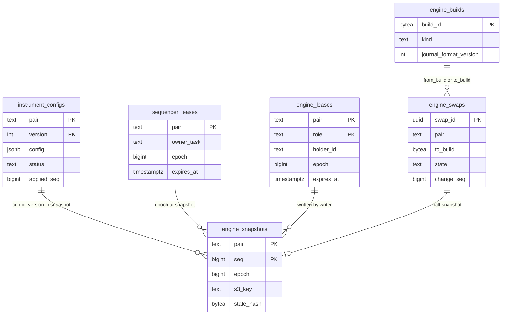

# Data model: マッチングエンジンと sequencer

sequencer と書き手のエンジンの持ち主の記録、銘柄の設定、スナップショットの目録、エンジンのビルドと入れ替えの記録。振る舞いは [matching-engine.md](../matching-engine.md)・[infrastructure.md](../infrastructure.md) の 4.3 節・[delivery.md](../delivery.md) の 4.6 節、方針は [ADR-0002](../../decisions/0002-sequencer-and-event-journal.md)・[ADR-0013](../../decisions/0013-instrument-config-versioning.md)・[ADR-0014](../../decisions/0014-output-hash-chain-and-snapshots.md)・[ADR-0015](../../decisions/0015-shadow-engine-failover.md)・[ADR-0072](../../decisions/0072-matching-placement-across-azs.md)・[ADR-0074](../../decisions/0074-engine-swap-in-planned-halt-window.md)。

- 板の正本は MSK の入力の記録で、ここの表は板の状態を持たない（[ADR-0002](../../decisions/0002-sequencer-and-event-journal.md)）。表は core のクラスタにあり、エンジンの部品（`sequencer`・`engine-host`）と `ops-api` が書く。
- 板を直す経路はない。表の行を書き換えても板は変わらない。銘柄の設定も、`SetConfig` の入力が記録に入って初めて効く。

## 1. ER 図

- `engine_snapshots` は S3 のスナップショットの目録である。本体は S3 にあり、読む側は状態のハッシュが出力の記録の `SnapshotMarker` と一致することを確かめてから使う。

## 2. 表

### 2.1 `sequencer_leases`

板ごとの sequencer の持ち主の記録。期限 5 秒、更新 1 秒。取ったら `epoch` を 1 上げてから入力を受ける。定義元：[ADR-0002](../../decisions/0002-sequencer-and-event-journal.md) の「単一の書き手の保証」、[infrastructure.md](../infrastructure.md) の 11 節。

| 列 | 型 | NULL | 説明 |
| --- | --- | --- | --- |
| `pair` | `text` | NOT NULL | `btc_jpy`・`eth_jpy` |
| `owner_task` | `text` | NOT NULL | 持ち主の ECS のタスク |
| `az` | `text` | NOT NULL | 持ち主の AZ |
| `epoch` | `bigint` | NOT NULL | 取るたびに 1 上がる。入力に付ける |
| `expires_at` | `timestamptz` | NOT NULL | |
| `renewed_at` | `timestamptz` | NOT NULL | |

- キー：PK `(pair)`。
- 取り方：`UPDATE … SET owner_task = $me, epoch = epoch + 1, expires_at = now() + '5 s' WHERE pair = $p AND expires_at < now()`（条件つき）。
- Aurora core のフェイルオーバーの間に更新できなくても、持ち主は MSK に書ける限り続ける。2 つ目の書き手が生まれても、板ごとに 1 つの `transactional.id` の fencing で古い書き手の書き込みは拒まれ、新しい持ち主は fencing の後に記録の末尾を読んでから受け付ける（[ADR-0072](../../decisions/0072-matching-placement-across-azs.md) の 2026-11-15 の注記）。
- RLS：なし（`sequencer` の役割）。区分：M。保持：置き換え。S1 の量：2 行。

### 2.2 `engine_leases`

出力を書く側のエンジン（書き手）の持ち主の記録。写しは期限切れで持ち主になる。定義元：[ADR-0015](../../decisions/0015-shadow-engine-failover.md)、[matching-engine.md](../matching-engine.md) の 4.9 節。

| 列 | 型 | NULL | 説明 |
| --- | --- | --- | --- |
| `pair` | `text` | NOT NULL | |
| `role` | `text` | NOT NULL | `writer`（今は 1 つの値だけ） |
| `holder_id` | `text` | NOT NULL | 持ち主の `engine-host` |
| `epoch` | `bigint` | NOT NULL | 取るたびに 1 上がる |
| `expires_at` | `timestamptz` | NOT NULL | 期限 5 秒、更新 1 秒。期限を過ぎた書き手は自分で出力を止める |

- キー：PK `(pair, role)`。CHECK：`role = 'writer'`。
- 手での切り替えも同じ条件つきの更新（`epoch` ＋ 1）で行う（[runbooks/engine-failover.md](../../runbooks/engine-failover.md)）。
- RLS：なし（`engine-host` の役割、運用の画面の切り替えの操作）。区分：M。保持：置き換え。S1 の量：2 行。

### 2.3 `instrument_configs`

銘柄の設定。板とバージョンごとの全体の値で持ち、部分の更新をしない。定義元：[ADR-0013](../../decisions/0013-instrument-config-versioning.md)、[matching-engine.md](../matching-engine.md) の 4.7 節。

| 列 | 型 | NULL | 説明 |
| --- | --- | --- | --- |
| `pair` | `text` | NOT NULL | |
| `version` | `integer` | NOT NULL | 板ごとに増える |
| `config` | `jsonb` | NOT NULL | 価格と数量の刻み、最小・最大の数量、指値と成行の帯、急変の判定、取り消しだけの時間の既定、停止の時間の予定。数は文字列の整数 |
| `bundle_kind`・`bundle_version` | `text`・`integer` | NOT NULL | 元の設定の束（`instruments`。[regulatory-and-config.md](regulatory-and-config.md) の 2.6 節） |
| `approved_by` | `uuid[]` | NOT NULL | Dev と Ops の 2 人 |
| `status` | `text` | NOT NULL | `pending`・`applied`・`rejected` |
| `applied_seq` | `bigint` | NULL | `ConfigApplied` を出した入力の `seq` |
| `created_at` | `timestamptz` | NOT NULL | |

- キー：PK `(pair, version)`。部分 UK `(pair) WHERE status = 'pending'`（送る前の設定は板ごとに 1 つ）。
- CHECK：`status IN (...)`。`cardinality(approved_by) >= 2`。`(status = 'applied') = (applied_seq IS NOT NULL)`。
- `status` は出力の記録の `ConfigApplied`・`ConfigRejected` を読んで書く。エンジンの設定が正本で、この行は写し。
- RLS：なし（公開の設定。書くのは `ops-api` と状態の更新の部品）。区分：M。保持：消さない（再生に要る）。S1 の量：年に数十行。

### 2.4 `engine_snapshots`

スナップショットの目録。`seq` が 100,000 の倍数のときと `Halt` のたびに、書き手のエンジンだけが書く。定義元：[ADR-0014](../../decisions/0014-output-hash-chain-and-snapshots.md)、[matching-engine.md](../matching-engine.md) の 4.8 節。

| 列 | 型 | NULL | 説明 |
| --- | --- | --- | --- |
| `pair` | `text` | NOT NULL | |
| `seq` | `bigint` | NOT NULL | スナップショットの時点の入力の番号 |
| `epoch` | `bigint` | NOT NULL | |
| `config_version` | `integer` | NOT NULL | その時点の銘柄の設定 |
| `build_id` | `bytea` | NOT NULL | 書いたエンジンのビルド |
| `s3_key` | `text` | NOT NULL | `snapshots/<pair>/<seq>.snap` |
| `state_hash` | `bytea` | NOT NULL | 末尾の状態のハッシュ（`SnapshotMarker` と同じ値） |
| `output_hash` | `bytea` | NOT NULL | `output_hash[seq]` |
| `created_at` | `timestamptz` | NOT NULL | |

- キー：PK `(pair, seq)`。CHECK：`octet_length(state_hash) = 32`。
- RLS：なし（`engine-host`）。区分：M。保持：入力の記録の保管と同じ（L4・L7）。日次の再生は前日の始めのスナップショットを使う。S1 の量：板ごとに 1 日 約 45 件（1 日 約 450 万入力 ÷ 10 万）＋ 停止の回数。

### 2.5 `engine_builds`

再生に使うエンジンのビルド。定義元：[delivery.md](../delivery.md) の 4.4・11 節。

| 列 | 型 | NULL | 説明 |
| --- | --- | --- | --- |
| `build_id` | `bytea` | NOT NULL | バイナリのハッシュ |
| `kind` | `text` | NOT NULL | `A`・`B`・`C`（入れ替えの種類。delivery の 4.6 節） |
| `journal_format_version` | `integer` | NOT NULL | 入力と出力の記録の符号化のバージョン（[ADR-0012](../../decisions/0012-engine-io-encoding-and-ticks.md)） |
| `artifact_ref` | `text` | NOT NULL | 成果物の置き場所 |
| `sbom_ref` | `text` | NOT NULL | |
| `created_at` | `timestamptz` | NOT NULL | |

- キー：PK `(build_id)`。RLS：なし（CI の役割が書く）。区分：M。保持：消さない（どの `seq` の範囲をどのビルドで再生するかに要る）。S1 の量：年に数十行。

### 2.6 `engine_swaps`

エンジンの入れ替えの記録。状態は [delivery.md](../delivery.md) の 4.6 節の表が正。定義元：同 11 節、[ADR-0074](../../decisions/0074-engine-swap-in-planned-halt-window.md)。

| 列 | 型 | NULL | 説明 |
| --- | --- | --- | --- |
| `swap_id` | `uuid` | NOT NULL | |
| `pair` | `text` | NOT NULL | |
| `from_build`・`to_build` | `bytea` | NOT NULL | `engine_builds` |
| `state` | `text` | NOT NULL | `shadow_testing`・`staging_diff`・`scheduled`・`halted_for_swap`・`verifying`・`cancel_only`・`live`・`rolled_back`・`rejected` |
| `halt_seq` | `bigint` | NULL | 停止の入力の `seq` |
| `change_seq` | `bigint` | NULL | `engine_build_change` の入力の `seq`。日次の再生はこの `seq` でビルドを切り替える |
| `halted_at`・`live_at` | `timestamptz` | NULL | |
| `approved_by` | `uuid[]` | NULL | `cancel_only` → `live` の 2 人 |

- キー：PK `(swap_id)`。部分 UK `(pair) WHERE state IN ('scheduled','halted_for_swap','verifying','cancel_only')`（板ごとに進行中の入れ替えは 1 つ）。
- RLS：なし（`ops-api`）。区分：M。保持：消さない。S1 の量：年に数十行。

## 3. 段階ごとの変化

- S2：板が 10 になり、EC2 の組に数板を置く。行の数は板の数に比例するだけで、形は変わらない。
- S3：入力の記録の方式を替えても（[ADR-0002](../../decisions/0002-sequencer-and-event-journal.md) の見直し）、`seq`・`epoch`・要約の形とこの表は変えない。

## 4. MSK の記録の形

| トピック | 区画 | 中身 | 保持 |
| --- | --- | --- | --- |
| `engine.in.<pair>` | 1 | sequencer が `seq`・`ts`・`epoch` を付けた入力（`NewOrder`、`Cancel`、`CancelAll`、`AccountBlock`・`AccountUnblock`、`Halt`・`Resume`、`SetConfig`、`SetReferencePrice`、`engine_build_change`、`Tick`） | 7 日。毎時 S3 へ（Object Lock、保管は L4・L7） |
| `engine.out.<pair>` | 1 | `OrderOpened`、`OrderRejected`、`Trade`、`OrderDone`、`CancelRejected`、`CancelRecorded`、`BookDelta`、`MarketStateChanged`、`ConfigApplied`・`ConfigRejected`、`SnapshotMarker`、`InputDigest` | 同上 |

- 符号化は Protocol Buffers の固定の形で、金額と数量は文字列の整数（[ADR-0012](../../decisions/0012-engine-io-encoding-and-ticks.md)、[ADR-0001](../../decisions/0001-platform-and-stack.md)）。入力と出力の項目は [matching-engine.md](../matching-engine.md) の 4.2 節。
- `NewOrder` の `stp_group_id` は `orders.self_trade_group_id` と同じ値である（[data-model.md](../data-model.md) の 7 節の N8）。
- レプリカ 3、`min.insync.replicas=2`、`acks=all`、板ごとに 1 つの `transactional.id`。区画の主は、その板の本番の sequencer と同じ AZ（[infrastructure.md](../infrastructure.md) の 4.3 節）。
