# Data model: 暗号資産の出金

出金と遷移の事象、取引の試み（元・置き換え・作り直し）、承認、宛先の許可の一覧、ETH のレーン。振る舞いは [withdrawals.md](../withdrawals.md)、方針は [ADR-0008](../../decisions/0008-withdrawal-pipeline-and-approvals.md)・[ADR-0042](../../decisions/0042-withdrawal-transition-table.md)・[ADR-0043](../../decisions/0043-one-transaction-per-withdrawal-and-fee-table.md)・[ADR-0044](../../decisions/0044-stuck-transaction-replacement.md)・[ADR-0045](../../decisions/0045-allowlist-registration-recorded-in-boundary.md)。

- どの表も core のクラスタにあり、`wallet-orchestrator`（`packages/withdrawals`）が書く。遷移は `transitionWithdrawal()` だけが書き、[withdrawals.md](../withdrawals.md) の 4.1 節の DT-WD（W01〜W26）にない遷移を拒む。
- 拘束は ledger の `holds`（`source_type = withdrawal`。額 ＋ 表の固定の手数料）。完了で `crypto_withdrawal` を書く。
- 宛先の登録の時刻と利用者のパスキーの公開鍵の正本は、署名の境界の記録（[custody-and-wallets.md](custody-and-wallets.md) の 3 節）。`destinations` はその写しで、待ち時間を判定しない。
- 手数料の表は [ledger-and-balances.md](ledger-and-balances.md) の `fee_schedules`（`kind = crypto_withdrawal`）。withdrawals の `withdrawal_fee_tables` はここにまとめた（[data-model.md](../data-model.md) の 7 節の N5）。

## 1. ER 図

```mermaid
erDiagram
    accounts ||--o{ destinations : "registers"
    destinations ||--o{ withdrawals : "pays to"
    withdrawals ||--|{ withdrawal_events : "transitions"
    withdrawals ||--o{ withdrawal_transactions : "original, replacement, recreation"
    withdrawals ||--o{ withdrawal_approvals : "approved by"
    eth_lanes ||--o{ withdrawal_transactions : "nonce from lane"
    fee_schedules ||--o{ withdrawals : "fee fixed at request"
    withdrawals ||--o| screening_results : "screened"
    withdrawals ||--o| travel_rule_messages : "notified"

    withdrawals {
        uuid withdrawal_id PK
        uuid account_id
        text asset
        numeric amount
        numeric fee
        text state
        text policy_rule_no
    }
    withdrawal_events {
        uuid withdrawal_id PK
        int seq PK
        text rule_id
    }
    withdrawal_transactions {
        uuid withdrawal_id PK
        smallint attempt PK
        text kind
        text txid
    }
    withdrawal_approvals {
        uuid withdrawal_id PK
        uuid approver_id PK
        text decision
    }
    destinations {
        uuid destination_id PK
        uuid account_id
        text asset
        text address
        timestamptz registered_at_boundary
    }
    eth_lanes {
        text asset PK
        smallint lane_no PK
        bigint next_nonce
    }
    fee_schedules {
        uuid schedule_id PK
    }
    screening_results {
        uuid screening_id PK
    }
    travel_rule_messages {
        uuid message_id PK
    }
```

## 2. 表

### 2.1 `withdrawals`

出金。状態は ADR-0008 の 13。定義元：[withdrawals.md](../withdrawals.md) の 4・15 節。

| 列 | 型 | NULL | 説明 |
| --- | --- | --- | --- |
| `withdrawal_id` | `uuid` | NOT NULL | 署名の依頼の ID の元。境界は同じ ID に 2 度署名しない |
| `account_id` | `uuid` | NOT NULL | RLS。本システムが作る出金（凍結した入金の返却）は運用の口座 |
| `asset` | `text` | NOT NULL | |
| `amount` | `numeric(38,0)` | NOT NULL | 宛先が受け取る額 |
| `fee` | `numeric(38,0)` | NOT NULL | 利用者の出金の手数料（表の固定の額） |
| `fee_schedule_version` | `integer` | NOT NULL | 依頼の時の表（領域の文書の `fee_table_version`） |
| `destination_id` | `uuid` | NOT NULL | |
| `passkey_assertion_ref` | `text` | NOT NULL | 出金の内容への利用者のパスキーの署名（境界が確かめる） |
| `state` | `text` | NOT NULL | `requested`・`held`・`screening`・`compliance_review`・`policy`・`approving`・`waiting_funds`・`signing`・`broadcast`・`replacing`・`confirming`・`completed`・`rejected` |
| `reason_code` | `text` | NULL | `insufficient_funds`・`compliance_rejected`・`policy_denied`・`approver_rejected`・`approval_expired`・`user_cancelled` と、待ちの理由（`deposit_maturity`・`provider_outage`） |
| `hold_id` | `uuid` | NULL | |
| `screening_result_id` | `uuid` | NULL | |
| `travel_rule_message_id` | `uuid` | NULL | |
| `policy_rule_no` | `text` | NULL | DT-POL の最初に当たった行（P02〜P05） |
| `policy_bundle_id` | `bytea` | NULL | 判定に使った方針の束 |
| `tier` | `text` | NULL | 署名した段（`hot`・`warm`。`waiting_funds` から `cold` の儀式を待つこともある） |
| `lane` | `smallint` | NULL | ETH のホットのレーン |
| `journal_id` | `uuid` | NULL | 完了の `crypto_withdrawal` |
| `created_at`・`updated_at` | `timestamptz` | NOT NULL | |
| `completed_at` | `timestamptz` | NULL | |

- キー：PK `(withdrawal_id)`。
- CHECK：`amount > 0`。`fee >= 0`。`state IN (...)`。`(state = 'completed') = (journal_id IS NOT NULL)`。`lane IS NULL OR asset = 'ETH'`。
- 状態の更新：`UPDATE … WHERE withdrawal_id = $1 AND state = $from`。`signing` から後は `rejected` に行かない。
- `scope = account` の解けていない出金の制限がある間は `requested` に留める（W01 を行わない。I8）。
- 索引：`(state, updated_at) WHERE state NOT IN ('completed','rejected')` — 滞留の SLI（`waiting_funds`、`approving` の 3 営業日、`signing`）。`(account_id, created_at DESC)` — 照会と手続き中の出金 10 件の上限。
- RLS：本人。区分：F。保持：`legal.transaction_record_retention_days`。S1 の量：1 日 4,000 行。

### 2.2 `withdrawal_events`

出金の遷移の記録。追記だけ。定義元：同 15 節。

| 列 | 型 | NULL | 説明 |
| --- | --- | --- | --- |
| `withdrawal_id` | `uuid` | NOT NULL | |
| `seq` | `integer` | NOT NULL | |
| `from_state`・`to_state` | `text` | — | |
| `rule_id` | `text` | NOT NULL | DT-WD の行（W01〜W26） |
| `reason_code` | `text` | NULL | |
| `actor` | `text` | NOT NULL | 部品の名前か人の ID |
| `at` | `timestamptz` | NOT NULL | |

- キー：PK `(withdrawal_id, seq)`。CHECK：`rule_id ~ '^W[0-9]{2}$'`。
- RLS：本人（`actor` を除く列の GRANT）。区分：F。保持：出金と同じ。S1 の量：1 日 約 4 万行。

### 2.3 `withdrawal_transactions`

出金のチェーンの取引。元（`original`）、置き換え（`replacement`。同じ入力・同じ nonce、宛先と額を変えない）、作り直し（`recreation`。前の取引が確定しえないとチェーンで確かめた後だけ）。定義元：同 8・15 節、[ADR-0044](../../decisions/0044-stuck-transaction-replacement.md)。

| 列 | 型 | NULL | 説明 |
| --- | --- | --- | --- |
| `withdrawal_id` | `uuid` | NOT NULL | |
| `attempt` | `smallint` | NOT NULL | 1 から |
| `kind` | `text` | NOT NULL | `original`・`replacement`・`recreation` |
| `txid` | `text` | NOT NULL | |
| `inputs_or_nonce` | `text` | NOT NULL | BTC は使った出力の一覧の正規の形、ETH は送り元のアドレスと nonce |
| `fee_paid` | `numeric(38,0)` | NULL | 確定した取引のチェーンの手数料（`network_fee_expense`） |
| `policy_rule_no` | `text` | NULL | 置き換えの行（P06・P07） |
| `recreation_evidence_ref` | `text` | NULL | 作り直しの条件の確かめの記録 |
| `broadcast_at` | `timestamptz` | NULL | |
| `block_hash` | `text` | NULL | |
| `confirmations` | `integer` | NOT NULL | 既定 0 |

- キー：PK `(withdrawal_id, attempt)`。UK `(txid)`。
- CHECK：`kind IN (...)`。`(kind = 'recreation') = (recreation_evidence_ref IS NOT NULL)`。置き換えが 5 回を超えたら自動の置き換えを止める（`stuck-withdrawals.md`）。回数は `kind = 'replacement'` の行で数える。
- 同じ出金で有効な取引は 1 つ（I14）。置き換えの組（同じ入力か同じ nonce）は境界の `nonce-and-utxo-guard` が確かめる。
- 索引：`(withdrawal_id) WHERE block_hash IS NULL` — 詰まりの判定と流し直し。
- RLS：なし（サービス。利用者の画面は `withdrawals` から最後の `txid` を出す）。区分：C。保持：出金と同じ。S1 の量：1 日 約 4,000 行（置き換えは少数）。

### 2.4 `withdrawal_approvals`

額による承認。承認の内容（出金の ID、資産、額、宛先、束の ID）のハッシュに、承認者の鍵で署名する。定義元：同 15 節、[ADR-0036](../../decisions/0036-approver-keys-and-approval-payload.md)。

| 列 | 型 | NULL | 説明 |
| --- | --- | --- | --- |
| `withdrawal_id` | `uuid` | NOT NULL | |
| `approver_id` | `uuid` | NOT NULL | 境界の `approvers` |
| `role` | `text` | NOT NULL | 運用・コンプライアンス・財務 |
| `payload_hash` | `bytea` | NOT NULL | 承認の内容のハッシュ |
| `signature_ref` | `text` | NOT NULL | 署名の置き場所（中身はログに出さない） |
| `expires_at` | `timestamptz` | NOT NULL | 30 分 |
| `decision` | `text` | NOT NULL | `approved`・`rejected` |
| `decided_at` | `timestamptz` | NOT NULL | |

- キー：PK `(withdrawal_id, approver_id)` — 同じ人の 2 度目を数えない。作成者でないことは境界の `approval-verifier` が確かめる。
- `waiting_funds` から `policy` へ戻ったら、古い承認を使わない（W16）。判定は承認の行の `decided_at` と方針の判定の時刻で分ける。
- RLS：なし。区分：A。保持：出金と同じ。S1 の量：1 日 数百行（P04・P05 の出金）。

### 2.5 `destinations`

宛先の許可の一覧の写し。待ち時間は境界の時刻で数える。定義元：同 5・15 節。

| 列 | 型 | NULL | 説明 |
| --- | --- | --- | --- |
| `destination_id` | `uuid` | NOT NULL | |
| `account_id` | `uuid` | NOT NULL | RLS |
| `asset` | `text` | NOT NULL | |
| `address` | `text` | NOT NULL | |
| `kind` | `text` | NOT NULL | `vasp`（交換業者のアドレス）・`self_hosted` |
| `counterparty_vasp_id` | `uuid` | NULL | 相手の交換業者（`counterparty_vasps`） |
| `travel_rule_ref` | `text` | NULL | 受取人の情報（`kyc-vault` の `travel_rule_payloads`） |
| `registered_at_boundary` | `timestamptz` | NULL | 境界が受けた時刻（境界からの応答で書く） |
| `usable_from` | `timestamptz` | NULL | 表示用。`registered_at_boundary` ＋ 待ち時間（既定 24 時間。P4） |
| `revoked_at` | `timestamptz` | NULL | 取り消しはすぐに効く |
| `created_at` | `timestamptz` | NOT NULL | |

- キー：PK `(destination_id)`。部分 UK `(account_id, asset, address) WHERE revoked_at IS NULL`。
- CHECK：`(kind = 'vasp') = (counterparty_vasp_id IS NOT NULL)`。本システムの入金のアドレスは登録できない（`deposit_addresses` との照らしは登録の関数で行う）。
- RLS：本人。区分：C（受取人の情報は金庫の参照だけ）。保持：取り消しの後も取引の記録と同じ。S1 の量：数十万行。

### 2.6 `eth_lanes`

ETH のホットの送り元のレーン。資産ごとに 4 つ。nonce は `wallet-orchestrator` がレーンごとに連番で割り当てる。定義元：同 7・15 節、[ADR-0043](../../decisions/0043-one-transaction-per-withdrawal-and-fee-table.md)。

| 列 | 型 | NULL | 説明 |
| --- | --- | --- | --- |
| `asset` | `text` | NOT NULL | |
| `lane_no` | `smallint` | NOT NULL | 1〜4 |
| `wallet_id` | `uuid` | NOT NULL | レーンのアドレス（`wallets`） |
| `address` | `text` | NOT NULL | |
| `next_nonce` | `bigint` | NOT NULL | |
| `oldest_pending_nonce` | `bigint` | NULL | 詰まりの判定 |

- キー：PK `(asset, lane_no)`。CHECK：`lane_no BETWEEN 1 AND 4`。`oldest_pending_nonce IS NULL OR oldest_pending_nonce < next_nonce`。
- 割り当ては `UPDATE … SET next_nonce = next_nonce + 1 RETURNING` の 1 行の更新。境界は「前の nonce の次」か「同じ nonce の置き換え」だけを許す。
- RLS：なし。区分：C。保持：置き換え。S1 の量：4 行。

## 3. 段階ごとの変化

- S2：出金をまとめる取引（ADR-0043 の案 2）を見直すときは、出金と取引の多対多の表を足す。今は 1 つの出金に 1 つの有効な取引。
