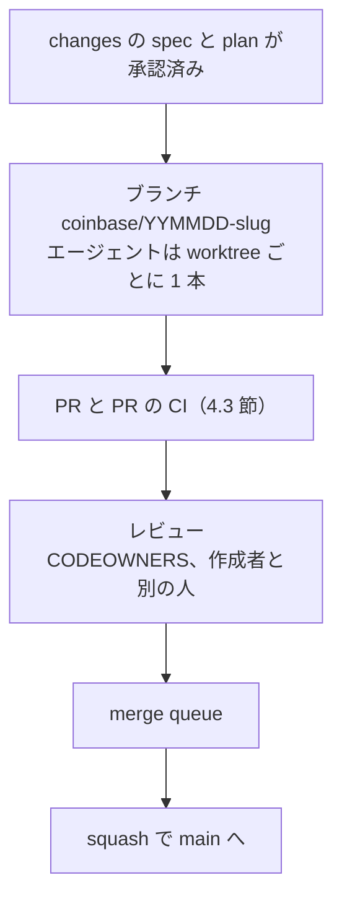
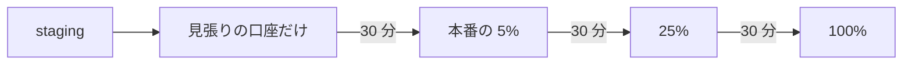
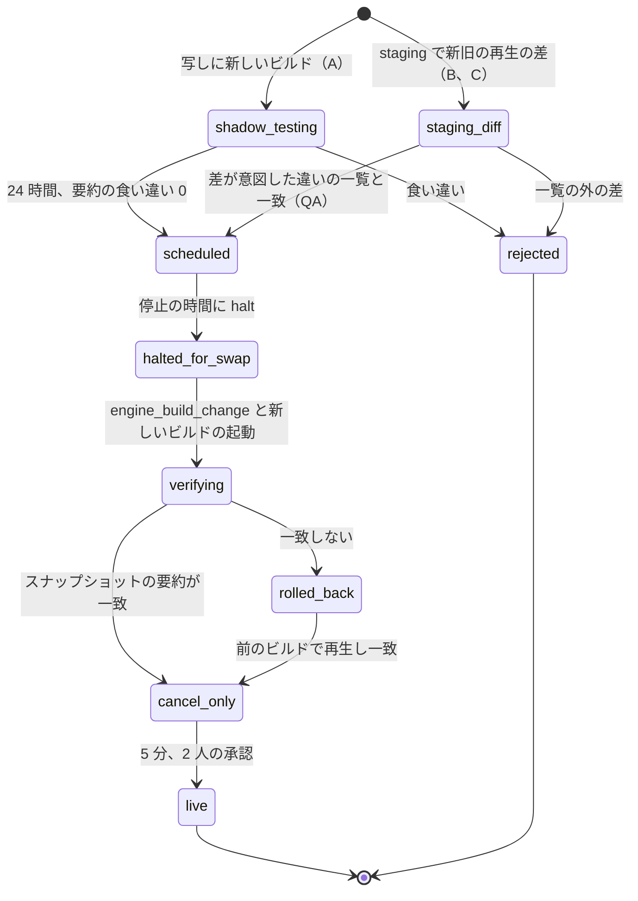
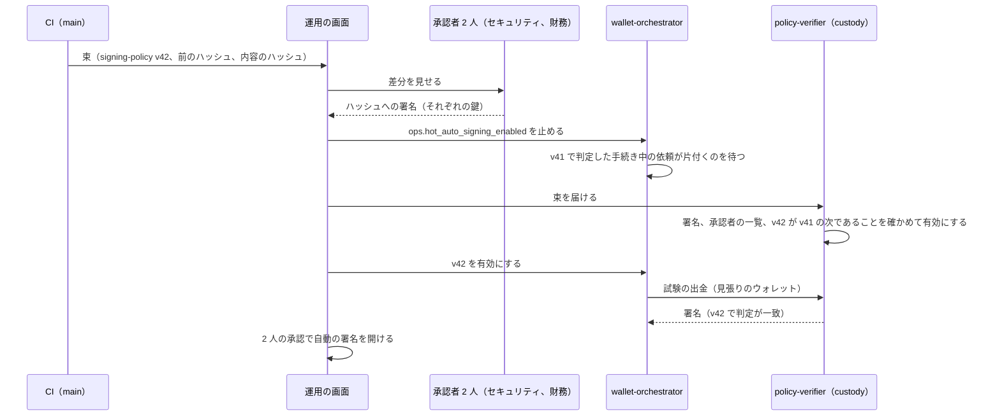

# Delivery: Coinbase

ブランチ、CI、ビルド、デプロイ、リリースの流れ。全体像は [README.md](README.md) にある。Slack の [delivery.md](../../../slack/docs/architecture/delivery.md) と Stripe の [delivery.md](../../../stripe/docs/architecture/delivery.md) を引き継ぎ、この題材に固有の 3 つを足す：**エンジンの入れ替え**（板の停止の時間）、**署名の境界の分かれたデプロイの経路**、**方針と規則の表の署名つきの束**。方針（時間帯、凍結、段階、自動のロールバックの条件）の正本は Ops の [runbooks/README.md](../runbooks/README.md) の 3 節で、ここにはそれを実現する仕組みを書く。

| 対象 | 決定 |
| --- | --- |
| ブランチモデル | リポジトリ共通の [ADR-0002](../../../../docs/decisions/0002-trunk-based-development.md)（トランクベース開発） |
| デプロイとマイグレーション、フラグの仕組み | Slack の [ADR-0022](../../../slack/docs/decisions/0022-zero-downtime-deploy-and-migrations.md)・[ADR-0026](../../../slack/docs/decisions/0026-feature-flags.md) を引き継ぐ |
| お金を動かすコードの影の実行と訂正の仕訳 | Stripe の [ADR-0032](../../../stripe/docs/decisions/0032-release-safety-for-money-moving-code.md) を引き継ぐ |
| 分かれた経路と変更の記録 | Stripe の [ADR-0033](../../../stripe/docs/decisions/0033-cde-pipeline-and-change-control.md) の形を `custody` に当てる |
| エンジンの入れ替え | [ADR-0074](../decisions/0074-engine-swap-in-planned-halt-window.md) |
| 方針と規則の表の出し方 | [ADR-0075](../decisions/0075-signed-config-bundles-for-policies-and-rules.md) |
| アカウントと CI の起点 | [ADR-0071](../decisions/0071-aws-accounts-network-and-egress.md)（infrastructure の領域） |
| 手順 | [runbooks/deploy-and-rollback.md](../runbooks/deploy-and-rollback.md) |

原則は 4 つ。

- **`main` は常にデプロイできる状態に保つ。** 未完成の振る舞いは `release.*` の裏に置く。
- **デプロイとリリースを分ける。** デプロイは Ops が承認し、リリースは PM が判断する。
- **約定の規則・仕訳の型・署名の方針をフラグにしない。** コードと、承認者が署名した設定の束として出す（ADR-0075）。
- **正しさの指標は利用者の組で分けられない。** 段階のデプロイは遅れと 5xx を組で比べるが、照合と記帳の指標は全体で見る。1 件で止める（runbooks の 3 節の自動のロールバックの条件）。

## 1. 範囲

この領域が持つもの：変更からマージまでの流れ、PR と夜間の CI、ビルドと成果物、デプロイの経路（Fargate、台帳、エンジンと sequencer、署名の境界、Terraform、アプリ）、エンジンの入れ替えの仕組み、スキーマの変更、フラグ、設定の束の作り方と有効にする手順、指標。

持たないもの：時間帯・凍結・段の割合・自動のロールバックの条件の値（runbooks の 3 節）、テストの中身と合否（[quality.md](../quality.md)）、署名の方針の決定表の中身（custody-and-keys の領域）、銘柄の設定の中身（matching-engine の領域）、`legal.*` の値の一覧（regulatory-compliance-japan の領域）。

## 2. 要件

| 要件 | この領域でやること |
| --- | --- |
| NFR-003（決定性） | エンジンの変更を写しで 24 時間比べ、入れ替えの `seq` を記録に残す（ADR-0074） |
| NFR-004、NFR-005（残高、記帳） | 台帳のサービスを単独の日に出す。マイグレーションは広げる段だけ。過去の仕訳を書き換えない |
| NFR-010（可用性） | 予定した板の停止は数えない。停止の時間を短く保つ（既定 10 分） |
| NFR-014（鍵と署名） | 署名の境界と方針の変更は、別の経路と 2 人の承認。受け手が署名を確かめる（ADR-0075） |
| AGENTS.md | エージェントは PR を作れるが、承認せず、本番と `custody` にデプロイの経路を持たない。テストの正解の変更は QA の承認 |
| roadmap の「エージェントに任せないこと」 | 契約・テストの正解・方針・`legal.*` の変更を CODEOWNERS で止める |

## 3. 本家の形（確かめたこと）

| 項目 | 本家 | 出典（確認日） |
| --- | --- | --- |
| デプロイの時間帯 | Exchange の FIX・WebSocket・REST のデプロイは、月・水・木の東部時間 14 時。部品ごとに違い、予告なく変わるとする | [Exchange Systems & Operations](https://docs.cdp.coinbase.com/exchange/introduction/systems-operations)（2026-11-15） |
| 停止の後の再開 | 2026 年 5 月の停止の後、取引を取り消しだけと板寄せを経て段階的に戻した | [InfoQ](https://infoq.com/news/2026/06/coinbase-aws-failure-postmortem)（2026-11-15）。本家のブログの本文は**未検証** |
| エンジンの入れ替えの方式、CI、承認の形 | 公式の資料で確かめられなかった | **未検証** |

- 本家は取引の時間帯の昼にデプロイの時間を置く。本システムはエンジンの入れ替えを、取引の少ない平日の早朝の板の停止の時間に置く（runbooks の 3.1 節）。MVP の再開は板寄せでなく、取り消しだけの後の連続の取引にする（[ADR-0003](../decisions/0003-matching-rules-and-self-trade-prevention.md)）。

## 4. 設計

### 4.1 変更からマージまで

Slack・Stripe と同じ。

- PR の説明には、変更フォルダ、規模、使うフラグに加えて、**区分**（4.2 節）と、エンジンの変更なら**種類**（A・B・C。ADR-0074）を書く。
- エージェントは PR を作り、確認ループ（[quality.md](../quality.md) の 2.3 節）を回すが、レビューの承認、デプロイの承認、束の署名をしない。

### 4.2 リポジトリの中の区分

開発リポジトリは 1 つ（モノレポ）。区分は CODEOWNERS と GitHub のルールセットで持つ（[roadmap.md](../roadmap.md) の `dev-repo-bootstrap`）。

| 区分 | パス | オーナー | デプロイの経路 |
| --- | --- | --- | --- |
| エンジン | `crates/engine-core`、`crates/sequencer`、`crates/engine-host` | テックリード、QA（正解のファイル） | エンジン（4.6 節） |
| お金 | `packages/ledger`、`packages/order-entry`、`packages/withdrawals`、`packages/deposits`、`packages/funding`、`packages/brokerage` | テックリード、QA | Fargate（台帳は単独の日） |
| 署名 | `packages/signing-policy`、`custody/`（境界の部品） | テックリード、セキュリティ | `custody`（4.7 節） |
| 設定の束 | `config/signing-policy/`、`config/legal/`、`config/compliance-rules/`、`config/assets/`、`config/instruments/` | 種類ごと（ADR-0075） | 束（4.9 節） |
| 正解 | `engine-ref`、`ledger-ref`、再生の固定の列の期待する要約、試験のベクトル、手数料の表の期待する値 | QA | — |
| 基盤 | `infra/`（Terraform） | Ops | Terraform（4.5 節） |
| その他 | 口座、通知、運用の画面、アプリ | 各領域 | Fargate、アプリの列車 |

### 4.3 CI

**PR の CI**（Slack の 2.1 節の段をすべて持ち、次を足す。目標は 25 分以内。Rust を含む PR は 35 分以内）：

| 段 | 内容 | 失敗の条件 |
| --- | --- | --- |
| Rust | `cargo fmt --check`、`cargo clippy -- -D warnings`、`cargo test` | 1 件でも |
| `engine-core` の lint | 時計・乱数・スレッド・`HashMap` の反復・浮動小数点の禁止、依存の許可の一覧、`telemetry` への依存の禁止（[ADR-0001](../decisions/0001-platform-and-stack.md)、[ADR-0069](../decisions/0069-telemetry-schema-without-secrets.md)） | 1 件でも |
| 参照との比べ・再生 | `engine-ref` との比べ（2,000 列）、固定の列の再生と要約（[quality.md](../quality.md) の 2.3 節） | 1 件でも |
| 性質ベース・シミュレーター | 触れた区分の性質（2,000 試行）、`chain-sim` などの場面 1 万 | 1 件でも。再実行で緑にしない |
| 金額の型 | 金額・数量を `number`・浮動小数点で扱うコード | 1 件でも |
| 契約 | 記録の Protocol Buffers の後方互換の検査。記録の形のバージョンを上げない形の変更を落とす | 1 件でも |
| 依存の禁止 | 本家のコード・SDK・公開のライブラリ、許可の外の暗号のライブラリ | 1 件でも |
| 正解の変更の検出 | テストの削除・skip・期待値の変更、正解のファイルの変更にラベルを付け、QA の承認を必須にする | QA の承認がない |
| 漏れ | `pnpm test:leaks`、ロガーの項目の lint | 1 件でも |
| 注釈 | アラートの手順の URL、DT-OBS-1（[observability.md](observability.md) の 8 節） | 1 件でも |
| 束 | `config/` に触れたとき：決定表の全行、型と範囲、`legal.*` の内側、2 か所の判定の一致（ADR-0075） | 1 件でも |
| エンジンの種類 | `crates/engine-*` に触れたとき：PR の種類（A・B・C）の記載、C の記録の形のバージョン（ADR-0074） | 欠け |

**夜間の CI**：性質ベース（各 20 万試行）、参照との比べ（大きな生成）、前日の本番の形の生成の列の再生、シミュレーター（場面 100 万）、障害の注入（[quality.md](../quality.md) の 2.2 節）、縮めた規模の負荷、E2E の全部。失敗は翌朝の当番が `changes/` に起票する。

### 4.4 ビルドと成果物

- 1 回ビルドした同じ成果物を、環境をまたいで昇格させる。成果物は digest で指し、タグで指さない。
- コンテナのイメージと Rust のバイナリに、SBOM と来歴の証明（SLSA の provenance）を付け、`shared` の ECR に置く。デプロイの関門は、来歴の証明が `main` の CI から作られたものかを確かめる。
- Rust のビルドは、固定したツールチェーンと `Cargo.lock` で行い、同じ入力から同じバイナリが出ることを夜間に確かめる（2 回ビルドして比べる）。エンジンのビルドの ID は、このバイナリのハッシュにする。
- エンジンの過去の全部のビルドを、再生のために保つ（ADR-0074）。

### 4.5 デプロイの経路

| 経路 | 対象 | 承認 | 時間帯（runbooks の 3.1 節） |
| --- | --- | --- | --- |
| Fargate の段階 | API の層、ドメインのサービス、Worker | Ops（作成者と別） | 種類ごと（平日 10〜17 時、お金は 10〜15 時） |
| 台帳 | `ledger`、`ledger-poster`、`reconcilers` | Ops、テックリード | 単独の日（他のお金の区分を出さない日）の 10〜15 時 |
| エンジン | `sequencer`、`engine-host` | Ops、テックリード（B・C は QA も） | 予定した板の停止の時間（4.6 節） |
| `custody` | 署名の境界の部品 | テックリードとセキュリティの 2 人 | 平日 10〜15 時。コールドの儀式の当日は凍結 |
| 束 | 方針、規則の表、資産と銘柄の設定、`legal.*` | 種類ごとの署名（ADR-0075） | 種類ごと（4.9 節） |
| Terraform | ネットワーク、DB、MSK、ノード、アカウント | Ops（`custody` と `watch` はセキュリティも） | 平日 10〜16 時 |
| アプリ | iOS、Android | PM、QA | 週 1 回の列車 |

**Fargate の段階**（runbooks の 3 節）：

- 段の割り当ての単位は口座（`hash(service_version + account_id) mod 100`）。同じ口座の要求が新旧に分かれると、問い合わせと照合の説明がつかなくなる（Stripe の 5.4 節と同じ理由）。
- 各段で、自動のロールバックの条件（runbooks の 3 節）を見る。正しさの指標（拘束の照合、記帳の重複と遅れ、負の `available`、方針の判定の食い違い、入金の記帳の停止）は組で分けず、全体で 1 件出たら戻す。
- デプロイの順は runbooks の 3 節（マイグレーション → Worker → ドメインのサービス（`ledger` は最後に単独で）→ API の層 → Web の資産）。

**`custody` の経路**（Stripe の CDE の形）：

| 項目 | 本体 | `custody` |
| --- | --- | --- |
| 成果物の置き場所 | `shared` の ECR | `custody-prod` の中の ECR。本体の CI のロールは push できない |
| デプロイのロール | `environment:prod` の主体 | `environment:custody-prod` の主体で、ワークフローが `custody-deploy.yml` のときだけ（OIDC の `job_workflow_ref`） |
| 承認 | Ops 1 人 | テックリードとセキュリティの 2 人（どちらも作成者と別）。2 人が揃わない間はデプロイしない |
| 変更の記録 | PR | PR と、影響・試験の証跡・戻し方の変更の記録（委託とシステムのリスクの管理の当てはめは法務の L13） |
| 前後 | — | 入れ替えの前に `ops.hot_auto_signing_enabled.*` を止め、`custody-nonprod` と本番の試験の出金を通してから 2 人の承認で開ける（runbooks の 3 節） |

### 4.6 エンジンの入れ替え

写しで先に確かめ、予定した板の停止の時間に、sequencer を通した入れ替えの入力（`engine_build_change`）で本番を入れ替える（ADR-0074）。

| 状態 | 次へ進む条件 | 戻すとき |
| --- | --- | --- |
| `shadow_testing` | 本番の入力で 24 時間、入力ごとの要約が一致 | 写しを前のビルドに戻す。本番は触れない |
| `staging_diff` | 前日の本番の形の生成の列の再生の差が、意図した違いの一覧と一致（QA の承認） | — |
| `scheduled` | 2 営業日前までにお知らせを出した。凍結（runbooks の 3.1 節）の外 | 予定を取り消す |
| `halted_for_swap` | 停止の入力でスナップショットを書いた | — |
| `verifying` | 新しいビルドが停止のスナップショットを読み、要約が停止の時点と一致 | 前のビルドに戻し（`engine_build_change` で前のビルドの ID）、同じ確かめ |
| `cancel_only` | 既定 5 分、取引中への切り替えは 2 人の承認 | 板を止めたままにし、IC を立てる |

- 停止の時間の既定は平日の早朝 10 分。時刻は銘柄の設定で持つ（例：水曜 06:00〜06:10）。予定した停止は NFR-010 の可用性に数えない。
- 写しの `engine-host` は、本番の入れ替えの後、新しいビルドで比べを続ける（A は既に新しいビルド。B・C は入れ替えと同時に新しいビルドにする）。
- 日次の再生は、`engine_build_change` の `seq` で使うビルドを切り替える（ADR-0074）。

### 4.7 スキーマの変更

- Slack の ADR-0022 の広げる・移す・縮めるの段に従う。マイグレーションは広げる段だけを先に出し、前のバージョンが今の DB で動く。
- **台帳は追記だけ**（[ADR-0005](../decisions/0005-ledger-balances-and-trade-settlement.md)）。過去の仕訳を書き換えるマイグレーションとバックフィルを作らない。誤りは打ち消しの仕訳で、財務の 2 人の承認で直す（Stripe の 5.3 節の訂正のジョブ）。
- 守る物（拘束の条件つきの更新、仕訳の釣り合いのトリガー、RLS のポリシー、`kyc-vault` の読む関数の監査の行）に触れるマイグレーションは、テックリードとセキュリティ（ledger は財務も）の承認を要する（[runbooks/deploy-and-rollback.md](../runbooks/deploy-and-rollback.md)）。
- 入力と出力の記録の形は DB のスキーマでなく契約で、変えるときは記録の形のバージョンを上げる（ADR-0074 の C）。

### 4.8 フラグ

| 種類 | 名前 | 使い方 | 変える人 |
| --- | --- | --- | --- |
| `release.*` | kebab-case（`release.brokerage-quotes`） | 未完成の振る舞いを隠す。口座の単位で広げる。100% の後 30 日で消す | PM（Ops が指標を確かめる） |
| `ops.*` | snake_case（`ops.trading_enabled.btc_jpy`） | 止めるだけ。当番が 1 人で止められる。開けるのは 2 人の承認 | Ops |
| `legal.*` | 法務の結論の値（`legal.hot_ratio_max`） | 本番は法務の結論まで無効。署名つきの束で入れる（4.9 節） | 法務・財務の承認、Ops が適用 |

- AppConfig の環境は東京と大阪の両方に持ち、同じ変更で両方に入れる。片方だけの値の違いを、毎時の検査で見つける（大阪へ切り替えた時に違う値で動かないため。[ADR-0073](../decisions/0073-osaka-dr-and-market-restart.md)）。
- `release.*` で、マッチングの規則・仕訳の型・署名の方針・スクリーニングの規則を切り替えるコードを、CI の lint で拒む（フラグを読む関数を、決めたパッケージから呼べなくする）。

### 4.9 設定の束

方針と規則の表は、承認者が署名した束として出し、受け手が署名とバージョンを確かめる（ADR-0075）。署名の方針の切り替えは次の順で行う。

- 規則の表と資産の設定は、束に有効の時刻を書き、受け手はその時刻から使う。判定の記録に規則のバージョンを残す。
- 銘柄の設定は、束を sequencer を通した銘柄の設定の変更の入力にし、板の停止の時間の中で入れる。

### 4.10 アプリのリリース

- iOS・Android は週 1 回の列車でストアに出し、App Store の段階のリリース・Google Play の段階の公開で 7 日かけて広げる。クラッシュのない率が 99.5% を下回ったら止める（[runbooks/deploy-and-rollback.md](../runbooks/deploy-and-rollback.md)）。
- アプリは、注文と出金の規則を持たない（サーバーが検査する）。古いアプリのバージョンを止めるときは、`app-api` が最小のバージョンを返し、更新を求める。
- 契約の前の書面や手数料の説明の文言を変えるリリースは、法務の確認を要する（法務の L12）。

### 4.11 例：BTC/JPY のエンジンの入れ替え

`engine-core` の段の検索を速くする変更（種類 A、ビルド `b7f3…`）。

| 日時 | 事象 | 値 |
| --- | --- | --- |
| 月曜 10:30 | 写しの `engine-host`（BTC/JPY、`match-2`）を `b7f3…` に替える | 入力の `seq` 8,000,000 から比べる |
| 火曜 10:30 | 24 時間の比べ | 約 900 万入力、食い違い 0。処理の p99 は 62µs から 41µs |
| 月曜 11:00 | お知らせ「水曜 06:00〜06:10 に BTC/JPY の取引を止めます」 | 2 営業日前 |
| 水曜 06:00:00 | 停止の入力（`seq` 9,412,007）。スナップショットを書く | 板の注文 1,830 件 |
| 06:00:20 | `engine_build_change`（`seq` 9,412,008、`b7f3…`、記録の形のバージョン 3 のまま） | — |
| 06:02:10 | 本番の `engine-host`（`match-1`）を `b7f3…` で起こし、スナップショットの要約が停止の時点と一致 | — |
| 06:02:10 | 取り消しだけ | 5 分 |
| 06:07:10 | 2 人の承認で取引中 | 停止は 7 分 10 秒 |
| 木曜 06:00 | 日次の再生。`seq` 9,412,008 までを前のビルド、その後を `b7f3…` で再生 | 食い違い 0 |

時間の流れは次のとおり。

```mermaid
gantt
    title 水曜の停止の時間（BTC/JPY）
    dateFormat HH:mm:ss
    axisFormat %H:%M
    section 板
    停止とスナップショット :h1, 06:00:00, 20s
    入れ替えの入力 :h2, after h1, 10s
    新しいビルドの起動と確かめ :h3, after h2, 100s
    取り消しだけ :h4, after h3, 300s
    取引中 :milestone, h5, after h4, 0s
```

## 5. 障害のときの振る舞い

| 障害 | 検知 | 振る舞い | 回復 |
| --- | --- | --- | --- |
| 段階のデプロイの中の自動のロールバック | runbooks の 3 節の条件 | 新しい組の重みを 0 に | [deploy-and-rollback.md](../runbooks/deploy-and-rollback.md) |
| エンジンの入れ替えの後の要約の不一致 | `verifying` の確かめ | 前のビルドに戻し、同じ確かめ | 同上。縮めた入力の列を固定の列に足す |
| 停止の時間の中で終わらない | 06:10 の時点で `cancel_only` に入っていない | 板を止めたまま、IC を立てる。取引中にしない | 前のビルドで再開してから原因を調べる |
| 束の署名が足りない・古い | 受け手の確かめ | 有効にせず呼び出す | 束を作り直す |
| 署名の方針の切り替えの途中で止まる | 手続き中の依頼が片付かない | 自動の署名は止めたまま。出金は承認に回る | 前のバージョンで開けるか、IC が判断 |
| 東京と大阪のフラグの値の違い | 毎時の検査 | チケット | 同じ変更で揃える |
| CI の経路の侵害の疑い | 来歴の証明の不一致、想定外のワークフロー | デプロイの関門が拒む。`custody` は 2 人の承認と受け手の確かめで止まる | セキュリティの手順 |

## 6. 上限

| 対象 | 値 | 備考 |
| --- | --- | --- |
| PR の CI | 25 分（Rust を含む PR は 35 分） | 超えたら段の並列を見直す |
| エンジンの入れ替え | 週 1 回まで、1 回の停止 10 分 | 臨時の停止は IC の判断 |
| 写しでの比べ（A） | 24 時間 | runbooks の 3 節 |
| `release.*` の寿命 | 100% の後 30 日 | 期限を過ぎたフラグを CI が警告する |
| `custody` のデプロイ | 2 人が揃うときだけ | ADR-0007 |

## 7. セキュリティ

- CI のロールは OIDC で短命にし、環境ごとに引き受けられる主体を絞る。`custody-prod` の主体は決めたワークフローだけ（4.5 節）。
- 成果物は来歴の証明と SBOM を持ち、デプロイの関門が確かめる。
- 束は、受け手が承認者の署名とバージョンの鎖を確かめる。CI や `prod` が破られても、承認のない方針・規則・`legal.*` は有効にならない（ADR-0075）。
- エージェントは、本番と `custody` へのデプロイの経路、束の署名、レビューとデプロイの承認を持たない。
- テストの正解の変更は QA の承認を要する（4.3 節）。

## 8. テスト

| ID | 種類 | 中身 |
| --- | --- | --- |
| PROP-DEL-1 | 性質 | 任意の `engine_build_change` を含む入力の列で、ビルドを `seq` で切り替えた再生の要約が、本番の要約と一致する |
| PROP-DEL-2 | 性質 | 任意の束の列（署名の欠け、作成者の署名、同じ人の 2 つの署名、古いバージョン、前のハッシュの食い違い）で、受け手が有効にするのは規則を満たす束だけ（ADR-0075） |
| DT-DEL-1 | 決定表 | 4.6 節の状態と遷移の表。運用の画面の入れ替えの操作が、表の行の外の遷移を拒む |
| — | 障害の注入 | 署名の方針の切り替えの途中のバージョンの違い（staging）、エンジンの入れ替えの `verifying` での不一致 |

- ID の接頭辞 `PROP-DEL`・`DT-DEL` は quality.md の 2.2.2 節に足す（11 節）。

## 9. Story の候補

| Epic | Story | 内容 |
| --- | --- | --- |
| E1 | `ci-pipeline-baseline` | 4.3 節の段（roadmap の既存の Story を細かくする） |
| E1 | `build-provenance` | SBOM、来歴の証明、Rust の再現できるビルド、デプロイの関門 |
| E1 | `deploy-stages-by-account` | Fargate の段階、口座の単位の割り当て、自動のロールバックの条件 |
| E1 | `flags-and-legal-config` | フラグ、東京と大阪の値の検査、`release.*` の lint（roadmap の既存の Story に足す） |
| E1 | `config-bundles` | 束の作り方、署名、受け手の確かめ（ADR-0075） |
| E6 | `custody-pipeline` | `custody` の分かれた経路、2 人の承認、変更の記録 |
| E6 | `signing-policy-rollout` | 署名の方針の切り替えの手順（4.9 節） |
| E9 | `engine-swap-procedure` | `engine_build_change`、`shadow_testing` から `live` までの操作、ビルドを切り替える再生（ADR-0074） |

## 10. 未解決の問い

| 問い | 案と推奨 | 判断 |
| --- | --- | --- |
| エンジンの急ぎの修正で、お知らせの期間（2 営業日）を縮めてよいか | IC の判断で臨時の停止。お知らせは停止の前に出す | PM、法務（利用者への説明。L12） |
| エンジンのビルドを保つ期間（7 年） | 記録の保存の期間に合わせる | 法務の確認待ち（L4・L7） |
| `custody` の変更の記録の形が、システムのリスクと委託の管理の要件に合うか | Stripe の CDE の変更の記録の形 | 法務の確認待ち（L13） |

## 11. quality.md・runbooks・data-model への項目

**quality.md**

- 2.2.2 節の一覧に `PROP-DEL`・`DT-DEL` を足す。
- 2.2 節の「再生」の行に、ビルドを `engine_build_change` で切り替えることを足す。

**runbooks**

- README の 3 節のエンジンの入れ替えに、`engine_build_change` の入力と、停止の時間の中で終わらないときの扱い（板を止めたまま IC）を足す。
- README の 3 節の署名の方針の項に、手続き中の依頼が片付くのを待つ段と、猶予の期間を置かないことを足す。
- 新しい手順 `engine-swap.md`：4.6 節の状態ごとの操作と戻し方。作る Story は `engine-swap-procedure`。
- 新しい手順 `signing-policy-rollout.md`：4.9 節の順。作る Story は `signing-policy-rollout`。

**data-model**

| 表（クラスタ） | 主な列 | 用途 |
| --- | --- | --- |
| `engine_builds`（core） | `build_id`（バイナリのハッシュ）、`kind`（A・B・C）、`journal_format_version`、`artifact_ref`、`sbom_ref`、`created_at` | 再生に使うビルド |
| `engine_swaps`（core） | `swap_id`、`pair`、`from_build`、`to_build`、`halt_seq`、`change_seq`、`state`、`halted_at`、`live_at` | 入れ替えの記録（状態は 4.6 節） |
| `config_bundles`（core。`custody` は自分の写し） | `kind`、`version`、`prev_hash`、`content_hash`、`content_ref`、`effective_at`、`activated_at` | 束 |
| `config_bundle_signatures`（core） | `kind`、`version`、`approver_id`、`role`、`signature`、`signed_at` | 束の署名 |

**他の領域へ**

- matching-engine の領域：`engine_build_change` を sequencer の入力の種類に足す（状態を変えない入力）。
