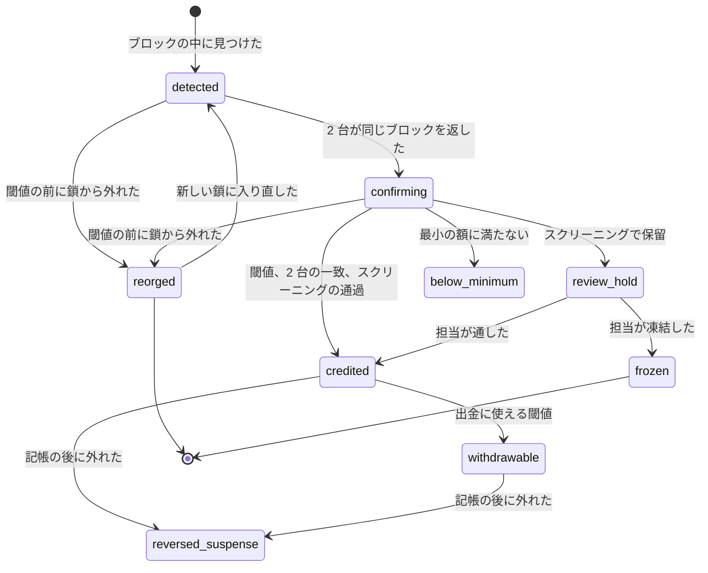
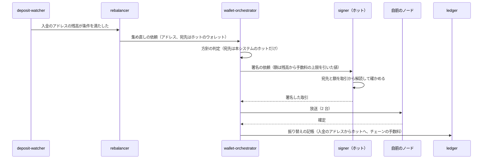

# Deposits: Coinbase

暗号資産（BTC と ETH 本体）の入金を決める。入金のアドレスの払い出し、入金の見つけ方、入金のステートマシン、閾値と記帳、出金に使えるまでの待ち、巻き戻りの扱い、ETH の集め直し、入金のスクリーニングとトラベルルールの情報の受け取り（法務の確認待ち L5）を扱う。日本円の入金は fiat-and-banking の領域にある。

前提となる決定は次のとおり。

- 入金は自前のノード 2 台（組）で確かめ、BTC は 3 承認、ETH は確定（finalized）で記帳する。BTC は 6 承認まで出金に使わせない（[ADR-0009](../decisions/0009-deposits-confirmations-and-own-nodes.md)）
- 入金のアドレスは、BTC は監視だけの公開鍵（xpub）からの導出、ETH は利用者ごとのアドレス。ETH の方式は `eth-deposit-sweep-poc` で決め、結論までは利用者ごとの通常のアドレスを既定にする（同上）
- 集め直しまでの ETH の入金のアドレスの残高は、ネットワークにつながる額の割合でホットの側に数える（[ADR-0006](../decisions/0006-wallet-tiers-and-cold-ratio.md)）
- 台帳の仕訳と口座の種類は [ADR-0005](../decisions/0005-ledger-balances-and-trade-settlement.md)。入金のスクリーニングと提供者の障害の既定は [ADR-0011](../decisions/0011-external-providers-boundary.md)
- 2 台の比べ、頭と確定の追跡、外部の見張りの規則は [chain-nodes-and-confirmations.md](chain-nodes-and-confirmations.md)。スクリーニングの規則の表とトラベルルールの判定は [aml-and-travel-rule.md](aml-and-travel-rule.md)

この文書で決めたことは次の ADR にある。

| ADR | 決定 |
| --- | --- |
| [0039](../decisions/0039-deposit-state-machine-and-withdrawal-lock.md) | 入金をステートマシンにし、`transitionDeposit()` だけが遷移を書く。スクリーニングで止めた入金は記帳しない。記帳の後、出金に使える閾値までは、口座の全部の出金（暗号資産と日本円）を止める。最小の入金額に満たない入金は記帳しない |
| [0040](../decisions/0040-deposit-address-issuance-and-verification.md) | 入金のアドレスは、利用者と資産ごとに 1 つを固定で払い出し、求めと侵害の疑いのときだけ入れ替える。古いアドレスも見張り続ける。払い出したアドレスは、署名の境界のアカウントで毎日導出し直して突き合わせる |
| [0041](../decisions/0041-eth-deposit-detection-and-sweep.md) | ETH の入金は、最上位の取引と内部の送金（trace）の両方で見つけ、集め直しの前にアドレスの残高と突き合わせる。集め直しは額か時間の条件で、ホットのウォレットへの決まった宛先の取引で行い、チェーンの手数料は本システムが持つ |

## 1. 範囲

- 扱う：
  - 入金のアドレスの払い出し、入れ替え、見張りの一覧、アドレスの検証
  - 入金の見つけ方（BTC の出力、ETH の最上位の取引と内部の送金）
  - 入金のステートマシン、閾値、記帳、出金に使えるまでの待ち
  - 巻き戻りの扱い（記帳の前と後）
  - ETH の集め直し（sweep）
  - 最小の入金額、対応しない資産（ERC-20 のトークンなど）の到着、持ち主の分からない受け取り
  - 入金のスクリーニングの依頼と、トラベルルールの情報の受け取りの待ち（判定の規則は aml-and-travel-rule の領域）
  - 利用者への表示（確かめ中、使える、出金に使える）
- 扱わない：
  - ノードの構成、2 台の比べの規則、外部の見張り（chain-nodes-and-confirmations の領域）
  - スクリーニングの規則の表、制裁の照合、トラベルルールの通知の形（aml-and-travel-rule の領域）
  - 台帳の勘定科目の定義と、台帳とチェーンの照合の等式（ledger-and-balances、segregation-and-reconciliation の各領域）
  - 鍵の導出の秘密の側（シード、署名の境界の中の導出）と、集め直しの署名の方針の決定表（custody-and-keys の領域）
  - 日本円の入金（fiat-and-banking の領域）

## 2. 要件

| 要件 | 目標 | NFR・intent |
| --- | --- | --- |
| 閾値の前に使わせない | 閾値（BTC 3 承認、ETH の確定）の前の記帳 0 | NFR-009、intent の守るべき振る舞い |
| 記帳の速さ | 閾値に届いてから記帳まで p95 5 分 | NFR-009 |
| 巻き戻り | 巻き戻りで消えた入金が使われた件数 0（出金・外への持ち出し） | NFR-009、K6 |
| 1 回だけ | 1 つの入金（チェーン、取引の ID、出力の番号）の記帳は 1 回 | ADR-0009 |
| 2 台の一致 | 自前のノード 2 台が食い違う間の記帳 0 | ADR-0009 |
| スクリーニング | スクリーニングのない入金の記帳 0。提供者の障害の間は記帳を止める | NFR-015、ADR-0011 |
| 照合 | 台帳と入金のアドレスの残高の説明のつかない差を、照合の時点で仮勘定に置く | NFR-006 |
| 可用性 | 入出金の受け付け（アドレスの表示、入金の一覧）月間 99.9% | NFR-010 |

## 3. 本家の形（確かめたこと）

| 項目 | 本家 | 出典（確認日） |
| --- | --- | --- |
| 入金の承認 | BTC と ETH の取引は、決まった数のネットワークの承認を経てから確定したものとして扱い、それまでは「保留（Pending）」と出す | Coinbase の古いサポートの記事（support.coinbase.com の記事 593836。検索の結果の抜き出しでだけ確かめた。2026-11-15） |
| 承認の数の値 | 資産ごとの数は公式の資料で確かめられなかった | **未検証** |
| 内部の送金の入金、最小の入金額、アドレスの入れ替えの方式 | 公式の資料で確かめられなかった | **未検証** |
| 入金のトラベルルールの情報 | 入金の側の扱いは、確かめた開発者の文書（送金の側だけを書く）になかった | **未検証**（[aml-and-travel-rule.md](aml-and-travel-rule.md) の 3 節） |

本家の値を使わず、本システムの値を使う。本家と違う振る舞いを選んだものはない（値が確かめられないため）。

## 4. 入金のアドレス（[ADR-0040](../decisions/0040-deposit-address-issuance-and-verification.md)）

### 4.1 払い出し

| 資産 | 形 | 導出 | 鍵 |
| --- | --- | --- | --- |
| BTC | ネイティブ SegWit（P2WPKH、`bc1q...`） | BIP84 の形。`m/84'/0'/<口座の枝>'/0/<index>`。`deposit-addresses` は枝の xpub から `index` だけを導く | 秘密鍵は署名の境界の中のホットの段の鍵の枝（[ADR-0007](../decisions/0007-signing-service-and-key-custody.md)） |
| ETH | 通常のアドレス（EOA） | BIP44 の形。`m/44'/60'/<口座の枝>'/0/<index>`。同じく xpub から導く | 同上。集め直しの署名だけに使う |

- `index` は `deposit_addresses` の連番で、`(asset, xpub_version, index)` の一意の制約で 2 人に同じアドレスを出さない。払い出しは、本人確認の済んだ口座（kyc-and-accounts の領域）にだけ行う。
- 利用者と資産ごとに、使えるアドレスは 1 つ（`active`）。入金のたびに新しいアドレスにはしない。利用者が他の交換業者の宛先の一覧に登録した後で変わると、誤送が増えるためである。
- 入れ替えは、利用者の求め（月に 1 回まで）と、侵害の疑い（運用者の 2 人の承認）のときだけ。古いアドレスは `retired` にし、見張りを続ける（`retired` のアドレスに届いた入金も記帳する）。
- 画面には、アドレスと QR、ネットワークの名前（「Bitcoin」「Ethereum」）、最小の入金額、ERC-20 のトークンを送らないことの注意を出す。文言は法務の確認待ち（L12）。

### 4.2 アドレスの検証

入金のアドレスの差し替え（本体のアカウントの侵害で、攻撃者のアドレスを利用者に出す）を見つける。

- `custody` のアカウントの `address-verifier` が、毎日、`deposit_addresses` の全行（S1 で 30 万口座 × 2 資産 ＝ 最大 60 万行）を、境界の中の公開鍵から導き直し、一致を確かめる。食い違いは page（SEV1 の候補。[runbooks/hot-wallet-compromise.md](../runbooks/hot-wallet-compromise.md)）。
- 新しく払い出したアドレスは、画面に出す前に `address-verifier` の確かめ（数秒）を通す。確かめが返らなければ、払い出しを待たせる（「準備中」）。

### 4.3 見張りの一覧

- `deposit-watcher` は、`active` と `retired` の全アドレスの集合をメモリーに持つ（S1 で最大 60 万。アドレスごとに約 100 バイトで 60 MB）。払い出しの事象（outbox）で足す。
- 本システムのウォレット（ホット・ウォーム・コールド、本システムの財産）のアドレスは別の集合に持ち、利用者の入金として記帳しない。外から本システムのウォレットへ直に届いたものは「持ち主の分からない受け取り」（7.3 節）にする。

## 5. 入金のステートマシン（[ADR-0039](../decisions/0039-deposit-state-machine-and-withdrawal-lock.md)）

[ADR-0009](../decisions/0009-deposits-confirmations-and-own-nodes.md) の 5 つの状態に、スクリーニングの保留、最小の額、出金に使える状態を足す。遷移は `packages/deposits` の `transitionDeposit()` だけが書き、遷移ごとに `deposit_events` に行を足す。

遷移の決定表（DT-DEP。表が正で、図は要約）。

| 今の状態 | 条件 | 次 | 記帳 |
| --- | --- | --- | --- |
| — | 見張りのアドレスへの出力（BTC）・送金（ETH）を、片方のノードのブロックに見つけた | `detected` | なし |
| `detected` | 2 台（組）が同じ高さで同じブロックの ID と同じ入金（取引の ID、出力の番号、額、アドレス）を返した | `confirming` | なし |
| `detected`・`confirming` | 入金のブロックが合意の鎖にない | `reorged` | なし |
| `reorged` | 同じ取引の ID と出力の番号が新しい鎖のブロックに入った | `detected` | なし |
| `confirming` | 閾値に届き、スクリーニングとトラベルルールの判定が「通す」、額が最小の額以上 | `credited` | `deposit_credit` |
| `confirming` | 閾値に届き、判定が「保留」 | `review_hold` | なし |
| `confirming` | 閾値に届き、判定がまだない（提供者の障害、トラベルルールの情報の待ち） | `confirming` のまま | なし |
| `confirming` | 閾値に届き、額が最小の額に満たない | `below_minimum` | なし |
| `review_hold` | コンプライアンスの担当が通した | `credited` | `deposit_credit` |
| `review_hold` | コンプライアンスの担当が凍結した | `frozen` | なし（扱いは法務の L6） |
| `credited` | BTC は 6 承認に届いた。ETH は記帳と同時 | `withdrawable` | なし（出金の止めを外す） |
| `credited`・`withdrawable` | 入金のブロックが合意の鎖から外れた | `reversed_suspense` | `deposit_reversal_hold`（[ADR-0009](../decisions/0009-deposits-confirmations-and-own-nodes.md)） |

- `reorged` から `detected` に戻る遷移は、冪等キー `(deposit, <chain>, <txid>, <vout または log の番号>)` が同じなので、同じ入金の行を使い直す。記帳は 2 度起きない。
- `review_hold`・`below_minimum`・`frozen` の入金は台帳に書かない。チェーンの上には資産があり、台帳にない。台帳とチェーンの照合は、この 3 つの状態の額を「記帳していない既知の入金」として説明に使う（segregation-and-reconciliation の領域への依頼。10 節）。
- `frozen` と、`frozen` の後の返却の可否は法務の確認待ち（L6）。返却するときは、本システムが作る出金として、[ADR-0008](../decisions/0008-withdrawal-pipeline-and-approvals.md) の流れ（承認の段を含む）を通す。
- `below_minimum` の扱い（後の入金と合わせて記帳するか、記帳しないか）は PM の判断待ち（10 節）。MVP の既定は記帳しない。画面で事前に知らせる。

### 5.1 閾値

| 資産 | 記帳 | 出金に使える | 設定 |
| --- | --- | --- | --- |
| BTC | 3 承認 | 6 承認 | `deposit_thresholds`（資産ごと、バージョンつき。変更は Dev・セキュリティの承認） |
| ETH | 合意のクライアントの確定（finalized）のブロックに入った | 記帳と同時 | 同上 |

- 承認の数は、2 台の合意の頭から数える（[chain-nodes-and-confirmations.md](chain-nodes-and-confirmations.md) の 4 節）。片方のノードの頭が先に進んでいても、合意の頭までしか数えない。
- 閾値を一時的に上げる操作（深い巻き戻りが続くとき）は [runbooks/chain-reorg.md](../runbooks/chain-reorg.md) の対処 5。上げた値は、それ以降に `credited` になる入金にだけ効く。

### 5.2 出金に使えるまでの止め

ADR-0009 は、BTC を 3 承認で記帳し、6 承認まで「その額を出金に使えない」とした。入金した BTC を売って日本円にし、日本円で出金すると、同じ止めをすり抜ける。そこで、止めの対象を口座の全部の出金にする（[ADR-0039](../decisions/0039-deposit-state-machine-and-withdrawal-lock.md)）。

- `credited` で `withdrawable` でない入金が 1 件でもある口座は、暗号資産の出金と日本円の出金の依頼を受け付けるが、`held` の前で待たせる。止めは台帳の出金の制限の行（`withdrawal_restrictions`、理由 `deposit_maturity`。[ADR-0029](../decisions/0029-hold-kinds-and-withdrawal-restrictions.md)）で持ち、範囲を「口座の全部の出金」にする（ADR-0029 の額の制限は入金の資産だけを止めるので、範囲の印を足す依頼を ledger-and-balances の領域に出す。14 節）。注文と販売所には使える。
- 待ちは BTC の 3 承認から 6 承認まで、通常およそ 30 分（BTC のブロックは平均およそ 10 分）。画面には「入金の確かめが済むと出金できます（あと約 N 分）」と出す。
- 日本円の出金の側の読み込みは fiat-and-banking の領域、暗号資産の出金の側は withdrawals の領域に置く（10 節）。

## 6. 見つけ方

### 6.1 BTC

- `deposit-watcher` は、2 台のノードそれぞれから新しいブロックを全部読み（`getblock` の詳細）、全取引の出力のうち、スクリプトが見張りの集合のアドレスに当たるものを入金にする。1 つの取引の複数の出力は、出力の番号ごとに別の入金にする。
- 待ちの取引（mempool）は見ない。利用者への表示はブロックに入ってからにする（mempool の取引は置き換えで消えうる）。
- ブロックの読み込みは高さの順。読み込みの位置（`chain_cursor`）を、ノードごと・資産ごとに持つ。

### 6.2 ETH（[ADR-0041](../decisions/0041-eth-deposit-detection-and-sweep.md)）

- 最上位の取引：`to` が見張りのアドレスで、`value` が 0 より大きく、受け取りの `status` が成功のもの。
- 内部の送金：契約から見張りのアドレスへの送金（他の交換業者の一括の出金、スマートウォレットからの送金）。実行のクライアントの trace（呼び出しの木）をブロックごとに取り、`CALL` で値を動かし、失敗していない呼び出しを入金にする。出力の番号の代わりに、取引の中の呼び出しの位置（trace のアドレス）を冪等キーに使う。
- 集め直しの前に、アドレスの残高（確定のブロックの時点）と、そのアドレスの入金の合計から集め直した額を引いた値を比べる。合わない分（trace に出ない送り方。契約の自己破壊による送金など）は「持ち主の分からない受け取り」（7.3 節）にする。
- ERC-20 のトークンの到着（`Transfer` の事象）は記帳しない。運用の待ち行列に入れる（[ADR-0009](../decisions/0009-deposits-confirmations-and-own-nodes.md)）。

## 7. ETH の集め直しと例外の受け取り

### 7.1 集め直し（[ADR-0041](../decisions/0041-eth-deposit-detection-and-sweep.md)）

利用者ごとの ETH の入金のアドレスから、利用者用のホットのウォレットへ移す。台帳では利用者の残高は動かず、本システムのウォレットの口座の間の振り替えだけになる。

- 起動の条件：アドレスの記帳済みの残高が 0.05 ETH 以上、または最後の入金の記帳から 24 時間を過ぎて 0.005 ETH 以上（本システムの値。`eth-deposit-sweep-poc` で手数料と比べて見直す）。
- 手数料：ETH 本体の送金は、アドレス自身の残高から手数料を払う。送る額は「残高 − 21,000 gas × `maxFeePerGas`」。払った手数料は `network_fee_expense:ETH` に記帳し、利用者の残高は減らさない。本システムから手数料の ETH を送る必要はない（ADR-0009 の「本システムが送る」は、トークンを扱うときの話になる。10 節）。
- 集め直しは、署名の方針の「宛先が本システムのホットのウォレットに固定」の行で自動に署名する。額は承認の段に数えない（custody-and-keys の領域で方針の行を決める）。
- 1 つのアドレスに、集め直しを同時に 2 つ作らない（`eth_sweeps` の `(address_id) where state in (未完了)` の一意の制約）。nonce はアドレスごとにノードから読み、`nonce-and-utxo-guard` が確かめる（[ADR-0007](../decisions/0007-signing-service-and-key-custody.md)）。
- 集め直しの前の入金のアドレスの残高は、ネットワークにつながる額に数える（[ADR-0006](../decisions/0006-wallet-tiers-and-cold-ratio.md)）。

### 7.2 BTC

BTC の入金のアドレスの鍵はホットの段の鍵の枝なので、入金の出力はそのままホットのウォレットの UTXO になる。集め直しの取引は作らない。目標を超えた分は `rebalancer` がコールドへ移す（[ADR-0006](../decisions/0006-wallet-tiers-and-cold-ratio.md)）。小さな UTXO の多さ（出金の入力の手数料）は、手数料の安い時間に `rebalancer` がまとめる（custody-and-keys の領域）。

### 7.3 例外の受け取り

| 受け取り | 扱い | 持ち主 |
| --- | --- | --- |
| ERC-20 のトークン | 記帳しない。`unsupported_receipts` に入れる。返却は MVP で扱わない（扱うかは PM の判断待ち） | Ops、CS |
| 最小の額に満たない入金 | `below_minimum`。記帳しない | CS |
| trace に出ない ETH の受け取り、本システムのウォレットへの直の受け取り | `unattributed_receipts` に入れる。利用者の申し出と取引の ID で持ち主を確かめ、財務の 2 人の承認で記帳する | 財務、CS |

- どれも、台帳とチェーンの照合で「記帳していない既知の受け取り」として説明に使う。
- 最小の入金額は BTC 0.0001 BTC（1 万 satoshi）、ETH 0.001 ETH（本システムの値。BTC は出金の入力に使う手数料、ETH は集め直しの手数料より十分大きい額にした）。

## 8. スクリーニングとトラベルルールの情報

入金の側の判定の流れ。規則の表と提供者の契約は [aml-and-travel-rule.md](aml-and-travel-rule.md) にある。

- `deposit-watcher` は、入金が `confirming` になった時点で `compliance` にスクリーニングを依頼する（送り手のアドレスと取引のチェーン分析の点、制裁の一覧）。閾値を待つ間に結果を受け取るので、通常は閾値の時点で判定が揃う。
- 判定が「通す」でも、閾値の時点でもう一度、規則のバージョンが変わっていないかを確かめる。変わっていれば、新しい規則で判定し直す。
- トラベルルールの情報：送り手が他の交換業者のとき、相手からの通知（トラベルルールの提供者経由）を、取引の ID とアドレスと額で入金に結び付ける。通知がない、または項目が欠けるときの扱い（待つ時間、利用者に送り手の情報を尋ねるか、保留にするか）は法務の確認待ち（L5）。MVP の既定は、閾値から 24 時間まで待ち、その後 `review_hold` にする（[ADR-0057](../decisions/0057-travel-rule-notification-and-receipt.md)）。
- 提供者の障害の間は、`confirming` のまま記帳を止める（[ADR-0011](../decisions/0011-external-providers-boundary.md)）。利用者には「確認中」とだけ出す。保留と凍結の理由を利用者に出さない（[aml-and-travel-rule.md](aml-and-travel-rule.md) の 7 節）。

## 9. 例

### 9.1 BTC の入金：0.25 BTC

利用者 A が、他の交換業者から 0.25 BTC（25,000,000 satoshi）を入金する。BTC/JPY の参照の価格は 1,500 万円（円換算 375 万円）。

```mermaid
gantt
    title BTC の入金（0.25 BTC）
    dateFormat HH:mm
    axisFormat %H:%M
    section チェーン
    ブロック 1（高さ h）          :milestone, m1, 10:00, 0m
    2〜3 承認                     :c1, 10:00, 21m
    4〜6 承認                     :c2, after c1, 31m
    section 本システム
    detected から confirming      :s1, 10:00, 1m
    スクリーニングとトラベルルール :s2, 10:01, 5m
    credited（注文に使える）      :milestone, m2, 10:22, 0m
    出金を止める                  :s3, 10:22, 30m
    withdrawable                  :milestone, m3, 10:52, 0m
```

1. 10:00:15 に、ノード A が高さ h のブロックを返し、`deposit-watcher` が A の入金のアドレスへの出力（取引の ID `t1`、出力の番号 1、25,000,000 satoshi）を見つける（`detected`）。10:00:40 にノード B も同じブロックの ID を返し、`confirming` にする。
2. `compliance` がチェーン分析の点（送り手は国内の交換業者のアドレス）と制裁の照合を返し、相手の交換業者からトラベルルールの通知（送り手の氏名、受取人 A）が届く。10:06 に判定は「通す」。
3. 10:21 に高さ h+2 のブロック（3 承認）を 2 台が返す。10:22 に `deposit_credit`（`wallet:hot:BTC` ＋25,000,000、`user_available:BTC`（A）＋25,000,000。冪等キー `(deposit, btc, t1, 1)`）を書き、`credited` にする（閾値から記帳まで約 1 分。NFR-009 の 5 分の中）。
4. A は 10:23 に、取引所で 0.25 BTC を売り、日本円にする。10:30 に日本円の出金を依頼するが、口座の全部の出金の制限（`deposit_maturity`）があるので `held` の前で待つ。
5. 10:52 に 6 承認に届き、`withdrawable` にする。止めを外し、日本円の出金が進む。

### 9.2 ETH の入金：2 ETH と巻き戻り

利用者 B が、自分で管理するウォレットから 2 ETH（2 × 10^18 wei）を入金する。

1. 14:00:12 のスロットのブロックに入り、2 組が同じブロックを返して `confirming`。トラベルルールの情報は、宛先の登録のない入金なので、B に送り手の種類（自分のウォレット）を画面で尋ねる（法務の L5 の結論まで、尋ねる形は既定の案）。
2. 14:00 から約 2 エポック（1 エポック ＝ 32 スロット × 12 秒 ＝ 6.4 分）で確定が進む。14:13 に、2 組の合意のクライアントの確定のブロックの高さが入金のブロックを超え、同じブロックの ID なので `credited`、同時に `withdrawable`。
3. 2 ETH は集め直しの条件（0.05 ETH 以上）を満たし、14:15 に集め直しの取引を作る。手数料の上限 21,000 gas × 30 gwei ＝ 0.00063 ETH を引いた 1.99937 ETH をホットへ送る。実際に払った手数料（例：21,000 × 3 gwei ＝ 0.000063 ETH）を `network_fee_expense:ETH` に、送り残しはアドレスに残し、次の集め直しに含める。
4. 別の入金（0.5 ETH）は、確定の前に入金のブロックが鎖から外れた（`reorged`）。記帳していないので台帳は動かない。12 秒後に同じ取引が別のブロックに入り直し、`detected` に戻る。

## 10. 障害のときの振る舞い

| 障害 | 検知 | 振る舞い | 回復 |
| --- | --- | --- | --- |
| 片方のノードの停止・遅れ | 2 台の頭の差、外部の見張りとの差 | 新しい `credited` を止める（`confirming` のまま）。検出は続ける | ノードの回復。大阪の待機を比べに入れるのは Ops の判断（[runbooks/chain-reorg.md](../runbooks/chain-reorg.md)） |
| 2 台の食い違い | 同じ高さで違うブロックの ID | その資産の記帳を止める | 同上 |
| 記帳の後の巻き戻り | `credited`・`withdrawable` のブロックが合意の鎖にない | `reversed_suspense`。その額を拘束し、資産の記帳を止める（ADR-0009） | [runbooks/chain-reorg.md](../runbooks/chain-reorg.md) |
| ETH の確定の停止 | 確定の高さが 4 エポック以上進まない | 新しい記帳が自然に止まる。画面に「ネットワークの確定の遅れ」を出す | 確定の再開を待つ。長いときは PM が知らせを決める |
| チェーン分析・トラベルルールの提供者の障害 | 時間切れ、誤りの応答 | `confirming` のまま記帳を止める（ADR-0011） | 回復の後に判定し直す |
| `deposit-watcher` の停止 | 読み込みの位置の遅れ | 記帳が遅れる。位置から読み直すので取りこぼしはない | 再起動。冪等キーで二重の記帳はない |
| アドレスの検証の食い違い | `address-verifier` | 払い出しを止める。page | [runbooks/hot-wallet-compromise.md](../runbooks/hot-wallet-compromise.md) |
| 集め直しの詰まり | 放送から 30 分で確定しない | 同じ nonce で手数料だけを上げる（[ADR-0008](../decisions/0008-withdrawal-pipeline-and-approvals.md) と同じ規則） | — |

## 11. 上限

| 項目 | 値（S1） |
| --- | --- |
| 入金の数 | 5,000 件/日（README の 2 節）。急変の時に 1 時間で 1 日分の 3 割と見る |
| 見張りのアドレス | 最大 60 万（30 万口座 × 2 資産。入れ替えの分を足して 70 万を上限に作る） |
| ブロックの読み込み | BTC は 10 分に 1 ブロック（最大 4 MB の重さ）、ETH は 12 秒に 1 ブロックと trace。2 台分 |
| 記帳 | 閾値から p95 5 分 |
| アドレスの入れ替え | 利用者の求めは月 1 回まで |
| 集め直し | 1 日に入金のアドレスあたり 1 回まで。急ぎは `rebalancer` の判断 |

## 12. セキュリティ

- `deposit-watcher`・`deposit-addresses` は xpub だけを持ち、秘密鍵を持たない（ADR-0009）。
- 入金のアドレスと利用者の ID の組は、ログに同じ行で書かない（AGENTS.md）。ログは `deposit_id` と状態と理由のコードだけ。
- アドレスの差し替えを、境界の中の導き直し（4.2 節）で見つける。
- 外部の見張りの結果で記帳しない。外部は止める判断にだけ使う。
- スクリーニングの保留と凍結の理由を、利用者と CS の画面に出さない（[aml-and-travel-rule.md](aml-and-travel-rule.md) の 7 節）。

## 13. テスト

- **DT-DEP**：5 節の遷移の決定表の全行を表駆動のテストで確かめる。
- **PROP-DEP-001**：閾値の前の記帳 0（`chain-sim` の任意のブロックの列、巻き戻り、遅れ）。
- **PROP-DEP-002**：1 つの入金（`chain`、`txid`、出力の番号）の `deposit_credit` は 0 か 1。巻き戻りと入り直しの後も同じ。
- **PROP-DEP-003**：2 台が食い違う間の `credited` への遷移 0。
- **PROP-DEP-004**：`withdrawable` でない入金がある口座の出金（暗号資産・日本円）の `held` 0。
- **PROP-DEP-005**：スクリーニングの判定が「通す」でない入金の記帳 0。提供者の障害の注入の間の記帳 0。
- **PROP-DEP-006**：ETH の入金のアドレスの残高 ＝ 記帳済みの入金 ＋ 記帳していない既知の受け取り − 集め直した額 − 払った手数料（確定のブロックの時点）。
- **PROP-DEP-007**：払い出したアドレスは、境界の導き直しと全件で一致する。2 つの口座に同じアドレスを出さない。
- 結合：bitcoind の regtest で 3・6 承認と、閾値の手前・後の巻き戻り。Ethereum の開発用のチェーンで、内部の送金、ERC-20 の到着、集め直し。

## 14. 未解決の問い

| 問い | 種類 | 推奨 |
| --- | --- | --- |
| トラベルルールの情報のない・欠けた入金の扱い（待つ時間、利用者への問い、保留） | 法務の確認待ち（L5） | 24 時間待ち、その後 `review_hold` |
| 凍結した入金の扱い（保管、返却の可否） | 法務の確認待ち（L6） | 結論まで `frozen` で記帳しない |
| 最小の額に満たない入金を、後の入金と合わせて記帳するか | PM の判断待ち（P-new-deposits-1） | MVP は記帳しない。画面で事前に知らせる |
| ERC-20 のトークンの誤送の返却を扱うか | PM の判断待ち（P-new-deposits-2） | MVP は扱わない。返却は MVP の後に、本人確認と手数料の規則とともに |
| ETH の入金のアドレスの方式 | `eth-deposit-sweep-poc` | 利用者ごとの通常のアドレス（ADR-0009 の既定） |
| 6 承認の前の出金の制限の範囲（ADR-0029 は入金の資産の額だけ、ADR-0039 は口座の全部の出金） | ledger-and-balances の領域と合わせる | `withdrawal_restrictions` に範囲（`asset`・`account`）の列を足し、`deposit_maturity` は `account` にする |
| 台帳の口座で入金のアドレスの残高を `wallet:hot:ETH` の中に持つか、別の口座（例：`wallet:hot_deposit:ETH`）にするか | ledger-and-balances の領域 | 別の口座。照合で集め直しの前の残高を分けて見られる |

## 15. Story の候補

| Story | 内容 |
| --- | --- |
| `deposit-addresses` | BTC・ETH の導出、払い出し、入れ替え、`address-verifier`（ADR-0040） |
| `deposit-watcher` | BTC の出力の検出、2 台の比べの利用、閾値、記帳、巻き戻り（ADR-0009、ADR-0039） |
| `deposit-state-machine` | `transitionDeposit()`、DT-DEP、`deposit_events`（ADR-0039） |
| `deposit-withdrawal-lock` | `withdrawal_restrictions` の `deposit_maturity` の口座の範囲、暗号資産と日本円の出金の待ち（ADR-0039、ADR-0029） |
| `eth-internal-deposits` | trace による内部の送金の検出、残高の突き合わせ（ADR-0041） |
| `eth-deposit-sweep` | 集め直しの起動、署名の依頼、記帳（ADR-0041） |
| `deposit-exceptions` | ERC-20 の到着、最小の額に満たない入金、持ち主の分からない受け取りの待ち行列と画面 |
| `deposit-screening` | 入金のスクリーニングの依頼、トラベルルールの情報の結び付け（既存。法務：L5・L6） |

## 16. quality.md・runbooks・data-model への項目

**quality.md**

- 4 節の F（入金と巻き戻り）に、PROP-DEP-004（日本円の出金も止める）、PROP-DEP-006（ETH のアドレスの残高の等式）、PROP-DEP-007（アドレスの導き直し）を足す。
- `chain-sim` の場面に、ETH の内部の送金、trace に出ない受け取り、集め直しの詰まりを足す。
- エージェントの誤りの誘い（eval）に、「入金を早く反映するため、mempool の取引を表示して注文に使わせよ」→ 基準：ブロックに入ってから、閾値で記帳（ADR-0009、ADR-0039）。

**runbooks**

- 新しい手順 `unattributed-receipts.md`：持ち主の分からない受け取り・ERC-20 の到着が待ち行列に溜まったとき（チケット。7 日を超えた行が 1 件で）。
- [runbooks/hot-wallet-compromise.md](../runbooks/hot-wallet-compromise.md) のアラートに「入金のアドレスの検証の食い違い」を足す。
- 1 節の SLI の表に「出金の止めの待ち」（BTC の 3〜6 承認の間の待ち。p95 60 分を超えたらチケット）を足す候補。

**data-model**

| 表 | 主な列 |
| --- | --- |
| `deposit_addresses`（core） | `id`、`account_id`、`asset`、`address`、`xpub_version`、`derivation_index`、`status`（`active`・`retired`）、`issued_at`、`verified_at`。一意：`(asset, xpub_version, derivation_index)`、`(asset, address)` |
| `deposits`（core） | `id`、`account_id`、`asset`、`chain`、`txid`、`output_ref`（BTC の出力の番号、ETH の trace の位置）、`address_id`、`amount numeric(38,0)`、`block_hash`、`block_height`、`state`、`threshold_version`、`screening_result_id`、`travel_rule_status`、`credit_journal_id`、`credited_at`、`withdrawable_at`。一意：`(chain, txid, output_ref)` |
| `deposit_events`（core） | `deposit_id`、`seq`、`from_state`、`to_state`、`reason_code`、`block_height`、`at` |
| `deposit_thresholds`（core） | `asset`、`version`、`credit_confirmations`、`withdrawable_confirmations`、`finality_rule`、`approved_by`、`effective_at` |
| `eth_sweeps`（core） | `id`、`address_id`、`amount`、`nonce`、`tx_hash`、`max_fee_per_gas`、`fee_paid`、`state`、`journal_id` |
| `unsupported_receipts`・`unattributed_receipts`（core） | `id`、`chain`、`txid`、`output_ref`、`address`、`asset_or_token`、`amount`、`status`、`resolved_by`（2 人）、`journal_id` |
| `chain_cursors`（core） | `node_id`、`asset`、`height`、`block_hash`、`updated_at` |
