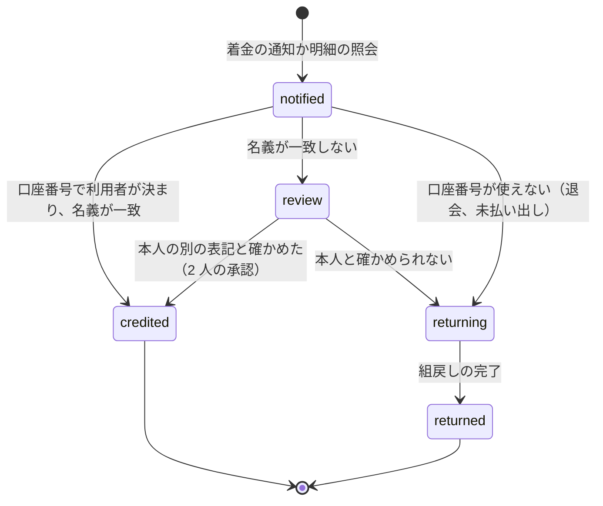

# Fiat and banking: Coinbase

日本円の入出金と、提携銀行・信託銀行との連携の領域の設計。全体像は [README.md](README.md) にある。提携銀行での振込の実行（銀行の API を主、全銀の形式のファイルを予備、依頼の番号、結果の照会）は Stripe の [ADR-0018](../../../stripe/docs/decisions/0018-payout-execution-via-banking-partner.md) と [payouts-and-reconciliation.md](../../../stripe/docs/architecture/payouts-and-reconciliation.md) の 4 節にあり、設計し直さない。この文書は、利用者ごとの振込先の口座番号、名義の照合、組戻し、本人の名義の口座への出金、信託の依頼の差分を書く。

> **法務の確認待ち**：信託の方式と額（L3）、取引時確認と第三者からの振込の扱い（L4）、出金の宛先の誤りの責任と説明（L12）は決まっていない。結論までは、E3 の信託の Story の spec を承認しない。

## 1. 範囲

この領域が持つもの：

- 銀行のアダプター（`packages/providers/bank`、`bank-sim`。[ADR-0011](../decisions/0011-external-providers-boundary.md)）
- 本システムの銀行の口座の構成と、台帳の口座との対応
- 利用者ごとの振込先の口座番号の払い出しと、着金の記帳（[ADR-0049](../decisions/0049-virtual-accounts-and-name-matching.md)）
- 名義の照合、組戻し、記帳していない着金の扱い
- 出金の口座の登録と、日本円の出金の状態と結果（[ADR-0050](../decisions/0050-fiat-withdrawals-idempotency-and-inquiry.md)）
- 信託銀行への依頼の送りと、信託の残高の通知の取り込み
- 銀行の営業日と締め

持たないもの：

| もの | 持つ領域 |
| --- | --- |
| 仕訳の型と手数料の表 | [ledger-and-balances.md](ledger-and-balances.md) |
| 銀行・信託の照合、信託すべき額の計算 | [segregation-and-reconciliation.md](segregation-and-reconciliation.md) |
| 取引の監視、疑わしい取引の届出 | aml-and-travel-rule（法務の L4・L6） |
| 本人確認の氏名のカナ、口座の番号の保管 | kyc-and-accounts（`kyc-vault`） |

## 2. 要件

| 要件 | 内容 | 出典 |
| --- | --- | --- |
| NFR-004 | 日本円の出金も、使える残高を超えて拘束しない | [README.md](README.md) の 3 節 |
| NFR-006 | 台帳と銀行・信託の照合を毎営業日。説明のつかない差を翌営業日に 0 | 同上 |
| NFR-010 | 入出金の受け付け 月間 99.9% | 同上 |
| NFR-016 | 口座の番号は `kyc-vault` の外に出さない | 同上 |
| 流れ E | 名義の違う振込は記帳せず、組戻しに回す。出金は本人の名義の口座にだけ送る。結果が分からないときは依頼し直さない | [README.md](README.md) の 1.3 節 E |
| 規模 | S1 で日本円の入金 5,000 件/日、出金 4,000 件/日（暗号資産と同じほどと見込む） | [README.md](README.md) の 2 節 |

## 3. 本家の形（確かめたこと）

| 項目 | 本家 | 出典（確認日） |
| --- | --- | --- |
| 日本での日本円の入出金の方式 | 本家は 2023 年に日本の事業を止めた。当時の方式は確かめていない | **未検証**（2026-11-15） |
| 振込先の口座番号、名義の照合、組戻し | 公式の資料で確かめられなかった | **未検証**（2026-11-15） |
| 銀行の API（振込依頼、結果照会、組戻しの状態） | 本家の資料ではない。Stripe の題材で、提携銀行の公開の API の一覧を確かめた | Stripe の [payouts-and-reconciliation.md](../../../stripe/docs/architecture/payouts-and-reconciliation.md) の 4.1 節（2026-09-27 の確認を引く） |
| 振込先の口座番号の払い出しの API、着金の通知、名義の照会の可否、締めの時刻 | 提携銀行を選ぶときに、各行の仕様書で確かめる | **未検証** |

## 4. 銀行の口座の構成

| 口座 | 銀行 | 台帳の口座 | 区分 | 使い道 |
| --- | --- | --- | --- | --- |
| 入金の口座 | 提携銀行 | `bank:user_deposit` | 利用者の金銭の置き場所 | 利用者ごとの振込先の口座番号の親。着金を受ける |
| 出金の口座 | 提携銀行 | `bank:user_payout` | 利用者の金銭の置き場所 | 出金の振込の払い元 |
| 本システムの口座 | 提携銀行 | `bank:house` | 本システムの財産 | 手数料・販売所の収益、費用の支払い、信託への拠出の元 |
| 信託の口座 | 信託銀行 | `trust:<account>` | 利用者の金銭の置き場所 | 利用者の日本円の信託（法務の L3） |

- 入金の口座から出金の口座への補充、入金の口座と信託の口座の間の移しは、`internal_transfer` の仕訳で書く（[ledger-and-balances.md](ledger-and-balances.md) の 5 節）。補充の額と頻度は財務の手順で決め、2 人の承認を要する。
- 本システムの口座と利用者の金銭の口座の間の移しは、本システムの持ち分の精算だけに使う（[ADR-0032](../decisions/0032-house-share-settlement.md)）。

## 5. 日本円の入金

[ADR-0049](../decisions/0049-virtual-accounts-and-name-matching.md) で決める。

- 利用者が本人確認を終えたら、利用者ごとに 1 つの振込先の口座番号を払い出す。口座番号は `kyc-vault` に置き、core には参照だけを持つ。退会の後も再利用しない。
- 着金は、銀行の通知（API）で受け、入出金の明細の照会で取りこぼしを拾う（1 時間ごと、と毎営業日の朝）。通知と照会は、銀行の取引の番号で 1 回にする。
- 名義の照合は、振込の依頼人の名義と、本人確認の氏名のカナを、同じ正規化（全銀の使用文字、半角カナ、小書きの仮名を大きくする、空白を除く）にしてから完全一致で比べる。

次の図は、着金の状態の移り方を示す。正は ADR-0049 の遷移の表である。

- `credited`：`fiat_deposit`（`bank:user_deposit` から `user_available:JPY`）を書く。冪等キーは銀行の取引の番号。
- `review`・`returning`：着金した額を `suspense:bank` に置く（`bank:user_deposit` の増えの相手）。記帳していない着金で、信託すべき額の `with_unapplied` に入る（[ADR-0033](../decisions/0033-trust-amount-method-and-daily-top-up.md)）。`review` は翌営業日までに CS とコンプライアンスが決める。
- 第三者（本人と違う名義）からの振込を受けてよいか、どの表記の違いを本人と認めてよいかは、法務の L4 の確認待ちである。結論までは、表記の違いだけを `review` で認め、別の人の名義は組戻しにする。
- 組戻しの手数料を誰が負うか、組戻しの手続きの API の可否は、提携銀行で確かめる（**未検証**）。

## 6. 日本円の出金

[ADR-0050](../decisions/0050-fiat-withdrawals-idempotency-and-inquiry.md) で決める。

### 6.1 出金の口座の登録

- 出金の口座は、利用者の本人の名義の口座 1 つだけを登録できる。登録と変更は、パスキーの確認と知らせを要し、変更の後 72 時間は出金を受けない（暗号資産の宛先と同じ。[ADR-0008](../decisions/0008-withdrawal-pipeline-and-approvals.md)）。
- 登録の名義のカナは、本人確認の氏名のカナと 5 節の正規化で一致しなければ受けない。銀行の名義の照会が使えれば、登録の時に照会する（**未検証**。使えなければ、最初の出金の結果で確かめる）。

### 6.2 状態

| 状態 | 意味 | 次 | 仕訳 |
| --- | --- | --- | --- |
| `requested` | 利用者がパスキーで確かめて依頼した | `held`、`rejected` | — |
| `held` | 額 ＋ 出金の手数料を拘束した（`fiat_withdrawal`） | `submitted`、`rejected` | `hold` |
| `submitted` | 依頼の番号を採番して保存し、銀行に送った（受付の成否は分からないことがある） | `accepted`、`failed`、`unknown` | `fiat_withdrawal_request`（拘束から `fiat_in_transit` と手数料） |
| `unknown` | 時間切れなどで受付の成否が分からない | `accepted`、`failed`（照会で決める） | — |
| `accepted` | 銀行が受け付けた | `completed`、`failed` | — |
| `completed` | 結果の照会で振込の完了を確かめた | `returned` | `fiat_withdrawal_settle`（`fiat_in_transit` から `bank:user_payout`、銀行の振込の手数料） |
| `failed` | 銀行が拒否した、振込が不能だった | — | `fiat_withdrawal_return`（`fiat_in_transit` から `user_available`、手数料を返す） |
| `returned` | 完了の後に組戻し・資金の返却が着金した | — | 返却の着金を `bank:user_payout` から `user_available` へ |
| `rejected` | 送らずに終えた（拘束の不足、口座の止め、制限） | — | `hold_release` |

- 遷移は 1 つの関数だけが書き、遷移ごとに `fiat_withdrawal_events` に行を足す。`submitted` 以降は `rejected` に進めない。
- `unknown` では依頼し直さない。結果の照会で依頼の番号の状態を確かめ、照会しても分からなければ Ops の確認に回す（Stripe の [ADR-0018](../../../stripe/docs/decisions/0018-payout-execution-via-banking-partner.md) の形）。
- 同じ口座に、解けていない出金の制限（`withdrawal_restrictions`、`scope = account`、理由 `deposit_maturity`。6 承認の前の BTC の入金）があれば、日本円の出金を `held` の前で待たせる（[ADR-0039](../decisions/0039-deposit-state-machine-and-withdrawal-lock.md)。[ADR-0029](../decisions/0029-hold-kinds-and-withdrawal-restrictions.md) の残した経路を閉じる）。円換算の額を引く式は使わない（ADR-0050 の 2026-11-15 の注記）。参照の価格に依らない。
- 出金の手数料は表の固定の額（[ADR-0027](../decisions/0027-fee-schedules-and-rounding.md)）。`ops.fiat_withdrawals_enabled` を切ると、`submitted` の前の出金を止める（[runbooks/README.md](../runbooks/README.md) の 2 節）。

### 6.3 締めと束ね

- 出金は、30 分ごとに `held` のものを束ね、銀行の 1 回の依頼の件数の上限（**未検証**）に合わせて送る。束ねの単位は `fiat_payout_batches` に持ち、束の依頼の番号を採番してから送る。
- 出金の口座の残高が、その回の合計に足りなければ送らず、財務に補充を依頼する（補充は人が行う）。

## 7. 信託の依頼

- 信託すべき額の計算は segregation-and-reconciliation の領域（[ADR-0033](../decisions/0033-trust-amount-method-and-daily-top-up.md)）。この領域は依頼を送り、結果を取り込む。
- 依頼（`trust_instructions`：種類 `top_up`・`withdraw`、額、営業日、依頼の番号、状態 `requested` → `accepted` → `completed`／`failed`）は、依頼の番号で冪等にする。結果が分からないときは依頼し直さず照会する。
- `top_up` は自動、`withdraw`（解約）は財務の 2 人の承認を要する。完了で `internal_transfer`（`bank:user_deposit` と `trust:<account>` の間）を書く。
- 信託銀行との接続の方式（API、ファイル、銀行の窓口の手続き）と締めの時刻は、信託銀行を選ぶときに確かめる（**未検証**。法務の L3）。接続が人の手続きなら、依頼は運用の画面の作業の待ち行列にし、財務が完了を記録する。

## 8. 銀行の営業日

- 営業日は日本の銀行の休業日（土日、祝日、12 月 31 日〜1 月 3 日）を除いた日。表は Stripe の [ledger.md](../../../stripe/docs/architecture/ledger.md) の 5.1 節と同じ `business_calendars` を持ち、年に 1 回 Ops が更新する。
- 着金と出金の依頼は 24 時間受ける。銀行がいつ処理するか（他行あての振込の時間帯、モアタイムの対応）は提携銀行で確かめる（**未検証**）。利用者には「着金の見込み」を、受付の時刻と営業日から出す。
- 照合と信託の計算は営業日にだけ回す。休業日の分は、次の営業日にまとめて扱う（[segregation-and-reconciliation.md](segregation-and-reconciliation.md) の 8 節）。

## 9. 例：日本円の入金と出金

数値の手数料は例の値である（本番の値は `fee_schedules` と提携銀行の契約で決める）。

1. 利用者 U（本人確認の氏名のカナ「ヤマダ タロウ」）が、自分の振込先の口座番号に 300,000 円を振り込んだ。依頼人の名義は「ﾔﾏﾀﾞ ﾀﾛｳ」。正規化で「ﾔﾏﾀﾞﾀﾛｳ」どうしが一致し、`fiat_deposit` で `user_available:JPY` が 300,000 円増える。
2. 別の日、依頼人の名義が「ﾔﾏﾀﾞ ﾊﾅｺ」の 50,000 円が U の口座番号に着金した。名義が一致しないので、50,000 円を `suspense:bank` に置き `review` にする。CS が本人と確かめられず、組戻しに回す（`returning` → `returned`）。
3. U が 100,000 円の出金を依頼する。出金の手数料（例の値）300 円で、100,300 円を拘束する。
4. 束ねて銀行に送った（`submitted`）。応答が時間切れになり `unknown` にした。依頼し直さず、10 分後の照会で受付を確かめて `accepted` にした。
5. 結果の照会で振込の完了を確かめ、`completed` にした。銀行に払った振込の手数料（例の値）145 円を `bank_fee_expense:JPY` に記帳する。

| 仕訳 | 借方 | 貸方 |
| --- | --- | --- |
| `hold` | `user_available:JPY` 100,300 | `user_hold:JPY` 100,300 |
| `fiat_withdrawal_request` | `user_hold:JPY` 100,300 | `fiat_in_transit` 100,000、`fee_revenue:JPY` 300 |
| `fiat_withdrawal_settle` | `fiat_in_transit` 100,000、`bank_fee_expense:JPY` 145 | `bank:user_payout` 100,145 |

- 本システムの持ち分（手数料 300 円 − 振込の手数料 145 円 ＝ 155 円）は、利用者の金銭の口座の中にあり、毎日の精算で `bank:house` へ移す（[ADR-0032](../decisions/0032-house-share-settlement.md)）。

## 10. 障害のときの振る舞い

| 障害 | 検知 | 振る舞い | 回復 |
| --- | --- | --- | --- |
| 銀行の API の障害 | 時間切れ・誤りの率 | 入金の記帳と出金の依頼を待たせる（[ADR-0011](../decisions/0011-external-providers-boundary.md)）。依頼の受け付けは続け、`held` で待つ | 回復の後、明細の照会で着金を拾い、`unknown` を照会で決める |
| 着金の通知の取りこぼし | 明細の照会との差 | 照会で拾って記帳する（取引の番号で 1 回） | — |
| 出金の結果の不明の急増 | `unknown` の件数 | 新しい依頼を止め、照会を続ける。`bank-outage.md` | 照会で決める |
| 出金の口座の残高の不足 | 束ねの前の検査 | 送らずに財務へ | 補充の後に送る |
| API が長く使えない | 1 営業日を超える障害 | 全銀の形式のファイルを予備の手段にする（財務と Ops の 2 人の承認） | API の回復 |
| 信託銀行の接続の障害 | 依頼の時間切れ | 依頼を照会で確かめる。不足がその営業日に解けなければ runbooks の R5 | — |

## 11. 上限

| 項目 | 値 | 根拠 |
| --- | --- | --- |
| 入金・出金の件数 | S1 で 5,000 件/日、4,000 件/日。最大はその 10 倍の 1 時間の集中 | [README.md](README.md) の 2 節、[capacity.md](capacity.md) |
| 1 件の出金の上限と 1 日の累計 | 設定の値（`legal.*` に置くかは法務の L4・L12）。既定は withdrawals の領域と揃える | [AGENTS.md](../../AGENTS.md) |
| 名義の照合の `review` の期限 | 翌営業日 | NFR-006 |
| 振込先の口座番号 | 1 利用者に 1 つ。S1 で 30 万口座分 | [README.md](README.md) の 2 節 |

## 12. セキュリティ

- 口座の番号（振込先、出金の口座）と氏名のカナは `kyc-vault` に置く。`funding` は照合の時に、金庫の関数で正規化したカナの比べの結果だけを受ける（Workday の [my-number-vault.md](../../../workday/docs/architecture/my-number-vault.md) の形）。ログには番号を出さない。
- 銀行の API の認証の情報は、`funding` の銀行のアダプターだけが読める秘密に置く。出金の依頼を作れるのは `funding` の Worker だけで、運用の画面から直接の依頼を作らない。
- 出金の口座の変更は乗っ取りの兆しとして見る（`account-takeover.md`）。

## 13. テスト

- **PROP-FIAT-001**：`bank-sim` の任意の通知の重複・遅れ・取りこぼしと照会の列で、着金ごとの記帳は 0 か 1。名義が一致しない着金の記帳 0（`review` の承認を除く）。
- **PROP-FIAT-002**：任意の時間切れ・誤り・照会の列で、1 つの出金の依頼の番号から完了する振込は 0 か 1。`unknown` からの依頼のし直し 0。
- **PROP-FIAT-003**：6 承認の前の BTC の入金がある口座の、日本円の出金の `held` 0。
- **DT-FIAT-001**：名義の正規化の決定表（全角・半角、小書き、空白、長音、法人格の略語）。期待する値は QA の正解のファイル。
- **DT-FIAT-002**：出金の遷移の決定表（6.2 節）。

## 14. Story の候補

| Epic | Story | 内容 |
| --- | --- | --- |
| E3 | `bank-adapter` | 契約、`bank-sim`、予備の全銀の形式のファイル |
| E3 | `virtual-account-deposits` | 口座番号の払い出し、通知と照会、名義の照合、`review`、組戻し |
| E3 | `payout-account-registration` | 出金の口座の登録、名義の確かめ、変更の後の待ち（**新しい候補**） |
| E3 | `fiat-withdrawals` | 状態、束ね、依頼の番号、照会、失敗と返却 |
| E3 | `trust-instructions` | 信託の依頼の送りと結果（法務：L3） |
| E3 | `business-calendar` | 営業日の表と着金の見込み（**新しい候補**） |

## 15. 未解決の問い

- 第三者からの振込と、本人と認める表記の違いの範囲（法務の確認待ち L17。L4 と関わる）。
- 信託の接続の方式と締め（法務の L3、信託銀行の選定）。
- 1 件と 1 日の出金の上限を `legal.*` に置くか（法務の L4・L12）。
- 提携銀行の能力（口座番号の払い出し、名義の照会、組戻しの API、締めの時刻、件数の上限）：**未検証**。銀行の選定の Story で確かめる。

## 16. quality.md・runbooks・data-model への項目

**quality.md**

- 2.2.1 節 G の場面に、名義の照合の決定表（DT-FIAT-001）と出金の結果の不明（PROP-FIAT-002）を足す。3 節の ID の表に PROP-FIAT・DT-FIAT を足す（E3）。

**runbooks**

- `bank-outage.md`（計画のもの）の中身：API の障害、結果の不明の急増、予備の全銀の形式のファイルへの切り替え、信託の接続の障害。
- `fiat-deposit-review-backlog.md`（`review` の待ちが翌営業日を超える。チケット）。

**data-model**

| 表 | 主な列 |
| --- | --- |
| `virtual_accounts` | `virtual_account_id`、`user_id`、`vault_ref`（口座番号の参照）、`status`、`issued_at`、`retired_at` |
| `fiat_deposits` | `fiat_deposit_id`、`bank_txn_id`（一意）、`virtual_account_id`、`amount`、`payer_name_ref`、`status`、`name_check_result`、`journal_id`、`received_at` |
| `payout_bank_accounts` | `payout_account_id`、`user_id`、`vault_ref`、`name_verified_by`、`registered_at`、`cooldown_until` |
| `fiat_withdrawals` | `fiat_withdrawal_id`、`user_id`、`amount`、`fee`、`fee_schedule_version`、`status`、`batch_id`、`hold_id`、`created_at` |
| `fiat_withdrawal_events` | `fiat_withdrawal_id`、`seq`、`from_status`、`to_status`、`reason`、`at` |
| `fiat_payout_batches` | `batch_id`、`bank_request_ref`（一意）、`count`、`total`、`status`、`submitted_at` |
| `trust_instructions` | `instruction_id`、`kind`、`amount`、`business_date`、`request_ref`（一意）、`status`、`approved_by` |
| `business_calendars` | `country`、`date`、`is_business_day` |
