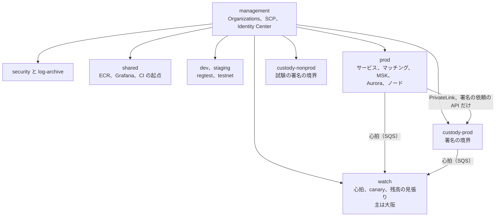
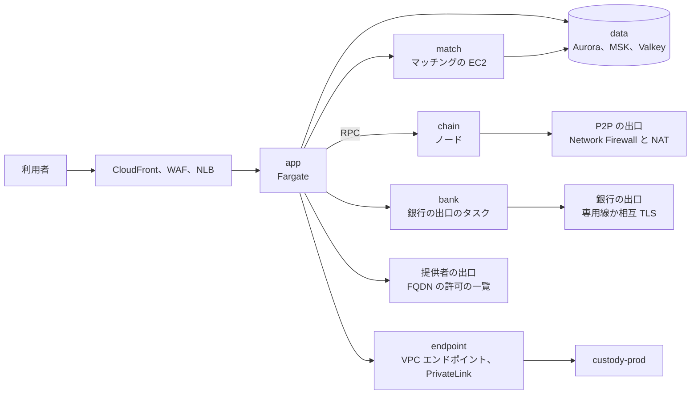
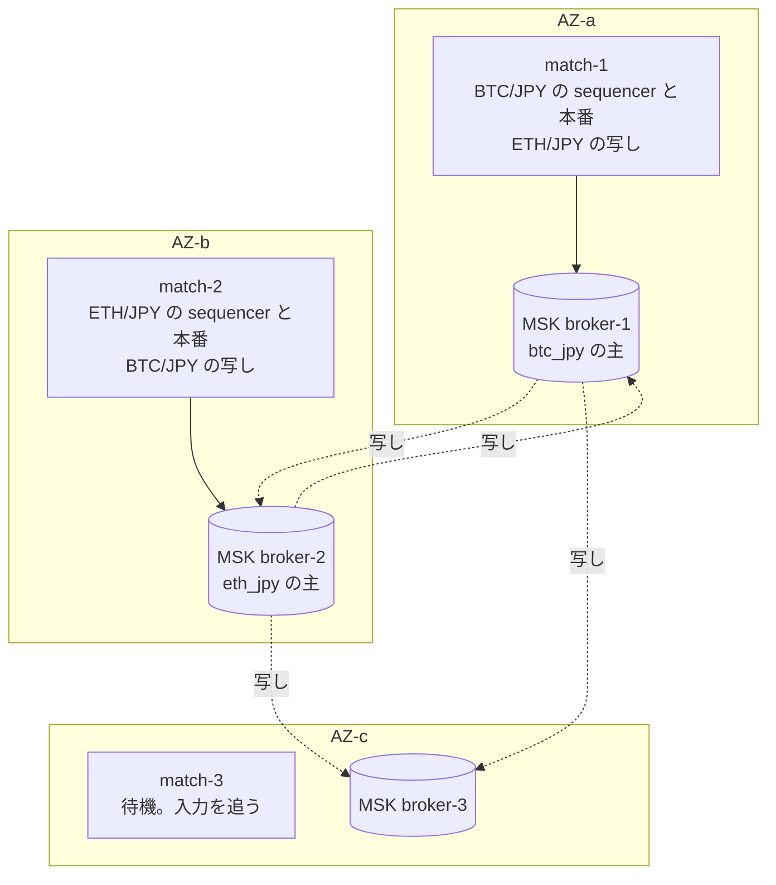
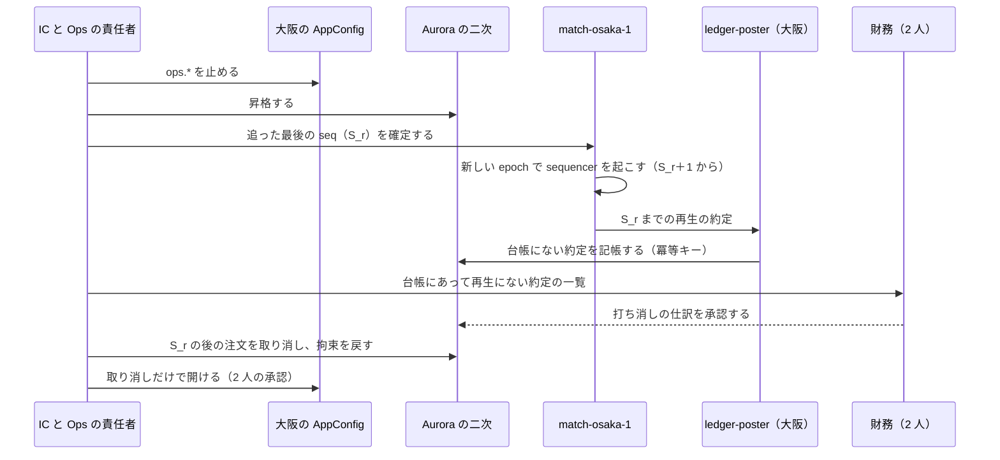

# Infrastructure: Coinbase

AWS の上の構成、アカウント、ネットワークと外への経路、マッチングの EC2 の配置、MSK、3 つの Aurora、ノード、署名の境界のアカウント、DR（大阪）と板の再開、段階を上げる基準。全体像は [README.md](README.md) にある。土台は Slack の [infrastructure.md](../../../slack/docs/architecture/infrastructure.md) と Stripe の [infrastructure.md](../../../stripe/docs/architecture/infrastructure.md) で、この題材に固有の事情（板の単一の書き手、鍵の境界、ノードの P2P、銀行の経路）だけを足す。

| 対象 | 決定 |
| --- | --- |
| アカウント、ネットワーク、外への経路 | [ADR-0071](../decisions/0071-aws-accounts-network-and-egress.md) |
| マッチングの EC2 と MSK の配置、時計 | [ADR-0072](../decisions/0072-matching-placement-across-azs.md) |
| 大阪の DR と板の再開 | [ADR-0073](../decisions/0073-osaka-dr-and-market-restart.md) |
| 基盤と言語、DB の分け方 | [ADR-0001](../decisions/0001-platform-and-stack.md) |
| 入力の記録と sequencer | [ADR-0002](../decisions/0002-sequencer-and-event-journal.md) |
| 署名の境界 | [ADR-0007](../decisions/0007-signing-service-and-key-custody.md) |
| ノード | [ADR-0009](../decisions/0009-deposits-confirmations-and-own-nodes.md) |
| IaC（Terraform）、デプロイの方式 | Slack の [ADR-0020](../../../slack/docs/decisions/0020-infrastructure-as-code-with-terraform.md)・[ADR-0022](../../../slack/docs/decisions/0022-zero-downtime-deploy-and-migrations.md) を引き継ぐ |

ログ・SLI は [observability.md](observability.md)、CI とリリースは [delivery.md](delivery.md)、負荷と台数と費用の根拠は capacity の領域にある。インスタンスの型と大きさは `engine-latency-poc` と capacity の領域で決め、ここでは台数と置き場所を書く。

## 1. 範囲

この領域が持つもの：AWS のアカウントと SCP、VPC とサブネット、外への経路と出口の IP、マッチングの EC2 の置き方と時計、MSK のブローカーの置き方、3 つの Aurora の置き方、ノードの置き場所と経路、`custody` のアカウントの構成、バックアップ、AZ とリージョンの障害への備え、環境、段階を上げる基準。

持たないもの：

- sequencer とエンジンの切り替えの規則（`epoch`、fencing、`ts` の単調さ）の正本（matching-engine の領域。[ADR-0002](../decisions/0002-sequencer-and-event-journal.md)）。
- 鍵の保管の方式と儀式（custody-and-keys の領域。`custody-signing-poc`）。ここは `custody` のアカウントの器だけを持つ。
- ノードのクライアントの種類と同期（chain-nodes-and-confirmations の領域。`node-ops-poc`）。
- 単価と費用（capacity の領域）。

## 2. 要件

| 要件 | この領域でやること |
| --- | --- |
| NFR-001、NFR-002（受け付けと配信の速さ） | sequencer・MSK の主・エンジンを同じ AZ に寄せ、CPU を固定する（ADR-0072） |
| NFR-010（可用性） | 3 AZ。1 つの AZ の障害で、板は写しで続ける |
| NFR-011（耐久性と復旧） | AZ：RTO 5 分。リージョン：RTO 4 時間、台帳の RPO 1 分、入力の記録の RPO 1 秒（ADR-0073） |
| NFR-014（鍵と署名） | 署名の境界を `custody-prod` に置き、`prod` からは 1 つの API でだけ届く（ADR-0071） |
| NFR-016（個人のデータ） | `kyc-vault` を別のクラスタにし、読める役割を絞る（ADR-0001） |
| intent の Constraints | データは日本（東京、DR は大阪）。コールドの鍵の材料は東京・大阪・その他の 1 か所（custody-and-keys の領域） |
| 法務の L13 | クラウドと提供者への委託の管理の当てはめ（法務の確認待ち）。この領域は、構成の記録（Config、Terraform の状態）を監査に出せる形で持つ |

## 3. 本家の形（確かめたこと）

| 項目 | 本家 | 出典（確認日） |
| --- | --- | --- |
| 取引所の置き場所 | 米国の現物の取引所の基盤は AWS の US-EAST-1 にあり、複数の AZ を使う。注文の口、エンジン、配信の AZ の ID に use1-az4 を挙げる。予告なく変わるとする | [Exchange Systems & Operations](https://docs.cdp.coinbase.com/exchange/introduction/systems-operations)（2026-11-15） |
| マッチングエンジンの配置と 2026 年 5 月の停止 | Raft の 5 節のクラスタを 1 つの配置グループに置いていた。1 つの AZ の冷却の障害で 3 節が止まり、定足数を失い、別の AZ への自動の切り替えがなく、数時間止まった。復旧は取り消しだけと板寄せを経た | [InfoQ](https://infoq.com/news/2026/06/coinbase-aws-failure-postmortem)（2026-11-15）。本家のブログの本文は取得できず**未検証** |
| 日本の事業の基盤 | 日本の事業は 2023 年に止めた。日本での構成は確かめられなかった | **未検証** |
| インスタンスの型、台数、DR の目標 | 公式の資料で確かめられなかった | **未検証** |

**本家との意図した違い**（[README.md](README.md) の 1.4 節に足す候補。11 節）：

| 項目 | 本家 | 本システム | 理由 |
| --- | --- | --- | --- |
| エンジンの冗長 | 1 つの配置グループの Raft のクラスタ（報道） | 単一の書き手のエンジンと、別の AZ の写しのエンジン。板ごとに本番の AZ を互い違いにする | 1 つの物理の障害で板を止めない（ADR-0072） |
| 置き場所 | US-EAST-1 | 東京、DR は大阪 | 日本の交換業者にする |

## 4. 設計

### 4.1 アカウント

用途と鍵の境界で分ける。表の正本は [ADR-0071](../decisions/0071-aws-accounts-network-and-egress.md) にある。

- 人の権限は期限つきの割り当てだけ（[Auth0 の ADR-0056](../../../auth0/docs/decisions/0056-operator-access.md)）。`custody-prod` はセキュリティの 2 人の承認で最長 4 時間。
- AI エージェントは `prod`・`custody-*`・`watch` に経路を持たない。dev と staging は、生成した鍵とテストのチェーンだけを扱う。

### 4.2 ネットワークと外への経路

`prod` の VPC は 3 AZ にまたがる。外への経路を、ノードの P2P・銀行・提供者の 3 つに分け、出口の IP も分ける（ADR-0071）。

| 経路 | 宛先 | 出口 | 備考 |
| --- | --- | --- | --- |
| 入口（Web、アプリの API） | `app.<brand>.<domain>` | CloudFront → ALB | WAF の Bot Control |
| 入口（取引の API、配信） | `api.<brand>.<domain>`、`ws.<brand>.<domain>` | NLB（TLS の終端は `trading-api`・`ws-gateway`） | 遅れを減らす。速さの上限は order-entry-and-risk・market-data の各領域 |
| ノードの P2P | 任意の相手 | P2P の NAT（東京の各 AZ） | クライアントの P2P の口だけ。既定は外向きだけ（`node-ops-poc`） |
| 銀行 | 提携銀行・信託銀行 | 銀行の NAT（固定の IP）か専用線 | 東京と大阪の IP を最初から登録する |
| 提供者 | eKYC、チェーン分析、トラベルルール、参照の価格、メール・プッシュ | 提供者の NAT | SNI の FQDN の許可の一覧 |
| `custody` | 署名の依頼の API | PrivateLink、相互 TLS | `wallet-orchestrator` のロールだけ |

- `match` と `data` のサブネットは外への経路を持たない。
- ノードの RPC は、`deposit-watcher`・`wallet-orchestrator` のセキュリティグループからだけ受ける。`custody` はノードに経路を持たない（放送は `wallet-orchestrator` が行う。11 節の食い違い）。

### 4.3 マッチングの EC2 と MSK

板ごとに本番と写しを互い違いに置き、`match-3` を待機にする（ADR-0072）。

| 部品 | S1 の台数 | 置き方 |
| --- | --- | --- |
| マッチングの EC2 | 3（`match-1`〜`match-3`） | AZ ごとに 1。CPU の核をタスクに固定。配置グループは使わない |
| MSK | 3 ブローカー | AZ ごとに 1。区画の主を、その板の本番の sequencer と同じ AZ に置く |
| 入力のトピック | 板ごとに 1（区画 1） | レプリカ 3、`min.insync.replicas=2`、保持 7 日、毎時 S3 へ（ADR-0002） |
| 出力のトピック | 板ごとに 1 | 同上 |
| `sequencer_leases` | core の表 | Aurora core のフェイルオーバーの間も、持ち主の sequencer は MSK に書ける限り続ける（ADR-0072） |

- 時計：Amazon Time Sync Service（chrony）に合わせ、差 1ms 以内を目標にする。1ms を超えたらチケット、100ms を超えたら呼び出し、その板の sequencer を待機に移す（ADR-0072）。
- エンジンのパッチと入れ替えは、予定した板の停止の時間に行う（[delivery.md](delivery.md) の 4.3 節）。

### 4.4 Aurora、Valkey、S3

| 部品 | 東京 | 大阪 | 備考 |
| --- | --- | --- | --- |
| Aurora core | writer 1、reader 1（別の AZ） | Global Database の二次（reader 1） | 口座、注文の記録、入出金の状態、`sequencer_leases` |
| Aurora ledger | writer 1、reader 1（別の AZ） | 同上 | `ledger` のサービスだけが書く。熱い口座の分け方は S2（Stripe の ADR-0016） |
| Aurora kyc-vault | writer 1、reader 1（別の AZ） | 同上 | 読む関数は監査の行を書く。読めるロールは `identity`・`funding` だけ |
| Valkey | 3 AZ のクラスタ | なし（切り替えの後に作る） | 失ってよい |
| S3 | スナップショット、記録の長期の保管、書き出し | リージョンをまたいで写す | Object Lock（記録の保管の期間は法務の L4・L7） |

- **`rds.global_db_rpo` は S1 では設定しない。** 設定すると、大阪への写しが遅れたとき東京の書き込みが止まる（Stripe の [infrastructure.md](../../../stripe/docs/architecture/infrastructure.md) の 5.3 節と同じ理由）。代わりに `AuroraGlobalDBRPOLag` を見張る。
- バックアップ：Aurora は PITR 35 日と AWS Backup の日次のスナップショット（大阪へ写す）。長期の保管の期間は、台帳と記録の保存の要件（法務の L4・L10）で決める。保管庫は Vault Lock で消せなくする。

### 4.5 ノードと署名の境界の器

| 部品 | 東京 | 大阪 | 経路 |
| --- | --- | --- | --- |
| BTC のノード | 2 台（別の AZ） | 待機 1 台 | RPC は `deposit-watcher`・`wallet-orchestrator` だけ。P2P は P2P の出口 |
| ETH のノード（実行と合意の組） | 2 組（別の AZ） | 待機 1 組 | 同上 |
| 外部の見張りのノード | 提供者の API | 同じ | 提供者の出口。見張りだけ（ADR-0009） |
| `custody-prod` | `policy-verifier`、`approval-verifier`、`nonce-and-utxo-guard`、`signer`（2 AZ） | 待機 | `prod` からの PrivateLink だけ。外への経路は MPC の提供者のときだけ（ADR-0071） |

- ノードのディスクは大きな NVMe の EC2 にし、同期の時間とディスクの大きさは `node-ops-poc` で決める。待機のノードは同期を続ける（入金の 2 台の比べの相手に入れられる。[runbooks/disaster-recovery.md](../runbooks/disaster-recovery.md)）。
- `custody-prod` の中の構成（HSM・MPC）は `custody-signing-poc` の後に custody-and-keys の領域で描く。

### 4.6 AZ の障害

| 部品 | 動き | 目安 |
| --- | --- | --- |
| マッチング | 本番を失った板は写しが本番になる（fencing と `epoch`）。写しを失った板は止まらない。`match-3` が新しい写しになる | 切り替えは数秒〜5 分。写しの回復は 15 分以内（ADR-0072） |
| MSK | 残る 2 つで書ける。区画の主が移る | 数秒 |
| Aurora | 別の AZ の reader へフェイルオーバー | 多くは 1 分未満（Stripe の 5.2 節の出典）。sequencer は止まらない |
| Fargate | 残る AZ でタスクを起こし直す | 数分 |
| ノード | 片方の BTC・ETH のノードを失うと 2 台の比べができず、入金の記帳が止まる。大阪の待機を比べの相手に入れる（Ops の判断） | 記帳の停止は 15 分で呼び出し |
| `custody-prod` | 残る AZ の部品で受ける | 数分。止まる間は出金の署名が待つ |

### 4.7 リージョンの障害と板の再開

大阪で入力の記録を追い続け、再生の終わり（板ごとの `S_r`）を正として再開する（ADR-0073）。手順の正本は [runbooks/disaster-recovery.md](../runbooks/disaster-recovery.md)。

RTO 4 時間の予算（本システムの値。訓練で測る）：

```mermaid
gantt
    title リージョンの障害から取引の再開まで
    dateFormat HH:mm
    axisFormat %H:%M
    section 判断
    障害の確認と切り替えの判断 :d1, 00:00, 60m
    section 切り替え
    ops の停止と Aurora の昇格 :s1, after d1, 20m
    S_r の確定と sequencer の起動 :s2, after s1, 20m
    台帳と再生の突き合わせと打ち消し :s3, after s2, 60m
    失った注文の取り消しと知らせ :s4, after s2, 40m
    section 再開
    取り消しだけ :r1, after s3, 30m
    取引中 :milestone, r2, after r1, 0m
```

- 判断の 60 分は、runbook の「東京の回復の見込みが 1 時間を超えるとき」に合わせる。取引の再開までで 3 時間 10 分になり、40 分を余裕にする。
- 入出金は、照合が 0 になり、ノードと `custody-prod` の大阪の待機を確かめてから開ける。取引の再開より後になりうる。
- 東京へ戻すのは、計画した板の停止の時間に、同じ確かめで行う。

### 4.8 例：リージョンの障害で失った入力

東京のリージョンが 03:12:40 に止まった。BTC/JPY の板で、東京が最後に受け付けた `seq` は 8,120,400、`match-osaka-1` が追った最後の `seq`（`S_r`）は 8,120,395 だった（写しの遅れ 0.8 秒）。

| `seq` | 入力 | 大阪での扱い |
| --- | --- | --- |
| 8,120,396 | 利用者 C の指値の買い 0.01 BTC（1,000 万円。拘束 100,000 円＋手数料の上限 100 円） | 失った。注文を取り消し、拘束 100,100 円を戻し、C に「取り消し」と知らせる |
| 8,120,397 | 利用者 D の取り消し（板にある売り 0.05 BTC） | 失った。D の売りは大阪の板に残る。取り消しだけの 30 分の間に、D が確かめて取り消せる。知らせに「取り消しが届いていない可能性」を書く |
| 8,120,398 | 利用者 E の成行の売り 0.002 BTC。板の買いと約定（`trade_seq` 1,204,890、1,000 万円で 20,000 円） | 失った入力の約定。大阪の台帳には写っていた（台帳の写しのほうが早かった）。打ち消しの仕訳で戻す（E の `available:BTC` に 0.002 BTC、買い手に 20,000 円＋手数料 20 円。財務の 2 人の承認） |
| 8,120,399〜8,120,400 | 利用者 F の指値の注文 2 件 | 失った。取り消し、拘束を戻す |

- `trade_seq` 1,204,889 までは、再生の出力と大阪の台帳が一致した。
- 打ち消しの対象の E と買い手への知らせ方は、法務とコンプライアンスの確認を要する（10 節）。
- 取り消しだけで 03 時台の利用者の確かめを待ち、06:22 に取引中にした（判断 60 分を含めて 3 時間 10 分）。

### 4.9 環境とデータ

| 環境 | アカウント | チェーン | 署名 | データ |
| --- | --- | --- | --- | --- |
| local | — | regtest、開発用のチェーン | 試験の境界（ソフトウェアの鍵） | 生成 |
| dev | dev | regtest、開発用のチェーン | 同上 | 生成 |
| staging | staging、custody-nonprod | testnet、テストネット | 試験の境界。本番と同じ方針の検証の部品 | 生成（S1 を縮めた比率）。負荷・障害の注入・DR の訓練 |
| prod | prod、custody-prod | mainnet | 本番の境界 | 本番 |

- 本番のデータ、鍵、アドレス、xpub を本番のアカウントの外に出さない。匿名化した写しも作らない（AGENTS.md）。

### 4.10 段階を上げる基準

次のどれかに当たり、戻らない見込みになったら、次の段階への移行を始める（目安は本システムの値。移行に四半期ほどかかるので、上限の手前で始める）。

| 指標 | S1 → S2 を始める目安 | S2 → S3 を始める目安 |
| --- | --- | --- |
| 板の入力の最大（全体） | 1,800 件/秒（S1 の 60%）を 2 週続けて超える | 1.8 万件/秒を 2 週続けて超える |
| 1 つの板のエンジンのスレッドの使用率（最大の 1 分） | 50% を超える | 専用の EC2 でも 50% を超える見込み |
| 受け付けの p99 | 15ms（NFR-001 の 75%）を 2 週続けて超える | MSK の書き込みが主な原因で、20ms に近づく（ADR-0002 の `decide_after`） |
| 配信の接続 | 1.2 万（S1 の 60%） | 6 万 |
| Aurora ledger の writer の CPU（最大の p95） | 60% を超える | 熱い口座のスロットでも 60% を超える見込み |
| 銘柄の数 | 3 つ目の板を足すとき | 10 を超えるとき |
| 稼働の口座 | 18 万 | 90 万 |

- S2 で行うこと：板を EC2 の組に分けて置く（1 組に数板、ADR-0072 の形を繰り返す）、ledger の熱い口座をスロットに分ける（[Stripe の ADR-0016](../../../stripe/docs/decisions/0016-hot-accounts-and-ledger-sharding.md)）、配信を銘柄ごとの組に分ける、大阪の Aurora の二次を writer と同じ大きさにする。
- S3 で見直すこと：入力の記録の方式（ADR-0002）、大阪の待機の形（ウォームから、板の一部を大阪で持つ形へ）。それぞれ段階を上げる時に ADR を書く。

## 5. 障害のときの振る舞い

| 障害 | 検知 | 振る舞い | 回復 |
| --- | --- | --- | --- |
| 1 つの AZ | 健全性の検査、AWS Health | 4.6 節 | 自動。5 分で終わらなければ板を止めて手で（runbook） |
| リージョン | AWS Health、`watch` の `canary` | 板と入出金を止め、4.7 節の手順 | IC の判断で大阪へ |
| MSK の 2 ブローカーの停止 | 書き込みの失敗 | 受け付けを返さない。板は動かない | ブローカーの回復を待つ。`min.insync.replicas` を下げない |
| 大阪への写しの遅れ（MSK Replicator、Global Database） | 写しの遅れの SLI | 本番は止めない。リージョンの障害の時の RPO が伸びる | 呼び出し。原因を調べる |
| 時計のずれ | chrony の指標 | 100ms を超えたら、その板の sequencer を待機へ移す | Time Sync の回復 |
| P2P の出口の障害 | ノードの相手の数、頭の遅れ | 入金の記帳が止まる（ADR-0009）。取引は止めない | NAT・Firewall の回復 |
| 銀行の出口の障害 | 銀行のアダプターの失敗 | 日本円の入出金を待たせる（ADR-0011） | 予備の経路（専用線と VPN）へ |
| `custody` への PrivateLink の障害 | 署名の依頼の失敗 | 出金の署名が待つ。`signing` の前で止まる | 経路の回復。作り直さない（ADR-0008） |

## 6. 上限

| 対象 | S1 の値 | 備考 |
| --- | --- | --- |
| 1 台のマッチングの EC2 のタスク | 4 まで | ADR-0072 |
| MSK のブローカー | 3（東京）、3（大阪） | S2 で板の数で見直す |
| 外への出口 | 3 種 × 3 AZ × 2 リージョン | ADR-0071 |
| 大阪への入力の記録の写しの遅れ | 目標 1 秒、10 秒を 5 分で呼び出し | ADR-0073。MSK Replicator の値は**未検証** |
| `custody-prod` の人の権限 | 最長 4 時間、2 人の承認 | ADR-0071 |

## 7. セキュリティ

- `custody-prod` は、`prod` からの 1 つの API でだけ届き、`prod` のロールから引き受けられない（SCP）。鍵の材料の場所と方式は custody-and-keys の領域。
- `chain` のサブネットは、他のサブネットに届かず、銀行と提供者の出口を使えない。
- 銀行の出口の IP は、銀行の宛先の外に使わない。
- 組織の CloudTrail と Config を `log-archive` に送り、止める操作を SCP で拒む。
- 構成の変更は Terraform だけで行い、手の変更を Config のルールで見つける。Terraform の apply の権限と承認は delivery の領域。
- 委託の管理（クラウド、提供者）の当てはめは法務の確認待ち（L13）。

## 8. テスト

| ID | 種類 | 中身 |
| --- | --- | --- |
| PROP-INF-1 | 性質 | 任意の写しの遅れ（入力の記録と台帳で別々）と切り替えの時刻で、ADR-0073 の手順の後、台帳の約定の記帳の集合と `S_r` までの再生の約定の集合が一致し、拘束の和が `S_r` までの未約定の注文の必要額と一致する |
| PROP-INF-2 | 性質 | 任意の AZ の停止の列で、同じ板の本番と写しが同じ AZ に置かれず、写しのない時間が 15 分を超えたら SLI に出る |
| DT-INF-1 | 決定表 | 外への経路の表（サブネット × 宛先の種類 → 許す・拒む）。Terraform の計画と Network Firewall の規則から生成した表と突き合わせる |
| — | 障害の注入 | AZ の停止、Aurora core のフェイルオーバー（sequencer が止まらない）、MSK のブローカーの停止、P2P の出口の停止（夜間、staging） |
| — | DR の訓練 | 半年ごと、staging で 4.7 節を回し、RTO を測る（`dr-drill-market-restart`） |

- ID の接頭辞 `PROP-INF`・`DT-INF` は quality.md の 2.2.2 節に足す（11 節）。

## 9. Story の候補

| Epic | Story | 内容 |
| --- | --- | --- |
| E1 | `aws-accounts-and-network` | アカウント、SCP、VPC、サブネット、3 つの出口（ADR-0071）。roadmap の既存の Story を細かくする |
| E1 | `custody-account-skeleton` | `custody-prod`・`custody-nonprod`、PrivateLink、相互 TLS（ADR-0071） |
| E1 | `osaka-skeleton` | 大阪の VPC、Aurora の二次、MSK と Replicator、ECR とフラグの写し（ADR-0073）。roadmap の「大阪の骨格」 |
| E9 | `match-placement` | `match-1`〜`match-3`、CPU の固定、MSK の主の置き方、時計の見張り（ADR-0072） |
| E9 | `osaka-follow-engine` | `match-osaka-1`、写しの遅れの SLI、大阪での要約の比べ（ADR-0073） |
| E5 | `chain-egress` | `chain` のサブネット、P2P の出口、RPC の経路（ADR-0071） |
| E3 | `bank-egress` | 銀行の出口（専用線か相互 TLS）、東京と大阪の IP の登録 |
| E16 | `dr-drill-market-restart` | 4.7 節の訓練と、台帳と再生の突き合わせ、打ち消しの道具 |

## 10. 未解決の問い

| 問い | 案と推奨 | 判断 |
| --- | --- | --- |
| リージョンの障害で失った入力の約定を、打ち消しで戻すときの利用者への扱いと説明 | ADR-0073 の y（再生の終わりを正）を推奨。結論まで 1 件ずつ IC・財務・コンプライアンスで合意 | 法務の確認待ち（新しい項目の候補） |
| MSK Replicator の写しの遅れが 1 秒に届くか | 届かなければ自前の写し（MirrorMaker 2） | `engine-latency-poc` と同じ時期に測る |
| ノードの受け付けの P2P を開けるか | 既定は外向きだけ | `node-ops-poc` |
| 銀行の経路（専用線かインターネット） | 接続先の条件で選ぶ | E3 の銀行の選定 |
| クラウドと提供者の委託の管理 | 構成の記録を監査に出せる形で持つ | 法務の確認待ち（L13） |

## 11. quality.md・runbooks・data-model への項目

**quality.md**

- 2.2.2 節の一覧に `PROP-INF`・`DT-INF` を足す。
- 5 節の E16 の合否基準に「DR の訓練で、台帳と再生の突き合わせの一覧が再生の結果と一致する」を足す。

**runbooks**

- README の 1 節の表に、「写しのエンジンの欠け（切り替えの後）」（15 分を超えたらチケット、60 分で IC の判断）、「大阪への入力の記録の写しの遅れ」（1 秒を目標、10 秒を 5 分で呼び出し）、「時計のずれ」（1ms でチケット、100ms で呼び出し）の行を足す。
- [disaster-recovery.md](../runbooks/disaster-recovery.md) の対処の 4〜6 を、ADR-0073 の手順（`S_r` の確定、台帳と再生の突き合わせ、打ち消しの財務の 2 人の承認、失った取り消しの扱い）に合わせて詳しくする。
- 新しい手順 `clock-drift.md`：時計のずれの切り分けと、sequencer の待機への移し。作る Story は `match-placement`。

**data-model**

| 表（クラスタ） | 主な列 | 用途 |
| --- | --- | --- |
| `sequencer_leases`（core。ADR-0002 の表に列を足す候補） | `pair`、`owner_task`、`az`、`epoch`、`expires_at`、`renewed_at` | 持ち主の記録 |
| `dr_failovers`（core） | `failover_id`、`started_at`、`decided_by`、`promoted_at`、`reopened_at` | 切り替えの記録 |
| `dr_lost_ranges`（core） | `failover_id`、`pair`、`s_r`、`tokyo_last_seq`、`lost_order_ids`、`reversed_trade_seqs` | 失った入力と打ち消しの一覧（台帳の打ち消しは `ledger` の仕訳で、ここは参照だけ） |

**README と他の領域へ**

- README の 1.4 節の「本家との意図した違い」に、3 節の表の 2 行を足す。
- 食い違い：[ADR-0009](../decisions/0009-deposits-confirmations-and-own-nodes.md) の 44 行目は、ノードの RPC を「署名の境界の放送の部品」にも開くと書く。README の 1.3 節 B の図と ADR-0071 は、放送を `wallet-orchestrator` が行い、`custody` はノードに経路を持たない形にしている。
