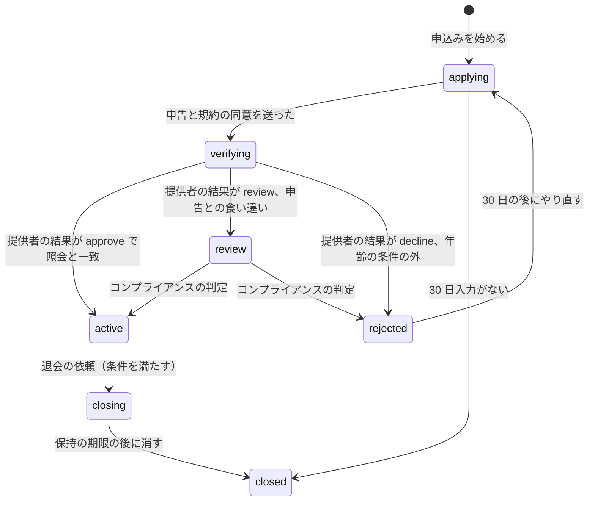

# KYC and Accounts: Coinbase

アカウントと本人確認の設計。口座の開設、eKYC の方式と状態、再確認、法人の口座、ログインと端末、重要な操作の確かめと出金の待ち、取引の API キー、`kyc-vault`、退会と保持、未成年を決める。全体像は [README.md](README.md) にある。法令の解釈に当たる項目は枠組みだけを書き、結論を書かない。どれも **法務の確認待ち** で、[intent.md](../intent.md) の L 番号を付ける。

前提となる決定は次のとおり。

- eKYC は提供者のアダプターの後ろに置き、判定と状態は自前で持つ。提供者の障害の間は新しい口座の確認を待たせ、既存の口座は止めない（[ADR-0011](../decisions/0011-external-providers-boundary.md)）
- 氏名・住所・生年月日、本人確認の書類の参照、銀行の口座の番号は `kyc-vault`（Aurora の別のクラスタ）に置き、読む関数は監査の行を書く（[ADR-0001](../decisions/0001-platform-and-stack.md)）
- 認証の情報の変更の後 72 時間は出金を受け付けない。値はこの領域で確定する（[ADR-0008](../decisions/0008-withdrawal-pipeline-and-approvals.md)）
- 注文は `order-gateway` が口座の状態を検査してから拘束を書く（[ADR-0004](../decisions/0004-order-entry-holds-and-idempotency.md)）
- 自己約定の組は、個人は口座、法人は同じ法人の口座の全部（[ADR-0003](../decisions/0003-matching-rules-and-self-trade-prevention.md)）

この文書で決めたことは次の ADR にある。

| ADR | 決定 |
| --- | --- |
| [0052](../decisions/0052-account-lifecycle-levels-and-restrictions.md) | 口座の寿命の状態、確認の水準、制限の行を分けて持ち、使える機能を 1 つの決定表で決める。確認の方式は `legal.kyc_allowed_methods` で選ぶ |
| [0053](../decisions/0053-sign-in-step-up-cooldown-and-api-keys.md) | ログインはパスキーを第一にし、予備はメールと TOTP の 2 つ。重要な操作は直近 5 分のパスキーを求め、認証の情報の変更の後 72 時間は出金を止める。API キーは利用者の Ed25519 の公開鍵で、取引と照会の権限だけ |
| [0054](../decisions/0054-kyc-vault-purpose-api-and-retention.md) | `kyc-vault` は目的で縛る関数だけで読み、書類と顔の画像を持たない。保持は退会からの日数を `legal.*` で持ち、期限の後は人ごとの鍵の破棄で消す。退会は残高と拘束が 0 のときだけ受ける |

## 1. 範囲

- 扱う：
  - 口座の開設の流れ、利用者の申告（適合性の項目を含む）
  - 確認の水準と方式、eKYC の提供者の結果の当て方、再確認（法務の L4）
  - 口座の状態と制限、使える機能の決定表（`DT-KYC-001`）
  - 法人の口座と取引の担当者（PM の判断待ち P1。法務の L4）
  - ログイン、セッション、端末、パスキー、TOTP、アカウントの回復
  - 重要な操作の強い確かめ（step-up）と、出金の待ち（cooldown）
  - 取引の API キー（権限、署名、上限）
  - `kyc-vault` の中身と読む関数、退会と保持（法務の L11・L14）、未成年（法務の L12）
- 扱わない：
  - 制裁の照合、取引の監視、疑わしい取引の届出（aml-and-travel-rule の領域）。この領域は確かめた本人の属性と、制限の行を書く口を渡す
  - 銀行の口座の登録と名義の照合の実行（fiat-and-banking の領域）。この領域は確認の名義のカナと照合の関数を渡す
  - 出金の宛先の許可の一覧と待ち時間（withdrawals の領域）
  - 注文の速さの上限の段（order-entry-and-risk の領域）
  - 運用者の権限、CS の画面の参照の範囲、鍵の階層（security の領域）
  - 不公正取引の監視の口座の結び付き（market-surveillance の領域が、この領域の `person_key` と端末の信号を読む）

## 2. 要件

| 要件 | 値 | 出どころ |
| --- | --- | --- |
| 書類・口座の番号の漏れ | 金庫の外（ログ、CS の画面、分析の基盤）に出た事象 0。運用者の参照は全件が監査の行を持つ | NFR-016 |
| 確認のない取引 | 水準が `verified` でない口座の、注文・販売所の受け入れ・暗号資産の出金 0 | intent の「守るべき振る舞い」、[ADR-0011](../decisions/0011-external-providers-boundary.md) |
| 1 人で資産を動かせない | 認証の情報の変更の後 72 時間の出金 0。API キーでの出金 0 | [ADR-0008](../decisions/0008-withdrawal-pipeline-and-approvals.md)、PM の判断待ち P2 |
| 制限の反映 | 制限の行を書いてから、`order-gateway` と `wallet-orchestrator` と `funding` の判定に効くまで p99 5 秒 | 本システムの値 |
| 確認の速さ | 提供者の結果を受けてから、水準に効くまで p95 10 秒 | 本システムの値 |
| 可用性 | ログインは取引所と同じ月間 99.95%（ログインできなければ取引できない）。口座の開設は提供者に依るので数えない | NFR-010 の取引所の値を当てた本システムの値 |

## 3. 本家の形（確かめたこと）

| 項目 | 本家 | 出典（確認日） |
| --- | --- | --- |
| 本人確認の目的 | 法令の対応と不正の防止のために求め、口座の持ち主だけが銀行の口座やカードをつなげるようにする | [Verify your identity on Coinbase](https://help.coinbase.com/en/coinbase/getting-started/getting-started-with-coinbase/id-doc-verification)（2026-11-15。検索の抜粋でだけ確かめ、本文は取得できなかった。**未検証**） |
| 書類 | 有効で、氏名・生年月日・住所か国・番号が見える書類。種類は国ごとに違う。EU の利用者は書類と顔の撮影 | 同上と [EU verification levels FAQ](https://help.coinbase.com/en/coinbase/managing-my-account/verify-my-identity/eu-verification-levels-faq)（同上。**未検証**） |
| 確認の段 | 段（Level）があり、暗号資産の送受は書類の確認の後の段で使える（地域による） | 同上（**未検証**） |
| 日本での方式 | 2023 年に日本の事業を止めた。日本での確認の方式は公式の資料で確かめられなかった | [intent.md](../intent.md) の出典（**未検証**） |
| API キーの方式 | 本家の取引所の API キーの署名の方式は、この文書の範囲で確かめなかった | **未検証** |

本家の確認の段の名前と条件は使わない。本システムの水準は日本の法令の枠組み（法務の L4）から決める。

## 4. 水準、状態、制限（ADR-0052）

### 4.1 3 つの軸

口座の「使える機能」を、次の 3 つの軸の組から決める。軸ごとに書く者が違うので、1 つの状態の列に詰めない。

| 軸 | 値 | 書く者 |
| --- | --- | --- |
| 寿命の状態（`lifecycle`） | `applying`・`verifying`・`review`・`active`・`rejected`・`closing`・`closed` | `identity`（口座の開設と退会の流れ） |
| 確認の水準（`kyc_level`） | `none`・`contact`・`verified` | `identity`（提供者の結果を決定表に当てる） |
| 制限（`account_restrictions` の行） | 種類 `restricted`（一部を止める）か `frozen`（全部を止める）と、理由のコード | `identity`、`compliance`、`surveillance`、運用の画面（期限つきの権限） |

- 制限は行で持ち、複数が同時に立つ。解除は行ごとに、立てた者の種類の承認で行う（たとえば `compliance` が立てた行は、コンプライアンスの担当の 2 人目の承認で外す）。
- 口座の実際の制限は、立っている行のうち重いほう（`frozen` ＞ `restricted`）。

### 4.2 水準と方式

| 水準 | 方式（`method`） | 中身 |
| --- | --- | --- |
| `none` | - | メールアドレスだけ確かめた |
| `contact` | `email_phone` | メールアドレスと電話番号（SMS）を確かめた |
| `verified` | `jpki`、`ic_chip_face`、`document_face`、`document_postal` | 取引時確認を済ませた。方式の中身は下の表 |

| 方式 | 中身 | 本番で使えるか |
| --- | --- | --- |
| `jpki` | マイナンバーカードの署名用の電子証明書による公的個人認証 | `legal.kyc_allowed_methods` に入るときだけ（法務の L4） |
| `ic_chip_face` | 本人確認の書類の IC チップの情報の読み取りと、容貌の撮影の照合 | 同上 |
| `document_face` | 書類の画像と容貌の画像の照合（「ホ」方式と解説されている。2027 年 4 月 1 日から使えなくなると解説されている。**未検証**） | 同上。値に終わりの日を持てるようにする |
| `document_postal` | 書類の画像と、転送不要の郵便の受け取り | 同上 |

- `legal.kyc_allowed_methods` は、方式ごとに「使える期間（始まりと終わりの日）」を持つ。開発と検証の既定は全部の方式、本番は法務の L4 の結論まで空（どの方式でも `verified` にしない）。
- 画面は `jpki` を先に出し、読めない端末に `ic_chip_face` を出す（本システムの既定）。
- 方式の終わりの日を過ぎても、その日より前に `verified` になった口座の水準は下げない。再確認を求めるかは法務の L4（`legal.kyc_reverify_on_method_sunset`）。

### 4.3 寿命の状態

寿命の状態の遷移。表を正とし、図はその要約である。

| 遷移 | 条件 | 副作用 |
| --- | --- | --- |
| `applying` → `verifying` | 申告（氏名、カナ、生年月日、住所、職業、取引の目的、適合性の項目）が揃い、規約と契約の前の書面の同意（法務の L12）を記録した | 提供者のセッションを作る |
| `verifying` → `active` | 提供者の結果が承認で、照会の結果と一致し、確かめた氏名・生年月日・住所が申告と一致する | `kyc_level = verified`。振込先の口座番号の払い出しを `funding` に依頼する（outbox の `account.activated`） |
| `verifying` → `review` | 提供者の結果が要確認、申告と確かめた値の食い違い、同じ `person_key` の別の口座がある | コンプライアンスの待ち行列に入れる |
| `verifying` → `rejected` | 提供者の結果が拒否、確かめた生年月日が `legal.minimum_age` の外 | 理由の種類を本人に示す |
| `active` → `closing` | 7 節の退会の条件を満たす | ログインを止める |

- 1 人（同じ `person_key`）が持てる個人の口座は 1 つ（本システムの方針）。2 つ目は `review` に回す。
- `active` の中の一時の止めは、寿命の状態を変えずに制限の行で表す。

### 4.4 使える機能の決定表（DT-KYC-001）

`identity.capabilities(account_id)` が、この表だけで答える。各サービスは結果の真偽だけを見る。

| 条件 | ログイン | 日本円の入金 | 買い（販売所・取引所） | 売り・取り消し | 暗号資産の入金の記帳 | 暗号資産の出金 | 日本円の出金 |
| --- | --- | --- | --- | --- | --- | --- | --- |
| `applying`・`verifying`・`review` | ○ | × | × | × | × | × | × |
| `active`・`verified`・制限なし | ○ | ○ | ○ | ○ | ○ | ○（cooldown の外） | ○（cooldown の外） |
| `active`・`restricted` | ○ | ○ | × | ○ | ○ | × | ○（本人の名義の口座だけ） |
| `active`・`frozen` | ○（照会だけ） | ×（着金は記帳し拘束） | × | ×（止める時に未約定を取り消す） | ×（検出と追跡は続ける） | × | × |
| `closing`・`closed`・`rejected` | × | × | × | × | × | × | × |

- `frozen` に入るとき、`identity` は未約定の注文の取り消しを `order-gateway` に依頼する（[ADR-0004](../decisions/0004-order-entry-holds-and-idempotency.md) の取り消しの入力）。取り消しで戻る拘束は `available` に戻るが、出金も注文もできない。
- `frozen` の間に届いた日本円の着金は、記帳してから拘束の口座に移す（返却は組戻しの手順。fiat-and-banking の領域）。暗号資産の入金の記帳を止める理由は、制裁の対象の疑いの間に残高に入れないためである（法務の L6）。
- `restricted` の理由のコードの例：`reverify_due`（再確認の期限切れ）、`suitability_limit`（適合性の上限。4.6 節）、`surveillance_hold`（market-surveillance の措置）、`compliance_hold`。
- `frozen` の理由のコードの例：`takeover_lock`（本人の「これは私ではない」）、`sanctions_match`、`legal_order`（差押え・凍結の要請。法務の L6・L14）、`deceased`（法務の L14）。

### 4.5 制限の反映の速さ

`order-gateway` の注文の受け付けは p99 20ms（NFR-001）で、毎回 `identity` を呼ぶ余裕はない。

- `identity` は制限と水準の変化を、同じトランザクションで outbox（`account.capabilities_changed`）に書く。`order-gateway`・`wallet-orchestrator`・`funding`・`brokerage` は、口座ごとの使える機能の写しを持ち、事象で更新する。
- 写しは 5 秒で期限が切れ、切れたら `identity` に問い合わせる。`frozen` への変化は、写しを消す依頼を直接にも送る（事象の遅れを待たない）。
- 出金と日本円の出金は、写しではなく、拘束を書く前に `identity` の関数で確かめ直す（遅れの余裕がある経路では、正本を見る）。

### 4.6 申告と適合性

- 口座の開設の申告で、職業、取引の目的、投資の経験、金融資産の区分、年収の区分を受ける。値は `kyc-vault` に置き、core には区分から決めた段（`suitability_tier`）だけを置く。
- 段に応じた取引の上限（新しい買いの累計、保有の上限）を `legal.suitability_limits` で持つ。協会と業界の団体は、年齢・経験・資産・所得・目的からリスクの閾値を置き、超えた取引を制限する運用を計画していると示した（[第 6 回暗号資産制度に関する WG の説明資料](https://www.fsa.go.jp/singi/singi_kinyu/angoshisanseido_wg/gijishidai/20251126/02.pdf)、2025-11-26）。本システムに何が求められるかは法務の確認待ち（L12。新しい問い L-new-kyc-1 の候補）。
- 本番の値が決まるまで、段を記録するだけにし、上限で止めない（`restricted` の `suitability_limit` を書かない）。

### 4.7 再確認

- 再確認の契機の候補：住所・氏名の変更の申告、コンプライアンスの指示（高リスクの取引。法務の L4）、方式の終わり（4.2 節）、長く使われなかった口座の再開（法務の L14）。どれを契機にするかは `legal.kyc_reverify_triggers`。
- 再確認を求めたら、口座に期限（既定 30 日）を付けて知らせる。期限を過ぎたら `restricted`（`reverify_due`）を立てる。確認が済んだら外す。
- 氏名・住所の変更は、再確認の結果で `kyc-vault` の値を差し替える。古い値は保持の期限まで履歴として残す（7 節）。

### 4.8 法人の口座（PM の判断待ち P1）

- 法人は `organizations`（法人番号、名称、所在地）と、実質的支配者の行、代表者と取引の担当者（それぞれ個人として `verified`）で持つ。法人の口座の確認の水準は、法人の書類と、担当者と実質的支配者の確認がすべて済んだときに `verified` にする（確認の範囲は法務の L4）。
- 法人の取引の口座は複数持て、同じ法人の口座の全部が 1 つの自己約定の組になる（[ADR-0003](../decisions/0003-matching-rules-and-self-trade-prevention.md)）。`self_trade_group_id` は `identity` が決め、注文の受け付けで注文に付ける。
- P1 が「入れない」なら、表と型はそのまま持ち、`release.corporate-accounts` の裏に置く。

## 5. ログイン、端末、重要な操作（ADR-0053）

### 5.1 ログインの方式

| 方式 | 使うとき | 中身 |
| --- | --- | --- |
| パスキー | 通常 | WebAuthn。利用者の確認（UV）を必須にする。端末ごとに登録する |
| メールの確認 ＋ TOTP | パスキーを使えない端末 | メールのリンク（15 分、1 回）と TOTP の 6 桁の 2 つ。どちらか 1 つではログインしない |
| アカウントの回復 | パスキーと TOTP を失った | 改めて eKYC をし、確かめた氏名・生年月日・住所から作る `person_key` が口座のものと一致したときだけ（`jpki` か `ic_chip_face`） |

- パスワードは持たない。SMS の一時コードはログインに使わない（電話番号の乗っ取りでログインされない）。電話番号は確認の水準と連絡にだけ使う。
- セッション：アプリは端末の鍵で署名する更新のトークン（30 日、使うたびに回す）と 15 分のアクセスのトークン。Web は HttpOnly の cookie で、操作がなければ 30 分、最長 12 時間。形は Mercari の題材の [ADR-0066](../../../mercari/docs/decisions/0066-sign-in-sessions-and-devices.md) を引き継ぐ。
- 端末の一覧は、端末の名前、最後に使った時刻、登録の時刻を出し、本人が取り消せる。取り消すとその端末のセッションとパスキーを無効にする。

### 5.2 重要な操作と出金の待ち

重要な操作は、直近 5 分のパスキーの確かめ（UV つき）を求める。パスキーでない方式でログインしたセッションでは行えない。

| 重要な操作 | 確かめ | 出金の待ち（cooldown） | 知らせ |
| --- | --- | --- | --- |
| 出金の依頼（暗号資産・日本円） | 直近 5 分のパスキー | - | プッシュ、メール |
| 出金の宛先の登録・変更 | 同上 | 宛先の待ち 24 時間（withdrawals の領域。PM の判断待ち P4） | 同上 |
| パスキーの追加（新しい端末） | 既存の端末のパスキー、または回復 | **72 時間** | 既存の全端末とメール |
| TOTP の再設定 | 直近 5 分のパスキー | **72 時間** | 同上 |
| メールアドレス・電話番号の変更 | 同上。新旧の両方の確認 | **72 時間** | 旧と新の両方 |
| アカウントの回復 | eKYC のやり直し | **72 時間** | 全端末とメール |
| API キーの作成 | 直近 5 分のパスキー | - | メール |
| 退会 | 同上 | - | メール |

- 待ちの間は、暗号資産と日本円の出金の依頼を受けない。売買と入金は止めない（資産は口座の中にとどまる）。
- 待ちの終わりの時刻は `cooldowns` の行（口座、理由、終わり）で持ち、出金の依頼のたびに `identity.withdrawalAllowedAt(account_id)` で確かめる。
- 知らせから「これは私ではない」を押すと、`frozen`（`takeover_lock`）を立て、全セッションを消す。外すのは CS の担当の確かめと 2 人目の承認（[runbooks/README.md](../runbooks/README.md) の計画の `account-takeover.md`）。
- 形は Mercari の題材の [ADR-0067](../../../mercari/docs/decisions/0067-account-takeover-step-up-and-payout-holds.md) を引き継ぎ、待ちの値と契機をこの題材の値にする。

### 5.3 取引の API キー

- 利用者が端末で Ed25519 の鍵の組を作り、公開鍵だけを登録する。本システムは秘密の値を持たない。キーの ID は `<brand>_live_<26 文字>`（秘密でない識別子）。
- 権限は `read`（残高、注文、約定の照会）と `trade`（注文と取り消し）だけ。出金、宛先、API キーの管理の権限は持たない（PM の判断待ち P2。推奨：MVP では持たせない）。`trading-api` は出金の経路を持たず、`app-api` は API キーの署名を受けない。
- 要求の署名：`<Brand>-Key`（キーの ID）、`<Brand>-Timestamp`（UNIX 秒）、`<Brand>-Signature`（`timestamp ＋ method ＋ path ＋ 本文の SHA-256` への署名の Base64）。時刻の差 30 秒を超える要求は拒む。注文の重複は `client_order_id` で止める（[ADR-0004](../decisions/0004-order-entry-holds-and-idempotency.md)）。
- 任意で IP の許可の一覧（最大 10 件）を付けられる。キーの期限は既定 365 日、口座ごとに 10 本まで。
- 速さの上限の段は order-entry-and-risk の領域で決める。キーの段の属性（個人、マーケットメイカー）はこの領域が持つ。

## 6. `kyc-vault`（ADR-0054）

### 6.1 置くもの、置かないもの

| データ | 置き場所 | 備考 |
| --- | --- | --- |
| 氏名、カナ、生年月日、住所、国籍、職業、申告の項目（適合性） | `kyc-vault` の `persons`・`person_declarations` | 人ごとの鍵の封筒の暗号化 |
| 確認の記録（方式、書類の種類、提供者の参照、判定、日時） | `kyc-vault` の `kyc_checks` | 書類の番号を残すかは法務の L4（`legal.kyc_record_fields`） |
| 銀行の口座の番号と名義 | `kyc-vault` の `bank_accounts` | 書くのは `funding`（fiat-and-banking の領域） |
| 書類と顔の画像 | 提供者だけ | 本システムは受け取らない。提供者の保存の期間と削除の依頼は契約で決める（選定の条件） |
| 個人番号（マイナンバー） | 持たない | `jpki` でも個人番号は受け取らない。税の報告で要るかは法務の L10。要るなら [Workday のマイナンバーの保管庫](../../../workday/docs/architecture/my-number-vault.md)の設計をそのまま使う |
| `person_key` | `kyc-vault` と core | 確かめた氏名のカナ・生年月日・住所の正規化した値の HMAC（`identity` の鍵）。core には値だけを置き、元に戻せない |
| 口座の寿命・水準・制限・段 | core | 個人の項目を持たない |

### 6.2 読む関数

`kyc-vault` は目的で縛る関数だけで読む。形は Workday の題材の [ADR-0046](../../../workday/docs/decisions/0046-purpose-bound-vault-api-and-access-log.md) を引き継ぐ。

| 関数 | 呼ぶ者 | 返すもの |
| --- | --- | --- |
| `nameKanaMatches(account_id, kana)` | `funding` | 真偽（振込の依頼人の名義、出金の口座の名義の照合） |
| `travelRuleOriginator(account_id, withdrawal_id)` | `compliance` | トラベルルールの通知の項目（法務の L5 が決める項目だけ） |
| `screeningSubject(account_id)` | `compliance` | 制裁の照合の項目（氏名、生年月日、国籍） |
| `reportSubject(account_id, report_id)` | regulatory-compliance-japan の書き出し | 報告の定義が求める項目だけ |
| `revealForCase(account_id, case_id)` | 運用の画面（期限つきの権限） | 案件の種類が許す項目。理由の入力と 2 人の承認（[Auth0 の ADR-0056](../../../auth0/docs/decisions/0056-operator-access.md)） |

- どの関数も、監査の行（呼んだ者、目的、口座、項目の種類、時刻）を同じトランザクションで書く。監査の行はハッシュの鎖でつなぐ（[Workday の ADR-0048](../../../workday/docs/decisions/0048-audit-log-hash-chain-and-anchoring.md)）。
- CS の画面は氏名の一部（姓だけ）と、確認の水準、制限の理由のコードだけを出す（本家の 2025 年の事故。[README.md](README.md) の 1.4 節）。

## 7. 退会と保持（ADR-0054）

- 退会の条件：未約定の注文 0、拘束 0、手続き中の入出金 0、全資産の残高 0、制限の行のうち `frozen` 0、開いたコンプライアンスと監視の案件 0。
- 残高が残っていれば、画面は「販売所で売る」「日本円を出金する」「暗号資産を出金する」を案内する。最小の出金の額に届かない暗号資産の端数の扱いは PM の判断待ち（P-new-kyc-1 の候補）と法務の L12・L14。
- 受け付けたら `closing` にし、ログインと全 API キーを止める。台帳と取引の記録は消さない（追記だけ）。
- 保持の期限：本人確認の記録と取引の記録を、取引の終了（退会）から `legal.kyc_record_retention_days`・`legal.transaction_record_retention_days` の日数持つ。開発と検証の既定はどちらも 2,555 日（7 年。本システムの仮の値）。本番の値は法務の L4・L11。法令の照会や差押えの間は保持の延長（legal hold）をかける（[Workday の ADR-0049](../../../workday/docs/decisions/0049-retention-rules-table-and-legal-hold.md)）。
- 期限の後、`kyc-vault` の人ごとの鍵を破棄し、`closed` にする。台帳と core には口座の ID と `person_key` だけが残る（`person_key` も鍵の破棄の後は照合に使えなくなる）。
- 相続、差押え、長く使われない口座は、`frozen` の理由のコードと運用の手順で扱う（法務の L14。MVP は運用の手順）。

### 7.1 未成年（法務の L12）

- 確かめた生年月日から `ageOf()` の 1 つの関数で年齢を出す（形は Mercari の題材の [ADR-0068](../../../mercari/docs/decisions/0068-account-deletion-and-minors.md)）。
- `legal.minimum_age` より若い申込みは `rejected` にする。開発と検証の既定は 18。保護者の同意で未成年を受けるかは PM の判断待ち（P-new-kyc-2 の候補。推奨：MVP では受けない）と法務の L12。

## 8. 例：口座の開設から出金の待ちまで

架空の利用者（30 歳、個人）の 1 件を追う。時刻は日本時間。

| 時刻 | 出来事 | 状態と記録 |
| --- | --- | --- |
| 2027-05-10 10:00 | メールを確かめ、申込みを始める | `applying`、`kyc_level = none` |
| 10:02 | 電話番号を SMS で確かめる。申告（会社員、資産形成、経験 1 年未満、金融資産 300〜1,000 万円、年収 500〜700 万円）と同意を送る | `verifying`、`contact`。`suitability_tier = 2` |
| 10:03 | `jpki` でマイナンバーカードを読む。提供者のセッション（冪等キー `kyc:<account_id>:1`） | `kyc_checks` に `submitted` |
| 10:04:20 | 提供者の Webhook（approve）。署名を確かめ、照会で一致を確かめ、申告と確かめた値の一致を確かめる | `active`、`verified`。`account.activated` を outbox へ。8 秒で水準に効いた（目標 p95 10 秒） |
| 10:05 | `funding` が振込先の口座番号を払い出す | （fiat-and-banking の領域） |
| 11:30 | 300,000 円の着金を記帳する。販売所で 0.01 BTC を約 150,000 円で買う | 使える機能の表の 2 行目 |
| 2027-05-12 21:00 | 新しいスマートフォンにパスキーを追加する（既存の端末で承認） | `cooldowns`：`passkey_added`、終わり 2027-05-15 21:00。全端末とメールに知らせ |
| 2027-05-13 09:00 | 0.01 BTC の出金を依頼する | `withdrawalAllowedAt` が 05-15 21:00 を返し、出金を受けない。画面に「2027-05-15 21:00 から出金できます」 |
| 2027-05-13 09:05 | 取引所で 0.005 BTC を売る | 売買は止めない |
| 2027-05-15 21:00 以降 | 出金の依頼 | 受ける（宛先の待ちは withdrawals の領域） |

- 05-12 の追加を本人がしていなければ、知らせの「これは私ではない」で `frozen`（`takeover_lock`）が立ち、未約定の注文を取り消し、全セッションを消す。

## 9. 障害のときの振る舞い

| 障害 | 検知 | 振る舞い | 回復 |
| --- | --- | --- | --- |
| eKYC の提供者の障害 | 時間切れ・誤りの率 | 新しい確認を `verifying` のまま待たせ、画面に「確認中」。既存の口座は止めない（[ADR-0011](../decisions/0011-external-providers-boundary.md)） | 結果を 10 分ごとに照会（72 時間まで）。[runbooks/README.md](../runbooks/README.md) の計画の `provider-outage.md` |
| Webhook の欠け・重複・順序の入れ替え | inbox、照会との差 | Webhook だけで水準を変えない。照会の結果で決める | 照会の再実行 |
| `kyc-vault` の障害 | DB の健全性 | 口座の開設、名義の照合、出金の確かめ直しを止める。注文と取り消しは写しで続ける | Aurora のフェイルオーバー |
| `identity` の障害 | 5xx | 写しの期限（5 秒）の後は、注文の受け付けを止める側に倒す（確かめられない口座で取引させない） | 復旧の後に写しを作り直す |
| 制限の事象の遅れ | outbox の遅れの SLI | 写しは 5 秒で切れて正本を見る。出金は常に正本を見る | `relay` の復旧 |
| 乗っ取りの兆しの急増 | 端末の追加・回復の率 | 回復の受け付けを人の確かめに回す（`ops.account_recovery_auto_enabled` を切る） | 計画の `account-takeover.md` |

## 10. 上限

| 対象 | 値 |
| --- | --- |
| 確認のやり直し | 24 時間に 3 回まで。超えたら `review` |
| `rejected` の後の申込み | 30 日の後 |
| 個人の口座 | 1 つの `person_key` に 1 つ |
| パスキー | 口座ごとに 10 件 |
| API キー | 口座ごとに 10 本、期限 365 日、IP の許可の一覧 10 件 |
| 重要な操作の確かめ | 直近 5 分 |
| 出金の待ち | 72 時間（5.2 節の契機） |
| 再確認の期限 | 30 日 |

## 11. セキュリティ

- 本人確認の書類の画像を受け取らないので、本システムから画像が漏れる経路がない。漏れの経路の表（[quality.md](../quality.md) の 2.2.1 節 I）に、提供者の部品の画面、Webhook の本文、照会の応答を行として足す。
- ログには口座の ID、方式、判定、理由のコードだけを書く。氏名、生年月日、住所、電話番号、メールアドレス、提供者のセッションの URL を書かない（[AGENTS.md](../../AGENTS.md)）。
- 回復は eKYC のやり直しを要するので、メールと電話番号を乗っ取っただけでは回復できない。
- API キーは公開鍵だけを持つので、本システムの DB の漏れで API キーが使われない。
- 運用者が制限を外す操作は、期限つきの権限と 2 人の承認と理由を要する（security の領域）。エージェントは運用の画面に経路を持たない。

## 12. テスト

| ID | 種類 | 中身 |
| --- | --- | --- |
| DT-KYC-001 | 決定表 | 4.4 節の使える機能の表。寿命・水準・制限の全部の組で、`capabilities()` が表と一致する |
| DT-KYC-002 | 決定表 | 方式の受け入れ：方式 × `legal.kyc_allowed_methods` の期間 × 確認の日 → `verified` にするか |
| DT-KYC-003 | 決定表 | 5.2 節の重要な操作：操作 × 直近の確かめの方式と時刻 → 受けるか、待ちの終わり |
| PROP-KYC-001 | 性質 | 水準は決定表の行でだけ上がり、同じ提供者の結果を何度当てても同じ（冪等） |
| PROP-KYC-002 | 性質 | 任意の操作の列で、待ちの間の出金の受け付け 0。`frozen` の間の注文の受け付け 0（写しの期限を含む） |
| PROP-KYC-003 | 性質 | `legal.*` が本番で未設定なら、どの方式でも `verified` にならない |
| PROP-KYC-004 | 性質 | `kyc-vault` の読み出しは全件、同じトランザクションの監査の行を持つ |
| PROP-KYC-005 | 性質 | 退会は残高・拘束・手続き中の入出金が 0 のときだけ受ける |
| PROP-KYC-006 | 性質 | API キーの署名の要求で、出金・宛先・キーの管理の経路に届くもの 0 |

- 障害の注入：`kyc-sim` の時間切れ・重複の Webhook・照会との食い違い、`relay` の停止（写しの期限で止まる）。
- E2E：口座の開設（`kyc-sim`）→ パスキーの追加 → 出金が 72 時間拒まれる → 時刻を進めて受ける。

## 13. Story の候補

| Story | 内容 |
| --- | --- |
| `kyc-provider-adapter` | 既存（roadmap）。`kyc-sim`、Webhook の inbox と照会 |
| `account-opening` | 既存。寿命の状態、申告、DT-KYC-001・002 |
| `account-restrictions` | 新規。制限の行、使える機能の写しと事象、`frozen` の時の取り消しの依頼 |
| `suitability-profile` | 新規。適合性の申告と段、`legal.suitability_limits`（本番は無効） |
| `reverification` | 新規。再確認の契機と期限 |
| `kyc-vault` | 既存。目的の関数、監査の鎖 |
| `sign-in-and-devices` | 既存。パスキー、メールと TOTP、回復、端末の一覧 |
| `step-up-and-cooldowns` | 新規。重要な操作、72 時間の待ち、「これは私ではない」 |
| `api-keys` | 既存。Ed25519 の公開鍵、署名の検査、権限 |
| `corporate-accounts` | 既存（P1） |
| `account-closure` | 既存。退会の条件、保持、鍵の破棄 |

## 14. 未解決の問い

- 方式ごとの扱いと、本番で使える方式（法務の L4）。`document_face` の終わりの日の扱い。
- 確認の記録に書類の番号を残すか、保持の期間（法務の L4・L11）。
- 適合性の確認と取引の上限が求められるか、その段と値（法務の L12。L-new-kyc-1 の候補）。
- 未成年を受けるか（PM の判断待ち P-new-kyc-2 の候補、法務の L12）。
- 退会の時の端数の扱い（PM の判断待ち P-new-kyc-1 の候補、法務の L12・L14）。
- 税の報告で個人番号を集めるか（法務の L10）。集めるなら Workday の保管庫を使う ADR を起票する。

## 15. quality.md・runbooks・data-model への項目

**quality.md**

- 2.2.2 節の `PROP-KYC`・`DT-KYC` の行に、DT-KYC-001〜003、PROP-KYC-001〜006 を当てる。
- 5 節の E2 の合否に、DT-KYC-003 と PROP-KYC-002（待ちの間の出金 0）を足す。
- 2.2.1 節 I の漏れの経路の表に、提供者の部品の画面、Webhook の本文、照会の応答、CS の画面の氏名の出し方を足す。

**runbooks**

- 計画の `account-takeover.md`：「これは私ではない」の急増、回復の急増。`ops.account_recovery_auto_enabled` を切る手順を含める。
- 新しい `account-restriction-release.md`（制限の解除の手順と 2 人の承認。作る Story は `account-restrictions`）。
- SLI に「制限の反映 p99 5 秒」「確認の結果から水準まで p95 10 秒」を足す候補。

**data-model**

| 表 | 置き場所 | 主な列 |
| --- | --- | --- |
| `accounts` | core | `account_id`、`account_type`（individual・corporate）、`lifecycle`、`kyc_level`、`suitability_tier`、`person_key`、`organization_id`、`self_trade_group_id`、`created_at` |
| `account_restrictions` | core | `restriction_id`、`account_id`、`kind`（restricted・frozen）、`reason_code`、`set_by_kind`、`set_by`、`case_id`、`set_at`、`released_at`、`released_by` |
| `kyc_checks` | kyc-vault | `check_id`、`account_id`、`method`、`provider`、`provider_ref`、`result`、`document_kind`、`checked_at`、`legal_config_version` |
| `persons` | kyc-vault | `person_id`、`account_id`、`name`、`name_kana`、`birth_date`、`address`、`nationality`、`key_id`（人ごとの鍵）、`valid_from`、`valid_to` |
| `person_declarations` | kyc-vault | `account_id`、`occupation`、`purpose`、`experience`、`asset_band`、`income_band`、`declared_at` |
| `organizations`・`beneficial_owners` | core・kyc-vault | 法人番号、名称（core）。実質的支配者の個人の項目（kyc-vault） |
| `passkeys` | core | `credential_id`、`account_id`、`device_id`、`public_key`、`sign_count`、`created_at`、`revoked_at` |
| `devices`・`sessions` | core | `device_id`、`account_id`、`name`、`last_seen_at`。`session_id`、`device_id`、`expires_at` |
| `cooldowns` | core | `account_id`、`reason`、`started_at`、`ends_at` |
| `api_keys` | core | `key_id`、`account_id`、`public_key`、`scopes`、`ip_allowlist`、`tier`、`expires_at`、`revoked_at` |
| `vault_access_log` | kyc-vault | `seq`、`caller`、`purpose`、`account_id`、`field_kinds`、`at`、`prev_hash`、`hash` |
| `retention_holds` | core | `account_id`、`reason`、`set_at`、`released_at` |
