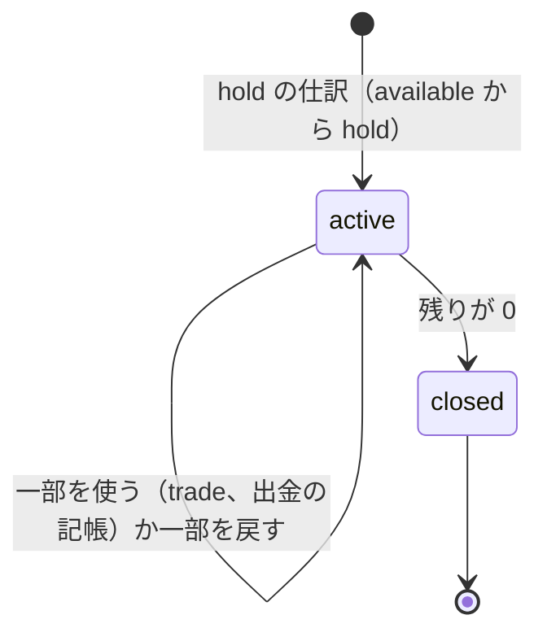
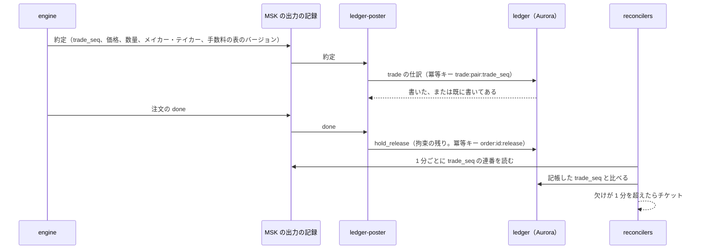

# Ledger and balances: Coinbase

台帳と残高の領域の設計。全体像は [README.md](README.md) にある。台帳の一般の設計（追記だけの複式簿記、冪等、日次の検証、熱い口座）は Stripe の [ledger.md](../../../stripe/docs/architecture/ledger.md) とメルカリの [ledger-and-proceeds.md](../../../mercari/docs/architecture/ledger-and-proceeds.md) にあり、設計し直さない。この文書は、[ADR-0005](../decisions/0005-ledger-balances-and-trade-settlement.md) の差分（複数の資産、拘束、約定の記帳、利用者の財産と本システムの財産の分け）を、仕訳の型と手数料と明細の水準まで書く。

## 1. 範囲

この領域が持つもの：

- 勘定科目（口座の種類）と、口座の持ち主（利用者、本システム、ウォレット、銀行・信託、仮勘定）
- 仕訳の型と、型ごとの冪等キー
- 残高の行（`available`・`hold`）と、拘束の行の種類と寿命
- 約定の記帳（`ledger-poster`）と、拘束の戻し
- 手数料の表と端数の規則（[ADR-0027](../decisions/0027-fee-schedules-and-rounding.md)）
- 出金の制限（BTC の 6 承認の前の入金）と、法的な拘束（差押え・相続。[ADR-0029](../decisions/0029-hold-kinds-and-withdrawal-restrictions.md)）
- 明細と年間の取引の報告書の元データ（[ADR-0028](../decisions/0028-statements-and-annual-report-source.md)。法務の L10）
- 日次の締め、残高のスナップショット、不変条件の検査

持たないもの：

| もの | 持つ領域 |
| --- | --- |
| 注文の検査と拘束の額の計算、送り直し | order-entry-and-risk（[ADR-0004](../decisions/0004-order-entry-holds-and-idempotency.md)） |
| 約定そのもの（エンジンの出力） | matching-engine |
| 台帳とチェーン・銀行・信託の照合、信託の額、分別管理の報告 | [segregation-and-reconciliation.md](segregation-and-reconciliation.md) |
| 販売所の価格と在庫の上限 | brokerage-quotes（[ADR-0010](../decisions/0010-brokerage-quotes-and-inventory.md)） |
| 出金の状態とチェーンの手数料の見積もり | withdrawals（[ADR-0008](../decisions/0008-withdrawal-pipeline-and-approvals.md)） |
| 日本円の入出金の状態と銀行の結果 | [fiat-and-banking.md](fiat-and-banking.md) |
| 税の書類の様式、当局への報告 | regulatory-compliance-japan（法務の L10） |

## 2. 要件

| 要件 | 内容 | 出典 |
| --- | --- | --- |
| NFR-004 | `available` の負 0。拘束の和 ＝ 必要額の和（5 分ごとの照合） | [README.md](README.md) の 3 節 |
| NFR-005 | 釣り合わない仕訳 0。約定から記帳まで p99 1 秒。重複 0、1 分を超える欠け 0 | 同上 |
| NFR-006 | 照合の等式が成り立つ（照合は segregation-and-reconciliation の領域） | 同上 |
| 守るべき振る舞い | 1 つの約定は 1 回だけ記帳し、買い手・売り手・手数料の口座の増減の和は資産ごとに 0 | [intent.md](../intent.md) |
| 守るべき振る舞い | 各仕訳は資産ごとに借方と貸方の和が等しい | 同上 |

## 3. 本家の形（確かめたこと）

| 項目 | 本家 | 出典（確認日） |
| --- | --- | --- |
| 口座の残高の形 | 取引の口座は、通貨ごとに `balance`・`hold`・`available` を持つ | [Get all accounts for a profile](https://docs.cdp.coinbase.com/api-reference/exchange-api/rest-api/accounts/get-all-account-profile)（2026-11-15） |
| 約定と受け渡し | 約定（fill）は先に記録し、後の受け渡しの処理で両者の残高を動かす。`settled` が受け渡しの済みを示す | [Get all fills](https://docs.cdp.coinbase.com/api-reference/exchange-api/rest-api/orders/get-all-fills)（2026-11-15） |
| 約定ごとの手数料 | 約定ごとに `fee`（その約定の手数料）と `liquidity`（`M` メイカー、`T` テイカー）を持つ | 同上 |
| 手数料の率の段 | メイカーとテイカーの率は、30 日の取引高（米ドル換算）で決まる | [Get fees](https://docs.cdp.coinbase.com/api-reference/exchange-api/rest-api/fees/get-fee)（2026-11-15） |
| 手数料をどの資産で取るか、端数の規則 | 公式の資料で確かめられなかった | **未検証** |
| 年間の報告書、日本の税の書類 | 本家は日本の事業を止めた。日本の様式は確かめていない | **未検証** |

本家との意図した違い（2026-11-15 の統合で [README.md](README.md) の 1.4 節に足した）：

| 項目 | 本家 | 本システム | 理由 |
| --- | --- | --- | --- |
| 手数料の段 | 30 日の取引高の段 | MVP は段を 1 つにする。段は P1（マーケットメイカー）の結論の後 | 個人だけの MVP では段の効果が小さい（[ADR-0027](../decisions/0027-fee-schedules-and-rounding.md)） |
| 手数料を取る資産 | **未検証** | 受け取る資産から引く（[ADR-0005](../decisions/0005-ledger-balances-and-trade-settlement.md)） | 拘束の額と受け取りの額を、それぞれ 1 つの資産で閉じる |

## 4. 勘定科目

[ADR-0005](../decisions/0005-ledger-balances-and-trade-settlement.md) の口座の種類に、この領域で次を足す。足した口座は [ADR-0027](../decisions/0027-fee-schedules-and-rounding.md) と [ADR-0029](../decisions/0029-hold-kinds-and-withdrawal-restrictions.md) に書いた。

| 口座の種類 | 持ち主 | 区分 | 意味 |
| --- | --- | --- | --- |
| `user_available:<asset>` | 利用者 | 利用者の財産 | 使える残高（ADR-0005） |
| `user_hold:<asset>` | 利用者 | 利用者の財産 | 拘束した残高。拘束の行（`holds`）の残りの和（ADR-0005） |
| `wallet:<tier>:<asset>` | 本システム | 利用者の財産の置き場所 | 利用者用のウォレットの段ごとの残高（ADR-0005） |
| `bank:<account>`、`trust:<account>` | 本システム | 置き場所 | 銀行の口座、信託の口座（ADR-0005） |
| `fiat_in_transit` | 本システム | 置き場所 | 銀行に依頼して結果の前の日本円（ADR-0005） |
| `house_wallet:<asset>`、`house_inventory:<asset>` | 本システム | 本システムの財産 | 本システムのウォレット、販売所の在庫（ADR-0005、ADR-0010） |
| `fee_revenue:<asset>` | 本システム | 本システムの財産 | 手数料の収益（ADR-0005） |
| `network_fee_expense:<asset>` | 本システム | 本システムの財産 | 払ったチェーンの手数料（ADR-0005） |
| `bank_fee_expense:JPY` | 本システム | 本システムの財産 | 払った銀行の振込の手数料（**足す**。ADR-0027） |
| `suspense:<source>` | 本システム | 仮勘定 | 説明のつかない差。`source` は `chain`、`bank`、`trust`、`reorg`、`wallet_loss`（ADR-0005、runbooks） |

- 口座の行（`ledger_accounts`）は `(kind, owner_id, asset)` で一意にし、`property_class`（`user`・`house`・`location`・`suspense`）を持つ。照合と分別管理の報告は、この区分で集計する（[segregation-and-reconciliation.md](segregation-and-reconciliation.md)）。
- 符号は ADR-0005 のとおり借方を正にする。下の表は、読みやすさのために「借方」「貸方」の列で書く。

## 5. 仕訳の型

型は `journal_type` の列挙で持ち、コードと DB の両方で、型ごとに使ってよい口座の組を検査する（`journal_type_rules`）。型の追加は、QA の承認を要する正解のファイルの変更である（[roadmap.md](../roadmap.md) の「エージェントに任せないこと」）。

| 型 | 借方 | 貸方 | 冪等キー | 書くもの |
| --- | --- | --- | --- | --- |
| `hold` | `user_available` | `user_hold` | `<source>:<id>:hold` | `ledger`（注文、出金、日本円の出金、巻き戻り、法的な拘束） |
| `hold_release` | `user_hold` | `user_available` | `<source>:<id>:release` | `ledger-poster`、`wallet-orchestrator`、`funding` |
| `trade` | 買い手の `user_hold:JPY`、売り手の `user_hold:<base>` | 売り手の `user_available:JPY`、買い手の `user_available:<base>`、`fee_revenue` の両方 | `trade:<pair>:<trade_seq>` | `ledger-poster` |
| `brokerage` | 利用者の `user_available`（払う資産）、`house_inventory`（渡す資産） | `house_inventory`（受ける資産）、利用者の `user_available`（受ける資産） | `quote:<quote_id>` | `brokerage`（ADR-0010） |
| `crypto_deposit` | `wallet:<tier>:<asset>` | `user_available:<asset>` | `deposit:<chain>:<txid>:<vout>` | `deposit-watcher`（ADR-0009） |
| `crypto_withdrawal` | `user_hold`（額＋手数料）、`network_fee_expense` | `wallet:<tier>`（額＋チェーンの手数料）、`fee_revenue` | `withdrawal:<id>:complete` | `wallet-orchestrator`（ADR-0008） |
| `fiat_deposit` | `bank:<account>` | `user_available:JPY` | `fiat_deposit:<bank_txn_id>` | `funding` |
| `fiat_withdrawal_request` | `user_hold:JPY` | `fiat_in_transit`、`fee_revenue:JPY` | `fiat_withdrawal:<id>:request` | `funding` |
| `fiat_withdrawal_settle` | `fiat_in_transit`、`bank_fee_expense:JPY` | `bank:<account>` | `fiat_withdrawal:<id>:settle` | `funding` |
| `internal_transfer` | 移し先の `wallet`・`bank`・`trust`・`house_wallet` | 移し元 | `transfer:<id>` | `rebalancer`、`funding`、財務の手順 |
| `suspense_in`・`suspense_out` | 仮勘定か相手の口座 | 相手の口座か仮勘定 | `suspense:<case_id>:<n>` | 財務の 2 人の承認（runbooks） |
| `reversal` | 元の仕訳の逆 | 元の仕訳の逆 | `reversal:<journal_id>` | 財務の 2 人の承認 |

- 1 つの仕訳は、資産ごとに借方と貸方の和が等しい（ADR-0005）。`trade` と `brokerage` だけが 2 つの資産を含む。
- `crypto_withdrawal` は、拘束の額とチェーンの手数料の差を本システムが持つ（[ADR-0008](../decisions/0008-withdrawal-pipeline-and-approvals.md)）。拘束のうち額と手数料の和を超える分はない（出金の手数料は表の固定の額で、拘束の時に決まる）。
- 日本円の出金が銀行で失敗したら、`fiat_withdrawal_settle` の代わりに `fiat_in_transit` から `user_available:JPY` へ戻す型（`fiat_withdrawal_return`）を書く。手数料は返す（[fiat-and-banking.md](fiat-and-banking.md) の 6 節）。
- 打ち消しは `reversal` だけで行い、元の仕訳を書き換えない（Stripe の [ADR-0003](../../../stripe/docs/decisions/0003-double-entry-ledger.md)）。

## 6. 拘束

拘束の行（`holds`）は、注文・出金などの「この先で使う額」を 1 行で持つ。行の残りの和が `user_hold` の残高と一致する（日次の検査）。次の図は拘束の行の寿命を示す。正は 6.1 節の表である。

### 6.1 拘束の種類

| `source_type` | 作る | 使う・戻す | 0 に戻る条件 | 出典 |
| --- | --- | --- | --- | --- |
| `order` | `order-gateway` | `ledger-poster`（約定で使う、`done` で戻す） | 注文が `done` | [ADR-0004](../decisions/0004-order-entry-holds-and-idempotency.md) |
| `withdrawal` | `wallet-orchestrator` | `completed` で使う、`rejected` で戻す | 出金が終わる | [ADR-0008](../decisions/0008-withdrawal-pipeline-and-approvals.md) |
| `fiat_withdrawal` | `funding` | 依頼で使う、拒否で戻す | 日本円の出金が依頼されるか拒まれる | [fiat-and-banking.md](fiat-and-banking.md) |
| `reorg` | `deposit-watcher` | 調べの結論で使う（`suspense` へ）か戻す | 財務とコンプライアンスの結論 | [ADR-0009](../decisions/0009-deposits-confirmations-and-own-nodes.md) |
| `legal` | 運用の画面（コンプライアンスの 2 人の承認） | 法的な手続きの結論で使うか戻す | 解除の 2 人の承認 | [ADR-0029](../decisions/0029-hold-kinds-and-withdrawal-restrictions.md)（法務の L14） |

- 販売所の受け入れは、残高の条件つきの更新と在庫との振り替えを 1 つのトランザクションで書く（ADR-0010）。拘束の行を作らない。したがって、NFR-004 の照合には販売所の項を入れない（2026-11-15 の統合で、NFR-004 と intent からこの項を外した）。
- 拘束の額は `user_available` の条件つきの更新（`available >= $a`）で書く（ADR-0004）。`reorg` だけは、足りなければ足りない分を `suspense:reorg` に置く（ADR-0009）。

### 6.2 出金の制限

BTC は 3 承認で記帳するが、6 承認までは、その口座の全部の出金（暗号資産と日本円）を止める（ADR-0009、[ADR-0039](../decisions/0039-deposit-state-machine-and-withdrawal-lock.md)、ADR-0029 の 2026-11-15 の注記）。これは拘束ではなく、出金だけを止める制限である。注文と販売所には使える。入金した BTC を売った日本円や、その日本円で買った ETH での持ち出しも、これで止まる。

- 制限の行（`withdrawal_restrictions`：口座、範囲 `scope`、資産、額、理由 `deposit_maturity`、元の入金の ID、解ける条件）を記帳と同じトランザクションで書く。`deposit_maturity` は `scope = account`（`asset` は空）にする。6 承認で `deposit-watcher` が解く。
- `scope = account` の解けていない行がある口座は、暗号資産と日本円の出金を `held` の前で待たせる（額の式を使わない）。
- `scope = asset` の行（将来の理由のため）は、出金に使える額 ＝ `available` − 解けていない制限の和（0 未満なら 0）で引く。出金の拘束の条件つきの更新に、この式を入れる（`available - restricted >= $a`）。
- 制限は台帳の口座にしない。資産の持ち主は変わらず、照合の等式にも入らない（[ADR-0029](../decisions/0029-hold-kinds-and-withdrawal-restrictions.md)）。

## 7. 約定の記帳

`ledger-poster` は MSK の出力の記録を `trade_seq` の順に読み、1 約定を 1 つの `trade` の仕訳にする。次の図は、約定から拘束の戻しまでの流れと、欠けの検出を示す。

1. 手数料の率は、注文の受け付けの時に `order-gateway` が決め、エンジンの出力に載る（[ADR-0003](../decisions/0003-matching-rules-and-self-trade-prevention.md)）。`ledger-poster` は表を引き直さず、出力の率とバージョンで計算する。表を変えても、受け付け済みの注文の手数料は変わらない（[ADR-0027](../decisions/0027-fee-schedules-and-rounding.md)）。
2. 代金は `floor(価格 × 数量 ÷ 基準の資産の 1 単位)` の円（ADR-0003）。手数料は 8 節の式で計算する。
3. `ledger-poster` は板ごとに 1 つのタスクで、区画の順に記帳する。並べ替えない。同じ `trade_seq` の再実行は一意の制約で 0 行になり、成功として扱う。
4. 記帳の後、約定と注文の状態を outbox に積み、明細と通知に流す（13 節）。

## 8. 手数料

[ADR-0027](../decisions/0027-fee-schedules-and-rounding.md) で決める。要点は次のとおり。

| 項目 | 規則 |
| --- | --- |
| 表 | `fee_schedules` にバージョンつきで持つ。種類は `trade`（板ごと、メイカー・テイカー）、`crypto_withdrawal`（資産ごとの固定の額）、`fiat_withdrawal`（固定の額）。販売所は手数料を取らない（スプレッドが収益。ADR-0010） |
| 率の単位 | 100 万分率（ppm）の整数。0.10% は 1,000 ppm |
| 既定の率（本システムの値。PM が確かめる） | テイカー 1,000 ppm（0.10%。[README.md](README.md) の 2.1 節）、メイカー 500 ppm（0.05%） |
| 取る資産 | 受け取る資産から引く。買い手は暗号資産、売り手は日本円（ADR-0005） |
| 実際の手数料 | `floor(受け取る額 × 率 ÷ 1,000,000)`。利用者に有利な側に切る |
| 拘束 | 手数料の上限を含めない。手数料は受け取る資産から引くので、拘束した資産から払わない（ADR-0004 の 2026-11-15 の注記） |
| 最低の手数料 | 持たない。小さな約定の手数料は 0 になりうる |
| 負の手数料（メイカーへの払い戻し） | MVP で持たない（P1 の結論の後に検討。PM の判断待ち P8） |
| 段 | MVP は 1 つ。30 日の取引高の段は P1 の結論の後 |

- 端数の切り捨てで本システムが失う額は、約定 1 件で 1 単位（1 円、1 satoshi、1 wei）未満である。1 日 30 万件でも 30 万円未満で、収益の誤差として受ける。
- 拘束の上限の手数料を日本円で取る指値の買い（ADR-0004 の表）は、ADR-0005 の既定では使われず、`done` で全額戻る（18 節の未解決の問い）。

## 9. 残高の行と日次の締め

- `balances`（`account_id`、`asset`、`available`、`hold`、`version`）は、仕訳と同じトランザクションで更新する（ADR-0005）。`withdrawal_restrictions` の和は別に集計する。
- 締めは JST 0:00。締めの後に `balance_snapshots`（口座、資産、締めの日、残高）を、前日のスナップショットとその日の仕訳から作る（Stripe の [ledger.md](../../../stripe/docs/architecture/ledger.md) の 4.2 節の形）。
- 締めの検査：

| 検査 | 内容 | 破れたとき |
| --- | --- | --- |
| 仕訳の釣り合い | その日の仕訳ごとに、資産ごとの和が 0 | SEV1 の候補。書き込みを止める |
| 全体の釣り合い | 資産ごとに、全口座のスナップショットの和が 0 | 同上 |
| 残高の行 | `balances` ＝ スナップショット ＋ 締めの後の仕訳の和 | SEV2。残高の行を直し、原因まで出金を止める |
| 拘束の行 | `user_hold` ＝ `active` の拘束の残りの和（口座、資産ごと） | SEV2 |
| 型の規則 | 仕訳の型と口座の組が `journal_type_rules` に合う | SEV2 |
| 再計算 | 週次に、任意に選んだ口座の残高を全仕訳から計算し直す | SEV2 |

- 円換算の評価（分別管理の報告、ウォレットの割合、年間の報告書）は、台帳の口座にしない。評価の時点の参照の価格と数量から、報告の側で計算する（[ADR-0006](../decisions/0006-wallet-tiers-and-cold-ratio.md)）。

## 10. 明細と年間の取引の報告書

[ADR-0028](../decisions/0028-statements-and-annual-report-source.md) で決める。

- 明細（`statement_lines`）は、利用者の口座に触れた仕訳の行の射影で、outbox から作る。正本は仕訳で、明細は作り直せる。明細の行は、仕訳の ID、型、資産、増減、手数料、約定の価格、相手の種類（板、販売所、入出金）を持つ。
- 年間の取引の報告書は、暦の年（JST の 1 月 1 日〜12 月 31 日）の明細から作る。取得の価額の計算の方法（総平均法か移動平均法か）、様式、交付の期限は法務の L10 の結論で決め、`legal.cost_basis_method` と様式のバージョンで持つ。結論までは、数量と円の受け払いの合計だけを出し、取得の価額を出さない。
- 作った報告書は、作った時の明細の範囲（最後の仕訳の ID）と要約（ハッシュ）を持ち、作り直しで違う結果が出たら差分を財務に回す。

## 11. 法的な拘束（相続・差押え・休眠）

法務の L14 の結論が出るまで、MVP は運用の手順で扱う。台帳は、どの結論にも対応できる形だけを持つ（[ADR-0029](../decisions/0029-hold-kinds-and-withdrawal-restrictions.md)）。

- 差押えと相続の手続きの開始では、コンプライアンスの担当が、対象の資産と額を `legal` の拘束にする（2 人の承認）。拘束の間も、利用者の残高の和と照合の等式には入ったままである。
- 返し方（暗号資産で返すか、日本円で返すか、日本円の換算の時点）は法務の L14 の結論で決める。暗号資産を日本円で返すなら、販売所の売りと同じ `brokerage` の仕訳を、運用の承認つきで書く。
- 長く使われない口座（休眠）の残高は、MVP では自動で動かさない。

## 12. 例：BTC/JPY の指値の買いの約定

買い手 B が 0.1 BTC を指値 1,000 万円で買い、板にあった売り手 S の指値 999 万円の売り 0.1 BTC と約定する。B はテイカー（1,000 ppm）、S はメイカー（500 ppm）。

1. **拘束**（ADR-0004）：B の `user_available:JPY` から `user_hold:JPY` へ、`floor(10,000,000 × 0.1)` ＝ 1,000,000 円（手数料は受け取る BTC から引くので、上限を足さない）。S は既に 0.1 BTC（10,000,000 satoshi）を拘束している。
2. **約定**：価格は板の注文の価格の 999 万円（ADR-0003）。代金 n ＝ `floor(9,990,000 × 0.1)` ＝ 999,000 円。
3. **手数料**：B は受け取る BTC から `floor(10,000,000 × 1,000 ÷ 1,000,000)` ＝ 10,000 satoshi。S は受け取る日本円から `floor(999,000 × 500 ÷ 1,000,000)` ＝ `floor(499.5)` ＝ 499 円。
4. **`trade` の仕訳**（冪等キー `trade:BTC-JPY:<trade_seq>`）：

| 資産 | 借方 | 貸方 | 和 |
| --- | --- | --- | --- |
| JPY | B の `user_hold:JPY` 999,000 | S の `user_available:JPY` 998,501、`fee_revenue:JPY` 499 | 0 |
| BTC | S の `user_hold:BTC` 10,000,000 | B の `user_available:BTC` 9,990,000、`fee_revenue:BTC` 10,000 | 0 |

5. **拘束の戻し**：B の注文が `done` になり、残りの 1,000,000 − 999,000 ＝ 1,000 円を `hold_release` で戻す。S の拘束の残りは 0。
6. **結果**：B は 999,000 円を払い、0.0999 BTC を得た。S は 0.1 BTC を渡し、998,501 円を得た。本システムは 499 円と 10,000 satoshi を得た。手数料の 0.5 円の端数は S に残った。

## 13. 障害のときの振る舞い

| 障害 | 検知 | 振る舞い | 回復 |
| --- | --- | --- | --- |
| `ledger-poster` の停止・遅れ | 約定の記帳の遅れの SLI、欠けの検出 | 画面は「約定済み、反映中」。記帳の前の数量は出金にも次の注文にも使わせない（[README.md](README.md) の 1.3 節 A） | 最後の `trade_seq` から読み直す（冪等） |
| ledger の Aurora のフェイルオーバー | 書き込みの誤り | 拘束を書けない注文・出金は拒む（受け付けない） | 再接続の後、`pending_submit` の注文は `reconcilers` が扱う（ADR-0004） |
| 仕訳の釣り合いの検査の破れ | DB の遅延の制約、締めの検査 | トランザクションは失敗する。締めで見つけたら書き込みを止める | 原因を直し、`reversal` で直す（財務の 2 人の承認） |
| 手数料の表のバージョンが見つからない | `ledger-poster` の誤り | その約定の記帳を止め、板の記帳を止める（後の約定を先に書かない） | 表を戻す。手で率を入れない |
| 明細の作成の遅れ | outbox の遅れ | 残高は台帳から出す。明細は遅れて揃う | relay の回復 |

## 14. 上限

| 項目 | 値 | 根拠 |
| --- | --- | --- |
| 書き込みの最大 | 拘束 1,500・戻し 1,500・約定 300 件/秒で、約 3,300 トランザクション/秒、約 1.9 万行/秒（S1 の急変） | [capacity.md](capacity.md) の 5.2 節 |
| 1 つの仕訳の行 | `trade` は 6 行。仕訳の行の上限は 20 | 型の規則 |
| 熱い口座 | マーケットメイカーの残高の行は S2 でスロットに分ける | [ADR-0004](../decisions/0004-order-entry-holds-and-idempotency.md)、Stripe の [ADR-0016](../../../stripe/docs/decisions/0016-hot-accounts-and-ledger-sharding.md) |
| 金額 | `numeric(38,0)`。ETH の wei でも足りる | ADR-0005 |

## 15. セキュリティ

- ledger のクラスタに書けるのは `ledger` のサービスの役割だけ。仕訳の表の `UPDATE`・`DELETE` は DB の権限で禁止する（ADR-0005）。
- `reversal`・`suspense_*`・`legal` の拘束は、運用の画面から、期限つきの権限と 2 人の承認でだけ作る（Auth0 の [ADR-0056](../../../auth0/docs/decisions/0056-operator-access.md)）。エージェントと Dev は本番の台帳に経路を持たない。
- 明細と報告書には、氏名・住所を入れない。交付の時に `kyc-vault` から差し込む（security の領域）。

## 16. テスト

- **PROP-LED-001**：任意の注文・約定・取り消し・入出金・販売所・巻き戻りの列（重複、遅れ、順序の入れ替え）で、仕訳は資産ごとに釣り合い、全口座の和は 0、`available >= 0`、`user_hold` ＝ 拘束の行の残りの和（[quality.md](../quality.md) の 2.2.1 節 B）。
- **PROP-LED-002**：約定ごとの記帳は 1 回。`ledger-poster` の任意の停止と再開で変わらない。
- **PROP-LED-003**：任意の約定で、0 ≤ 手数料 ≤ 受け取る額（買い手は受け取る暗号資産、売り手は受け取る日本円）。`done` の注文の拘束の残りは 0。
- **PROP-LED-004**：6 承認の前の入金がある口座の出金（暗号資産と日本円）の `held` 0。注文の拘束には、その入金を使える。
- **DT-LED-001**：仕訳の型と口座の組の決定表（5 節）。全行を表駆動で流し、表にない組を拒む。
- **DT-LED-002**：手数料の端数の決定表（率、受け取る額、期待する手数料）。期待する値は QA が持つ。
- **参照の実装**：`ledger-ref` の残高と一致する。
- **障害の注入**：`ledger-poster` の停止、Aurora のフェイルオーバー、MSK の再送。

## 17. Story の候補

| Epic | Story | 内容 |
| --- | --- | --- |
| E4 | `ledger-core` | 口座の種類、`property_class`、仕訳の型の規則、釣り合いの制約 |
| E4 | `balance-holds` | 拘束の種類（`order`・`withdrawal`・`fiat_withdrawal`・`reorg`・`legal`） |
| E4 | `trade-settlement-poster` | 約定の記帳、拘束の戻し、欠けの検出 |
| E4 | `fee-tables` | 手数料の表、ppm、端数の規則、注文への率の固定 |
| E4 | `withdrawal-restrictions` | 6 承認の前の出金の制限（**新しい候補**） |
| E4 | `daily-close-and-checks` | 締め、スナップショット、検査（**新しい候補**） |
| E4 | `statements-and-annual-report` | 明細の射影、年間の報告書（法務：L10） |
| E4 | `legal-holds` | 差押え・相続の拘束と解除（法務：L14。**新しい候補**） |

## 18. 未解決の問い

- 取得の価額の計算の方法と報告書の様式（法務の L10）。
- 差押え・相続の返し方と換算の時点（法務の L14）。
- メイカーへの払い戻し（負の手数料）と取引高の段（P1 の後。PM の判断待ち P8）。
- 既定のメイカーの率 500 ppm（PM が確かめる）。
- 2026-11-15 の統合で決めた（Dev の承認待ち）：[ADR-0004](../decisions/0004-order-entry-holds-and-idempotency.md) の拘束の表の日本円の手数料の上限は、[ADR-0005](../decisions/0005-ledger-balances-and-trade-settlement.md) の既定（買い手の手数料は受け取る暗号資産から引く）と合わないので外した（ADR-0004 の注記、[design-log.md](design-log.md)）。
- 2026-11-15 の統合で決めた：NFR-004 と intent の「受け入れた販売所の提示の必要額」は、ADR-0010 の 1 つのトランザクションの受け入れでは拘束として残らないので、その項を外し、`source_type` ごとの拘束の和で書いた（[README.md](README.md) の NFR-004、ADR-0029）。

## 19. quality.md・runbooks・data-model への項目

**quality.md**

- 2.2.1 節 B の性質に PROP-LED-003（0 ≤ 手数料 ≤ 受け取る額）と PROP-LED-004（出金の制限）を足す。
- DT-LED-001・DT-LED-002 を 3 節の ID の表に足す。手数料の端数の期待する値は QA の正解のファイル。

**runbooks**

- `ledger-daily-close-failure.md`（締めの検査の破れ。page）：残高の行と拘束の行の食い違い、型の規則の破れ。
- [ledger-reconciliation-mismatch.md](../runbooks/ledger-reconciliation-mismatch.md) の R3 に、手数料の表のバージョンが見つからない場合の記帳の停止を足す。

**data-model**

| 表 | 主な列 |
| --- | --- |
| `ledger_accounts` | `account_id`、`kind`、`owner_id`、`asset`、`property_class`、`created_at` |
| `journals` | `journal_id`（UUIDv7）、`journal_type`、`idempotency_key`（一意）、`source_type`、`source_id`、`created_at`、`actor_id` |
| `journal_lines` | `journal_id`、`line_no`、`account_id`、`asset`、`amount`（`numeric(38,0)`、借方を正） |
| `journal_type_rules` | `journal_type`、`side`、`account_kind`、`version` |
| `balances` | `account_id`、`asset`、`available`、`hold`、`version`、`updated_at` |
| `holds` | `hold_id`、`account_id`、`asset`、`source_type`、`source_id`、`amount`、`remaining`、`status`、`created_at`、`closed_at` |
| `withdrawal_restrictions` | `restriction_id`、`account_id`、`scope`（`account`・`asset`）、`asset`（`scope = account` は空）、`amount`、`reason`、`deposit_id`、`released_at` |
| `fee_schedules` | `schedule_id`、`version`、`kind`、`pair_or_asset`、`tier`、`maker_ppm`、`taker_ppm`、`fixed_amount`、`effective_from`、`approved_by` |
| `balance_snapshots` | `account_id`、`asset`、`as_of_date`、`balance` |
| `statement_lines` | `account_id`、`journal_id`、`journal_type`、`asset`、`delta`、`fee`、`price`、`counterparty_kind`、`created_at` |
| `annual_reports` | `report_id`、`user_id`、`year`、`format_version`、`cost_basis_method`、`last_journal_id`、`digest`、`issued_at` |
