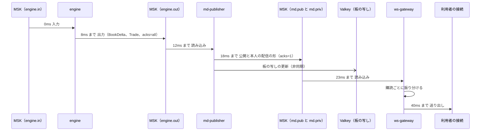

# Market data: Coinbase

板の配信、約定、ローソク足、日々の売買高の公表の設計。全体像は [README.md](README.md) にある。配信の経路と通し番号（[ADR-0021](../decisions/0021-market-data-feed-and-book-seq.md)）、ローソク足（[ADR-0022](../decisions/0022-candles-from-sequencer-time.md)）、日々の売買高の公表（[ADR-0023](../decisions/0023-daily-volume-publication.md)）を決める。

## 1. 範囲

この領域が持つもの：

- `md-publisher`：エンジンの出力の記録から、公開の配信（板の差分、約定、気配）と本人の配信（注文の状態、約定）を作る
- `ws-gateway`：WebSocket の接続、購読、上限、取りこぼしの回復
- REST の公開の口：板、約定、ローソク足、気配
- 板の写し（Valkey）：販売所と REST が読む
- ローソク足の計算と保管
- 日々の売買高の計算と公表（法務の L1）

持たないもの：

| もの | 任せる領域 |
| --- | --- |
| 板の差分の `book_seq` と約定の `trade_seq` を付けること | [matching-engine.md](matching-engine.md)（エンジンが付ける） |
| 注文と取り消しの REST、`<Brand>-Signature` の検証 | [order-entry-and-risk.md](order-entry-and-risk.md)、kyc-and-accounts |
| 販売所の価格の計算 | [brokerage-quotes.md](brokerage-quotes.md) |
| 当局への報告の様式、公表の義務の解釈 | regulatory-compliance-japan |
| 配信の接続の数の負荷の試算 | capacity |

## 2. 要件

| NFR | この領域に効くこと |
| --- | --- |
| NFR-002 | 入力の記録への書き込みから、配信の接続への送り出しまで p99 50ms |
| NFR-010 | 板の配信 月間 99.95% |
| NFR-013 | 配信の速さで特定の利用者を優先しない（どの接続も同じ経路） |

- 配信の接続は S1 で 2 万、S2 で 10 万、S3 で 50 万（README の 2 節）。
- 公開の配信に、注文の持ち主（`account_id`、`order_id`）を出さない。

## 3. 本家の形（確かめたこと）

| 項目 | 本家 | 出典（確認日） |
| --- | --- | --- |
| 経路（channel） | `heartbeat`・`status`・`auctionfeed`・`matches`・`rfq_matches`・`ticker`・`ticker_batch`・`full`・`user`・`level2`・`level2_batch`・`level3`・`balance` | [Channels](https://docs.cdp.coinbase.com/exchange/websocket-feed/channels)（2026-11-15） |
| `heartbeat` | 指定した銘柄ごとに 1 秒ごと | 同上 |
| `level2` と `level2_batch` | `level2` は認証が要り、全部の更新を届ける。`level2_batch` は認証が要らず、50ms ごとにまとめて送る | 同上 |
| `matches` | 約定だけを送る。取りこぼしうるので、`heartbeat` の最後の約定の ID で REST から取り直す | 同上 |
| 購読の期限 | 接続から 5 秒の中に購読を送らないと切られる | [WebSocket Feed](https://docs.cdp.coinbase.com/exchange/websocket-feed/overview)（2026-11-15） |
| 通し番号 | 銘柄ごとに増える整数。1 より大きい飛びは取りこぼし、小さい番号は順序の入れ替わり | 同上 |
| 公開の REST の上限 | IP ごとに 1 秒 10、瞬間 15 | [Rate limits](https://docs.cdp.coinbase.com/exchange/rest-api/rate-limits)（2026-11-15） |
| ローソク足の粒度、日の境界 | 確かめられなかった | **未検証** |
| WebSocket の接続と送信の上限 | 上の頁には書かれていない | **未検証** |

本家との意図した違い（2026-11-15 の統合で README の 1.4 節に足した）：板の全部の差分の経路（`book`）を認証なしで、まとめずに配る。本家は全部の更新の `level2` に認証を求め、認証なしは 50ms のまとめ（`level2_batch`）である。日本の利用者の多くは画面で板を見るので、認証なしで NFR-002 の速さを出す（[ADR-0021](../decisions/0021-market-data-feed-and-book-seq.md)）。

## 4. 設計

### 4.1 構成と流れ

[ADR-0021](../decisions/0021-market-data-feed-and-book-seq.md) で決める。エンジンの出力から利用者の画面までの部品と、NFR-002 の遅れの予算（p99。時刻は入力が記録に書けた時を 0 にした目安）。

- `md-publisher` は板ごとに 1 つ動き、エンジンの出力から次を作る。公開の配信 `md.pub.<pair>`：板の差分、約定、気配。本人の配信 `md.priv.<pair>`：注文の状態と約定（`account_id` つき）。
- `md.*` のトピックは、エンジンの出力から作り直せる派生の記録なので、`acks=1` で遅れを減らす。失ったら、`md-publisher` がエンジンの出力から作り直す。
- `ws-gateway` の各タスクは、全部の板の `md.pub` と `md.priv` を読み、自分のメモリーに板（段の合計）を持つ。新しい購読には、このメモリーの板からスナップショットを返す。スナップショットと差分が同じ記録から作られるので、`book_seq` が必ずつながる。
- Valkey の板の写し（`book:<pair>`：段の合計、`book_seq`、最良の気配、更新の時刻）は、REST の板と販売所（[brokerage-quotes.md](brokerage-quotes.md)）が読む。`md-publisher` が 1 秒ごとの `heartbeat` でも時刻を更新するので、板が静かでも写しの新しさを判定できる。

### 4.2 経路

| 経路 | 中身 | 認証 | 送り方 |
| --- | --- | --- | --- |
| `heartbeat` | 板ごとの最後の `book_seq`・`trade_seq`、板の状態、時刻 | 不要 | 1 秒ごと（本家と同じ） |
| `status` | 板の状態（`trading`・`cancel_only`・`halted`）、銘柄の設定のバージョン、刻み | 不要 | 変わったときと、10 秒ごと |
| `book` | 購読の時に全部の段のスナップショット、以後は `BookDelta`（段の価格と合計の数量） | 不要 | エンジンの出力ごと（まとめない） |
| `trades` | `trade_seq`、価格、数量、テイカーの向き、時刻 | 不要 | 約定ごと |
| `ticker` | 最良の気配、直近の約定の価格、24 時間の高値・安値・出来高 | 不要 | 100ms ごとにまとめる |
| `candles` | 1 分足の今の値と、確定した足 | 不要 | 約定ごと（100ms でまとめる）と確定の時 |
| `user` | 本人の注文の状態（`received`・`open`・`done`）と約定、手数料 | 要（API キーの署名かセッション） | 出力ごと |

- 公開の経路は段の合計だけを出し、注文ごとの配信（本家の `full`・`level3` に当たるもの）は MVP で持たない（[ADR-0021](../decisions/0021-market-data-feed-and-book-seq.md)）。
- 板の状態が `halted` の間も `heartbeat` と `status` は送る。

### 4.3 通し番号と取りこぼしの回復

- `book` の各差分は、エンジンが付けた `book_seq`（板ごとに 1 ずつ増える）を持つ。`trades` は `trade_seq` を持つ。どちらもエンジンの出力の値で、`md-publisher` や `ws-gateway` が替わっても同じ値になる。
- 利用者の側の規則（本家と同じ形）：
  1. 差分の `book_seq` が前の値 ＋ 1 なら当てる。
  2. 前の値以下なら捨てる（重複）。
  3. 前の値 ＋ 2 以上なら取りこぼし。`book` を購読し直し、新しいスナップショットから始める。
- `trades` の取りこぼしは、`heartbeat` の `trade_seq` と比べて見つけ、REST の `GET /markets/{pair}/trades?after=<trade_seq>` で取り直す。
- `ws-gateway` の側：`md.pub` の読み込みで同じ `book_seq` が 2 度来たら（`md-publisher` の作り直しの後）捨てる。飛びを見つけたら、その板の購読者に `resync` を送り、メモリーの板を作り直す。Valkey の写し（`book_seq` つき）を読み、その `book_seq` の後の差分を `md.pub` から当てる。

### 4.4 接続と上限

| 対象 | 値 | 根拠 |
| --- | --- | --- |
| 購読の期限 | 接続から 5 秒 | 本家と同じ |
| 認証なしの接続 | IP ごとに 20 | 本システムの値 |
| 認証ありの接続 | 口座ごとに 10 | 本システムの値 |
| 利用者からの送信 | 接続ごとに 1 秒 20 件 | 本システムの値 |
| 1 接続の購読 | 経路 × 板で 20 まで | 本システムの値 |
| 送りの詰まり | 未送信が 4 MB か 2 秒を超えたら、`slow_consumer` の理由で切る | 本システムの値 |
| 1 タスクの接続 | 5,000 | capacity の領域で確かめる |
| 公開の REST | IP ごとに 1 秒 10、瞬間 15 | 本家と同じ |

- S1 の 2 万の接続を、3 つの AZ の 6 タスク（1 つの AZ が落ちても 4 タスクで 2 万を受ける）で受ける。
- 入れ替えのときは、タスクを順に抜き、切る接続に `reconnect_after_ms`（0〜5,000 の一様な乱数）を送って、再接続の山を散らす（[Figma の multiplayer.md](../../../figma/docs/architecture/multiplayer.md) の 9 節の形）。
- 遅い接続を切ることで、他の接続の遅れ（NFR-002）を守る。切られた利用者は購読し直してスナップショットから始める。

### 4.5 ローソク足

[ADR-0022](../decisions/0022-candles-from-sequencer-time.md) で決める。

- 粒度は 1 分、5 分、15 分、1 時間、6 時間、1 日。
- 足の時刻は、約定を出した入力の `ts`（sequencer の時刻）で決める。壁の時計を使わないので、作り直しても同じ足になる。
- 1 日と 6 時間の足は日本時間（UTC+9。夏時間なし）で切る。1 日の足は 0 時から 24 時。6 時間の足は 0・6・12・18 時から。
- 足は、`ts` が足の終わり以上の入力（`Tick` を含む。エンジンの `InputDigest` の `ts`）を `md-publisher` が見たときに確定する。約定のない足は作らない（照会では欠けとして返す）。
- 値：始値、高値、安値、終値、基準の資産の出来高、日本円の代金の合計、約定の数。数は整数で持つ。
- 確定した足は core の `candles` に書く。夜間に S3 の出力の記録から前日の足を作り直し、書いた値と一致することを確かめる。
- ローソク足と `ticker` の 24 時間の値は、取引所の約定だけで作る。販売所の取引を入れない。

### 4.6 日々の売買高の公表

[ADR-0023](../decisions/0023-daily-volume-publication.md) で決める。改正法で日々の売買高などの公表が入る（intent の出典）。何を、どの単位で、いつまでに公表するかは法務の L1 の確認待ちである。

- 計算：日本時間の 1 日ごと、板ごとに、約定の数・基準の資産の数量・日本円の代金の合計を、出力の記録の `Trade` から作る。販売所の取引を含めるかは `legal.daily_volume_definition` の値で切り替える（含めるなら、ledger の `brokerage` の仕訳から作る）。
- 照合：公表の前に、出力の記録から作った値と、ledger の約定の仕訳（`trade`）から作った値を比べる。一致しなければ公表せずに止め、財務とコンプライアンスに知らせる。
- 公表：翌日の 0 時 30 分に計算し、照合が一致したら、公開の頁と REST（`GET /stats/daily-volume`）に出す。公表した値は書き換えない。訂正は新しいバージョンとして理由と一緒に出す。
- `legal.daily_volume_definition` の本番の値は、法務の L1 の結論まで有効にしない。それまでは計算と照合だけを回し、公表しない。

### 4.7 例：BTC/JPY の板の差分の取りこぼし

[matching-engine.md](matching-engine.md) の 4.10 節の約定の後の配信。

1. エンジンの出力：`Trade`（`trade_seq` 501・502）、`BookDelta`（`book_seq` 9,001：売り 15,000,000 → 0、売り 15,000,010 → 0.03）。入力の記録への書き込みは 10:00:00.000（日本時間）。
2. `md-publisher` が `md.pub.btc_jpy` に `trades` の 2 件と `book` の差分を書く。`ticker` は次の 100ms の区切りで、直近の価格 15,000,010 円、最良の売り 15,000,010 円（0.03 BTC）を出す。
3. 利用者 X の接続は 10:00:00.031 に差分 9,001 を受ける（予算の 50ms の中）。
4. X のスマートフォンの通信が 3 秒途切れ、`book_seq` 9,002〜9,004 を失う。再開の後に 9,005 を受け、前の値 9,001 ＋ 2 以上なので取りこぼしと判定する。
5. X は `book` を購読し直し、`ws-gateway` のメモリーの板から `book_seq` 9,006 のスナップショットを受ける。以後、9,007 からの差分を当てる。
6. 1 分足：10:00:00〜10:01:00 の足に、始値 15,000,000、高値 15,000,010、安値 15,000,000、終値 15,000,010、出来高 0.12 BTC、代金 1,800,000 円、約定の数 2 が入る（この 2 件だけとした場合）。10:01:00 以上の `ts` の入力（`Tick`）で確定する。

## 5. 障害のときの振る舞い

| 障害 | 検知 | 振る舞い | 回復 |
| --- | --- | --- | --- |
| `md-publisher` の停止 | 持ち主の記録の期限切れ、`heartbeat` の途切れ | 待機の `md-publisher` が、最後に書いた `md.pub` の位置からエンジンの出力を読み直して続ける。重複は `book_seq` で捨てる | 自動 |
| `ws-gateway` のタスクの停止 | NLB の健全性の確かめ | そのタスクの接続は切れ、利用者は再接続してスナップショットから始める | 自動 |
| MSK の `md.*` の書き込みの失敗 | producer の誤り | `md-publisher` は書けるまで再試行する。配信が遅れる | ブローカーの回復 |
| Valkey の障害 | 接続の誤り | REST の板は `ws-gateway` のメモリーからは返さず 503。販売所は板の中値を使えず、ADR-0010 の規則で提示を止める | 回復の後に `md-publisher` が写しを書き直す |
| エンジンの停止・切り替え | `heartbeat` の `book_seq` が進まない | 配信は止まる。`status` は前の状態のまま送る | 切り替えの後に続く（[matching-engine.md](matching-engine.md) の 4.9 節） |
| 配信の遅れ（p99 が 500ms を 5 分超え） | 送り出しの時刻と記録の時刻の差 | 呼び出し（[runbooks/README.md](../runbooks/README.md) の 1 節） | 遅い接続の率、タスクの CPU、MSK の遅れを確かめる |
| 日々の売買高の照合の不一致 | 公表の前の照合 | 公表しない。財務とコンプライアンスに知らせる | 原因（記帳の欠け、出力の欠け）を調べる |

## 6. 上限

| 対象 | 値 | 根拠 |
| --- | --- | --- |
| 配信の速さ | p99 50ms | NFR-002 |
| 配信の接続 | S1 2 万（6 タスク） | README の 2 節 |
| 接続と送信の上限 | 4.4 節の表 | この文書 |
| `ticker` のまとめ | 100ms | この文書 |
| ローソク足の確定 | 足の終わりの後、最大 1 秒（`Tick`） | ADR-0012、ADR-0022 |
| 日々の売買高の公表 | 翌日 0 時 30 分の計算、照合の一致の後 | ADR-0023 |

## 7. セキュリティ

- `md.pub` は `account_id` と `order_id` を持たない。`md-publisher` の変換の関数を、公開の型（`account_id` の項目を持たない型）に出すようにし、型で漏れを止める。
- `md.priv` を読めるのは `ws-gateway` だけ。`user` の経路は、認証した口座の行だけを振り分ける。振り分けの関数に、他の口座の行を渡さない性質のテストを置く。
- 公開の経路は認証なしなので、エッジ（AWS WAF）で IP ごとの接続の数と、接続の速さを絞る。
- ログには接続の ID、経路、数だけを書く。IP は 30 日で捨てる（security の領域で確かめる）。

## 8. テスト

性質（PROP-MD。[quality.md](../quality.md) の 2.2.2 節に接頭辞を足す提案）：

| ID | 性質 |
| --- | --- |
| PROP-MD-1 | 任意のエンジンの出力の列で、スナップショットに後の差分を `book_seq` の順に当てた板が、エンジンの板の段の合計と一致する |
| PROP-MD-2 | `md-publisher` を任意の点で止めて作り直しても、利用者が受ける `book_seq` と `trade_seq` の列は抜けがなく、重複は捨てられる |
| PROP-MD-3 | 公開の経路の全部の行に `account_id` と `order_id` がない。`user` の経路に他の口座の行がない |
| PROP-MD-4 | 同じ出力の記録から作ったローソク足は、何度作っても同じ。足の時刻は入力の `ts` だけで決まる |
| PROP-MD-5 | 日々の売買高は、出力の記録から作った値と ledger の約定の仕訳から作った値が一致する |

- 負荷：[quality.md](../quality.md) の 2.2.1 節 H の 2 万の接続で、NFR-002。遅い接続を 5% 混ぜても、他の接続の p99 が 50ms 以内。
- 障害の注入：`md-publisher` の停止、`ws-gateway` のタスクの停止、Valkey の停止（夜間）。
- 結合：画面（Playwright）で、通信の途切れの後に板が正しく戻る。

## 9. Story の候補

| Story | 内容 | ADR |
| --- | --- | --- |
| `market-data-publisher` | `md-publisher`、`md.pub`・`md.priv`、Valkey の板の写し、`heartbeat`・`status` | 0021 |
| `ws-gateway` | 接続、購読、上限、メモリーの板、スナップショット、遅い接続、入れ替えの散らし | 0021 |
| `market-data-rest` | 板・約定・ローソク足・気配の REST と公開の上限 | 0021 |
| `candles` | ローソク足の計算、確定、保管、夜間の作り直しの比べ | 0022 |
| `daily-volume-publication` | 日々の売買高の計算、照合、公表、訂正（法務：L1） | 0023 |

roadmap の E10 の `market-data-publisher`・`ws-gateway`・`daily-volume-publication` に、`market-data-rest`・`candles` を足す。`trading-rest-api` は [order-entry-and-risk.md](order-entry-and-risk.md) の受付と同じ部品で作る。

## 10. 未解決の問い

| 問い | いつ・どう決めるか |
| --- | --- |
| 日々の売買高の公表の中身（販売所を含めるか、単位、時刻、場所） | 法務の確認待ち（L1）。`legal.daily_volume_definition` |
| 注文ごとの配信（本家の `full`・`level3` に当たるもの）を出すか | PM の判断待ち（P12）。推奨：MVP は出さない。マーケットメイカー（P1）の求めと、見せ玉の監視（market-surveillance）の後に決める |
| 1 タスク 5,000 の接続で NFR-002 を満たすか | capacity の領域の負荷試験 |
| 本家のローソク足の粒度と日の境界 | 公式の資料で確かめられなかった（**未検証**）。本システムの値を使う |

## 11. quality.md・runbooks・data-model への項目

### quality.md

- 2.2.2 節の表に PROP-MD を足す（E10）。
- 2.2.1 節 I（漏れの経路）に、公開の配信の型と `user` の振り分け（PROP-MD-3）を行として足す。
- 2.2.1 節 H に、遅い接続を 5% 混ぜる場面を足す。

### runbooks

- [`market-data-degraded.md`](../runbooks/market-data-degraded.md)（2026-11-15 の統合で、ledger-and-balances の領域が出した同じ手順と 1 本にした）：配信の p99 が 500ms を 5 分超えたとき（区間ごとの遅れ、遅い接続の率、`ws-gateway` の CPU、MSK の遅れ）と、タスクの追加。
- `daily-volume-mismatch.md`（新規）：日々の売買高の照合が合わないとき（記帳の欠けと出力の欠けの調べ、公表の保留と知らせ、訂正の出し方）。

### data-model

| 表・置き場所 | 主な列 |
| --- | --- |
| core `candles` | `pair`、`granularity`、`bucket_start`（日本時間の境界）、`open`・`high`・`low`・`close`、`volume_base`、`volume_quote`、`trade_count`、`final` |
| core `daily_volume_publications` | `trade_date`（日本時間）、`pair`、`definition_version`、`trade_count`、`volume_base`、`volume_quote`、`reconciled_at`、`published_at`、`version`、`correction_reason` |
| core `md_publisher_leases` | `pair`、`holder_id`、`epoch`、`expires_at` |
| Valkey `book:<pair>` | 段の合計、`book_seq`、最良の気配、更新の時刻 |
| MSK `md.pub.<pair>`・`md.priv.<pair>` | 公開と本人の配信の形。保持 1 日（作り直せる） |
