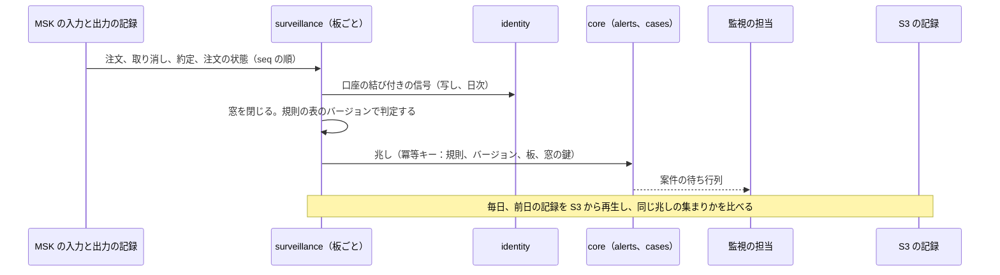
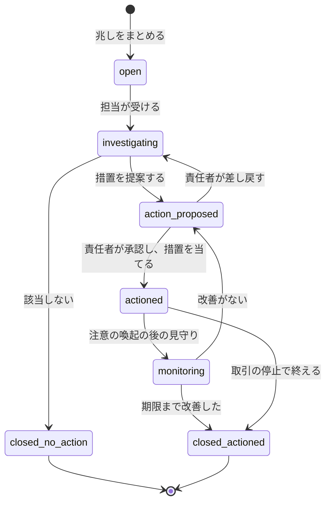

# Market Surveillance: Coinbase

不公正取引の監視の設計。板の入力と約定の記録からの兆しの検出（見せ玉、仮装売買・馴合売買、相場操縦、価格の急変）、案件と調べ、措置と協会への報告の材料、役職員の取引の制限、インサイダー取引の規制への備えを決める。全体像は [README.md](README.md) にある。法令の解釈に当たる項目は枠組みだけを書き、結論を書かない。どれも **法務の確認待ち（L7、自主規制の規則は L9）** である。

前提となる決定は次のとおり。

- 板の入力は sequencer が通し番号（`seq`）と時刻（`ts`）を付けて MSK の入力の記録に書き、エンジンは約定と注文の状態を出力の記録に書く。記録は S3 に長く持つ（[ADR-0002](../decisions/0002-sequencer-and-event-journal.md)）
- 同じ自己約定の組の注文どうしは約定しない（[ADR-0003](../decisions/0003-matching-rules-and-self-trade-prevention.md)）。仮装売買の監視は、組が違うが同じ人の疑いのある口座の間を見る
- 参照の価格が 1 分で 15% 以上動いたら、エンジンが板を `cancel_only` にする。値は matching-engine の領域が持つ（ADR-0003）。この領域は止めずに見つけて調べる
- 販売所の在庫は MVP ではヘッジせず、本システムの口座は板に注文を出さない（[ADR-0010](../decisions/0010-brokerage-quotes-and-inventory.md)。PM の判断待ち P3）
- 監視の規則は自前で書く（AGENTS.md の「核を自前で作る」）。`surveillance` のサービスと `packages/surveillance` に置く（[ADR-0001](../decisions/0001-platform-and-stack.md)）
- 措置の止めは、口座の制限の行で表す（[ADR-0052](../decisions/0052-account-lifecycle-levels-and-restrictions.md)）

この文書で決めたことは次の ADR にある。

| ADR | 決定 |
| --- | --- |
| [0059](../decisions/0059-surveillance-detectors-over-journals.md) | 検出器は入力と出力の記録を `seq` の順に読む決定的な関数にし、時刻は `ts` だけを使う。閾値はバージョンの付いた規則の表に置き、コンプライアンスの承認でだけ変わる。同じ記録の再生で同じ兆しが出る |
| [0060](../decisions/0060-surveillance-cases-actions-and-records.md) | 兆しを口座ごとの案件にまとめ、措置（注意の喚起、取引の制限、取引の停止）は監視の担当が提案し、別の責任者が承認する。記録は `legal.surveillance_record_retention_days` 持ち、協会への報告の材料を書き出す |
| [0061](../decisions/0061-staff-trading-and-material-information.md) | 役職員の口座を登録し、本システムの口座での取引に限る。重要な情報の台帳を持ち、台帳の事象に触れる者の口座は公表まで制限の行で止める。全役職員に最短の保有の期間を置く |

## 1. 範囲

- 扱う：
  - 検出器（見せ玉・レイヤリング、仮装売買・馴合売買、買い上がり・売り崩し、価格の急変、本システムの口座の注文、内部の者の取引）と規則の表
  - 口座の結び付き（同じ人の疑い）の信号の使い方
  - 兆し、案件、措置のステートマシン、記録と保存
  - 協会への報告の材料（発生の報告、月次の取りまとめ）
  - 役職員の取引の制限、重要な情報の台帳と、それに触れる者の止め
- 扱わない：
  - 板の停止と再開、価格の帯（matching-engine の領域、[runbooks/market-halt.md](../runbooks/market-halt.md)）
  - マネー・ローンダリングの取引の監視と、疑わしい取引の届出（aml-and-travel-rule の領域）。同じ口座で両方の案件があれば、互いに参照する
  - 報告の様式と提出（regulatory-compliance-japan の領域。この領域は材料を渡す）
  - 本人確認の値と `person_key` の作り方（kyc-and-accounts の領域）
  - 販売所の価格と在庫の調整（brokerage-quotes の領域）

## 2. 要件

| 要件 | 値 | 出どころ |
| --- | --- | --- |
| 兆しの遅れ | 窓が閉じてから兆しが出るまで p95 5 分 | 本システムの値 |
| 見落としの検査 | 日次に前日の記録を再生し、常時の検出器と同じ兆しの集まりが出る（差 0） | NFR-003 の再生の形 |
| 本システムの口座の板の注文 | 0 件（MVP） | [ADR-0010](../decisions/0010-brokerage-quotes-and-inventory.md) |
| 規則の変更 | 承認の記録のない閾値の変更 0 | 協会の規則のガイドライン（3 節） |
| 個人のデータ | 案件の画面は口座の ID と取引の記録だけを出し、氏名は `revealForCase` で期限つきに見る | NFR-016、[ADR-0054](../decisions/0054-kyc-vault-purpose-api-and-retention.md) |
| 監視の量 | S1 の板の入力の最大 3,000 件/秒、平均 100 件/秒を遅れずに読む | [README.md](README.md) の 2 節 |

## 3. 本家と制度の形（確かめたこと）

| 項目 | 本家・制度 | 出典（確認日） |
| --- | --- | --- |
| 本家の禁止する行為 | 取引の規則で、相場操縦として先回り、仮装売買、見せ玉（spoofing）、レイヤリング、回転売買、注文の詰め込みを挙げる | [Coinbase Markets Trading Rules](https://www.coinbase.com/legal/trading_rules)（2026-11-15。検索の抜粋でだけ確かめ、本文は取得できなかった。**未検証**） |
| 本家の役職員の取引 | 役職員に本家の基盤だけで取引させ、監視の担当が見られるようにしていると書く | [How Coinbase thinks about market integrity and trade surveillance](https://www.coinbase.com/blog/how-coinbase-thinks-about-market-integrity-and-trade-surveillance)（同上。古い記事で、今の運用か**未検証**） |
| 本家の検出の方法と閾値 | 公式の資料で確かめられなかった | **未検証** |
| 協会の規則：審査の部門 | 会員は取引審査の部門を置き、受注を管理する部門から独立させる。社内規則に、抽出の基準、価格の変動率と数量の定量の基準、定性の基準を定める | 日本暗号資産等取引業協会, [暗号資産交換業に係る不公正取引等の防止に関する規則](https://jvcea.or.jp/cms/wp-content/themes/jvcea/images/pdf/B10_jvcea202005.pdf)（2018-07-30 制定、2020-04-24 一部改正のときの PDF。第 4〜6 条。2026-11-15 に確認。最新の改正を反映しているかは**未検証**） |
| 協会の規則：措置 | 相場操縦などに当たる、または当たるおそれが高いときは注意を喚起し、改善がなければ取引を止めるなどの措置を取る | 同上（第 6 条第 3 項） |
| 協会の規則：記録と報告 | 審査の結果と措置の社内の記録を 5 年保存する。措置を取ったら速やかに協会に報告し、毎月の発生の状況と措置を報告する | 同上（第 21・22 条） |
| 協会の規則：自動の審査 | プログラムで自動にするときは、パラメーターが適切に決められ、無断で変更されていないことを確かめる。定量の基準は単位の時間あたりの平均に幅を足して決めることが考えられる | 同上のガイドライン（第 4 条第 3 項、第 6 条第 2 項） |
| 協会の規則：役職員と自己の取引 | 役職員と会員の自己の計算の取引に、社内規則、情報の管理、取引の監視、点検を求める | 同上（第 19 条） |
| 業界の計画 | 協会に売買審査の担当を置き、会員の注文と取引のデータから閾値で抜き出して審査し、証券取引等監視委員会に連携する方針を示した | [第 6 回暗号資産制度に関する WG の説明資料](https://www.fsa.go.jp/singi/singi_kinyu/angoshisanseido_wg/gijishidai/20251126/02.pdf)（2025-11-26。データの様式と時期は**未検証**） |
| 改正法 | インサイダー取引の規制が新しく入る | [intent.md](../intent.md) の出典（法律の本文は**未検証**。法務の L1・L7） |

- 協会の規則の保存の 5 年は、`legal.surveillance_record_retention_days` の開発・検証の既定（1,826 日）に使う。本番の値は法務の L7・L9 の後に入れる。
- 本家の禁止の一覧は、検出器の種類の網羅を確かめる参考にだけ使う。

## 4. 検出（ADR-0059）

### 4.1 データの流れ

`surveillance` は、板ごとに入力と出力の記録を `seq` の順に読み、口座ごとの窓の状態を持つ。兆しは core の `surveillance_alerts` に書く。

- 時刻は sequencer の `ts` だけを使う。壁の時計を使わないので、再生で同じ窓に切れる。
- 入力の記録の注文は、口座の ID と自己約定の組の ID を持つ（matching-engine と order-entry-and-risk の領域の入力の形に依る）。
- 口座の結び付きの信号は、`identity` の `person_key`、端末の ID、ログインの IP の /24、出金の宛先のアドレス、日本円の出金の口座の一致から作る（`account_links`。日次と変化の事象で更新）。個人の項目そのものは読まない。
- 兆しの冪等キーは `(rule_id, rule_version, pair, window_key)`。常時の検出器と日次の再生が同じ兆しを書いても 1 件になる。日次の再生が常時の側にない兆しを出したら、見落としとして SLI に数え、案件を作る。

### 4.2 規則の表（S1 の既定。本システムの値）

閾値は、協会のガイドラインの考え方（平均に幅を足す）に合わせ、板と時間帯ごとの過去 30 日の基準の値に対する倍率で書けるようにする。

| 規則 | 見るもの | 既定の閾値 |
| --- | --- | --- |
| `SUR-SPOOF-1` 見せ玉・レイヤリング | 60 秒の窓で、口座が片側の最良から 5 段の中に出し、2 秒以内に取り消した数量と、同じ窓の反対側の約定の数量 | 取り消しの数量 ≥ 反対側の約定の 10 倍、かつ取り消しの円換算 ≥ 500 万円、かつ反対側の約定が置いた後 10 秒以内。1 時間に 3 回で案件 |
| `SUR-WASH-1` 仮装売買・馴合売買 | 結び付いた口座の間の約定 | 24 時間に 3 件以上、かつ円換算 100 万円以上 |
| `SUR-RAMP-1` 買い上がり・売り崩し | 5 分の窓で、価格が動いた向きのテイカーの約定の、口座ごとの占める割合 | 価格の変化 ≥ 3%、口座の割合 ≥ 50%、30 分以内に反対の向きで約定 |
| `SUR-SPIKE-1` 価格の急変 | 板の 5 分の価格の変化 | 基準の 5 分の変化の 99.9 百分位の 2 倍か 5% の小さいほう。板ごとの案件にし、寄与の大きい 10 口座を付ける |
| `SUR-HOUSE-1` 本システムの口座の注文 | `house_*` の口座の板の入力 | 1 件で案件（MVP） |
| `SUR-INSIDER-1` 内部の者の取引 | 重要な情報の台帳の事象（6.2 節）の公表の前 30 日に、台帳の対象者とその結び付いた口座の約定と販売所の受け入れ | 1 件で案件 |
| `SUR-STAFF-1` 役職員の制限の違反 | 役職員の口座の保有の期間の中の反対の売買、登録の外の口座の疑い（結び付き） | 1 件で案件 |

- 規則は `surveillance_rules`（規則、バージョン、閾値、有効の始まり）に置く。変更は `config/surveillance/` の PR で、コンプライアンスの CODEOWNERS の承認と、承認の記録の ID を要る。適用はバージョンを上げる入力として記録し、どのバージョンで判定したかを兆しに残す。
- 閾値を下げる（厳しくする）変更も上げる変更も同じ手順にする（協会のガイドラインの「無断で変更されていない」）。
- 検出器は、真偽ではなく点（閾値に対する倍率）も兆しに残す。案件の優先度の並べに使う。

### 4.3 例：見せ玉の兆し

BTC/JPY の最良の買いが 14,990,000 円、最良の売りが 15,000,000 円のとき。口座 A（架空）が次の順に入力した。

| `ts`（秒） | 入力 | 板の上の位置 |
| --- | --- | --- |
| 0.000 | 買いの指値 1.0 BTC × 4 本（14,989,000〜14,986,000 円） | 買いの 2〜5 段 |
| 0.400 | 売りの指値 0.2 BTC、14,999,000 円 | 最良の売り |
| 1.100 | 売りの 0.2 BTC が約定（相手は他の利用者の買い） | - |
| 1.300 | 買いの 4 本を全部取り消す（板にあった時間 1.3 秒） | - |

- 取り消した数量 4.0 BTC ÷ 反対側の約定 0.2 BTC ＝ 20 倍（閾値 10 倍）。取り消しの円換算 約 5,995 万円（閾値 500 万円）。反対側の約定は置いた後 0.7 秒（閾値 10 秒）。→ `SUR-SPOOF-1` の兆し（点 2.0）。
- 同じ口座が 1 時間に同じ形を 3 回くり返すと、口座 A の案件を作る。1 回だけなら兆しとして残し、案件にしない。
- マーケットメイカーの通常の出し直しは、反対側の約定が少ないので、取り消しの多さだけでは閾値に届かない（倍率は約定との比で見る）。

### 4.4 例：仮装売買の兆し

口座 X と口座 Y（`person_key` は別、同じ端末の ID と同じ IP の /24）が、24 時間に BTC/JPY で互いを相手に 12 件、各 0.05 BTC を 15,000,000 円前後で約定した。1 件は 750,000 円、合計 900 万円。

- 自己約定の組が違うので、エンジンは止めない（ADR-0003 は組の中だけを止める）。
- `SUR-WASH-1`：件数 12（閾値 3）、合計 900 万円（閾値 100 万円）→ 兆し。2 つの口座を 1 つの案件にまとめる。

## 5. 案件と措置（ADR-0060）

### 5.1 ステートマシン

案件の状態。表を正とし、図はその要約である。

| 遷移 | 誰が | 条件・副作用 |
| --- | --- | --- |
| `open` → `investigating` | 監視の担当 | 担当を割り当てる。7 日を過ぎて `open` のままなら責任者に知らせる |
| `investigating` → `closed_no_action` | 監視の担当 | 理由のコード（`market_making`、`legitimate_hedge`、`false_positive` など）と所見。協会の規則の「該当しないことが明らか」の扱いは法務の L9 |
| `investigating` → `action_proposed` | 監視の担当 | 措置の種類と理由 |
| `action_proposed` → `actioned` | 監視の責任者（提案者と別の人） | 措置を当てる（5.2 節）。協会への発生の報告の材料を作る |
| `actioned` → `monitoring` | 自動 | 注意の喚起のとき。見守りの期間は既定 30 日 |
| `monitoring` → `action_proposed` | 自動 | 見守りの間に同じ規則の兆しが出た |
| `monitoring` → `closed_actioned` | 自動 | 見守りの期間に同じ規則の兆しが出なかった |
| `actioned` → `closed_actioned` | 監視の責任者 | 取引の制限・停止を当てて終える。制限の行は案件を閉じても残り、外すのは別の承認 |

### 5.2 措置

| 措置 | 当て方 | 戻し方 |
| --- | --- | --- |
| 注意の喚起 | 本人への知らせ（文言は法務の確認の後の型） | - |
| 取引の制限 | `account_restrictions` に `restricted`（`surveillance_hold`）。新しい買いと暗号資産の出金を止める | 責任者の承認で行を外す |
| 取引の停止 | `account_restrictions` に `frozen`（`surveillance_suspension`）。未約定の注文を取り消す | 同上 |
| API キーの停止 | その口座の API キーを止める | 同上 |

- 措置を承認するのは人である。エージェントは兆しの要約と、案件の所見の草案（ID と数と理由のコードだけ）を作るが、措置を提案も承認もしない。
- 取引の停止の間に、本人の名義の口座への日本円の出金を許すかは法務の L7（[kyc-and-accounts.md](kyc-and-accounts.md) の DT-KYC-001 の `frozen` の行は今は許さない）。
- 監視の担当と責任者の役割は、板の停止・再開の運用の役割と、注文の受付を持つ Dev の役割から分ける（協会の規則の第 4 条第 4 項の独立。分け方は security の領域の役割の表）。

### 5.3 記録と報告の材料

- 兆し、案件の遷移、所見、措置、規則のバージョンを、追記だけの表に置く。案件の記録はハッシュの鎖でつなぐ（[Workday の ADR-0048](../../../workday/docs/decisions/0048-audit-log-hash-chain-and-anchoring.md)）。
- 保存は `legal.surveillance_record_retention_days`（開発・検証の既定 1,826 日）。兆しの根拠の入力（`seq` の範囲）は記録に残し、元の記録は S3 の入力の記録から再生で取り出す（S3 の保持はこの日数以上にする。infrastructure の領域）。
- 協会への報告の材料：措置ごとの発生の報告（`surveillance_report_items`）、月次の発生の状況と措置の集計。様式と提出は regulatory-compliance-japan の領域（[ADR-0064](../decisions/0064-regulatory-report-exports.md)）。協会が会員の注文と取引のデータを集める計画（3 節）の様式は未定で、記録から書き出せる形だけを用意する（法務の L9）。

## 6. 役職員の取引と重要な情報（ADR-0061）

### 6.1 役職員の口座

- 役職員の名簿（人事から日次に受ける。`staff_registry`：役職員の ID、段、`person_key`、在籍の期間）と、口座の `person_key` を照らし、役職員の口座に `staff_tier` を付ける。登録した以外の口座の疑い（結び付き）は `SUR-STAFF-1` で見る。
- 段：`staff_a`（重要な情報に日常的に触れる者：経営、銘柄の審査、セキュリティの事故の対応、販売所の在庫の運用、監視の担当）、`staff_b`（その他の役職員）。
- 全役職員：買ったものを最短 30 日（既定）は売らない、売ったものを 30 日は買わない。`order-gateway` が注文の受け付けで拒む（拒否の理由のコード `staff_holding_period`）。販売所の受け入れも同じ。
- `staff_a`：上に加え、本システムの取引所と販売所の売買ごとに事前の申請と、コンプライアンスの承認（承認の印は 1 営業日有効）を要る。
- 値と範囲（家族を含めるか、禁止にするか）は `legal.staff_trading_policy` で持ち、法務の L7 の結論で決める。

### 6.2 重要な情報の台帳

- コンプライアンスが、公表の前の重要な情報の候補を `material_info_events` に開く（種類の例：銘柄の取扱いの開始・終了の決定、流出などのセキュリティの事故、大きな在庫の処分、当局の処分）。何が重要事実に当たるかは法務の L7。
- 事象ごとに、知った者の一覧（`insider_lists`）を持つ。事象を見た者は、画面の操作が自動で一覧に足される。
- 一覧の者（役職員と外部の関係者のうち口座を持つ者）の口座に `restricted`（`staff_blackout`）を立て、新しい買いを止める（売りをどこまで止めるかは法務の L7）。公表の時刻の 1 営業日後に外す。
- 公表の時、`SUR-INSIDER-1` が公表の前 30 日の、一覧の者と結び付いた口座の取引を調べる。

## 7. 障害のときの振る舞い

| 障害 | 検知 | 振る舞い | 回復 |
| --- | --- | --- | --- |
| `surveillance` の停止・遅れ | 記録の読みの遅れ（`seq` の差） | 板は止めない。兆しの遅れの SLI を外れたらチケット | 最後の `seq` から読み直す。冪等キーで重複しない |
| 規則の表の読み込みの誤り | 起動の検査 | 前のバージョンのまま動き、知らせる | 正しいバージョンを承認の手順で入れ直す |
| 日次の再生で見落とし | 兆しの集まりの差 | 差の兆しで案件を作り、見落としの数を SLI に数える | 常時の検出器の不具合を Intent に起票する |
| 口座の結び付きの信号の遅れ | 写しの日付 | 前日の写しで続ける。`SUR-WASH-1` の兆しに信号の日付を残す | 次の更新 |
| 兆しの急増 | 件数の率 | 案件の待ち行列を優先度で並べる。計画の `surveillance-surge.md` | 原因（相場の急変、規則の誤り）を確かめる |

## 8. 上限

| 対象 | 値 |
| --- | --- |
| 窓の長さ | 最長 24 時間（`SUR-WASH-1`）。それより長い調べは再生の道具で行う |
| 口座ごとの窓の状態 | 板ごとに最新 1 万件の入力 |
| 兆しの遅れ | p95 5 分 |
| 案件の受け付け | `open` から 7 日 |
| 見守りの期間 | 30 日 |
| 公表の前の調べの期間 | 30 日 |

## 9. セキュリティ

- 案件の画面は口座の ID、取引の記録、点だけを出す。氏名と連絡先は `revealForCase` で、案件の ID と理由と期限つきの権限で見る（[ADR-0054](../decisions/0054-kyc-vault-purpose-api-and-retention.md)）。
- 重要な情報の台帳の中身は、台帳の権限を持つ者だけが見る。見た者は一覧に足され、監査の行が残る。
- 規則の閾値は、外に出すと回避に使われる。利用者向けの文書と API の誤りの応答に閾値を出さない。
- 監視の担当の役割で、監視の担当自身の口座の案件を扱えない（自分の案件は別の担当に回す）。

## 10. テスト

| ID | 種類 | 中身 |
| --- | --- | --- |
| DT-SUR-001 | 決定表 | 4.2 節の規則ごとの閾値の内外と、兆しを出すか |
| DT-SUR-002 | 決定表 | 5.1 節の案件の遷移（誰が、どの状態から） |
| DT-SUR-003 | 決定表 | 6.1 節の役職員の段 × 保有の期間 × 事前の承認 → 注文を受けるか |
| PROP-SUR-001 | 性質 | 同じ記録の列からは、何度、どの点から再生しても同じ兆しの集まりが出る（決定性） |
| PROP-SUR-002 | 性質 | 兆しは冪等キーごとに 1 件 |
| PROP-SUR-003 | 性質 | 措置の承認者は提案者と別。エージェントの役割の承認 0 |
| PROP-SUR-004 | 性質 | 承認の記録のない規則のバージョンで判定した兆し 0 |
| PROP-SUR-005 | 性質 | 一覧の者の口座の、公表の前の新しい買いの受け付け 0 |

- 試験のベクトル：QA が期待する兆しを持つ固定の入力の列（4.3 節と 4.4 節の例、マーケットメイカーの通常の出し直しで兆しが出ない列、閾値のちょうどの値）。正解のファイルの CODEOWNERS は QA とコンプライアンス。
- 合成の板の入力：相場の急変の負荷（[quality.md](../quality.md) の 2.2.1 節 H）の列を流し、兆しの遅れ p95 5 分を確かめる。

## 11. Story の候補

| Story | 内容 |
| --- | --- |
| `surveillance-signals` | 既存（roadmap）。検出器、規則の表、冪等な兆し |
| `surveillance-rules-table` | 新規。`surveillance_rules`、承認の手順、バージョンの記録 |
| `surveillance-replay-check` | 新規。日次の再生と見落としの比べ |
| `account-links` | 新規。口座の結び付きの信号（kyc-and-accounts の領域と共に） |
| `surveillance-cases` | 既存。案件、措置、ハッシュの鎖の記録 |
| `surveillance-report-items` | 新規。協会への報告の材料（regulatory-compliance-japan の領域へ渡す） |
| `staff-trading-controls` | 既存。役職員の名簿、段、保有の期間、事前の承認 |
| `material-info-register` | 新規。重要な情報の台帳、知った者の一覧、止めの行 |

## 12. 未解決の問い

- 監視の義務の範囲と、措置の基準（法務の L7）。協会の規則の最新の改正の中身（法務の L9）。
- 改正法のインサイダー取引の規制での重要事実の範囲、役職員と関係者の範囲、情報の管理の要件（法務の L7）。
- 取引の停止の間に本人の名義への日本円の出金を許すか（法務の L7）。
- 協会が集める注文と取引のデータの様式と頻度（法務の L9）。
- 役職員の取引を禁止にするか、申請と期間で縛るか、家族を含めるか（法務の L7。`legal.staff_trading_policy`）。
- 販売所の在庫を板で調整する（PM の判断待ち P3 の後）なら、`SUR-HOUSE-1` を閾値つきの規則に替え、利益相反の監視を足す。

## 13. quality.md・runbooks・data-model への項目

**quality.md**

- 2.2.2 節の表に「不公正取引の監視（E14）｜PROP-SUR、DT-SUR」の行を足す。
- 5 節の E14 の合否に、PROP-SUR-001（再生の決定性）と試験のベクトルの緑を足す。
- 4.1 節の判定基準に「日次の再生の見落とし 0」を足す候補。

**runbooks**

- 計画の `surveillance-surge.md`：兆しの急増、相場の急変の後の案件の並べ。
- 新しい `material-info-handling.md`：重要な情報の事象を開く・公表する・閉じる手順と止めの行（作る Story は `material-info-register`）。
- SLI に「兆しの遅れ p95 5 分」「日次の再生の見落とし 0」を足す候補。

**data-model**

| 表 | 置き場所 | 主な列 |
| --- | --- | --- |
| `surveillance_rules` | core | `rule_id`、`version`、`params`（JSON）、`effective_from`、`approval_ref`、`approved_by` |
| `surveillance_alerts` | core | `alert_id`、`rule_id`、`rule_version`、`pair`、`window_key`、`account_ids`、`score`、`seq_from`、`seq_to`、`detected_at`、`source`（live・replay） |
| `surveillance_cases` | core | `case_id`、`kind`（account・market）、`state`、`assignee`、`opened_at`、`closed_at`、`close_reason` |
| `surveillance_case_events` | core | `case_id`、`seq`、`event`、`actor`、`note_ref`、`at`、`prev_hash`、`hash` |
| `surveillance_actions` | core | `action_id`、`case_id`、`kind`、`restriction_id`、`proposed_by`、`approved_by`、`applied_at` |
| `surveillance_report_items` | core | `item_id`、`case_id`、`kind`（incident・monthly）、`period`、`exported_at` |
| `account_links` | core | `account_a`、`account_b`、`signal`（person・device・ip・address・bank）、`first_seen`、`last_seen` |
| `staff_registry` | core | `staff_id`、`tier`、`person_key`、`valid_from`、`valid_to` |
| `staff_preclearances` | core | `preclearance_id`、`staff_id`、`account_id`、`pair`、`side`、`max_qty`、`expires_at`、`approved_by` |
| `material_info_events` | core | `event_id`、`kind`、`opened_at`、`published_at`、`closed_at`、`owner` |
| `insider_lists` | core | `event_id`、`person_ref`（staff_id か外部の関係者の ID）、`added_at`、`reason` |
