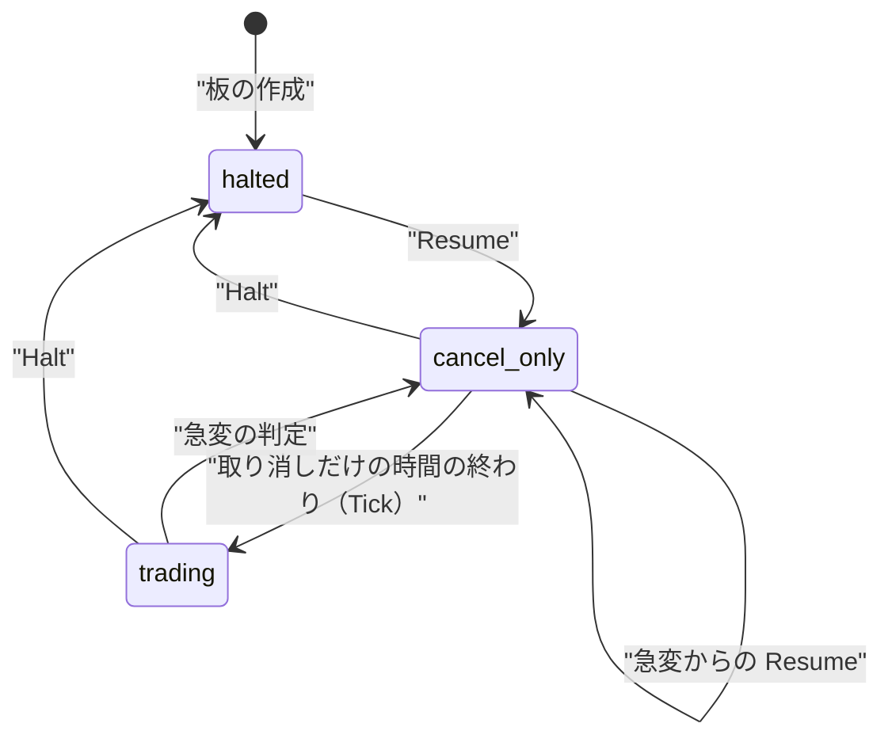
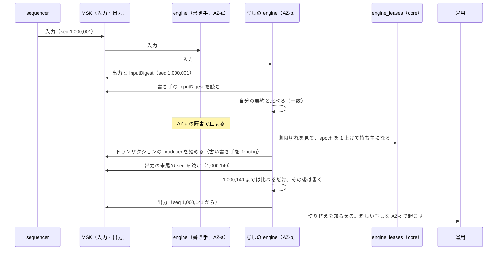

# Matching engine: Coinbase

板とマッチングエンジンの設計。全体像は [README.md](README.md) にある。順序付けと記録の方式は [ADR-0002](../decisions/0002-sequencer-and-event-journal.md)、約定の規則は [ADR-0003](../decisions/0003-matching-rules-and-self-trade-prevention.md) で決めている。この文書は、その 2 つを `engine-core` の型と手順に落とし、入出力の形式（[ADR-0012](../decisions/0012-engine-io-encoding-and-ticks.md)）、銘柄の設定（[ADR-0013](../decisions/0013-instrument-config-versioning.md)）、要約とスナップショット（[ADR-0014](../decisions/0014-output-hash-chain-and-snapshots.md)）、写しのエンジンと切り替え（[ADR-0015](../decisions/0015-shadow-engine-failover.md)）を決める。

## 1. 範囲

この領域が持つもの：

- `engine-core` の板の型、注文の種類と期限、突き合わせ、自己約定の防止、価格の帯、板の状態
- 入力と出力の型と符号化、時刻の進め方（tick の入力）
- 銘柄の設定とそのバージョン
- 出力の要約（ハッシュの連鎖）、スナップショットの形、再生の道具（`engine-replay`）、参照の実装（`engine-ref`）
- 写しのエンジンと、出力の書き手の切り替え

持たないもの：

| もの | 任せる領域 |
| --- | --- |
| 注文の検査、拘束、`client_order_id` の冪等、送り直し、速さの上限 | [order-entry-and-risk.md](order-entry-and-risk.md) |
| 板の差分・約定・ローソク足の配信 | [market-data.md](market-data.md) |
| 約定の記帳、手数料の表と端数 | ledger-and-balances |
| 相場の急変と不公正取引の兆しの検出の規則 | market-surveillance |
| EC2 の配置、MSK の構成、大阪での再開 | infrastructure |
| エンジンの入れ替えの手順 | delivery、[runbooks/deploy-and-rollback.md](../runbooks/deploy-and-rollback.md) |

## 2. 要件

| NFR | この領域に効くこと |
| --- | --- |
| NFR-002 | エンジンの 1 入力の処理 p99 100µs |
| NFR-003 | 同じスナップショットと入力の列から、出力の要約が一致しない件数 0。本番と写しの食い違い 0。日次の再生の食い違い 0 |
| NFR-011 | AZ の障害で板の再開まで RTO 5 分（写しのエンジンへの切り替え） |
| NFR-012 | 同じ自己約定の組の約定 0 |
| NFR-013 | `seq` の順と違う順で処理した入力 0 |

intent の守るべき振る舞いのうち、次の 3 つをこの領域が持つ。

- 板の状態を変える入力は、sequencer の番号の順にだけエンジンに入る。抜けも重なりもない。
- 同じスナップショットと入力の列から、同じ出力の列が出る。本番と写しの要約は入力の番号ごとに一致する。
- 価格の良い順、同じ価格なら受け付けの順に約定する。約定の価格は板にあった注文の価格。同じ利用者の売りと買いは約定しない。

## 3. 本家の形（確かめたこと）

| 項目 | 本家 | 出典（確認日） |
| --- | --- | --- |
| 突き合わせ | 連続の先着順で、価格・時間の優先で突き合わせる | [Exchange Matching Engine](https://docs.cdp.coinbase.com/exchange/concepts/matching-engine)（2026-11-15） |
| 約定の価格 | 板にあった注文の価格。テイカーの価格ではない | 同上 |
| 注文の状態 | `received` → `open` → `done` | 同上 |
| 自己約定の防止 | 既定は `dc`（小さいほうを取り消し、大きいほうを減らす。同じ数量なら両方を取り消す）。`co`・`cn`・`cb` もある。テイカーの指定が優先する | 同上 |
| 成行と `dc` | 金額の指定の成行の買いは、金額を減らす。数量と金額の両方の指定では数量を減らす | 同上 |
| 配信の型 | `full` の経路に `received`・`open`・`done`・`match`・`change`・`activate` の型がある | [Channels](https://docs.cdp.coinbase.com/exchange/websocket-feed/channels)（2026-11-15） |
| 期限の種類（`gtt`・`fok` など）、`post_only` の振る舞い、価格の帯、板の状態の種類 | 上の頁には書かれていない。注文の API の頁は確認できなかった | **未検証** |
| エンジンの実装、言語、配置、遅れ、スナップショットの方式 | 公式の資料で確かめられなかった | **未検証** |

本家と違うのは自己約定の防止の既定だけで、[README.md](README.md) の 1.4 節に書いた。

## 4. 設計

### 4.1 構成

エンジンの部品は Rust の crate に分ける。約定の規則は `engine-core` にだけ書く（AGENTS.md）。

| crate | 中身 | I/O |
| --- | --- | --- |
| `engine-proto` | 入力と出力の型、固定の符号化と復号（ADR-0012）、記録の形のバージョン | なし |
| `engine-core` | 板の型、`apply(state, input) -> (state, outputs)`、要約の計算、スナップショットの作成と読み込み | なし |
| `engine-host` | MSK の入力を読み、`engine-core` を呼び、出力を書く。持ち主の記録、写しの比べ、S3 へのスナップショットの書き込み | MSK、S3、Aurora core |
| `engine-ref` | 素直な配列の板の参照の実装。速さを気にせず、規則を読みやすく書く | なし |
| `engine-replay` | スナップショットと記録から再生し、要約を比べる道具 | S3、ファイル |

- `engine-core` は `std` の `HashMap`・`HashSet`、壁の時計、乱数、スレッド、浮動小数点を使わない。`clippy` の `disallowed-types`・`disallowed-methods` で落とす。
- 数量・価格・代金は `u128`（数量と代金）と `u64`（価格）で持ち、演算は検査つき（`checked_mul` など）にする。桁あふれは入力の拒否ではなく板の停止にする（起きてはいけない誤りなので、黙って通さない）。

### 4.2 入力と出力

入力は sequencer が `seq`・`ts`・`epoch` を付けたものだけである（ADR-0002）。型と符号化は [ADR-0012](../decisions/0012-engine-io-encoding-and-ticks.md) で決める。

| 入力 | 主な項目 | 出す者 |
| --- | --- | --- |
| `NewOrder` | `order_id`、`account_id`、`stp_group_id`、向き、種類、期限、価格、数量か金額、成行の買いの代金の上限、自己約定の指定、メイカーとテイカーの手数料の率（ppm）と表のバージョン、口座の注文の数の上限 | `order-gateway` |
| `Cancel` | `order_id`、`account_id` | `order-gateway` |
| `CancelAll` | `account_id`（板の中の、その口座の全部の注文） | `order-gateway` |
| `AccountBlock`・`AccountUnblock` | `account_id`、理由のコード | `order-gateway`（[ADR-0019](../decisions/0019-account-trading-restrictions.md)） |
| `Halt`・`Resume` | 理由のコード、`Resume` は取り消しだけの時間 | `ops-api`（2 人の承認の後） |
| `SetConfig` | 銘柄の設定の全体とバージョン | `ops-api`（[ADR-0013](../decisions/0013-instrument-config-versioning.md)） |
| `SetReferencePrice` | 運用者が入れる参照の価格（直近の約定も気配もないとき） | `ops-api` |
| `Tick` | なし（`ts` だけ）。sequencer が 1 秒ごとに入れる | sequencer |

| 出力 | 主な項目 |
| --- | --- |
| `OrderOpened` | `order_id`、板に残った数量 |
| `OrderRejected` | `order_id`、理由のコード（4.4 節） |
| `Trade` | `trade_seq`、メイカーとテイカーの `order_id` と `account_id`、価格、数量、代金、それぞれの手数料の率 |
| `OrderDone` | `order_id`、理由（`filled`・`canceled`・`ioc_remainder`・`market_remainder`・`stp`・`blocked`）、約定した数量の合計 |
| `CancelRejected` | `order_id`、理由（`already_done`・`not_owner`・`market_not_trading`）。板にない `order_id` の取り消しは拒まずに印を付ける（4.3 節） |
| `CancelRecorded` | `order_id`、印の期限。この後に同じ `order_id` の注文が約定しないことを示し、`ledger-poster` が拘束を戻してよい合図になる（[ADR-0018](../decisions/0018-cancel-idempotency-and-early-cancel.md)） |
| `BookDelta` | `book_seq`、変わった価格の段ごとの合計の数量（0 は段の消滅） |
| `MarketStateChanged` | 前と後の状態、理由のコード |
| `ConfigApplied`・`ConfigRejected` | 設定のバージョン |
| `SnapshotMarker` | スナップショットの `seq` と状態のハッシュ（[ADR-0014](../decisions/0014-output-hash-chain-and-snapshots.md)） |
| `InputDigest` | 入力ごとに 1 つ。`seq`、入力の `ts`、`output_hash[seq]` |

- どの入力も、出力の最後に `InputDigest` を 1 つ出す。出力のない `Tick` も要約を進める。写しの比べは `InputDigest` だけを見る。
- `BookDelta` の `book_seq` は、板の差分が出るたびに 1 上がる板ごとの連番で、エンジンが付ける。配信の取りこぼしの検出に使う（[market-data.md](market-data.md)）。`trade_seq` も板ごとの連番である（ADR-0003）。

### 4.3 板の持ち方

- 価格の段は、買いと売りのそれぞれ `BTreeMap<価格, 段>` で持つ。段の中は `seq` の順の待ち行列（`VecDeque`）にする（ADR-0003）。
- `order_id` から注文を引く索引は `BTreeMap<order_id, 位置>` にする。`HashMap` は使わない（反復の順序に依らないことを型で守る。[quality.md](../quality.md) の 3 節の誘い）。
- 段の中の取り消しは、待ち行列の要素に印を付け、先頭に来たときに捨てる。段の合計の数量は印を付けたときに減らす。
- 口座ごとに、板にある注文の数を `BTreeMap<account_id, 数>` で持つ。`NewOrder` に付いた上限を超える注文は `too_many_open_orders` で拒む（上限の値は [order-entry-and-risk.md](order-entry-and-risk.md) の 4.8 節）。
- 先に届いた取り消しの印（`order_id` と、期限の `ts`）を持つ。後から届いた同じ `order_id` の注文は、板に入れずに `OrderDone(canceled)` にする（[ADR-0018](../decisions/0018-cancel-idempotency-and-early-cancel.md)）。印は 60 秒（`ts` で数える）で消す。
- 板の注文の数の上限は 1 つの板に 100 万件（本システムの値）。超える注文は `book_full` で拒む。1 件を約 120 バイトと見て、板の状態は 200 MB 以下に収まる。

### 4.4 注文の種類と突き合わせ

種類は ADR-0003 の表のとおり（指値の `gtc`・`ioc`・`post_only`、成行の数量の指定と金額の指定）。エンジンの中の検査の順は次のとおりで、最初に当たった理由で拒む。

| 順 | 検査 | 理由のコード |
| --- | --- | --- |
| 1 | 同じ `order_id` がすでにある、か `done` になった（直近 60 秒） | `duplicate_order_id` |
| 2 | 先に届いた取り消しの印がある | 拒まずに `OrderDone(canceled)` |
| 3 | 口座が `AccountBlock` の中 | `account_blocked` |
| 4 | 板の状態が `trading` でない | `market_not_trading` |
| 5 | 価格の刻み、数量の刻み、最小・最大の数量（銘柄の設定） | `tick_violation`・`size_below_min`・`size_above_max` |
| 6 | 指値が価格の帯の外 | `price_out_of_band` |
| 7 | `post_only` が反対側と交差する | `post_only_would_cross` |
| 8 | 口座の注文の数、板の注文の数 | `too_many_open_orders`・`book_full` |

- 5〜8 は `order-gateway` も確かめるが、エンジンが正本である（銘柄の設定と帯は、`order-gateway` が読む写しより新しいことがある）。エンジンが拒んだ注文の拘束は、`ledger-poster` が `OrderRejected` で戻す。
- **成行の金額の指定**：残りの金額で買える数量を、数量の刻みで切り捨てて約定させる。残りの金額が 1 刻みの代金に届かなくなったら、`OrderDone(market_remainder)` にする。手数料を金額に含めるかは `order-gateway` が `NewOrder` の金額に入れる前に決める（エンジンは手数料を知らない。[order-entry-and-risk.md](order-entry-and-risk.md) の 4.3 節）。
- **成行の止まり方**：参照の価格の上下 5% の端を越える段とは突き合わせない。端に達したか板が尽きたら、残りを `OrderDone(market_remainder)` にする。
- **成行の数量の指定の買い**：代金の合計が `NewOrder` の代金の上限（`order-gateway` が拘束した額から手数料の上限を除いた額）を超える約定はしない。超える手前で残りを `OrderDone(market_remainder)` にする（[order-entry-and-risk.md](order-entry-and-risk.md) の 4.3 節）。
- **自己約定の防止**：`stp_group_id` が同じ注文どうしで働く。既定は `cancel_newest`（ADR-0003）。`decrement` は本家の `dc` と同じく、同じ数量なら両方を取り消す。
- 約定の代金は `floor(価格 × 数量 ÷ 基準の資産の 1 単位)`（ADR-0003）。

### 4.5 時刻と参照の価格

- エンジンが使う時刻は入力の `ts` だけである。時間で進む振る舞い（取り消しだけの時間の終わり、参照の価格の古さ、取り消しの印の期限）を、入力が来ない間も進めるため、sequencer は板ごとに 1 秒ごとに `Tick` を入れる（[ADR-0012](../decisions/0012-engine-io-encoding-and-ticks.md)）。1 日 86,400 件で、記録の量には効かない。
- 参照の価格は次の順で選ぶ（ADR-0003 の「直近 1 分に更新されたもの」を、順を付けて決める）。
  1. 直近 60 秒の中の最後の約定の価格
  2. 1 がなく、買いと売りの両方の最良の気配があり、直近 60 秒の中で変わったなら、その中値（切り捨て）
  3. どちらもなければ、最後の `SetReferencePrice` の値。それもなければ、指値は帯で拒まず、成行は受けない（`market_not_trading` ではなく `no_reference_price` で拒む）
- 急変の判定のため、`Tick` ごとに参照の価格を 60 個の輪の配列に入れる。今の値と、60 秒の中の最大・最小の差が 15% 以上なら、板を `cancel_only` にする（ADR-0003。値は market-surveillance の領域と見直す）。

### 4.6 板の状態

状態と受ける入力は ADR-0003 の表のとおり。遷移は下の決定表（DT-ME-1）を正とし、図はその要約である。

| # | 今の状態 | 入力・条件 | 次の状態 | 出力 |
| --- | --- | --- | --- | --- |
| 1 | `halted` | `Resume`（取り消しだけの時間 T、既定 5 分） | `cancel_only`（`trading_at = ts + T`） | `MarketStateChanged` |
| 2 | `cancel_only` | `ts >= trading_at` の最初の入力（`Tick` を含む） | `trading` | 同上。その入力の処理の前に遷移する |
| 3 | `trading` | 急変の判定（4.5 節） | `cancel_only`（`trading_at` なし） | 同上。運用に知らせる |
| 4 | `cancel_only`（`trading_at` なし） | `Resume` | `cancel_only`（`trading_at = ts + T`） | 同上 |
| 5 | どれでも | `Halt` | `halted` | 同上。板の注文は残す。`SnapshotMarker` を出す |
| 6 | `halted` | `Halt` | `halted` | なし（冪等） |
| 7 | `trading`・`cancel_only` | `Resume` | 変えない | なし |
| 8 | `halted` | `NewOrder`・`Cancel`・`CancelAll` | `halted` | `OrderRejected(market_not_trading)`。取り消しは `CancelRejected(market_not_trading)` |
| 9 | `cancel_only` | `NewOrder` | `cancel_only` | `OrderRejected(market_not_trading)` |
| 10 | どれでも | 入力の `seq` が前の値 ＋ 1 でない、`epoch` が今より小さい、桁あふれ | `halted` | `MarketStateChanged(integrity_halt)`。その入力は処理しない |

- 板の停止の間も注文と拘束は残る（[runbooks/market-halt.md](../runbooks/market-halt.md)）。
- 10 行目は `engine-host` が `engine-core` を呼ぶ前にも確かめる。二重の守りにする。

### 4.7 銘柄の設定

銘柄の設定はバージョンつきで、sequencer を通る `SetConfig` でだけ変える（[ADR-0013](../decisions/0013-instrument-config-versioning.md)）。

| 項目 | BTC/JPY | ETH/JPY | 変えてよい状態 |
| --- | --- | --- | --- |
| 価格の刻み | 1 円 | 1 円 | `halted`、かつ板の注文がすべて新しい刻みに合う |
| 数量の刻み | 0.0001 BTC（10,000 satoshi） | 0.001 ETH（10^15 wei） | 同上 |
| 最小の数量 | 0.0001 BTC | 0.001 ETH | どれでも（板にある注文には効かない） |
| 最大の数量（1 注文） | 100 BTC | 1,000 ETH | どれでも（同上） |
| 指値の帯 | 参照の価格の上下 10% | 同じ | どれでも |
| 成行の帯 | 上下 5% | 同じ | どれでも |
| 急変の判定 | 60 秒で 15% | 同じ | どれでも |
| 取り消しだけの時間の既定 | 5 分 | 5 分 | どれでも |

- 刻みと最小の数量は ADR-0003 の値、最大の数量は ADR-0013 で決めた本システムの値である。
- 変更は Dev と Ops の 2 人の承認（[runbooks/README.md](../runbooks/README.md) の 2 節）。

### 4.8 要約とスナップショット

[ADR-0014](../decisions/0014-output-hash-chain-and-snapshots.md) で決める。

- `output_hash[seq] = SHA-256(output_hash[seq-1] ‖ seq ‖ その入力の出力の列の符号化)`。`output_hash[0]` は板の作成の時の固定の値。符号化は ADR-0012 の固定の形で、同じ出力は同じバイトになる。
- スナップショットは `seq` が 100,000 の倍数のときと、`Halt` のたびに作る（ADR-0002）。きっかけを `seq` と入力の種類だけで決めるので、本番と写しが同じ点でスナップショットを作り、同じ `SnapshotMarker` を出す。
- スナップショットは、見出し（形のバージョン、板、`seq`、`epoch`、設定のバージョン、`output_hash`、`trade_seq`・`book_seq` の次の値）、注文（向き、価格、`seq` の順）、口座ごとの数と止め、取り消しの印、参照の価格の輪、末尾の状態のハッシュの順に並べる。
- 書き手のエンジンだけが S3 に `snapshots/<pair>/<seq>.snap` として書く。読み込む側は、ファイルの状態のハッシュが記録の `SnapshotMarker` と一致することを確かめてから使う。
- 戻りの時間：スナップショットの読み込み（200 MB で数秒）と、その後の最大 10 万入力の再生（1 入力 10µs として 1 秒）で、数十秒以内と見込む（`engine-latency-poc` で確かめる）。

### 4.9 写しのエンジンと切り替え

[ADR-0015](../decisions/0015-shadow-engine-failover.md) で決める。本番（書き手）と写しは、別の AZ で同じ入力のトピックを読む。書き手は core の `engine_leases` の行（期限 5 秒、更新 1 秒）を持つ。

- 写しの遅れ（書き手の `InputDigest` から写しの計算まで）は p99 100ms を目標にし、5 秒を超えたらチケットにする。遅れの間は比べが遅れるだけで、板は止めない。
- 要約が食い違ったら、両方の板を止める（ADR-0002）。どちらが正しいかは再生で決める（[runbooks/market-halt.md](../runbooks/market-halt.md)）。
- 切り替えは期限の 5 秒と、トピックの読み込みで、多くは 10 秒前後で終わる見込みである。目標は 5 分（NFR-011）。
- 切り替えの間も sequencer は入力を受け付ける（入力の記録は止まらない）。利用者には、受け付けた注文の約定と配信が遅れて見える。

### 4.10 例：BTC/JPY の 1 件の買いと自己約定

参照の価格は 15,000,000 円（直近の約定）。指値の帯は 13,500,000〜16,500,000 円。板の売りは次の 2 つ。

| `seq` | 口座 | 向き | 価格 | 数量 |
| --- | --- | --- | --- | --- |
| 101 | A | 売り | 15,000,000 | 0.05 BTC |
| 102 | B | 売り | 15,000,010 | 0.10 BTC |

**1. C の指値の買い**（`seq` 103、`gtc`、15,000,010 円、0.12 BTC、テイカーの率 1,000 ppm。[ADR-0027](../decisions/0027-fee-schedules-and-rounding.md)）

- `order-gateway` は `floor(15,000,010 × 0.12) = 1,800,001` 円に手数料の上限 `ceil(1,800,001 × 1,000 ÷ 1,000,000) = 1,801` 円を足した 1,801,802 円を拘束してから送る（[order-entry-and-risk.md](order-entry-and-risk.md)）。
- エンジンの出力：

| 出力 | 中身 |
| --- | --- |
| `Trade`（`trade_seq` 501） | A と C、15,000,000 円、0.05 BTC、代金 750,000 円 |
| `Trade`（`trade_seq` 502） | B と C、15,000,010 円、0.07 BTC、代金 `floor(1,050,000.7) = 1,050,000` 円 |
| `OrderDone` | A の注文、`filled` |
| `OrderDone` | C の注文、`filled`、合計 0.12 BTC |
| `BookDelta`（`book_seq` 9,001） | 売り 15,000,000 → 0、売り 15,000,010 → 0.03 |
| `InputDigest` | `seq` 103、`output_hash[103]` |

- 約定の価格は板の注文の価格で、C は指値より 10 円安く 0.05 BTC を買えた。C の代金は 1,800,000 円で、拘束の残り 1,802 円は `done` で戻る（ADR-0005 の既定では、買い手の手数料は受け取る BTC から引く：5,000 satoshi と 7,000 satoshi）。

**2. D の成行の売りと自己約定**

板の買い：E が 14,999,995 円 0.01 BTC（`seq` 104）、D が 14,999,990 円 0.03 BTC（`seq` 105）。D が数量 0.05 BTC の成行の売り（`seq` 106、自己約定の指定なし）を出す。

- E と 14,999,995 円 0.01 BTC で約定する（`trade_seq` 503）。
- 次の段は D 自身の買いなので、既定の `cancel_newest` で D の成行の残り 0.04 BTC を `OrderDone(stp)` にする。D の板の買いは残る。
- 成行の帯の下の端（14,250,000 円）には届いていない。

## 5. 障害のときの振る舞い

| 障害 | 検知 | 振る舞い | 回復 |
| --- | --- | --- | --- |
| 書き手のエンジンの停止（AZ の障害を含む） | `engine_leases` の期限切れ（5 秒） | 写しが持ち主になり、出力の末尾から書く（4.9 節） | 新しい写しを別の AZ でスナップショットから起こす |
| 写しのエンジンの停止 | 写しの持ち主の記録の更新が止まる | 書き手は続ける。比べが止まった時間を記録する | 新しい写しを起こし、追いついたら比べを再開する |
| 要約の食い違い | 写しの比べ、日次の再生 | 両方の板を `halted` にする | [runbooks/market-halt.md](../runbooks/market-halt.md) |
| `seq` の抜け・重なり・古い `epoch` | `engine-host` と `engine-core` の検査 | その入力を処理せず `halted` | sequencer を 1 つにし、正しい入力から続ける |
| 桁あふれ | 検査つきの演算 | `halted`（`integrity_halt`） | 原因の入力を再生で特定し、修正のビルドで再生してから再開 |
| MSK の出力の書き込みの失敗 | producer の誤り | 入力の読み込みを止め、書けるまで再試行する。要約は進めない | ブローカーの回復の後に続ける |
| スナップショットの書き込みの失敗 | S3 の誤り | 板は止めない。次の点で再び作る。2 回続けて失敗したらチケット | 再生の時間が伸びるだけ |
| スナップショットのハッシュの不一致 | 読み込みの時の確かめ | そのファイルを使わず、1 つ前のスナップショットから再生する | 原因を調べる（改ざん、書き込みの途中の停止） |

## 6. 上限

| 対象 | 値 | 根拠 |
| --- | --- | --- |
| 1 入力の処理 | p99 100µs | NFR-002 |
| 1 つの板の入力 | 3,000 件/秒を 10 分（S1 の全体の最大を 1 板で受ける） | README の 2 節 |
| 1 つの板の注文 | 100 万件 | 4.3 節 |
| スナップショット | 10 万入力ごと、停止のたび | ADR-0002 |
| `Tick` | 1 秒ごと | ADR-0012 |
| 切り替え | 目標 5 分、見込み 10 秒前後 | NFR-011、ADR-0015 |
| 写しの遅れ | p99 100ms、5 秒でチケット | ADR-0015 |

## 7. セキュリティ

- エンジンの EC2 は入力と出力のトピック、S3 のスナップショットの場所、core の `engine_leases` だけに経路を持つ。台帳と利用者のデータには経路を持たない。
- 出力の `account_id` は台帳と本人の配信のために要る。公開の配信は `market-data` が段の合計だけにする（[market-data.md](market-data.md)）。
- スナップショットと記録の S3 の場所は、書き手のエンジンの役割だけが書け、上書きと削除を禁じる（オブジェクトのロック）。読み込みの時のハッシュの確かめで改ざんを見つける。
- `Halt`・`Resume`・`SetConfig`・`SetReferencePrice` は `ops-api` から 2 人の承認の後にだけ出る（`Halt` は当番 1 人でよい）。エージェントはこれらの経路を持たない。

## 8. テスト

性質（PROP-ME）：

| ID | 性質 |
| --- | --- |
| PROP-ME-1 | 任意の入力の列で、`engine-core` と `engine-ref` の約定・取り消し・拒否・板の状態が一致する |
| PROP-ME-2 | 任意の列の任意の点のスナップショットから再生した要約が、通しで流した要約と一致する |
| PROP-ME-3 | 同じ `stp_group_id` の注文どうしの約定 0 |
| PROP-ME-4 | 約定の価格はメイカーの注文の価格。同じ価格の段の約定は `seq` の順 |
| PROP-ME-5 | `post_only` の注文はテイカーにならない。帯の外の約定 0 |
| PROP-ME-6 | 約定の代金は `floor(価格 × 数量 ÷ 単位)`。注文の約定の数量の合計は注文の数量以下 |
| PROP-ME-7 | 任意の sequencer の切り替え・二重の起動・MSK の再送で、処理する `seq` は 1 から抜けなく 1 回ずつ。古い `epoch` の入力の処理 0 |
| PROP-ME-8 | `book_seq` と `trade_seq` は抜けなく 1 ずつ増える。`BookDelta` を順に足した板が、エンジンの板の段の合計と一致する |
| PROP-ME-9 | 先に届いた取り消しの後の同じ `order_id` の注文は、板に入らず約定しない |
| PROP-ME-10 | 写しの切り替えを任意の点で起こしても、出力のトピックの `InputDigest` の列は、切り替えなしの列と同じ |

決定表（DT-ME）：

| ID | 表 |
| --- | --- |
| DT-ME-1 | 板の状態の遷移（4.6 節） |
| DT-ME-2 | エンジンの中の検査の順と理由のコード（4.4 節） |
| DT-ME-3 | 自己約定の 4 つの指定と、成行・指値・数量の大小の組み合わせ |
| DT-ME-4 | 銘柄の設定の変更を受けるか拒むか（4.7 節の「変えてよい状態」） |

- 試験のベクトル：4.10 節の例、同じ価格の段の時間の優先、成行の帯の端、桁の誤りの注文（参照の価格の 10 倍）、金額の指定の成行の端数。期待する値は QA が持つ。
- 変異の試験：`engine-core` に反復の順序に依る書き方を入れたビルドで、写しの比べと PROP-ME-2 が食い違いを見つける。
- 障害の注入：書き手の停止、写しの停止、MSK のブローカーの停止、スナップショットの壊れ（夜間）。

## 9. Story の候補

| Story | 内容 | ADR |
| --- | --- | --- |
| `engine-proto-encoding` | 入力と出力の型、固定の符号化、記録の形のバージョン | 0012 |
| `engine-core-and-ref` | 板、突き合わせ、自己約定、帯、状態、`engine-ref`、PROP-ME-1〜6 | 0003 |
| `sequencer-ticks` | sequencer の 1 秒ごとの `Tick` と、時間で進む遷移 | 0012 |
| `instrument-config` | 銘柄の設定のバージョンと `SetConfig`、DT-ME-4 | 0013 |
| `snapshots-and-replay` | 要約の連鎖、`SnapshotMarker`、S3 への書き込み、`engine-replay`、日次の再生 | 0014 |
| `shadow-engine-and-failover` | 写しの比べ、`engine_leases`、出力の fencing、PROP-ME-10 | 0015 |

roadmap の E9 の `engine-core-and-ref`・`snapshots-and-replay`・`shadow-engine-and-failover` に対応し、`engine-proto-encoding`・`sequencer-ticks`・`instrument-config` を足す。

## 10. 未解決の問い

| 問い | いつ・どう決めるか |
| --- | --- |
| 1 入力の処理 p99 100µs と、切り替えの時間の実測 | `engine-latency-poc` |
| 急変の判定の値（60 秒で 15%）が BTC と ETH で同じでよいか | market-surveillance の領域と、PoC の過去の価格での試算 |
| 参照の価格に外部の参照の価格の提供者の値を使うか（今は板の中の値だけ） | market-surveillance の領域。外部の値を入れるなら sequencer の入力にする |
| 本家の `gtt`・`fok`・逆指値・板の状態の種類 | 公式の資料で確かめられなかった（**未検証**）。MVP は持たない |

## 11. quality.md・runbooks・data-model への項目

### quality.md

- 2.2.2 節の PROP-ME・DT-ME の ID を、8 節の表のとおりに付ける。
- 2.2.1 節 C に、写しの切り替えを任意の点で起こす場面（PROP-ME-10）と、スナップショットの壊れの場面を足す。
- 2.2.1 節 D に、金額の指定の成行の端数と、先に届いた取り消し（PROP-ME-9）を足す。
- `clippy` の `disallowed-types`（`HashMap`・`HashSet`・`f32`・`f64`）を `engine-core` の CI の関門にする。

### runbooks

- `engine-failover.md`（新規）：書き手のエンジンの停止で切り替えが 5 分で終わらないとき（持ち主の記録、fencing、出力の末尾の確かめ、手での切り替えの手順）。[market-halt.md](../runbooks/market-halt.md) のアラートの「切り替えが 5 分で終わらない」から分ける。
- `market-halt.md` に、スナップショットのハッシュの不一致の対処（1 つ前のスナップショットからの再生）を足す。

### data-model

| 表・置き場所 | 主な列 |
| --- | --- |
| core `engine_leases` | `pair`、`role`（`writer`）、`holder_id`、`epoch`、`expires_at` |
| core `instrument_configs` | `pair`、`version`、`config`（jsonb）、`approved_by`（2 人）、`applied_seq`、`status`（`pending`・`applied`・`rejected`） |
| core `engine_snapshots` | `pair`、`seq`、`epoch`、`s3_key`、`state_hash`、`created_at` |
| S3 `snapshots/<pair>/<seq>.snap` | 4.8 節の形 |
| MSK `engine.in.<pair>`・`engine.out.<pair>` | ADR-0012 の符号化。保持 7 日、S3 へ毎時 |
