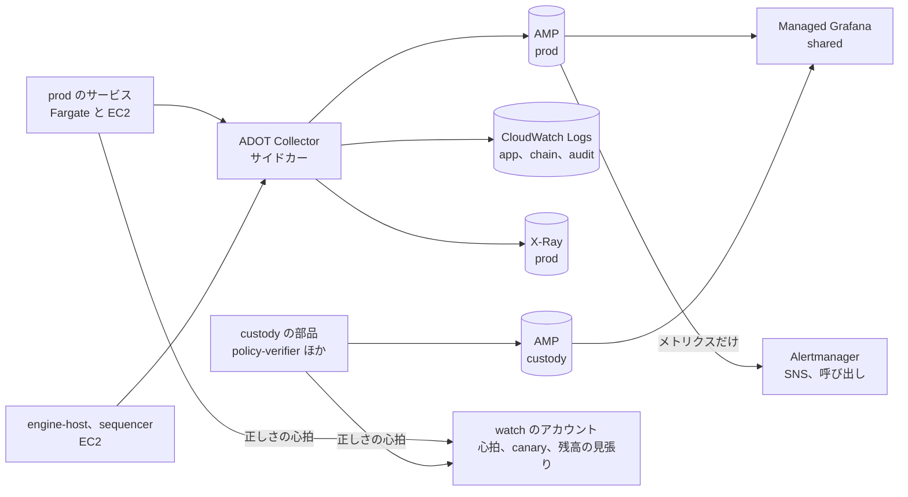
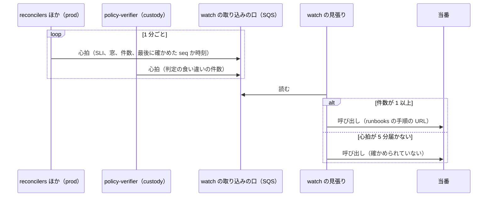

# Observability: Coinbase

ログ・メトリクス・トレース、SLI の計測、正しさの見張り、外からの見張り、秘密を含まない計測の型。全体像は [README.md](README.md) にある。道具は Slack の [ADR-0021](../../../slack/docs/decisions/0021-observability-stack.md) と Stripe の [observability.md](../../../stripe/docs/architecture/observability.md) を引き継ぐ（OpenTelemetry（ADOT）→ AMP・X-Ray・CloudWatch Logs、Managed Grafana で横断）。**SLO の値とアラートの一覧の正本は Ops の [runbooks/README.md](../runbooks/README.md)** で、ここにはそれを計測する仕組みを書く。値を変えるときは runbooks を先に変える。

| 対象 | 決定 |
| --- | --- |
| 正しさの見張りと、別のアカウントの独立の経路 | [ADR-0068](../decisions/0068-correctness-monitors-and-independent-watch.md) |
| 秘密と個人のデータを含まない計測の型 | [ADR-0069](../decisions/0069-telemetry-schema-without-secrets.md) |
| アカウントの分け方（`prod`、`custody`、`watch`） | [ADR-0071](../decisions/0071-aws-accounts-network-and-egress.md)（infrastructure の領域） |
| 計装の道具、バーンレート、アラートの注釈 | Slack の ADR-0021 と Stripe の observability.md の 5 節を引き継ぐ |

## 1. 範囲

この領域が持つもの：

- 計装の共通の部品（`packages/telemetry`、`crates/telemetry`）と、項目の許可の一覧。
- runbooks の 1 節の SLI を、どこで、どの指標で数えるか。
- 正しさの見張り（写しのエンジンの要約の比べ、日次の再生、照合、ウォレットの割合、方針の判定の食い違い）の結果を、指標と心拍にする仕組み。
- 外からの見張り（`canary`）と、`watch` のアカウントのデッドマンスイッチ。
- ログの流れ（`app`・`chain`・`audit`）、保持、読める人。
- アラートの条件の実装と、手順の URL の注釈の検査。

持たないもの：

- SLO の値、アラートの重さ、手順の中身（runbooks）。
- 比べ・照合の計算そのもの（matching-engine、segregation-and-reconciliation、custody-and-keys の各領域）。この領域は、結果を受け取って数える。
- 監査ログの中身と運用者の参照の権限（security の領域。[Auth0 の ADR-0056](../../../auth0/docs/decisions/0056-operator-access.md)）。
- 取引の記録・確認の記録の保存（法令の記録。ledger-and-balances、kyc-and-accounts、regulatory-compliance-japan の各領域）。ログは法令の記録の代わりにしない。
- 負荷のモデルと費用（capacity の領域）。

## 2. 要件

| 要件 | この領域でやること |
| --- | --- |
| NFR-001、NFR-002（受け付け p99 20ms、配信 p99 50ms） | 計る場所と時計を決める（4.3 節）。外からの見張りで利用者の側の値も見る |
| NFR-003、NFR-013（決定性、番号の連続） | 写しの比べの結果と番号の検査を、入力ごとに数え、1 件で呼び出す |
| NFR-004〜NFR-007（残高、記帳、照合、ネットワークにつながる額） | 照合と割合の結果を指標と心拍にする。確かめられていない時間を緑にしない |
| NFR-010（可用性） | 5xx と時間切れを、数えないもの（runbooks の 1 節）を除いて数える |
| NFR-014、NFR-015（署名、スクリーニング） | 2 か所の方針の判定の食い違い、スクリーニングのない署名を数える |
| NFR-016（個人のデータ） | 計測の型で、個人のデータと秘密をログ・トレースに出さない（ADR-0069） |
| intent の K7・K9 | 外からの見張りの結果を、成功の基準の測り方にする |
| AGENTS.md | エージェントは本番のログ・トレースに経路を持たない。チェーンのアドレス・取引の ID を利用者の ID と同じ行に書かない |

## 3. 本家の形（確かめたこと）

| 項目 | 本家 | 出典（確認日） |
| --- | --- | --- |
| 配信の通し番号 | 銘柄ごとに増える整数。抜けは取りこぼし、小さい番号は順序の入れ替わり | [Exchange WebSocket Feed](https://docs.cdp.coinbase.com/exchange/websocket-feed/overview)（2026-11-15） |
| 取引所の置き場所 | 米国の現物の取引所の基盤は AWS の US-EAST-1 の複数の AZ にある。主な部品の AZ の ID として use1-az4 を挙げる。予告なく変わるとする | [Exchange Systems & Operations](https://docs.cdp.coinbase.com/exchange/introduction/systems-operations)（2026-11-15） |
| デプロイの時間帯 | FIX・WebSocket・REST のデプロイは、月・水・木の東部時間 14 時と書く | 同上 |
| 2026 年 5 月の停止 | 2026 年 5 月 7 日、US-EAST-1 の 1 つの AZ の冷却の障害で、マッチングエンジン（Raft の 5 節のクラスタ、1 つの配置グループ）の 3 節が止まり、取引・入出金が数時間止まった。別の AZ への自動の切り替えがなかったと本家は書いた | [InfoQ](https://infoq.com/news/2026/06/coinbase-aws-failure-postmortem)（2026-11-15）。本家のブログの本文は取得できず**未検証** |
| 内部の計測の道具、SLO の値、アラートの条件 | 公式の資料で確かめられなかった | **未検証** |

本家の計測の設計は参考にしない。2026 年 5 月の停止は、外からの見張りと、AZ をまたぐ写しの比べを置く理由の 1 つにする（[ADR-0068](../decisions/0068-correctness-monitors-and-independent-watch.md)、infrastructure の領域の [ADR-0072](../decisions/0072-matching-placement-across-azs.md)）。

## 4. 設計

### 4.1 全体の流れ

各アカウントの中で計測を集め、Grafana は決めたものだけを読む。正しさの心拍は、本体の経路と別に `watch` へ送る。

- **`custody` のログとトレースを、`custody` のアカウントの外に出さない。** Grafana が読むのは、ラベルの値を決めたメトリクスだけにする（Stripe の CDE と同じ形）。
- `watch` は呼び出しを自分の SNS から送り、本体の Alertmanager に依らない（[ADR-0068](../decisions/0068-correctness-monitors-and-independent-watch.md)）。
- ログは CloudWatch Logs から Firehose で `log-archive` の S3（Object Lock）へ送る（4.6 節）。

### 4.2 計装と伝播

- 計装は `packages/telemetry`（TypeScript）と `crates/telemetry`（Rust）に集め、項目は 1 つの定義から生成する（[ADR-0069](../decisions/0069-telemetry-schema-without-secrets.md)）。
- 共通の属性：`service.name`、`service.version`、`deployment.environment`、`cloud.region`、`cloud.availability_zone`、`pair`、`asset`。
- ドメインのスパンを手で足す：拘束の記帳、sequencer への送り、方針の判定、スクリーニングの照会、署名の依頼、放送、ノードの RPC、銀行の API、outbox の書き込み。

| 境界 | 運び方 |
| --- | --- |
| 利用者 → `trading-api`・`app-api` | 外の `traceparent` を受け付けない。入口が始め、応答の `X-<Brand>-Request-Id` と結ぶ |
| 入口 → ドメインのサービス → sequencer | `traceparent` ヘッダー |
| sequencer → MSK → `engine-host`・`ledger-poster`・`md-publisher` | 運ばない。各部品が `(pair, seq)` を属性に持つ別のスパンを作り、Grafana のリンクでつなぐ（ADR-0069） |
| outbox → `relay` → SQS → Worker | outbox の行の `trace_context` 列、SQS のメッセージ属性（Slack と同じ） |
| `wallet-orchestrator` → `custody` | 署名の依頼に `trace_id` だけを渡す。`custody` の側のスパンは `custody` の X-Ray にだけ残る |

**サンプリング**（先頭で決める）：

| 経路 | 割合 | 理由 |
| --- | --- | --- |
| 注文と取り消し | 1%（エラーと 4xx を除く） | S1 の最大 3,000 件/秒。速さはトレースでなくヒストグラムで見る |
| 出金、入金の記帳、日本円の入出金、販売所の受け入れ、署名の依頼 | 100% | 件数が少なく（S1 で入出金 1 万件/日ほど）、調べに全件を使う |
| `canary` と見張りの口座 | 100% | 見張りの結果を調べに使う |
| その他 | 10% | Slack と同じ |

- 捨てたものも、ログには `trace_id` と内部の ID を書く。

### 4.3 SLI の計測

runbooks の 1 節の行ごとに、数える場所と指標を決める。指標の名前は `packages/telemetry` の定数で持つ。

| SLI（runbooks） | 数える場所 | 指標 | 時計 |
| --- | --- | --- | --- |
| 取引所の可用性 | `trading-api`（NLB の 5xx で補う） | `http_server_requests_total{route, status_class}` | — |
| 注文の受け付けの速さ | `trading-api` が要求を読み終えた時刻から、受け付けの応答を書き始める時刻まで | `order_ack_duration_seconds`（ヒストグラム） | タスクの単調な時計 |
| 板の配信の速さ | sequencer が MSK に書けた時刻（入力の `ts`）から、`ws-gateway` が送り出す時刻まで | `md_publish_lag_seconds` | 2 つのホストの壁の時計。時計のずれ（infrastructure の領域）を差し引かない。ずれの指標を並べて見る |
| 販売所の可用性、入出金の受け付けの可用性 | `app-api`、`trading-api` | `http_server_requests_total{route_group}` | — |
| エンジンの決定性 | 写しの `engine-host` の比べ、日次の再生のジョブ | `engine_digest_mismatch_total{pair}`、`engine_digest_compared_seq{pair}`、`replay_mismatch_total{pair}` | — |
| 入力の番号 | `engine-host` | `engine_seq_violation_total{pair, kind}`（`gap`・`duplicate`・`stale_epoch`） | — |
| 使える残高 | `ledger` の残高の行の検査（5 分ごと）と、更新の失敗 | `ledger_negative_available_total{asset}` | — |
| 拘束と注文 | `reconcilers`（5 分ごと） | `hold_reconciliation_mismatch{asset}` | — |
| 約定の記帳 | `ledger-poster`（出力の記録の `ts` から記帳の commit まで）と、`reconcilers` の欠けの検査（1 分ごと） | `trade_settlement_lag_seconds{pair}`、`trade_settlement_duplicate_total`、`trade_settlement_missing{age_bucket}` | 壁の時計 |
| 台帳とウォレット、台帳と銀行・信託 | `reconcilers` | `recon_unexplained{source, tier, asset}`（件数）、`recon_unexplained_jpy{source, tier}`（監視用の円換算） | — |
| ネットワークにつながる額 | `rebalancer`（10 分ごと） | `online_ratio_bp{asset}`（基点。1 bp ＝ 0.01%）、`online_ratio_breach_seconds_total` | — |
| 方針の外の署名 | `policy-verifier`（`custody`）が、`wallet-orchestrator` の通した依頼を拒んだ件数 | `policy_verdict_disagreement_total{reason_code}` | — |
| 出金の速さ | `wallet-orchestrator` の状態の時刻（承認とコンプライアンスの待ちを除く） | `withdrawal_to_broadcast_seconds{asset, tier}` | 状態の行の時刻 |
| 入金の反映 | `deposit-watcher`（閾値に届いたブロックを見た時刻から記帳まで） | `deposit_credit_lag_seconds{asset}` | 壁の時計 |
| ノードの遅れ | `deposit-watcher`（自前の 2 台と外部の見張りの頭の差） | `node_head_lag_blocks{asset, node}` | — |

- **数えないもの**は runbooks の 1 節に従う（残高の不足、価格の帯の外、板の停止の間の拒否、429、予定した板の停止）。数えないものも、`reason_code` のラベルで別に数え、急な上がりをダッシュボードで見る。見張りの口座の要求は `canary="true"` のラベルで分け、SLO の計算から除く。
- **確かめられていない時間を緑にしない。** 正しさの SLI（runbooks で「品質の判定に使う」に○）は、比べ・照合の最後に確かめた `seq` か時刻を `*_last_checked` のゲージに出す。窓の中で 1 回も確かめていなければ、SLI の値を「不明」にし、`watch` のデッドマンスイッチが呼び出す（4.4 節）。
- 金額の指標は監視にだけ使い、正本にしない（[ADR-0069](../decisions/0069-telemetry-schema-without-secrets.md)）。

### 4.4 正しさの見張り

比べ・照合の結果は、本体の AMP に出すのに加えて、1 分ごとの心拍として `watch` に送る（[ADR-0068](../decisions/0068-correctness-monitors-and-independent-watch.md)）。

| 見張り | 送り手 | 心拍の中身 | 手順 |
| --- | --- | --- | --- |
| 写しのエンジンの要約の比べ | 写しの `engine-host` | 板ごとの比べた最後の `seq`、食い違いの件数 | [market-halt.md](../runbooks/market-halt.md) |
| 日次の再生 | 再生のジョブ | 再生した `seq` の範囲、食い違いの件数 | [market-halt.md](../runbooks/market-halt.md) |
| 入力の番号 | `engine-host` | 違反の件数 | [market-halt.md](../runbooks/market-halt.md) |
| 拘束と注文、負の `available` | `reconcilers`、`ledger` | 件数、最後の検査の時刻 | `balance-hold-mismatch.md`（計画） |
| 約定の記帳の重複と欠け | `reconcilers` | 件数、最も古い欠けの経過 | [ledger-reconciliation-mismatch.md](../runbooks/ledger-reconciliation-mismatch.md) |
| 台帳とウォレット | `reconcilers` | 段ごとの説明のつかない差の件数 | [ledger-reconciliation-mismatch.md](../runbooks/ledger-reconciliation-mismatch.md) |
| ネットワークにつながる額 | `rebalancer` | 割合（bp）、超えの秒 | `hot-ratio-breach.md`（計画） |
| 方針の判定の食い違い | `policy-verifier` | 件数 | [hot-wallet-compromise.md](../runbooks/hot-wallet-compromise.md) |
| ホットとウォームの残高の減り | `watch` が自分で読む | 説明のつかない減りの額（監視用） | [hot-wallet-compromise.md](../runbooks/hot-wallet-compromise.md) |

### 4.5 外からの見張り（`canary`）

`watch` のアカウントの `canary` が、利用者と同じ公開の口から確かめる（[quality.md](../quality.md) の 4.2 節）。

| 場面 | 頻度 | 合格 |
| --- | --- | --- |
| 見張りの口座が、メイカーだけの指値（最良の価格から 9% 離した、価格の帯の内側）を出し、取り消す | 5 分 | 受け付け 100ms 以内、`open` と取り消しの通知が `ws.<brand>.<domain>` で 2 秒以内、拘束が 0 に戻る |
| 板の配信の購読と通し番号の連続 | 常時（1 接続） | 抜け 0、最後の受信から 5 秒以内 |
| 販売所の 1,000 円の購入と売却 | 15 分 | 提示と受け入れが成功、台帳に記帳される |
| 状況のページとお知らせの表示 | 5 分 | 200 |

- 見張りの口座は、本システムの口座の種類 `canary` で、利用者の取引高、手数料の収益、監視（market-surveillance の領域）の兆し、SLO から除く。
- メイカーだけの指値を最良の価格から離して置くのは、利用者の注文と約定せず、板の最良の価格を動かさないためである。数量は最小の数量にする。

**約定の見張りの扱い**（2026-11-15 の統合で甲を既定の案にした。法務の L7 の確認待ち。[quality.md](../quality.md) の 4.2 節も甲に直した）：[quality.md](../quality.md) の 4.2 節は「見張りの口座どうしで 5 分ごとに注文と約定」と書く。本システムの口座どうしの約定は、仮装売買の形に当たりうる（法務の L7）。また、板で突き合わせる以上、見張りの口座どうしだけで約定させることはできない（買いの指値は、先に板にある利用者の売りと価格の優先で約定する）。案は次の 3 つ。

| 案 | 中身 | 代償 |
| --- | --- | --- |
| 甲（推奨） | 本番の `canary` は注文と取り消しだけ（上の表）にし、約定の経路は、本番の約定の指標（記帳の遅れ、配信）と、staging の約定の `canary` で見る | 本番で約定の通知の端から端を `canary` で確かめない |
| 乙 | 見張りの口座が、利用者の注文と最小の数量で約定する（即時の約定か取り消し） | 本システムが利用者の相手になる。自己の売買と利益相反の整理が要る（法務の L7） |
| 丙 | 見張りの口座どうしで約定させる | 板の規則の上でできない。仮装売買の形（法務の L7） |

**入出金の見張りの扱い**（2026-11-15 の統合で b を既定の案にした。PM の判断待ち P13。quality.md の 4.2 節も b に直した）：[quality.md](../quality.md) の 4.2 節は「1 日 1 回テストネットでの入出金」を本番の `canary` に置く。しかし本番のノードと署名の境界は本番のネットワーク（mainnet）だけを扱い、テストネットの入出金は本番の経路を通らない。案は次の 3 つ。

| 案 | 中身 | 利点 | 代償 |
| --- | --- | --- | --- |
| a | staging でテストネットの入出金を毎日回し、本番は回さない | 本物の資産が動かない | 本番の署名の境界・ノード・方針の経路を確かめない |
| b（推奨） | 本番で、本システムの `canary` の口座と本システムの見張りのウォレット（本システムの財産）の間で、1 日 1 回、最小の額（BTC 0.0001、ETH 0.001）を出金し、入金として受ける | 本番の出金・署名・放送・入金の記帳を端から端で確かめる | 本物の手数料を払う。方針の決定表に見張りのウォレットの行が要る。本システムの財産の口座の扱いが要る |
| c | 本番で、利用者と同じテストネットの資産の扱いを足す | — | 本番にテストネットの経路を足すことになり、取り違えの面が増える |

- b は、署名の方針（custody-and-keys の領域）と、本システムの財産の扱い（ledger-and-balances の領域）に関わる。範囲の判断を PM に、方針の行をセキュリティと財務に委ねる（11 節）。

### 4.6 ログ、保持、読める人

1 行 1 JSON の構造化ログ。項目は許可の一覧の中だけ（[ADR-0069](../decisions/0069-telemetry-schema-without-secrets.md)）。

| 流れ（ロググループ） | 持てる ID | 持てない項目 | 読める人 |
| --- | --- | --- | --- |
| `app` | `account_id`、`order_id`、`withdrawal_id`、`deposit_id`、`quote_id`、`request_id`、`trace_id`、`pair`、`seq` | チェーンのアドレス、取引の ID、個人のデータ、秘密 | Ops、Ops が許可した Dev（読むだけ、期限つき） |
| `chain` | `withdrawal_id`、`deposit_id`、`transfer_id`、アドレス、取引の ID、ブロックの番号 | `account_id`、`user_id`、個人のデータ、秘密 | Ops とセキュリティの決めた役割（期限つき） |
| `audit` | 運用者の ID、操作、対象の内部の ID、理由のコード | 個人のデータの値 | セキュリティ（中身と権限は security の領域） |
| `custody`（`custody` のアカウントの中） | 署名の依頼の ID、方針のバージョン、判定、承認者の ID | 鍵の材料、承認の署名の中身 | セキュリティ（期限つき）。`custody` のアカウントの外に出さない |

| データ | すぐに使える場所 | 保管 |
| --- | --- | --- |
| `app`・`chain` のログ | CloudWatch Logs 120 日 | `log-archive` の S3（Object Lock のコンプライアンスモード）13 か月（本システムの値。Stripe と同じ） |
| `audit`、CloudTrail、Config、VPC フローログ、WAF・NLB のログ | CloudWatch Logs か S3＋Athena で 120 日 | `log-archive` 13 か月以上。法令の記録の要件で伸ばすか（法務の L4・L13） |
| メトリクス | AMP 150 日 | 保管しない |
| トレース | X-Ray 30 日 | 保管しない |

- 取引の記録と確認の記録の保存の期間は法令の記録の要件（法務の L4）で、ログの保持とは別の表と S3 に持つ。ログの保持を、法令の記録の保存の代わりにしない。
- **AI エージェントは本番のログ・トレース・メトリクスに経路を持たない。** 調べに使うときは、人が取り出した、ID と数と理由のコードだけの記録を渡す（[quality.md](../quality.md) の 4.3 節）。`chain` と `custody` のログは渡さない。
- CS の役割は、ログを読めない。問い合わせは運用の画面で、問い合わせに要る項目だけを見る（security の領域）。

### 4.7 アラートの一覧

重さと閾値の正本は runbooks の 1 節にある。ここでは、条件の実装の場所と送り先を書く。

| アラート | 実装 | 送り先 | 手順 |
| --- | --- | --- | --- |
| 可用性のバーンレート（取引所、販売所、入出金） | AMP のルール（Stripe の 5.1 節の窓） | Alertmanager | [incident-response.md](../runbooks/incident-response.md) |
| 受け付け・配信の遅れ | AMP のルール | Alertmanager | `order-entry-degraded.md`、`market-data-degraded.md`（計画） |
| 写しの要約の食い違い、番号の違反、再生の食い違い | AMP のルール ＋ `watch` | 両方 | [market-halt.md](../runbooks/market-halt.md) |
| 負の `available`、拘束の照合の不一致 | 同上 | 両方 | `balance-hold-mismatch.md`（計画） |
| 約定の記帳の重複・欠け・遅れ | 同上 | 両方 | [ledger-reconciliation-mismatch.md](../runbooks/ledger-reconciliation-mismatch.md) |
| 台帳とウォレット・銀行・信託の差 | 同上 | 両方 | [ledger-reconciliation-mismatch.md](../runbooks/ledger-reconciliation-mismatch.md) |
| ネットワークにつながる額の超え | 同上 | 両方 | `hot-ratio-breach.md`（計画） |
| 方針の判定の食い違い、ホットの残高の説明のつかない減り | `custody` の AMP ＋ `watch` | 両方（SEV1） | [hot-wallet-compromise.md](../runbooks/hot-wallet-compromise.md) |
| 心拍の途絶（5 分） | `watch` | `watch` の SNS | [incident-response.md](../runbooks/incident-response.md) |
| `canary` の 2 回続けての失敗 | `watch` | `watch` の SNS | [incident-response.md](../runbooks/incident-response.md) |
| ノードの遅れ、2 台の食い違い、入金の記帳の停止 | AMP のルール | Alertmanager | [chain-reorg.md](../runbooks/chain-reorg.md) |
| 出金の詰まり、放送の失敗の急増 | AMP のルール | Alertmanager | `stuck-withdrawals.md`（計画） |
| 提供者の障害、銀行の障害 | AMP のルール（アダプターの `outcome`） | Alertmanager | `provider-outage.md`、`bank-outage.md`（計画） |
| Aurora Global Database の遅延、MSK の写しの遅れ | CloudWatch アラーム | SNS | [disaster-recovery.md](../runbooks/disaster-recovery.md) |
| 時計のずれ（infrastructure の領域の値） | AMP のルール（chrony の指標） | Alertmanager | `order-entry-degraded.md`（計画） |
| `app` のログでのアドレス・API キーの形の検出 | 購読のフィルター → 走査の Lambda | SNS | `privacy-leak-response.md`（計画） |
| デプロイ中の自動のロールバック | delivery の領域 | Alertmanager | [deploy-and-rollback.md](../runbooks/deploy-and-rollback.md) |

- すべてのアラートは、手順の URL を注釈に持つ。CI が、AMP のルールと `watch` の定義を読み、注釈がない・URL の先がない（計画のファイル名で、まだ作っていないものは `incident-response.md` に読み替える）ものを落とす。
- 呼び出しは、SLO と正しさの症状に限る。原因の側の指標（CPU、ディスク）はチケットとダッシュボードにとどめる。

### 4.8 例：1 つの約定を計る

利用者 B が、BTC/JPY の板に 0.0001 BTC の指値の買い（1,000 万円。拘束 1,000 円。手数料は受け取る BTC から引く）を出し、板にある利用者 A の売りと約定するまで。時刻は東京の 10:00:00.000 からの経過で、遅れの予算（本システムの値。`engine-latency-poc` で確かめる）を示す。

```mermaid
gantt
    title 受け付け p99 20ms と配信 p99 50ms の予算（ms）
    dateFormat x
    axisFormat %L
    section 受け付け（NFR-001）
    署名の検証と注文の検査 :a1, 0, 2
    拘束の記帳（Aurora ledger） :a2, 2, 7
    sequencer の束の待ち :a3, 7, 8
    MSK の書き込み acks=all :a4, 8, 16
    受け付けの応答 :a5, 16, 18
    section 配信（NFR-002）
    engine-host の読み取りと処理 :b1, 16, 20
    出力の記録の書き込み :b2, 20, 28
    md-publisher と ws-gateway :b3, 28, 40
```

| 時刻 | 事象 | 計る指標 | 値 |
| --- | --- | --- | --- |
| 0ms | `trading-api` が要求を読み終える | `order_ack_duration_seconds` の始め | — |
| 7ms | ledger に拘束 1,000 円を書く | `ledger_hold_duration_seconds` | 5ms |
| 16ms | MSK に `seq` 8,120,345 で書けた（`ts` を付ける） | `sequencer_journal_write_seconds` | 8ms |
| 18ms | 受け付けの応答 | `order_ack_duration_seconds` | 18ms（20ms の内） |
| 20ms | `engine-host` が約定（`trade_seq` 1,204,881） | `engine_input_process_seconds` | 0.04ms |
| 40ms | `ws-gateway` が約定を送り出す | `md_publish_lag_seconds`（`ts` から） | 24ms（50ms の内） |
| 300ms | `ledger-poster` が約定を記帳 | `trade_settlement_lag_seconds` | 284ms（1 秒の内） |
| 40ms | `ws-gateway` が B に本人の約定の通知を送り出す（画面は「約定済み、反映中」） | `user_fill_notify_seconds` | 24ms |
| 310ms | B の画面の残高が反映済みになる（記帳の事象から） | `balance_reflect_seconds` | 294ms |

- この約定の `app` のログの行は `account_id`（A と B）、`order_id`、`pair`、`seq`、`trade_seq` を持ち、金額は持たない。トレースは `trading-api` から sequencer まで 1 つで、エンジンの側は `(btc_jpy, 8120345)` でつなぐ。
- 写しのエンジンは同じ `seq` の要約を出し、10:00:00.5 に本番と比べ、`engine_digest_compared_seq{pair="btc_jpy"}` が 8,120,345 に進む。

### 4.9 ダッシュボード

| ダッシュボード | 主な中身 | 見る人 |
| --- | --- | --- |
| SLO | 4.3 節の SLI、バジェットの残り、バーンレート | 全員 |
| 板 | 板ごとの受け付けと配信の遅れの分布、入力の流量、比べた最後の `seq`、板の状態、価格の帯の拒否 | Ops、Dev |
| お金 | 拘束と記帳の照合、記帳の遅れ、照合の差の経過、仮勘定の件数 | Ops、財務 |
| ウォレット | 段ごとの残高（監視用）、割合（bp）、移し替えの待ち、出金の状態ごとの件数、放送の結果 | Ops、財務、セキュリティ |
| チェーン | ノードの頭と遅れ、2 台の食い違い、入金の状態ごとの件数 | Ops |
| 提供者 | アダプターごとの成否と遅れ、障害の間の止めの件数 | Ops、コンプライアンス |
| DR | Global Database の遅延、MSK の写しの遅れ、大阪の待機の健全性 | Ops |

## 5. 障害のときの振る舞い

| 障害 | 検知 | 振る舞い | 回復 |
| --- | --- | --- | --- |
| ADOT のサイドカーの停止 | タスクの健全性、送られた量の減り | サービスは止めない。計測は失われる | タスクを起こし直す |
| AMP・Alertmanager の停止 | `watch` の心拍は届くが、本体のアラートの試験の発火が届かない | 正しさの見張りは `watch` が続ける。可用性と遅れの見張りは `canary` が続ける | AWS の回復を待つ |
| 比べ・照合のジョブの停止 | `*_last_checked` が進まない、心拍の途絶 | SLI は「不明」。`watch` が 5 分で呼び出す | ジョブを起こし直す。止まった間を後から確かめる |
| `watch` のアカウントの障害 | 本体の側の `watch` の心拍の応答の検査 | 本体の経路だけで見張る。`watch` の回復までチケット | 大阪の `watch` を戻す |
| 時計のずれ | chrony の指標 | 配信の遅れの値が信用できなくなる。受け付けの遅れ（単調な時計）は影響しない | infrastructure の領域 |
| ログの走査で個人のデータ・秘密の形を検出 | 走査の Lambda | 呼び出し。該当の行の範囲を特定し、手順に従って消し、消した記録を残す | `privacy-leak-response.md`（計画） |

## 6. 上限

| 対象 | 値 | 理由 |
| --- | --- | --- |
| メトリクスの系列 | サービスごとに 5 万まで。超えるラベルの追加は CI で落とす | AMP の費用と問い合わせの速さ |
| ラベルの値 | `pair` は銘柄の数、`asset` は資産の数、`reason_code` は 50 種まで | 高い基数のラベルを使わない（ADR-0069） |
| ログの量 | S1 で 1 日 200 GB を目安（本システムの値。capacity の領域で確かめる） | 注文の経路の成功はログに出さず、指標にする |
| 心拍の間隔と途絶の判定 | 1 分ごと、5 分で途絶 | 照合の最短の窓（5 分）に合わせる |
| `canary` の約定の額 | 0.0001 BTC、販売所 1,000 円 | 利用者の取引に影響しない最小の単位 |

## 7. セキュリティ

- 計測の型（[ADR-0069](../decisions/0069-telemetry-schema-without-secrets.md)）で、個人のデータと秘密を出さない。チェーンの識別子を利用者の ID と別の流れに置く。
- `custody` のログとトレースは `custody` のアカウントの中だけ。Grafana の `custody` のデータ源はメトリクスだけで、ラベルの値を決めた一覧に限る。
- `watch` のアカウントは、本体のアカウントのロールから変えられない（SCP）。`watch` の外部のノードの提供者の鍵は `watch` の Secrets Manager に置く。
- ログの読み手は期限つきの権限で、読んだこと自体を監査ログに残す（security の領域）。
- エージェントの経路はない（AGENTS.md）。

## 8. テスト

| ID | 種類 | 中身 |
| --- | --- | --- |
| PROP-OBS-1 | 性質 | 合成の利用者・口座の番号・API キー・アドレスを含む任意の要求と誤りの列で、`app` の行にアドレス・取引の ID・個人のデータ・秘密が出ない。`chain` の行に `account_id` が出ない |
| PROP-OBS-2 | 性質 | 任意の心拍の欠けの列で、5 分を超える途絶は必ず呼び出しになり、途絶の間の SLI は「不明」で、緑にならない |
| DT-OBS-1 | 決定表 | runbooks の 1 節の SLI の行ごとに、数える場所・指標・数えないもの・送り先（Alertmanager、`watch`）・手順の URL。CI が runbooks の表とこの表を突き合わせる |
| — | lint | ロガーの項目の許可の一覧、`engine-core` が `telemetry` に依存しない、記録の定義にトレースの項目がない（ADR-0069） |
| — | 障害の注入 | AMP を止めて `watch` が呼び出す。比べのジョブを止めて SLI が「不明」になる（夜間、staging） |

- ID の接頭辞 `PROP-OBS`・`DT-OBS` は、quality.md の 2.2.2 節の一覧に足す（11 節）。

## 9. Story の候補

| Epic | Story | 内容 |
| --- | --- | --- |
| E1 | `telemetry-baseline` | `packages/telemetry`・`crates/telemetry`、項目の許可の一覧、型と lint、ADOT、AMP・X-Ray・Logs、Grafana（ADR-0069） |
| E1 | `log-streams-and-archive` | `app`・`chain`・`audit` の流れ、`log-archive` の Object Lock、走査の Lambda |
| E1 | `alert-annotation-check` | アラートの注釈の CI の検査、DT-OBS-1 の突き合わせ |
| E1 | `watch-account-and-heartbeats` | `watch` のアカウント、取り込みの口、デッドマンスイッチ、呼び出しの経路（ADR-0068） |
| E9 | `engine-telemetry` | `engine-host` と sequencer の計測、`(pair, seq)` のリンク、比べた最後の `seq` |
| E13 | `recon-heartbeats` | 照合と割合の結果の指標と心拍 |
| E16 | `canary-trading` | 見張りの口座、`canary` の注文と取り消し、販売所、配信の購読（約定は 4.5 節の結論の後） |
| E16 | `canary-chain` | 入出金の見張り（4.5 節の案の結論の後） |

## 10. 未解決の問い

| 問い | 案と推奨 | 判断 |
| --- | --- | --- |
| 本番の入出金の見張りをどうするか | 4.5 節の a・b・c。推奨は b | PM の判断（範囲）、方針の行はセキュリティと財務 |
| 本番で見張りの口座に約定させるか | 4.5 節の甲・乙・丙。推奨は甲（本番は注文と取り消しだけ） | 法務の確認待ち（L7。本システムの口座の約定の扱い） |
| ログの保管の期間（13 か月）で、法令の記録の要件を満たすか | ログは法令の記録の代わりにしない前提。監査ログの期間を伸ばすか | 法務の確認待ち（L4・L13） |
| 外部の監視の提供者（`watch` の外部のノード、呼び出し）の委託の管理 | 本体と別の契約にする | 法務の確認待ち（L13） |
| 配信の遅れを、時計のずれを含めて計る精度 | 時計の目標は infrastructure の領域 | Ops |

## 11. quality.md・runbooks・data-model への項目

**quality.md**

- 2.2.2 節の一覧に、可観測性の `PROP-OBS`・`DT-OBS` を足す。
- 4.2 節と 2.2 節の表の「外からの見張り」の書き方を、4.5 節の結論に合わせて直す（今は「見張りの口座どうしの約定」と「本番でテストネットの入出金」と書いている）。
- 4.1 節に、「正しさの SLI が確かめられていない時間（心拍の途絶）」を判定基準として足す（0 分。外れたら SEV2）。

**runbooks**

- README の 1 節の表に、「正しさの見張りの心拍」の行を足す（途絶 5 分で呼び出し）。
- 新しい手順 `watch-heartbeat-lost.md`：`watch` の心拍の途絶（本体の経路の停止か、比べのジョブの停止か、`watch` の側か）を切り分ける。作る Story は `watch-account-and-heartbeats`。
- 計画の `privacy-leak-response.md` の引き金に、「`app` のログでのアドレス・API キーの形の検出」を足す。

**data-model**

| 表（クラスタ） | 主な列 | 用途 |
| --- | --- | --- |
| `canary_accounts`（core） | `account_id`、`pair_role`（a・b）、`created_at`、`disabled_at` | 見張りの口座を、取引高・手数料・監視・SLO から除く |
| `watch_heartbeats`（`watch` の DynamoDB） | `sli`、`sender`、`window_end`、`count`、`last_checked_ref`、`build_version`、`received_at` | 心拍とデッドマンスイッチ |
| `watch_wallet_balances`（`watch` の DynamoDB） | `asset`、`tier`、`address_ref`、`observed_at`、`balance_minor`、`reported_outflow_minor`、`unexplained_minor` | ホットとウォームの残高の独立の見張り |
