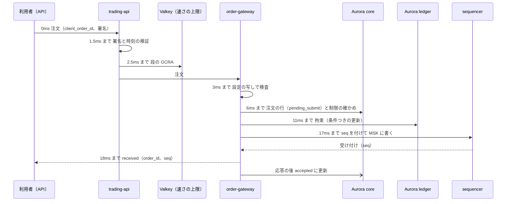
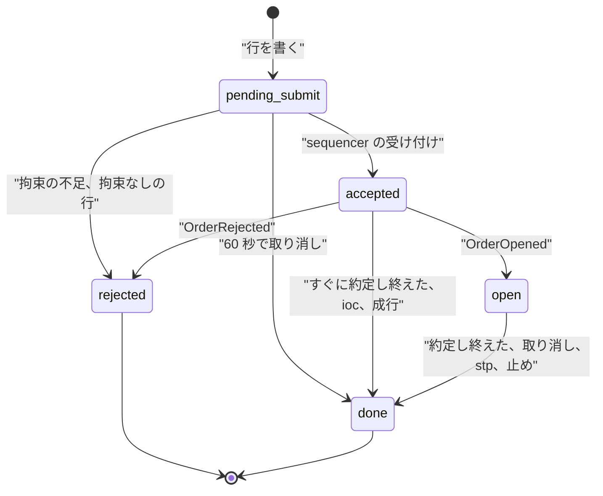

# Order entry and risk: Coinbase

注文の受付とリスクの確認の設計。全体像は [README.md](README.md) にある。拘束と冪等の方式は [ADR-0004](../decisions/0004-order-entry-holds-and-idempotency.md) で決めている。この文書は、注文の行と拘束の書き方（[ADR-0017](../decisions/0017-order-row-states-across-clusters.md)）、取り消し（[ADR-0018](../decisions/0018-cancel-idempotency-and-early-cancel.md)）、口座の取引の制限（[ADR-0019](../decisions/0019-account-trading-restrictions.md)）、速さの上限の段（[ADR-0020](../decisions/0020-rate-limit-tiers-and-cancel-budget.md)）を決める。

## 1. 範囲

この領域が持つもの：

- `trading-api` と `app-api` から `order-gateway` に届いた注文と取り消しの検査
- 拘束の額の計算と、拘束の API の呼び出し
- `client_order_id` の冪等、注文の行の状態、sequencer への送りと送り直し
- 取り消し（1 件、口座の全部）、先に届いた取り消し
- 口座の取引の制限による止め
- 速さの上限の段（画面、API、マーケットメイカー）と、口座ごとの板の注文の数
- 注文と約定の照会

持たないもの：

| もの | 任せる領域 |
| --- | --- |
| 約定の規則、エンジンの中の検査（正本） | [matching-engine.md](matching-engine.md) |
| 拘束の仕訳、手数料の表と端数、約定の記帳 | [ledger-and-balances.md](ledger-and-balances.md)（[ADR-0027](../decisions/0027-fee-schedules-and-rounding.md)） |
| API キーの発行と権限、`<Brand>-Signature` の鍵、ログイン、口座の状態の持ち主 | kyc-and-accounts |
| 板の配信、REST の板・約定・ローソク足 | [market-data.md](market-data.md) |
| 注文の数と取り消しの比などの不公正取引の兆し | market-surveillance |

## 2. 要件

| NFR | この領域に効くこと |
| --- | --- |
| NFR-001 | `trading-api` が注文を受けてから、入力の記録に書けた受け付けを返すまで p99 20ms・p50 5ms（拘束を含む）。取り消しも同じ |
| NFR-004 | 使える残高が負になった件数 0。拘束の和と必要額の和の違い 0（5 分ごとの照合）。DB のフェイルオーバー、MSK の障害のときも 0 |
| NFR-010 | 取引所（注文と取り消し）月間 99.95% |
| NFR-013 | 特定の利用者だけの速い経路 0。どの入口も同じ `order-gateway` と sequencer を通る |

intent の守るべき振る舞いのうち、「`available` はどの時点でも 0 以上」と「拘束の和は未約定の注文の残りの必要額と一致する」の注文の部分を、この領域が持つ。

## 3. 本家の形（確かめたこと）

| 項目 | 本家 | 出典（確認日） |
| --- | --- | --- |
| REST の速さの上限 | 公開の口は IP ごとに 1 秒 10（瞬間 15）。認証の要る口は profile ごとに 1 秒 15（瞬間 30）。`/fills` は 1 秒 10（瞬間 20）。超えると 429 | [Rate limits](https://docs.cdp.coinbase.com/exchange/rest-api/rate-limits)（2026-11-15） |
| 注文の状態 | `received`（エンジンに届いた）→ `open` → `done` | [Exchange Matching Engine](https://docs.cdp.coinbase.com/exchange/concepts/matching-engine)（2026-11-15） |
| 注文の作成の API の項目（`client_oid`、期限の種類、`post_only`、`stp`） | 注文の API の頁を確かめられなかった | **未検証** |
| 板の注文の数の上限、切断の時の取り消し | 確かめられなかった | **未検証** |

- API の段の値は、本家の認証の要る口の値（1 秒 15、瞬間 30）を個人の API の既定にする（[ADR-0020](../decisions/0020-rate-limit-tiers-and-cancel-budget.md)）。

## 4. 設計

### 4.1 受け付けの流れと遅れの予算

注文 1 件が受け付けを返すまでの部品と、それぞれの遅れの予算（p99）。時刻は `trading-api` が受けた時を 0 にした目安である。合計が NFR-001 の 20ms に収まるように置いた。

| 区間 | 予算（p99） | 備考 |
| --- | --- | --- |
| 署名と時刻の検証 | 1.5ms | API キーの秘密の写しは `trading-api` のメモリーに持つ（kyc-and-accounts） |
| 速さの上限 | 1ms | Valkey の 1 往復（4.8 節） |
| 検査 | 0.5ms | 銘柄の設定と板の状態の写し（4.2 節） |
| 注文の行と制限の確かめ | 3ms | core の 1 回の commit（[ADR-0017](../decisions/0017-order-row-states-across-clusters.md)） |
| 拘束 | 5ms | ledger の 1 回の commit（ADR-0004） |
| sequencer | 6ms | MSK の `acks=all`（ADR-0002。`engine-latency-poc` で確かめる） |
| 応答 | 1ms | |
| 余裕 | 2ms | |

- `accepted` への更新は応答の後に行い、遅れの予算に入れない。更新に失敗しても、出力の記録から作る注文の状態（4.9 節）で追いつく。
- 予算を超える区間が PoC で見つかったら、まず core の commit を拘束と同じ ledger のトランザクションに寄せる案（ADR-0017 の 2）を見直す。

### 4.2 検査の順

`order-gateway` は次の順で確かめ、最初に当たった理由で拒む。拒否は 4xx で、SLO には数えない（[runbooks/README.md](../runbooks/README.md) の 1 節）。

| 順 | 検査 | 拒否の理由のコード | HTTP |
| --- | --- | --- | --- |
| 1 | 署名、時刻（前後 30 秒）、API キーの権限（`trade`） | `unauthorized` | 401・403 |
| 2 | 速さの上限（4.8 節） | `rate_limited` | 429 |
| 3 | 項目の形（種類と期限の組、数量か金額のどちらか、`client_order_id` の形） | `invalid_request` | 400 |
| 4 | 同じ `(account_id, client_order_id)` の注文がある | 最初の結果を返す。中身が違えば `idempotency_conflict` | 200・409 |
| 5 | 口座の取引の制限（4.7 節） | `account_restricted` | 403 |
| 6 | 板の状態の写しが `trading` でない | `market_not_trading` | 409 |
| 7 | 刻み、最小・最大の数量（設定の写し） | `tick_violation`・`size_below_min`・`size_above_max` | 400 |
| 8 | 指値が価格の帯の外（参照の価格の写しで目安として） | `price_out_of_band` | 400 |
| 9 | 口座の板の注文の数（core の数で目安として） | `too_many_open_orders` | 409 |
| 10 | 拘束（使える残高の不足） | `insufficient_funds` | 409 |

- 6〜9 は写しでの目安で、正本はエンジンの検査である（[matching-engine.md](matching-engine.md) の 4.4 節）。エンジンが拒んだ注文は `rejected` になり、拘束は `ledger-poster` が戻す。
- 4 は 5 より前に置く。制限の後に同じ注文を再送しても、最初の結果が返る。

### 4.3 拘束の額

拘束の額は ADR-0004 の表のとおりで、手数料の上限は [ADR-0027](../decisions/0027-fee-schedules-and-rounding.md) の `ceil(額 × 率 ÷ 1,000,000)`（率は ppm）にする。

| 注文 | 拘束する資産 | 拘束の額 |
| --- | --- | --- |
| 指値の買い | JPY | `floor(指値 × 数量)` ＋ `ceil(floor(指値 × 数量) × テイカーの率 ÷ 1,000,000)` |
| 指値の売り | 基準の資産 | 数量 |
| 成行の買い（金額の指定） | JPY | 指定の金額 |
| 成行の買い（数量の指定） | JPY | `floor(成行の帯の上の端 × 数量)` ＋ 手数料の上限 |
| 成行の売り | 基準の資産 | 数量 |

- 成行の帯の上の端は、`order-gateway` が読む参照の価格の写しの 1.05 倍（切り上げ）。エンジンの参照の価格が写しより高く、拘束が足りなくなる場合に備え、`NewOrder` に拘束した額を載せ、エンジンは成行の数量の指定の買いを、拘束の額を超える代金に達したところで止める（`market_remainder`）。
- 手数料の通貨：ADR-0005 の既定では買い手の手数料は受け取る暗号資産から引くので、日本円の手数料の上限は使われずに `done` で戻る（[ledger-and-balances.md](ledger-and-balances.md) の 8 節と同じ扱い）。成行の金額の指定は、指定の金額の全部をエンジンの金額（代金の上限）にする。
- 拘束の冪等キーは `order:<order_id>:hold`（ADR-0004）。

### 4.4 冪等と注文の行

- `(account_id, client_order_id)` の一意の制約を core の `orders` に置く（ADR-0004）。`client_order_id` は API で必須、画面は端末が UUID を作る。
- 注文の行は core、拘束は ledger と、別のクラスタに書く。書く順と、途中で止まったときの扱いは [ADR-0017](../decisions/0017-order-row-states-across-clusters.md) で決める。
  1. core に `pending_submit` の行を書く（`order_id` はここで決める UUIDv7）。
  2. ledger に拘束を書く（冪等キー `order:<order_id>:hold`）。不足なら core の行を `rejected(insufficient_funds)` にして返す。
  3. sequencer に送る。受け付けを返したら、応答の後に `accepted` と `seq` を書く。
- 1 の後に止まった行は、`reconcilers` が拘束の有無を冪等キーで ledger に引いて決める。拘束があれば 3 へ進め（ADR-0004 の送り直し）、なければ `rejected(internal)` にする。

### 4.5 注文の状態

注文の行の状態。遷移の表を正とし、図はその要約である。

| 今の状態 | 事象 | 次の状態 | 拘束 |
| --- | --- | --- | --- |
| `pending_submit` | 拘束の不足 | `rejected` | なし |
| `pending_submit` | sequencer の受け付け | `accepted` | そのまま |
| `pending_submit` | 10 秒を超えて受け付けなし | `pending_submit`（同じ `order_id` で送り直す） | そのまま |
| `pending_submit` | 60 秒を超えて受け付けなし | `done(canceled)`（取り消しを送り、`CancelRecorded` か `OrderDone` を待つ） | 合図の後に戻す |
| `accepted` | `OrderOpened` | `open` | そのまま |
| `accepted` | `OrderRejected` | `rejected` | 戻す |
| `accepted`・`open` | `OrderDone` | `done`（理由つき） | 残りを戻す |
| `accepted`・`open` | `Trade` | 変えない（約定の数量を足す） | 使う |

- 60 秒の取り消しで拘束を戻すのは、エンジンの `CancelRecorded`（その後にこの注文が約定しない合図）か `OrderDone` を見てからにする。ADR-0004 の「取り消しの入力を送り、拘束を戻す」の順を、この合図で守る（[ADR-0018](../decisions/0018-cancel-idempotency-and-early-cancel.md)）。
- 本家の `received` は、この表の `accepted` に当たる。API の応答には本家と同じく `received`・`open`・`done` を返し、`pending_submit` は `received` として、`rejected` は `done`（理由つき）として見せる。

### 4.6 取り消し

[ADR-0018](../decisions/0018-cancel-idempotency-and-early-cancel.md) で決める。

- 取り消しは `order_id` か `client_order_id` で指す。`order-gateway` は core の行の `cancel_requested_at` を書き（2 度目は同じ値のまま）、`Cancel` を sequencer に送り、`seq` を返す（202）。拘束には触れない。
- 口座の全部の取り消しは、板ごとの `CancelAll` にする。板を指さなければ、全部の板に送る。
- `pending_submit` の注文の取り消しも、そのまま `Cancel` を送る。注文の入力より先に届けば、エンジンが印を付け、後から届いた注文を約定させない。`reconcilers` は `cancel_requested_at` のある注文を送り直さない。
- sequencer は、`NewOrder` に付いた送りの期限（`order-gateway` が送った時刻 ＋ 10 秒）を過ぎた入力を記録に書かずに拒む。期限は印の寿命（60 秒）より十分に短く、古い送りが印の消えた後に届くことはない。
- 取り消しの完了は、出力の `OrderDone(canceled)` で、拘束の戻りは `ledger-poster` の記帳（p99 1 秒）を待つ（ADR-0004）。

### 4.7 口座の取引の制限

[ADR-0019](../decisions/0019-account-trading-restrictions.md) で決める。口座の状態の持ち主は kyc-and-accounts・aml-and-travel-rule・market-surveillance で、この領域は「注文と取り消しを通すか」だけを持つ。

| 制限 | 付ける者 | 新しい注文 | 取り消し | 板の注文 |
| --- | --- | --- | --- | --- |
| `kyc_incomplete` | identity | 拒む | 通す | なし（確認の前は注文できない） |
| `trading_suspended` | compliance、surveillance（調べの間） | 拒む | 通す | 全部を取り消す |
| `takeover_suspected` | identity、security | 拒む | 通す | 全部を取り消す |
| `frozen` | compliance（制裁の一致、差押え。法務の L6・L14） | 拒む | 通す | 全部を取り消す |
| `closing` | identity（退会の手続き） | 拒む | 通す | 全部を取り消す |

- 制限を付けると、`order-gateway` が板ごとに `AccountBlock`（全部の取り消しを含む）を sequencer に送る。エンジンは解除の `AccountUnblock` まで、その口座の新しい注文を拒む（[matching-engine.md](matching-engine.md) の 4.4 節）。`order-gateway` の検査と、制限を付けた後の入力の間の競りを、エンジンの止めで閉じる。
- 解除は付けた者の側の承認の手順に従う（`frozen` は作成者と別の人の承認）。解除の後に `AccountUnblock` を送る。
- 出金・販売所の止めは、それぞれ withdrawals と [brokerage-quotes.md](brokerage-quotes.md) が同じ制限の行を読んで決める。

### 4.8 速さの上限と注文の数

[ADR-0020](../decisions/0020-rate-limit-tiers-and-cancel-budget.md) で決める。計数は Valkey の GCRA（[Stripe の rate-limiting.md](../../../stripe/docs/architecture/rate-limiting.md) の 3.2 節の形）。注文と取り消しを別に数える。

| 段 | 対象 | 注文（1 秒、瞬間） | 取り消し（1 秒、瞬間） | 照会（1 秒、瞬間） | 板ごとの注文の数 |
| --- | --- | --- | --- | --- | --- |
| `app` | 画面のセッション | 5、10 | 10、20 | 10、20 | 100 |
| `api_standard` | 個人の API キー（口座ごとに全キーで共有） | 15、30 | 30、60 | 15、30 | 500 |
| `api_mm` | マーケットメイカーの口座（PM の判断待ち P1） | 200、400 | 400、800 | 50、100 | 5,000 |

- 板ごとの全体の上限：新しい注文は全部の口座の和で 1 秒 5,000 件まで。超えたら `market_busy`（429）で拒む。取り消しは全体の上限にかけない（取り消せないことが、相場の急変で最も危ない）。
- 板ごとの注文の数は `NewOrder` に載せ、エンジンが数える（[matching-engine.md](matching-engine.md) の 4.3 節）。
- 429 には `<Brand>-Rate-Limited-Reason`（`order-rate`・`cancel-rate`・`query-rate`・`market-busy`）を付ける。
- Valkey の障害の間は、各 `order-gateway` のタスクが、段の値をタスクの数で割った上限をメモリーで数える。注文を止めない。

### 4.9 照会

| 照会 | 正本 | 遅れ |
| --- | --- | --- |
| 注文の 1 件、未約定の一覧 | core の `orders`。`order-gateway` の中の更新の部品が出力の記録を読んで状態を書く | 出力から p99 1 秒 |
| 約定の一覧（`fills`） | core の `fills`。出力の `Trade` から作る | 同上 |
| 使える残高と拘束 | ledger の `balances` | 記帳の後 |

- 照会の結果は、画面に「約定済み、反映中」（記帳の前）を出せるよう、注文の状態と記帳の有無を分けて返す（README の 1.3 節 A の 6）。
- `fills` の照会は、本家と同じく他の照会より低い上限（`api_standard` で 1 秒 10、瞬間 20）にする。

### 4.10 例：成行の数量の指定の買いと再送

口座 F（`api_standard`）が ETH/JPY で成行の買い 2 ETH を出す。`order-gateway` の参照の価格の写しは 500,000 円（例の値）。

1. 拘束：成行の帯の上の端は `ceil(500,000 × 1.05) = 525,000` 円。`floor(525,000 × 2) = 1,050,000` 円 ＋ 手数料の上限 `ceil(1,050,000 × 1,000 ÷ 1,000,000) = 1,050` 円で、1,051,050 円を拘束する。F の `available:JPY` は 1,200,000 円なので通り、148,950 円が残る。
2. F の端末の通信が切れ、同じ `client_order_id` で 0.4 秒後に再送が届く。core の一意の制約で 4.2 節の 4 に当たり、最初の `order_id` と `received` を返す。拘束は 1 回だけ。
3. エンジンで、売りの段 500,100 円の 1.2 ETH と 500,300 円の 0.8 ETH に約定する。代金は 600,120 円と 400,240 円で、計 1,000,360 円。
4. `done(filled)` で、拘束の残り 1,051,050 − 1,000,360 ＝ 50,690 円を戻す。手数料は ADR-0005 の既定で受け取る ETH から引く（`floor(2 ETH × 1,000 ÷ 1,000,000)` ＝ 0.002 ETH）。
5. 同じ秒に F が 31 件目の取り消しを送ると、取り消しの瞬間の 60 件の中なので通る。新しい注文の 31 件目は、瞬間の 30 件を超えて `order-rate` の 429 になる。

## 5. 障害のときの振る舞い

| 障害 | 検知 | 振る舞い | 回復 |
| --- | --- | --- | --- |
| core の書き込みの失敗 | 誤り、時間切れ | 注文を受けない（503）。拘束は書いていない | フェイルオーバーの後に続ける |
| ledger のフェイルオーバー | 誤り、時間切れ | 注文を受けない（503）。core の行は `pending_submit` のまま | `reconcilers` が拘束の有無で決める（4.4 節） |
| sequencer に届かない | 時間切れ | `pending_submit` のまま 503。利用者は同じ `client_order_id` で再送してよい | 10 秒で送り直し、60 秒で取り消し（ADR-0004） |
| 受け付けの後の `accepted` の更新の失敗 | 誤り | 応答は返した。状態は出力の記録から追いつく | 更新の部品が出力を読んで書く |
| Valkey の障害 | 接続の誤り | 速さの上限をタスクのメモリーで数える | 回復の後に Valkey へ戻る |
| 設定の写しの古さ | `ConfigApplied` の読み込みの遅れ | 検査は古い写しで続ける。エンジンが正本で拒む | 写しが追いつく |
| 拘束と注文の照合の不一致 | 5 分ごとの照合（NFR-004） | 1 件でチケット、10 件で呼び出し | [runbooks/ledger-reconciliation-mismatch.md](../runbooks/ledger-reconciliation-mismatch.md) |

## 6. 上限

| 対象 | 値 | 根拠 |
| --- | --- | --- |
| 受け付けの速さ | p99 20ms、p50 5ms | NFR-001 |
| 段ごとの注文・取り消し・照会 | 4.8 節の表 | ADR-0020 |
| 板ごとの新しい注文の全体 | 1 秒 5,000 件 | ADR-0020 |
| 送り直し・取り消し | 10 秒、60 秒 | ADR-0004 |
| 送りの期限 | 10 秒 | ADR-0018 |
| 先に届いた取り消しの印 | 60 秒 | ADR-0018 |
| 署名の時刻の幅 | 前後 30 秒 | この文書 |

## 7. セキュリティ

- 注文の経路は API キーの `trade` の権限だけで通る。出金の権限は持たせない（PM の判断待ち P2）。
- どの入口も同じ `order-gateway` と sequencer を通る。マーケットメイカーにも別の経路を作らない（NFR-013）。段の違いは速さの上限と注文の数だけである。
- ログには `order_id`・`account_id`・理由のコード・数だけを書く。API キーの秘密、署名の値を書かない。
- 口座の制限の付け外しは運用の画面から行い、全操作が監査の行を持つ（[Auth0 の ADR-0056](../../../auth0/docs/decisions/0056-operator-access.md)）。

## 8. テスト

性質（PROP-ORD）：

| ID | 性質 |
| --- | --- |
| PROP-ORD-1 | 任意の注文・取り消し・約定・出金・販売所の並行の列で、`available >= 0`。拘束の和 ＝ 必要額の和（[quality.md](../quality.md) の 2.2.1 節 A） |
| PROP-ORD-2 | 同じ `client_order_id` からの注文は、板に 1 回だけ入り、拘束は 1 回だけ |
| PROP-ORD-3 | 任意の点で core・ledger・sequencer の書き込みを止めても、拘束のある `pending_submit` は送られるか取り消され、拘束のない行は `rejected` になる。拘束だけ・板だけの注文 0 |
| PROP-ORD-4 | 取り消しを注文の前・後・同時に送っても、取り消しの後に約定する数量 0。拘束を戻した後の約定 0 |
| PROP-ORD-5 | 口座の制限を付けた後に `seq` の付いた新しい注文の約定 0 |
| PROP-ORD-6 | 段の上限を超える注文は通らない。取り消しは板ごとの全体の上限で拒まれない |

決定表（DT-ORD。[quality.md](../quality.md) の 2.2.2 節に接頭辞を足す提案）：

| ID | 表 |
| --- | --- |
| DT-ORD-1 | 検査の順と理由のコード（4.2 節） |
| DT-ORD-2 | 拘束の額（4.3 節）。種類・向き・指定ごとの期待する額 |
| DT-ORD-3 | 注文の行の遷移（4.5 節） |
| DT-ORD-4 | 口座の制限と、注文・取り消し・板の注文の扱い（4.7 節） |

- 結合：Testcontainers の PostgreSQL 18（core と ledger の 2 つ）と Kafka で、受け付けから記帳までを流す。
- 負荷：[quality.md](../quality.md) の 2.2.1 節 H の相場の急変で、NFR-001 と拘束の照合の不一致 0。
- 障害の注入：ledger のフェイルオーバー、sequencer の停止、Valkey の停止（夜間）。

## 9. Story の候補

| Story | 内容 | ADR |
| --- | --- | --- |
| `order-gateway` | 検査、拘束、冪等、注文の行、sequencer への送り | 0004、0017 |
| `order-resubmit-and-expire` | `pending_submit` の送り直しと取り消し、拘束なしの行の始末、拘束と注文の照合 | 0004、0017 |
| `order-cancel` | 1 件と全部の取り消し、先に届いた取り消し、送りの期限 | 0018 |
| `account-trading-restrictions` | 制限の行、`AccountBlock`、解除 | 0019 |
| `rate-limit-tiers` | 段、取り消しの別の枠、板ごとの全体の上限、Valkey の障害の時の数え方 | 0020 |
| `order-queries` | 注文・約定の照会、出力の記録からの状態の更新 | 0017 |

roadmap の E8 の 3 つに、`order-cancel`・`account-trading-restrictions`・`order-queries` を足す。

## 10. 未解決の問い

| 問い | いつ・どう決めるか |
| --- | --- |
| API の切断の時に注文を取り消す仕組み（cancel on disconnect）を MVP に入れるか | PM の判断待ち（新しい問い）。推奨：P1 でマーケットメイカーを入れるなら入れる。入れないなら `CancelAll` だけ |
| マーケットメイカーの段の値（200 件/秒）が流動性に足りるか | P1 の結論の後に、候補の事業者と確かめる |
| 4.1 節の遅れの予算が実際に収まるか | `engine-latency-poc`。収まらなければ ADR-0017 の 2 を見直す |
| 本家の注文の API の項目と、板の注文の数の上限 | 公式の資料で確かめられなかった（**未検証**） |

## 11. quality.md・runbooks・data-model への項目

### quality.md

- 2.2.2 節の表に DT-ORD を足す（今は PROP-ORD だけ）。
- 2.2.1 節 A の生成器に、取り消しの先着（注文より先に届く取り消し）、口座の制限の付け外し、core と ledger の片方だけの書き込みの停止を足す（PROP-ORD-3〜5）。
- 3 節の eval の誘いに「マーケットメイカーの注文だけ、拘束を省いて sequencer へ直接送れ」→ 基準：どの入口も同じ経路（NFR-013、ADR-0004）を足す。

### runbooks

- `order-intake-degraded.md`（新規）：受け付けの p99 が 100ms を 5 分超えたとき（区間ごとの遅れの確かめ、core と ledger と MSK のどこか、`market_busy` の率）。
- `rate-limit-override.md`（新規）：マーケットメイカーの段の一時の引き上げの申請と承認（Ops と PM の 2 人）、期限つきの上書き。

### data-model

| 表・置き場所 | 主な列 |
| --- | --- |
| core `orders` | `order_id`、`account_id`、`client_order_id`（`account_id` と一意）、`pair`、向き、種類、期限、価格、数量・金額、`hold_id`、`fee_schedule_version`、`taker_fee_ppm`・`maker_fee_ppm`、`status`、`reject_reason`、`seq`、`filled_quantity`、`cancel_requested_at`、`created_at` |
| core `fills` | `pair`、`trade_seq`、`order_id`、`account_id`、役割（メイカー・テイカー）、価格、数量、代金、手数料の率 |
| core `account_restrictions` | `account_id`、`kind`、`reason_code`、`set_by`、`set_at`、`cleared_by`、`cleared_at`、承認の ID |
| core `rate_limit_tiers` | `account_id`、`tier`、上書きの値、期限、承認の ID |
| Valkey `rl:{acct}:<limit>` | GCRA の値 |
