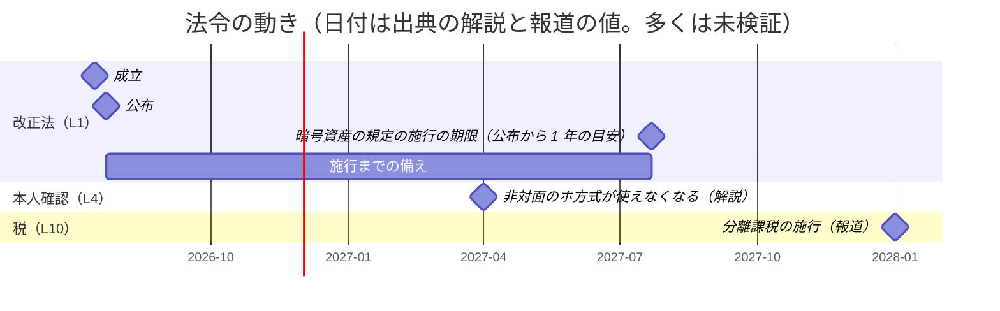
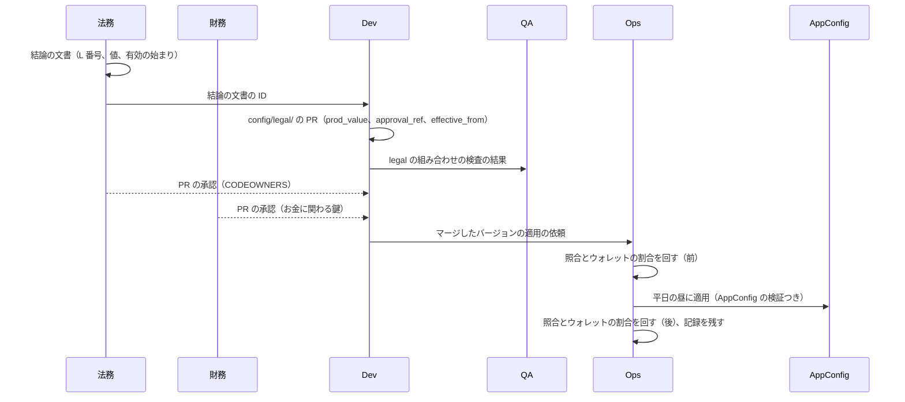

# Regulatory Compliance Japan: Coinbase

日本の法令の対応の枠組みを決める。法令の型と資金決済法から金融商品取引法への移行（法務の L1）、`legal.*` の値の一覧と変更の手順、当局と自主規制団体への報告の書き出し、税の書類（法務の L10）、システムのリスクと外部への委託（法務の L13）、自主規制の規則の当てはめ（法務の L9）を扱う。全体像は [README.md](README.md) にある。法令の解釈に当たる項目は枠組みだけを書き、結論を書かない。どれも **法務の確認待ち** で、[intent.md](../intent.md) の L 番号を付ける。

前提となる決定は次のとおり。

- 法的に未決の値は `legal.*` の設定で持ち、法務の結論が出るまで本番の値を有効にしない（AGENTS.md、[ADR-0005](../decisions/0005-ledger-balances-and-trade-settlement.md)、[ADR-0006](../decisions/0006-wallet-tiers-and-cold-ratio.md)）
- `legal.*` の値の変更は、法務・財務の承認の記録を添えて、平日の昼に Ops が適用する。適用の前後で照合とウォレットの割合を回す（[runbooks/README.md](../runbooks/README.md) の 3 節）
- フラグは AWS AppConfig で持つ（[ADR-0001](../decisions/0001-platform-and-stack.md)）
- 外部の提供者はアダプターの後ろに置き、障害の間は止める側に倒す（[ADR-0011](../decisions/0011-external-providers-boundary.md)）
- 法令の値を設定に切り出す形は、メルカリの題材（`legal.*`）と Uber の題材（法令の論点をフラグと記録で本番の関門にする）にある（[docs/patterns.md](../../../../docs/patterns.md) の「ロールから探す」）

この文書で決めたことは次の ADR にある。

| ADR | 決定 |
| --- | --- |
| [0062](../decisions/0062-legal-config-catalog-and-approval.md) | `legal.*` の値を、L 番号・持ち主・未設定の時の振る舞い・有効の期間・承認の記録を持つ一覧（カタログ）で管理し、読むのは `legalValue(key, at)` だけにする。本番の値は承認の記録なしに入らず、GA に要る値が揃わなければ GA の判定を通さない |
| [0063](../decisions/0063-regulatory-regime-switch.md) | 資金決済法と金融商品取引法の型を `legal.regime` の有効の期間つきの値で持ち、用語・報告・改正法で入る規律を型ごとの表で切り替える。コードを法令ごとに分岐させない |
| [0064](../decisions/0064-regulatory-report-exports.md) | 当局と自主規制団体への報告は、定義（バージョンつき）と基準の時刻から台帳と記録を読み直して作る書き出しにし、同じ定義と時刻から同じ中身（ハッシュ）が出る。2 人が確かめ、提出は人が行う |

## 1. 範囲

- 扱う：
  - 法令の型（`legal.regime`）と移行の段取り（法務の L1）
  - `legal.*` のカタログ、読み方、変更の手順、GA の関門
  - 報告の定義と書き出し、確かめと提出の記録（法務の L1・L2・L3・L9・L10）
  - 外部への委託の台帳（法務の L11・L13）
  - 自主規制の規則と設計の対応の表（法務の L9）
- 扱わない：
  - 分別管理の数の計算と照合（segregation-and-reconciliation の領域）。この領域は書き出しに使う
  - 利用者向けの明細と年間の取引の報告書（ledger-and-balances の領域）。この領域は税務署など当局への提出を扱う
  - 疑わしい取引の届出の判断と案件（aml-and-travel-rule の領域）
  - 不公正取引の案件（market-surveillance の領域）。この領域は協会への報告の材料を受ける
  - 日々の売買高の公表の配信（market-data の領域）
  - 本人確認の方式（kyc-and-accounts の領域）

## 2. 要件

| 要件 | 値 | 出どころ |
| --- | --- | --- |
| 無効のはずの値 | 本番で、承認の記録のない `legal.*` の値が効いた件数 0 | [quality.md](../quality.md) の 1 節のリスク 12 |
| コードの定数 | 法令の値（割合、日数、方式）をコードに書いた件数 0（lint） | AGENTS.md |
| 報告の再現 | 同じ定義のバージョンと基準の時刻から、同じ中身のハッシュ | 本システムの値 |
| 報告の確かめ | 提出の前に 2 人（作成者と別）が確かめた記録 100% | 本システムの値 |
| 法令の型の切り替え | 施行の時刻に、用語・報告・規律の切り替えが 1 つの値の変更で済む | intent の L1 |

## 3. 制度の形（確かめたこと）

| 項目 | 事実 | 出典（確認日） |
| --- | --- | --- |
| 改正法 | 2026 年 7 月 15 日に成立、7 月 23 日に公布。暗号資産の規定は公布の日から 1 年以内に施行。暗号資産交換業は「暗号資産取引業」として金融商品取引業の枠組みに入る。顧客の金銭と暗号資産の分別管理、責任準備金、自己資本規制比率、インサイダー取引の規制が入る | [intent.md](../intent.md) の出典（法律事務所の解説。法律の本文は**未検証**） |
| 改正法の法案 | 基準を満たさない暗号資産を扱わないこと、日々の売買高などを公表することを含む | 同上（大和総研の解説） |
| 協会の不公正取引の規則 | 措置の発生の報告と、毎月の発生の状況と措置の報告を求める。記録を 5 年保存 | [market-surveillance.md](market-surveillance.md) の 3 節 |
| 業界の計画 | 協会が会員の注文と取引のデータから売買審査をし、証券取引等監視委員会と連携する方針。協会を金商法の下の認定の自主規制団体として強化する方針 | [第 6 回暗号資産制度に関する WG の説明資料](https://www.fsa.go.jp/singi/singi_kinyu/angoshisanseido_wg/gijishidai/20251126/02.pdf)（2025-11-26。2026-11-15 に確認） |
| 協会の規則の改正 | 2024 年の流出の後の利用者財産の管理の規則の改正の意見公募（2025 年） | [intent.md](../intent.md) の出典（中身は**未検証**。法務の L9） |
| 報告の様式・頻度・提出の手段 | 事業報告書、分別管理の報告、協会への月次の報告の様式と期限は、この文書の範囲で確かめなかった | **未検証**（法務の L1・L9） |
| 本家 | 日本の事業を 2023 年に止めた。日本での報告の運用は確かめられない | [intent.md](../intent.md) の出典（**未検証**） |

### 3.1 時間の軸

法令の動きの日付。本システムの開業の日は決まっていないので置かない。

- 施行の日は政令で決まる。期限の日は「公布の日から 1 年以内」から置いた目安で、実際の日は法務の L1 で確かめる。

## 4. `legal.*` のカタログ（ADR-0062）

### 4.1 項目の形

| 列 | 中身 |
| --- | --- |
| `key` | `legal.<名前>`（snake_case） |
| `schema` | 値の型（数、割合、日数、列挙の集合、表） |
| `l_ref` | intent の L 番号（複数可） |
| `owner_area` | 値を使う領域（その領域の文書が使い方を書く） |
| `dev_default` | 開発と検証の環境の値 |
| `prod_value` | 本番の値。承認されるまで空 |
| `when_unset` | 本番で空のときの振る舞い（止める側に倒す。項目ごとに書く） |
| `effective_from`・`effective_to` | 有効の期間（施行の日、方式の終わりの日） |
| `approval_ref` | 法務・財務の承認の記録の ID（文書の参照）。`prod_value` を入れるときに必須 |
| `ga_required` | GA の判定の前に本番の値が要るか |

### 4.2 一覧（2026-11-15 の時点）

この領域で決めるのはカタログの形と手順で、各値の使い方は持ち主の領域が書く。他の領域の文書が足した鍵は、工程 3 で合わせる。

| key | l_ref | owner_area | dev_default | when_unset（本番） | ga_required |
| --- | --- | --- | --- | --- | --- |
| `legal.regime` | L1 | regulatory-compliance-japan | `psa_exchange` | GA を通さない | ○ |
| `legal.hot_ratio_max` | L2 | custody-and-keys | 0.05 | 持ち主の領域の既定（[ADR-0006](../decisions/0006-wallet-tiers-and-cold-ratio.md)） | ○ |
| `legal.trust_amount_method` | L3 | segregation-and-reconciliation | 本システムの式 | 信託の額の自動の依頼をしない（[ADR-0005](../decisions/0005-ledger-balances-and-trade-settlement.md)） | ○ |
| `legal.kyc_allowed_methods` | L4 | kyc-and-accounts | 全部の方式 | どの方式でも `verified` にしない | ○ |
| `legal.kyc_record_retention_days`・`legal.transaction_record_retention_days` | L4・L11 | kyc-and-accounts | 2,555 | 期限の後も消さない | ○ |
| `legal.kyc_reverify_triggers` | L4 | kyc-and-accounts | 住所・氏名の変更 | 再確認を求めない | - |
| `legal.minimum_age` | L12 | kyc-and-accounts | 18 | 口座の開設を受けない | ○ |
| `legal.suitability_limits` | L12 | kyc-and-accounts | 段ごとの例 | 上限で止めない（記録だけ） | - |
| `legal.surveillance_record_retention_days` | L7・L9 | market-surveillance | 1,826 | 期限の後も消さない | ○ |
| `legal.staff_trading_policy` | L7 | market-surveillance | 30 日の保有の期間と事前の承認 | 開発の既定と同じ制限を本番でも効かせる（緩める側に倒さない） | ○ |
| トラベルルール・制裁・出金の上限の鍵 | L5・L6 | aml-and-travel-rule、withdrawals | 各領域 | 各領域（[ADR-0011](../decisions/0011-external-providers-boundary.md) の止める既定） | ○ |
| `legal.daily_volume_publication` | L1 | market-data | 無効 | 公表しない | `regime` による |

- `when_unset` は「止める」か「緩めない」側にする。保持の日数は、未設定なら消さない（消したデータは戻らない）。
- `legal.staff_trading_policy` のように、未設定でも制限を効かせるべき鍵は、`when_unset` に開発の既定を使うと書く。

### 4.3 読み方

- サービスは `legalValue(key, at)` だけで読む。`at` は判定の基準の時刻（確認の日、記帳の時刻、報告の基準の時刻）で、有効の期間から値を選ぶ。本番で空なら、カタログの `when_unset` を返す。
- 値の変更で過去の判定は変えない。判定の記録に、使った鍵のカタログのバージョンを残す（たとえば `kyc_checks.legal_config_version`）。
- lint：コードの `legal.` の参照はカタログにある鍵だけ。カタログの鍵でコードに参照のないものは警告する。`legal.*` の値の数値の定数（`0.05` など）を、値を使う関数の近くに書いたら拒む。

### 4.4 変更の手順

- エージェントは PR の草案と検査の結果を作れるが、`prod_value` と `approval_ref` を決めない（[roadmap.md](../roadmap.md) の「エージェントに任せないこと」）。
- 適用の記録（`legal_config_changes`：鍵、前後の値、承認の記録、適用の者と時刻）を core に残す。
- 戻すときも同じ手順（承認の記録つき）。急ぎで止めるときは `ops.*` を使い、`legal.*` を書き換えない。

### 4.5 例：本人確認の方式の結論が出たとき

架空の日付で追う。

| 日時 | 出来事 |
| --- | --- |
| 2027-03-01 | 法務が L4 の結論の文書（`LEGAL-2027-014`）を出す。例として「`jpki` と `ic_chip_face` を使う。`document_face` は 2027-03-31 まで」とする |
| 03-02 | Dev が `legal.kyc_allowed_methods` の PR を出す：`jpki` と `ic_chip_face` は `effective_from = 2027-03-08`、`document_face` は `effective_to = 2027-03-31T23:59:59+09:00`。QA が DT-KYC-002 の全行を緑で添える |
| 03-04 | 法務の承認（CODEOWNERS） |
| 03-08 11:00 | Ops が適用。前後で照合を回し、記録 `legal_config_changes` に 1 行 |
| 03-31 23:59:59 の後 | `document_face` の確認の結果を受けても `verified` にしない（`at` が期間の外）。03-31 までに `verified` になった口座は下げない |

## 5. 法令の型と移行（ADR-0063）

### 5.1 型

| `legal.regime` | 中身 |
| --- | --- |
| `psa_exchange` | 資金決済法の暗号資産交換業 |
| `fiea_trading` | 金融商品取引法の暗号資産取引業（改正法の施行の後） |

- 値は有効の期間を持つ。施行の時刻に `fiea_trading` へ切り替える値を、前もって入れておける（4.3 節の `at` で選ぶ）。
- 経過の措置（登録の扱い、移行の期間）は法務の L1 で、型を増やすかもそこで決める。

### 5.2 型ごとに切り替えるもの

| 切り替えるもの | 持ち方 | 持ち主 |
| --- | --- | --- |
| 用語（業の名前、登録の番号の表示、根拠の法令の名前、契約の前の書面の文言） | `regulatory_terms`（型 × 用語の鍵 → 文言、バージョン） | この領域。画面と書面は鍵で引く |
| 報告の定義 | `report_definitions` の `regime` の列 | この領域（6 節） |
| 改正法で入る規律 | 型で有効になる部品の一覧 | 下の表 |

| 規律（改正法） | 本システムの部品 | 持ち主の領域 |
| --- | --- | --- |
| 自己資本規制比率 | 財務のデータからの計算と報告（書き出し） | この領域（報告）、ledger-and-balances（数） |
| 金融商品取引責任準備金 | 準備金の台帳の口座と積み立ての仕訳 | ledger-and-balances |
| 日々の売買高の公表 | 板ごとの日次の売買高の公表 | market-data |
| インサイダー取引の規制 | 重要な情報の台帳、役職員の取引の制限 | market-surveillance（[ADR-0061](../decisions/0061-staff-trading-and-material-information.md)） |
| 扱えない暗号資産の基準 | 銘柄の取扱いの審査の記録（MVP は BTC と ETH） | 銘柄の追加の Epic（MVP の後） |
| 顧客の金銭と暗号資産の分別管理・信託 | 照合と報告 | segregation-and-reconciliation |

- 部品は `regime` の値で有効になるが、準備の作業（台帳の口座、計算、試験）は `psa_exchange` の間に済ませ、検証の環境で `fiea_trading` を先に動かす。
- コードで `if regime == ...` を書くのは、上の部品の入口の 1 か所だけにする（lint で場所を限る）。

### 5.3 切り替えの手順

1. 法務が施行の日と経過の措置を確かめる（L1）。
2. 検証の環境で `legal.regime = fiea_trading` にし、用語・報告・部品の全部の試験を回す。
3. 本番に、施行の時刻を `effective_from` にした `fiea_trading` を前もって入れる（4.4 節の手順）。
4. 施行の時刻の前後で、照合と報告の書き出しの試し（7 節）を回す。
5. 切り替えの後の最初の報告の期日まで、型ごとの報告の差を毎日確かめる。

## 6. 報告の書き出し（ADR-0064）

### 6.1 報告の定義の一覧（候補）

どの報告が要るか、様式、頻度、期限、提出の手段は、どれも法務の確認待ちである。下の表は、書き出しの形を決めるための候補で、根拠の欄の L 番号で確かめる。

| 定義の ID | 宛先 | 中身 | 根拠 | 材料の領域 |
| --- | --- | --- | --- | --- |
| `REP-SEG` | 当局・協会 | 利用者の金銭と暗号資産の分別管理の状況 | L2・L3・L9 | segregation-and-reconciliation |
| `REP-JVCEA-MONTHLY` | 協会 | 月次の取引の状況（取引高、預かり、口座の数） | L9（協会の月次の統計の形。会員の様式は**未検証**） | ledger-and-balances、kyc-and-accounts |
| `REP-SURV` | 協会 | 不公正取引の措置の発生と月次の状況 | L7・L9 | market-surveillance |
| `REP-SURV-DATA` | 協会 | 協会の売買審査のための注文と取引のデータ（計画の段階） | L9 | market-surveillance、matching-engine |
| `REP-BUSINESS` | 当局 | 事業報告書の数の部分 | L1 | ledger-and-balances |
| `REP-CAPITAL` | 当局 | 自己資本規制比率（`fiea_trading` から） | L1 | ledger-and-balances |
| `REP-INCIDENT` | 当局・協会 | システムの障害、流出などの発生（事象ごと） | L13 | 各領域の runbooks |
| `REP-TAX` | 税務署 | 支払調書・取引の報告の書類 | L10 | ledger-and-balances、kyc-and-accounts（`reportSubject`） |

- 疑わしい取引の届出は aml-and-travel-rule の領域が持つ。書き出しの仕組み（6.2 節）を使うかはその領域で決める。

### 6.2 定義と実行

- 定義（`report_definitions`）：ID、バージョン、型（`regime`）、宛先、根拠の L 番号、頻度、材料の問い合わせ（読み取りだけの関数の名前）、出力の様式（CSV・XML など）、持ち主。定義の変更は `config/reports/` の PR で、コンプライアンスと財務の CODEOWNERS。
- 実行（`report_runs`）：定義のバージョン、基準の時刻（`as_of`）、作成の時刻、中身のハッシュ、確かめた 2 人、提出した者と時刻、受付の番号。
- 材料は `as_of` の時点の値で作る。台帳は `as_of` 以前の仕訳の和で、core の状態は `as_of` の時点の履歴の行で読む。今の値から作らない（作り直したときに同じ中身にするため）。
- 個人の項目が要る報告（`REP-TAX` など）は、`kyc-vault` の `reportSubject(account_id, report_id)` で、定義が求める項目だけを読む（[ADR-0054](../decisions/0054-kyc-vault-purpose-api-and-retention.md)）。出力のファイルは書き出し専用の S3 の場所に、報告ごとの鍵で暗号化して置き、提出の後に保持の期限で消す。
- 提出は人が行う（提出の手段は**未検証**）。本システムは外へ自動で送らない。

### 6.3 例：協会への月次の報告

架空の値で追う。

| 日時 | 出来事 |
| --- | --- |
| 2027-09-01 06:00 | `REP-JVCEA-MONTHLY` v3 を `as_of = 2027-08-31T23:59:59+09:00` で実行する。取引高 約 770 億円、預かりの暗号資産 約 1,500 億円、稼働の口座 約 30 万（S1 の想定の値。[README.md](README.md) の 2 節） |
| 06:12 | 中身のハッシュ `h1` を記録する |
| 09-02 10:00 | コンプライアンスの担当 2 人（作成者と別）が、前月との差と照合の結果を見て確かめる |
| 09-02 15:00 | 財務が前日の照合の差 0 を確かめ、`ledger-reconciliation-mismatch` の開いた件がないことを記録する |
| 09-03 | 担当が提出し、受付の番号を `report_runs` に書く |
| 09-20 | 同じ定義と `as_of` で作り直し、ハッシュが `h1` と同じことを確かめる（再現の試し） |

- 作り直しのハッシュが違えば、`as_of` より後の行を読んでいる誤りで、提出の前なら止め、後なら財務とコンプライアンスに知らせる。

## 7. 外部への委託と自主規制の規則

### 7.1 外部への委託の台帳（法務の L11・L13）

| 列 | 中身 |
| --- | --- |
| 委託先 | クラウド（AWS）、HSM・MPC、eKYC、チェーン分析、トラベルルール、参照の価格、銀行、信託銀行、メール・プッシュ |
| 委託する機能 | アダプターの種類（[ADR-0011](../decisions/0011-external-providers-boundary.md)） |
| 渡すデータ | 項目の種類（個人の項目、取引の情報）と、データのある国（外国にある第三者への提供は L11） |
| 重要度 | 止まったときの影響（[ADR-0011](../decisions/0011-external-providers-boundary.md) の障害の間の既定） |
| 契約 | 契約の参照、監査の権利、データの削除、再委託 |
| 出口の計画 | 替えるときの手順（契約の試験と模型があるか） |
| 見直し | 最後の見直しの日、次の見直しの日（年 1 回を既定） |

- 台帳は `vendor_register`（core）に置き、提供者のアダプターを足す spec は台帳の行を足す（レビューの観点）。事務ガイドラインの外部への委託の項目への当てはめは法務の L13。

### 7.2 自主規制の規則の対応の表（法務の L9）

- 協会の規則ごとに、条ごとの要求と、それを満たす設計（文書と ADR へのリンク）、試験、運用の手順を、開発リポジトリの `compliance/rule-map.yaml` に表で持つ。
- 規則の改正（3 節の 2025 年の意見公募など）が出たら、表の差分を作り、足りない行を Intent に起票する。
- 例：協会の不公正取引の規則の第 4 条第 4 項（審査の部門の独立）→ [ADR-0060](../decisions/0060-surveillance-cases-actions-and-records.md) と security の領域の役割の表。第 21 条（記録の保存）→ `legal.surveillance_record_retention_days`。

## 8. 障害のときの振る舞い

| 障害 | 検知 | 振る舞い | 回復 |
| --- | --- | --- | --- |
| AppConfig の配布の失敗 | 配布の検証の誤り | 前のバージョンのまま。`legal.*` の値を壊れたバージョンにしない | 正しいバージョンを同じ手順で入れ直す |
| カタログと実際の値の食い違い | 日次の検査（本番の値と `config/legal/` の比べ） | チケット。承認の記録のない値なら SEV2 の候補 | 法務と確かめ、手順で戻す |
| 報告の材料の照合の差 | `report_runs` の確かめ | 提出を止める | 照合の差の手順（[runbooks/ledger-reconciliation-mismatch.md](../runbooks/ledger-reconciliation-mismatch.md)） |
| 報告の作り直しのハッシュの違い | 再現の試し | 提出の前なら止める。後なら財務とコンプライアンスに知らせる | 材料の問い合わせの誤りを直し、定義のバージョンを上げる |
| 施行の時刻の切り替えの誤り | 用語と部品の試験 | 板と入出金は止めない。用語と報告を前の型に戻すかを法務と決める | 手順で戻す |

## 9. 上限

| 対象 | 値 |
| --- | --- |
| `legal.*` の適用 | 平日の昼、1 回に 1 つの鍵の束（結論の文書ごと） |
| 報告の確かめ | 作成者と別の 2 人 |
| 報告の出力の保持 | 提出から既定 1,826 日（本システムの仮の値。法務の L9） |
| 委託の台帳の見直し | 年 1 回 |

## 10. セキュリティ

- `config/legal/`・`config/reports/` は CODEOWNERS（法務・財務・コンプライアンス）で守り、エージェントの PR だけではマージできない。
- 報告の出力は個人の項目を含みうるので、書き出し専用の S3 の場所に置き、読める役割をコンプライアンスと財務に限る。ダウンロードは監査の行を残す。
- 報告の問い合わせの関数は読み取りだけの役割で動き、ledger と core に書けない。

## 11. テスト

| ID | 種類 | 中身 |
| --- | --- | --- |
| DT-REG-001 | 決定表 | 鍵ごとの `when_unset` と、`at` が有効の期間の前・中・後のときの `legalValue` |
| DT-REG-002 | 決定表 | `legal.regime` × 部品 → 有効か。用語の鍵の全部が両方の型に文言を持つ |
| PROP-REG-001 | 性質 | 本番の設定の任意の組で、`approval_ref` のない `prod_value` が読まれる件数 0 |
| PROP-REG-002 | 性質 | 同じ定義のバージョンと `as_of` から、何度作っても同じハッシュ（`as_of` より後の書き込みを混ぜても） |
| PROP-REG-003 | 性質 | GA に要る鍵（`ga_required`）が本番で空なら、GA の判定の検査が落ちる |

- lint：法令の値の数の定数、カタログにない `legal.` の参照、`regime` の分岐の場所。
- E2E：検証の環境で `fiea_trading` に切り替え、画面の用語、報告の定義の一覧、部品の有効が変わる。

## 12. Story の候補

| Story | 内容 |
| --- | --- |
| `legal-config-procedure` | 既存（roadmap）。カタログ、`legalValue`、lint、適用の記録 |
| `regulatory-transition-plan` | 既存。`legal.regime`、`regulatory_terms`、部品の一覧、検証の環境での切り替えの試し |
| `regulatory-report-framework` | 新規。`report_definitions`・`report_runs`、`as_of` の読み、再現の試し、2 人の確かめ |
| `regulatory-reports` | 既存。定義ごとの書き出し（法務の結論の出たものから） |
| `tax-reports` | 既存。`REP-TAX`（法務の L10） |
| `vendor-register` | 新規。外部への委託の台帳 |
| `rule-map` | 新規。自主規制の規則の対応の表 |

## 13. 未解決の問い

- 施行の日、経過の措置、本システムの開業の時期にどちらの登録を取るか（法務の L1）。
- 報告の種類、様式、頻度、期限、提出の手段（法務の L1・L2・L3・L9）。
- 税の報告で個人番号を集めるか（法務の L10。集めるなら Workday の保管庫を使う）。
- 外部への委託の当てはめと、外国にある提供者への提供（法務の L11・L13）。
- 協会の規則の最新の改正の中身（法務の L9）。

## 14. quality.md・runbooks・data-model への項目

**quality.md**

- 2.2.2 節の表に「法令の対応と報告（E15）｜PROP-REG、DT-REG」の行を足す。
- 5 節の E15 の合否に、PROP-REG-002（報告の再現）と PROP-REG-003（GA の関門）を足す。
- 2.1 節の仕様レビューの関門に「新しい `legal.*` の鍵は、カタログの行（L 番号、`when_unset`、`ga_required`）を足している」を足す候補。

**runbooks**

- 新しい `legal-config-change.md`：結論の文書から適用まで（4.4 節）、前後の照合、戻し方。作る Story は `legal-config-procedure`。
- 新しい `regulatory-report-submission.md`：書き出し、2 人の確かめ、提出、作り直しのハッシュの違いの扱い。作る Story は `regulatory-report-framework`。
- 新しい `regime-cutover.md`：施行の時刻の切り替え（5.3 節）。作る Story は `regulatory-transition-plan`。
- 計画の `legal-request.md` は aml-and-travel-rule の領域の手順と合わせる。

**data-model**

| 表 | 置き場所 | 主な列 |
| --- | --- | --- |
| `legal_config_changes` | core | `change_id`、`key`、`old_value`、`new_value`、`effective_from`、`effective_to`、`approval_ref`、`approved_by`、`applied_by`、`applied_at`、`catalog_version` |
| `regulatory_terms` | core | `regime`、`term_key`、`text`、`version`、`effective_from` |
| `report_definitions` | core | `definition_id`、`version`、`regime`、`recipient`、`l_refs`、`frequency`、`source_functions`、`format`、`owner` |
| `report_runs` | core | `run_id`、`definition_id`、`definition_version`、`as_of`、`generated_at`、`content_hash`、`output_ref`、`reviewed_by`（2 人）、`submitted_by`、`submitted_at`、`receipt_ref` |
| `vendor_register` | core | `vendor_id`、`function`、`data_kinds`、`data_countries`、`criticality`、`contract_ref`、`exit_plan_ref`、`last_review`、`next_review` |
