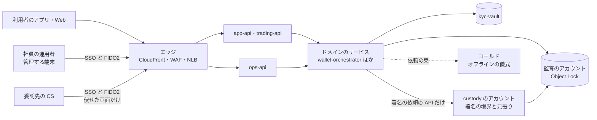
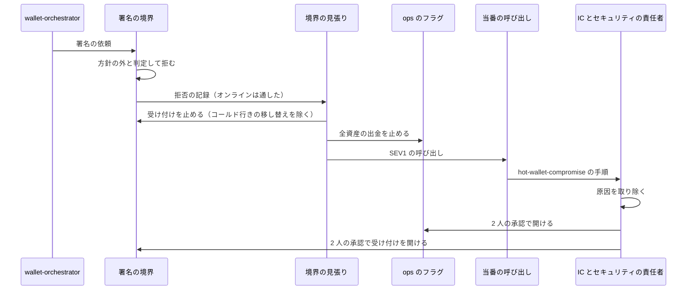

# security: 安全の設計

この領域の設計。全体像は [README.md](README.md) にある。目標と信頼境界、脅威モデル（ウォレット、承認者、内部の者、利用者の乗っ取り、宛先の書き換え）、アカウントの分け方の要件、運用者の期限つきの権限と監査、CS の画面の参照の範囲、個人のデータの扱い、侵害の兆しでの自動の停止、漏えいの対応を扱う。

前提となる決定は次のとおり。

- 署名の境界を別のアカウント（`custody`）に置き、境界の中で方針と承認を確かめ直す（[ADR-0007](../decisions/0007-signing-service-and-key-custody.md)）。ウォレットの段とネットワークにつながる額の上限（[ADR-0006](../decisions/0006-wallet-tiers-and-cold-ratio.md)）
- 出金は許可の一覧と額による承認だけで署名する（[ADR-0008](../decisions/0008-withdrawal-pipeline-and-approvals.md)）。宛先の登録と利用者のパスキーを境界の時刻で記録する（[ADR-0045](../decisions/0045-allowlist-registration-recorded-in-boundary.md)）
- 承認者は FIDO2 の鍵で承認の内容に署名する（[ADR-0036](../decisions/0036-approver-keys-and-approval-payload.md)）
- 本人確認の書類と口座の番号は `kyc-vault` にだけ置く（[Workday の保管庫](../../../workday/docs/architecture/my-number-vault.md)の形）。運用者は期限つきの権限（[Auth0 の ADR-0056](../../../auth0/docs/decisions/0056-operator-access.md)）

この文書で決めたことは次の ADR にある。

| ADR | 決定 |
| --- | --- |
| [0065](../decisions/0065-operator-access-and-cs-view-scope.md) | CS の画面（委託先を含む）は伏せた項目だけを出し、完全な一致の検索だけを持つ。金庫の中身を見る操作は社員のコンプライアンスの担当だけで、2 人目の承認、1 回 1 件、1 日 20 件（メルカリの ADR-0070 の形）。CS の担当は 1 日 80 口座まで |
| [0066](../decisions/0066-automatic-withdrawal-tripwires.md) | 確かな兆し（2 か所の判定の食い違い、説明のつかない減り、境界の記録にない署名）では全資産の出金を自動で止め、誤りもありうる兆しではその資産の自動の署名を止める。境界の中の見張りも自分で止める。開けるのは 2 人 |

0067 は空けておく（漏えい等の報告の手順の型を、法務の L11 の結論の後に起票する）。

## 1. 範囲

| 持つもの | 持たないもの（任せる領域） |
| --- | --- |
| 脅威モデルと、脅威ごとの守りの割り当て | 方針の決定表、鍵と儀式（[custody-and-keys.md](custody-and-keys.md)） |
| アカウントの分け方の要件（どの部品をどこに分けるか） | アカウントとネットワークの構成そのもの（infrastructure の領域） |
| 運用者の権限、CS の画面の項目、金庫を見る操作、監査 | 出金のステートマシン（[withdrawals.md](withdrawals.md)） |
| データの区分とログに出してよいか | ログ・トレースの属性の許可の一覧の実装（observability の領域） |
| 侵害の兆しと自動の停止 | ログイン、パスキー、端末、API キーの流れ（kyc-and-accounts の領域） |
| 脆弱性、供給網、開発者を狙う攻撃への守り | ボットと速さの上限の値（order-entry-and-risk、market-data の各領域） |
| 漏えい・侵害の対応の流れ | 当局への報告の中身（regulatory-compliance-japan の領域） |

## 2. 目標と前提

| 目標 | 値 | 出どころ |
| --- | --- | --- |
| 方針の外の署名 | 0。1 人で署名できる経路 0。境界の外での鍵の材料の平文 0 | NFR-014、K1 |
| 損失の上限 | 侵害の時の損失を、ホットの残高と自動の停止までの署名の額に閉じる | [ADR-0006](../decisions/0006-wallet-tiers-and-cold-ratio.md)、[ADR-0066](../decisions/0066-automatic-withdrawal-tripwires.md) |
| 個人のデータ | 本人確認の書類・口座の番号が金庫の外に出た事象 0。運用者の参照は全件が監査の行を持つ | NFR-016 |
| 内部の者の持ち出し | 委託先の担当者が見られる項目は伏せたものだけ。1 人の 1 日の参照の上限 | [ADR-0065](../decisions/0065-operator-access-and-cs-view-scope.md) |
| エージェントと Dev | 本番、運用の画面、署名の境界への経路 0 | AGENTS.md |
| 脆弱性 | E16 の外部のペンテストで High 以上 0 | [quality.md](../quality.md) の 5 節 E16 |

## 3. 本家の形（確かめたこと）

| 項目 | 本家 | 出典（確認日） |
| --- | --- | --- |
| サポートの委託先からの漏えい | 2025 年 5 月、米国の外のサポートの委託先の担当者が買収され、利用者のデータを持ち出した。鍵とウォレットには触れられなかった | [Help Net Security](https://www.helpnetsecurity.com/2025/05/15/coinbase-suffers-data-breach-gets-extorted/)（2026-11-15。届出の本文は**未検証**） |
| 機関向けの出金の承認 | Prime の出金と宛先の帳簿の追加は、既定で合意の承認を要する | [Prime Withdrawals](https://docs.cdp.coinbase.com/prime/concepts/transactions/withdrawals)（2026-11-15） |
| CS の画面の項目、委託先の権限、事故の後の対策 | 公式の資料で確かめられなかった | **未検証** |
| アカウントの分け方、署名の境界の構成 | 見つからなかった | **未検証** |

国内の事例：2024 年 5 月の国内の交換業者の流出と、金融庁の 2 度の自主点検の要請（2 度目は北朝鮮の系統の攻撃の集団に関する注意喚起を受けたもの）がある（[intent.md](../intent.md) の出典）。流出の原因は公表の資料で確かめていない（**未検証**）。

## 4. 信頼境界

次の図は、信用の度合いの違う区画と、その間を越えるものを示す。破られた区画から、隣の区画の確かめを飛ばせないことを守りの中心にする。

| 境界 | 越えるもの | 守り |
| --- | --- | --- |
| インターネット → API の層 | 利用者の要求、ボット、乗っ取られた口座 | WAF、速さの上限、パスキー、出金はパスキーの署名つきだけ（ADR-0045） |
| 運用者 → `ops-api` | 人の操作 | SSO、FIDO2、管理する端末の証明、JIT の権限、見る操作の承認（7 節） |
| 委託先 → `ops-api` | 問い合わせの対応 | 伏せた画面だけ、見る操作なし、1 日 80 口座（[ADR-0065](../decisions/0065-operator-access-and-cs-view-scope.md)） |
| ドメインのサービス → 署名の境界 | 署名の依頼 | 1 つの API だけ。境界は取引の解読、方針、承認、利用者の署名、宛先の時刻を自分で確かめる（ADR-0007、ADR-0045） |
| オンライン → コールド | 依頼の束 | 記録媒体か QR だけ。オフラインの機器が束の署名と宛先を確かめる（[custody-and-keys.md](custody-and-keys.md) の 5.2 節） |
| サービス → `kyc-vault` | 本人確認の書類、口座の番号 | 用途ごとの鍵、読む関数の監査の行（Workday の形） |
| 本番 → 監査のアカウント | 運用者の操作、署名の記録 | 書くだけの権限、Object Lock、ハッシュの鎖（[Workday の ADR-0048](../../../workday/docs/decisions/0048-audit-log-hash-chain-and-anchoring.md)） |

### 4.1 アカウントの分け方の要件

アカウントとネットワークの構成は infrastructure の領域で決める。この領域は次を要件として渡す。

| アカウント | 置くもの | 要件 |
| --- | --- | --- |
| 本番 | API の層、ドメインのサービス、Aurora、MSK、ノード | 人の普段の経路なし。break-glass の 2 人の読み出しだけ |
| `custody` | 署名の境界、HSM・MPC のアダプター、境界の記録、境界の見張り、`custody-notifier` | 本番からは署名の依頼の 1 つの API だけ。CI からのデプロイは、セキュリティの承認と、本番と別の役割 |
| 監査 | 運用者の操作の記録、境界の記録の写し、CloudTrail | 書くだけ。消せない（Object Lock） |
| 見張り（`canary`） | 外からの見張りの口座 | 本番の利用者のデータに触れない |
| 検証・開発 | 試験の境界（ソフトウェアの鍵）、シミュレーター | 本番の鍵・アドレス・xpub・利用者のデータを持たない。エージェントが使える |

## 5. 脅威モデル

| # | 脅威 | 入口 | 影響 | 主な守り |
| --- | --- | --- | --- | --- |
| T1 | ホット・ウォームの鍵の持ち出し | HSM・MPC の提供者、境界の部品の脆弱性 | ホット・ウォームの全額 | 鍵は境界の中だけ。段ごとに別の鍵。境界の記録にない署名の自動の停止（ADR-0066） |
| T2 | オンラインの側の侵害で不正な依頼を出す | `wallet-orchestrator`、`app-api`、core の DB | 方針の中の自動の額まで | 境界の確かめ直し、境界の時刻での待ち時間と利用者の署名（ADR-0045）、境界の累計、自動の停止 |
| T3 | 承認者の乗っ取り・だまし | 承認者の端末、偽の承認の依頼、承認の画面の書き換え | 承認の段の額 | FIDO2 の鍵、承認の内容への署名と境界での照らし（ADR-0036）、承認者の急な承認の停止（ADR-0066） |
| T4 | 内部の者の持ち出し（利用者のデータ） | CS の画面、委託先の担当者の買収 | 利用者のデータ、詐欺の電話の素材 | 伏せた画面、見る操作の限定、参照の上限と兆しの知らせ（ADR-0065） |
| T5 | 利用者の口座の乗っ取り | フィッシング、SIM の乗っ取り、盗んだパスワード、偽のサポート | 利用者の資産の出金 | パスキー、許可の一覧と 24 時間、認証の情報の変更の後 72 時間、境界での数え（ADR-0045）、知らせ |
| T6 | 宛先の書き換え | 端末のマルウェア（貼り付けの書き換え）、似たアドレス | 誤った宛先への出金 | 許可の一覧の待ち時間、登録の確認の画面、知らせ（[withdrawals.md](withdrawals.md) の 5.1 節） |
| T7 | 内部の者の資産の持ち出し | 運用者、保持者、承認者の共謀 | 承認の段の額、コールド | 2 人以上の承認、3-of-5 と 1 か所 2 つまで（[ADR-0034](../decisions/0034-cold-key-quorum-and-locations.md)）、方針の緩める変更の 24 時間（[ADR-0035](../decisions/0035-signing-policy-bundle-and-decision-table.md)） |
| T8 | 開発者・CI を狙う攻撃 | 偽の求人・依頼のファイル、依存のライブラリ、CI の権限 | 境界の部品の書き換え、秘密の持ち出し | 境界のデプロイの別の役割とセキュリティの承認、依存の許可の一覧、署名つきのビルド、開発の端末に本番の秘密なし（10 節） |
| T9 | AI エージェントの誤り・乗っ取り | 指示の注入、誤った変更 | 方針・正解・規則の緩め | エージェントは本番と境界に経路なし。正解と方針の CODEOWNERS（[roadmap.md](../roadmap.md) の「エージェントに任せないこと」） |
| T10 | 本システムを名乗る詐欺 | 偽のサイト、偽の電話・SMS、偽の CS | 利用者の乗っ取り、送金のだまし | 本システムは電話で出金・パスキーを求めない旨の告知、SMS にリンクなし、DMARC、偽のドメインの見張り |
| T11 | API キーの漏れ | 利用者の自動の売買の環境 | 不要な注文 | 取引の権限だけ（PM の判断待ち P2）、IP の許可の一覧の任意の設定、キーごとの速さの上限 |
| T12 | 運用の画面・API の脆弱性 | 権限の確かめの漏れ、SSRF | 個人のデータ、運用の操作 | FORCE RLS、`ops-api` の操作ごとの権限、egress の許可の一覧、ペンテスト |

### 5.1 T2 と T3：方針の後ろの守り

オンラインの側が破られたときに出せる額は、境界の方針の自動の行（[custody-and-keys.md](custody-and-keys.md) の 6.2 節の P03）の中だけで、しかも次のすべてを満たす依頼に限られる。

- 利用者のパスキーの署名がある（攻撃者は利用者の端末も要る）。
- 宛先の登録が、境界の時刻で 24 時間より前（攻撃者は待つ間に知らせと見張りに見つかる）。
- 境界の記録の累計が上限の中。1 時間の累計が 24 時間の上限の 25% を超えたら自動の署名が止まる（ADR-0066）。

承認者が破られた場合も、承認の内容は境界が取引の中身と照らし（ADR-0036）、1,000 万円を超える出金は 2 つの役割の承認を要する。

### 5.2 T4：本家の 2025 年の事故の形

| 本家で起きたこと（報道） | 本システムの守り |
| --- | --- |
| 委託先の担当者が利用者のデータを引けた | 委託先の画面は伏せた項目だけ（ADR-0065） |
| 担当者が多数の利用者を見た | 完全な一致の検索だけ、1 日 80 口座、1 時間 30 件で知らせ |
| 本人確認の書類の画像が出た | 書類は `kyc-vault` だけ。見るのは社員のコンプライアンスで、2 人目の承認と 1 日 20 件 |
| 持ち出したデータで利用者をだました | T10 の告知、出金の 24 時間と 72 時間、知らせ |

## 6. 例：CS の問い合わせと書類の確かめ

委託先の CS 担当 V が、口座 A の「出金が届かない」という問い合わせ（案件 C-1024）を受けた。

| 時刻 | 誰が | 何をする | 見えるもの |
| --- | --- | --- | --- |
| 10:00 | V | 案件 C-1024 の登録のメールアドレスで完全な一致の検索 | 口座 A、氏名「ヤ＊＊＊（4 文字）」、メールの末尾 4 文字 |
| 10:01 | V | 口座 A の出金を開く（今日の 12 件目） | 出金の状態 `confirming`、0.5 BTC、宛先の末尾 6 文字、取引の ID の末尾 6 文字 |
| 10:03 | V | 「ブロックの確認中」と答える | — |
| 10:20 | V | 利用者が「本人確認の書類を出し直したい」。V は見る操作を持たないので、社員のコンプライアンスへ回す | — |
| 10:40 | 社員 S | 案件 C-1024 に結び付く 2 時間の JIT を申し出て、責任者 R が承認 | — |
| 10:42 | S | 書類の画像を見る操作（今日の 3 件目）。R が 2 人目として承認 | 透かしつきの画像、画面だけ |
| 10:42 | `kyc-vault` | 読む関数が監査の行を同じトランザクションで書く。監査のアカウントへハッシュの鎖で写す | — |

- V が 1 時間に 30 件を超えて口座を開けば、セキュリティに知らせる。81 件目は開けない（ADR-0065）。
- ログには、案件の ID、口座の ID、操作の種類だけを書く。氏名、メール、アドレスを書かない。

## 7. 運用者の権限と監査

[Auth0 の ADR-0056](../../../auth0/docs/decisions/0056-operator-access.md) と [メルカリの ADR-0070](../../../mercari/docs/decisions/0070-operator-access-vault-reveal-and-audit.md) を引き継ぐ。この題材で足すものを表にする。

| 役割 | できること | 権限の取り方 |
| --- | --- | --- |
| CS（委託先） | 伏せた画面、案件の対応、社員への回付 | SSO と FIDO2、勤務の時間だけ |
| CS（社員） | 上に加え、口座の止め（出金の停止）、宛先の取り消しの代行（利用者の依頼のとき） | 案件に結び付く JIT |
| コンプライアンス | `compliance_review` の判断、金庫を見る操作 | 案件に結び付く 2 時間の JIT、見る操作は 2 人目の承認 |
| 出金の承認者 | 承認（[ADR-0036](../decisions/0036-approver-keys-and-approval-payload.md)） | 承認者の一覧と FIDO2 の鍵。運用の画面の役割とは別に境界が確かめる |
| Ops の当番 | `ops.*` を止める、板の停止 | 当番の間だけ。開けるのは 2 人 |
| セキュリティ | 境界の受け付けの停止、承認者の一時の停止 | break-glass の 2 人の手順 |
| 財務 | 照合の差の調べ、打ち消しの仕訳の承認 | 案件に結び付く JIT と 2 人 |
| Dev・AI エージェント | 本番に経路なし | — |

- 操作の監査の事象は、操作と同じトランザクションで書き、流れごとのハッシュの鎖で監査のアカウントへ写す（Workday の ADR-0048、メルカリの ADR-0070）。
- 承認者、鍵の保持者、境界の break-glass は、同じ人に重ねない（作成者と承認者の分け、1 人に 2 つの鍵を持たせない。[ADR-0034](../decisions/0034-cold-key-quorum-and-locations.md)）。

## 8. データの区分

区分の考え方は [メルカリの ADR-0071](../../../mercari/docs/decisions/0071-data-classes-and-lifecycle.md) を引き継ぐ。この題材の区分と、ログに出してよいかを表にする。保持の期間は法務の L4・L11 の結論で決める。

| 区分 | 例 | 置き場所 | ログ・トレース |
| --- | --- | --- | --- |
| 秘密 | 鍵の材料、API キーの秘密、承認の署名の中身 | 境界、Secrets Manager | 出さない |
| 金庫 | 本人確認の書類、顔の画像、氏名・住所・生年月日、口座の番号 | `kyc-vault` | 出さない |
| 本人 | メール、電話、端末 | core（暗号化の列） | 出さない |
| お金 | 残高、仕訳、出金の額 | ledger、core | ID と額だけ |
| チェーン | アドレス、取引の ID | core、境界の記録 | 出してよいが、利用者の ID と同じ行に書かない（AGENTS.md） |
| 監査 | 運用者の操作、署名の記録 | 監査のアカウント | — |
| 公開 | 板、約定、ローソク足 | Valkey、S3 | 出してよい |

## 9. 侵害の兆しと自動の停止

[ADR-0066](../decisions/0066-automatic-withdrawal-tripwires.md) の兆しが出てから止まるまでの流れ。境界の中の見張りと、本体の側の見張りが、それぞれ自分で止める。

- 止めるまでの目標は 30 秒（ADR-0066）。止めた後の手順は [runbooks/hot-wallet-compromise.md](../runbooks/hot-wallet-compromise.md)。
- `ops.*` のフラグの基盤（AppConfig）が使えなくても、境界の停止だけで署名は止まる。

## 10. 脆弱性と供給網

- 依存のライブラリは許可の一覧で固定し、境界の部品（取引の解読、提供者の SDK）の更新はセキュリティのレビューを要する。SBOM を作り、ビルドに署名する。
- 開発者を狙う攻撃（偽の求人の課題のファイル、依頼のリポジトリ）を前提に、開発の端末には本番と `custody` の秘密を置かない。境界のデプロイは、CI の別の役割と、セキュリティの承認の後だけ。
- 外部のペンテストは、署名の境界、承認者の流れ、運用の画面、宛先の登録を範囲に入れる（E16 の `external-pentest`）。
- 脆弱性の届けの窓口（`security@<brand>.<domain>`）を置く。報奨の制度は E16 の後に判断する。

## 11. 漏えい・侵害の対応

| 事象 | 最初の操作 | 手順 |
| --- | --- | --- |
| 方針の外の署名、説明のつかない減り | 自動の停止（ADR-0066） | [runbooks/hot-wallet-compromise.md](../runbooks/hot-wallet-compromise.md) |
| 個人のデータの漏れの疑い | 疑いのある担当者の権限を止める。参照の記録を保全する | `privacy-leak-response.md`（計画。漏えい等の報告の判断は法務の L11） |
| 委託先の担当者の不正の疑い | 委託先の役割をまとめて止め、社員だけで対応する | 同上、新：`vendor-access-suspend.md` |
| 乗っ取りの急増 | その兆しの資産の自動の署名を止める | `account-takeover.md`（計画） |

- 当局・自主規制団体への報告と、利用者への知らせの時期と文言は、法務とコンプライアンスが決める（法務の L1・L9・L11・L13）。

## 12. 障害のときの振る舞い

| 障害 | 検知 | 振る舞い | 回復 |
| --- | --- | --- | --- |
| SSO・FIDO2 の基盤の障害 | ログインの失敗 | 運用の画面に入れない。`ops.*` を止める操作は当番の break-glass で行える | SSO の回復 |
| 監査のアカウントへの写しの遅れ | 写しの遅れの SLI | 金庫を見る操作と承認を止める（監査なしに見せない） | 写しの回復の後に開ける |
| 境界の見張りの停止 | 見張りの心拍 | 境界の受け付けを止める（見張りなしに自動の署名をしない） | 見張りの再起動 |
| 自動の停止の誤り | 兆しの記録の確かめ | 誤りもありうる兆しは自動の署名だけが止まり、承認の段で払う | Ops とセキュリティの 2 人で開ける |

## 13. テスト

| 種類 | 中身 |
| --- | --- |
| 応答の監査 | CS の画面の API の応答に、伏せない氏名・住所・生年月日・書類・口座の番号の形が出ない |
| 性質（PROP-SEC） | 委託先の役割での見る操作 0。案件に結び付かない参照 0。上限を超えた参照 0。確かな兆しの後のコールド行き以外の署名 0。開ける操作に 2 人の承認のないもの 0 |
| ログの走査 | 8 節の区分の「出さない」の形の検出 0（[quality.md](../quality.md) の漏れの経路の表） |
| 障害の注入 | ADR-0066 の各兆しを作り、止まるまでの時間と範囲 |
| ペンテスト | 本体のアカウントから境界の鍵と記録に届かない。承認の画面の書き換えで違う取引に署名させられない |
| 訓練 | hot-wallet-compromise と、委託先の権限の一括の停止 |

## 14. Story の候補

| Epic | Story | 内容 |
| --- | --- | --- |
| E1 | `ops-console-skeleton`（既存） | 7 節の役割、JIT、監査の事象とハッシュの鎖 |
| E1 | 新：`audit-account-and-hash-chain` | 監査のアカウント、Object Lock、ハッシュの鎖（Workday の ADR-0048） |
| E2 | 新：`cs-masked-views` | CS の伏せた画面、完全な一致の検索、1 日 80 口座、兆しの知らせ（ADR-0065） |
| E2 | `kyc-vault`（既存） | 見る操作の 2 人目の承認と 1 日 20 件 |
| E6 | 新：`boundary-tripwires` | 境界の見張りと自動の停止（ADR-0066） |
| E7 | 新：`withdrawal-tripwires` | 本体の側の兆しと `ops.*` の自動の停止（ADR-0066） |
| E16 | `external-pentest`（既存） | 10 節の範囲 |
| E16 | 新：`vendor-access-drill` | 委託先の権限の一括の停止の訓練 |

## 15. 未解決の問い

| 問い | 誰が | いつ |
| --- | --- | --- |
| 本人確認の書類と顔の画像の保存の期間、外国にある提供者への提供、漏えい等の報告の手順 | 法務の確認待ち（L11） | E2 の書類の保存の Story、`privacy-leak-response.md` の前 |
| CS の委託の管理（委託先の監督、海外の委託先を使うか） | 法務の確認待ち（L13）、PM | E2 の CS の Story の前 |
| 自主規制団体のシステムのリスクの管理の規則の当てはめ | 法務の確認待ち（L9） | E16 の GA の判定の前 |
| CS の 1 日 80 口座、自動の停止の値 | Ops、セキュリティ | E2・E7 の spec の前（実績で直す） |
| 脆弱性の報奨の制度 | PM、セキュリティ | E16 の後 |

## 16. quality.md・runbooks・data-model への項目

**quality.md**

- 1 節のリスクの表に足す候補：内部の者の持ち出し（T4）、自動の停止の効かない時間。
- 2.2.1 節に足す：CS の画面の応答の監査、委託先の役割の性質、自動の停止の障害の注入（各兆しから 30 秒）。
- 性質の名前：PROP-SEC（E1・E2・E16 の行に足す）。
- E16 の合否基準に足す：委託先の権限の一括の停止の訓練。

**runbooks**

| 手順 | 契機 |
| --- | --- |
| `privacy-leak-response.md`（計画にある） | 個人のデータの漏れの疑い、CS の参照の兆しの知らせ |
| `account-takeover.md`（計画にある） | 乗っ取りの兆し、誤りもありうる兆しでの自動の署名の停止 |
| 新：`vendor-access-suspend.md` | 委託先の担当者の不正の疑い。委託先の役割の一括の停止と、社員だけでの対応 |
| 新：`tripwire-reopen.md` | 自動の停止の後の確かめと、2 人での開け方（hot-wallet-compromise の「開ける」を兆しごとに分ける） |

- 1 節の SLI に足す候補：自動の停止から止まるまでの時間、CS の参照の上限に当たった件数、監査の写しの遅れ。
- 5 節の定期作業に足す：担当者ごとの参照の数の見直し（毎月、セキュリティ）。

**data-model**

| 表（クラスタ） | 主な列 |
| --- | --- |
| `operator_grants`（core） | `grant_id`、`operator_id`、`role`、`case_id`、`approved_by`、`expires_at` |
| `operator_actions`（core。監査のアカウントへ写す） | `action_id`、`operator_id`、`grant_id`、`kind`、`target_account_id`、`case_id`、`prev_hash`、`hash`、`at` |
| `vault_reveals`（kyc-vault） | `reveal_id`、`operator_id`、`second_approver_id`、`account_id`、`field_kind`、`case_id`、`at` |
| `cs_view_counters`（core） | `operator_id`、`day`、`accounts_opened`、`last_hour_count` |
| `tripwire_events`（core と custody の記録） | `event_id`、`signal`、`certainty`、`asset`、`stopped_scope`、`detected_at`、`stopped_at`、`reopened_by`、`reopened_at` |
