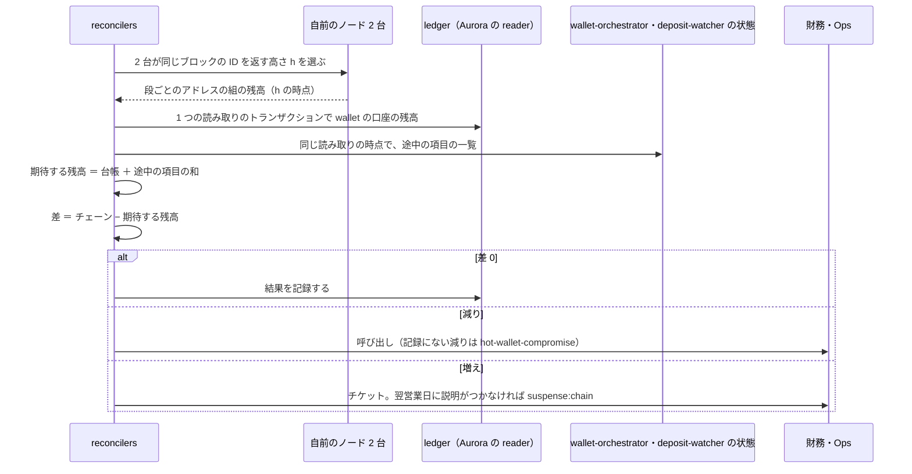

# Segregation and reconciliation: Coinbase

分別管理と照合の領域の設計。全体像は [README.md](README.md) にある。照合と仮勘定の一般の形は Stripe の [ADR-0017](../../../stripe/docs/decisions/0017-three-way-reconciliation-with-suspense.md) と [payouts-and-reconciliation.md](../../../stripe/docs/architecture/payouts-and-reconciliation.md) の 5 節にあり、設計し直さない。この文書は、相手にチェーンの上のウォレット（段ごと）と信託が入ること、利用者の財産と本システムの財産を分けて数えることの差分を書く。

> **法務の確認待ち**：利用者の暗号資産の管理の割合と計算（L2）、利用者の金銭の信託の額と頻度（L3）、改正法の後の分別管理の規律（L1）は決まっていない。この文書はどの結論にも対応できる形にするが、結論までは E13 の分別管理の報告の Story と、E3 の信託の Story の spec を承認しない。

## 1. 範囲

この領域が持つもの：

- 照合の一覧（何と何を、いつ、どの鍵で比べるか）と、照合の結果の記録
- 台帳とチェーン（利用者用のウォレットの段ごと、本システムのウォレット）の照合（[ADR-0031](../decisions/0031-point-in-time-reconciliation-with-in-flight.md)）
- 台帳と銀行・信託の照合
- 仮勘定の種類と期限
- 本システムの持ち分の精算（手数料、販売所の受け渡し。[ADR-0032](../decisions/0032-house-share-settlement.md)）
- 日本円の信託の額の計算（[ADR-0033](../decisions/0033-trust-amount-method-and-daily-top-up.md)。法務の L3）
- 分別管理の日次の報告の元データ（法務の L2・L3）

持たないもの：

| もの | 持つ領域 |
| --- | --- |
| 拘束と注文の照合（5 分ごと） | order-entry-and-risk（[ADR-0004](../decisions/0004-order-entry-holds-and-idempotency.md)）。結果の記録の形はこの領域と同じにする |
| 約定の記帳の欠けの検出（1 分ごと） | [ledger-and-balances.md](ledger-and-balances.md) の 7 節 |
| ウォレットの段の目標と移し替え、ネットワークにつながる額の割合 | custody-and-keys（[ADR-0006](../decisions/0006-wallet-tiers-and-cold-ratio.md)） |
| 銀行の明細と着金の取り込み、信託の依頼の送り | [fiat-and-banking.md](fiat-and-banking.md) |
| 当局への報告の提出 | regulatory-compliance-japan |

## 2. 要件

| 要件 | 内容 | 出典 |
| --- | --- | --- |
| NFR-006 | 台帳とホット・ウォームの照合は 1 時間ごと、コールドは毎日、銀行・信託は毎営業日。説明のつかない差を翌営業日に 0（仮勘定に置き、期限で人が確かめる） | [README.md](README.md) の 3 節 |
| NFR-007 | ネットワークにつながる額の割合の超え 0 分（計算は custody-and-keys の領域。照合の結果の残高を入力に使う） | 同上 |
| 守るべき振る舞い | 利用者の口座の残高の和は、利用者用のウォレットの残高と照合の時点で一致する。違いは仮勘定に置き、説明がつくまで消さない | [intent.md](../intent.md) |
| K4 | 台帳とチェーン・銀行・信託の、説明のつかない差を翌営業日に 0 | 同上 |

## 3. 本家の形（確かめたこと）

| 項目 | 本家 | 出典（確認日） |
| --- | --- | --- |
| 照合の頻度と方式、仮勘定の扱い | 公式の資料で確かめられなかった | **未検証**（2026-11-15） |
| 利用者の資産と自社の資産の分け方、コールドの割合 | 公式の資料で確かめられなかった | **未検証**（2026-11-15。[README.md](README.md) の 1.4 節と同じ） |
| 日本の信託と分別管理の報告 | 本家は日本の事業を止めた。日本の運用は確かめていない | **未検証**（2026-11-15） |
| 内閣府令の第 27 条（ネットワークにつながる管理は円換算の 5% まで） | 翻訳の資料。本システムへの当てはめは法務の L2 | [intent.md](../intent.md) の出典（2026-11-15） |

## 4. 照合の一覧

| ID | 照合 | 内部 | 外部 | 鍵 | 頻度 | 差の置き場所 |
| --- | --- | --- | --- | --- | --- | --- |
| REC-HOLD | 拘束と注文 | `holds`（`order`） | エンジンの未約定の注文の写し | 口座、資産 | 5 分 | 仮勘定にしない（送り直しと取り消し。ADR-0004） |
| REC-TRADE | 約定の記帳 | `trade` の仕訳 | 出力の記録の `trade_seq` | 板、`trade_seq` | 1 分 | 仮勘定にしない（読み直し） |
| REC-CHAIN-HOT | ホット・ウォーム | `wallet:hot`・`wallet:warm` | 自前のノードの残高（高さ h） | アドレスの組、資産、h | 1 時間 | `suspense:chain` |
| REC-CHAIN-COLD | コールド | `wallet:cold` | 同上 | 同上 | 毎日 | `suspense:chain` |
| REC-HOUSE | 本システムのウォレット | `house_wallet` | 同上 | 同上 | 毎日 | `suspense:chain` |
| REC-BANK | 銀行 | `bank:*`、`fiat_in_transit` | 銀行の入出金の明細と残高 | 銀行の取引の番号、依頼の番号 | 毎営業日 | `suspense:bank` |
| REC-TRUST | 信託 | `trust:*` | 信託銀行の残高の通知 | 信託の口座、日付 | 毎営業日 | `suspense:trust` |
| REC-SEG | 利用者の財産の全体 | 利用者の口座の和 | 置き場所の口座の和 − 本システムの持ち分 | 資産、締めの時点 | 毎日（JST 0:00 の締め） | 差は上の照合のどれかに帰す |

- 照合の結果は `reconciliation_runs`（種類、時点、件数、差の額、状態）と `reconciliation_items`（説明のついた項目、説明のつかない差）に残す。結果は書き換えない。
- `reconcilers` は照合のジョブの最後の成功の時刻を SLI に出す。間隔の 2 倍を超えたら呼び出す（[runbooks/ledger-reconciliation-mismatch.md](../runbooks/ledger-reconciliation-mismatch.md)）。

## 5. 台帳とチェーンの照合

[ADR-0031](../decisions/0031-point-in-time-reconciliation-with-in-flight.md) で決める。チェーンは動き続け、台帳は承認の数を待って遅れて書く。同じ時点の値どうしを比べ、途中のものは明示の一覧で説明する。

次の図は、1 回の照合の流れを示す。



### 5.1 途中の項目

| 項目 | チェーン（h） | 台帳 | 期待する残高への足し方 |
| --- | --- | --- | --- |
| 記帳を待つ入金（`detected`・`confirming`。h までのブロックに入った） | 増えている | まだ | ＋額 |
| 記帳を止めた入金（スクリーニングの待ち、ERC-20 のトークン、2 台の食い違い） | 増えている | まだ | ＋額（項目の理由を記録） |
| 放送して h までに入ったが `completed` の前の出金 | 減っている | まだ | −（額 ＋ 払ったチェーンの手数料） |
| 段の間の移し替え（h までに入り、移し先の記帳の前） | 移し元は減り、移し先は増える | まだ | 移し元は −（額 ＋ 手数料）、移し先は ＋額 |
| ETH の入金のアドレスからの集め直し（sweep） | 同上 | まだ | 同上（deposits の領域） |
| 巻き戻りで `reversed_suspense` の入金 | 減っている | 記帳済み | −額（`suspense:reorg` に置き済みなら説明がつく） |

- 台帳の側は、h を決めた後に 1 つの読み取りのトランザクション（REPEATABLE READ）で、口座の残高と途中の項目の状態を同時に読む。途中の項目は、含まれたブロックの高さを持ち、h より後のものは数えない。
- 差が出たら、まず h を 1 ブロック前後にずらして取り直す（途中の項目の状態の遅れを除くため）。2 回続けて同じ差なら、説明のつかない差として扱う。

### 5.2 減りと増え

- **減り**（チェーン < 期待する残高）：署名の記録にない減りは、ただちに [runbooks/hot-wallet-compromise.md](../runbooks/hot-wallet-compromise.md) に従う（runbooks の R1）。記録にある減りは、記帳の欠けを探す。
- **増え**（チェーン > 期待する残高）：本システムに知らされない送金（誤送金、ダスト）、記帳の漏れ。翌営業日に説明がつかなければ、`suspense:chain` に置く（`suspense_in`）。利用者の残高には入れない。

## 6. 利用者の財産の全体の等式

資産ごとに、締めの時点で次を確かめる（ADR-0005 の照合の等式を、本システムの持ち分で一般にした形）。

```
暗号資産：Σ 利用者の口座（user_available ＋ user_hold）
         ＝ Σ 利用者用のウォレットの口座（wallet:hot ＋ wallet:warm ＋ wallet:cold）
           − 本システムの持ち分のうち利用者用のウォレットにあるもの
           ＋ 利用者の財産のうち本システムのウォレットにあるもの
日本円：  Σ 利用者の口座 ＝ Σ 利用者の金銭の口座（bank:user_* ＋ trust:*）＋ fiat_in_transit
           − 本システムの持ち分のうち利用者の金銭の口座にあるもの
           ＋ 利用者の財産のうち本システムの口座にあるもの
```

- 「本システムの持ち分のうち利用者用のウォレットにあるもの」は、手数料の収益と、販売所で利用者から受けた資産のうち、まだ本システムのウォレットへ移していないもの（チェーンの手数料を引く）である。
- 「利用者の財産のうち本システムのウォレットにあるもの」は、販売所で利用者に渡した資産のうち、まだ利用者用のウォレットへ移していないものである。これは利用者の財産の置き場所の不足で、最も短く精算する（7 節）。
- 2 つの項は、仕訳の行の `settlement_batch_id` が空のものの和で出す。精算の仕訳を書くと、その行に精算の束の ID を付ける（[ADR-0032](../decisions/0032-house-share-settlement.md)）。

## 7. 本システムの持ち分の精算

[ADR-0032](../decisions/0032-house-share-settlement.md) で決める。

| 向き | 例 | 精算の頻度 | 誰が |
| --- | --- | --- | --- |
| 利用者の財産が不足する（本システムの置き場所にある） | 販売所の買い：利用者の BTC は `house_wallet` にある。販売所の売り：利用者に払う日本円は本システムの口座にある | 1 時間ごと。累計が閾値（既定 1,000 万円の円換算）を超えたら即時 | `rebalancer`（暗号資産）、`funding`（日本円）。方針の中の自動 |
| 本システムの持ち分が余る（利用者の置き場所にある） | 手数料の収益、販売所の売り：利用者から受けた BTC は利用者用のウォレットにある | 毎日 | 同上 |

- 暗号資産の精算は、`house_wallet` と利用者用のホットのウォレットの間の移し替えで、宛先は互いの許可の一覧のアドレスに限る（[ADR-0007](../decisions/0007-signing-service-and-key-custody.md)）。両方向を差し引いて、1 回の取引にする。
- 日本円の精算は、本システムの口座と利用者の金銭の口座の間の振替で行う（[fiat-and-banking.md](fiat-and-banking.md)）。
- 利用者の財産の置き場所の不足を、どれだけの時間・額まで許すかは、法務の確認待ち（L2・L3）である。結論までは、上の既定で運用し、不足の額と時間を日次の報告に出す。

## 8. 日本円の信託の額

[ADR-0033](../decisions/0033-trust-amount-method-and-daily-top-up.md) で決める。信託すべき額の計算は `legal.trust_amount_method` で持ち、法務の L3 の結論まで本番の値を有効にしない（[ADR-0005](../decisions/0005-ledger-balances-and-trade-settlement.md)）。

| 方式（`legal.trust_amount_method`） | 信託すべき額 |
| --- | --- |
| `user_balance` | 利用者の日本円の残高の和（`user_available` ＋ `user_hold`） |
| `with_in_transit` | 上 ＋ `fiat_in_transit`（出金を銀行に依頼し、結果の前） |
| `with_unapplied`（試験の既定） | 上 ＋ 着金したが記帳していない額（名義の違い、組戻しの待ち） |

- 計算は毎営業日、前日の締め（JST 0:00）のスナップショットで行う。足りなければ、その営業日の中に信託の追加を依頼する（[fiat-and-banking.md](fiat-and-banking.md) の 7 節）。余っていても、自動では信託を減らさない（解約は財務の 2 人の承認）。
- 信託の口座の残高（信託銀行の通知）と `trust:*` の差は REC-TRUST で照合する。信託すべき額との不足は runbooks の R5 である。
- 本システムの持ち分の日本円（手数料、販売所の収益）は信託すべき額に入れない。

次の図は、1 営業日の照合と信託の順序を示す。銀行の締めの時刻は**未検証**で、提携銀行を選ぶときに確かめる。

```mermaid
gantt
    title 1 営業日の照合と信託（JST、時刻は既定の案）
    dateFormat HH:mm
    axisFormat %H:%M
    section 台帳
    締めとスナップショット :a1, 00:00, 30m
    利用者の財産の全体の等式 :a2, after a1, 30m
    section 銀行と信託
    前営業日の明細の取り込み :b1, 07:00, 60m
    REC-BANK と REC-TRUST :b2, after b1, 60m
    信託すべき額と不足の計算 :b3, after b2, 30m
    信託の追加の依頼 :b4, after b3, 60m
    section 報告
    分別管理の日次の報告の作成 :c1, 11:00, 60m
    財務の確認 :c2, after c1, 120m
```



## 9. 分別管理の日次の報告

- 報告は、締めの時点の照合の結果から作る。中身は、資産ごとの利用者の財産の和、置き場所ごとの額（段ごとのウォレット、銀行、信託、`fiat_in_transit`）、本システムの持ち分の精算の待ち、ネットワークにつながる額の割合（custody-and-keys の領域の計算）、信託すべき額と信託の額、仮勘定の残高と年齢、説明のつかない差である。
- 報告は要約（ハッシュ）を持ち、書き換えない。財務が確かめ、承認の記録を付ける。
- 様式、当局と自主規制団体への提出の要否と頻度は、法務の L2・L3・L9 の結論で決める（regulatory-compliance-japan の領域）。

## 10. 仮勘定

| 種類 | 入る理由 | 期限 | 出し方 |
| --- | --- | --- | --- |
| `suspense:chain` | チェーンの説明のつかない増え | 翌営業日に財務が確かめる。30 日で財務の責任者へ | 誤送金の返却、本システムの収益、利用者への記帳（調べの結論） |
| `suspense:bank` | 銀行の説明のつかない差、名義の違う着金の組戻しの待ち | 翌営業日 | 組戻し、記帳、銀行の訂正 |
| `suspense:trust` | 信託の通知と台帳の差 | 翌営業日 | 信託銀行への照会 |
| `suspense:reorg` | 記帳の後の巻き戻りで足りない分（ADR-0009） | 調べの結論まで | 回収、本システムの損失 |
| `suspense:wallet_loss` | 流出（[runbooks/hot-wallet-compromise.md](../runbooks/hot-wallet-compromise.md)） | 補填の判断まで | 補填の仕訳 |

- 仮勘定への出し入れは `suspense_in`・`suspense_out` の仕訳だけで、財務の 2 人の承認を要する（[ledger-and-balances.md](ledger-and-balances.md) の 5 節）。
- 仮勘定の残高と年齢を日次の報告に出す。説明のつく差（5.1 節の途中の項目）は仮勘定に入れない。

## 11. 例：BTC のホットの照合

ある時刻に、2 台のノードが同じブロックの ID を返す高さ h を選んだ。

| 項目 | BTC |
| --- | --- |
| 台帳の `wallet:hot:BTC` | 150.00000000 |
| 記帳を待つ入金（h までに入り、2 承認） | ＋0.30000000 |
| `confirming` の出金 1 件（額 0.5、払ったチェーンの手数料 0.00002） | −0.50002000 |
| ホットからコールドへの移し替え（h までに入り、移し先の記帳の前。額 10、手数料 0.00001） | −10.00001000 |
| 期待する残高 | 139.79997000 |
| チェーンの残高（h） | 139.79997000 |
| 差 | 0 |

- もしチェーンの残高が 139.79987000 なら、差は −0.0001 BTC（10,000 satoshi）の減りである。h をずらしても同じなら、署名の記録と照らし、記録にない減りなら [runbooks/hot-wallet-compromise.md](../runbooks/hot-wallet-compromise.md) へ進む。
- 同じ時点の日本円の信託の例（`with_unapplied`）：利用者の日本円の残高の和 150 億円、`fiat_in_transit` 1.2 億円、記帳していない着金 300 万円で、信託すべき額は 151 億 2,300 万円。信託の額が 150 億 5,000 万円なら、不足 7,300 万円の信託の追加を、その営業日の中に依頼する。

## 12. 障害のときの振る舞い

| 障害 | 検知 | 振る舞い | 回復 |
| --- | --- | --- | --- |
| ノードの 2 台が食い違う、遅れる | 同じブロックの ID の高さが選べない | 照合を見送り、最後の成功の時刻の SLI で知らせる。入金の記帳も止まる（ADR-0009） | ノードの回復の後に取り直す |
| 途中の項目の状態の遅れ | 差が h のずらしで消える | 差として扱わない | — |
| 銀行の明細が届かない | 取り込みの遅れ | REC-BANK を見送り、翌営業日の差の期限は延ばさない（財務のチケット） | 照会で取る（[fiat-and-banking.md](fiat-and-banking.md)） |
| 信託銀行の通知が届かない | REC-TRUST の見送り | 信託すべき額の計算と依頼は続ける | 照会 |
| `reconcilers` の停止 | 最後の成功の時刻が間隔の 2 倍 | 呼び出し | 再開で、抜けた時点を後から照合する |
| 精算の移し替えが詰まる | 精算の待ちの額と時間 | 利用者の財産の不足が閾値を超えたら呼び出し。販売所の偏りを増やす向きの提示を止める（brokerage-quotes の領域に依頼） | 置き換えの規則で詰まりを解く（ADR-0008） |

## 13. 上限

| 項目 | 値 | 根拠 |
| --- | --- | --- |
| 照合のアドレスの数 | S1 でホットとウォームのアドレスの組は数千。利用者ごとの入金のアドレス（BTC）は、記帳を待つ入金の項目として数え、全アドレスの残高を毎時に引かない | [capacity.md](capacity.md) |
| 利用者の財産の不足の閾値 | 円換算 1,000 万円（既定。法務の L2・L3 の後に見直す） | [ADR-0032](../decisions/0032-house-share-settlement.md) |
| 説明のつかない差の期限 | 翌営業日 | NFR-006 |

## 14. セキュリティ

- 照合のジョブは ledger の reader と、ノードの読み取りの RPC だけを使う。台帳への書き込みは結果の記録と、承認つきの仮勘定の仕訳だけ。
- 照合の結果と日次の報告は、アドレスと利用者の ID を同じ行に書かない（[AGENTS.md](../../AGENTS.md)）。報告は集計だけを持つ。
- 精算の移し替えの宛先は、本システムの許可の一覧の 2 つのアドレスの組に固定し、方針で他を拒む（ADR-0007）。

## 15. テスト

- **PROP-REC-001**：任意の入出金・移し替え・巻き戻り・精算の列と任意の h で、チェーン ＝ 台帳 ＋ 途中の項目の和（[quality.md](../quality.md) の 2.2.1 節 G）。
- **PROP-REC-002**：任意の列で、利用者の財産の全体の等式が締めの時点で成り立つ。精算の仕訳の後、本システムの持ち分の項が 0 に戻る。
- **PROP-REC-003**：説明のつく差（5.1 節）が仮勘定に入らない。わざと入れた説明のつかない差は必ず見つかる（変異の試験）。
- **PROP-REC-004**：信託すべき額は、方式の 3 つで単調に増える（`user_balance` ≤ `with_in_transit` ≤ `with_unapplied`）。
- **DT-REC-001**：途中の項目の決定表（5.1 節）。
- **シミュレーター**：`chain-sim`（詰まり、置き換え、巻き戻り、ノードの分かれ）、`bank-sim`（明細の遅れ、名義の違い、組戻し、出金の結果の不明）、信託の通知の遅れ。

## 16. Story の候補

| Epic | Story | 内容 |
| --- | --- | --- |
| E13 | `chain-reconciliation` | 高さ h の選び方、途中の項目、段ごとの照合、仮勘定 |
| E13 | `house-share-settlement` | 本システムの持ち分の精算（**新しい候補**） |
| E13 | `bank-and-trust-reconciliation` | REC-BANK、REC-TRUST（法務：L3） |
| E13 | `segregation-daily-report` | 全体の等式、日次の報告（法務：L2・L3） |
| E3 | `trust-instructions` | 信託すべき額の計算と依頼（法務：L3） |

## 17. 未解決の問い

- 信託すべき額の方式と頻度、信託までの間の扱い（法務の L3）。
- 利用者の財産の置き場所の一時の不足（販売所の受け渡しの精算の待ち）を、どこまで許すか（法務の確認待ち L16）。
- 分別管理の日次の報告の様式と提出（法務の L2・L3・L9）。

## 18. quality.md・runbooks・data-model への項目

**quality.md**

- 2.2.1 節 G に PROP-REC-001〜004 と DT-REC-001 を足す。場面に「販売所の受け渡しの精算の待ち」を足す。

**runbooks**

- `house-settlement-stuck.md`（利用者の財産の不足が閾値か 1 時間を超えた。page）。
- [ledger-reconciliation-mismatch.md](../runbooks/ledger-reconciliation-mismatch.md) の確認に「h を 1 ブロックずらして取り直す」を足す。
- 定期作業：仮勘定の年齢の確認（毎営業日、財務）。

**data-model**

| 表 | 主な列 |
| --- | --- |
| `reconciliation_runs` | `run_id`、`kind`（REC-*）、`asset`、`tier`、`block_height`、`block_hash`、`as_of`、`status`、`diff_amount`、`created_at` |
| `reconciliation_items` | `run_id`、`item_kind`（5.1 節）、`source_type`、`source_id`、`amount`、`explained` |
| `settlement_batches` | `batch_id`、`asset`、`direction`、`amount`、`transfer_id`、`journal_id`、`created_at`、`completed_at` |
| `journal_lines`（列を足す） | `settlement_batch_id` |
| `trust_calculations` | `calc_id`、`business_date`、`method`、`user_balance`、`in_transit`、`unapplied`、`required`、`trust_balance`、`shortfall`、`instruction_id` |
| `segregation_reports` | `report_id`、`business_date`、`digest`、`approved_by`、`approved_at` |
| `suspense_cases` | `case_id`、`suspense_kind`、`asset`、`amount`、`opened_at`、`due_at`、`resolution`、`approved_by` |
