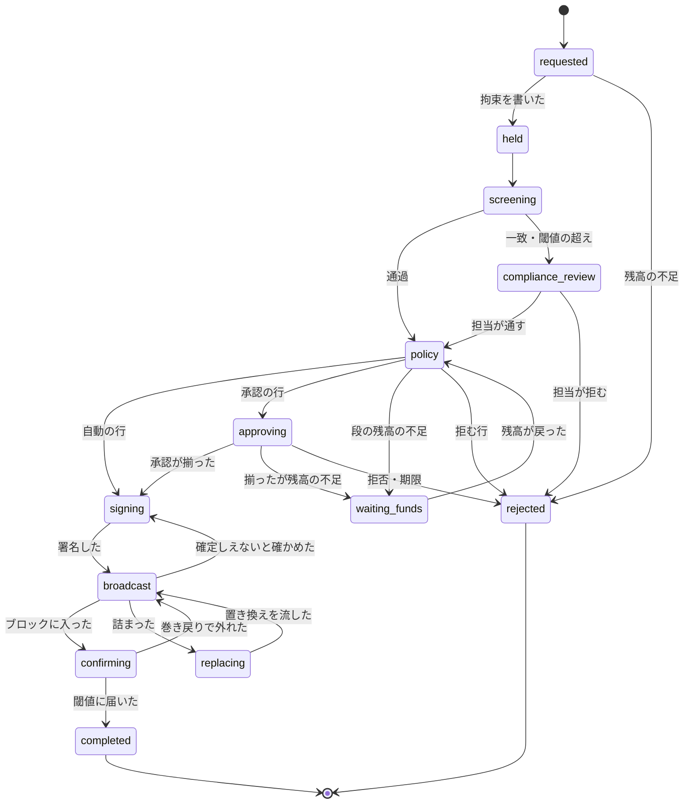
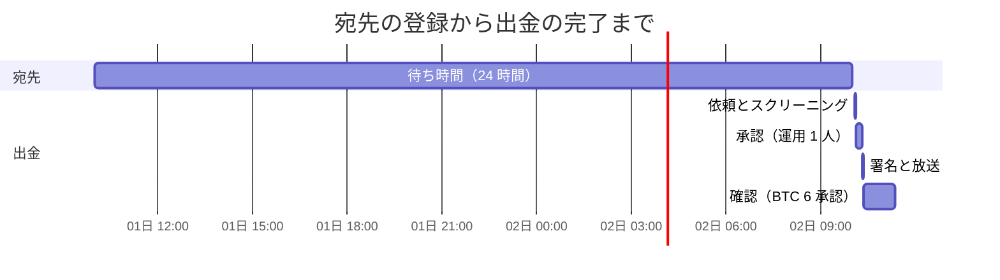
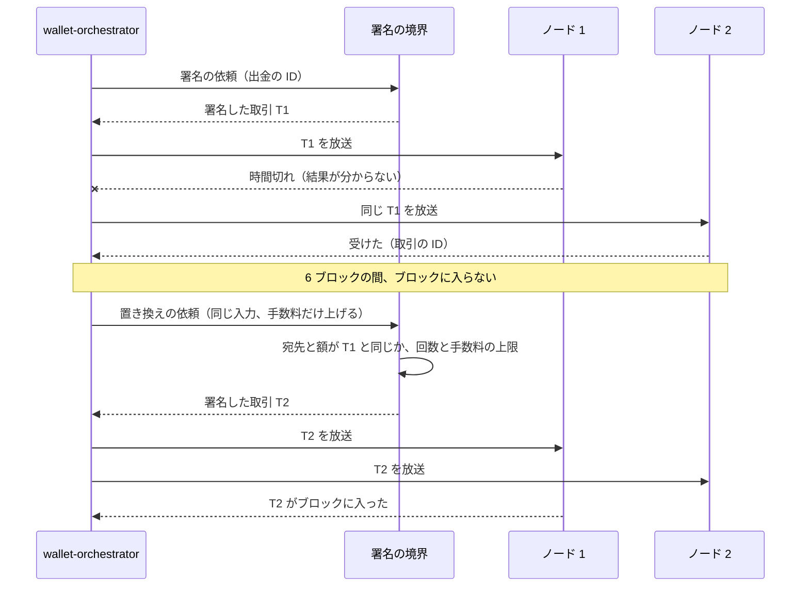

# withdrawals: 暗号資産の出金

この領域の設計。全体像は [README.md](README.md) にある。出金のステートマシン、許可の一覧、額による承認の段、取引の作り直しの規則は [ADR-0008](../decisions/0008-withdrawal-pipeline-and-approvals.md) で決めた。この文書は、遷移の決定表、取引の組み立てと手数料、詰まった取引の扱い、宛先の登録の確かめ方を決める。

この文書で決めたことは次の ADR にある。

| ADR | 決定 |
| --- | --- |
| [0042](../decisions/0042-withdrawal-transition-table.md) | ADR-0008 の 13 の状態を変えず、方針の拒否、補充の後の判定し直し、利用者の取り消し、承認の期限、巻き戻り、作り直しの遷移を足す。`completed` は BTC 6 承認、ETH の確定 |
| [0043](../decisions/0043-one-transaction-per-withdrawal-and-fee-table.md) | 1 つの出金を 1 つの取引で送る（まとめない）。ETH のホットは 4 つのレーン。利用者の手数料は資産ごとの固定の表（BTC 0.0002、ETH 0.002） |
| [0044](../decisions/0044-stuck-transaction-replacement.md) | 詰まりは BTC 6 ブロック・ETH 25 ブロックで判定し、置き換えは 5 回まで。待ちの置き場から消えても作り直さない。作り直しは入力・nonce が他の確定した取引で使われたときだけ |
| [0045](../decisions/0045-allowlist-registration-recorded-in-boundary.md) | 宛先の登録と利用者のパスキーの公開鍵を境界の時刻で記録し、出金の依頼に利用者のパスキーの署名を添える。待ち時間と 72 時間を境界で数える |

## 1. 範囲

| 持つもの | 持たないもの（任せる領域） |
| --- | --- |
| 出金の依頼、拘束、ステートマシン、`transitionWithdrawal()` | 署名の境界、方針の決定表 DT-POL、承認者の鍵（[custody-and-keys.md](custody-and-keys.md)） |
| 宛先の許可の一覧、登録の確認と待ち時間、知らせ | スクリーニングの規則、トラベルルールの通知の中身（aml-and-travel-rule の領域） |
| 承認の画面の流れと期限 | 手数料の見積もりの計算、放送の経路、ノード（chain-nodes-and-confirmations の領域） |
| 取引の組み立て（UTXO の選び方、ETH のレーンと nonce） | 台帳の仕訳の型（ledger-and-balances の領域） |
| 利用者の手数料の表、最小の出金の額 | 認証の情報の変更の事象、パスキーの登録（kyc-and-accounts の領域） |
| 詰まり・置き換え・作り直し | 台帳・チェーン・出金の状態の照合（segregation-and-reconciliation の領域） |
| 利用者への状態の説明（法務の L12） | 日本円の出金（fiat-and-banking の領域） |

## 2. 要件

| 出どころ | 要件 |
| --- | --- |
| NFR-008 | 二重の出金 0。許可の一覧の外の宛先への出金 0。ホットで払える出金の依頼から放送まで p95 30 分（承認の待ちを除く）。上限を超える出金は 24 時間以内（営業日） |
| NFR-015 | スクリーニングとトラベルルールの判定のない署名 0 |
| NFR-004 | 拘束の和 ＝ 未約定の注文の必要額 ＋ 手続き中の出金 ＋ 受け入れた提示（[ADR-0004](../decisions/0004-order-entry-holds-and-idempotency.md)） |
| NFR-010 | 入出金の受け付けの可用性 月間 99.9% |
| K5・K10 | 出金の正しさと速さ |
| intent の守るべき振る舞い | 1 つの出金から確定する取引は 0 か 1。宛先は待ち時間を過ぎた許可の一覧の中。スクリーニングを通らない出金に署名しない |
| ADR-0009 | BTC の入金は 6 承認まで出金に使えない（出金の拘束の対象から外す） |

## 3. 本家の形（確かめたこと）

| 項目 | 本家 | 出典（確認日） |
| --- | --- | --- |
| 機関向けの宛先の帳簿 | Coinbase Prime は、宛先の帳簿で、知らない宛先・許されない宛先への出金を止める。帳簿の新しい行は画面での合意の承認を要する。帳簿は画面で切れる | [Prime Withdrawals](https://docs.cdp.coinbase.com/prime/concepts/transactions/withdrawals)（2026-11-15） |
| 機関向けの出金の承認 | Prime の出金は、既定で画面での合意の承認を要する。自動の用途では承認の要件を変えられる | 同上 |
| 国際の取引所の宛先の帳簿 | Coinbase International Exchange の帳簿の行は `PENDING`・`ACTIVE`・`DISABLED` で、`PENDING` の行は 24 時間の後に `ACTIVE` になる | [INTX Get Address Book](https://docs.cdp.coinbase.com/api-reference/international-exchange-api/rest-api/address-book/get-address-book)（2026-11-15） |
| 個人向けの許可の一覧 | 個人向けは、利用者が選んで有効にする（opt-in）許可の一覧で、新しい宛先に 48 時間の保留があると、検索の結果の要約が伝える。ヘルプの頁は取得できなかった | **未検証** |
| 出金の手数料、詰まった取引の扱い、まとめ方 | 見つからなかった | **未検証** |

**本家との意図した違い**（[README.md](README.md) の 1.4 節に足す候補）：

| 項目 | 本家 | 本システム | 理由 |
| --- | --- | --- | --- |
| 個人の許可の一覧 | 選んで有効にする（**未検証**） | 必須（PM の判断待ち P4） | 乗っ取りの後の即時の出金を止める（ADR-0008） |
| 待ち時間 | 個人 48 時間（**未検証**）、INTX 24 時間 | 24 時間（P4） | ADR-0008 の既定 |

## 4. 出金のステートマシン

状態は [ADR-0008](../decisions/0008-withdrawal-pipeline-and-approvals.md) の 13 のまま。下の図は 4.1 節の決定表の要約で、食い違ったら表を正とする。

利用者の取り消し（`signing` の前の状態から `rejected`）は、図では省く。

### 4.1 遷移の決定表（DT-WD の候補）

| # | 今の状態 | 条件 | 次の状態 | 副作用 |
| --- | --- | --- | --- | --- |
| W01 | `requested` | 拘束（額 ＋ 手数料）の条件つきの更新が成功 | `held` | 拘束の仕訳（冪等キー `(withdrawal, <id>, hold)`） |
| W02 | `requested` | 使える残高の不足（BTC は 6 承認の前の入金を除いて数える） | `rejected`（`insufficient_funds`） | なし |
| W03 | `held` | — | `screening` | スクリーニングとトラベルルールの依頼（[ADR-0011](../decisions/0011-external-providers-boundary.md)） |
| W04 | `screening` | 制裁の一致なし、点が閾値以下、トラベルルールの通知が済んだか対象外 | `policy` | 判定の記録 |
| W05 | `screening` | 一致、閾値の超え、通知を送れない相手 | `compliance_review` | 案件を作る。拘束は残す |
| W06 | `screening` | 提供者の障害 | `screening`（留まる） | 待ちの理由を出す（ADR-0011） |
| W07 | `compliance_review` | 担当が通す | `policy` | 担当と理由の記録 |
| W08 | `compliance_review` | 担当が拒む | `rejected`（`compliance_rejected`） | 拘束を戻す。凍結の判断は `compliance_review` に留める（法務の L6） |
| W09 | `policy` | DT-POL の最初の行が `auto`、段の残高が足りる | `signing` | 署名の依頼 |
| W10 | `policy` | 最初の行が `approve(...)` | `approving` | 承認の依頼 |
| W11 | `policy` | 最初の行が `auto` か承認を要しない、段の残高が足りない | `waiting_funds` | 補充の依頼（[custody-and-keys.md](custody-and-keys.md) の 4.1 節） |
| W12 | `policy` | 最初の行が `deny` | `rejected`（`policy_denied`） | 拘束を戻す |
| W13 | `approving` | 行の求める役割と数の承認が、期限（30 分）の中で揃い、段の残高が足りる | `signing` | 承認の署名を添えて署名の依頼 |
| W14 | `approving` | 承認が揃い、段の残高が足りない | `waiting_funds` | 補充の依頼 |
| W15 | `approving` | 承認者が拒む、または 3 営業日の間に揃わない | `rejected`（`approver_rejected`・`approval_expired`） | 拘束を戻す |
| W16 | `waiting_funds` | 段の残高が戻った | `policy` | 方針を判定し直す（古い承認を使わない） |
| W17 | `requested`〜`waiting_funds`（`compliance_review` を除く） | 利用者が取り消した | `rejected`（`user_cancelled`） | 拘束を戻す |
| W18 | `signing` | 署名した取引を受けた | `broadcast` | 2 台以上のノードへの放送 |
| W19 | `signing` | 境界が拒んだ | `signing`（留まる） | SEV1 の候補（[security.md](security.md) の自動の停止）。`rejected` にしない |
| W20 | `broadcast` | 取引がブロックに入った | `confirming` | 利用者に「送金済み、確認中」 |
| W21 | `broadcast` | 詰まりの判定（[ADR-0044](../decisions/0044-stuck-transaction-replacement.md)） | `replacing` | 置き換えの署名の依頼（DT-POL の P06・P07） |
| W22 | `broadcast` | 作り直しの条件をチェーンで確かめた | `signing` | 新しい取引の署名の依頼（確かめの記録を添える） |
| W23 | `broadcast` | 結果が分からない、待ちの置き場から消えた | `broadcast`（留まる） | 同じ署名済みの取引を流し直す |
| W24 | `replacing` | 置き換えの取引を受けた | `broadcast` | 放送 |
| W25 | `confirming` | 取引のブロックが外れた | `broadcast` | 同じ取引を流し直す |
| W26 | `confirming` | BTC 6 承認、ETH の確定 | `completed` | 出金の記帳（拘束、ウォレット、手数料の収益、チェーンの手数料。仕訳の型は ledger-and-balances の領域） |

- 表にない遷移は `transitionWithdrawal()` が拒む。`signing` から後は `rejected` に行かない（ADR-0008）。
- `ops.withdrawals_enabled.<asset>` を切っている間は、W09・W13 の遷移を止める（状態は変えない）。`signing` より後の出金の追跡と置き換えは続ける。
- W19 で境界が拒むのは、オンラインの判定と境界の判定が食い違ったときで、方針の外の署名の SLI に数える。

## 5. 宛先の許可の一覧

### 5.1 登録

- 利用者は、資産ごとに宛先を登録する。登録の時に、宛先の種類（交換業者のアドレス、自分で管理するウォレット）と、トラベルルールの情報（相手の交換業者、受取人）を受ける（ADR-0008、法務の L5）。
- 登録は、利用者のパスキーで登録の内容（資産、アドレス、種類）に署名させ、`wallet-orchestrator` が境界に送る。境界が受けた時刻が登録の時刻で、待ち時間は境界の時刻で数える（[ADR-0045](../decisions/0045-allowlist-registration-recorded-in-boundary.md)）。
- 登録を受けたら、メールとプッシュで知らせる。境界の `custody-notifier` からも別の経路で知らせる（ADR-0045）。知らせから、待ち時間の間に取り消せる。取り消しはすぐに効く。
- アドレスの形（BTC はネイティブ SegWit などの形と検査の符号、ETH は大文字と小文字の検査の符号）を確かめる。本システムの入金のアドレスは登録できない（内部の振替は MVP で持たない）。
- 画面では、貼り付けたアドレスの最初と最後の 6 文字を大きく出し、登録の確認の画面でもう一度出す。端末のマルウェアの書き換えは、待ち時間と知らせで止める（[security.md](security.md) の T6）。

### 5.2 待ち時間の図

宛先の登録から最初の出金の完了までの時間の軸。例の 0.5 BTC の出金（6 節）に当てた。

- 待ち時間（既定 24 時間）は PM の判断待ち P4。認証の情報の変更の後 72 時間は出金を受けない（ADR-0008。境界は ADR-0045 でパスキーの追加の 72 時間を数える。パスワードとメール・電話の変更の 72 時間は identity の事象を境界が記録して数える）。

## 6. 例：0.5 BTC の出金

BTC を 1,000 万円とする（[README.md](README.md) の 1.3 節 A と同じ仮定）。利用者 U は、使える残高 0.8 BTC（すべて 6 承認を過ぎた入金と約定から）を持つ。

| 時刻 | 状態 | 出来事 |
| --- | --- | --- |
| 12/1 10:00 | — | U が宛先 `bc1q...7k2m` を登録。境界の時刻で記録。メール・プッシュ・`custody-notifier` の知らせ |
| 12/2 10:05:00 | `requested` | U が 0.5 BTC の出金を依頼。画面は手数料 0.0002 BTC、受け取る額 0.5 BTC を出す。U はパスキーで出金の内容に署名 |
| 10:05:01 | `held` | 拘束 0.5002 BTC（W01）。U の使える残高は 0.2998 BTC |
| 10:05:02 | `screening` | チェーン分析の点、制裁の照合。宛先は自分で管理するウォレット（トラベルルールの扱いは法務の L5） |
| 10:06 | `policy` | 円換算 500 万円。DT-POL は P03 に当たらず（100 万円を超える）、P04（運用 1 人）に当たる |
| 10:06 | `approving` | 運用者に承認の依頼（W10） |
| 10:19 | `approving` | 運用者 A が、FIDO2 の鍵で承認の内容（出金の ID、0.5 BTC、宛先、束の ID、期限 10:49）に署名 |
| 10:19 | `signing` | ホットの残高 64.5 BTC で足りる（W13）。境界が、取引の解読、方針の行 P04、A の承認、U のパスキーの署名、宛先の登録から 24 時間 19 分を確かめて署名 |
| 10:20 | `broadcast` | 2 台のノードへ放送。手数料の率は 3 ブロックの見積もり |
| 10:31 | `confirming` | 1 承認。U に「送金済み、確認中」 |
| 11:24 | `completed` | 6 承認（W26）。拘束 0.5002 BTC を解き、記帳。払ったチェーンの手数料（例：0.00003 BTC）を `network_fee_expense`、受けた 0.0002 BTC を `fee_revenue` |

- 依頼から放送までは 15 分で、そのうち承認の待ちが 13 分。NFR-008 の p95 30 分は承認の待ちを除いて数えるので、この出金の計測の値は 2 分になる。
- 10:40 に詰まっていたら（6 ブロック、低い率）、`replacing` で手数料を 3 ブロックの見積もりの 1.2 倍に上げる。置き換えの手数料が表の 10 倍（0.002 BTC）以下なら自動（P06）で、宛先と額は変えない。

## 7. 取引の組み立てと手数料

| 項目 | BTC | ETH |
| --- | --- | --- |
| 1 つの出金の取引 | 1 つ（まとめない）（[ADR-0043](../decisions/0043-one-transaction-per-withdrawal-and-fee-table.md)） | 1 つ |
| 入力 | 6 承認以上の UTXO から最小の組。お釣りは同じ段の内部のアドレス | 送り元のレーン（ホットは 4 つ） |
| 置き換えの印 | Replace-by-Fee を示す | 同じ nonce |
| 手数料の見積もり | 3 ブロックの見積もり（chain-nodes-and-confirmations の領域） | 基本の手数料と優先の手数料（同） |
| 利用者の手数料 | 0.0002 BTC | 0.002 ETH |
| 最小の出金の額 | 0.0005 BTC | 0.01 ETH |

- 利用者の手数料の表は財務が持つ。見積もりの 7 日の中央値が表の手数料を 1 日続けて超えたら、財務に知らせる。
- 依頼の時の表のバージョンを出金に残し、表が変わっても、その出金の手数料は変えない。

## 8. 詰まり、置き換え、作り直し

[ADR-0044](../decisions/0044-stuck-transaction-replacement.md) の規則を、ノードとの間の失敗の経路で示す。

- 結果が分からないときも、待ちの置き場から消えたときも、同じ署名済みの取引を流し直す。作り直さない。
- 置き換えが 5 回を超えたら自動の置き換えを止め、`stuck-withdrawals.md` の手順で運用が判断する。
- 作り直しは、この出金のどの取引の入力（nonce）も、この出金のものでない確定した取引で使われたと確かめたときだけ（W22）。本システムの鍵での別の署名しかありえないので、侵害の兆しとしてセキュリティに知らせる。

## 9. 障害のときの振る舞い

| 障害 | 検知 | 振る舞い | 回復 |
| --- | --- | --- | --- |
| チェーン分析・トラベルルールの提供者の障害 | アダプターの時間切れ | `screening` に留める（W06）。署名しない（NFR-015） | 回復の後に同じ依頼 |
| 署名の境界の拒否 | W19、方針の外の署名の SLI | その出金は `signing` に留まる。全出金の自動の停止（[security.md](security.md)） | [runbooks/hot-wallet-compromise.md](../runbooks/hot-wallet-compromise.md) |
| HSM・MPC の障害 | 署名の時間切れ | `signing` に留まる。同じ依頼を流し直す（境界の guard が同じ取引だけを返す） | 提供者の回復 |
| ノード 1 台の障害 | 放送の誤り | 残りのノードに流す。2 台とも使えなければ `broadcast` に留め、流し直す | ノードの回復 |
| 手数料の急騰 | 詰まりの判定の急増 | 置き換え（上限まで）。上限を超えたら承認の行 | `stuck-withdrawals.md` |
| 巻き戻り | `confirming` の取引が外れた | W25 で同じ取引を流し直す | [runbooks/chain-reorg.md](../runbooks/chain-reorg.md) |
| ホット・ウォームの不足 | W11・W14 | `waiting_funds`。補充と儀式 | [custody-and-keys.md](custody-and-keys.md) の 4.1 節 |
| `wallet-orchestrator` の停止 | ヘルスチェック | 状態は DB にあり、再開の後に各状態の続きから。`signing` の依頼は出金の ID で冪等 | 再起動 |

## 10. 上限

| 対象 | 値（S1 の既定） | 正本 |
| --- | --- | --- |
| 額による承認の段 | 100 万円まで自動、1,000 万円まで 1 人、超えて 2 人 | ADR-0008、DT-POL |
| 口座の自動の 24 時間の累計 | 300 万円 | [custody-and-keys.md](custody-and-keys.md) の 6.2 節 |
| 宛先の待ち時間 | 24 時間（PM の判断待ち P4） | ADR-0008 |
| 認証の情報の変更の後の止め | 72 時間 | ADR-0008、ADR-0045 |
| 承認の期限 | 30 分。承認を求めてから 3 営業日で `rejected` | ADR-0036、ADR-0042 |
| 利用者の手数料、最小の額 | 7 節 | ADR-0043 |
| 置き換え | BTC 6 ブロック、ETH 25 ブロックで判定。5 回まで | ADR-0044 |
| 完了の閾値 | BTC 6 承認、ETH の確定 | ADR-0042 |
| ETH のレーン | ホットに資産ごと 4 つ | ADR-0043 |
| 1 口座の手続き中の出金 | 資産ごとに 10 件（本システムの値。乱用と照合の負荷を抑える） | この文書 |

## 11. セキュリティ

- 出金の依頼は、画面とパスキーだけで受ける。API キーには出金の権限を持たせない（PM の判断待ち P2 の推奨。ADR-0045 もその前提で作った）。
- 利用者の署名、宛先の登録の時刻、承認者の署名は、すべて境界で確かめ直す。オンラインの側の「確かめた」という印を信じない（[ADR-0007](../decisions/0007-signing-service-and-key-custody.md)、[ADR-0045](../decisions/0045-allowlist-registration-recorded-in-boundary.md)）。
- ログには、出金の ID、状態、理由のコード、額だけを書く。宛先のアドレスと取引の ID を利用者の ID と同じ行に書かない（AGENTS.md）。
- 乗っ取りの兆し（新しい宛先の登録の急増、取り消しの多い口座）は [security.md](security.md) の T5 と runbooks の `account-takeover.md`。

## 12. テスト

| 種類 | 中身 |
| --- | --- |
| 決定表 | DT-WD の全行（W01〜W26）と、表にない遷移の拒否 |
| 性質（PROP-WD、`chain-sim`） | 1 つの出金から確定する取引は 0 か 1。`signing` の後の `rejected` 0。`rejected`・`completed` の拘束の残り 0。境界の時刻で待ち時間の中の宛先への署名 0。期限の切れた承認での署名 0。作り直しの条件を満たさない作り直し 0。宛先・額の違う置き換え 0 |
| 結合 | regtest と ETH の開発用のチェーンで、依頼 → 承認 → 署名 → 放送 → 詰まり → 置き換え → 確定 → 巻き戻り → 流し直し |
| 障害の注入 | 提供者の時間切れ、ノードの時間切れ、境界の拒否、`wallet-orchestrator` の再起動 |
| E2E | 宛先の登録 → 待ち時間 → 出金（Playwright、Maestro）。アクセシビリティは [quality.md](../quality.md) の 2 節 |

## 13. Story の候補

既存の E7 の Story（[roadmap.md](../roadmap.md)）に、この文書の中身を当てる。

| Story | 内容 |
| --- | --- |
| `address-allowlist` | 登録、知らせ、取り消し、境界の記録と時刻（ADR-0045）。法務：L12 |
| `withdrawal-state-machine` | DT-WD、`transitionWithdrawal()`、`withdrawal_events`（ADR-0042） |
| `withdrawal-approvals` | 承認の画面、期限、3 営業日の期限、集め直し |
| `broadcast-and-replacement` | 放送、流し直し、詰まり、置き換え、作り直しの確かめ（ADR-0044） |
| `network-fee-estimation` | 手数料の表、表のバージョン、財務への知らせ（ADR-0043） |
| `withdrawal-travel-rule` | 出金のトラベルルールの通知（法務：L5） |
| 新：`eth-withdrawal-lanes` | ETH の 4 つのレーンと nonce の割り当て（ADR-0043） |
| 新：`custody-notifier` | 境界の記録からの知らせの経路（ADR-0045） |

## 14. 未解決の問い

| 問い | 誰が | いつ |
| --- | --- | --- |
| 許可の一覧を必須にするか、待ち時間 | PM の判断待ち（P4） | E7 の spec の前 |
| API キーの出金の権限 | PM の判断待ち（P2）。「持たせる」なら ADR-0045 を見直す | E2・E7 の spec の前 |
| 自分で管理するウォレットへの出金のトラベルルールの扱い、送れない相手への出金 | 法務の確認待ち（L5） | `withdrawal-travel-rule` の前 |
| `compliance_review` で止めた資産の凍結と返却 | 法務の確認待ち（L6） | E12 と E7 の spec の前 |
| 宛先の誤りの責任、取り消せないことの説明、手数料の表示 | 法務の確認待ち（L12） | `address-allowlist` の前 |
| 利用者の手数料の値と、本システムが持つ差の上限 | 財務 | E7 の spec の前 |
| ETH の置き換えに要る最小の引き上げ、ETH の確定の時間 | Dev、Ops | `node-ops-poc` |
| BTC の出金をまとめるか（S2） | Dev、財務 | S2 への移行を始めるとき |

## 15. quality.md・runbooks・data-model への項目

**quality.md**

- 2.2.1 節 E に足す：境界の時刻での待ち時間、利用者のパスキーの署名、承認の期限、作り直しの条件、待ちの置き場から消えた取引の流し直し、ETH のレーンの nonce の連続。
- 決定表の名前：DT-WD（W01〜W26）。
- E7 の合否基準に足す：置き換えの 5 回の上限と、手数料の上限で承認に回ること。

**runbooks**

| 手順 | 契機 |
| --- | --- |
| `stuck-withdrawals.md`（計画にある） | 置き換えの 5 回の超え、詰まりの判定の急増、`signing` の滞留 |
| `account-takeover.md`（計画にある） | 宛先の登録・取り消しの急増、72 時間の止めに当たる依頼の急増 |
| 新：`withdrawal-fee-review.md` | 見積もりの中央値が利用者の手数料の表を超えた（財務へのチケット） |

- 2 節の上限の表に足す：口座の自動の累計 300 万円、完了の閾値、置き換えの判定と回数、手続き中の出金 10 件。
- 1 節の SLI に足す候補：`waiting_funds` の滞留の時間、`approving` の 3 営業日の期限切れの件数。

**data-model**

| 表（クラスタ） | 主な列 |
| --- | --- |
| `withdrawals`（core） | `withdrawal_id`、`account_id`、`asset`、`amount`、`fee`、`fee_table_version`、`destination_id`、`state`、`reason_code`、`policy_rule_no`、`policy_bundle_id`、`tier`、`lane`、`created_at` |
| `withdrawal_events`（core） | `withdrawal_id`、`seq`、`from_state`、`to_state`、`rule_id`（W01 など）、`reason_code`、`actor`、`at` |
| `withdrawal_transactions`（core） | `withdrawal_id`、`attempt`、`kind`（original・replacement・recreation）、`txid`、`inputs_or_nonce`、`fee_paid`、`broadcast_at`、`block_hash`、`confirmations` |
| `withdrawal_approvals`（core） | `withdrawal_id`、`approver_id`、`role`、`payload_hash`、`expires_at`、`decision` |
| `destinations`（core） | `destination_id`、`account_id`、`asset`、`address`、`kind`、`travel_rule_ref`、`registered_at_boundary`、`revoked_at` |
| `withdrawal_fee_tables`（core） | `asset`、`version`、`fee`、`min_amount`、`effective_at`、`approved_by` |
| `eth_lanes`（core） | `asset`、`lane_no`、`address`、`next_nonce`、`oldest_pending_nonce` |
| `boundary_destinations`・`boundary_credentials`（custody の記録） | 利用者の ID、資産・アドレスか資格情報の ID と公開鍵、境界の受けた時刻、取り消しの時刻 |
