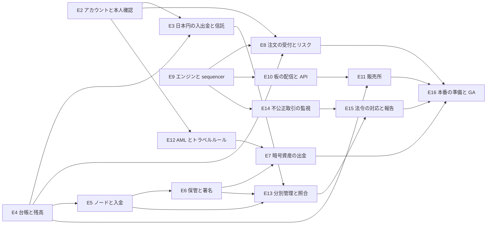

# Roadmap: Coinbase

## 進め方の原則

- **最初に walking skeleton を通す。** E1・E2・E3・E4・E5・E6・E7・E8・E9 の最小の部分で、口座の開設（`kyc-sim`）→ 日本円の入金（`bank-sim`）→ 拘束 → BTC/JPY の指値 → 別の利用者の指値と約定 → 台帳の記帳 → BTC の出金（regtest、試験の署名の境界、承認 1 件）→ 承認の数の追跡 → 別の利用者の BTC の入金（regtest、3 承認）を端から端まで貫く。sequencer と MSK の記録、`engine-core` と再生、拘束の条件つきの更新、仕訳の型と冪等キー、出金のステートマシンと署名の境界の方針の確かめ直し、入金の 2 台の比べは、最初から本物の形で作る。後から足すと直せないため。
- **PoC を先に済ませる。** 次の PoC は、それぞれの Epic の Story の spec を承認する前に結果を記録する。
  - E9 の前：MSK の `acks=all` の遅れ、エンジンの速さ、写しのエンジンの遅れ（`engine-latency-poc`）。
  - E6 の前：鍵の保管と署名の方式（HSM、MPC、チェーンの上の複数署名）と提供者（`custody-signing-poc`）。
  - E5 の前：ETH の入金のアドレスの方式と集め直しの費用（`eth-deposit-sweep-poc`）、ノードの運用（`node-ops-poc`）。
- **規則は 1 つのコードに。** 約定の規則は `crates/engine-core`、拘束は `packages/order-entry`、仕訳は `packages/ledger`、署名の方針は `packages/signing-policy`、出金の遷移は `packages/withdrawals`、入金の記帳は `packages/deposits`、販売所の価格は `packages/brokerage`、スクリーニングの規則は `packages/compliance-rules` にだけ書く。
- **契約を先に固定する。** 板の入力と出力の記録の形、板の状態の決定表、注文の種類、台帳の勘定科目と仕訳の型、署名の方針の決定表、出金と入金の遷移の決定表、提供者のアダプターの契約、`legal.*` の値の一覧は、人間がレビューして確定する。エージェントは勝手に変えない。
- **法務の確認待ちの Story は、spec を承認しない。** 設計と、法務に依らない Story は進めてよい（[intent.md](intent.md) の「法務の確認待ち」L1〜L14）。下の表で「法務：L*」と書いた Story が当たる。
- **相場の急変を早く試す。** 注文の負荷の生成器を E9 で作り、縮めた規模の相場の急変の場面を、E9 から夜間に流し続ける。

## Epic

PM が持つ。変更の一覧はここに書かず、各変更の `spec.md` の frontmatter（`epic`）から集計する（[process.md](../../../docs/process.md) の「粒度」）。各 Epic の品質の重点と合否基準は [quality.md](quality.md) の 5 節にある。

| Epic | 目的 | 状態 |
| --- | --- | --- |
| E1 基盤 | AWS・Terraform・CI（TypeScript と Rust、参照の実装と再生の枠）、3 つの Aurora と RLS、outbox、フラグ（`release.*`・`ops.*`・`legal.*`）、監査ログ、運用の画面の骨格、署名の境界のアカウント、大阪の骨格 | 未着手 |
| E2 アカウントと本人確認 | 口座の開設、eKYC、ログイン、端末、API キー、`kyc-vault`、退会 | 未着手（法務：L4・L11・L12。法人の口座は PM の判断待ち P1） |
| E3 日本円の入出金と信託 | 提携銀行のアダプター、振込先の口座番号、名義の照合、組戻し、出金、信託の依頼 | 未着手（信託は法務：L3） |
| E4 台帳と残高 | 勘定科目、仕訳、拘束、約定の記帳、手数料、明細、年間の報告書 | 未着手（報告書は法務：L10、相続と差押えは法務：L14） |
| E5 チェーンのノードと入金 | ノード、入金のアドレス、承認の数と確定、巻き戻り、集め直し、入金のスクリーニング | 未着手（前に `node-ops-poc`・`eth-deposit-sweep-poc`。トラベルルールの受け取りは法務：L5） |
| E6 保管と署名 | ウォレットの段、署名の境界、方針の決定表、承認者の鍵、鍵の儀式、`rebalancer`、履行保証暗号資産 | 未着手（前に `custody-signing-poc`。法務：L2・L9・L13） |
| E7 暗号資産の出金 | 宛先の許可の一覧、出金のステートマシン、承認の段、放送と追跡、置き換え、手数料 | 未着手（法務：L5・L12。待ち時間は PM の判断待ち P4） |
| E8 注文の受付とリスクの確認 | 注文の検査、拘束、冪等、送り直し、速さの上限の段 | 未着手 |
| E9 マッチングエンジンと sequencer | `engine-core`、`engine-ref`、sequencer、MSK の記録、スナップショットと再生、写しのエンジン、板の停止と再開 | 未着手（前に `engine-latency-poc`） |
| E10 板の配信と API | REST と WebSocket、板の差分と全体、約定、ローソク足、通し番号、API キーの署名 | 未着手（日々の売買高の公表は法務：L1） |
| E11 販売所 | 価格の提示、受け入れ、在庫の上限、表示 | 未着手（法務：L7・L8。ヘッジは PM の判断待ち P3） |
| E12 AML とトラベルルール | スクリーニング、制裁の照合、取引の監視、届出の案件、トラベルルールの通知 | 未着手（法務：L4・L5・L6・L11） |
| E13 分別管理と照合 | 台帳とチェーン・銀行・信託の照合、仮勘定、日次の報告 | 未着手（法務：L2・L3） |
| E14 不公正取引の監視 | 兆しの検出、案件と調べ、役職員の取引の制限 | 未着手（法務：L7） |
| E15 法令の対応と報告 | 法令の移行への備え、当局と自主規制団体への報告、税の書類、`legal.*` の変更の手順 | 未着手（法務：L1・L9・L10） |
| E16 本番の準備と GA の判定 | 相場の急変の負荷試験、DR の訓練（板の再開）、鍵の儀式の監査、外部のペンテスト、GA の判定 | 未着手（GA の判定は法務：L1・L2・L11・L13） |
| E17 銘柄の追加とトークン（MVP の後） | 銘柄ごとのノード・承認・保管、ERC-20、取扱いの審査 | 未着手（MVP の後。法務：L1・L9） |
| E18 積立（MVP の後） | 定期の購入、日付の規則 | 未着手（MVP の後） |
| E19 法人の大口の取引と外部でのヘッジ（MVP の後） | OTC、本システムの外の取引所での在庫の調整 | 未着手（MVP の後。法務：L7・L8） |
| E20 板寄せでの再開（MVP の後） | 停止の後のオークション | 未着手（MVP の後） |

E1〜E16 が MVP（S1）。領域の文書の「Story の候補」は、この番号で書く。

### Epic の依存

E1 はすべての Epic の前にある（図では省く）。矢印は「この Epic が終わる（主な Story が出る）と、次の Epic の主な Story を始められる」を示す。

- E8 と E9 は、拘束の API（E4）と sequencer の入力の形（E9）を先に固め、両方を並べて進める。walking skeleton では E8 と E9 の最小の部分を同時に作る。

## Story

各 Story は、着手するときに `changes/YYMMDD-<slug>/` として起票する。ここは計画で、進み具合は各変更の `spec.md` の frontmatter で見る。順序は Epic の中での目安で、依存があるものを先に置いた。工程 2 で、領域の文書の「Story の候補」から行を足す。

### E1 基盤

| Story | 内容 |
| --- | --- |
| `dev-repo-bootstrap` | Coinbase の再構築の開発リポジトリを作り、`changes/`・`specs/`・開発向けの `AGENTS.md`、CODEOWNERS（`crates/`・`packages/ledger`・`packages/signing-policy`・`packages/withdrawals` はテックリード、`config/legal/` は法務と財務、`config/signing-policy/` はセキュリティと財務）を置く（リポジトリ共通の ADR-0005） |
| `aws-accounts-and-network` | アカウント（本番、検証、署名の境界の `custody`、見張り）、SCP、VPC、egress の経路（銀行、提供者、ノードの P2P） |
| `aurora-clusters-and-rls` | core・ledger・kyc-vault の 3 クラスタ、FORCE RLS、`SET LOCAL app.actor_id`、サービスの役割の許可リスト（ADR-0001） |
| `outbox-and-relay` | outbox、`relay`、SNS・SQS の話題 |
| `ci-pipeline-baseline` | PR の関門、TypeScript と Rust、参照の実装・再生・シミュレーターの枠、テストの緩和の検出、依存の禁止の一覧、`engine-core` の lint（ADR-0001） |
| `flags-and-legal-config` | AppConfig のフラグ、`legal.*` の値の一覧と本番の無効の既定、変更の 2 人の承認 |
| `ops-console-skeleton` | 運用の画面の骨格、期限つきの権限、理由の入力、監査ログ（Auth0 の ADR-0056 の形） |

### E2 アカウントと本人確認

| Story | 内容 |
| --- | --- |
| `kyc-provider-adapter` | eKYC の提供者の契約と `kyc-sim`（ADR-0011。法務：L4） |
| `account-opening` | 口座の開設、確認の水準の決定表、口座の状態（法務：L4・L12） |
| `kyc-vault` | 氏名・住所・生年月日・書類の参照の金庫、読む関数の監査（法務：L11） |
| `sign-in-and-devices` | パスキー、TOTP、セッション、端末、変更の後の出金の待ち |
| `api-keys` | 取引の API キー、署名、権限、速さの上限の段（出金の権限は PM の判断待ち P2） |
| `corporate-accounts` | 法人の口座と実質的支配者（PM の判断待ち P1。法務：L4） |
| `account-closure` | 退会、残高が 0 でない口座の扱い、保持の期限（法務：L11・L14） |

### E3 日本円の入出金と信託

| Story | 内容 |
| --- | --- |
| `bank-adapter` | 提携銀行の契約と `bank-sim`、予備の全銀の形式のファイル（ADR-0011） |
| `virtual-account-deposits` | 利用者ごとの振込先の口座番号、着金の通知と照会、名義の照合、組戻し |
| `fiat-withdrawals` | 本人の名義の口座への出金、冪等の依頼の番号、結果の照会 |
| `trust-instructions` | 利用者の日本円の合計と信託の額の比べ、信託の依頼（法務：L3） |

### E4 台帳と残高

| Story | 内容 |
| --- | --- |
| `ledger-core` | 勘定科目、仕訳、資産ごとの釣り合いの制約、残高の行、冪等キー（ADR-0005） |
| `balance-holds` | 拘束の API、条件つきの更新、拘束の行（ADR-0004） |
| `trade-settlement-poster` | `ledger-poster`、約定の記帳、拘束の戻し、欠けの検出（ADR-0005） |
| `fee-tables` | メイカー・テイカーの手数料、出金の手数料の表、端数の規則 |
| `statements-and-annual-report` | 明細、年間の取引の報告書（法務：L10） |

### E5 チェーンのノードと入金

| Story | 内容 |
| --- | --- |
| `node-ops-poc` | ノードのクライアントの選び方、同期の時間、ディスク、更新の手順の PoC（ADR-0009） |
| `eth-deposit-sweep-poc` | ETH の入金のアドレスの方式と集め直しの費用の PoC（ADR-0009） |
| `chain-nodes` | BTC・ETH の各 2 台（組）、大阪の待機、外部の見張り |
| `deposit-addresses` | BTC の導出、ETH の方式、払い出し |
| `deposit-watcher` | 入金の検出、2 台の比べ、閾値、記帳、巻き戻りの扱い（ADR-0009） |
| `deposit-screening` | 入金のスクリーニング、トラベルルールの情報の受け取り（法務：L5・L6） |

### E6 保管と署名

| Story | 内容 |
| --- | --- |
| `custody-signing-poc` | HSM・MPC・チェーンの上の複数署名と提供者の比べ（ADR-0007。法務：L13） |
| `signing-boundary` | `custody` のアカウント、`policy-verifier`、`approval-verifier`、`nonce-and-utxo-guard`、signer のアダプター（ADR-0007） |
| `signing-policy-table` | 方針の決定表、バージョンと 2 人の承認、2 か所の判定の一致（ADR-0007） |
| `approver-keys` | 承認者の端末の鍵、承認者の一覧の変更の手順 |
| `wallet-tiers-and-rebalancer` | ホット・ウォーム・コールド、目標と上限、移し替えの依頼（ADR-0006。法務：L2） |
| `cold-ceremony` | コールドの鍵の作成と署名の儀式、場所と人、記録（法務：L9） |
| `performance-guarantee-assets` | 履行保証暗号資産のウォレットと額の計算（法務：L2） |

### E7 暗号資産の出金

| Story | 内容 |
| --- | --- |
| `address-allowlist` | 宛先の許可の一覧、登録の確認と待ち時間、知らせ（PM の判断待ち P4。法務：L12） |
| `withdrawal-state-machine` | 出金の状態と遷移の決定表、`transitionWithdrawal()`（ADR-0008） |
| `withdrawal-approvals` | 額の段、承認の画面、累計の上限（ADR-0008） |
| `broadcast-and-replacement` | 放送、追跡、手数料の引き上げの置き換え、作り直しの規則（ADR-0008） |
| `network-fee-estimation` | 手数料の見積もり、受けた手数料と払った手数料の記帳 |
| `withdrawal-travel-rule` | 出金のトラベルルールの通知と、送れない相手の扱い（法務：L5） |

### E8 注文の受付とリスクの確認

| Story | 内容 |
| --- | --- |
| `order-gateway` | 注文の検査、拘束、`client_order_id` の冪等、sequencer への送り（ADR-0004） |
| `order-resubmit-and-expire` | `pending_submit` の送り直しと取り消し、拘束と注文の照合（ADR-0004） |
| `rate-limit-tiers` | 個人・API・マーケットメイカーの速さの上限の段 |

### E9 マッチングエンジンと sequencer

| Story | 内容 |
| --- | --- |
| `engine-latency-poc` | MSK の `acks=all`、エンジン、写しのエンジンの速さの PoC（ADR-0001、ADR-0002） |
| `engine-core-and-ref` | `engine-core` の板と約定の規則、`engine-ref`、性質ベーステスト（ADR-0003） |
| `sequencer-and-journal` | sequencer、epoch と持ち主の記録、MSK の入力と出力の記録（ADR-0002） |
| `snapshots-and-replay` | スナップショット、`engine-replay`、日次の全部の再生（ADR-0002） |
| `shadow-engine-and-failover` | 写しのエンジン、要約の比べ、切り替え（ADR-0002） |
| `market-states` | 板の状態（取引中・取り消しだけ・停止）、価格の帯、急変の自動の取り消しだけ（ADR-0003） |
| `order-load-generator` | 注文の負荷の生成器と相場の急変の場面 |

### E10 板の配信と API

| Story | 内容 |
| --- | --- |
| `market-data-publisher` | 板の差分と全体、約定、ローソク足、通し番号 |
| `ws-gateway` | WebSocket の接続、購読、上限、取りこぼしの回復 |
| `trading-rest-api` | 注文・取り消し・照会の REST、`<Brand>-Signature` の検証 |
| `daily-volume-publication` | 日々の売買高の公表（法務：L1） |

### E11 販売所

| Story | 内容 |
| --- | --- |
| `reference-price-adapter` | 参照の価格の提供者 2 つと `price-sim`（ADR-0011） |
| `brokerage-quotes` | 価格の提示、期限、スプレッドの式（ADR-0010。法務：L8） |
| `brokerage-accept-and-settle` | 受け入れ、台帳の記帳、`quote_id` の冪等（ADR-0010） |
| `brokerage-inventory-limits` | 在庫の上限とスプレッドの広げ（ADR-0010。法務：L7） |

### E12 AML とトラベルルール

| Story | 内容 |
| --- | --- |
| `screening-adapter` | チェーン分析の提供者の契約と `screening-sim`（ADR-0011。法務：L11） |
| `sanctions-screening` | 制裁の一覧との照合（法務：L6） |
| `compliance-rules-and-review` | スクリーニングの規則の表、`compliance_review` の待ち行列と画面（法務：L6） |
| `transaction-monitoring` | 取引の監視の規則、疑わしい取引の届出の案件（法務：L4） |
| `travel-rule-adapter` | トラベルルールの通知の提供者の契約と `travel-rule-sim`（法務：L5） |

### E13 分別管理と照合

| Story | 内容 |
| --- | --- |
| `chain-reconciliation` | 台帳とウォレット（段ごと）の照合、仮勘定（ADR-0005） |
| `bank-and-trust-reconciliation` | 台帳と銀行・信託の照合（法務：L3） |
| `segregation-daily-report` | 分別管理の日次の報告（法務：L2・L3） |

### E14 不公正取引の監視

| Story | 内容 |
| --- | --- |
| `surveillance-signals` | 見せ玉・仮装売買・相場操縦の兆しの検出（法務：L7） |
| `surveillance-cases` | 案件と調べの画面、記録 |
| `staff-trading-controls` | 役職員の取引の制限と届け出（法務：L7） |

### E15 法令の対応と報告

| Story | 内容 |
| --- | --- |
| `regulatory-transition-plan` | 資金決済法から金融商品取引法への移行の備え、言葉と報告の差分（法務：L1） |
| `regulatory-reports` | 当局と自主規制団体への定期の報告（法務：L1・L9） |
| `tax-reports` | 支払調書・取引の報告の書類（法務：L10） |
| `legal-config-procedure` | `legal.*` の値の変更の手順と記録 |

### E16 本番の準備と GA の判定

| Story | 内容 |
| --- | --- |
| `load-test-market-spike` | 相場の急変の負荷試験（quality.md の 2.2.1 節 H） |
| `dr-drill-market-restart` | 大阪での板の再開と台帳の切り替えの訓練 |
| `ceremony-audit` | 鍵の儀式の外部の監査 |
| `external-pentest` | 外部のペンテスト（署名の境界、承認者、運用の画面） |
| `cost-baseline` | 費用の実績と単価の確かめ |
| `runbooks-e16` | 計画の手順の作成と訓練 |
| `ga-decision` | GA の判定（法務：L1・L2・L11・L13） |

## エージェントに任せないこと

どれも、間違えたときに気づきにくいか、後から直すコストが高いか、人の責任で決めるべきものである。エージェントは草案を書き、実装し、確認ループを回すが、次は決めない。

| 任せないこと | 理由 | 誤りを止める仕組み |
| --- | --- | --- |
| 契約（板の入力と出力の記録の形、板の状態の決定表、注文の種類、勘定科目と仕訳の型、署名の方針の決定表、出金と入金の遷移の決定表、提供者のアダプターの契約、`legal.*` の値の一覧）の確定 | 記録・利用者・外部に配った後に変えるコストが最も高い。記録の形を変えると再生ができなくなる | CODEOWNERS（テックリード、セキュリティ、財務）。spec の表を CI が直接読むので、表を変えない変更では振る舞いが変わらない |
| テストの正解（`engine-ref`、`ledger-ref`、再生の固定の列の期待する要約、方針の決定表、試験のベクトル、手数料の表の期待する値）の変更 | エージェントが自分のテストを通すために正解を緩めると、誤りが消えて見える | 正解のファイルの CODEOWNERS は QA。CI がテストの削除・skip・期待値の変更を検出してラベルを付ける |
| 署名の方針、承認者の一覧、ホットの上限、本システムのウォレットの許可の一覧の変更 | 一度の誤りで、取り戻せない資産が出ていく | 方針はバージョンと 2 人の承認の署名つきでだけ署名の境界に入る（ADR-0007）。エージェントは境界に経路を持たない |
| 出金の承認、鍵の儀式、ウォームとコールドからの移し替えの実行 | 資産を動かす判断と責任は人が持つ | エージェントは承認者にならない。境界の `approval-verifier` が承認者の鍵を確かめる |
| 手の仕訳、仮勘定の解消、残高の修正 | 誤りがエラーにならずに金額の違いとして残る | 台帳の表は追記だけ（DB の権限）。打ち消しの仕訳は財務の 2 人の承認 |
| 板の停止の解除（再開）と、再生の食い違いの判断 | 公正さと利用者の約定に直接かかわる | `ops.*` の開ける操作は 2 人の承認。再開は IC と Ops の責任者 |
| スクリーニングの規則と閾値、`compliance_review` の判断、届出の判断 | 法令の責任は人が持つ | 規則の表はコンプライアンスの承認でだけ有効になる |
| `legal.*` の値の変更 | 法務と財務の結論である | 変更は法務・財務の承認の記録を添えて Ops が適用する |
| 大阪への切り替えの判断 | 板を止め、利用者の取引を止める判断である | IC と Ops の責任者 |
| 法務の判断（L1〜L14）と PM の判断（P1〜P4） | 解釈と範囲は人が決める | 法務の確認待ちの Story の spec は承認しない |
| 負荷試験・PoC の結果の解釈 | 数字は出せるが、上限・構成・採否は判断である | PoC の結果は Dev・QA・PM がレビューして記録する |

## 延期の一覧

MVP の後に検討する。E17〜E20 に入れなかったもの。着手するときに `intent.md` から起票する。

- **暗号資産の貸借（レンディング）**（改正法で規制の対象になる。法務の L1 の後）。
- **板の配信の FIX の口、コロケーション**（market-data の領域。利用者の量が増えてから）。
- **逆指値、期限つきの注文、全部か取り消し**（matching-engine の領域）。
- **入力の記録を自前の複製の記録に替えること（S3）**（[ADR-0002](decisions/0002-sequencer-and-event-journal.md)。段階を上げる基準で起票する）。
- **ledger の熱い口座のスロット（S2）と持ち主のハッシュでの分割（S3）**（[Stripe の ADR-0016](../../stripe/docs/decisions/0016-hot-accounts-and-ledger-sharding.md) を引き継ぐ。段階を上げる基準で起票する）。
- **API キーの出金の権限**（PM の判断待ち P2 の結論が「持たせる」のとき）。
