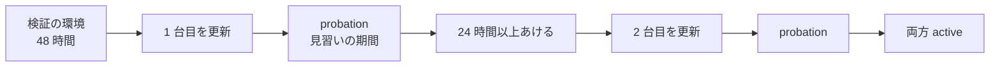

# Runbook: ノードのクライアントの更新とハードフォークの備え

- Owner: Ops
- 対応するアラート: 定期作業（毎週のクライアントの更新の知らせの確認）、合意の規則の変更（ハードフォーク）の予定、セキュリティの修正の知らせ
- 最終確認日: 2026-11-15

前提の設計は [ADR-0048](../decisions/0048-node-client-diversity-and-upgrades.md)（クライアントの多様さと更新）と [ADR-0046](../decisions/0046-two-node-agreement-and-external-watch.md)（2 台の比べ）。ノードの状態は [chain-nodes-and-confirmations.md](../architecture/chain-nodes-and-confirmations.md) の 4.3 節と 8 節。

## 症状

- クライアント（Bitcoin Core、ETH の実行のクライアントと合意のクライアント）の新しいバージョンが出た。
- ハードフォークの有効の高さ・エポックが告知された。
- セキュリティの修正（急ぎ）の知らせ。

## 影響

- 1 台を更新している間、その資産の合意の頭は進まず、入金の記帳が止まる（検出と放送は残りで続く）。BTC は見習いの 6 ブロック（約 1 時間）、ETH は確定の 2 エポックを見込む。
- 2 台を同時に止めない。

## 確認

1. 変更の中身（合意の規則の変更か、性能・修正か）、公式の配布の署名と hash。
2. 2 台（組）の今のバージョンとクライアントの組み合わせ（多様さを保つか。ADR-0048）。
3. 大阪の待機のノードの状態（1 台目の更新の間の予備に使えるか）。
4. 凍結の時間帯（[README.md](README.md) の 3.1 節。Terraform は平日 10〜16 時）。

## 対処

1. **PR**：イメージのバージョンと設定の PR を作る（エージェントが作ってよい。本番への適用はしない）。Ops の承認。
2. **検証**：検証の環境（テストネットと regtest・開発用のチェーン）で 48 時間動かし、2 台の比べと外部の見張りとの差に食い違いがないことを確かめる。
3. **1 台目**：本番の 1 台を `excluded` にしてから更新する。起動の後 `syncing` → `probation` → `active` に自動で戻るのを確かめる（見習いの期間に食い違いなし）。
4. **待つ**：24 時間以上空ける。新しいバージョンでの食い違い・遅れ・資源の使い方を見る。
5. **2 台目**：同じ手順で更新する。大阪の待機も同じバージョンに揃える。
6. **ハードフォーク**：有効になる高さ・エポックの 7 日前までに全部のノードを更新する。前後 6 時間の入金の記帳を止めるかを、Ops と PM が前日までに決める（既定は止めない）。止めるなら `ops.deposit_crediting_enabled.<asset>` を切り、開けるのは 2 人の承認。
7. **セキュリティの修正**：検証の 48 時間を縮めるかは Ops の責任者とセキュリティが決め、記録に残す。1 台ずつの順は変えない。

## エスカレーション

- 更新の後に `probation` で食い違った：`excluded` のまま前のバージョンに戻す。[chain-reorg.md](chain-reorg.md) の「ノードの食い違い」。Dev のテックリードに知らせる。
- ハードフォークでネットワークが分かれた：[chain-reorg.md](chain-reorg.md)。入出金の停止の長さを Ops の責任者と PM で決める。

## 事後

- 更新したバージョン、時刻、記帳が止まった時間を記録する。
- 見習いの期間と 24 時間の間隔を実績で見直す（`node-ops-poc` の結果を含む）。
