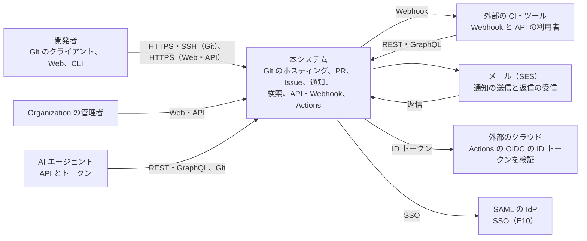
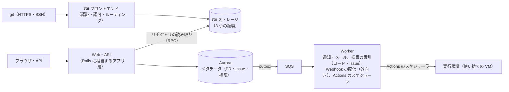

# Architecture: GitHub

全体像と横断的な方針。領域ごとの設計は、同じディレクトリの各ファイルにある。用語は[前提知識の資料](https://shoito.github.io/rebuilds/systems/github/docs/primer/index.html#glossary)の用語集にある。

領域ごとの文書の一覧は 7 節にある。

## 1. 全体構成

### 1.1 コンテキスト

次の図は、本システムを使う人と、本システムがやり取りする外部のシステムを示す。中身の部品は 1.2 節にある。



使う人は [intent.md](../intent.md) の「Affected users and systems」による。メールは [notifications.md](notifications.md)、OIDC は [actions.md](actions.md) の 7 節、SSO は [identity-and-permissions.md](identity-and-permissions.md) の 8 節にある。

### 1.2 コンテナ

次の図は、Git の経路と Web・API の経路、非同期の処理のつながりを示す。



| コンポーネント | 責務 |
| --- | --- |
| Git フロントエンド | SSH と HTTPS の Git の要求を受け、認証・認可し、リポジトリの複製のあるノードへ振り分ける。状態を持たない |
| Git ストレージ | リポジトリを 3 つのノードに複製して保持する。読み取り（差分、ファイル、マージの計算）の RPC を提供する |
| Web・API | 画面、REST、GraphQL。メタデータを DB に持ち、Git の中身はストレージの RPC で読む |
| Worker | 通知、検索の索引、Webhook、Actions のジョブの配置 |
| Actions の実行環境 | ジョブごとに使い捨ての VM で、ワークフローを実行する |

原則は 3 つ。

- **リポジトリの中身の正本は Git。** DB は、Pull Request・Issue・権限などのメタデータの正本であり、ref やコミットの複製は、検索や表示のための写しとして扱う（[ADR-0005](../decisions/0005-git-as-source-of-truth.md)）。
- **権限はリポジトリの単位で、1 つの判定関数で決める。** 公開リポジトリをまたいだ読み取りが本質なので、テナントの RLS ではなく、リポジトリへの権限の判定に集約する（[ADR-0002](../decisions/0002-repository-permission-model.md)）。
- **信頼できない入力を実行・描画する部分を隔離する。** CI のジョブ、Markdown・SVG の描画、Webhook の外向きの送信は、それぞれ隔離された環境で行う。

### 1.3 主要な流れ

- **merge queue**：キューの各 PR について、base の最新と前の PR を合わせた一時的なブランチでチェックを走らせ、失敗した PR を外して後ろを作り直す（[pull-requests.md](pull-requests.md) の 8 節）
- **複製の修復と再配置**：`network_replicas.state` が、修復・定期の照合・再配置・ref の更新の合意でどう移るかを示す（[git-storage.md](git-storage.md) の 6 節）
- **Actions の実行とジョブ**：実行（workflow run）とジョブの状態の移り方を示す（[actions.md](actions.md) の 4 節）
- **push の受け付けと ref の更新の合意**：パックを 3 つの複製の検疫へ流し、検査の後に 3 相の手順で ref を更新し、2 つ以上の複製と DB が確定してから成功を返す（[git-protocols.md](git-protocols.md) の 5.1 節、[git-storage.md](git-storage.md) の 5.2 節）
- **PR のマージ**：DB の写しで事前に判定し、ストレージの RPC で現在の SHA で再評価してから、base の ref を比較交換で更新する（[pull-requests.md](pull-requests.md) の 6.2 節）

### 1.4 本家の形（確かめたこと）

| 項目 | 本家 | 出典 |
| --- | --- | --- |
| 規模 | 開発者 1 億 8,000 万超、リポジトリ 6 億 3,000 万（2025 年の新規 1 億 2,100 万）。2025 年に公開リポジトリでマージされた PR 5 億 1,870 万、push されたコミット約 10 億 | [Octoverse 2025](https://github.blog/news-insights/octoverse/octoverse-a-new-developer-joins-github-every-second-as-ai-leads-typescript-to-1/)（2026-10-11） |
| リポジトリの保存 | Spokes（旧 DGit）。3 つの複製を別のラックに置き、厳密な過半数で書き込みを確定する。3 相コミット、`(refname, value)` のハッシュの XOR のチェックサム、同期している最も近い複製から読む | [Introducing DGit](https://github.blog/engineering/architecture-optimization/introducing-dgit/)、[Building resilience in Spokes](https://github.blog/engineering/infrastructure/building-resilience-in-spokes/)、[Stretching Spokes](https://github.blog/engineering/infrastructure/stretching-spokes/)（[git-storage.md](git-storage.md) の冒頭） |
| ファイルと push の上限 | 50 MiB で警告、100 MiB を超えるファイルを拒否、push は 2 GB、ブラウザからの追加は 25 MiB。推奨はリポジトリ（`.git`）10 GB 以下、ブランチ 5,000 以下 | [About large files on GitHub](https://docs.github.com/en/repositories/working-with-files/managing-large-files/about-large-files-on-github)、[Repository limits](https://docs.github.com/en/repositories/creating-and-managing-repositories/repository-limits)（2026-10-11） |
| 差分の上限 | PR 全体で 20,000 行か生の差分 1 MB、1 ファイルで 20,000 行か 500 KB、1 つの差分に 300 ファイル | [Repository limits](https://docs.github.com/en/repositories/creating-and-managing-repositories/repository-limits#diff-limits)（2026-10-11。[pull-requests.md](pull-requests.md) の 3.4 節） |
| マージの計算 | libgit2 の独自の実装から `merge-ort` に移り、平均 71 ms から 7.74 ms に。rebase は `git replay` | [Scaling merge-ort across GitHub](https://github.blog/engineering/infrastructure/scaling-merge-ort-across-github/)（[pull-requests.md](pull-requests.md) の 3.1 節） |
| ruleset | 1 つのブランチに複数が重なり、優先順位はなく、最も厳しい規則が効く。上限はリポジトリあたり 75、Organization あたり 75 | [About rulesets](https://docs.github.com/en/repositories/configuring-branches-and-merges-in-your-repository/managing-rulesets/about-rulesets)（[pull-requests.md](pull-requests.md) の 5.2 節） |
| fork のネットワーク | ネットワークのどのリポジトリに push したコミットも、上流を含む他のリポジトリから到達できうる | [About permissions and visibility of forks](https://docs.github.com/en/pull-requests/collaborating-with-pull-requests/working-with-forks/about-permissions-and-visibility-of-forks)（2026-09-26。[git-storage.md](git-storage.md) の 7.2 節） |
| REST のレート制限 | 認証なし 60 回/時（IP ごと）、ユーザー 5,000 回/時、App のインストール 5,000〜12,500 回/時（Enterprise Cloud は 15,000）、Actions のトークン 1,000 回/時・リポジトリ。同時 100 件、REST は 900 点/分 | [Rate limits for the REST API](https://docs.github.com/en/rest/using-the-rest-api/rate-limits-for-the-rest-api)（2026-10-11） |
| App と Webhook | インストールのトークンは 1 時間、ユーザーのトークンは 8 時間、リフレッシュトークンは 6 か月。Webhook は事象の種類ごとに 20 まで、ペイロードは 25 MB まで、HMAC-SHA256 で署名 | [Generating an installation access token](https://docs.github.com/en/apps/creating-github-apps/authenticating-with-a-github-app/generating-an-installation-access-token-for-a-github-app)、[Refreshing user access tokens](https://docs.github.com/en/apps/creating-github-apps/authenticating-with-a-github-app/refreshing-user-access-tokens)、[Troubleshooting webhooks](https://docs.github.com/en/webhooks/testing-and-troubleshooting-webhooks/troubleshooting-webhooks)（2026-09-26。[api-and-webhooks.md](api-and-webhooks.md) の 7・9 節） |
| Actions のランナー | ホストされた標準のランナーは、公開リポジトリで 4 CPU・16 GB・SSD 14 GB、非公開で 2 CPU・8 GB・SSD 14 GB。分はジョブごとに切り上げて数える | [GitHub-hosted runners reference](https://docs.github.com/en/actions/reference/runners/github-hosted-runners)、[Actions runner pricing](https://docs.github.com/en/billing/reference/actions-runner-pricing)（2026-09-26。[actions.md](actions.md) の 8・14 節） |
| コード検索 | Rust の専用のエンジン Blackbird。公表の時点で 4,500 万リポジトリ・115 TB のコード。権限はクエリの後で絞る。索引はデフォルトブランチだけ、350 KiB を超えるファイルを除く | [The technology behind GitHub's new code search](https://github.blog/engineering/architecture-optimization/the-technology-behind-githubs-new-code-search/)、[About GitHub code search](https://docs.github.com/en/search-github/github-code-search/about-github-code-search)（[search.md](search.md) の 2・3.1 節） |
| バックアップの方式、マージ可能かの計算の上限、ジョブのログの上限 | 公式の資料で確かめられなかった | **未検証**（[git-storage.md](git-storage.md) の 9 節、[pull-requests.md](pull-requests.md) の 3.3 節、[actions.md](actions.md) の 10 節） |

日付を付けた行はその日に確認した。日付のない行は、各領域の文書が設計の工程で確かめたもの。この設計は振る舞いを参考にするが、本家のコード・本家が公開した部品を核に使わない（[リポジトリ共通の ADR-0007](../../../../docs/decisions/0007-no-reuse-of-original-implementation.md)、[ADR-0036](../decisions/0036-own-runner-agent-and-no-original-components.md)）。

**本家との意図した違い**：

- **非公開の fork のネットワークでは、到達できない SHA を返さない。** 本家は到達できうるとする。ストレージの層で到達可能性を検査する（[git-storage.md](git-storage.md) の 7.2 節、2026-09-28 の決定）。
- **検索の権限は、シャードへの問い合わせの前に絞る**（[ADR-0015](../decisions/0015-search-permission-filtering.md)、[search.md](search.md) の 2 節）。
- **App のユーザーのトークンの期限を外せない**。Webhook のペイロードは、Webhook ごとに REST のバージョンを固定する。`POST` に冪等性のキーを持つ（[api-and-webhooks.md](api-and-webhooks.md) の 3.3・7・9 節）。
- **標準のランナーは、公開リポジトリも 2 vCPU・8 GiB にする**（容量の計画を単純にするため。[actions.md](actions.md) の 18 節）。
- **squash では、PR の中のコミットの署名を問わない**（base に入る 1 つのコミットだけを署名する。[pull-requests.md](pull-requests.md) の 5.5 節）。
- **ヘッダー・トークンの接頭辞・ドメイン・パスに本家の名前を使わない**（[リポジトリ共通の ADR-0006](../../../../docs/decisions/0006-brand-neutral-identifiers.md)）。

## 2. 規模の段階

| 段階 | リポジトリ | 1 日の利用者 | Git の要求（ピーク） | 構成 |
| --- | --- | --- | --- | --- |
| S1（MVP） | 100 万 | 10 万 | 2,000 件/秒 | 1 リージョン（東京）・3 AZ。ストレージのノードは数十台 |
| S2 | 1,000 万 | 100 万 | 20,000 件/秒 | ストレージのノードを数百台に。コード検索の索引を独立したクラスタに |
| S3 | 1 億 | 1,000 万 | 200,000 件/秒 | 複数のリージョン。リポジトリをリージョンに割り当て、読み取りの複製を他のリージョンに置く |

### 2.1 費用のモデル

リポジトリの月と、Actions のジョブの分の原価を、次の和で見る。単価は [infrastructure.md](infrastructure.md) の 9 節の、AWS の東京のオンデマンドの価格（2026-09-26 に確認）による。

```
リポジトリの月あたりの原価 = Git ストレージ（i8g.4xlarge のローカル NVMe、3 つの複製）
                         ＋ 外向きの転送（clone・fetch。CloudFront、NLB）
                         ＋ バックアップ（大阪の S3 への差分のバンドル）、LFS（S3）
                         ＋ メタデータ（Aurora）と検索の索引（Zoekt、OpenSearch）
                         ＋ Web・API・Worker（ECS）、通知（SES）、Webhook の配信
ジョブの分あたりの原価 = 実行環境（m7i.metal-48xl ÷ 1 ホストあたり約 40 の microVM）
                     ＋ 待機のホスト（20%）と待機中の microVM
                     ＋ ログ・成果物・キャッシュ（S3）
                     ＋ Actions の中からの clone（PrivateLink）
```

- S1 の本番の月額は約 300,000 USD（±50%）。最も大きいのは Actions の実行環境（約 180,000、約 6 割）で、次が Git ストレージ（約 50,000）と外向きの転送（約 25,000）である（[infrastructure.md](infrastructure.md) の 9 節）。
- 目安として、Git ストレージは 50,000 USD ÷ 100 万リポジトリで、1 リポジトリの月あたり約 0.05 USD。実行環境は 12.4992 USD/時 ÷ 約 40 VM で、VM 1 時間あたり約 0.31 USD（待機を除く）。1 ホストあたりの VM の数は E8 の `firecracker-host-poc` で測って直す（[capacity.md](capacity.md) の 2.9 節）。
- 外向きの転送は、外部の CI からの大量の clone で大きく変わる。bundle-uri と CDN、リポジトリごと・IP ごとの clone の制限で抑える（[ADR-0008](../decisions/0008-pack-caching-and-bundle-cdn.md)）。

## 3. 非機能要件

| ID | 項目 | S1 の目標 | 備考 |
| --- | --- | --- | --- |
| NFR-001 | 可用性（Git の操作、Web、API） | 月間 99.95% | |
| NFR-002 | push の耐久性 | 成功を返した push は失われない（3 つの複製のうち 2 つ以上に書いてから成功を返す） | |
| NFR-003 | clone・fetch の速さ | 中規模のリポジトリ（1 GB 未満）の fetch の開始まで p95 1 秒以内 | |
| NFR-004 | Web の表示 | Pull Request の画面の表示 p95 1.5 秒以内（差分 1,000 行まで） | |
| NFR-005 | 検索への反映 | Issue・Pull Request は 10 秒、コードはデフォルトブランチへの push から 5 分以内 | |
| NFR-006 | Webhook の配信 | 最初の配信の p95 10 秒以内 | |
| NFR-007 | Actions のジョブの開始 | キューに入ってから実行の開始まで p95 60 秒以内（ホストされた標準の実行環境） | |
| NFR-008 | 復旧（AZ の障害） | RPO 0、RTO 5 分以内 | |
| NFR-009 | 復旧（リージョンの障害） | RPO 15 分以内。RTO は、Web・API と直近 7 日に push か fetch のあったリポジトリの読み書きが 4 時間以内、全リポジトリが 24 時間以内 | 範囲は [ADR-0032](../decisions/0032-disaster-recovery-strategy.md)。Actions とコード検索は後回し。S3 で RPO 1 分、RTO 1 時間（目標） |
| NFR-010 | 非公開のリポジトリの秘匿 | 権限のない人に中身が見える事象は 0 件 | |
| NFR-011 | 通知の遅延 | イベントから Web の受信箱に見えるまで p95 30 秒以内、メール（SES に渡すまで）p95 5 分以内 | [notifications.md](notifications.md) の 4.1 節。メールの到達は SES と受け手のサーバーに依存するので含めない |

## 4. 技術スタック

| 層 | 選定 | 理由 |
| --- | --- | --- |
| Web・API・Worker | TypeScript（Hono、React）。Web は SSR をストリームで返し、画面の単位でハイドレーションする | Slack・Stripe と同じ（[ADR-0001](../decisions/0001-platform-and-stack.md)）。描画の方式は [ADR-0035](../decisions/0035-web-rendering-ssr-streaming.md) |
| Git ストレージ・フロントエンド | Go と Git の本体（`git` のコマンド、必要に応じて libgit2 に相当するライブラリ） | Git の操作と長時間の I/O に向く。本家の Spokes・GitLab の Gitaly と同じ考え方 |
| コード検索 | Zoekt（Go）をリポジトリの単位のシャードで独立したクラスタに。Issue・PR・リポジトリの検索は Amazon OpenSearch Service | [ADR-0014](../decisions/0014-code-search-engine.md) |
| DB | Aurora PostgreSQL 18 | |
| 非同期 | outbox → SQS | |
| 実行基盤 | AWS（ECS、EC2 のストレージのノード（ローカル NVMe）、Actions の実行環境は EC2 の metal の上の Firecracker の microVM） | [ADR-0031](../decisions/0031-storage-nodes-on-instance-store.md)、[ADR-0023](../decisions/0023-firecracker-microvm-runners.md) |
| IaC・可観測性 | Terraform、OpenTelemetry | Slack と同じ |

## 5. 主な決定

| ADR | 決定 |
| --- | --- |
| [0001](../decisions/0001-platform-and-stack.md) | 基盤は他の題材を引き継ぎ、Git の層だけ Go と Git の本体で作る |
| [0002](../decisions/0002-repository-permission-model.md) | 権限はリポジトリの単位の判定関数に集約し、テナントの RLS は使わない |
| [0003](../decisions/0003-replicated-git-storage.md) | リポジトリは、アプリケーションの層で 3 つのノードに複製する |
| [0004](../decisions/0004-stateless-git-frontend.md) | Git の要求は、状態を持たないフロントエンドで受けて、複製へ振り分ける |
| [0005](../decisions/0005-git-as-source-of-truth.md) | リポジトリの中身の正本は Git。DB はメタデータの正本 |
| [0006](../decisions/0006-ref-update-consensus.md) | ref の更新は 3 つの複製の 3 相の手順と、DB のチェックサムの CAS で順序を決める |
| [0007](../decisions/0007-fork-network-object-sharing.md) | fork はネットワークごとの共有の objects（alternates）で持ち、ネットワークを配置の単位にする |
| [0008](../decisions/0008-pack-caching-and-bundle-cdn.md) | clone の負荷は、ビットマップ、パックのキャッシュ、人気の公開リポジトリの bundle-uri と CDN で下げる |
| [0009](../decisions/0009-lfs-storage-on-s3.md) | LFS の objects はネットワークごとの S3 のキーに置き、presigned URL で直接転送する |
| [0010](../decisions/0010-server-side-merge-and-diff.md) | 差分とマージは、ストレージの RPC で作業ツリーなしに計算し、SHA の組でキャッシュする |
| [0011](../decisions/0011-rulesets-as-single-protection-model.md) | ブランチの保護は ruleset に一本化し、1 つの評価関数で push とマージの両方を判定する |
| [0012](../decisions/0012-merge-queue-with-speculative-groups.md) | merge queue は投機的なグループの ref を作り、検査を通った SHA を早送りで取り込む |
| [0013](../decisions/0013-untrusted-content-domain-isolation.md) | 利用者の内容は別の登録可能ドメインから配り、豊かな描画は隔離した iframe で行う |
| [0014](../decisions/0014-code-search-engine.md) | コード検索は Zoekt を独立したクラスタに、Issue・PR・リポジトリの検索は OpenSearch に置く |
| [0015](../decisions/0015-search-permission-filtering.md) | 検索の権限は読めるリポジトリの条件をクエリの前段に入れ、属性の変更は除外の表で即時に効かせる |
| [0016](../decisions/0016-notification-fanout.md) | 通知は購読と watch から受け手を決め、outbox → SQS の多段で配り、送る直前に権限を確かめ直す |
| [0017](../decisions/0017-shared-issue-numbering.md) | Issue と PR は 1 つの表に置き、リポジトリごとの 1 つの番号の列で採番する |
| [0018](../decisions/0018-repository-roles-and-permission-composition.md) | リポジトリの権限は、本家と同じ 5 つのロールの最大値で決める |
| [0019](../decisions/0019-authentication-and-token-model.md) | Web のログインは Better Auth、プログラムからのアクセスは細粒度のトークンを既定にする |
| [0020](../decisions/0020-github-app-model.md) | 外部との連携の主な形を、本家の GitHub App と同じ形（インストールと 1 時間のトークン）にする |
| [0021](../decisions/0021-api-shape-and-versioning.md) | 公開 API は本家の形に寄せ、REST は日付のバージョンをヘッダーで選び、GraphQL はバージョンを持たない |
| [0022](../decisions/0022-webhook-signing-and-delivery.md) | Webhook は本家と同じ方式の HMAC-SHA256 で署名し、隔離した egress から送り、送る直前に権限を確かめる |
| [0023](../decisions/0023-firecracker-microvm-runners.md) | ホストされたランナーは EC2 の metal の上の Firecracker の microVM で、1 ジョブ 1 VM・使い捨て |
| [0024](../decisions/0024-job-scheduling-and-fairness.md) | ジョブは持ち主ごとの同時実行の上限と、持ち主の間の公平な順番で配る |
| [0025](../decisions/0025-secrets-and-fork-pr-policy.md) | シークレットはジョブの取得時にだけ復号し、fork の PR には渡さない。`<BRAND>_TOKEN` は最小の権限 |
| [0026](../decisions/0026-actions-oidc-provider.md) | 自前の OIDC の発行者を持ち、ジョブごとの短命の ID トークンを KMS の鍵で署名する |
| [0027](../decisions/0027-artifact-and-cache-storage.md) | 成果物・キャッシュ・ログは S3 にリポジトリ単位で置き、キャッシュは ref の単位で分ける |
| [0028](../decisions/0028-encryption-and-key-management.md) | 通信は TLS、保存時は KMS の鍵をデータの種類ごとに分け、価値の高い秘密情報だけアプリ層で暗号化する |
| [0029](../decisions/0029-audit-log.md) | 管理の操作は同じトランザクションで監査ログに書き、Git のイベントとアクセスログは別に集め、改ざんできないアーカイブへ送る |
| [0030](../decisions/0030-data-retention-and-deletion.md) | 削除したリポジトリは 90 日復元でき、その後に消去する。バックアップの期限を削除の最終的な期限にする |
| [0031](../decisions/0031-storage-nodes-on-instance-store.md) | Git のストレージのノードは EC2 のローカル NVMe（インスタンスストア）に置く |
| [0032](../decisions/0032-disaster-recovery-strategy.md) | 災害復旧は、AZ を 3 つの複製で、リージョンを大阪の S3 へのバックアップと Aurora Global Database で守る |
| [0033](../decisions/0033-rolling-storage-node-upgrades.md) | ストレージのノードは 1 つの AZ の中で 1 台ずつ退避して更新し、AZ をまたいで同時に止めない |
| [0034](../decisions/0034-multi-region-repository-placement.md) | S3 では、リポジトリにホームのリージョンを割り当て、他のリージョンに非同期の読み取りの複製を置く（proposed） |
| [0035](../decisions/0035-web-rendering-ssr-streaming.md) | Web は React をサーバーでストリーム描画し、画面の単位でハイドレーションする |
| [0036](../decisions/0036-own-runner-agent-and-no-original-components.md) | Actions のランナーのエージェントを自前で作り、本家の公開の部品を核に使わない |
| [0037](../decisions/0037-import-from-other-hosts.md) | 他のホスティングからの取り込みは、空のリポジトリに元の番号のまま、通知・Webhook・Actions を起こさずに行う（proposed。範囲は PM の判断待ち） |
| [0038](../decisions/0038-operator-access.md) | 運用者は常設で非公開の中身を読めず、DB・ストレージのノードは期限つきの権限、中身の参照は持ち主の同意で行う（proposed） |

リポジトリ共通の決定（開発プロセス、ブランチモデル、本家の名前を使わない識別子、本家の実装を核に使わないこと）は、ルートの [docs/decisions/](../../../../docs/decisions/) にある。特に [ADR-0006](../../../../docs/decisions/0006-brand-neutral-identifiers.md)：振る舞いは本家に寄せるが、ヘッダー・トークンの接頭辞・ドメイン・環境変数・パスの本家の名前は使わず、`<Brand>`・`<brand>`・`<BRAND>` の置き換え用の名前で書く（例：`X-<Brand>-Api-Version`、`X-<Brand>-Signature-256`、`<brand>p_...`、`<brand>usercontent.<domain>`、`<BRAND>_TOKEN`、`.<brand>/workflows/`）。

## 6. リスクと未解決の問い

- **非公開のリポジトリの中身の漏洩**：経路が多い（Git、Web、API、検索、通知、Webhook、Actions のログ、fork のネットワークの共有 objects）。判定関数の集約（ADR-0002）、`can`・`canMany`・`filterActorsCanRead`・`accessPredicate` の一致の性質ベーステスト、経路ごとの漏洩テスト、本番の権限の合成監視で守る（[quality.md](../quality.md) のリスク 1）。
- **fork のネットワークの共有 objects**：同じネットワークの他の fork のコミットが、SHA で見えうる（本家と同じ仕様、ADR-0007）。Git のプロトコル v2 の `fetch` は、広告していないハッシュの `want` も弾かない（2026-09-26 に確認。[git-storage.md](git-storage.md) の 7.2 節）。公開のネットワークでは本家と同じく受け入れる。非公開のネットワークでは、Go のストレージの層で到達可能性を既定で検査し、Git・Web・API のどれからも返さない（2026-09-28 の決定。本家との違い）。検査の費用は E1 の PoC で測る。
- **成功を返した push の喪失**：3 相の合意（ADR-0006）とチェックサム、障害注入で守る。リージョンの障害では最大 15 分の push を失いうる（ADR-0032。利用規約と SLA に反映する）。
- **巨大なリポジトリと大量の clone**：少数のリポジトリが、ストレージのノードと帯域を占有しうる（[git-protocols.md](git-protocols.md)、[capacity.md](capacity.md)）。パックのキャッシュ、bundle-uri、clone の制限、読み取りの複製の追加で抑える。
- **CI の隔離と費用**：信頼できないコードを大量に実行する。隔離の破綻は、他の利用者のシークレットの漏洩につながる（[actions.md](actions.md)）。SMT を無効にするので、1 ホストあたりの VM は約 40 で、Actions は本番の費用の約 6 割を占める（[infrastructure.md](infrastructure.md) の 9 節）。1 ホストあたりの VM の数と起動の時間は E8 の PoC で測る。
- **権限の組み合わせ**：公開と非公開、fork、Organization・チーム・基本の権限・トークンの上限が絡み合う（[identity-and-permissions.md](identity-and-permissions.md)）。決定表を spec に移し、表駆動テストで守る。
- **ブランチの保護の迂回**：push と API のマージの 2 つの経路で同じ評価関数を呼ぶ（ADR-0011）。判定の材料が読めないときは拒否する（fail closed）。
- **検索の索引の遅れによる漏洩**：権限の属性の変更は除外の表で即時に効かせる（ADR-0015）。Zoekt の差分のシャードと ID の集合の条件は E6 の試作で確かめる。
- **CloudFront・NLB 経由の長い転送**：数 GB の clone・push が最後まで通るか、デプロイ時に進行中の転送がどこまで保たれるかは **未検証**（CloudFront・NLB・ECS の各上限は 2026-09-26 に AWS の文書で確かめたが、組み合わせの振る舞いは文書にない。E1 の `frontend-drain-poc` と E3 の `git-load-tests` で確かめる）。
- **本家の名前を使わないこと**（リポジトリ共通の ADR-0006）：本家の SDK・`gh`・ワークフローは、名前の置き換えなしには使えない。公式の SDK と CLI、ワークフローの移行の道具を用意する。

### 残る未解決事項

法務の確認待ちのものは、ここでは決めない。E9 の `legal-review-before-launch` で確認を受ける。

- DMCA の通知の公開（[security.md](security.md) の 15 節）
- 日本の発信者情報開示と、外為法・制裁への対応（同）
- リージョンの障害での push の喪失の、利用規約と SLA への反映（[ADR-0032](../decisions/0032-disaster-recovery-strategy.md)、[roadmap.md](../roadmap.md)）

### 持ち越し（計測・PoC・後の段階で決めるもの）

| 項目 | いつ・どう決めるか |
| --- | --- |
| プロトコル v2 の `fetch` の、広告していないハッシュの `want` の振る舞いと、到達可能性の検査の費用 | v2 が検査しないことは 2026-09-26 に確認した。非公開のネットワークで検査をかけることは 2026-09-28 に決めた。E1 の `fork-network-want-poc` でバージョンごとの振る舞いを [quality.md](../quality.md) の漏洩テストに固定し、`gitd` での検査の費用を測る |
| NLB の登録解除の後の接続、ECS の EC2 起動タイプの停止猶予 15 分 | E1 の `frontend-drain-poc`（staging） |
| CloudFront 経由の数 GB の clone・push、`core.fsync` の性能、reftable、LFS の presigned の署名への `x-amz-checksum-sha256` の組み込み | E3 の Git の負荷試験と PoC（本家が bundle-uri を広告していないこと、LFS のクライアントがヘッダーを付けることは 2026-09-26 に確認した） |
| マージ可能かの再計算の間引き | E4 で既定（5 分）で始め、E9 の負荷試験で直す |
| Issue の移動を非同期にする上限 | E5 の `issue-transfer` で測る |
| Zoekt の差分のシャードと ID の集合の条件の性能（機能があることは 2026-09-26 に確認） | E6 の `code-search-zoekt-poc` |
| Firecracker の VM の起動の時間、1 ホストあたりの VM の数、ログのマスクの二重の確認 | E8 の `firecracker-host-poc`、`log-mask-double-check` |
| 匿名の閲覧の HTML の CDN のキャッシュ | E9 の負荷試験の後 |
| 大阪での `i8g` の在庫（提供されていることと東京の価格は 2026-09-26 に確認） | E9 の `dr-osaka-pilot-light` の前に確かめる |
| 受信箱の DynamoDB への移行、blob の単位の検索の重複の排除、Docker の pull-through のキャッシュ | E10 |
| S3 の複数リージョン（ADR-0034 は proposed） | E11。S2 の間に staging で試す |

決めた経緯（工程ごとの「決定」の記録）は [design-log.md](design-log.md) にある。

## 7. 領域の文書

各文書の頭の表・前提にある ADR を「ADR」の列に示す（他の題材の ADR は除く）。

| ファイル | 範囲 | ADR |
| --- | --- | --- |
| [git-storage.md](git-storage.md) | リポジトリの保存、3 つの複製、ルーティング、fork のネットワーク、保守（repack） | 0001、0003、0004、0005、0006、0007 |
| [git-protocols.md](git-protocols.md) | HTTPS・SSH、プロトコル v2、push の受け付けと ref の更新、LFS、大きなリポジトリ | 0002、0003、0004、0005、0006、0008、0009 |
| [pull-requests.md](pull-requests.md) | 差分、マージの計算、レビュー、ブランチの保護（ruleset）、merge queue | 0002、0003、0005、0006、0010、0011、0012 |
| [web.md](web.md) | Web の画面、描画の方式、コードの閲覧、信頼できない内容（Markdown・SVG・ノートブック）の安全な描画、多言語化 | 0001、0002、0010、0013、0035 |
| [issues.md](issues.md) | Issue、ラベル、マイルストーン、参照（相互リンク） | 0017 |
| [notifications.md](notifications.md) | 通知の購読、配信、メール | 0016 |
| [search.md](search.md) | コード検索と、リポジトリ・Issue・Pull Request の検索 | 0002、0014、0015 |
| [identity-and-permissions.md](identity-and-permissions.md) | ユーザー、Organization、チーム、ロール、SSH の鍵、トークン、SSO | 0002、0018、0019、0020 |
| [api-and-webhooks.md](api-and-webhooks.md) | REST・GraphQL、Webhook、OAuth のアプリと App（本家の GitHub App に相当）、レート制限 | 0019、0020、0021、0022 |
| [actions.md](actions.md) | CI：ワークフロー、ジョブのスケジューリング、実行環境の隔離、シークレット、ログ、成果物、キャッシュ | 0001、0002、0005、0023、0024、0025、0026、0027、0036 |
| [security.md](security.md) | 脅威モデル、暗号化、監査ログ、濫用対策、データのライフサイクル | 0002、0003、0004、0005、0028、0029、0030、0037、0038 |
| [data-model.md](data-model.md) | データモデルの正本：置き場所、テーブルの規則、ER 図、全テーブルの定義（[data-model/](data-model/identity.md) に領域ごと）、Git・Valkey・S3・索引・Event の形、横断の不変条件 | 0002、0005 |
| [infrastructure.md](infrastructure.md) | AWS の構成、ストレージのノード、冗長化、災害復旧 | 0003、0004、0031、0032、0033、0034 |
| [observability.md](observability.md) | ログ、メトリクス、トレース、SLO | — |
| [capacity.md](capacity.md) | 負荷のモデル、部品ごとの必要量、パラメーター | — |
| [delivery.md](delivery.md) | CI/CD、リリース、フィーチャーフラグ | 0033 |
| [design-log.md](design-log.md) | 設計の工程ごとの決定の記録（経緯） | — |
