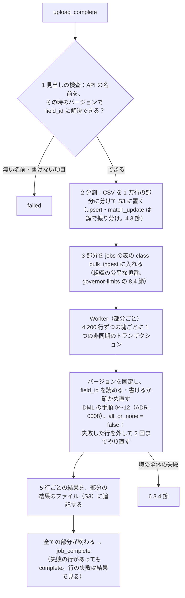

# Bulk and import: Salesforce

一括の API（取り込みのジョブと問い合わせのジョブ、分割、部分の成功、再試行、結果）、インポートのウィザード（CSV の取り込みの画面、項目の対応、下見）、外部 ID での upsert、取り込みの時の重複の照合、自動化を伴う取り込みの上限の設計。土台は [ADR-0005](../decisions/0005-tenancy-and-governor-limits.md)（一括の 1 回の処理は非同期の上限を使う）、[ADR-0008](../decisions/0008-dml-order-of-execution.md)（DML の 200 件の塊と部分の成功）、[ADR-0022](../decisions/0022-duplicate-rules-and-japanese-matching.md)（重複の照合の鍵）、NFR-010（100 万件の取り込みが 30 分以内）、intent の K8（1 万件を取り込んでリストビューで見るまで中央値 30 分）。この文書で決めたことは、次の 2 つの ADR にある。

- 一括の取り込みは、CSV を S3 に置き、1 万行の部分に分けて Worker の公平な順番に入れる。部分は 200 行ずつの非同期のトランザクションで処理し、行ごとに成功か失敗かを返す（部分の成功）。トランザクションの全体の失敗（ロックの待ち、バージョンの変更）は同じ 200 行で最大 10 回やり直し、上限の超過は 200 行を半分ずつに分けて原因の行を見つける。結果は 7 日（[ADR-0036](../decisions/0036-bulk-jobs-chunking-and-partial-success.md)）。
- インポートのウィザードは、同じ一括のジョブの上に作る画面にする。文字コード（UTF-8 と Shift_JIS）の判定、項目の対応、200 行の下見（巻き戻すトランザクション）を持つ。外部 ID での upsert と、照合の規則での「既存を更新」は、同じ鍵の行を同じ部分に集めて順に処理し、ファイルの中の重複も既存のレコードも 1 件にまとめる。見えないレコードとの一致は無いものとして扱う（[ADR-0037](../decisions/0037-import-wizard-upsert-and-duplicate-matching.md)）。
- 本家からの移行は、移行の文書（本家との違いの表）と、本家の ID を `legacy_id` の外部 ID に入れて決まった順で upsert する手順で支える。メタデータの変換の道具は後の Epic にする（[ADR-0065](../decisions/0065-migration-path-from-original.md)、proposed）。15 節。

本家の振る舞いは、2026-09-28 に次の資料で確かめた。確かめられなかったものは「未検証」と書く。本家の Bulk API との互換は持たない（[ADR-0001](../decisions/0001-platform-and-stack.md)）。

## 1. 目的と範囲

| 範囲に含む | 範囲に含まない（担当の領域） |
| --- | --- |
| 一括の取り込みのジョブ（作成、アップロード、処理、結果）と問い合わせのジョブ | DML の手順そのもの（[metadata-and-runtime.md](metadata-and-runtime.md) の 6 節） |
| 分割、部分の成功、再試行、並行と直列 | 重複の規則と照合の鍵の中身（[sales-objects.md](sales-objects.md) の 6 節） |
| インポートのウィザード（画面、文字コード、対応、下見） | 画面の部品の共通の設計（[ui-layouts-and-list-views.md](ui-layouts-and-list-views.md)） |
| 外部 ID での upsert、親の外部 ID での参照 | 一意と外部 ID の保存（[data-storage.md](data-storage.md) の 3.2 節） |
| 取り込みの時の重複の照合と既存の更新 | 割り当ての値の正本（[governor-limits.md](governor-limits.md)） |
| 完全な削除のジョブ | ごみ箱と消去（[data-storage.md](data-storage.md) の 5 節） |
| 本家からの移行の手順と、本家との違いの表（15 節） | メタデータの形式とデプロイ（[sandboxes-and-deploy.md](sandboxes-and-deploy.md)） |

## 2. 本家の仕組み（確かめたこと）

主な出典は [Developer Limits and Allocations Quick Reference](https://resources.docs.salesforce.com/latest/latest/en-us/sfdc/pdf/salesforce_app_limits_cheatsheet.pdf)（2026-09-11 更新版、以下「Limits」）と [Bulk API 2.0 and Bulk API Developer Guide](https://resources.docs.salesforce.com/latest/latest/en-us/sfdc/pdf/api_asynch.pdf)（Winter '27 版、以下「Bulk」）。

| 項目 | 本家 | 出典 |
| --- | --- | --- |
| 使い分け | 2,000 件を超える操作は一括の API が向く。それより少なければ、同期の複合の要求 | Limits |
| ジョブの流れ | ジョブを作る（`Open`）→ CSV を上げる → `UploadComplete` → `InProgress` → `JobComplete`・`Failed`・`Aborted`。取り込みは insert・update・upsert・delete・hard delete で同じ流れ | Bulk |
| 分割 | Bulk API 2.0 は batch を自動で作る。batch は 200 件の塊（chunk）で処理する | Limits、Bulk |
| 割り当て | 24 時間で 15,000 の batch（Bulk API と共有。取り込みだけが使う）、取り込み 1 億 5,000 万行。問い合わせのジョブ 10,000、問い合わせの結果 1TB | Limits |
| ファイル | 1 つのジョブの CSV は 150MB（base64 の増加を見込み、上げる量は 100MB まで）。1 項目 131,072 文字、1 行 5,000 項目・400,000 文字 | Limits |
| 再試行 | 取り込みは自動で再試行し、20 回を超えたら小さなファイルで上げ直すよう言う。問い合わせは 15 回 | Limits |
| 結果 | 成功・失敗・未処理のレコードを、終わってから 7 日取り出せる。成功の結果は `sf__Id`・`sf__Created` を持つ | Limits、Bulk |
| ジョブの寿命 | 終わった状態で 7 日を過ぎたジョブを消す。開いたままのジョブは 24 時間まで | Limits |
| 問い合わせの結果 | 1 ファイル 1GB まで。`locator` と `maxRecords` で全体を読める。結果を読む時間切れ 20 分 | Limits |
| 行の区切り | `LF` と `CRLF`。列の区切りを選べる | Bulk |
| インポートのウィザード | 1 回 50,000 件まで、取引先・取引先責任者・リード・カスタムオブジェクトなど。ワークフローとプロセスを動かすかを選べる | [How many records can I import?](https://help.salesforce.com/s/articleView?id=xcloud.faq_data_import_wizard_how_many_records.htm&type=5)、[Import Data with the Data Import Wizard](https://help.salesforce.com/s/articleView?id=xcloud.import_with_data_import_wizard.htm&type=5)（2026-09-28 に確認） |
| ウィザードの文字コード | ファイルの文字コードを選べる（選べる一覧に Shift_JIS があるかは本文に書かれていない。未検証。E9 の `import-wizard` で確かめる） | 同上 |

## 3. 一括の取り込みのジョブ（ADR-0036）

### 3.1 API

```
POST /api/v1/jobs/ingest
{ "object": "contact", "operation": "upsert", "external_id_field": "x_erp_id",
  "column_delimiter": "comma", "line_ending": "lf", "encoding": "utf-8",
  "concurrency": "parallel", "options": { "allow_duplicates": false } }
→ 201 { "id": "<job_id>", "state": "open", "upload_url": "/api/v1/jobs/ingest/<job_id>/data" }

PUT  /api/v1/jobs/ingest/{id}/data          （CSV。複数回に分けて上げてよい。合計 150MB）
PATCH /api/v1/jobs/ingest/{id}  {"state": "upload_complete"}   （または "aborted"）
GET  /api/v1/jobs/ingest/{id}               （状態、処理した行、失敗の行、所要時間）
GET  /api/v1/jobs/ingest/{id}/successful_results   （CSV：id, created, 元の列）
GET  /api/v1/jobs/ingest/{id}/failed_results       （CSV：error_code, error_message, 元の列）
GET  /api/v1/jobs/ingest/{id}/unprocessed_records
GET  /api/v1/jobs/ingest?state=...&created_after=...
DELETE /api/v1/jobs/ingest/{id}             （終わったジョブと結果を消す）
```

| `operation` | 意味 |
| --- | --- |
| `insert` | 作成 |
| `update` | `id` の列で更新 |
| `upsert` | `external_id_field` で作成か更新（4 節） |
| `delete` | `id` の列で削除（ごみ箱へ） |
| `hard_delete` | ごみ箱を通さない削除。`bulk_hard_delete` のシステムの権限が要る（[ADR-0011](../decisions/0011-recycle-bin-and-purge.md)）。監査に残す |
| `match_update` | 照合の規則で既存を探して更新か作成（ウィザードの「既存を更新」。5.3 節） |

- CSV の 1 行目は API の名前。参照の項目は、親の ID か、`<参照の項目>.<親の外部 ID の項目>`（例：`account.x_erp_id`）で親を指せる（4.2 節）。
- 空の欄は「変えない」。空にしたい時は `#N/A` と書く（本家の慣習に寄せる。本家の一括の API とデータローダーも、更新で空の欄を無視し、空にするには `#N/A` と書く。[Bulk API 2.0 and Bulk API Developer Guide](https://resources.docs.salesforce.com/latest/latest/en-us/sfdc/pdf/api_asynch.pdf)、[Data Loader Guide](https://resources.docs.salesforce.com/latest/latest/en-us/sfdc/pdf/salesforce_data_loader.pdf)、Winter '27 版、2026-09-28 に確認）。
- ジョブは作った利用者の権限（オブジェクトの権限、FLS、共有）で処理する。API は `api_enabled` が要る。
- 状態は `open` → `upload_complete` → `in_progress` → `job_complete`・`failed`・`aborted`。`open` のまま 24 時間を過ぎたら `aborted`。

### 3.2 処理の流れ

次の図は、`upload_complete` の後に、ジョブを部分に分けて Worker で処理し、`job_complete` になるまでを示す。



- **1 つのトランザクションは 200 行**（DML の 1 つの塊。ADR-0008）。非同期のトランザクションの上限（[governor-limits.md](governor-limits.md) の 4.1 節）の中で、フロー・入力規則・重複の規則・積み上げ集計が通常どおり動く。
- 1 万行の部分にするのは、Worker の 1 回の仕事の大きさをそろえ、公平な順番（仮想時刻）の費用の単位にするため。本家の batch の 1 万件に寄せる（Limits）。
- 部分の中の塊は順に処理する。部分どうしは並行で処理する（3.3 節）。
- 見出しの解決は `upload_complete` の時のバージョンで行い、処理の時は塊ごとに今のバージョンで確かめ直す。途中で項目が消えたり型の変換が始まったら、その塊の行は `FIELD_UNAVAILABLE`・`FIELD_CONVERTING` で失敗にする（ジョブは続ける）。
- 保存の後の索引・変更のイベントは、一括の分として低い優先の経路に入れる（[search.md](search.md) の 4.5 節）。

### 3.3 並行と直列

| `concurrency` | 振る舞い | 向く場面 |
| --- | --- | --- |
| `parallel`（既定） | 1 つのジョブの部分を、組織の `org_cap`（10）の中で並行に処理する | 親が散らばったデータ |
| `serial` | 1 つのジョブの部分を 1 つずつ処理する | 同じ親に多くの子を足す（積み上げ集計の親のロックの奪い合いを避ける） |

- 並行の時、同じ親の子が別の部分に散らばると、積み上げ集計の親の行ロックと、暗黙の共有の行（[ADR-0015](../decisions/0015-sharing-reasons-and-where-they-live.md)）で待ちが増える。分割の時に、主従の親の ID（または最初の参照の親）の列で CSV を並べ替えてから切る（`sort_by_parent`、既定で真）。同じ親の子が同じ部分に集まり、部分の中で順に処理される。
- 本家も、ロックの奪い合いを避けるため子を親ごとにまとめるよう勧める（[Best Practices for Deployments with Large Data Volumes](https://resources.docs.salesforce.com/latest/latest/en-us/sfdc/pdf/salesforce_large_data_volumes_bp.pdf)）。

### 3.4 再試行

**DT-BULK-001：塊（200 行）のトランザクションの失敗**（上から評価）

| # | 失敗 | やり直し | 最後まで失敗した時の行の結果 |
| --- | --- | --- | --- |
| 1 | 行の検証のエラー（入力規則、必須、型、重複の規則、`DUPLICATE_VALUE`、`INSUFFICIENT_ACCESS`） | その行を外して残りをやり直す（ADR-0008 の部分の成功。2 回まで） | その行を失敗（エラーの `code`） |
| 2 | ロックの待ちの時間切れ、デッドロック、直列化の失敗 | 同じ 200 行を、1 秒・2 秒・4 秒…（最大 60 秒）で 10 回まで | 全ての行を `UNABLE_TO_LOCK_ROW` |
| 3 | `METADATA_CHANGED`（バージョンの変更） | 新しいバージョンで見出しを確かめ直して 3 回まで | 全ての行を `METADATA_CHANGED` |
| 4 | `LIMIT_EXCEEDED`（トランザクションの上限） | 200 行を半分に分けて、それぞれやり直す（100 → 50 → … → 1） | 1 行でも超える行を `LIMIT_EXCEEDED`（上限の名前付き） |
| 5 | DB の切り替え、Worker の停止 | 部分の最後に確定した塊の次から再開（部分は冪等。4.4 節） | — |
| 6 | その他の内部のエラー | 3 回まで | 全ての行を `INTERNAL_ERROR` |

- 行 4 の分け方は、フローが多くの行で同じ問い合わせを繰り返すなど、塊の大きさで上限に当たる場合に、ジョブの全体を止めずに進めるため。1 行でも超える行は、利用者の設定（フロー）の問題として返す。
- やり直しの前の上限の数は、トランザクションごとに新しく数える（塊は別のトランザクション）。
- 本家は取り込みを自動で 20 回までやり直す（Limits）。本システムは、原因ごとに回数を決める。

### 3.5 結果と保持

- 行ごとの結果は、部分ごとの結果のファイル（S3、組織のデータキーで暗号化）に書き、取り出しの時に順に並べて返す。成功の結果は `id`・`created`（作成か）と元の列、失敗の結果は `error_code`・`error_message`（項目の名前、値は入れない）と元の列。
- 結果は、ジョブが終わってから **7 日**取り出せる（本家と同じ。Limits）。7 日でジョブの行と S3 のファイルを消す。
- 結果を取り出せるのは、ジョブを作った利用者と、`modify_all_data` を持つ利用者。
- 元の CSV（S3）は、処理が終わったら 24 時間で消す（個人データを長く残さない）。

## 4. 外部 ID での upsert（ADR-0037）

### 4.1 規則

- `external_id_field` は、`external_id` の印の項目か `id`。外部 ID は必ず一意（[ADR-0020](../decisions/0020-rest-api-shape-and-versioning.md)。本家の 300 は起きない）。
- 行ごとに、`record_unique_values` で外部 ID を引く。
  - 無い → 作成。
  - ある、利用者が `edit` の水準で見られる → 更新。
  - ある、`read` だけ → `INSUFFICIENT_ACCESS` で失敗。
  - ある、見られない → 一意の制約で作成もできないので、失敗にする。`code` は、一意の項目の重複（`DUPLICATE_VALUE`）と同じ応答にし、ID を返さない。「見えないレコードがある」ことは 1 ビット漏れるが、一意の制約を持つ以上避けられない（手で作成しても同じ応答になる）。
- ごみ箱のレコードの外部 ID は放してある（[ADR-0011](../decisions/0011-recycle-bin-and-purge.md)）ので、同じ外部 ID で作成になる。

### 4.2 親の外部 ID での参照

- 列 `account.x_erp_id` の値で、親の取引先を外部 ID で引き、`account` の参照に入れる。親が無い・見えない時は、その行を `PARENT_NOT_FOUND` で失敗にする（見えない親と無い親を区別しない）。
- 同じジョブで親と子を取り込む時は、親のジョブを先に終えてから子のジョブを作るよう案内する（1 つのジョブは 1 つのオブジェクト）。

### 4.3 同じ鍵の行

- **分割の時に、外部 ID（`match_update` では照合の鍵。5.3 節）で行を振り分け、同じ鍵の行を同じ部分に集める。** 部分の中では、同じ鍵の 2 行目以降を、1 行目の塊の後の塊に回す（同じ塊に同じ鍵を 2 行入れない）。
- これで、同じ鍵の行は順に処理され、1 行目が作成、2 行目以降は更新になる（ファイルの中の順の最後の値が残る）。並行の部分の間での作成の衝突が起きない。
- それでも起きた一意の違反（別のジョブや画面との競合）は、行 2 の再試行（ロックの待ち）ではなく、その行だけを upsert としてやり直す（1 回）。

### 4.4 冪等

- 部分は、最後に確定した塊の番号（`bulk_parts.last_chunk`）を塊のトランザクションの中で書く。Worker が落ちたら、次の塊から再開する。同じ塊を 2 回確定しない。
- `insert` のジョブを利用者が 2 回作ると、2 回作成する。再試行に強い取り込みには `upsert` を勧める（[query-language-and-api.md](query-language-and-api.md) の 12 節の決定と同じ）。

## 5. インポートのウィザード（ADR-0037）

### 5.1 流れ

```
1. オブジェクトと操作を選ぶ（新規作成 / 既存を更新（ID・外部 ID・照合の規則）/ 両方）
2. ファイルを上げる（CSV。50MB・5 万行まで）→ 文字コードと区切りを判定して見せる（変えられる）
3. 列と項目の対応：列の見出しを、項目のラベル・API の名前で自動で合わせる。保存した対応の型を使える
4. 下見：最初の 200 行を、巻き戻すトランザクションで実際に保存の手順に通し、行ごとの結果を見せる
5. 実行：一括の取り込みのジョブを作る（source = wizard）。進みと結果を画面で見せる
6. 結果：成功・失敗の件数、失敗の行の CSV の取り出し、作ったレコードのリストビューへのリンク
```

- ウィザードは、一括の取り込みのジョブ（3 節）の上の画面で、処理の経路は同じにする。API の割り当ては使わない（画面の要求。[governor-limits.md](governor-limits.md) の 8.1 節）が、`alloc.bulk_rows` には数える。
- 権限：`import_records` のシステムの権限（[orgs-users-and-auth.md](orgs-users-and-auth.md) の 7 節）と、オブジェクトの `create`・`edit`。`api_enabled` は要らない。
- 1 回 5 万行まで（本家も 50,000 件。2 節）。それより大きい取り込みは一括の API を案内する。
- intent の K8（1 万件を取り込んでリストビューで見るまで中央値 30 分）のため、既定の対応の型（名刺管理・表計算の典型の見出し：会社名、氏名、フリガナ、部署、役職、電話、メール、住所）を標準で持つ。

### 5.2 文字コードと形

| 判定 | 規則 |
| --- | --- |
| BOM | UTF-8 の BOM があれば UTF-8 |
| UTF-8 | BOM がなく、UTF-8 として正しく、最初の 64KB に置き換えの文字がなければ UTF-8 |
| Shift_JIS | それ以外は CP932（Windows の Shift_JIS）として読み、置き換えの文字が出なければ CP932 |
| 失敗 | どちらでも読めなければ、利用者に文字コードを選んでもらう |
| 区切り | カンマ、タブ、セミコロンを最初の 20 行で判定 |
| 改行 | `LF`・`CRLF` |

- 日本の表計算のソフトは CSV を CP932 で書くことが多いので、ウィザードは両方を自動で扱う。一括の API は `encoding` の指定（既定 UTF-8）に従い、判定しない。
- 値の変換：日付は `2026/09/28`・`2026-09-28`・`令和8年9月28日` を受ける（和暦は令和・平成）。数の桁区切り（`1,200,000`）と全角の数字を受ける。電話の全角の数字とハイフンは正規化する（[sales-objects.md](sales-objects.md) の 6.2 節）。
- 選択リストの値は、ラベルか API の値で合わせる。合わなければ、下見で「新しい値」として出し、制限付きの選択リストなら失敗にする。

### 5.3 取り込みの時の重複の照合

| 操作 | 規則 |
| --- | --- |
| 新規作成 | 各行は作成。重複の規則（[sales-objects.md](sales-objects.md) の DT-DUP-001）が通常どおり効き、`block` の規則に当たる行は失敗。`allow_duplicates` はウィザードの選択 |
| 既存を更新（照合の規則） | 選んだ照合の規則（ADR-0022）の鍵で、利用者が見られる既存のレコードを探す（**DT-IMP-001**） |
| 両方 | 既存を更新と同じで、一致が無ければ作成 |

**DT-IMP-001：照合の規則での既存の更新**（上から評価。「一致」は利用者が `read` 以上で見られるものだけ）

| # | 見られる一致 | ファイルの中の同じ鍵の前の行 | 操作 | 結果 |
| --- | --- | --- | --- | --- |
| 1 | - | ある | - | 前の行で作った・更新したレコードを更新する |
| 2 | 1 件 | なし | - | その 1 件を更新する（`edit` の水準がなければ `INSUFFICIENT_ACCESS`） |
| 3 | 2 件以上 | なし | - | 失敗 `MULTIPLE_MATCHES`（見られる一致の ID だけを返す） |
| 4 | 0 件 | なし | 両方 | 作成する |
| 5 | 0 件 | なし | 既存を更新だけ | 失敗 `NO_MATCH` |

- **見えないレコードとの一致は無いものとして扱う**（ADR-0022 の `enforce` と同じ）。そのため、見えない既存のレコードがあると、行 4 で新しいレコードを作る（重複が生まれうる）。見えないレコードの存在を漏らさないことを優先する。
- ファイルの中の重複（行 1）は、照合の鍵で同じ部分に集める（4.3 節）ことで扱う。
- 更新の既定は「空の項目だけに入れる」か「上書き」を、ウィザードで選ぶ（既定は上書き）。リードの変換の既存の更新（[sales-objects.md](sales-objects.md) の 5.3 節）と同じ「空の項目だけ」も選べる。
- 照合の鍵の候補の上限（200 件。ADR-0022）を超えた行は、照合せずに `MATCH_OVERFLOW` で失敗にする（既存を更新）か作成する（両方）。

### 5.4 自動化

- 取り込みでも、フロー・入力規則・重複の規則・積み上げ集計は、通常の保存と同じく動く。取り込みだけ自動化を止める選択は持たない。自動化を外したい時は、フローの条件で `origin`（一括のジョブ、ウィザード）を見る（`$Origin`。[automation-flows.md](automation-flows.md) への依頼。10 節）。
- 下見の 200 行は巻き戻すので、フローの送信（メール・Webhook）は outbox ごと消え、送られない。

## 6. 一括の問い合わせのジョブ

```
POST /api/v1/jobs/query { "q": "SELECT id, name, x_erp_id FROM account WHERE updated_at > 2026-09-01T00:00:00Z" }
GET  /api/v1/jobs/query/{id}
GET  /api/v1/jobs/query/{id}/results?locator=<l>&max_records=50000   （CSV。次の locator を見出しで返す）
```

- 作った利用者の権限（共有、FLS）で実行する（[sharing-and-record-access.md](sharing-and-record-access.md) の 6.4 節）。`query-all`（ごみ箱を含む）も選べる。
- 実行は reader で、ID の範囲（25 万行）ごとに読んで S3 に CSV を書く。範囲ごとに、共有の条件を付けた問い合わせをコンパイルする。
- **トランザクションの上限ではなく、`bulk.query` の予算で抑える**（[governor-limits.md](governor-limits.md) の 5 節、[ADR-0041](../decisions/0041-limits-registry-and-counting-rules.md)）：1 ジョブの DB の時間 60 分、結果の 1 ファイル 1GB。選択的でない条件も断らない（[query-language-and-api.md](query-language-and-api.md) の 4.5 節）。
- 結果は 7 日。24 時間の割り当ては `alloc.bulk_query_jobs`・`alloc.bulk_query_bytes`。
- 同じ時点の一貫した結果ではない（範囲ごとの時点）。結果の見出しに、最初と最後の範囲の時刻を返す。変更のイベントと組み合わせる同期では、ジョブの開始の前の `replay_id` から変更のイベントを読むよう案内する（[events-and-integrations.md](events-and-integrations.md) の 3.4 節）。

## 7. 上限（S1 の初期値）

値は [governor-limits.md](governor-limits.md) を正とする。

| 上限 | 値 | 本家 |
| --- | --- | --- |
| 1 つのジョブの CSV | 150MB（複数回に分けて上げてよい） | 150MB（Limits） |
| 1 行の項目・文字 | 500 項目（オブジェクトの項目の上限）・400,000 文字 | 5,000・400,000（Limits） |
| 1 項目の文字 | 131,072 | 131,072（Limits） |
| 部分の大きさ・1 トランザクション | 1 万行・200 行 | batch 1 万・chunk 200（Limits） |
| 開いたままのジョブ | 24 時間 | 24 時間（Limits） |
| 組織の開いたジョブ・処理中のジョブ | 100・10 | 未検証 |
| 24 時間の取り込みの行（Enterprise） | 1,000 万 | 1 億 5,000 万（Limits） |
| 24 時間の問い合わせのジョブ・結果（Enterprise） | 10,000・100GB | 10,000・1TB（Limits） |
| 結果の保持 | 7 日 | 7 日（Limits） |
| ウィザードの 1 回 | 5 万行・50MB | 5 万件（2 節） |
| ウィザードの下見 | 200 行 | — |
| 行のやり直し | DT-BULK-001 | 取り込み 20 回（Limits） |

本家の列の「未検証」は、本家の値を公開の資料で確かめていないもの。本システムの値は本家に依らず、E12 の `limits-final-values` で決める。

- 本家より 24 時間の取り込みの行を小さくするのは、S1 の全体（5 億件）と NFR-010（100 万件 30 分）から見た Worker の量に合わせるため。E12 で見直す。

## 8. 障害のとき

| 事象 | 振る舞い |
| --- | --- |
| Worker の停止 | 部分の最後に確定した塊の次から再開（4.4 節） |
| S3 の障害 | アップロードは 503。処理中の部分は待つ |
| 同じ親への並行の子の保存でロックの待ち | DT-BULK-001 の行 2。`serial` と `sort_by_parent` を案内する |
| 多くの行が `LIMIT_EXCEEDED` | 行 4 で分けて進める。フローの設計の見直しを管理者に知らせる（「上限に近い自動化」。[governor-limits.md](governor-limits.md) の 9.4 節） |
| バージョンの変更（デプロイ）と重なる | 行 3。項目が消えた行は失敗 |
| 1 つの組織の大きな取り込み | 公平な順番と `org_cap` で、他の組織を待たせない（[governor-limits.md](governor-limits.md) の 8.4 節） |
| 索引・変更のイベントの遅れ | 一括の分は低い優先の経路。対話の保存を先にする |
| 文字コードの誤った判定 | 下見で文字化けに気づけるよう、下見に元の値を並べる。利用者が選び直す |

## 9. セキュリティ

- ジョブは作った利用者の権限で処理する。結果の取り出しは作った利用者と `modify_all_data` の人だけ。
- 見えないレコードの存在を漏らさない：upsert の衝突（4.1 節）、親の参照（4.2 節）、照合（5.3 節）。見えないレコードの ID・名前・件数を結果に入れない。
- 失敗の結果の `error_message` に、値（読めない項目の値、他のレコードの値）を入れない。
- 完全な削除は `bulk_hard_delete` だけ。ジョブの作成と終わりを監査に残す（誰が、どのオブジェクトを、何行）。
- 元の CSV は 24 時間、結果は 7 日で消す。S3 は組織のデータキーで暗号化し、署名した URL を渡さず、API を通して読む。
- 大量の削除（1 万行以上の `delete`）とエクスポート（一括の問い合わせ）は、監査に残す（intent の「データの一括の削除は監査のログに残る」。[audit-and-field-history.md](audit-and-field-history.md) の 3 節）。
- `security:sensitive` の対象：結果のファイルの読みの権限、完全な削除、照合の見えないレコードの扱い。

## 10. テスト

- 決定表：`DT-BULK-001`（塊の失敗とやり直し）、`DT-IMP-001`（照合の既存の更新）を表駆動テストにする。
- 性質ベーステスト（fast-check）：
  - `PROP-BULK-001`（草案）：任意の CSV と、Worker の停止・ロックの失敗の注入の列で、各行の結果がちょうど 1 つ（成功か失敗）あり、成功の行の保存がちょうど 1 回（作成が 2 回にならない）。
  - `PROP-BULK-002`（草案）：任意の同じ外部 ID の行を含む CSV で、upsert の後のレコードの数が外部 ID の数と等しく、各レコードの値がファイルの中の最後の行の値。
  - 任意の分け方（並行・直列、部分の大きさ）で、成功・失敗の行の集合が同じ（処理の分け方に依らない。ロックの失敗を除く）。
  - 見えないレコードがあっても、結果に見えないレコードの ID が出ない。
  - 文字コード：任意の文字列を UTF-8 と CP932 で書いた CSV が、同じ値で読める（CP932 で表せる文字だけ）。
- 上限の試験：7 節の値（150MB、5 万行、開いたジョブ、24 時間の行）。
- 結合テスト：`LIMIT_EXCEEDED` の半分ずつの分け方で、原因の 1 行だけが失敗になる。
- 性能テスト（E9・E12）：100 万件の取引先責任者の取り込み（自動化が軽い時）が 30 分以内（NFR-010）。1 万件のウィザードの取り込みからリストビューまで（K8）。

## 11. この領域の ADR

| ADR | 決定 |
| --- | --- |
| [0036](../decisions/0036-bulk-jobs-chunking-and-partial-success.md) | 一括の取り込みは CSV を S3 に置き、1 万行の部分に分けて公平な順番に入れ、200 行ずつの非同期のトランザクションで行ごとに成功・失敗を返す。失敗は原因ごとにやり直し、上限の超過は半分ずつに分ける。結果は 7 日 |
| [0037](../decisions/0037-import-wizard-upsert-and-duplicate-matching.md) | ウィザードは同じジョブの上の画面にし、文字コードの判定と 200 行の下見を持つ。upsert と照合の既存の更新は同じ鍵の行を同じ部分に集めて順に処理し、見えない一致は無いものとして扱う |
| [0065](../decisions/0065-migration-path-from-original.md)（proposed） | 本家からの移行は、移行の文書と、本家の ID を外部 ID に入れて決まった順で CSV を upsert する手順で支える。監査の項目は専用の権限のジョブだけが書ける。メタデータの変換の道具は後の Epic で、上げたファイルを読む形にする |

他の領域への依頼：

- automation-flows の領域：フローの式で保存の出どころを見る `$Origin`（`ui`・`api`・`bulk`・`wizard`・`flow`）を足す。
- sharing-and-record-access の領域：システムの権限に `import_records` を足す（[orgs-users-and-auth.md](orgs-users-and-auth.md) の 7 節）。
- query-language-and-api の領域：`/api/v1/jobs/...` を REST の一覧に足す。4.5 節の一括の問い合わせを `bulk.query` の予算に直す（[governor-limits.md](governor-limits.md) の 13 節）。
- data-storage の領域：一意の値の引き（`record_unique_values`）を、一括の塊で 200 件まとめて行う。

## 12. Story の候補

| Epic | Story の候補 |
| --- | --- |
| E1 | CI：`DT-BULK-001`・`DT-IMP-001` の表駆動テストと、`PROP-BULK-*` の障害の注入の枠 |
| E3 | 一括の塊（200 行）の保存の経路と、部分の成功のやり直し（ADR-0008 の 6.3 節） |
| E9 | 取り込みのジョブの API（作成、アップロード、状態、結果、中止、削除） |
| E9 | 分割（1 万行、親での並べ替え、鍵での振り分け）と `jobs` の表への投入 |
| E9 | Worker の部分の処理、DT-BULK-001、冪等な再開 |
| E9 | 外部 ID の upsert と、親の外部 ID での参照 |
| E9 | 完全な削除のジョブと監査 |
| E9 | 問い合わせのジョブ（reader、範囲、locator、`bulk.query` の予算） |
| E9 | インポートのウィザード：文字コードの判定、対応、対応の型、下見 |
| E9 | 照合の規則での既存の更新（DT-IMP-001） |
| E9 | 割り当て（24 時間の行、ジョブ、結果の大きさ）と、Setup の「一括のジョブ」の画面 |
| E6 | `$Origin` と、取り込みでのフローの足並みの実行の性能 |
| E11 | 一括の削除・エクスポートの監査 |
| E12 | 100 万件の取り込みの負荷試験（NFR-010）と、K8 の計測 |

## 13. 未解決の問い

- 取り込みだけ自動化を止める選択を持つか（本家のインポートのウィザードは、ワークフローとプロセスを動かすかを選べる。2 節）。
- 照合での既存の更新で、見えないレコードとの重複が生まれることを受け入れるか。
- 24 時間の取り込みの行（Enterprise 1,000 万）は足りるか。
- ウィザードで Excel（xlsx）を受けるか。
- `insert` のジョブに冪等キーを持つか。
- 空の欄の意味（変えない）と、空にする書き方（`#N/A`）。

### 決定

2026-09-28 の既定案。

- 自動化を止める選択は持たない。`$Origin` で条件を書けるようにする。フローの無効化はバージョンを上げる通常のメタデータの変更として、監査に残る。
- 見えないレコードとの重複は受け入れる。存在を漏らさないことを優先する。重複の記録（`allow_report`）で管理者が後から見つけられる。
- 1,000 万で始め、E12 で Worker の量を測って見直す。
- Excel は MVP の後。CSV と文字コードの判定で始める。
- 冪等キーは持たない。upsert を案内する。
- 空の欄は変えない。空にするのは `#N/A`。ウィザードでは「空の欄で値を消す」を選べる。

## 14. quality.md・runbooks・data-model に載せるもの

**quality.md**

- リスク：取り込みの二重の保存・行の取りこぼし。`PROP-BULK-001` と障害の注入。
- リスク：upsert・照合で見えないレコードの存在が漏れる。否定側のテスト。
- リスク：日本語の CSV の文字化け（CP932）。文字コードの性質ベーステストと、生成した名刺のデータのコーパス。
- リスク：大きな取り込みが他の組織を遅くする。公平な順番の負荷試験。
- 上限の試験：7 節。
- 本番での検証：取り込みの行の速さ（行/秒）、`UNABLE_TO_LOCK_ROW` の率、`LIMIT_EXCEEDED` の分けの回数、K8 の中央値。

**runbooks**

- `bulk-job-stuck`：ジョブが 1 時間進まない。部分の状態と Worker の順番を調べる。
- `bulk-lock-contention`：`UNABLE_TO_LOCK_ROW` が多い組織に、`serial` と親での並べ替えを案内する。
- `bulk-result-storage-cleanup`：7 日の結果と 24 時間の元の CSV の消去が遅れた。
- `import-encoding-issue`：文字化けの問い合わせへの対応（文字コードの選び直し）。
- SLI の追加の依頼（Ops へ）：取り込みの行の速さ、ジョブの待ちの時間、失敗の行の率（`code` ごと）、問い合わせのジョブの時間、`bulk_ingest` の class の待ち。

**data-model**

| テーブル | 主な列 | 備考 |
| --- | --- | --- |
| `bulk_jobs` | `org_id`、`id`、`kind`（`ingest`・`query`）、`object_id`、`operation`、`external_id_field_id`、`state`、`source`（`api`・`wizard`）、`created_by`、`rows_processed`、`rows_failed`、`metadata_version`、`created_at`、`completed_at`、`expires_at` | 7 日で消す |
| `bulk_parts` | `org_id`、`job_id`、`part_no`、`s3_key`、`rows`、`state`、`last_chunk`、`attempts` | 冪等な再開 |
| `bulk_job_columns` | `org_id`、`job_id`、`col_no`、`header`、`field_id`、`parent_external_field_id` | 見出しの解決 |
| `import_mappings` | `org_id`、`id`、`object_id`、`name`、`columns`（JSONB）、`owner_id` | 対応の型 |
| S3 `bulk/<org>/<job>/...` | 元の CSV（24 時間）、部分、結果（7 日） | 組織のデータキーで暗号化 |

## 15. 本家からの移行（ADR-0065）

[ADR-0065](../decisions/0065-migration-path-from-original.md)（proposed）。これまで各領域が「移行の文書に書く」とした本家との違いと、本家のデータを取り込む手順を、この節に集める。**移行の道具（メタデータの変換）の Epic を作るか、いつ作るかは PM の判断**（[intent.md](../intent.md) の「PM の判断待ち」）。MVP では、データは 3〜5 節の部品で取り込み、メタデータは管理者が作り直す。本家のメタデータ・XML・`package.xml`・Apex は受け付けない（[ADR-0001](../decisions/0001-platform-and-stack.md)）。

### 15.1 オブジェクトと項目の対応

| 本家 | 本システム | 注意 |
| --- | --- | --- |
| 取引先、取引先責任者、リード、商談、ToDo、行動、メールのメッセージ | `account`、`contact`、`lead`、`opportunity`、`task`、`event`、`email_message`（[sales-objects.md](sales-objects.md) の 3 節） | カナ・法人番号の項目は本システムだけにある。空で入れてよい |
| 商談の取引先責任者の役割 | `opportunity_contact_role` | `is_primary` は商談ごとに 1 件 |
| 利用者 | 利用者（[orgs-users-and-auth.md](orgs-users-and-auth.md)） | 先に作り、`legacy_id` を入れる。パスワードは移さない（SSO か招待で入る） |
| カスタムオブジェクト | カスタムオブジェクト（メタデータで作り直す） | 主従の親から順に作る |
| テキスト・数値・パーセント・日付・日時・チェックボックス・選択リスト・複数選択リスト・メール・電話・URL・参照・主従 | 同じ名前の型（[metadata-and-runtime.md](metadata-and-runtime.md) の 3.3 節） | 選択リストの値は先に作る。ウィザードは値のラベルか API の値で合わせる（5.2 節） |
| 通貨 | `currency`（JPY） | 複数の通貨は E19。JPY 以外の値は移す前に換算する |
| 数式 | `formula` | 言語が違うので書き直す。FLS の扱いが本家より厳しい（15.4 節） |
| 積み上げ集計 | `rollup_summary` | 取り込みの後に計算し直す。値を列で入れない |
| 自動採番 | `autonumber` | 本家の番号を残すなら、`text` の項目に入れる。新しい番号は本システムが振る |
| 本家の項目の型の全ての一覧と、ここにない型（地理位置情報、時刻、暗号化したテキストなど） | — | 対応しない型は `text` に入れるか作り直す。型の一覧は本家の公開の資料で確かめる（未検証。E9 の着手の時） |

### 15.2 取り込みの手順

1. メタデータを作る（オブジェクト、項目、選択リストの値、レコードタイプ）。移す各オブジェクトに `legacy_id`（`text`、18、`external_id`・`unique`）を足す。
2. 本家の組織からデータを CSV で書き出す（本家の書き出しの機能。手順は本家の資料に従う）。
3. 次の順に、upsert の一括のジョブ（3・4 節）かウィザード（5 節）で取り込む。参照の列は親の `legacy_id`（4.2 節）で結ぶ。

| 順 | 対象 | 参照の結び方 |
| --- | --- | --- |
| 1 | 利用者 | — |
| 2 | 取引先 | 所有者は `owner.legacy_id`。親の取引先は、全件を入れた後の 2 回目の更新で結ぶ |
| 3 | 取引先責任者、リード | `account.legacy_id`、所有者 |
| 4 | 商談、商談の取引先責任者の役割 | `account.legacy_id`、`contact.legacy_id` |
| 5 | ToDo・行動、メールのメッセージ | 多態の参照は `who`・`what` の型と `legacy_id` の組 |
| 6 | カスタムオブジェクト | 主従の親から順に |

- `legacy_id` は 18 文字の形だけを受ける。本家の 15 文字の ID は大文字と小文字を区別するので、15 文字の値は `INVALID_LEGACY_ID` で断る（18 文字の形の性質は未検証。E9 の着手の時に確かめる）。
- 作成日・更新日・作成者・更新者は、`set_audit_fields_on_import` のシステムの権限（既定はどの権限セットにもない）を持つ人のジョブだけが列で指定できる。使ったジョブは監査に残る（[audit-and-field-history.md](audit-and-field-history.md)）。
- 取り込みでもフロー・入力規則・重複の規則が動く（5.4 節）。移行の間だけフローを止めたい時は、`$Origin` が `bulk` のときに抜ける条件をフローに書く。
- 各段は upsert なので、途中で止まっても同じ CSV でやり直せる。

### 15.3 持ってこないもの

- 項目の変更の履歴、設定の変更の履歴、ログインの履歴：新しい組織の監査の鎖（[ADR-0046](../decisions/0046-setup-audit-trail-and-login-history.md)）に、確かめられない記録を混ぜない。要る組織は、本家から書き出したファイルを組織の側で保管する。
- 本家のメタデータ・Apex・Visualforce・本家の形のレポートとダッシュボードの定義：作り直す。Apex の処理は、宣言的な設定か Webhook で外のシステムに任せる（[ADR-0001](../decisions/0001-platform-and-stack.md)）。
- ファイルと添付：MVP では対象にしない（容量の割り当てと形の設計が要る。後の移行の Epic で扱う）。

### 15.4 本家との違い（移行の文書の正本）

本家との違いを決めた領域は、この表に 1 行足す。

| 機能 | 本家 | 本システム | 代わりの案 | 根拠 |
| --- | --- | --- | --- | --- |
| 利用者のコード | Apex | MVP は持たない。後に TypeScript を WASM の砂場で（E13） | 宣言的な設定、Webhook | [ADR-0001](../decisions/0001-platform-and-stack.md) |
| ダッシュボードの実行の利用者 | 指定した実行ユーザーで全員が同じ数字を見られる | 見る人の権限だけで集計する | 部下の視点は共通部分で集計 | [ADR-0030](../decisions/0030-dashboards-viewer-intersection-and-subscriptions.md)、[reports-and-dashboards.md](reports-and-dashboards.md) の 7 節 |
| 組織が定義するイベントの既定 | すぐに発行 | 確定の後に発行（`after_commit`） | 型ごとに「すぐに発行」を選ぶ | [ADR-0034](../decisions/0034-event-subscription-access-and-org-events.md)、[events-and-integrations.md](events-and-integrations.md) の 4.2 節 |
| フローの要素の数 | 上限を持たない | 足並みの 1 歩で数え、上限を持つ | フローを分ける | [governor-limits.md](governor-limits.md) の 4.2 節、[ADR-0025](../decisions/0025-flow-definition-and-bulk-engine.md) の注記 |
| 数式の値の FLS | 参照先の FLS に関わらず値を見せると言われる（未検証） | 参照する項目を全て読める人にだけ返す | 参照先の FLS を見直す | [ADR-0009](../decisions/0009-formula-language-and-evaluator.md)、[metadata-and-runtime.md](metadata-and-runtime.md) の 7.7 節 |
| 活動を見られる人 | 公開の資料に細部がない（未検証） | 主の親 1 つと、割り当てられた本人の強い方 | — | [ADR-0021](../decisions/0021-lead-conversion-and-activity-parents.md)、[sales-objects.md](sales-objects.md) の 4 節 |
| 暗黙の親の共有 | 所有者の条件の共有ルールで子を見る人に親を見せるかは未検証 | 子の所有者と、子の行の付与の相手にだけ与える | 取引先にも共有ルールを足す | [sharing-and-record-access.md](sharing-and-record-access.md) の暗黙の親の節と未解決の問いの決定 |
| 新しいカスタムオブジェクトの OWD の既定 | 公開・参照・更新 | 非公開 | 作成の後に OWD を選ぶ | [sharing-and-record-access.md](sharing-and-record-access.md) の OWD の節 |
| ごみ箱から戻せる人 | 消した人（読める時）か、すべてのデータの編集 | 消した人、束の元の所有者、オブジェクトの「すべて変更」 | — | [data-storage.md](data-storage.md) の 5 節 |
| 外部 ID の一意 | 一意でない外部 ID がありうる（複数の一致で 300） | 外部 ID は必ず一意 | 一意にしてから取り込む | 4.1 節、[ADR-0020](../decisions/0020-rest-api-shape-and-versioning.md) |
| メタデータの形式とデプロイ | XML、`package.xml`、変更セット | 独自の形式だけ | 作り直す。変換の道具は後の Epic | [ADR-0039](../decisions/0039-metadata-package-format.md)、[sandboxes-and-deploy.md](sandboxes-and-deploy.md) |
| Web からのリードのフォーム | 本家の HTML のフォーム | 専用のホストの受け口と埋め込みのスクリプト | フォームの HTML の送り先と項目の名前を書き換える | [ADR-0064](../decisions/0064-web-lead-form-public-intake.md)、[sales-objects.md](sales-objects.md) の 9 節 |
| システムの権限の一覧 | 全ての一覧は未検証 | 25 の権限（[orgs-users-and-auth.md](orgs-users-and-auth.md) の 7 節） | — | E4 の着手の時に確かめて行を足す |

### 15.5 Story の候補と依頼

| Epic | Story の候補 |
| --- | --- |
| E9 | 移行の取り込み：`legacy_id` の検査、`set_audit_fields_on_import`、本家の書き出しの見出しの対応の型、15.2 節の手順書と生成した本家の形の CSV での結合テスト |
| 後の移行の Epic（PM の判断） | 本家のメタデータの書き出しの変換の道具（[ADR-0065](../decisions/0065-migration-path-from-original.md)）。法務：L13 |

- orgs-users-and-auth の領域：システムの権限に `set_audit_fields_on_import` を足す（どの権限セットにも既定で入れない）。
- 各領域：本家との違いを決めたら、15.4 節に行を足す。
