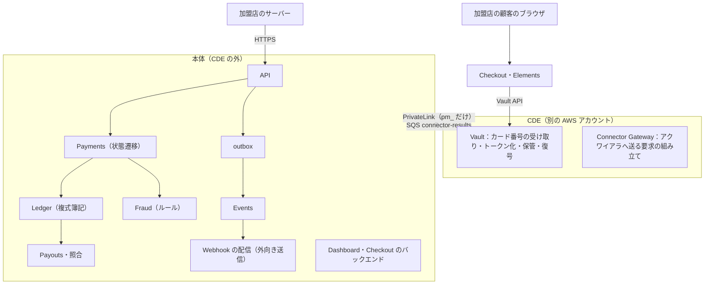

# Architecture: Stripe

全体像と横断的な方針。領域ごとの設計は、同じディレクトリの各ファイルにある。用語は[前提知識の資料](https://shoito.github.io/rebuilds/systems/stripe/docs/primer/index.html#glossary)の用語集にある。

| ファイル | 領域 |
| --- | --- |
| [api.md](api.md) | 公開 API：リソース、バージョン、冪等、ページング、エラー、SDK、テスト環境 |
| [auth-and-keys.md](auth-and-keys.md) | 加盟店のアカウント、ダッシュボードのログイン、API キー、権限 |
| [payments.md](payments.md) | PaymentIntent の状態遷移、オーソリ・キャプチャ・取り消し、返金、3D セキュア |
| [payment-methods.md](payment-methods.md) | 決済手段（カード、コンビニ払い、銀行振込）と、決済代行・アクワイアラのコネクタ |
| [disputes.md](disputes.md) | チャージバック、証拠の提出、結果の反映 |
| [ledger.md](ledger.md) | 複式簿記の台帳、残高、手数料、通貨 |
| [payouts-and-reconciliation.md](payouts-and-reconciliation.md) | 入金（Payout）、精算ファイルとの照合、会計のレポート |
| [card-vault.md](card-vault.md) | カード情報の保管とトークン化、CDE（カード情報を扱う領域） |
| [fraud.md](fraud.md) | ルールによる不正検知、3D セキュアの要否の判断 |
| [merchant-onboarding.md](merchant-onboarding.md) | 加盟店の審査、本人確認、リスクの見直し |
| [events-and-webhooks.md](events-and-webhooks.md) | Event、Webhook の配信と署名 |
| [checkout.md](checkout.md) | ホスト型の決済ページと、埋め込み型の入力部品 |
| [dashboard.md](dashboard.md) | 加盟店向けのダッシュボード |
| [security.md](security.md) | 脅威モデル、PCI DSS の統制、暗号化、監査ログ、データのライフサイクル |
| [data-model.md](data-model.md) | データモデルの正本：規約、置き場所、ER 図、テーブルの定義（[data-model/](data-model/) に領域ごと） |
| [infrastructure.md](infrastructure.md) | AWS の構成、アカウント、ネットワーク、冗長化、災害復旧 |
| [observability.md](observability.md) | ログ、メトリクス、トレース、SLO |
| [capacity.md](capacity.md) | 負荷のモデル、部品ごとの必要量、パラメーター |
| [delivery.md](delivery.md) | CI/CD、リリース、フィーチャーフラグ |
| [rate-limiting.md](rate-limiting.md) | レート制限と同時実行の制限 |
| [design-log.md](design-log.md) | 設計の工程ごとの決定の記録（経緯） |

## 1. 全体構成

次の図は、CDE と本体の境界と、主なコンポーネントのつながりを示す。

| コンポーネント | 責務 |
| --- | --- |
| API | 認証（API キー）、冪等、バージョンの変換、入力の検証、レート制限 |
| Payments | PaymentIntent・Refund の状態遷移。コネクタへの要求と結果の反映 |
| Ledger | すべてのお金の動きを、借方と貸方が一致する仕訳として追記する。残高はここから求める |
| Vault（CDE） | vault-ingest がカード番号を受け取って暗号化・保管し、vault-core が本体の要求で `pm_` に紐づける。復号は Connector Gateway だけ（[card-vault.md](card-vault.md)） |
| Connector Gateway（CDE） | 決済代行・アクワイアラごとの差を吸収する。カード番号を扱うので CDE に置く |
| Fraud | 決済の前にルールで判定し、3D セキュアの要否を決める |
| Payouts・照合 | 加盟店への入金と、決済代行の精算ファイル・銀行の明細との照合 |
| Events・Webhook | 状態の変化を Event として記録し、加盟店の URL へ署名付きで配る |

原則は 3 つ。

- **カード番号は CDE の外に出さない。** 本体はトークンだけを扱い、PCI DSS の対象を CDE に閉じ込める（[ADR-0005](../decisions/0005-pci-scope-segmentation.md)）。
- **お金の正本は台帳。** 残高・入金額・手数料は、台帳の仕訳から求める。状態のテーブルの数値を正としない（[ADR-0003](../decisions/0003-double-entry-ledger.md)）。
- **すべての書き込みは冪等。** 加盟店の再送、内部の再試行、コネクタの再送のどれでも、お金は 1 回しか動かない（[ADR-0004](../decisions/0004-idempotency.md)）。

### 主要な流れ

- **決済の確定（confirm）**：試行を記録してから振り分け・3D セキュア・オーソリへ進み、結果の反映・仕訳・Event を 1 トランザクションで書く（[payments.md](payments.md) の 4 節）
- **結果不明の回復**：オーソリの結果が分からない試行を `unknown` にし、照会を繰り返して、見つからなければ取り消しを送り、どちらもできなければ `processing` のまま待つ（[payments.md](payments.md) の 7 節）
- **決済から入金までの仕訳**：1 件のカードの決済が確定してから、加盟店への入金と決済代行からの精算の着金までに書く仕訳を、時刻の順に示す（[ledger.md](ledger.md) の 2.3 節）

## 2. 規模の段階

| 段階 | 決済の確定（ピーク） | 加盟店 | 構成 |
| --- | --- | --- | --- |
| S1（MVP） | 500 件/秒 | 1 万 | 1 リージョン（東京）・3 AZ。Aurora の writer 1 台＋reader。CDE は東京の別アカウント（cde-live・cde-test）。大阪にウォームスタンバイ（ADR-0030） |
| S2 | 5,000 件/秒 | 10 万 | 台帳の書き込みを加盟店のハッシュで分割（シャード）する。Webhook の配信を独立したクラスタにする |
| S3 | 50,000 件/秒（年末商戦の急増を含む） | 100 万 | セル構成。大阪と東京の両方で決済を受ける。大口の加盟店に専用のセル |

## 3. 非機能要件

| ID | 項目 | S1 の目標 | 備考 |
| --- | --- | --- | --- |
| NFR-001 | 決済の API の可用性 | 月間 99.99% | S3 で 99.995% |
| NFR-002 | API の処理時間（コネクタの待ちを除く） | p99 300ms 以内 | コネクタの応答時間は別に計測する |
| NFR-003 | 耐久性 | 成功を返した決済・返金・入金・仕訳は失わない | |
| NFR-004 | 冪等性 | 同じキーの要求は、24 時間のあいだ最初の結果を返す | 本家と同じ |
| NFR-005 | 台帳の正しさ | すべての仕訳で借方と貸方が一致する。精算との不一致は T+2 営業日までに 0 件 | |
| NFR-006 | Webhook の配信 | 最初の配信の p95 10 秒以内。失敗は 3 日間、指数的に再試行する | 本家に寄せる |
| NFR-007 | 復旧（AZ の障害） | RPO 0、RTO 5 分以内 | |
| NFR-008 | 復旧（リージョンの障害） | RPO 1 分以内（失った範囲はコネクタの記録で照合して回復）、RTO 1 時間以内 | |
| NFR-009 | テナント分離 | 他の加盟店のデータが見える事象は 0 件 | |
| NFR-010 | PCI DSS | v4.0.1 のサービスプロバイダー レベル 1 の要件を満たす設計 | 監査は別途 |

## 4. 技術スタック

| 層 | 選定 | 理由 |
| --- | --- | --- |
| 言語 | TypeScript（API・サービス・Web） | Slack と同じ。型で API の契約と金額の型を守る（[ADR-0001](../decisions/0001-platform-and-stack.md)） |
| 金額 | 通貨ごとの最小単位の整数（`bigint`）と、ISO 4217 の通貨コード | 浮動小数点を使わない。JPY は小数なし |
| API | Hono＋Zod。公開 API は `@hono/zod-openapi` で OpenAPI を出す | |
| DB | Aurora PostgreSQL 18。台帳は追記のみのテーブルと制約で守る | |
| 非同期 | transactional outbox → SQS | Slack と同じ |
| CDE | 別の AWS アカウント（cde-live・cde-test）。暗号鍵は KMS（CDE 専用の鍵）。必要に応じて AWS Payment Cryptography | [ADR-0005](../decisions/0005-pci-scope-segmentation.md)、[ADR-0019](../decisions/0019-vault-encryption-and-key-hierarchy.md)、[ADR-0029](../decisions/0029-multi-account-and-cde-layout.md) |
| 実行基盤 | AWS（ECS Fargate、Aurora、SQS、S3、CloudFront） | [ADR-0001](../decisions/0001-platform-and-stack.md) |
| IaC | Terraform | Slack と同じ |
| 可観測性 | OpenTelemetry（ADOT）→ AMP、X-Ray、CloudWatch Logs | Slack と同じ |

## 5. 主な決定

| ADR | 決定 |
| --- | --- |
| [0001](../decisions/0001-platform-and-stack.md) | 実行基盤と技術は Slack の決定を引き継ぐ。金額は最小単位の整数で扱う |
| [0002](../decisions/0002-account-tenancy.md) | 加盟店のアカウントをテナントにし、共有スキーマと RLS で分ける。テスト環境と本番環境をデータで分ける |
| [0003](../decisions/0003-double-entry-ledger.md) | お金の正本は、追記のみの複式簿記の台帳 |
| [0004](../decisions/0004-idempotency.md) | すべての書き込みを冪等にする |
| [0005](../decisions/0005-pci-scope-segmentation.md) | カード情報は CDE（別の AWS アカウント）に閉じ込め、本体はトークンだけを扱う |
| [0006](../decisions/0006-api-shape.md) | 公開 API は本家 v1 のリソースの形に寄せ、本文は JSON。見出しは `<Brand>-` にする |
| [0007](../decisions/0007-date-based-api-versions.md) | API のバージョンは日付で持ち、アカウントに固定し、変更モジュールで古いバージョンの形を保つ |
| [0008](../decisions/0008-api-keys-and-dashboard-access.md) | API キーは本家と同じ 3 種類（接頭辞は `<brand>_`）。ダッシュボードは Better Auth と必須の MFA |
| [0009](../decisions/0009-rate-limiting.md) | レート制限は本家の単位と値に寄せ、Slack の層と GCRA で行う |
| [0010](../decisions/0010-payment-intent-state-machine.md) | PaymentIntent を唯一の決済オブジェクトにし、遷移を 1 つの遷移関数に集める |
| [0011](../decisions/0011-connector-abstraction-and-unknown-outcome.md) | コネクタを共通の操作と能力で抽象し、結果不明は照会と取り消しで確定させる |
| [0012](../decisions/0012-3ds-via-connector.md) | 3D セキュアはコネクタの 3DS Server を使い、日本発行のカードの CIT では常に要求する |
| [0013](../decisions/0013-japan-async-payment-methods.md) | コンビニ払いと銀行振込は `requires_action` で待ち、銀行振込は顧客の現金残高を経由する |
| [0014](../decisions/0014-connector-inbox.md) | コネクタからの通知は受信箱に記録してから、重複と順序を解決して反映する |
| [0015](../decisions/0015-chart-of-accounts-and-balance-transactions.md) | 保留中・利用可能を別の口座にし、BalanceTransaction を仕訳の射影にする |
| [0016](../decisions/0016-hot-accounts-and-ledger-sharding.md) | 加盟店の残高の集計をスロットに分ける。S2 は加盟店のハッシュで台帳を分ける |
| [0017](../decisions/0017-three-way-reconciliation-with-suspense.md) | 台帳・精算・銀行の明細を 3 者で照合し、説明のつかないお金は仮勘定に置く |
| [0018](../decisions/0018-payout-execution-via-banking-partner.md) | 入金は作成の時点で残高から引き、提携銀行の API（予備に全銀のファイル）で振り込む |
| [0019](../decisions/0019-vault-encryption-and-key-hierarchy.md) | カード番号は CDE 専用の KMS の鍵でエンベロープ暗号化し、鍵の操作を役割で分ける |
| [0020](../decisions/0020-cde-access-model.md) | CDE へのアクセスは、人は JIT だけ。AI エージェントには与えない |
| [0021](../decisions/0021-fraud-rules-engine.md) | 不正検知は Radar に寄せたルールを決済の経路の中で同期に評価する |
| [0022](../decisions/0022-merchant-onboarding-and-kyc.md) | 加盟店の審査は自前のステートマシンで持ち、確認・照合は外部の提供者を使う |
| [0023](../decisions/0023-audit-log.md) | 監査ログは Slack の方式を引き継ぎ、CDE の記録は別の系統で log-archive へ送る |
| [0024](../decisions/0024-data-retention-and-deletion.md) | 財務の記録は法定の期間まで残し、カード番号と個人情報は用が済んだら消す |
| [0025](../decisions/0025-webhook-signing-and-isolated-delivery.md) | Webhook は本家の形式で署名し（`<Brand>-Signature`）、固定 IP の egress VPC から送る |
| [0026](../decisions/0026-snapshot-event-model.md) | Event は作成時点のスナップショットとして不変に保存する（MVP は snapshot だけ） |
| [0027](../decisions/0027-checkout-and-elements-isolation.md) | カード入力は CDE の側のオリジンが配る iframe で受け、loader も CDE の変更管理で配る |
| [0028](../decisions/0028-dashboard-architecture.md) | ダッシュボードは公開 API を呼ぶ SPA にし、第三者のスクリプトを読み込まない |
| [0029](../decisions/0029-multi-account-and-cde-layout.md) | AWS アカウントを PCI DSS の範囲で分け、CDE は cde-live と cde-test。本体→CDE は PrivateLink、CDE→本体は SQS だけ |
| [0030](../decisions/0030-payments-disaster-recovery.md) | S1 から大阪にウォームスタンバイを持ち、失った決済はコネクタへの照会で回復する |
| [0031](../decisions/0031-active-active-cells.md) | S3 で加盟店をセルに固定し、東京・大阪の active-active にする |
| [0032](../decisions/0032-release-safety-for-money-moving-code.md) | お金を動かすコードは、影の実行で比べてから加盟店単位のカナリアで広げる |
| [0033](../decisions/0033-cde-pipeline-and-change-control.md) | CDE のコードは `cde/` に置き、ビルド・デプロイの経路と承認を本体から分ける |
| [0034](../decisions/0034-card-data-migration.md) | 他の事業者とのカード番号の移行は、cde-live の SFTP でのファイルの受け渡しで行う（proposed。提供の可否は PM、法令は L9） |
| [0035](../decisions/0035-operator-access-outside-cde.md) | CDE の外も DB・シェルは JIT。運用者の画面は役割で絞り、閲覧を加盟店に見せる。なりすましの機能を作らない（proposed） |

リポジトリ共通の決定（開発プロセス、ブランチモデル、本家の名前・接頭辞を使わない規則の [ADR-0006](../../../../docs/decisions/0006-brand-neutral-identifiers.md)）は、ルートの [docs/decisions/](../../../../docs/decisions/) にある。

## 6. リスクと未解決事項

- **コネクタの先の障害と結果不明**：決済の成否は決済代行・アクワイアラに依存する。タイムアウトした要求の結果が分からない状態は、`processing` で待ち、照会と取り消しで確定させる（[ADR-0011](../decisions/0011-connector-abstraction-and-unknown-outcome.md)、[payments.md](payments.md) の 7 節）。照会 API を持たない接続先は本番で使わない。
- **台帳の書き込みのホットスポット**：大口の加盟店の残高の口座はスロットで分け、プラットフォームの口座は集計しない（[ADR-0016](../decisions/0016-hot-accounts-and-ledger-sharding.md)）。スロットで足りるかは E10 の負荷試験で確かめる。
- **エラーにならないお金の誤り**：手数料・仕訳の規則の誤りは、照合や Payout で後から見つかる。影の実行と加盟店単位のカナリア、お金の不変条件のガードで防ぐ（[ADR-0032](../decisions/0032-release-safety-for-money-moving-code.md)）。
- **カード番号の CDE の外への漏れ**：iframe・Vault・ログの多重の防御と、PAN の形の走査で守る（[card-vault.md](card-vault.md)、[observability.md](observability.md) の 4.2 節）。PrivateLink の扱い、本体に指紋と BIN・下 4 桁を置く扱いは、E10 の QSA の事前相談で確かめる。
- **リージョンの障害で失う書き込み**：Global Database の複製の遅延ぶんを、コネクタへの照会で回復する（[ADR-0030](../decisions/0030-payments-disaster-recovery.md)）。接続先の重複の扱いと照会 API に依存するので、接続先の選定（E3）で確かめる。
- **接続先への依存**：最初のカードのコネクタ、コンビニ収納代行、提携銀行が未定。30 日のオーソリ、3DS Server、照会の整合性の時間、精算のサイクル、振込の API の仕様は、選定の後に確かめる。
- **法令**：資金決済法の上の位置づけなど、法務の確認待ちの事項がある（[intent.md](../intent.md) の「法務の確認待ち」）。結論が出るまで、そこに挙げた Epic の spec を承認しない。

### 残る未解決事項

持ち越し（計測・PoC・接続先の選定で決めるもの）：

| 項目 | いつ・どう決めるか |
| --- | --- |
| 最初のカードのコネクタ（30 日のオーソリ、3DS Server と iframe、照会 API と整合性の時間、重複の扱い、TR-31 の要否、精算のサイクル、Dispute の通知の手段） | E3 の着手前に選ぶ。ADR-0011・0012・0030 の前提を確かめる |
| コンビニ収納代行（速報・確報、取り消し） | E8 の着手前に選ぶ |
| 提携銀行（振込の API の件数・締め・重複の識別子・名義照会、バーチャル口座の数と費用、口座振替での回収） | E4（入金）・E8（銀行振込）の着手前に選ぶ。法務の確認の結果にも依る |
| 外部の不正検知サービス、eKYC・反社・制裁の照合の提供者 | E9、E2 で選ぶ |
| 同時実行の上限、スロットの数、KMS の上限、コネクタの応答時間の実測 | E10 の負荷試験（k6） |
| QSA の選定、PrivateLink・指紋の扱い、附属書 A1 | E10 の QSA の事前相談 |
| JIT の仕組み（AWS TEAM など） | E10 の PoC（ADR-0020） |
| 検索 API の索引、読み取りの割当を止めるか | E11 の PoC と計測 |
| 本家の振る舞いで未確認のもの（手数料の丸め、`cancellation_reason`、アクセスポリシーの `code`、Webhook の自動の無効化の条件など） | 各文書の「持ち越し」に書いた Epic の Story で、本家のサンドボックスを観察して揃える |

決めた経緯（工程ごとの「決定」の記録）は [design-log.md](design-log.md) にある。
